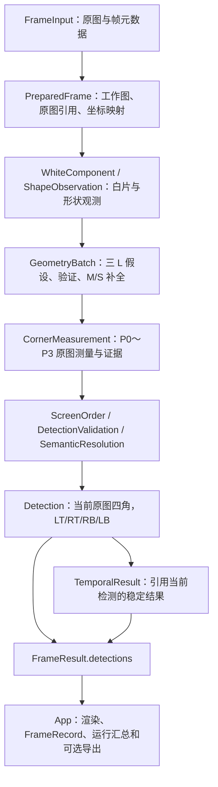

# MARK 检测器数据流与接口说明

本文对应 `feat/pnp` 当前代码。文中 `app/`、`lib/`、`include/`、`config/` 均相对于 `src/tushenghao/`；调用位置使用当前源码行号。只说明数据来源、接口契约和消费关系，数学实现以函数位置指引。

配置简称：**D** = [config/detector.yaml](../config/detector.yaml)，**DD** = [config/detector_debug.yaml](../config/detector_debug.yaml)，**DV** = [config/detector_verification.yaml](../config/detector_verification.yaml)。下文算法参数表均来自 **D**，且这些算法字段在 **DD/DV** 中数值相同；未写入 YAML 而由 C++ 默认值补齐的应用参数会单独标明。

## 1. 系统概述

输入是一张非空、二维、`CV_8UC3` 的原图（BGR8），以及帧号、微秒时间戳和时间源。公共入口是 `Detector::process(const FrameInput&)`，输出是 `FrameResult`：当前帧状态、当前原始检测 `detections`、引用当前检测的稳定结果 `tracks`、可选显示文字状态和诊断字符串。

一句话架构：**原图缩放形成工作图 → 白片观测 → 三 L 几何假设与验证 → M/S 对应补全 → 回到原图测量四角 → 排序、证据校验与语义归并 → 发布当前检测 → 时序稳定 → 应用层显示和记录。**

坐标域不能混用：

| 坐标域 | 装在哪里 | 谁产生、谁使用 |
| --- | --- | --- |
| 模型坐标 | `GeometryPolygon.vertices/anchor` | 几何 YAML 加载；用于生成对应、仿射投影和绑定物理角。当前模型外角为 `(0,0)、(80,0)、(80,80)、(0,80)`，这些数值不自动代表真实物理长度。 |
| 工作图像素 | `WhiteComponent.contour_`、形状多边形、`GeometryHypothesis.affine_transform_` 的输出 | 工作图分割和几何模块产生；用于搜索与验证。当前工作尺寸为 `960×720`。 |
| 原图像素 | `CornerEvidence`、`CornerMeasurement`、`Detection.corners/bbox` | 原图轮廓取证与角点拟合产生；最终检测、稳定、渲染使用。原图尺寸由每次输入决定。 |

`PreparedFrame.scale_x_ = 工作宽/原图宽`，`scale_y_ = 工作高/原图高`。`workToOriginal` 使用像素中心映射 `((x+0.5)/scale_x_-0.5, (y+0.5)/scale_y_-0.5)`。这个映射只把观测/模型投影放到原图搜索域；最终角点来自当前原图的两条观测直线交点。几何阶段的 `2×3` 仿射矩阵只表达模型到工作图的二维关系。

## 2. 四点语义契约

### 2.1 四个固定的物理角

`P0～P3` 指 MARK 自身的角，不随它在屏幕中的旋转改变。来源是 [config/marker_geometry.yaml](../config/marker_geometry.yaml) 与 [lib/corners/corner_resolver.cpp](../lib/corners/corner_resolver.cpp):87 的绑定表；边 `ei` 表示 `vi → v(i+1)`，末边回到 `v0`。

| 物理角 | 对应模型白片 | 顶点、模型坐标 | 构成该角的两条外边 |
| --- | --- | --- | --- |
| `P0` | `L0`，模型左上完整 L | `v0 = (0,0)` | `e5/e0`，外侧左边与上边 |
| `P1` | `M1`，模型右上分段结构中的 M | `v1 = (80,0)` | `e0/e1`，M 的外侧上边与右边 |
| `P2` | `L2`，模型右下完整 L | `v0 = (80,80)` | `e5/e0`，外侧右边与下边 |
| `P3` | `L3`，模型左下完整 L | `v0 = (0,80)` | `e5/e0`，外侧左边与下边 |

三 L 的凹点锚点用于拟合父变换，和上表的外侧凸角是不同的点。`S1a/S1b` 参与六片一对一解释，不单独提供一个输出角。`P1` 必须由实际 `M1` 外边测量，不能用缺口、S 片中心或模型预测角代替。

### 2.2 屏幕顺序与方向映射

`CornerMeasurement.physical_corners_[0..3]` 固定是 `P0/P1/P2/P3`；`Detection.corners[0..3]` 固定是 **LT/RT/RB/LB**，在图像坐标（x 向右、y 向下）形成顺时针环。

屏幕排序由 [lib/corners/screen_order.cpp](../lib/corners/screen_order.cpp):509 的 `orderCycleCore` 决定：检查有效凸四边形、枚举四个循环起点、归一化后选最小方框贴合误差；能量平局用完整点序的 `(y,x)` 字典序选定，并保留平局标记。屏幕标签不能当作物理编号。

`Attributes.orientation` 是可选的“**物理角 → 屏幕数组下标**”排列。例如 `[1,2,3,0]` 表示 P0 在 RT 槽、P1 在 RB 槽、P2 在 LB 槽、P3 在 LT 槽。存在该属性时，物理角坐标按 `corners[orientation[p]]` 取；为空时，不能从屏幕位置补出物理身份。

### 2.3 严格输出规则与当前实现差异

本任务要求的严格语义契约是：**四角可信 + 方向可信 + 几何合理才输出，否则 empty**。`empty` 指当前检测集合为空，不是四个零坐标，也不是沿用上一帧四角。四角可信要求每角都有当前原图独立边段和转折证据；方向可信要求物理映射唯一且搜索未截断；几何合理要求有限、互异、严格凸、无自交、在原图范围内，并通过证据复算。

**当前代码未完全执行其中的“方向可信才输出”门控。** `decode_stage.cpp:132` 只用 `geometry_consistent_` 拦截；随后 `publishFloatDetection(..., orientation_unique_, ...)` 在方向不唯一时仍可发布四点，把 `attributes.orientation` 留空。`search_truncated=true` 也只是令方向不唯一。因而，当前 `DETECTED` 或非空 `detections` 证明不了方向已知；需要严格物理语义的下游必须同时检查 `orientation.has_value()`。这是已确认的实现差异，本文件没有修改检测行为。

当前生产路径对缺角、原图来源不唯一、几何冲突、无法排除的失败竞争候选或 float 发布失败，保留空检测；`NOT_READY`、`INVALID_INPUT` 另行表达配置未就绪和输入非法。稳定层在当前检测为空时也返回空 `tracks`，不能用历史几何补检测。

## 3. 流水线阶段详解

以下按 `marker_app` 的实际 Full 流程排列。主入口 [app/main.cpp](../app/main.cpp):112 调用 `runOffline(..., ExecutionScope::Full, ...)`；逐帧入口是 [app/offline_runner.cpp](../app/offline_runner.cpp):257 的 `consume_input` 和 :293 的 `process_frame`，:324 调用公共 `Detector::process`。后续算法调用集中于 [lib/pipeline/detector.cpp](../lib/pipeline/detector.cpp):141 的 `runDecodePipeline` 与 :142 的 `finalizeDecodedFrame`。

计时的 `Detect` 槽覆盖白片提取到 M/S 补全；`Decode` 槽覆盖原图四角到当前检测发布；`Stabilize` 槽覆盖时序和结果装配。它们不是三个只调用一次的底层函数。

### 3.1 启动准备（每次运行一次）

- **实现文件**：[lib/config/config.hpp](../lib/config/config.hpp)、[config.cpp](../lib/config/config.cpp)、[app_config.hpp](../lib/config/app_config.hpp)、[observability_config.hpp](../lib/config/observability_config.hpp)；[include/mark/detector_config.hpp](../include/mark/detector_config.hpp)、[detector.hpp](../include/mark/detector.hpp)；[lib/core/marker_geometry.hpp](../lib/core/marker_geometry.hpp)、[marker_geometry.cpp](../lib/core/marker_geometry.cpp)；`lib/pipeline/detector.cpp`；`app/main.cpp`、[offline_runner.hpp](../app/offline_runner.hpp)/`offline_runner.cpp`。
- **调用位置**：`main.cpp:75` 加载配置；`offline_runner.cpp:199` 的 `start_input` 打开视频，:226 创建 Detector；Detector 构造函数复验配置并加载模型。
- **输入**：配置 YAML 路径、视频路径、运行目录；`AppConfig.detector_config` 是算法配置，`diagnostics/render/offline` 是应用观测和运行配置。
- **输出**：已校验的 `DetectorConfig`、已加载的 `MarkerGeometry.polygons`（六片图纸），以及视频 FPS/预期帧数和 Detector 实例。几何文件相对路径按检测配置所在目录解析。
- **关键参数（D）**：

| YAML 参数 | 当前值 | 消费关系 |
| --- | --- | --- |
| `schema_version` | `1` | 配置格式校验 |
| `input.pixel_format` | `BGR8` | 公共输入格式约束 |
| `input.timestamp_unit` | `us` | 时间戳单位约束 |
| `marker_geometry_path` | `"marker_geometry.yaml"` | 解析为 `config/marker_geometry.yaml` 并加载 |
| `detector.mode` | `Skeleton` | 当前唯一合法枚举值；当前 process 实际执行完整流水线 |

### 3.2 读取、包装当前帧并准备诊断请求

- **实现文件**：`app/offline_runner.cpp/.hpp`；[include/mark/detector_types.hpp](../include/mark/detector_types.hpp)；[lib/pipeline/detector_diagnostics_access.hpp](../lib/pipeline/detector_diagnostics_access.hpp)、`lib/pipeline/detector.cpp`。
- **调用位置**：`offline_runner.cpp:262` 的 `capture_.read(image_)`；:299 构造 `FrameInput`；:301 构造 `DiagnosticsRequest`；:319 调用 `prepare`。
- **输入**：视频解码出的 `cv::Mat`、从 0 开始的 `id_`、源视频 `fps_`。
- **输出**：`FrameInput.image` 是当前原图；`frame_id` 是成功读取序号；`timestamp_us = llround(frame_id×1e6/fps)`；`time_source=Unknown`。`DiagnosticsRequest` 记录本次运行 ID、范围、计时和是否采样详情。时间戳是视频 FPS 推算值，不是捕获时钟实测。
- **关键参数**：`input.pixel_format=BGR8`、`input.timestamp_unit=us`、`debug.timing_enabled=1`（D/DD/DV）。`debug.level/detail_first/detail_last/detail_interval` 的配置和值见 3.16。视频路径来自 `--video`，FPS 来自视频元数据，均不是检测 YAML 参数。

### 3.3 公共入口检查序列、尺寸和必需预算

- **实现文件**：`lib/pipeline/detector.cpp`；[frame_sequence.hpp](../lib/pipeline/frame_sequence.hpp)/[frame_sequence.cpp](../lib/pipeline/frame_sequence.cpp)；[lib/core/frame_stamp.hpp](../lib/core/frame_stamp.hpp)。
- **调用位置**：`offline_runner.cpp:324 → detector.cpp:54`；:107 校验输入，:118 检查尺寸，:123 检查预算。
- **输入**：`FrameInput` 和实例保存的上一合法 `FrameStamp`、原图尺寸。
- **输出**：合法输入继续；格式非法、时间戳负值、时间源非法、帧号不严格增长或时间戳回退，返回 `FrameResult.status=INVALID_INPUT` 并清历史。时间戳相等允许进入，后续平滑会按 `ZERO_DT` 回退。尺寸变化清历史后处理当前帧；同尺寸换源/重播由调用方显式 `reset(InputChanged)`。
- **关键参数**：必需 `detector.assignment_completion`（3.9），`detector.corner.observation`（3.10），`temporal.correspondence_uncertainty_px=2.0`、`temporal.max_smoothing_deviation_px=2.0`（D）。任一预算缺失返回 `NOT_READY/PIPELINE_BUDGET_MISSING`；公共入口即使关闭平滑，也不跳过这四项存在性检查。

### 3.4 预处理：保存原图，生成工作图

- **实现文件**：[lib/preprocess/preprocess.hpp](../lib/preprocess/preprocess.hpp)/[preprocess.cpp](../lib/preprocess/preprocess.cpp)；[lib/core/prepared_frame.hpp](../lib/core/prepared_frame.hpp)。
- **调用位置**：`detector.cpp:141 → decode_stage.cpp:224` 的 `preprocess(input, config.preprocess)`。
- **输入**：`FrameInput.image/frame_id/timestamp_us`、`PreprocessConfig`。
- **输出**：`PreparedFrame.image_` 为缩放后的 BGR8；`original_image_` 为只读原图浅引用；`scale_x_/scale_y_` 保存映射；`original_white_threshold_` 保存原图取证阈值；`components_` 此时尚未填充。
- **关键参数（D）**：

| YAML 参数 | 当前值 | 用途 |
| --- | --- | --- |
| `preprocess.work_width` | `960` | 工作图宽 |
| `preprocess.work_height` | `720` | 工作图高 |
| `preprocess.threshold` | `200` | 存入 `original_white_threshold_`，供原图分割使用 |

此函数只 resize，不在这里二值化工作图；头文件中“threshold 生成工作二值图”的旧注释与实现不同。

### 3.5 工作图白片提取

- **实现文件**：[lib/geometry/geometry_observation.hpp](../lib/geometry/geometry_observation.hpp)/[geometry_observation.cpp](../lib/geometry/geometry_observation.cpp)；[lib/core/geometry_types.hpp](../lib/core/geometry_types.hpp)。
- **调用位置**：`decode_stage.cpp:235` 的 `extractWhiteComponents`；:236 写入 `prepared.components_`。
- **输入**：`PreparedFrame.image_`（工作图）和 `GeometryConfig`。
- **输出**：`vector<WhiteComponent>`，每片保存帧内 ID、工作图轮廓、面积、外接框和碰边标志。灰度阈值分割使用 `RETR_EXTERNAL/CHAIN_APPROX_SIMPLE`；这里尚未赋予模型片身份。
- **关键参数（D）**：`geometry.white_threshold=200`；`geometry.min_area=0.0`（工作图像素面积下限）。本阶段没有使用 `preprocess.threshold`。

### 3.6 形状观察与 L 拓扑候选

- **实现文件**：`lib/geometry/geometry_observation.cpp/.hpp`；[geometry_l_topology.hpp](../lib/geometry/geometry_l_topology.hpp)/[geometry_l_topology.cpp](../lib/geometry/geometry_l_topology.cpp)；[assignment_match_metrics.hpp](../lib/geometry/assignment_match_metrics.hpp)。
- **调用位置**：`decode_stage.cpp:237` 的 `observeShapes`，其中调用 `observeLTopologies`。
- **输入**：`WhiteComponent.contour_/component_id_`。
- **输出**：`vector<ShapeObservation>`：来源 ID、简化多边形、凸凹转折、候选类别和多个 `LTopologyCandidate`。合法 L 候选保存真实六边轮廓和唯一凹点；不能仅凭顶点数把短 M 当 L。`supported_classes_` 是搜索候选类别，不是公开 `Detection.category`。
- **关键参数（D）**：`geometry.approximation_epsilon=2.0` 工作图像素。L 观察固定尝试其 `1、0.5、0.75、1.25、1.5、2` 倍，比例是源码规则，没有另设 YAML 开关。`simplification_error_` 当前写为 `0.0` 占位。

### 3.7 生成三 L 父假设

- **实现文件**：[lib/geometry/geometry_matcher.hpp](../lib/geometry/geometry_matcher.hpp)/[geometry_matcher.cpp](../lib/geometry/geometry_matcher.cpp)；[geometry_anchor_evidence.hpp](../lib/geometry/geometry_anchor_evidence.hpp)/[geometry_anchor_evidence.cpp](../lib/geometry/geometry_anchor_evidence.cpp)。
- **调用位置**：`decode_stage.cpp:238` 的 `generateGeometryHypotheses`。
- **输入**：`ShapeObservation.source_component_id_/supported_classes_/l_topology_candidates_`；`MarkerGeometry.polygons` 的三 L 锚点。
- **输出**：`GeometryBatch.hypotheses_`。每个假设包含三个 `ComponentAssignment`、模型到工作图的仿射矩阵、未计算残差 `-1`、待验证完整性和来源证据。组合枚举三观测 L 对三模型 L 的六种排列，再通过 `collect_observed_l_anchors/fitAnchorTuple` 枚举合法实际凹点元组。生产入口不直接采用旧 `fitModelToImageAffine` 的首凹点捷径。
- **关键参数（D）**：`geometry.max_hypothesis_count=1000`，约束对应组合及实际锚点元组搜索；无效仿射尝试也计入元组预算。仍有未检查候选时触顶，设置 `resource_truncated_=true`。

### 3.8 验证父几何假设

- **实现文件**：[lib/geometry/geometry_validation.hpp](../lib/geometry/geometry_validation.hpp)/[geometry_validation.cpp](../lib/geometry/geometry_validation.cpp)。
- **调用位置**：`decode_stage.cpp:251` 的 `validateGeometryBatch`。
- **输入**：生成的 `GeometryBatch`、模型顶点、对应 `WhiteComponent.contour_/area_/touches_border_`。
- **输出**：新的 `GeometryBatch`；几何残差失败的假设删除，成功假设回填实测 `validation_residual_`。面积比异常或组件碰边标为 `CLEARLY_INCOMPLETE`，其余仍是 `PENDING_VALIDATION`；不选唯一父假设，保留搜索截断标志。
- **关键参数（D）**：`geometry.max_validation_residual=5.0` 工作图像素；`geometry.min_area_ratio=0.5`、`geometry.max_area_ratio=2.0`。残差是各已绑定部件“投影模型顶点到完整观测轮廓平均距离”的最大值，面积比是投影面积/观测面积。

### 3.9 M/S 一对一对应补全

- **实现文件**：[lib/geometry/geometry_assignment_completion.hpp](../lib/geometry/geometry_assignment_completion.hpp)/[geometry_assignment_completion.cpp](../lib/geometry/geometry_assignment_completion.cpp)；`assignment_match_metrics.hpp`。
- **调用位置**：`decode_stage.cpp:280` 的 `completeSegmentedAssignments`。
- **输入**：已验证的三 L 父假设、当前白片、六片模型和 `AssignmentCompletionConfig`。
- **输出**：`GeometryBatch.segmented_assignments_ready_=true`，以及绑定 `L0/L2/L3/M1/S1a/S1b` 的分支。用完整边界、凹凸拓扑、方向和相对面积验证 M/S；同一白片不能占两个身份。已有 M/S 绑定也复验；父仿射和三 L 残差不重新估计。ready 表示补全阶段已执行，不保证有分支。
- **关键参数（D，完整 YAML 路径前缀为 `detector.assignment_completion.`）**：

| 参数名 | 当前值 | 用途 |
| --- | --- | --- |
| `max_boundary_distance_work_px` | `9.5` | 完整观测边界与投影边界的采样距离上限 |
| `approximation_epsilon_work_px` | `3.0` | 拓扑简化上限 |
| `max_direction_diff_deg` | `30.0` | 对应边方向差上限 |
| `max_relative_area_error` | `0.045` | 以三 L 中位面积为参照的相对面积误差上限 |
| `boundary_sample_step_work_px` | `1.0` | 边界采样步长 |
| `max_candidates` | `128` | 每父、每缺片最多检查的候选白片数 |
| `max_expansions` | `4096` | 整批补全搜索的扩展上限 |
| `max_output_branches` | `64` | 整批输出分支上限 |

资源不足保留截断信息；没有实际 M/S 支持时输出空分支，不由预测坐标补白片。

### 3.10 对每个假设、每个物理角回查原图并拟合

- **实现文件**：[lib/pipeline/decode_stage.hpp](../lib/pipeline/decode_stage.hpp)/[decode_stage.cpp](../lib/pipeline/decode_stage.cpp)；[lib/corners/corner_resolver.hpp](../lib/corners/corner_resolver.hpp)/`corner_resolver.cpp`；[corner_observation.hpp](../lib/corners/corner_observation.hpp)/[corner_observation.cpp](../lib/corners/corner_observation.cpp)；[corner_edge_fit.hpp](../lib/corners/corner_edge_fit.hpp)/[corner_edge_fit.cpp](../lib/corners/corner_edge_fit.cpp)；[periodic_line_fit.hpp](../lib/corners/periodic_line_fit.hpp)/[periodic_line_fit.cpp](../lib/corners/periodic_line_fit.cpp)；[lib/core/corner_budget.hpp](../lib/core/corner_budget.hpp)。
- **调用位置**：`decode_stage.cpp:49` 建立本次 decode 的 `OriginalContourIndex`；:53 遍历假设，:85 调用 `resolveObservedCorners`。resolver 对 P0～P3 依次执行 `index.observe → 模型边投影到原图 → fitObservedEdgePair`，不是先量完所有轮廓再统一拟合。
- **输入**：`PreparedFrame.original_image_/original_white_threshold_/components_/scale_*`；`GeometryHypothesis.assignments_/affine_transform_`；物理角绑定和 `CornerConfig`。
- **输出**：成功为 `CornerResolution.measurement_`，内含原图 `P0～P3` 四点和四份 `CornerEvidence`；任一角失败，整个 measurement 为空并附原因。
- **关键函数与数据关系**：`OriginalContourIndex::prepare` 惰性做一次当前原图灰度、阈值、`RETR_EXTERNAL/CHAIN_APPROX_NONE` 完整轮廓；`observe` 按已确定的工作图组件做双向边界关联，恰好一个来源才接受，碰原图边界直接拒绝。索引只活过本次 decode，不跨帧。模型投影仅指定两条待寻找的有限边；真实连续支持弧通过 `fitFor/matches/pairGeometry/select` 得到交点，恢复顺序见 §5。
- **关键参数（D，原图像素，角度项为度）**：

| 完整 YAML 参数 | 当前值 | 消费关系 |
| --- | --- | --- |
| `preprocess.threshold` | `200` | 原图白色轮廓阈值 |
| `detector.corner.min_line_points` | `10` | 每条支持弧至少有这些不同像素点 |
| `detector.corner.max_line_fit_error` | `0.5` | 声明模型的平均垂距上限；周期模型按校正残差门控 |
| `detector.corner.min_intersection_angle_deg` | `5.0` | 两条拟合线交角下限 |
| `detector.corner.max_corner_error` | `4.131595359474918` | 交点到实测转折连接弧的距离上限 |
| `detector.corner.approximation_epsilon` | `1.0` | 原图候选端点简化精度 |
| `detector.corner.semantic_geometry_threshold` | `64.0` | 合格边对交点的平方距离冲突检查，单位 px² |
| `detector.corner.observation.max_edge_direction_diff_deg` | `3.0` | 拟合线与指定模型外边方向差上限 |
| `detector.corner.observation.max_edge_position_distance_px` | `9.0` | 原位置或后验位置到指定有限模型边的上限 |
| `detector.corner.observation.max_component_mapping_distance_px` | `4.5` | 工作轮廓映射与原图轮廓双向关联预算 |
| `detector.corner.observation.turn_trim_distance_px` | `2.0` | 候选端点邻域修剪距离 |
| `detector.corner.observation.max_turn_connection_length_px` | `13.5` | 两条支持弧沿原轮廓的转折连接长度上限 |
| `detector.corner.observation.max_support_extension_px` | `9.5` | 交点相对每条有限支持的延伸上限 |
| `detector.corner.observation.min_support_span_px` | `14.0` | 支持点沿拟合线的跨度下限 |

`detector.corner.local_search_margin_ratio=0.2`、`edge_point_distance_threshold=3.0`、`reject_truncated_corner=1`（D）仍被加载和配置校验，但当前 resolver/边对搜索没有读取它们。原图来源关联使用上表预算；截断拒绝是实际路径的强制检查，不能把该旧开关解读成可接受截断角。

### 3.11 四角屏幕排序

- **实现文件**：`lib/corners/screen_order.cpp`、[screen_order.hpp](../lib/corners/screen_order.hpp)、[corner_types.hpp](../lib/corners/corner_types.hpp)。
- **调用位置**：`decode_stage.cpp:102` 的 `orderScreenCorners`；resolver 返回前也用同一入口检查四角是否成有效环。
- **输入**：`CornerMeasurement.physical_corners_`（P0～P3，原图 double 坐标）。
- **输出**：`ScreenOrderResult.screen_order_`，包含 `screen_points_`（LT/RT/RB/LB）、`physical_to_screen_`（P → 屏幕下标）和 `screen_order_tie_`；失败时为空并附原因。
- **关键参数**：无排序 YAML 参数。`CornerConfig` 虽在签名中传入，排序核心明确不读取它；平局规则由源码固定。

### 3.12 四角证据与最终几何校验

- **实现文件**：[lib/corners/detection_validator.hpp](../lib/corners/detection_validator.hpp)/[detection_validator.cpp](../lib/corners/detection_validator.cpp)；[corner_evidence_validation.hpp](../lib/corners/corner_evidence_validation.hpp)/[corner_evidence_validation.cpp](../lib/corners/corner_evidence_validation.cpp)；`periodic_line_fit.cpp/.hpp`。
- **调用位置**：`decode_stage.cpp:93` 检查证据属于当前帧；:110 调用 `validateDetectionGeometry`，内部逐角调用 `validateCornerEvidence`。
- **输入**：`CornerMeasurement.physical_corners_/evidence_`、`ScreenOrder`、`frame.original_image_.size()`；这里传原图尺寸。
- **输出**：`DetectionValidation.valid_/rejection_reason_`，不另造角点。通过后才将 measurement 放入本帧待归并集合。
- **实际检查**：屏幕映射为 0～3 排列且与点一致；四角有限、严格凸、无退化/自交/出界；四个角同帧、来源组件互异；物理顶点/边绑定正确；支持和连接弧真实、连续、互不复用；从完整支持重建声明的直线模型，并复算两类残差、交点、支持延伸和转折误差。
- **关键参数（D）**：复用 3.10 的 `min_line_points=10`、`max_line_fit_error=0.5`、`min_intersection_angle_deg=5.0`、`max_corner_error=4.131595359474918`，以及 `observation.min_support_span_px=14.0`、`max_support_extension_px=9.5`、`max_turn_connection_length_px=13.5`。验证阶段不重新用模型投影生成点，也不把 raw 残差字段改成周期校正残差。

如果某个竞争假设取证失败而另一个成功，`decode_stage.cpp:122` 返回 `UNRESOLVED_COMPETING_GEOMETRY` 并保持检测为空；不能通过丢掉失败候选宣称剩余方向唯一。

### 3.13 多假设语义归并

- **实现文件**：[lib/corners/semantic_resolver.hpp](../lib/corners/semantic_resolver.hpp)/[semantic_resolver.cpp](../lib/corners/semantic_resolver.cpp)。
- **调用位置**：`decode_stage.cpp:132` 的 `resolveSemantics(measurements, search_truncated, config)`。
- **输入**：所有通过前述检查的 `CornerMeasurement` 和 `GeometryBatch.resource_truncated_` 传来的 `search_truncated`。
- **输出**：`SemanticResolution.geometry_consistent_`、`orientation_unique_`、`retained_measurements_`、`rejection_reason_`。先比较无标签循环四点集合；一致时选择四角 `evidence.error_` 总和最小的已有测量，残差平局按稳定来源 ID 选择，不平均点。再判断物理对应是否一致；截断搜索强制使方向不唯一。
- **关键参数（D）**：`detector.corner.semantic_geometry_threshold=64.0` px²，比较四对点平方距离之和，不是单角 64 像素误差。
- **失败传播**：没有测量或存在几何冲突时检测为空；方向不唯一的当前发布行为见 2.3。

### 3.14 float 发布当前 Detection

- **实现文件**：[lib/corners/detection_publication.hpp](../lib/corners/detection_publication.hpp)/[detection_publication.cpp](../lib/corners/detection_publication.cpp)；`screen_order.cpp/.hpp`。
- **调用位置**：`decode_stage.cpp:147` 的 `publishFloatDetection`；:159 提交整个 `pending` 集合。
- **输入**：归并保留的 `CornerMeasurement`、`orientation_unique_`、原图尺寸。
- **输出**：`optional<Detection>`；先把物理 double 点转 float，再按舍入后的点重新排序，得到 `corners` 和该四角的 `bbox`。只有方向唯一才填 `attributes.orientation`。`category=Unknown`、`confidence/marker_code=nullopt`、`quality_flags=0`。
- **关键参数**：无新增 YAML 数值；排序不读 `CornerConfig`。float 后的有限性、界内、互异和严格凸性是表示检查，不添加误差预算。任一发布失败，全批当前检测不提交；成功非空时 `DecodeStageResult.status=DETECTED`，否则保持 `NOT_DETECTED`。

### 3.15 当前目标选择、平滑及 FrameResult 装配

- **实现文件**：[lib/pipeline/stabilize_stage.hpp](../lib/pipeline/stabilize_stage.hpp)/[stabilize_stage.cpp](../lib/pipeline/stabilize_stage.cpp)；[temporal_stabilizer.hpp](../lib/pipeline/temporal_stabilizer.hpp)/[temporal_stabilizer.cpp](../lib/pipeline/temporal_stabilizer.cpp)；[temporal_geometry.hpp](../lib/pipeline/temporal_geometry.hpp)/[temporal_geometry.cpp](../lib/pipeline/temporal_geometry.cpp)；[temporal_types.hpp](../lib/pipeline/temporal_types.hpp)；[display_history.hpp](../lib/pipeline/display_history.hpp)/[display_history.cpp](../lib/pipeline/display_history.cpp)。
- **调用位置**：`detector.cpp:142 → finalizeDecodedFrame`；`stabilize_stage.cpp:60` 调用 `temporal.update`，:105 调用 `display.update(std::nullopt, stamp)`。
- **输入**：`DecodeStageResult.status/detections/diagnostics`、当前 `FrameStamp`、原图尺寸，以及实例的选择参考、平滑和显示文字历史。
- **输出**：`FrameResult.detections` 保留本次原始结果；`tracks` 当前最多一项，`detection_index` 引用本次检测，`result` 为当前 raw 或通过限制检查的平滑点；`display_state` 在生产路径为空，因为没有当前语义文字输入。
- **机制**：优先唯一历史关联，没有唯一关联时选择当前最大四边形面积目标并清平滑；当前与上一 raw 都有方向映射时按物理身份对应，否则只检查同绕向四种循环对应。时间权重由实际 dt 计算。平滑后及转 float 后分别验证几何/对当前 raw 的偏离，再排序并更新 bbox/方向映射；任何失败回退当前 raw，不修改 raw 集合。
- **关键参数（D，路径前缀 `temporal.`）**：

| 参数名 | 当前值 | 用途 |
| --- | --- | --- |
| `stabilization_enabled` | `1` | 是否进行角点平滑；关闭时仍可输出引用当前 raw 的 track |
| `correspondence_uncertainty_px` | `2.0` | 无物理方向时循环对应的保守误差预算，原图像素 |
| `max_smoothing_deviation_px` | `2.0` | 稳定点偏离相应当前 raw 槽的上限，原图像素 |
| `reference_dt_ms` | `14.0` | 定义滤波时间常数的参考间隔 |
| `reference_alpha` | `0.7` | 定义时间常数的参考权重，不是每帧固定权重 |
| `history_max_gap_ms` | `50.0` | 选择参考过期时间 |
| `max_center_distance_diagonal_ratio` | `0.5` | 当前四角中心到历史中心的距离预算，相对历史 bbox 对角线 |
| `min_area_ratio` | `0.5` | 当前/历史四边形面积比下限 |
| `max_area_ratio` | `2.0` | 当前/历史四边形面积比上限 |
| `display_hold_enabled` | `0` | 独立语义文字历史保持开关 |
| `max_hold_frames` | `5` | 文字最多保持的有效 update 调用次数 |

当前 empty 清平滑历史，可暂留未过期选择参考，返回 `NOT_DETECTED` 和空 track；重新检测后从当前 raw 重建平滑历史。非法输入和显式 reset 清三类历史。显示文字历史不缓存四角、Detection 或方向。

### 3.16 返回公共结果并取出同次调用的 FrameRecord

- **实现文件**：[lib/core/diagnostics_types.hpp](../lib/core/diagnostics_types.hpp)、[timing.hpp](../lib/core/timing.hpp)/[timing.cpp](../lib/core/timing.cpp)；[lib/pipeline/diagnostics_context.hpp](../lib/pipeline/diagnostics_context.hpp)/[diagnostics_context.cpp](../lib/pipeline/diagnostics_context.cpp)；`detector.cpp`、`detector_diagnostics_access.hpp`、`app/offline_runner.cpp`。
- **调用位置**：`detector.cpp:63` 开始记录、:99 的 `context.output` 观察返回值；局部 Completion 析构收尾。App 在 `offline_runner.cpp:335` 调用 `take`，:336 用完整公共调用耗时替换 ProcessTotal，:371 填 Capture 槽。
- **输入**：各阶段现成载荷、计时/事件和最终 `FrameResult`；不重新运行算法。
- **输出**：`FrameRecord` 含帧身份、时间来源、尺寸、阶段计时、阶段数量、原因、reset 快照；只有选中详情帧复制 `output` 和 `StageDetails`。`FrameResult.diagnostics` 仍是公共字符串列表，与该记录不是同一个接口。
- **关键参数与有效值**（“默认”来自 `observability_config.hpp`；三个文件的 `debug.timing_enabled` 均为 `1`）：

| YAML 参数 | D | DD | DV |
| --- | --- | --- | --- |
| `debug.level` | 未写，默认 `summary` | `frame` | `evidence` |
| `debug.detail_first` | 未写，默认 `0` | `0` | `0` |
| `debug.detail_last` | 未写，默认无上限 | 未写，默认无上限 | 未写，默认无上限 |
| `debug.detail_interval` | 未写，默认 `1` | `1` | `1` |

详情采样条件为范围内且 `(frame_id-detail_first)%detail_interval==0`，summary 级不采样详情。当前 context 对 frame/evidence 的选中帧都建立 `StageDetails`；不能仅凭级别名称认定 frame 级一定没有完整角证据。

调用顺序必须是同一 Detector 的 `prepare → process → take`；prepare 请求或需读取的完成记录不能被下一调用覆盖，重复/重入会抛逻辑错误。普通直接调用 `process` 无需 prepare，采用默认 summary 请求且不启用计时。公共调用不含 Capture、GUI、等待、编码和 JSON 写盘；在 Full App 中 ProcessTotal 的边界标为 `public_call`。

### 3.17 渲染与等待

- **实现文件**：[app/debug_renderer.hpp](../app/debug_renderer.hpp)/[debug_renderer.cpp](../app/debug_renderer.cpp)；[display_session.hpp](../app/display_session.hpp)/[display_session.cpp](../app/display_session.cpp)；[display_probe.cpp](../app/display_probe.cpp)；`offline_runner.cpp`。
- **调用位置**：`offline_runner.cpp:360 → render_and_wait`；:389 调用 `renderDebugFrame`。baseline 模式 :381 直接跳过渲染。
- **输入**：当前原图、`FrameResult`、同帧 `FrameRecord`、`RenderConfig`。
- **输出**：原图 clone 上的当前 `cv::Mat overlay` 和 Visualize/Wait 计时；只在 `DETECTED` 且帧号一致时画 raw/stable 四角。无方向属性显示 UNKNOWN；历史文字若存在，只画文字及来源/年龄。渲染不改输入像素或检测结果。
- **关键参数与有效值**：

| YAML 参数 | D | DD | DV |
| --- | --- | --- | --- |
| `output.run_mode` | 未写，默认 `baseline` | `debug` | `debug` |
| `output.show_window` | `0` | `0` | `0` |
| `output.show_held_state` | `0` | `0` | `0` |
| `output.display_probe_timeout_ms` | `3000` | `3000` | `3000` |
| `output.playback_fps` | 未写，默认 `0` | `0.0` | `0.0` |
| `debug.draw_raw` | 未写，默认 `1` | `1` | `1` |
| `debug.draw_stable` | 未写，默认 `1` | `1` | `1` |
| `debug.draw_candidates` | `0` | `0` | `1` |
| `debug.draw_corner_evidence` | 未写，默认 `0` | `0` | `1` |
| `debug.draw_timing` | 未写，默认 `0` | `0` | `1` |

D 的 raw/stable 默认开关不导致 baseline 绘图；该模式整个渲染阶段被跳过。`--display` 仅在 debug 模式覆盖 `show_window`。窗口不可用时退化为无窗口处理；按 Esc/Q 停止会进入不完整运行判定。

### 3.18 逐帧记录和可选图像/视频导出

- **实现文件**：[lib/pipeline/diagnostics_recorder.hpp](../lib/pipeline/diagnostics_recorder.hpp)/[diagnostics_recorder.cpp](../lib/pipeline/diagnostics_recorder.cpp)；[run_report.hpp](../lib/pipeline/run_report.hpp)/[run_report.cpp](../lib/pipeline/run_report.cpp)；[app/video_exporter.hpp](../app/video_exporter.hpp)/[video_exporter.cpp](../app/video_exporter.cpp)；`offline_runner.cpp`。
- **调用位置**：`offline_runner.cpp:359` 更新结果指纹；:361 进入 `export_frame`；:432 写选中帧图片；:443 写视频；:444 提交记录；:446 单独补 Export 完成计时。
- **输入**：`FrameRecord`、当前原图和 overlay、`FrameResult`、运行目录。
- **输出**：所有提交帧进入 `RunSummary`，选中详情帧进入 `frames.jsonl`；Export 完成值进入 `export_timings.jsonl`，不会递归塞回正在计时的本帧 JSON。启用证据图片时写 original/overlay PNG；视频逐帧写 `overlay.partial.mp4`。
- **关键参数**：`output.export_evidence`、`output.export_video` 在 D 未写、默认 `0`，DD/DV 均为 `0`；`output.video_fourcc="MJPG"`、`output.video_filename="overlay.mp4"` 在三个文件中相同。`output.run_directory` 三者都未写，运行目录由 `--run-dir` 提供。`--export-video` 在 debug 模式覆盖视频开关；证据图片导出要求 debug/evidence。
- **边界**：日志/绘图载荷不反向参与角点准入；summary 模式仍汇总所有帧，但通常没有逐帧详情文件。

### 3.19 输入结束与运行级收尾（每次运行一次）

- **实现文件**：[app/input_completion.hpp](../app/input_completion.hpp)/[input_completion.cpp](../app/input_completion.cpp)；`offline_runner.cpp`、`video_exporter.cpp/.hpp`、`run_report.cpp/.hpp`、[run_console.hpp](../app/run_console.hpp)/[run_console.cpp](../app/run_console.cpp)。
- **调用位置**：`offline_runner.cpp:457` 的 `finish_run`；:460 调用 `evaluate_input_completion`。
- **输入**：成功读取数、预期数、用户停止标志、审计子集剩余项以及已累计的 `RunSummary`。
- **输出**：`InputCompletion` 明确覆盖是否验证、不完整及原因；写 manifest、summary 和补充导出耗时，必要时写 `INCOMPLETE.json`；异常失败由 recorder 留 `FAILED.json`。视频关闭后读回核验帧数/尺寸/源帧周期，完整输入才将 partial 文件发布为 `overlay.mp4`。
- **关键参数（D/DD/DV）**：`output.expected_frame_count=0`，表示尝试使用有效的容器帧数；`--expected-frames N` 可提供独立期待数。未知期待数不会被视为已验证完整；`0` 不是“无需核验”。编码参数仍为 3.18 的 MJPG/固定文件名。
- **范围区别**：普通 main 固定 Full；Geometry 审计停在 M/S 补全，记录 `geometry_scope_result` 而不宣称公共检测状态；Decode 审计到当前 Detection 发布；Temporal 审计另加共享稳定装配。审计分支在 `offline_runner.cpp:339`，不能与 :324 的公共入口混称。

## 4. 核心接口定义

以下表格的“谁填充”指当前生产路径；测试或外部调用者自行构造对象时，仍须满足相同字段约束。`optional` 为空表示没有该项证据/载荷，不表示数值为 0；`vector` 为空表示本阶段没有该类结果。

### 4.1 Detection：一个当前几何检测

定义：[include/mark/detector_types.hpp](../include/mark/detector_types.hpp):82。创建者：`publishFloatDetection`；稳定层复制为另一个 Detection 后仅更新稳定几何与映射。

| 字段及类型 | 含义、当前装什么 | 谁填充 | 下游谁用 |
| --- | --- | --- | --- |
| `category: MarkCategory` | 类别；当前只有 `Unknown`，不能据此分类 | float 发布显式写 Unknown；稳定结果继承 | 序列化、指纹复制保留；当前选择/平滑不用它作证据 |
| `corners: array<Point2f,4>` | 当前原图像素四角，固定 LT/RT/RB/LB；raw 来自本帧真实交点的 float 表示 | float 发布；track 的副本可由稳定层更新 | 时序关联、对应与平滑、渲染、记录、调用方 |
| `bbox: Rect2f` | 由上述四点取 `xmin/ymin/xmax-xmin/ymax-ymin` 的原图外接框，不是白片 bbox | float 发布；稳定结果更新点后重建 | 时序历史对角线/对应归一化、合法性校验、序列化/调用方 |
| `attributes: Attributes` | 可选方向映射与可选编码的容器 | 发布设置可用方向；其余默认空，稳定结果复制 | 物理角对应、渲染 P 标签、记录/调用方 |
| `confidence: optional<float>` | 置信度预留；当前为空，没有评分含义 | 发布对象值初始化为空；稳定结果继承 | 记录/指纹保留空值，算法不用于排名 |
| `quality_flags: uint32_t` | 质量位预留；当前发布对象值初始化为 `0`，未定义有效位语义 | 发布值初始化；稳定结果继承 | 序列化/指纹保留，当前算法不据此准入 |

`corners` 的一个数组永远是四项，不能装“三个可靠点加一个预测点”。当前 `resolveSemantics` 只保留一份 measurement，所以此生产发布路径的检测集合为 0 或 1 项；多个父假设是一个目标的竞争解释。

嵌套的 `Attributes` 和 `MarkerCode` 同样定义在公共头：

| 结构体.字段 | 含义 | 谁填充 | 下游谁用 |
| --- | --- | --- | --- |
| `Attributes.orientation: optional<array<int,4>>` | P0～P3 各自对应的屏幕槽下标，必须是 0～3 排列；为空表示当前方向未证明唯一 | 发布仅在 `orientation_unique` 为真时填；稳定结果重排后同步换算 | `resolveCornerCorrespondence`、渲染 P 标签、记录/调用方 |
| `Attributes.marker_code: optional<MarkerCode>` | 编码载荷预留，当前为空 | 当前生产路径无人写有效编码 | 记录/指纹保留；检测/稳定不消费有效编码 |
| `MarkerCode.scheme: string` | 预留编码方案名；当前没有生产方案值 | 当前无生产填充者 | 只有可选编码存在时序列化/指纹读取 |
| `MarkerCode.value: int` | 预留编码数值；当前没有生产数值或校验入口 | 当前无生产填充者 | 同上；不得把未填值当识别结果 |

### 4.2 FrameResult：本次公共调用的结果信封

定义：`detector_types.hpp:144`。

| 字段及类型 | 含义、当前装什么 | 谁填充 | 下游谁用 |
| --- | --- | --- | --- |
| `frame_id: uint64_t` | 本次输入帧号，失败结果也属于这一帧 | Detector 入口；正常路径的 finalize 从 stamp 复制 | App、帧号一致性渲染、记录/指纹、调用方 |
| `timestamp_us: int64_t` | 原样携带输入时间戳；App 视频输入为 FPS 推算值，不是实测采集时间 | Detector/finalize 复制输入或 stamp | 记录/指纹、调用方；时序实际使用同源 stamp |
| `status: Status` | 本次处理是否就绪、输入是否合法、是否有当前检测 | 入口检查、decode 和 temporal/finalize | 渲染、汇总和调用方判断 |
| `detections: vector<Detection>` | 本帧原始检测，原图 LT/RT/RB/LB；正常路径直接复制 decoded.detections | `finalizeDecodedFrame`；入口失败保持空 | 稳定结果索引、raw 绘制、记录/指纹、调用方 |
| `tracks: vector<TrackResult>` | 当前检测的稳定副本，当前最多一项；empty 时为空 | `TemporalStabilizer::update` 返回后 finalize 移入 | stable 绘制、记录/指纹、调用方 |
| `display_state: optional<DisplayState>` | 独立语义文字/历史显示载荷；当前生产为空 | finalize 调 DisplayHistory，但传入当前文字恒为 nullopt | 仅显示和记录/指纹；不参与当前几何判断 |
| `diagnostics: vector<string>` | 当前分支说明、几何计数、失败/回退原因等；可能含空字符串，不是“每项都是错误” | 入口、decode、finalize 追加 | 调用方和诊断序列化；不用于补造检测 |

**FrameResult 没有 `time_source` 或 `timestamp_source` 字段。** 时间源在 `FrameInput/FrameStamp` 及诊断 `FrameRecord` 中携带，当前为 Unknown；不要给这个结构体虚构字段。

| Status 枚举 | 当前含义 | 检测/稳定结果 |
| --- | --- | --- |
| `NOT_READY` | 必需阶段预算未齐 | 空 |
| `INVALID_INPUT` | 输入格式、序列或稳定层防御检查失败 | 空，并清历史 |
| `NOT_DETECTED` | 阶段可执行，但当前没有可发布几何 | 当前空，不补历史几何 |
| `DETECTED` | 当前有已发布四角几何 | 当前 raw 与引用它的 track；方向仍须看 orientation |

配置错误、I/O 错误、内部结果状态与载荷矛盾等会抛异常，不应笼统理解成视觉 empty。

### 4.3 输入与帧元数据

`FrameInput` 定义在公共头；`FrameStamp` 定义在 `lib/core/frame_stamp.hpp`。调用者应显式填所有 FrameInput 字段。

| 结构体.字段 | 含义 | 谁填充 | 下游谁用 |
| --- | --- | --- | --- |
| `FrameInput.image: Mat` | 当前非空二维 BGR8 原图 | App VideoCapture；外部调用者 | 入口校验、preprocess、当前原图取证/渲染 |
| `FrameInput.frame_id: uint64_t` | 同一输入序列中严格递增的帧号 | App 成功读取序号；外部调用者 | 序列验证、PreparedFrame、证据身份、结果和诊断 |
| `FrameInput.timestamp_us: int64_t` | 非负、序列不回退的微秒数值 | App 按帧号/FPS 推算；外部调用者 | 帧序列、PreparedFrame、FrameStamp、最终结果 |
| `FrameInput.time_source: TimestampSource` | 当前只支持 `Unknown` | App 显式填 Unknown | stamp 验证和诊断；当前不会提供真实时钟来源 |
| `FrameStamp.frame_id` | 不含图像的当前帧号 | Detector/finalize 调用方从输入复制 | 选择、平滑、文字历史和序列验证 |
| `FrameStamp.timestamp_us` | 不含图像的当前时间戳 | 同上 | dt、历史过期、文字来源一致性 |
| `FrameStamp.time_source` | 同源时间来源，默认/当前 Unknown | 同上 | `validateFrameStamp` |

Detector 保存上一合法 stamp 和尺寸，不保存输入像素作预测。

### 4.4 稳定和显示的公共载荷

定义：`detector_types.hpp:113/125`。

| 结构体.字段 | 含义 | 谁填充 | 下游谁用 |
| --- | --- | --- | --- |
| `TrackResult.detection_index: size_t` | `FrameResult.detections` 中当前检测的下标；不是跨帧目标 ID | Temporal 当前选择器 | App 绘制前检查索引范围、调用方定位 raw |
| `TrackResult.result: Detection` | 该当前检测的 raw 回退或平滑副本 | Temporal | stable 渲染、记录、调用方 |
| `DisplayState.source_frame_id: uint64_t` | 提供文字的源帧，held 时可早于当前帧 | DisplayHistory 当前样本/历史样本 | 显示来源标记、记录 |
| `DisplayState.age: uint64_t` | 源文字后连续缺失的有效 update 次数；新文字为 0 | DisplayHistory 的调用计数 | 显示和记录；不是帧号差 |
| `DisplayState.is_held: bool` | 是否沿用历史文字 | DisplayHistory | 历史/当前文字图例 |
| `DisplayState.value: string` | 独立语义文字，不是四角/方向 | DisplayHistory 复制 SemanticDisplaySample | 渲染和记录；当前生产没有样本来源 |

### 4.5 配置接口：YAML 装进哪些对象

定义：`include/mark/detector_config.hpp`、`lib/config/app_config.hpp`、`observability_config.hpp`。填充者是 `loadConfig`；CLI 只覆盖本次应用运行项。

| 字段 | 含义 | 谁填充 | 下游谁用 |
| --- | --- | --- | --- |
| `AppConfig.detector_config` | 算法/公共输入配置总包 | loadConfig | Detector 构造与各算法阶段 |
| `AppConfig.diagnostics` | `level/detail_first/detail_last/detail_interval`，详情级别及采样范围/步长 | loadConfig 或 C++ 默认 | runner 构造 DiagnosticsRequest，recorder 控制记录 |
| `AppConfig.render` | `draw_raw/draw_stable/draw_candidates/draw_corner_evidence/draw_timing/show_held_state`，绘制开关 | loadConfig；runner 用冻结开关覆盖 candidates/held | debug_renderer |
| `AppConfig.offline` | 模式、目录、导出、播放速度和输入完整性/编码参数 | loadConfig、CLI、默认 | OfflineRunSession、recorder、显示和视频导出 |
| `DetectorConfig.schema_version` | 检测配置版本 1 | loadConfig | validateConfig/有效配置记录 |
| `DetectorConfig.input` | `pixel_format/timestamp_unit`，BGR8/us 输入约束 | loadConfig | 配置校验；公共输入检查执行固定约束 |
| `DetectorConfig.preprocess` | `work_width/work_height/threshold`，工作尺寸与原图阈值 | loadConfig | preprocess、原图分割 |
| `DetectorConfig.geometry_` | 白片观察、三 L 搜索和父验证参数 | loadConfig 读取 `geometry` | geometry_observation/matcher/validation |
| `DetectorConfig.corner_` | 角点参数及可选 `observation_budget_` | loadConfig 读取 `detector.corner` | resolver、拟合、证据/几何校验、归并 |
| `DetectorConfig.assignment_completion_` | 可选 M/S 补全预算 | loadConfig 读取 `detector.assignment_completion` | 入口就绪门控、completeSegmentedAssignments |
| `DetectorConfig.marker_geometry_path_` | 几何模型文件路径 | loadConfig 按配置目录解析，runner 规范路径 | Detector/审计加载 MarkerGeometry |
| `DetectorConfig.mode` | 当前合法值为 Skeleton | loadConfig | 配置校验；不是 process 是否执行的开关 |
| `DetectorConfig.temporal` | 选择/平滑/文字历史参数 | loadConfig | TemporalStabilizer、DisplayHistory |
| `DetectorConfig.output` | `show_window/show_held_state`，冻结在公共配置内的显示项 | loadConfig；CLI 可覆盖窗口开关 | App 显示/渲染 |
| `DetectorConfig.debug` | `timing_enabled/draw_candidates`，冻结的计时/候选开关 | loadConfig | App 请求计时/绘候选，baseline 冲突检查 |

各子配置字段的含义和值对应 §3 参数表：`GeometryConfig` 和 `CornerConfig` 的普通算法字段在 C++ 名尾有 `_`；`CornerObservationBudget` 七字段和 `AssignmentCompletionConfig` 八字段不带尾部下划线。`TemporalConfig` 字段与 YAML 同名，其中两个 px 预算为 optional；缺失不会自动得到生产预算。

`OfflineRunConfig` 各字段的装载和消费如下：

| 字段 | 含义 | 谁填充 | 下游谁用 |
| --- | --- | --- | --- |
| `mode` | baseline/debug 运行模式 | `output.run_mode`、默认、`--mode` | runner 阶段编排和冲突检查 |
| `directory` | 本次新运行目录 | `output.run_directory` 或 `--run-dir` | recorder/导出，已有目录拒绝 |
| `export_evidence` | 是否写选中帧原图/overlay | `output.export_evidence`、默认 | export_frame |
| `export_video` | 是否逐帧写 overlay 视频 | `output.export_video`、默认、`--export-video` | VideoExporter |
| `playback_fps` | 应用等待速度，0 不主动限速 | `output.playback_fps`、默认 | render_and_wait，不改变检测时间戳 |
| `expected_frame_count` | 独立预期读取数，0 使用有效容器计数 | YAML、默认、`--expected-frames` | start_input/finish_run |
| `video_fourcc` | 当前固定 MJPG 编码约束 | YAML/默认 | VideoExporter::open |
| `video_filename` | 当前仅允许 overlay.mp4 | YAML/默认 | 配置校验；导出器固定同名路径 |
| `display_probe_timeout_ms` | 窗口探测超时毫秒 | YAML/默认 | DisplaySession::start |

### 4.6 图纸模型和 PreparedFrame

模型定义在 `lib/core/marker_geometry.hpp`。

| 结构体.字段 | 含义 | 谁填充 | 下游谁用 |
| --- | --- | --- | --- |
| `MarkerGeometry.schema_version: int` | 模型格式版本，当前 1 | loadMarkerGeometry | 模型校验 |
| `MarkerGeometry.polygons: vector<GeometryPolygon>` | 六片图纸；当前 L0/L2/L3/M1/S1a/S1b | loadMarkerGeometry | matcher、父验证、补全和物理角绑定 |
| `GeometryPolygon.id: string` | 模型白片身份 | 几何 YAML 加载 | 对应搜索和按 ID 回查 |
| `GeometryPolygon.vertices: vector<Point2f>` | 模型有序顶点，边/顶点下标以此为准 | 几何 YAML 加载 | 投影、边界/拓扑检查和角绑定 |
| `GeometryPolygon.anchor: Point2f` | 模型锚点；三 L 用凹点拟合 | 几何 YAML 加载 | 三 L 仿射拟合 |
| `GeometryPolygon.area: double` | 模型坐标面积；当前 L 各 416、M 160、S 各 64 | loadMarkerGeometry 读取 area | 补全的相对面积参照；不是图像 bbox 面积 |

loadMarkerGeometry 校验版本和必需节点；独立的 `validateMarkerGeometry` 可校验 ID 唯一、顶点数和正面积，但当前 Detector 构造/离线主路径没有调用该独立验证函数。加载成功不等于执行过这套完整模型验证。

`PreparedFrame` 定义在 `lib/core/prepared_frame.hpp`：

| 字段 | 含义 | 谁填充 | 下游谁用 |
| --- | --- | --- | --- |
| `image_: Mat` | 独立 resize 得到的 BGR8 工作图 | preprocess | 工作图白片提取 |
| `original_image_: Mat` | 调用期只读原图浅引用，不是复制的像素快照 | preprocess 引用 FrameInput.image | 原图轮廓索引、原图尺寸校验；禁止原地处理或跨帧当历史使用 |
| `original_white_threshold_: int` | 当前原图二值化阈值，未设置默认为 -1 | preprocess 写 threshold=200 | OriginalContourIndex::prepare |
| `scale_x_: double` | 工作宽/原图宽 | preprocess | workToOriginal/originalToWork，resolver 验映射 |
| `scale_y_: double` | 工作高/原图高 | preprocess | 同上 |
| `components_: vector<WhiteComponent>` | 本帧工作图白片的唯一观测集合 | runDecodePipeline 写提取结果 | resolver 按 ID 回查；详情渲染 |
| `frame_id_: uint64_t` | 本帧来源身份 | preprocess 从输入复制 | 索引绑定、四角证据、渲染/诊断 |
| `timestamp_us_: int64_t` | 本帧输入时间戳 | preprocess 从输入复制 | 详情/审计上下文；不用于预测角点 |

`workToOriginal/originalToWork` 是显式坐标转换方法，不是结构体里另存的一份角点。选中详情帧的 `StageDetails.prepared` 仍含 Mat 浅引用，当前 App 在读取下一帧前完成其消费。

### 4.7 白片、形状与真实 L 锚点

前三类定义在 `lib/core/geometry_types.hpp`；锚点载荷定义在 `lib/geometry/geometry_anchor_evidence.hpp`。

| 结构体.字段 | 含义 | 谁填充 | 下游谁用 |
| --- | --- | --- | --- |
| `WhiteComponent.component_id_: size_t` | 过滤后分配的本帧白片 ID，不是模型身份 | extractWhiteComponents | assignment 引用和 resolver/validator 按 ID 查找 |
| `WhiteComponent.contour_: vector<Point>` | 工作图原始轮廓，未做多边形简化；CHAIN_APPROX_SIMPLE 的点集 | extractWhiteComponents | 形状观察、父验证、补全、工作到原图来源关联 |
| `WhiteComponent.area_: double` | 工作图 contourArea，工作像素² | extractWhiteComponents | 面积过滤、父面积比、补全面积参照 |
| `WhiteComponent.bounding_box_: Rect` | 工作图整数外接框 | extractWhiteComponents | 碰边判断、诊断；不是 Detection.bbox |
| `WhiteComponent.touches_border_: bool` | 工作图轮廓是否触边 | extractWhiteComponents | 父完整性、补全候选拒绝 |
| `ShapeObservation.source_component_id_: size_t` | 来源白片 ID；默认最大 size_t 只用于兼容未显式填 ID 的旧 fixture | observeShapes 复制白片 ID | matcher 回查真实来源、锚点证据 |
| `ShapeObservation.l_topology_candidates_: vector<LTopologyCandidate>` | 同一白片的合法 L 多拓扑候选 | observeLTopologies 经 observeShapes 存入 | collect_observed_l_anchors，生产三 L 拟合 |
| `ShapeObservation.simplified_polygon_: vector<Point2f>` | 基础简化后的工作图多边形 | observeShapes | 基础转折、诊断；旧 fitModelToImageAffine 可读 |
| `ShapeObservation.turns_: vector<TurnFeature>` | 基础多边形各顶点凸/凹属性 | observeShapes | 基础 M/S 候选类别、诊断；不直接授权生产 L 拟合锚点 |
| `ShapeObservation.anchor_vertex_index_: optional<size_t>` | 基础多边形的首凹点下标，无凹点为空 | observeShapes | 旧仿射 helper、诊断；生产元组搜索用明确 L 拓扑 |
| `ShapeObservation.simplification_error_: double` | 观察误差预留；当前固定 0.0 | observeShapes 占位赋值 | 诊断，不作有效精度证据 |
| `ShapeObservation.supported_classes_: vector<string>` | L/M/S 候选类别；有明确 L 候选则 L，否则按基础转折数给 M/S | observeShapes | matcher 搜索剪枝、诊断，不填公开 category |
| `TurnFeature.vertex_index_: size_t` | 基础简化多边形顶点下标 | observeShapes | 转折锚点索引和诊断 |
| `TurnFeature.type_: TurnType` | CONVEX/CONCAVE | observeShapes 的 classifyTurn | 候选类别、首凹点、诊断 |
| `LTopologyCandidate.polygon_: vector<Point2f>` | 完整轮廓支持的六边 L 多边形 | observeLTopologies | 明确 L 结构校验、锚点回查 |
| `LTopologyCandidate.concave_vertex_indices_: vector<size_t>` | 当前合法候选的唯一凹点下标 | observeLTopologies | collect_observed_l_anchors |
| `LTopologyCandidate.simplification_epsilon_: double` | 该候选的实际工作图简化尺度 | observeLTopologies | L 候选合法性、来源诊断 |
| `LAnchorTopologySupport.topology_candidate_index_` | 凹点的来源 L 候选下标 | collect_observed_l_anchors | matcher 写入 anchor_topology 来源证据 |
| `LAnchorTopologySupport.concave_vertex_index_` | 该候选中的凹点下标 | 同上 | 同上 |
| `ObservedLAnchor.point_: Point2f` | 有明确 L 拓扑授权的实际工作图凹点 | collect_observed_l_anchors | fitAnchorTuple |
| `ObservedLAnchor.source_component_id_: size_t` | 所属白片 ID | 同上 | 父假设来源证据 |
| `ObservedLAnchor.topology_supports_: vector<LAnchorTopologySupport>` | 同一点全部合法拓扑来源；坐标相同可以合并拟合点，但不丢来源 | 同上 | matcher 来源记录 |
| `LAnchorCollection.anchors_: vector<ObservedLAnchor>` | 该观测所有可用于拟合的实测 L 凹点 | collect_observed_l_anchors | matcher 元组枚举 |
| `LAnchorCollection.rejected_topology_candidates_: size_t` | 明确 L 结构校验拒绝的候选数量 | 同上 | 返回的统计字段；当前生产拟合不据此选择角点 |

### 4.8 几何对应、假设和批次

定义：`lib/core/geometry_types.hpp`。

| 结构体.字段 | 含义 | 谁填充 | 下游谁用 |
| --- | --- | --- | --- |
| `ComponentAssignment.model_part_id_: string` | “这片白片解释为哪一个模型零件” | matcher 先填三 L；completion 追加 M/S | 父验证、补全、resolver 模型绑定 |
| `ComponentAssignment.component_id_: size_t` | 所引用的真实帧内 WhiteComponent ID，不能默认当向量下标 | matcher/completion | 各阶段按 ID 查来源 |
| `GeometryHypothesis.assignments_: vector<ComponentAssignment>` | 一组一对一候选解释，先三片、补全后六片 | matcher/completion | validation、decode 六片检查、resolver |
| `GeometryHypothesis.affine_transform_: Mat` | `2×3 CV_64F`，模型 → 工作图，合法非镜像二维仿射 | matcher 的 fitAnchorTuple；build 时 clone | 父验证、补全、原图搜索引导 |
| `GeometryHypothesis.validation_residual_: double` | 已验证部件最大平均边界残差，工作图 px；生成阶段 -1 表示未计算 | buildGeometryHypothesis 写 -1；validateGeometryBatch 回填 | completion 检查父已验证、诊断；不是置信分 |
| `GeometryHypothesis.completeness_: GeometryCompleteness` | CLEARLY_INCOMPLETE 或 PENDING_VALIDATION，没有“已最终完整”状态 | matcher 初始化；validation 打标 | completion/decode/resolver 拦明确不完整父 |
| `GeometryHypothesis.evidence_: vector<string>` | 三 L 凹点/拓扑来源、验证说明、补全来源 | matcher、validation、completion | 详情/审计回查；不补造坐标 |
| `GeometryBatch.segmented_assignments_ready_: bool` | M/S 补全验证阶段是否执行，默认 false | completeSegmentedAssignments 置 true | decode 就绪门控，不表示一定找到目标 |
| `GeometryBatch.hypotheses_: vector<GeometryHypothesis>` | 本阶段仍保留的所有解释 | generate/validate/complete 各自返回新的 batch | 后一阶段逐假设消费 |
| `GeometryBatch.diagnostics_: vector<string>` | 搜索、验证、补全原因及计数 | 几何模块与 runDecodePipeline | DecodeStageResult、诊断事件和记录 |
| `GeometryBatch.resource_truncated_: bool` | 存在因预算未完成的搜索 | matcher/completion 标记，validation 保留 | SemanticResolution 禁止宣称方向唯一 |

`validation_residual_` 在三 L 父验证后已确定；补 M/S 不把它扩展成六片残差统计。`PENDING_VALIDATION` 不能替代原图角证据或最终几何校验。

补全 helper 的载荷 `AssignmentMatchMetrics` 定义在 `assignment_match_metrics.hpp`，全部由 `measureAssignmentMatch` 填充：

| 字段 | 含义 | 下游谁用 |
| --- | --- | --- |
| `valid` | 输入/尺度等允许计算指标 | compatible 拒绝无效测量 |
| `topology_valid` | 存在凹凸序一致的轮廓对应 | compatible 准入 |
| `selected_epsilon` | 最佳方向对应的简化尺度 | helper 调用方可检查；生产 compatible 不据此设新门限 |
| `observed_vertices` | 选中拓扑顶点数 | 同上，描述测量条件 |
| `boundary_distance` | 观测/投影完整边界双向采样最大距离，工作图 px | compatible 对 max_boundary_distance_work_px |
| `direction_diff` | 可用拓扑对应中的最大边方向差，度 | compatible 对 max_direction_diff_deg |
| `relative_area_error` | 观测/三 L 中位面积与模型相应比例之差 | compatible 对 max_relative_area_error |

### 4.9 原图轮廓与边拟合的返回载荷

| 结构体.字段 | 含义 | 谁填充 | 下游谁用 |
| --- | --- | --- | --- |
| `OriginalContourResult.contour: vector<Point>` | 与指定工作白片唯一关联的当前原图完整连续轮廓；失败清空 | OriginalContourIndex::observe | resolver → fitObservedEdgePair |
| `OriginalContourResult.reason: string` | 无来源、多来源或截断等失败原因；成功为空 | 同上 | resolver 附上 P 编号并传播 |
| `EdgePairFitResult.evidence: optional<CornerEvidence>` | 该角两条指定外边的真实测量证据；无有效解为空 | EdgePairFitter::stage/select/run | resolver 补来源身份并构造 measurement |
| `EdgePairFitResult.reason: string` | 弧不足、方向/位置、连接、歧义等失败原因 | EdgePairFitter | resolver/DecodeStageResult；不应只看坐标占位 |
| `PeriodicLineFit.line: Vec4d` | 去掉扫描奇偶位移后的物理直线 `(vx,vy,x0,y0)` | fitPeriodicLine | 边对 fitter、证据验证重建 |
| `PeriodicLineFit.axis: int` | 1：按 y 扫描拟合 x；0：按 x 扫描拟合 y | fitPeriodicLine 根据支持跨度选择 | 周期残差与重建参数校验 |
| `PeriodicLineFit.coefficient: double` | 正交坐标方向的奇偶位移系数，原图 px | fitPeriodicLine | periodicLineDistance、CornerEvidence |

前两类定义在 `corner_observation.hpp/corner_edge_fit.hpp`，第三类定义在 `periodic_line_fit.hpp`。`OriginalContourIndex` 缓存由帧号、只读 PreparedFrame 和预算绑定；它不是跨帧跟踪对象。`PeriodicLineFitScratch` 是调用内容量复用，`EdgePairFitTrace` 是内部验证工具请求的全弧/配对轨迹；普通生产入口传空 trace，不把它们作为检测输入。

### 4.10 CornerEvidence：每一个角的测量卷宗

定义：`lib/corners/corner_types.hpp:138`。下表“fitter”指 `EdgePairFitter::select`，“resolver”指 `resolveObservedCorners`。四份证据中的每份都必须与对应 P 点一致。

| 字段 | 含义 | 谁填充 | 下游谁用 |
| --- | --- | --- | --- |
| `physical_corner_: PhysicalCorner` | 此证据属于哪个 P，默认非法身份 | resolver 按 P0～P3 补齐 | validateCornerEvidence 校验物理绑定 |
| `frame_id_: uint64_t` | 原图取证的当前帧号 | resolver | decode 当前帧检查、validator、渲染、记录 |
| `component_id_: size_t` | 来源工作图白片 ID，默认最大 size_t 表示未填 | resolver 从 assignment 填 | validator 来源唯一性、记录 |
| `stable_id_: string` | 帧/组件/模型边/观测弧起止索引组成的确定性来源键 | resolver | 语义择优残差平局、证据存在性、记录；不是 track ID |
| `model_edge_ids_: array<int,2>` | 本角对应的模型邻边编号 | resolver 写 e5/e0 或 P1 的 e0/e1 | validator 复核冻结绑定 |
| `model_vertex_id_: int` | 模型凸角顶点，P1 为 1，其余为 0 | resolver | validator 复核 |
| `original_support_arcs_: array<vector<Point2d>,2>` | 两条真实原图有序支持弧，保留全部访问点 | fitter | 重建直线、连续/独立支持、跨度/残差复算、证据绘制和记录 |
| `original_turn_arc_: vector<Point2d>` | 沿原轮廓连接两支持弧的实际转折弧 | fitter | 连接长度、端点连接、角点误差复算和记录 |
| `original_observation_: bool` | 是否明确拥有原图测量证据，默认 false | fitter 置 true | validator 必需门控 |
| `line_mean_residual_px_: array<double,2>` | 全部原支持点到物理直线的平均垂距，不做奇偶校正 | fitter | validator 复算、error_、记录 |
| `line_max_residual_px_: array<double,2>` | 上述 raw 垂距的最大值 | fitter | validator 一致性复算、记录；不是 max_line_fit_error 的平均值 |
| `support_extension_px_: array<double,2>` | 交点位于各有限支持投影范围之外的延伸距离 | fitter | validator 对 9.5 px 预算复查 |
| `corner_error_px_: double` | 交点到实际转折连接弧的最短距离 | fitter | validator 对 max_corner_error 复查 |
| `line_model_kinds_: array<LineFitModel,2>` | 每条线声明的估计器类型 | fitter | validator 选择完全相同的重建估计器 |
| `periodic_axes_: array<int,2>` | 每条周期线的扫描轴；Legacy 为默认 0 | fitter | 周期参数重建/残差复算；Legacy 默认值校验 |
| `periodic_coefficients_: array<double,2>` | 每条线的奇偶位移系数；Legacy 为 0 | fitter | 周期模型复算和防篡改检查 |
| `model_mean_residual_px_: array<double,2>` | 声明模型的平均残差；周期类型包含奇偶校正，Legacy 等于 raw | fitter | 0.5 px 门控及 validator 重建复算 |
| `model_max_residual_px_: array<double,2>` | 声明模型的最大残差 | fitter | validator 一致性复算与记录 |
| `observed_segment_ids_: vector<int>` | 本角两条支持弧的原轮廓起始端点索引，必须两项且不同 | fitter | validator 独立来源校验、stable_id、记录 |
| `observed_segment_end_ids_: array<int,2>` | 两支持弧原轮廓结束端点索引 | fitter | 来源追溯、stable_id 和记录 |
| `edge_segment_a_: array<Point2d,2>` | 第一支持弧首尾实际点 | fitter | validator 与 support.front/back 比对 |
| `edge_segment_b_: array<Point2d,2>` | 第二支持弧首尾实际点 | fitter | 同上 |
| `line_a_: Vec4d` | 第一归一化物理直线 `(vx,vy,x0,y0)` | fitter | 交点、角度、全部证据重建校验 |
| `line_b_: Vec4d` | 第二归一化物理直线 | fitter | 同上 |
| `intersection_: Point2d` | 两物理线的当前原图交点 | fitter | resolver 填 physical_corners_、validator 检查点在线上 |
| `error_: double` | 两条 raw 平均垂距之和，单位 px；不是置信度/概率 | fitter | SemanticResolution 选择已有测量，validator 校验统计一致 |
| `truncated_: bool` | 是否截断；默认 true 防止未填证据被接受 | 合格 fitter 写 false；原图来源先拒碰边 | validator 强制拒截断，记录 |

默认的交点和误差多为无穷，不代表成功。只有返回的 optional evidence 存在并通过后续校验，字段才可作为真实证据。周期路径可能 raw 平均残差超过 0.5，而模型校正平均残差不超过 0.5；这两个口径必须同时保留。

### 4.11 四角测量、排序、归并和 decode 信封

前三组定义在 `corner_types.hpp`，几何环排序载荷定义在 `screen_order.hpp`，decode 载荷定义在 `decode_stage.hpp`。

| 结构体.字段 | 含义 | 谁填充 | 下游谁用 |
| --- | --- | --- | --- |
| `CornerMeasurement.physical_corners_: array<Point2d,4>` | P0～P3 原图 double 交点 | resolver 从四份 evidence.intersection_ 复制 | 排序、几何校验、语义归并、float 发布 |
| `CornerMeasurement.evidence_: array<CornerEvidence,4>` | 与 P 下标一致的四份测量证据 | resolver | validator、归并残差/来源键、诊断/渲染 |
| `CornerResolution.status_: CornerResolutionStatus` | SUCCESS/FAILED | resolver | 调用方；decode 实际检查 measurement 是否存在 |
| `CornerResolution.measurement_: optional<CornerMeasurement>` | 仅四角都成功时存在 | resolver | decode，失败不得读默认角坐标 |
| `CornerResolution.rejection_reason_: string` | 为什么未得到可信四角 | resolver | decode 记录 corner 原因 |
| `ScreenOrder.screen_points_: array<Point2d,4>` | LT/RT/RB/LB 原图点序 | orderScreenCorners | validateDetectionGeometry |
| `ScreenOrder.physical_to_screen_: array<int,4>` | P → 屏幕槽排列 | orderScreenCorners | validator 重建/比对屏幕点 |
| `ScreenOrder.screen_order_tie_: bool` | 最小能量候选存在平局，并已按固定规则选定 | orderScreenCorners | 排序调用方/诊断；当前公开 Detection 不携带此标志 |
| `ScreenOrderResult.status_: ScreenOrderStatus` | SUCCESS/FAILED | 排序函数 | resolver/decode/归并检查 |
| `ScreenOrderResult.screen_order_: optional<ScreenOrder>` | 成功时的排序载荷 | 排序函数 | decode 几何验证，失败传播 |
| `ScreenOrderResult.rejection_reason_: string` | 输入/凸性/归一化等排序失败原因 | 排序函数 | decode/归并/发布调用方 |
| `ScreenCycleOrder.screen_points: array<Point2d,4>` | 无须物理身份也能排序的屏幕几何环 | orderScreenCycle 复用同一核心 | float 发布、stable 排序、raw 规范顺序检查 |
| `ScreenCycleOrder.input_to_screen: array<int,4>` | 输入环槽 → 新屏幕槽，不自动具有 P 语义 | orderScreenCycle | 发布已知 P 点时填方向；稳定层换算当前方向 |
| `ScreenCycleOrder.tie: bool` | 同一核心的排序平局标志 | orderScreenCycle | 该内部返回载荷调用方；不据此造方向 |
| `SemanticResolution.geometry_consistent_: bool` | 所有有效测量能解释同一无标签几何 | resolveSemantics | decode 发布门控 |
| `SemanticResolution.orientation_unique_: bool` | 物理对应一致且搜索未截断 | resolveSemantics | publishFloatDetection 决定填不填 orientation |
| `SemanticResolution.retained_measurements_: vector<CornerMeasurement>` | 已有测量择优结果，当前成功保留一项 | resolveSemantics | float 发布 |
| `SemanticResolution.rejection_reason_: string` | 空测量、非法测量或几何冲突原因 | resolveSemantics | decode 诊断 |
| `DetectionValidation.valid_: bool` | 原图几何和全部证据是否通过 | validateDetectionGeometry | decode 决定是否收 measurement |
| `DetectionValidation.rejection_reason_: string` | 第一条未通过的几何/证据原因 | 同上 | decode validator 诊断 |
| `DecodeStageResult.status: Status` | decode 就绪/非法/未检出/检出状态 | runDecodePipeline/decodeStage | finalize；审计 runner |
| `DecodeStageResult.detections: vector<Detection>` | 本帧已完成 float 发布的 raw 几何 | decodeStage | temporal、FrameResult、诊断 |
| `DecodeStageResult.measurements: vector<CornerMeasurement>` | 所有通过单假设校验的四角证据，可能在最终检测为空时仍存在 | decodeStage | 语义归并；FrameRecord 详情/渲染回查 |
| `DecodeStageResult.diagnostics: vector<string>` | 继承几何诊断并追加 decode 拒绝原因 | runDecodePipeline/decodeStage | finalize/FrameResult 和记录 |
| `DecodeStageResult.search_truncated: bool` | 几何批次的搜索截断状态 | decodeStage 从 batch 复制 | resolveSemantics、详情记录 |

`CornerBinding` 也在 `corner_types.hpp` 声明，但当前 resolver 使用局部 `Binding` 常量表，没有构造/传递这个声明结构：

| CornerBinding 字段 | 含义 | 谁填充 | 下游谁用 |
| --- | --- | --- | --- |
| `physical_corner_` | 固定物理角身份 | 当前生产未填此结构 | 当前生产未消费此结构 |
| `model_piece_id_` | 模型片 ID | 同上 | 同上；局部绑定提供等价模型查询 |
| `vertex_index_` | 模型顶点编号 | 同上 | 同上 |
| `adjacent_edge_indices_` | 两邻边编号 | 同上 | 同上 |

### 4.12 时序模块间载荷

定义：`lib/pipeline/temporal_types.hpp`；所有几何坐标仍为原图像素。

| 结构体.字段 | 含义 | 谁填充 | 下游谁用 |
| --- | --- | --- | --- |
| `AssociationResult.current_index: optional<size_t>` | 选中的本帧检测下标；empty 时无值 | TemporalStabilizer::update | track 引用、诊断 |
| `AssociationResult.matched_history: bool` | 当前与选择参考有唯一关联 | Temporal update | 是否允许使用平滑历史 |
| `AssociationResult.ambiguous: bool` | 多个当前候选满足历史关联门限 | Temporal update | 清平滑/当前最大面积回退、诊断 |
| `AssociationResult.reason: string` | EMPTY_CURRENT、NO_HISTORY、MATCHED_HISTORY、失败/歧义等 | Temporal update | finalize 诊断事件、记录 |
| `CornerCorrespondence.current_to_previous: array<size_t,4>` | 当前 raw 槽 → 上一 raw 槽；只在 valid 时可用 | resolveCornerCorrespondence | 用相应上一 stable 点平滑 |
| `CornerCorrespondence.valid: bool` | 是否得到可信对应 | 同上 | Temporal 平滑门控 |
| `CornerCorrespondence.reason: string` | 物理对应、循环对应或歧义/非法等 | 同上 | Temporal 回退、记录 |
| `CornerCorrespondence.energy: optional<array<double,4>>` | 四种同绕向循环对应的归一化平方距离 | 无物理映射时的对应 helper | 区间对应检查、详情；物理对应时为空 |
| `CornerCorrespondence.lower: optional<array<double,4>>` | 四个循环能量的保守下界 | 同上 | 唯一可分离对应检查 |
| `CornerCorrespondence.upper: optional<array<double,4>>` | 四个循环能量的保守上界 | 同上 | 同上 |
| `TemporalDiagnostics.dt_seconds: optional<double>` | 实際平滑候选使用的当前/平滑历史 dt | Temporal update | 权重和 ZERO_DT 判断、记录 |
| `TemporalDiagnostics.alpha: optional<double>` | 成功平滑时实际当前帧权重 | Temporal update | 详情记录；不是每帧一定存在 |
| `TemporalDiagnostics.association: AssociationResult` | 本次选择/关联结论 | Temporal update | finalize 事件、详情 |
| `TemporalDiagnostics.correspondence: CornerCorrespondence` | 本次若需要平滑的角对应结果 | Temporal update 取 helper 返回 | 平滑、详情 |
| `TemporalDiagnostics.used_smoothing: bool` | 是否成功发布平滑几何 | Temporal update | 详情/验证 |
| `TemporalDiagnostics.fell_back: bool` | 本次是否走当前 raw 回退说明 | Temporal update | 详情；不表示当前 raw 失效 |
| `TemporalDiagnostics.reset_or_fallback_reason: string` | 历史过期、对应歧义、偏离、零 dt 等 | Temporal update | finalize reset/诊断、记录 |
| `TemporalDiagnostics.output_slot_mapping: optional<array<int,4>>` | 成功平滑后当前槽 → 对外屏幕槽 | Temporal update 从 ScreenCycleOrder 填 | 详情/方向映射核验 |
| `TemporalResult.status: Status` | 本次 temporal 的当前状态 | Temporal update | finalize 写公共 status |
| `TemporalResult.tracks: vector<TrackResult>` | 当前最多一项的稳定输出 | Temporal update | finalize 移入 FrameResult |
| `TemporalResult.diagnostics: TemporalDiagnostics` | 本次关联、对应、平滑和回退详情 | Temporal update | finalize/StageDetails |

`TemporalStabilizer` 的选择参考保存上一选中 raw 和 stamp；平滑历史保存 raw、内部 stable 槽和 stamp，二者分开。即使对外 stable 重新排序，内部平滑槽也不被该排序覆盖。

| 文字接口字段 | 含义 | 谁填充 | 下游谁用 |
| --- | --- | --- | --- |
| `SemanticDisplaySample.value` | 独立当前语义文字 | 当前生产无填充者；外部内部调用可显式提供 | DisplayHistory |
| `SemanticDisplaySample.source_frame_id` | 样本文字所属当前帧 | 样本提供者 | DisplayHistory 校验等于当前 stamp |
| `SemanticDisplaySample.source_timestamp_us` | 样本文字所属当前时间戳 | 样本提供者 | DisplayHistory 同源校验 |
| `DisplayHistoryConfig.enabled` | 是否允许文字保持 | Detector/审计从 temporal.display_hold_enabled 构造 | DisplayHistory |
| `DisplayHistoryConfig.max_hold_frames` | 最多缺失文字调用数 | 从 temporal.max_hold_frames 构造 | DisplayHistory 过期判断 |

### 4.13 诊断请求、计时与阶段详情

定义：`lib/core/diagnostics_types.hpp`、`lib/pipeline/diagnostics_context.hpp`。`FrameDiagnosticsContext` 是实例内本次调用的装配对象；它不是公共 FrameResult。

| DiagnosticsRequest 字段 | 含义 | 谁填充 | 下游谁用 |
| --- | --- | --- | --- |
| `run_id: string` | 运行身份 | OfflineRunSession::process_frame | FrameRecord/recorder 身份检查 |
| `timing_enabled: bool` | 本次算法阶段是否读取/记录时钟 | runner 从 debug.timing_enabled 填 | FrameTiming、context 和 Detector Completion |
| `selected: bool` | 本次是否位于详情采样范围 | runner 按帧号/采样配置填 | context 决定是否复制载荷 |
| `scope: ExecutionScope` | Full/Geometry/Decode/Temporal 实际执行范围 | runner/main/审计入口 | 阶段编排、计时适用性、记录 |
| `level: DiagnosticsLevel` | Summary/Frame/Evidence | runner 从 debug.level 转换 | context；Summary 不产生选中详情 |
| `timestamp_recipe: string` | 数值时间戳取得方式；视频输入为 video_fps，默认 input | runner/默认请求 | FrameRecord 来源说明 |

| 结构体.字段 | 含义 | 谁填充 | 下游谁用 |
| --- | --- | --- | --- |
| `StageTiming.stage: Stage` | 九个固定阶段之一 | FrameTiming 初始化/外部补计时 | recorder/RunSummary 按槽检查 |
| `StageTiming.status: TimingStatus` | MEASURED、DISABLED、SKIPPED、NOT_IMPLEMENTED 或 NOT_EXECUTED | FrameTiming、runner、Export 完成入口 | 记录/汇总/计时渲染；不能将未测当零 |
| `StageTiming.elapsed: optional<nanoseconds>` | 仅 MEASURED 时有值的实际耗时 | 阶段计时和外部边界 | 汇总分布、序列化、计时文字 |
| `ReasonEvent.stage: Stage` | 原因所属阶段 | context/runner 渲染检查 | 按阶段归因和序列化 |
| `ReasonEvent.reason: ReasonCode` | 类型化原因，例如 CornerRejected/HistoryExpired | context/调用方 | 汇总 reason_counts |
| `ReasonEvent.detail: string` | 真实分支的具体说明 | context/调用方 | 详情回查 |
| `ReasonEvent.source_frame_id: optional<uint64_t>` | 原因来源帧，外部 reset 可没有关联输入帧 | context.event/resets、渲染验证 | 详情来源判断 |
| `ReasonEvent.hypothesis_id: optional<uint64_t>` | 本次批次中的假设下标，不是跨帧 ID | decode 的 context.event | 详情定位失败假设 |
| `ReasonEvent.component_id: optional<uint64_t>` | 能明确指出时的白片来源 ID；普通 context.event 未填 | 如渲染帧错配检查 | 详情定位来源 |
| `ReasonEvent.occurrences: uint64_t` | 该事件代表的次数，默认 1；reset 可批量累计 | context/resets | RunSummary 原因计数 |
| `ResetSnapshot.counts: array<uint64_t,3>` | External/InputChanged/InvalidSequence 调用次数 | Detector/Temporal 的 reset 调 add | context.resets 形成事件 |
| `ResetSnapshot.last: optional<ResetReason>` | 最近一次 reset 原因，无 reset 为空 | ResetSnapshot::add | FrameRecord 最后 reset 字段 |
| `ResetSnapshot.saturated: bool` | reset 计数是否饱和 | ResetSnapshot::add | reset 事件说明 |

九个计时槽依次为 Capture、Preprocess、Detect、Decode、Stabilize、ProcessTotal、Visualize、Wait、Export。ProcessTotal 已包含四个算法阶段，不能再把它们加上当总耗时。Export 本帧记录写出后才完成，以侧表补入；其状态和缺测值须一起读。

`StageDetails` 只在选中帧建立：

| StageDetails 字段 | 含义 | 谁填充 | 下游谁用 |
| --- | --- | --- | --- |
| `prepared: PreparedFrame` | 同次处理的图像/映射上下文，Mat 为浅引用 | runDecodePipeline | 渲染工作轮廓坐标和来源 |
| `components: vector<WhiteComponent>` | 提取白片的副本 | runDecodePipeline | 候选渲染/序列化 |
| `observations: vector<ShapeObservation>` | 形状观察的副本 | runDecodePipeline | 详情序列化 |
| `generated: GeometryBatch` | 三 L 生成阶段副本 | runDecodePipeline | 生成/验证前后回查 |
| `validated: GeometryBatch` | 父验证阶段副本 | runDecodePipeline | 同上 |
| `completed: GeometryBatch` | M/S 补全后的副本 | runDecodePipeline | 同上 |
| `decoded: DecodeStageResult` | 本次 raw 检测、全部有效 measurement 和拒绝原因 | decodeStage | 角证据渲染/序列化 |
| `temporal: TemporalDiagnostics` | 本次稳定层的关联/对应/回退 | finalizeDecodedFrame | 详情序列化 |
| `experimental: optional<ExperimentalDetails>` | 工具实验的条件/真值载荷，非生产证据 | 仅实验工具可填；Detector 不产生或消费 | 工具/序列化；不得用作检测准入 |

### 4.14 FrameRecord：应用观测载荷

定义：`lib/core/diagnostics_types.hpp:115`。所有阶段观测都来自同一次调用；`DetectorDiagnosticsAccess::take` 将完成记录移给 App。

| 字段 | 含义 | 谁填充 | 下游谁用 |
| --- | --- | --- | --- |
| `record_schema_version: int` | 记录格式版本，当前 1 | 类型默认 | JSON 消费/审计 |
| `run_id: string` | 所属运行 | context.begin 复制请求 | recorder 身份检查 |
| `frame_id: uint64_t` | 本次原图帧号 | context.begin 复制输入 | 记录顺序、渲染同帧检查 |
| `source_timestamp_us: int64_t` | 输入时间戳数值 | context.begin | 序列化/审计来源 |
| `timestamp_source: TimestampSource` | 当前 Unknown | context.begin 从 FrameInput.time_source 复制 | 序列化/审计；不宣称真实时间源 |
| `timestamp_recipe: string` | input/video_fps 取得方式 | context.begin 从 request 复制 | 记录/审计 |
| `execution_scope: ExecutionScope` | 本次算法实际范围 | context.begin | 计时/结果适用性说明 |
| `original_size: Size` | 本次原图宽高 | context.begin 从 image 复制 | 记录/审计 |
| `work_size: Size` | 实际预处理工作尺寸；未预处理时默认空尺寸 | runDecodePipeline | 记录/工作域回查 |
| `result_status: optional<Status>` | 有检测语义范围的真实状态 | decode/context.output | 汇总状态/详情；Geometry scope 不冒充该值 |
| `geometry_scope_result: optional<string>` | Geometry 审计的 READY/NOT_READY/INVALID_INPUT 等阶段状态 | runDecodePipeline 的 Geometry 分支 | 汇总 Geometry 运行 |
| `timings: TimingSnapshot` | 九个阶段计时槽 | context.finish；App 补 Capture/ProcessTotal/Visualize/Wait | 记录/RunSummary；Export 完成值另补 |
| `process_total_boundary: string` | internal_scope 或完整公共调用 public_call | 默认/context，Full App external_timing 替换 | 评估耗时边界 |
| `events: vector<ReasonEvent>` | 同次调用类型化原因和 reset 事件 | context；App 追加渲染验证事件 | 详情、原因汇总 |
| `last_reset_reason: optional<ReasonCode>` | 当前观察到的最近 reset 原因 | context.resets | 详情回查 |
| `last_reset_source_frame_id: optional<uint64_t>` | 能关联时的 reset 源帧；外部请求可为空 | context.resets | 详情来源判断 |
| `counts: FrameCounts` | 阶段输出数量及截断状态 | 各编排阶段/context.output | 漏检归因和详情 |
| `output: optional<FrameResult>` | 选中详情帧的公共输出副本 | context.output 仅 selected 时复制 | 序列化；非选中为空不代表没有检测 |
| `details: shared_ptr<const StageDetails>` | 选中帧同次算法详情 | context.begin 分配；各阶段填充 | 渲染/序列化；Summary 不分配 |
| `slot_overwrite_count: optional<uint64_t>` | 实时输入槽覆盖计数预留，当前离线未填 | 当前离线路径无填充者 | 记录保留空值 |
| `consumed_frame_count: optional<uint64_t>` | 实时消费统计预留，当前未填 | 同上 | 同上；不要替代运行 submitted |
| `enqueue_timestamp_ns: optional<int64_t>` | 入队时刻预留，当前未填 | 同上 | 同上 |
| `enqueue_to_result_us: optional<double>` | 队列到结果延迟预留，当前未填 | 同上 | 同上 |
| `clock_domain: optional<string>` | 实时延迟时钟域预留，当前未填 | 同上 | 同上 |
| `realtime_applicability: string` | 当前 `not_applicable` | 类型默认 | 离线记录说明 |
| `selected: bool` | 本帧是否实际采样详情 | context.begin，Summary 强制不选 | recorder 详情写盘、证据图片导出 |
| `run_failed: bool` | 本次是否有算法异常/明确内部失败 | Detector Completion 或内部防御检查 | recorder 标记 FAILED，不造成功汇总 |
| `diagnostics_construct_time: optional<nanoseconds>` | 本次诊断载荷构造计时，计时关闭时为空 | context.begin/event/output | RunSummary 诊断开销统计 |

`FrameCounts` 各 optional 数量字段的填充和消费：

| 字段 | 含义 | 谁填充 | 下游谁用 |
| --- | --- | --- | --- |
| `components` | 工作图白片数 | runDecodePipeline 提取后 | 详情/审计 |
| `observations` | ShapeObservation 数 | 形状观察后 | 同上 |
| `generated` | 生成的有效仿射假设数，不是全部尝试次数 | 生成后 | 同上 |
| `validated` | 父验证后保留数，仍可能含明确不完整项 | 验证后 | 同上 |
| `completed` | M/S 补全后的分支数 | 补全后 | 同上 |
| `measurements` | decode 单假设校验成功的四角测量数 | decodeStage | 同上；不等于最终检测数 |
| `detections` | 当前已发布 raw 检测数 | decode/context.output | 同上 |
| `tracks` | 当前稳定结果数 | finalize/context.output | 同上 |
| `truncated` | 几何批次是否搜索不完整 | 补全后复制 batch 标志 | 详情/语义状态回查 |

某阶段未执行时数量 optional 不必存在；存在的 `0` 才代表该阶段实际输出为空。

### 4.15 运行级记录与输入完整性

定义：`lib/pipeline/run_report.hpp`、`app/input_completion.hpp`。

| RunMetadata 字段 | 含义 | 谁填充 | 下游谁用 |
| --- | --- | --- | --- |
| `run_id` | 当前新运行目录名 | runner.prepare_metadata | recorder 身份、manifest |
| `mode` | 实际 baseline/debug | 同上，从 AppConfig.offline | manifest/控制台 |
| `source_path` | 规范后的输入视频路径 | 同上 | capture.open、manifest |
| `config_path` | 实际配置路径 | 同上 | manifest |
| `model_path` | 实际几何模型路径 | 同上 | 模型加载/指纹、manifest |
| `commit_label` | 编译时 MARK_COMMIT 标签 | 同上 | manifest；不是运行时查询的提交状态 |
| `code_fingerprint` | 编译时 MARK_CODE_HASH | 同上 | manifest 实现身份 |
| `input_fingerprint` | 输入文件 FNV1a64 和大小 | runner.fingerprint_file | manifest；不是 SHA256 |
| `run_purpose` | production/verification 运行目的 | CLI/runner | manifest、控制台 |
| `environment` | CPU/编译器/OpenCV、执行范围、输入数量、FPS、显示/导出状态等实际说明 | runner 启动和收尾逐步填 | manifest/控制台/审计 |

| RunSummary 字段 | 含义 | 谁填充 | 下游谁用 |
| --- | --- | --- | --- |
| `submitted` | 提交给 recorder 的帧数 | RunSummary::add | summary/控制台，不等于读取全部输入数 |
| `selected` | 选中详情帧数 | add | summary/控制台 |
| `exported` | 实际写出详情 JSON 的记录数，不是视频帧数 | DiagnosticsRecorder::submit | summary/控制台 |
| `durations` | 九阶段各自 MEASURED 时长集合，ns | add；Export 完成入口补入 | summarizeDurations/summary |
| `timing_states` | 九阶段×五计时状态的次数 | add；Export 完成入口修正 | summary/控制台 |
| `statuses` | 公共状态或 Geometry 阶段状态计数 | add | summary/控制台 |
| `reasons` | ReasonCode 按 occurrences 累计 | add | summary/控制台 |
| `first_frame` | 首次提交帧的九槽快照，Export 可后补 | add/complete_export | 首帧计时报告 |
| `failed` | 算法或记录运行失败 | add/recorder.fail | 失败报告 |
| `incomplete` | 输入覆盖未验证或未完成 | runner.finish_run | summary/控制台和退出码 |
| `result_fingerprint` | 公开结果的 FNV1a64 指纹，排除诊断/计时/run ID | runner 从 ResultFingerprint 取 | 一致性审计、summary |
| `run_export` | 运行级侧表、收尾报告及视频开关/读回成本 | recorder/runner | summary、run_export.yaml |
| `wall` | 逐帧消费开始到收尾设置字段时的壁钟区间，启动不含 | runner.finish_run | summary/控制台 |
| `fingerprint_frames` | 纳入公开结果指纹的帧数 | runner 从指纹对象取 | 指纹覆盖核验 |
| `bookkeeping` | 公共调用外 prepare/take/指纹等簿记成本 | runner | summary/控制台 |
| `diagnostics_construct` | 各帧记录的诊断构造耗时集合 | add | 诊断开销统计 |
| `framework_overhead` | 同边界已实测 ProcessTotal 减四算法阶段的差额 | add | 框架开销统计；阶段未齐时不造数 |

`TimingStatistics` 在 `lib/core/timing.hpp` 中由 `summarizeDurations` 填充，供运行报告使用：`n` 是实际样本数；`mean_ns/median_ns/p95_ns/p99_ns/max_ns` 分别是均值、中位数、P95、P99、最大值，无样本时 optional 为空。

| InputCompletion 字段 | 含义 | 谁填充 | 下游谁用 |
| --- | --- | --- | --- |
| `incomplete: bool` | 未验证完成，等于 !coverage_verified | evaluate_input_completion | runner 退出码/不完整标记/视频发布条件 |
| `coverage_verified: bool` | 是否有数量或明确子集覆盖证据 | 同上 | manifest/summary |
| `frames_read: uint64_t` | 实际成功读取的视频帧数，含子集外读取 | runner 传入，helper 复制 | 完整性结果/报告 |
| `expected_frames: optional<uint64_t>` | 显式或有效容器预期数；未知为空 | start_input 决定，helper 复制 | 完整输入数量比较/报告 |
| `reason: string` | USER_STOP、EXPLICIT_SUBSET、SUBSET_MISSING、COVERAGE_UNVERIFIED、COMPLETE 或 FRAME_COUNT_MISMATCH | helper 根据实际分支填 | manifest、INCOMPLETE.json、控制台 |

读取数、提交数、详情 JSON 数和视频写帧数是四个不同计数。成功 read 后因审计子集跳过的帧只进入读取数；没有详情采样的帧仍进入 submitted 和汇总。

## 5. 112 恢复路径

### 5.1 何时进入，以及三个搜索参数的含义

这是**单角边对拟合失败后的恢复**，不是针对帧号 112 的特殊处理。生产 `corner_resolver.cpp` 使用三参数 `fitObservedEdgePair`，其入口在 `corner_edge_fit.cpp:796～800` 固定选择 `FastRecovery`；实际顺序由 `EdgePairFitter::run`（:744）决定。

先决条件仍是：上游有完整六片对应、该物理角有唯一且未截断的原图轮廓、模型边/预算合法。原图来源关联失败不会进入恢复；`polygon_.size()<3` 在 run 开头直接返回 SHORT_SUPPORT。旧边对搜索返回了有效 evidence，立即返回；只有没有 evidence 才继续补查。

`stage(all, posterior, model)` 的三个参数如下：

| 参数 | false / 旧方式 | true / 补查方式 |
| --- | --- | --- |
| `all` | 使用 approxPolyDP 顶点及其沿弧 turn_trim 邻域形成的候选端点集合 | 使用完整原轮廓所有真实端点，连续支持按完整有序像素序列去重 |
| `posterior` | 支持原始像素点到指定有限模型边的位置检查 | 将全部支持点投影到实测物理拟合线，再检查投影点到指定有限模型边的位置 |
| `model` | 此项不是 bool，而是声明直线估计器 | Legacy、PeriodicPhaseMedian、PeriodicZeroSlope 或 PeriodicL1 |

按现有路径命名，**B 是原端点 + 后验位置，A 是全端点 + 原位置**。`posterior` 的拟合线来自当前支持像素，不是模型预测线；两个位置模式都使用同一 `9.0` px 位置预算。

### 5.2 FastRecovery 的完整真实顺序

下表按实际调用顺序展开嵌套循环，**只有前面所有已尝试阶段都没有 evidence，才到下一行**。某阶段一旦有有效证据就返回，不继续在后续路径中选更低残差。

| 顺序 | `stage(all, posterior, model)` | 路径及一句话机制 |
| --- | --- | --- |
| 0 | `(false, false, Legacy)` | 旧成功路径：原候选端点、原像素位置、普通 L2 拟合，优先保留旧有效解。 |
| 1 | `(false, false, PeriodicPhaseMedian)` | 快速周期候选：原端点、原位置，在当前支持的两奇偶相位上用中位数估计位移。 |
| 2 | `(false, false, PeriodicZeroSlope)` | 快速零斜率候选：同一周期模型的零斜率子空间，仍用原端点和原位置。 |
| 3 | `(false, true, PeriodicPhaseMedian)` | 快速周期后验：相位中位模型配合投影后位置检查。 |
| 4 | `(false, true, PeriodicZeroSlope)` | 快速零斜率后验：零斜率模型配合投影后位置检查。 |
| 5 | `(false, true, Legacy)` | B：普通直线仍使用原端点，补查后验位置，避免原像素位置预筛漏掉有效边。 |
| 6 | `(true, false, Legacy)` | A：普通直线用完整原轮廓端点补查，原位置预算不变。 |
| 7 | `(false, false, PeriodicPhaseMedian)` | 完整 C1 路由的原端点/原位置阶段。 |
| 8 | `(false, true, PeriodicPhaseMedian)` | 完整 C1 路由的原端点/后验位置阶段。 |
| 9 | `(true, false, PeriodicPhaseMedian)` | 完整 C1 路由的全端点/原位置阶段。 |
| 10 | `(false, false, PeriodicL1)` | 最后 L1 精化：原端点/原位置，对周期模型的绝对残差目标进一步估计。 |
| 11 | `(false, true, PeriodicL1)` | L1 精化的原端点/后验位置阶段。 |
| 12 | `(true, false, PeriodicL1)` | L1 精化的全端点/原位置阶段；仍无 evidence 则返回最终失败结果。 |

1～4 的顺序来自先遍历 `posterior=false,true`、再遍历 `PhaseMedian,ZeroSlope`。7～12 则先遍历模型 `PhaseMedian,L1`，每个模型依次尝试三种端点/位置模式。7/8 与快速段已尝试的组合相同，源码仍保留再次调用，并复用本拟合实例的计算缓存，文档没有将这些调用省略成不存在。

因此当前不是简单的 **A → B → C1**，也不是只执行“旧 → B → A → C1 → L1”；快速路线先插入四个原端点周期候选，然后才执行完整补查。

### 5.3 所有路径共同保持的证据门控

所有阶段使用相同连续支持、不同像素点数、支持跨度、边方向、有限边位置、转折连接、两支持不复用、凸转折、交角、交点误差和支持延伸预算；数值均在 3.10 表中。周期模型的 `0.5` px 限制作用于声明模型的平均校正垂距，原像素到物理直线的 raw 残差另存，不能偷换字段。

`fitPeriodicLine` 只读取完整支持点，要求两扫描奇偶相位和可辨识参数；相位中位、零斜率和 L1 是不同具名估计器。`PeriodicLeastSquares` 在 helper 中存在并参与初始参数计算，但 FastRecovery 没有独立尝试它作为一个 stage。

每个 stage 内，合格配对必须先检查交点之间的几何歧义，再按 raw 残差及来源端点顺序择优；几何冲突使该 stage 返回无 evidence。run 按 evidence 是否存在决定继续后续阶段。缓存仅在单次拟合内复用，不跨帧、组件、模型边或预算；原图索引则只在单次 decode 内共享。恢复成功仍须通过后续四角几何、证据复算、竞争假设和 float 发布检查，不自动等于整帧检测成功，也不会填类别、置信度或编码。

策略是内部 C++ 参数，没有对应 YAML 恢复开关。`OriginalOnly`、`LinearRecovery`、`PeriodicRecovery` 供内部对照入口显式选择，不能用它们的执行顺序描述生产 FastRecovery。

## 6. 已知占位 / 未确认项（诚实清单）

### 6.1 必须保留的事实

- **Detection 的 category 当前为 Unknown，confidence 为空，marker_code 为空——下游不得当作有效证据使用。** 有效的 L/M/S 候选类别或六片模型 ID 都不等于公开类别/编码。
- **FrameResult 的时间源当前为 Unknown——时间戳字段已预留但未填充真实值。** 就当前代码而言，FrameResult 只有 timestamp_us，没有时间源字段；来源由 FrameInput/FrameStamp 和 FrameRecord 表达。App 已按帧号/FPS 写入推算数值，公共结果原样携带，缺少的是真实捕获时钟时间及其来源，不能把“未填真实值”理解为每帧数值恒为 0。时序模块目前使用这些输入数值算 dt；steady_clock 的处理耗时属于另一种计时。
- `Detection.quality_flags` 当前为 0，未建立有效质量位定义；其位语义未确认。
- `ShapeObservation.simplification_error_` 当前固定 0.0，仍是占位，不证明零简化误差。
- 生产 `SemanticDisplaySample` 输入恒为空，故 `FrameResult.display_state` 当前为空；DisplayHistory 类已实现不代表生产有文字识别来源。
- FrameRecord 的实时覆盖计数、入队时间、端到端延迟及时钟域未填，适用性为 `not_applicable`；不得用作实时性能证据。

### 6.2 代码与要求、旧注释的已确认差异

| 事项 | 当前代码事实与影响 |
| --- | --- |
| 严格方向输出 | 方向不唯一/搜索截断仍可能发布几何，orientation 留空；尚未完全执行“四角可信+方向可信+几何合理才输出”的严格规则，见 2.3。 |
| Skeleton 名称 | 枚举/YAML 名称仍为 Skeleton，旧头注释称“啥也不干”，当前 process 实际编排完整检测和稳定阶段；真正 NOT_READY 原因是预算未齐等就绪检查。 |
| preprocess 二值图注释 | 当前 PreparedFrame.image_ 是 BGR8 resize 图；工作图二值化在 geometry_observation，原图二值化在 OriginalContourIndex。 |
| temporal 旧 YAML 注释 | 仍有“还没实现，先关着”文字；实际 stabilization_enabled=1，TemporalStabilizer 和 DisplayHistory 已实现。生产文字源缺失另行说明。 |
| 旧角点参数 | local_search_margin_ratio、edge_point_distance_threshold、reject_truncated_corner 被读取，但当前原图定位路径不以它们决定搜索/截断；有效门控见 3.10。 |
| 旧首凹点 helper | 生产三 L 生成使用明确 L 拓扑支持的全部合法锚点元组；不能按仍保留的 fitModelToImageAffine/anchor_vertex_index 字段推断只取首凹点。 |
| 112 顺序 | 生产 FastRecovery 有四项周期快速前置及重复的完整路由组合，真实顺序以 §5 展开的 run 代码为准。 |

### 6.3 参考缺失及未确认范围

提示要求参考的 `src/tushenghao/submissions/REPORT.md` 在当前工作区不存在；**其 §1 内容及与当前代码的逐项差异未确认**。本文采用中文系统概述、执行阶段和逐字段接口表，事实依据当前源码及配置，不猜测该报告内容。现有 112 文档可说明历史路径命名，但当前路由仍以 `corner_edge_fit.cpp` 为准。

当前检测主体 `app/lib/include` 没有读取 [config/calibration.yaml](../config/calibration.yaml)，也没有 `solvePnP`、畸变校正或位姿输出接口。该文件存在相机内参与畸变系数，不表示已进入检测流水线；模型单位 80 对应的真实 MARK 长度、相机/目标坐标约定及后续 PnP 接线方案**未确认**。`feat/pnp` 分支名不能作为已经实现位姿估计的证据。

`MarkCategory` 当前只有 Unknown，后续类别全集、marker_code 编码方案和 confidence 的评分定义**未确认**；严格方向输出差异的后续修复方案同样**未确认**。本次只生成说明文档，没有运行检测、构建、回归或重新验证历史“112 恢复”的性能/检出率结论。
