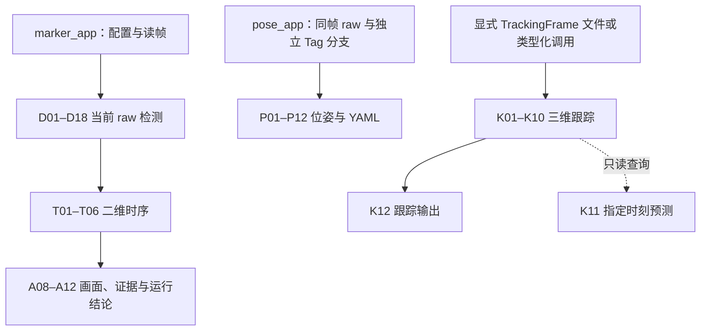

# 瘦身后的流程导读

本导读以代码收尾提交 `4c00708` 为准，给实际调用顺序和步骤边界定位。编号沿用 [lean-report.md](lean-report.md) 的 D/T/P/K/A/Q/S/C/V/B；原表是只读审查底稿，不能把其中的拟议布局当作本次已经实现。逐项修改、裁决、路线命中和验证命令见 [lean-changes.md](lean-changes.md)。

这里的“板块”就是相对独立的流程步骤，同一文件中也可有多个。以下每步都给输入、输出与替换点；替换点是须保持的契约，不要求新增类、框架或转发层。替换实现仍须守住公开语义、数值预算、来源身份和独立验证，不能靠改下游来掩盖接口变化。当前小函数、值结果、const 引用和显式状态实例承担这些边界。

## 从入口到输出的真实顺序

BGR8 指 OpenCV 的蓝／绿／红三通道、每通道 8 位图像。raw 指当前帧原始检测；stable 指二维显示平滑结果，二者分字段保留。物理角 P0…P3 是图纸身份，屏幕角 LT/RT/RB/LB 是画面顺序。下面四条路径有各自入口，并非一个可执行文件隐式串起全部模块。

后文 fps 是每秒帧数，dt 是两次时间的间隔；GUI 指图形窗口界面。K 是相机内参矩阵，dist 是畸变系数；profile 指由独立标定／验证形成的跟踪噪声与过程参数。codec 指文件与类型化数据之间的编码／解码函数；JSONL 是每行一个 JSON 对象的记录格式，schema 指字段与版本协议。其他算法手段在相应步骤首次展开时解释。

1. **marker_app 完整链**：A01 解析 → Q01–Q05 读验配置／资源 → A02 启动运行（其中 Q06 保存 effective 配置，A03 启动显示）→ A04 读帧 → A05/A06 单次桥 → D01–D18 当前检测 → T01–T06 二维时序 → A08/A09 画图与等待 → A10 写图／视频并执行 A07 submit、complete_export → 循环 → A11/A12 收尾与报告。公共 Detector 在缺预算时会早返回，后续步骤标未执行。
2. **几何／解码／时序审计**：独立工具把 ExecutionScope 显式传给 runOffline／runDecodePipeline。Geometry 跑 D02–D09 后停；Decode 继续 D10–D18；Temporal 再跑 T 链；Full 走公共 Detector 的现行入口门控。三个诊断工具可用 GeometryStop::Validated 停 D07。scope 与 selected 不同，前者选择执行范围，后者选择记录详情。
3. **pose_app（G2）**：A01/Q 配置 → 读原分辨率帧并建立 CaptureStamp → 完整 Detector.process → 对 raw.detections 做 P01→P05–P11；另从同一原图做 P02–P04→P05–P11 的 Tag 分支 → P12 写 observations.yaml／summary.yaml。G2 不吃二维 tracks，也不会把显示保持当新观测。
4. **tracking_app（G4）**：Q 配置／profile → K01 读文件帧 → 每帧 K02 创建事务 → 核 stamp／上下文／顺序并算本帧时间界 → K03/K04 适配当前位置／坐标 → 对已有轨迹 K06 预测 → 按时间界增广 R → 无 live 时走 K05 create；有 live 时 K07 关联，再走 K05 bootstrap/reseed 或 K08 correct → K09 决定生命周期 → K10 生成快照 → 返回 K02、接受后提交 → K12 输出。K11 是显式只读查询旁路。没有从 marker_app 偷传可变状态，也没有在此自动调用 G2 检测器。



阅读图时请注意，pose_app 自己调用 Detector 得到 raw；G4 的文件输入是另一个显式边界，图中的相邻模块不代表已接通自动生产链。

与只读步骤表的实际差异：三 L 枚举现名 generateThreeLAssignments；D02–D09 已有 GeometryStepsOutput，主链不再将组件塞回 PreparedFrame；D15 的同组 double 排序显式复用，D18 舍入后仍复核；T05 当前调用传空文字样本；G2/G4 当前主程序写 YAML；K05 是分支、K10 快照早于提交、A07 submit 实际位于 A10；B01–B03 尚未实施模块布局迁移。这些差异在对应步骤继续说明。

## 应用步骤 A01–A12

### A01 从入口解析明确运行请求

解析 marker_app 允许项，装配配置、模式、输出目录与预期帧数，再进入 runOffline。

**输入／输出／替换点：**输入 argv 与配置路径；输出 AppConfig、video、ExecutionScope::Full、subset 和 purpose。替换各入口 parse_cli 时维持各自允许项／错误策略。

**用到的办法：**语法检查先于资源创建，可避免拼错参数后产生看似有效的输出。 **读时注意：**marker_app 仍有自己的 CLI；pose/tracking 和部分审计工具共用纯 parser，不能假设所有入口选项完全一致。

定位：[tools/apps/marker/main.cpp:55](../tools/apps/marker/main.cpp#L55)；[原步骤 A01](lean-report.md?plain=1#L110)。

### A02 建立运行身份和输入资源

按 validate_run→prepare_metadata→beginRun→start_input 的顺序启动会话并打开视频、构造所需算法实例。

**输入／输出／替换点：**输入已解析 AppConfig、路径、scope/subset/purpose 与代码 identity；输出独占运行目录、capture、metadata 和实例资源。替换会话初始化保持各步显式依赖与失败生命周期。

**用到的办法：**provenance 是运行来源记录：把实际输入、配置、模型、代码与环境身份一起保存，便于追溯。 **读时注意：**beginRun 早于打开 capture；读取指纹失败可能更早停止，开视频失败则会留下失败目录，不能声称所有失败都不建目录。

定位：[src/app/offline/offline_runner.cpp:72](../src/app/offline/offline_runner.cpp#L72)；[原步骤 A02](lean-report.md?plain=1#L111)。

### A03 探测并启动显示会话

有窗口请求时由子进程探测 GUI，再创建 DisplaySession；不可用时按原规则无窗口继续。

**输入／输出／替换点：**输入 show_window、probe 路径和既有超时；输出 active／明确降级原因。替换显示后端保持 start/show/close 生命周期归会话。

**用到的办法：**子进程把显示库崩溃与主算法进程隔开，超时避免启动永久卡住。 **读时注意：**实际源是 tools/apps/display/display_probe.cpp；display_requested 与 display_active 分开记录，不能把未显示写成已显示。

定位：[src/app/display/display_session.cpp:72](../src/app/display/display_session.cpp#L72)；[原步骤 A03](lean-report.md?plain=1#L112)。

### A04 逐帧读取并建立回放时间轴

读取每帧，执行显式 subset 筛选，为实际处理帧计算 frame_id 和基于 fps 的微秒时间。

**输入／输出／替换点：**输入 capture、fps、id 与 subset；输出 FrameInput 和读取耗时。替换读帧／时间适配保持编号、溢出检查及来源。

**用到的办法：**显式时间轴让序列检查与平滑使用可解释的 dt。 **读时注意：**录像时间来源仍 Unknown，不能写成真实曝光；diagnostics 抽样不裁剪检测，但显式 execution subset 会。

定位：[src/app/offline/offline_runner.cpp:237](../src/app/offline/offline_runner.cpp#L237)；[原步骤 A04](lean-report.md?plain=1#L113)。

### A05 选择执行范围并交接诊断请求

将 selected／timing／level 作为观察请求，完整 scope 走 execute_and_record，审计 scope 显式传 runDecodePipeline。

**输入／输出／替换点：**输入帧、ExecutionScope 与 DiagnosticsRequest；输出一次算法执行的参数。替换编排只调整步骤实现，不能让 observer 是否存在决定算法范围。

**用到的办法：**分开执行意图与观测意图，可在关闭日志时仍跑同一条算法路径。 **读时注意：**DiagnosticsRequest.scope 是记录标签；真正范围是独立函数参数。Full 公共 Detector 继续保留原预算门控。

定位：[src/app/offline/offline_runner.cpp:273](../src/app/offline/offline_runner.cpp#L273)；[原步骤 A05](lean-report.md?plain=1#L114)。

### A06 取得算法结果与独立记录

内部桥完成 prepare→公共 process→take，带回结果、记录、异常和簿记耗时。

**输入／输出／替换点：**输入 Detector、FrameInput、request；输出 RecordedExecution。替换桥时保留错序守卫、异常先保存记录再重抛和 process_total 的 public_call 边界。

**用到的办法：**桥把单次调用协议集中在一处，让应用不再分别维护 prepare/take 生命周期。 **读时注意：**FrameRecord 的 StageDetails 是观察快照；未执行和关闭计时不记成零耗时，诊断失败也不能更改数值流程。

定位：[src/detection/pipeline/execution/detector.cpp:191](../src/detection/pipeline/execution/detector.cpp#L191)；[原步骤 A06](lean-report.md?plain=1#L115)。

### A07 登记所有帧并抽样存储详情

用所有提交帧累计状态／耗时／原因，按 selected 写详细记录并登记待补 export。

**输入／输出／替换点：**输入 FrameRecord、selected 与 recorder 实例；输出统计、frames.jsonl 及待补身份。替换存储保持单调帧号与生命周期。

**用到的办法：**统计全量、详情抽样降低证据体积，同时保留运行覆盖计数。 **读时注意：**实际 submit 在 A10 export_frame 内，位于渲染／写视频之后；A07 是职责编号，不表示每帧先写记录再渲染。

定位：[src/observability/recording/diagnostics_recorder.cpp:666](../src/observability/recording/diagnostics_recorder.cpp#L666)；[原步骤 A07](lean-report.md?plain=1#L116)。

### A08 适配渲染输入并生成画布

从只读快照提取原图点线、检查 evidence 一次，再叠 raw／stable／候选等图层到新画布。

**输入／输出／替换点：**输入原图、FrameResult、FrameRecord 与 RenderConfig；经 RenderInput 输出新 overlay／事件。替换适配器或图层时保持原图坐标及只读输入。

**用到的办法：**专用值输入隔开渲染与 fitter／缓存实现，换取证步骤不要求界面跟着读内部结构。 **读时注意：**baseline 跳过画布；记录字段和渲染适配仍有明确协议，渲染不得回写原图或算法结果。

定位：[src/app/rendering/debug_renderer.cpp:26](../src/app/rendering/debug_renderer.cpp#L26)；[原步骤 A08](lean-report.md?plain=1#L117)。

### A09 显示、等待并读取用户停止

对可用会话显示画布，处理停止按键及 playback 等待，记录真实可视化／等待耗时。

**输入／输出／替换点：**输入 overlay、session 与 playback 配置；输出继续／用户停止、显示状态和耗时。替换 UI 等待保持停止原因及时间归账边界。

**用到的办法：**把等待时间单独记录，避免将人为播放速度算进检测性能。 **读时注意：**用户停止会影响输入完整性；窗口中途降级后不能重复记入上一次显示耗时。

定位：[src/app/display/display_session.cpp:96](../src/app/display/display_session.cpp#L96)；[原步骤 A09](lean-report.md?plain=1#L118)。

### A10 输出视频／图像并补 export 耗时

先按请求写选中证据图／每个执行帧视频，再 submit 记录并 complete_export。

**输入／输出／替换点：**输入 record、overlay、frame_id 与输出请求；输出文件、侧表耗时及完成身份。替换 VideoExporter 或 recorder 编码保持 submit→complete_export 顺序。

**用到的办法：**导出在公共 process 计时外单列，使写盘成本不会混入算法耗时。 **读时注意：**视频不由 selected 决定；不完整运行最后标 partial。显式 subset 情况只导出实际执行帧。

定位：[src/app/offline/offline_runner.cpp:395](../src/app/offline/offline_runner.cpp#L395)；[原步骤 A10](lean-report.md?plain=1#L119)。

### A11 判定覆盖并收尾资源

用已读帧数／预期／subset 待完成项／用户停止求 RunOutcome，再关闭并读回核验视频。

**输入／输出／替换点：**输入真实计数、可空 expected 和停止原因；输出 coverage_verified、incomplete、reason 及完成／partial 视频。替换 evaluate_input_completion 保留 unknown 与 incomplete 的区别。

**用到的办法：**期待总量提供独立覆盖依据；读回校验确认编码器确实写出了声称的帧。 **读时注意：**编码器收尾在 recorder Running 期间进行；不能先写成功 summary 再发现视频失败。

定位：[src/app/offline/offline_runner.cpp:424](../src/app/offline/offline_runner.cpp#L424)；[原步骤 A11](lean-report.md?plain=1#L120)。

### A12 输出只读摘要与运行结论

显式传 RunOutcome／RunOverhead 给 finishRun，再写 summary、manifest、补充导出报告与控制台。

**输入／输出／替换点：**输入只读累计统计、运行结论、外部开销和 provenance；输出文件／终端及退出码。替换各 writer 保留公开编码与失败生命周期。

**用到的办法：**类型化完成结论避免 console 或 recorder 从 environment 字符串键猜流程状态。 **读时注意：**environment 仍编码兼容字段，但不作内部状态暗道；summary() 只读，未知覆盖不能冒称全量通过。

定位：[src/observability/reporting/run_report.hpp:19](../src/observability/reporting/run_report.hpp#L19)；[原步骤 A12](lean-report.md?plain=1#L121)。

## 配置步骤 Q01–Q06

### Q01 识别各模块配置协议

打开指定 YAML，识别版本、段与允许键，逐字段拒绝未知／重复／缺失输入。

**输入／输出／替换点：**输入显式配置路径；输出节点／原始 token 与 schema 约束。替换各 load_* 的文件阶段保留原模块协议和错误上下文。

**用到的办法：**严格键集合使拼写错误及时暴露，避免静默落到默认值。 **读时注意：**模块 reader 的字段集合各自拥有；display 是现行段，删掉的三个旋钮、旧显示键与旧模式都明确拒绝。

定位：[src/config/detector/config.cpp:135](../src/config/detector/config.cpp#L135)；[原步骤 Q01](lean-report.md?plain=1#L127)。

### Q02 转换类型并保留完整整数／空值

共享纯字段原语，调用者显式指定数字／数字串／可选空值策略及原错误文本。

**输入／输出／替换点：**输入 FileNode、token 与策略；输出有类型配置值。替换 config_value 原语、decimal_uint64 或 exact integer codec 时保持各模块类型边界。

**用到的办法：**精确整数旁路避免 OpenCV 32 位节点或 double 丢失 uint64；可选值表达尚未测得而非零预算。 **读时注意：**Detector 数字节点严格，G2 普通／optional 不同，G4 允许完整数字串；共用函数不等于统一成宽松解析。

定位：[src/config/reader/value_reader.hpp:9](../src/config/reader/value_reader.hpp#L9)；[原步骤 Q02](lean-report.md?plain=1#L128)。

### Q03 校验各模块自己的契约

由 Detector／Temporal／G2／G4 校验器分别核参数，应用总入口按原顺序组合。

**输入／输出／替换点：**输入本模块配置；输出合法值或原类型／上下文的错误。替换 validateTemporalConfig、validateDetectorConfig、validate_pose_config、validate_tracking_config 保持局部依赖。

**用到的办法：**局部校验避免构造无关 AppConfig 的默认值来间接证明一个模块合法。 **读时注意：**合法配置可以仍有空预算；格式检查通过不是实车／控制能力已就绪。

定位：[src/config/detector/config.cpp:529](../src/config/detector/config.cpp#L529)；[原步骤 Q03](lean-report.md?plain=1#L129)。

### Q04 解析模型、标定、profile 与单位

以明确配置来源解析资源路径，加载图纸／相机／profile 并保留身份和米制单位。

**输入／输出／替换点：**输入配置文件目录、资源路径与单位字段；输出只读模型、K/dist、米制点或 profile。替换资源加载须显式保留定位基准与来源。

**用到的办法：**配置目录定位使调用方切换 cwd 后仍能找到同一份资源；米制转换统一位姿与跟踪单位。 **读时注意：**默认入口路径仍有各自适配，不能说整个仓库已完全不读 cwd；F57 已将合成测试根显式传入，旧 CLI 兼容边界仍存在。

定位：[src/config/pose/pose_config.cpp:95](../src/config/pose/pose_config.cpp#L95)；[原步骤 Q04](lean-report.md?plain=1#L130)。

### Q05 核验协方差数学有效性

用低层只读数学函数检查有限、对称与正定条件，供配置与 filter 各自入口使用。

**输入／输出／替换点：**输入 R／camera_mse_m2 矩阵；输出 bool 或调用者自己的错误。替换 positive_definite 保留数值规则及误差上下文。

**用到的办法：**正定性保证误差方向有有效正权重并可做后续求解；它不是硬件误差预算。 **读时注意：**config 不再包含私有 Kalman 头；共享数学函数不意味着模块必须依赖滤波器实现。

定位：[include/vision/math/observed_geometry.hpp:75](../include/vision/math/observed_geometry.hpp#L75)；[原步骤 Q05](lean-report.md?plain=1#L131)。

### Q06 保存可往返的有效配置

把本次验证后的 AppConfig 写到明确路径，再按原精确 token 机制保存完整大整数。

**输入／输出／替换点：**输入 AppConfig 和输出路径；输出 effective_config.yaml。替换 writer 保持现行字段、空预算、整数精度与写失败保护。

**用到的办法：**配置快照使回放能复现本次实际开关和数值，而非只知道某个文件名。 **读时注意：**运行元信息是另外的 manifest；标定／G2／G4 也有各自 writer，不能拿 AppConfig writer 包办所有协议。

定位：[src/config/detector/config.cpp:743](../src/config/detector/config.cpp#L743)；[原步骤 Q06](lean-report.md?plain=1#L132)。

## 当前检测步骤 D01–D18

### D01 核验当前帧和序列

先拒绝空图、错误像素格式或不合法序列，再处理尺寸改变和缺预算；失败分支按现行规则清历史或返回 NOT_READY。

**输入／输出／替换点：**输入 FrameInput 和该 Detector 的上一帧标记／尺寸；输出可继续的当前帧或带原因的 FrameResult。替换点为帧校验及其显式上一帧参数。

**用到的办法：**序列检查把同一实例的先后关系落实到帧号／时间，避免旧图接上新状态。 **读时注意：**构造时校验 DetectorConfig 并加载模型；process 不负责补空预算，NOT_READY 与没检出不是同一状态。

定位：[src/detection/pipeline/execution/detector.cpp:49](../src/detection/pipeline/execution/detector.cpp#L49)；[原步骤 D01](lean-report.md?plain=1#L42)。

### D02 生成工作图与双向坐标映射

把当前 BGR8 原图缩到配置尺寸，保留只读原图视图、真实比例和像素中心映射。

**输入／输出／替换点：**输入帧与 PreprocessConfig；输出 PreparedFrame。替换 preprocess 时须继续提供原图来源、scale_x/scale_y 与 workToOriginal/originalToWork 契约。

**用到的办法：**像素中心映射补上 resize 的半像素偏移，使原图取证位置与工作图假设一致。 **读时注意：**image_ 此时仍是 BGR8；工作图的二值化在 D03，原图阈值另有明确来源，不能混用。

定位：[src/detection/preprocess/preprocess.cpp:11](../src/detection/preprocess/preprocess.cpp#L11)；[原步骤 D02](lean-report.md?plain=1#L43)。

### D03 提取带身份的白片

在工作图上阈值化并提取白片轮廓，给每片建立 component_id。

**输入／输出／替换点：**输入 PreparedFrame.image_ 与 GeometryConfig；输出 vector<WhiteComponent>。替换点为 extractWhiteComponents，保留工作坐标、轮廓遍历约定和来源 ID。

**用到的办法：**连通轮廓把像素聚成可独立测量的片；CHAIN_APPROX_SIMPLE 压缩直线段上的重复方向点。 **读时注意：**component_id 是身份，不是 vector 下标；下游按 ID 查找，不能依赖排列巧合。

定位：[src/detection/geometry/observation/geometry_observation.cpp:43](../src/detection/geometry/observation/geometry_observation.cpp#L43)；[原步骤 D03](lean-report.md?plain=1#L44)。

### D04 把轮廓变成形状与拓扑观察

对每片做多尺度近似，提取凹转折与 L／小片等可检验候选。

**输入／输出／替换点：**输入带 ID 的白片和观察参数；输出 ShapeObservation 列表。替换 observeShapes 或其拓扑函数时保留原组件来源与实际测得顶点。

**用到的办法：**多尺度近似降低某一 epsilon 恰好抹掉凹点的影响；拓扑条件把轮廓转折变成候选证据。 **读时注意：**候选标签还不是最终模型身份；观察位置、组件 ID、source_index 的含义各不相同。

定位：[src/detection/geometry/observation/geometry_observation.cpp:124](../src/detection/geometry/observation/geometry_observation.cpp#L124)；[原步骤 D04](lean-report.md?plain=1#L45)。

### D05 枚举三片 L 与模型的对应

从本帧 L 候选选三片，枚举与 L0/L2/L3 的对应关系，并记录资源截断。

**输入／输出／替换点：**输入 ShapeObservation、模型与搜索参数；输出三片对应排列及截断状态。替换点为 generateThreeLAssignments，输出须完整表达竞争。

**用到的办法：**组合／排列搜索显式保留同一图像的多个解释，避免先凭数组顺序指定身份。 **读时注意：**当前名称已修正；只枚举三 L，不是六片全排列，也不能拿最大的三片暗中当唯一。

定位：[src/detection/geometry/parent/geometry_matcher.cpp:104](../src/detection/geometry/parent/geometry_matcher.cpp#L104)；[原步骤 D05](lean-report.md?plain=1#L46)。

### D06 拟合父仿射假设

对每组对应再枚举实测锚点元组，拟合父变换并组装带来源的假设。

**输入／输出／替换点：**输入三 L 观察、模型与预算；输出 generated GeometryBatch。替换拟合／组装函数时显式传锚点和 assignments，buildGeometryHypothesis 只负责组装。

**用到的办法：**仿射是二维线性变换加平移，用来把图纸点映到工作图；它提供搜索参照，不是最终原图角测量。 **读时注意：**每个可计算元组都计入原搜索预算；截断表示尚有未排除解释，不能在下游抹掉。

定位：[src/detection/geometry/parent/geometry_matcher.cpp:257](../src/detection/geometry/parent/geometry_matcher.cpp#L257)；[原步骤 D06](lean-report.md?plain=1#L47)。

### D07 独立复核父假设

先查绑定和变换，再用同一投影产物检查残差、面积及完整性，保持原拒绝先后。

**输入／输出／替换点：**输入 generated batch、模型、当前 components 和 GeometryConfig；输出 validated batch。替换 validateGeometryBatch 或其中度量函数时保留原绑定来源、拒绝原因和降级规则。

**用到的办法：**投影残差衡量模型与实测轮廓的偏离；复用一次投影可避免同一步内部对面积再做一遍变换。 **读时注意：**这是父假设检查，不等于 D16 的最终原图角证据验证；两者不能互相代替。

定位：[src/detection/geometry/validation/geometry_validation.cpp:196](../src/detection/geometry/validation/geometry_validation.cpp#L196)；[原步骤 D07](lean-report.md?plain=1#L48)。

### D08 测量缺片候选

先做廉价面积筛查，再测缺片与当前白片的形状、方向、边界和拓扑关系。

**输入／输出／替换点：**输入白片、模型片、父仿射、参照面积及工作尺度；输出 AssignmentMatchMetrics。替换点为 measureAssignmentArea／measureAssignmentMatch，已算面积通过可选值显式交接。

**用到的办法：**把“测了多少”与“门限是否通过”分开，使同一测量能被搜索和探针一致使用。 **读时注意：**可选预计算值只用于同一输入；独立入口仍自己算面积并防御坏输入，不能把未知测量当零。

定位：[src/detection/geometry/completion/assignment_match_metrics.hpp:122](../src/detection/geometry/completion/assignment_match_metrics.hpp#L122)；[原步骤 D08](lean-report.md?plain=1#L49)。

### D09 完成有界的一对一绑定

沿父绑定枚举 M1/S1a/S1b 的可行组合，避免一片多用并保留竞争／资源截断。

**输入／输出／替换点：**输入 validated batch、components、模型及 AssignmentCompletionConfig；输出 completed batch。替换搜索时保留候选、扩展、输出三类上限及截断标记的含义。

**用到的办法：**有界搜索限制资源消耗；一对一约束防止同一真实白片被解释为多个图纸片段。 **读时注意：**Geometry 范围在此返回；GeometryStop::Validated 则更早在 D07 返回。诊断 selected 只决定详情，不裁剪正式算法。

定位：[src/detection/geometry/completion/geometry_assignment_completion.cpp:33](../src/detection/geometry/completion/geometry_assignment_completion.cpp#L33)；[原步骤 D09](lean-report.md?plain=1#L50)。

### D10 取得当前原图轮廓

由 decode 局部索引惰性分割原图，把工作组件关联到真实原图轮廓。

**输入／输出／替换点：**输入原图／映射、帧号、白片与原图预算；输出 OriginalContourResult。替换点为 OriginalContourSource 的只读 observe 回调；resolver 只知道 frame_id 与查询契约。

**用到的办法：**帧内缓存避免不同父假设重复做同一原图关联；帧号检查防止把另一帧的缓存拿来用。 **读时注意：**缓存生命周期止于一次 decode；回调不能外逃，也不能用父变换画出的边冒充实拍轮廓。

定位：[src/detection/corners/observation/corner_observation.cpp:37](../src/detection/corners/observation/corner_observation.cpp#L37)；[原步骤 D10](lean-report.md?plain=1#L51)。

### D11 解释物理角与邻边身份

按只读角身份表找到 P0…P3 各自的片、顶点和两条邻边，将图纸边映到原图作取证参照。

**输入／输出／替换点：**输入完成绑定、当前轮廓来源、模型与映射；输出每个物理角的 ModelEdges 和来源身份。替换绑定解析时仍只消费 model_corner_contract 与显式输入。

**用到的办法：**统一身份表使 resolver、证据检查和 G2 米制取点遵守同一图纸约定。 **读时注意：**预测邻边只限定取证方向／位置；没有实测边就返回失败，不用预测交点补角。

定位：[src/detection/corners/measurement/corner_resolver.cpp:74](../src/detection/corners/measurement/corner_resolver.cpp#L74)；[原步骤 D11](lean-report.md?plain=1#L52)。

### D12 枚举连续支持弧

从当前原图轮廓生成路线所需支持弧，检查连续性、端点范围和有效长度。

**输入／输出／替换点：**输入轮廓、ModelEdges、角配置与路线端点策略；输出有序 SupportRange／SupportRecord。替换弧枚举或 supportFor 时保留有序像素身份与连续连接语义。

**用到的办法：**支持弧就是用来拟合一条边的连续像素段；保留遍历顺序才能独立检查它是否真与另一条边相接。 **读时注意：**全端点枚举仍按原规则去重并恢复候选顺序；不能只按空间距离把两段孤立线拼成角。

定位：[src/detection/corners/fitting/corner_edge_fit.cpp:262](../src/detection/corners/fitting/corner_edge_fit.cpp#L262)；[原步骤 D12](lean-report.md?plain=1#L53)。

### D13 按显式顺序尝试边拟合路线

按策略掩码遍历 13 路表，首次得到 evidence 即返回；拟合同时保留直线、周期参数和残差。

**输入／输出／替换点：**输入支持弧、配置与 EdgePairFitStrategy；输出 EdgePairFitResult／失败原因，可选 trace。替换 fitFor／路线实现时保留路序、成功判据及 trace 契约。

**用到的办法：**周期线模型描述像素栅格带来的规律偏差；有序回退让不同模型的尝试过程可以重放。 **读时注意：**Fast 第 8/9 路复用同输入第 2/4 路结果，但照常重放逻辑 stage；完整清单、零命中保留裁决见 lean-changes。

定位：[src/detection/corners/fitting/corner_edge_fit.cpp:744](../src/detection/corners/fitting/corner_edge_fit.cpp#L744)；[原步骤 D13](lean-report.md?plain=1#L54)。

### D14 组装实测交点与完整证据

对通过相邻连接／交角／外推等检查的两边取交点，再由 resolver 写入物理角和帧／片身份。

**输入／输出／替换点：**输入两边拟合、连接弧与模型身份；输出 CornerMeasurement 的四个 double 物理角及逐角 CornerEvidence。替换 pairGeometry／select 时继续交付全部模型元数据与支撑像素。

**用到的办法：**交点把两条边转成角位置；同时记录支撑和误差，后续才能独立确认它不是无根据的延长线。 **读时注意：**stable_id 是证据来源标识，不是时序 Track ID；四角缺一即拒绝该假设。

定位：[src/detection/corners/fitting/corner_edge_fit.cpp:559](../src/detection/corners/fitting/corner_edge_fit.cpp#L559)；[原步骤 D14](lean-report.md?plain=1#L55)。

### D15 求屏幕角序并交付排序结果

把同一组 double 物理角归入 LT/RT/RB/LB，保留物理到屏幕的映射与平局信息。

**输入／输出／替换点：**输入四物理角与 CornerConfig；输出 ScreenOrderResult。替换点为 orderScreenCorners；resolver 的可选输出把同一结果显式交给几何和语义步骤。

**用到的办法：**循环顺序与屏幕起点规范化让下游始终读同一四边形顺序，而物理身份由另一份映射表达。 **读时注意：**屏幕左上不等于物理 P0；double 排序缓存只适用于这份数值，不能直接复用于 float 发布后。

定位：[src/detection/corners/ordering/screen_order.cpp:660](../src/detection/corners/ordering/screen_order.cpp#L660)；[原步骤 D15](lean-report.md?plain=1#L56)。

### D16 独立验证原图角证据

复核四边形、图像边界以及每个角的支撑／模型／残差／连接证据。

**输入／输出／替换点：**输入 CornerMeasurement、同组 ScreenOrder、原图尺寸与预算；输出有效性及拒绝原因。替换 validateDetectionGeometry／validateCornerEvidence 时保留独立复算和完整失败信息。

**用到的办法：**独立复算重新从支撑像素算参数或残差，避免生产者和检查者共享错误答案。 **读时注意：**只能共享身份和协议常量，不能把 fitter 缓存的数值结论当验证结果；frame_id 也须与本帧一致。

定位：[src/detection/corners/validation/detection_validator.cpp:270](../src/detection/corners/validation/detection_validator.cpp#L270)；[原步骤 D16](lean-report.md?plain=1#L57)。

### D17 处理竞争与方向唯一性

对全部有效测量及搜索截断状态判断几何是否一致，保留真实测量并单独判定方向是否唯一。

**输入／输出／替换点：**输入完整候选、search_truncated、配置及可选同组排序；输出 SemanticResolution。替换 resolveSemantics 时须消费完整竞争集合，不隐藏失败竞争。

**用到的办法：**把几何一致与物理方向唯一分开，允许有效四边形带 unknown 方向发布。 **读时注意：**decode 在进入这里前还检查 unresolved 竞争；不能丢掉无法排除的假设后将剩下一个强行叫唯一，也不平均多个角。

定位：[src/detection/corners/semantics/semantic_resolver.cpp:333](../src/detection/corners/semantics/semantic_resolver.cpp#L333)；[原步骤 D17](lean-report.md?plain=1#L58)。

### D18 转 float 后再发布当前检测

将保留测量转换为公开 float 四角，重新验证／排序，生成 bbox 和可空 orientation。

**输入／输出／替换点：**输入真实 double 测量、方向唯一性、原图尺寸及配置；输出可发布 Detection 或失败。替换发布适配时保持公开结构与 float 后的几何复核。

**用到的办法：**浮点舍入会改变非常接近的点或排序条件；重新检查保证公开数据本身满足契约。 **读时注意：**所有待发布候选先成功才提交；失败不能偷偷删掉竞争者。输出是 raw 当前检测，随后才进入 T 链。

定位：[src/detection/corners/publication/detection_publication.cpp:10](../src/detection/corners/publication/detection_publication.cpp#L10)；[原步骤 D18](lean-report.md?plain=1#L59)。

## 二维时序步骤 T01–T06

### T01 核验时序输入并维护重置边界

检查本帧所有 raw、标记和尺寸，再处理历史过期或输入变化。

**输入／输出／替换点：**输入 raw 列表、FrameStamp、原图尺寸及本实例历史；输出可继续的当前集合或 INVALID_INPUT。替换输入校验须显式传上一标记，状态仍归实例。

**用到的办法：**先检查全部候选，防止把坏候选过滤掉后制造“唯一目标”。 **读时注意：**这里再次防御是独立步骤入口的契约；空当前帧不制造历史几何，且会清平滑历史。

定位：[src/detection/temporal/stabilization/temporal_stabilizer.cpp:106](../src/detection/temporal/stabilization/temporal_stabilizer.cpp#L106)；[原步骤 T01](lean-report.md?plain=1#L65)。

### T02 选择当前跟踪对象

用中心距离和面积比例找历史匹配；恰好一个才延续，没有唯一匹配则选当前最大 raw 并停止沿用平滑。

**输入／输出／替换点：**输入当前 raw、reference_ 与关联参数；输出 current_index、匹配／歧义信息。替换关联段时显式给这些产物，不能靠原因字符串反向控制流程。

**用到的办法：**关联将“这一帧哪一个对象”与“如何平滑它”分开，避免跨对象混角。 **读时注意：**多个历史匹配不会偷偷挑最近者来平滑；仍可显示当前最大真实检测，但不能说关联唯一。

定位：[src/detection/temporal/stabilization/temporal_stabilizer.cpp:156](../src/detection/temporal/stabilization/temporal_stabilizer.cpp#L156)；[原步骤 T02](lean-report.md?plain=1#L66)。

### T03 确定角点对应关系

在需要且允许平滑时，按已知物理映射或未知方向的循环候选寻找唯一角对应。

**输入／输出／替换点：**输入当前／历史 raw、各自 orientation 与对应预算；输出 current_to_previous 或明确歧义。替换 resolveCornerCorrespondence 保留映射方向及歧义输出。

**用到的办法：**角对应保证指数平滑的是同一个角；不确定区间用来避免把几乎相等的循环方案硬选一个。 **读时注意：**仅在 T02 唯一关联且已有平滑历史时调用；未知方向不会因此变成已知物理方向。

定位：[src/detection/temporal/correspondence/temporal_geometry.cpp:10](../src/detection/temporal/correspondence/temporal_geometry.cpp#L10)；[原步骤 T03](lean-report.md?plain=1#L67)。

### T04 按真实时间平滑并复核

按实际 dt 计算权重，平滑对应角并复核偏离、凸性、float 与排序；失败回退当前 raw。

**输入／输出／替换点：**输入当前角、对应映射、历史 stable、dt 与 TemporalConfig；输出本帧 Track、诊断及下一历史。替换平滑段／validateStableCorners 时保留当前帧回退和显式原因。

**用到的办法：**时间常数使平滑强度随真实帧间隔变化，避免固定权重依赖帧率。 **读时注意：**零 dt、歧义、超偏离都不发布预测角；raw 不被覆盖。TemporalCause 是机器原因，旧 reason 文字只作兼容记录。

定位：[src/detection/temporal/stabilization/temporal_stabilizer.cpp:195](../src/detection/temporal/stabilization/temporal_stabilizer.cpp#L195)；[原步骤 T04](lean-report.md?plain=1#L68)。

### T05 更新独立文字保持

根据可选的当前文字样本与调用年龄，返回带来源帧／age／is_held 的 DisplayState。

**输入／输出／替换点：**输入 optional<SemanticDisplaySample>、FrameStamp 与本实例文字历史；输出 optional<DisplayState>。替换点为 DisplayHistory::update，不能把它改成几何观测来源。

**用到的办法：**独立文字历史允许界面短暂保留信息而不伪造新的检测。 **读时注意：**当前 finalizeDecodedFrame 实际传入 std::nullopt，没有接入文字识别样本；新实例通常持续无 display_state。原表的“当前文字”是接口能力，不是现有调用事实。

定位：[src/detection/temporal/display/display_history.cpp:22](../src/detection/temporal/display/display_history.cpp#L22)；[原步骤 T05](lean-report.md?plain=1#L69)。

### T06 组装当前帧公开结果

按 decoded 状态调用 temporal／display，组合 raw、tracks、display_state 并保存重置／回退诊断。

**输入／输出／替换点：**输入 DecodeStageResult、stamp、size 及两个显式状态实例；输出 FrameResult。替换 finalizeDecodedFrame 时保持公开字段的来源和非法分支清理顺序。

**用到的办法：**组装适配把不同生命周期的数据放在不同字段，让消费者能分清测量与显示稳定结果。 **读时注意：**detections 仍是原始当前测量；tracks 是二维平滑结果，不等于 G4 的三维 TargetTrack。

定位：[src/detection/temporal/assembly/stabilize_stage.cpp:7](../src/detection/temporal/assembly/stabilize_stage.cpp#L7)；[原步骤 T06](lean-report.md?plain=1#L70)。

## G2 位姿与 Tag步骤 P01–P12

### P01 把 MARK raw 转成物理点对

核对帧／时间／状态／索引，使用 orientation 把屏幕角转回 P0…P3，再配上米制图纸点。

**输入／输出／替换点：**输入 FrameResult.detections、检测序号、原图尺寸、CaptureStamp 及可选 PosePrior；输出四组点对或明确 PoseStatus。替换 MARK 适配时禁止用 tracks／held。

**用到的办法：**PnP 是由已知三维点及其二维投影求姿态；点对的物理身份正确才有数学意义。 **读时注意：**pose_app 先执行完整 Detector.process，但 estimate_mark 只读取 raw；方向缺失即 CorrespondenceMissing，不把屏幕序当物理序。

定位：[src/pose/estimation/pose_estimator.cpp:82](../src/pose/estimation/pose_estimator.cpp#L82)；[原步骤 P01](lean-report.md?plain=1#L76)。

### P02 适配 Tag 灰度输入

从原分辨率 BGR8 生成灰度，构造指向有效灰度存储的 C 图像视图。

**输入／输出／替换点：**输入原图与 CaptureStamp；输出 gray／image_u8_t 临时视图。替换输入适配保持真实 Mat.step、尺寸与存储生命周期。

**用到的办法：**图像视图避免额外复制，真实 stride 让非紧密排列图像也按正确行距读取。 **读时注意：**不使用 D02 工作图，也不隐式缩放相机 K；视图在当前检测调用内有效。

定位：[src/pose/tag/tag_detector.cpp:55](../src/pose/tag/tag_detector.cpp#L55)；[原步骤 P02](lean-report.md?plain=1#L77)。

### P03 检测并解码 Tag

调用每实例 AprilTag 后端，复制 ID／角点／质量并检查白名单、质量与同帧重复 ID。

**输入／输出／替换点：**输入灰度视图和 TagConfig；输出含失败原因的 TagObservation 列表。替换后端继续提供相同角身份及解码证据。

**用到的办法：**AprilTag 是带编码 ID 的平面标记；资源的自动释放保证异常时也能销毁 C 句柄。 **读时注意：**不能只保留成功 ID：重复／缺质量预算必须留下诊断，原生 detector/family 不跨实例共享可变状态。

定位：[src/pose/tag/tag_detector.cpp:66](../src/pose/tag/tag_detector.cpp#L66)；[原步骤 P03](lean-report.md?plain=1#L78)。

### P04 用 Tag 尺寸构造米制点对

复核 Tag 质量及批准尺寸，按该后端角定义构造四个平面物点，再调用公共平面求解。

**输入／输出／替换点：**输入 TagObservation、原图尺寸与 PoseEstimator 配置快照；输出点对／拒绝状态，后续再包装 ExitObservation。替换 estimate_exit 的输入适配保持 ID→side_m 显式来源。

**用到的办法：**真实边长提供像素到米的尺度；图案识别成功本身并不提供距离尺度。 **读时注意：**后端角顺序直接对应物点，不重排成屏幕 LT/RT/RB/LB；未知尺寸不猜。config() 已按值隔离 K/dist。

定位：[src/pose/tag/tag_detector.cpp:106](../src/pose/tag/tag_detector.cpp#L106)；[原步骤 P04](lean-report.md?plain=1#L79)。

### P05 检查平面求解前提与预算

验证 stamp、相机、图像大小、凸四边形与有限 z=0 物点，再检查已存在的面积预算。

**输入／输出／替换点：**输入四组点对、K/dist、stamp、target ID 与可选 prior；输出可求解输入或现行错误状态。替换前置校验保留数学检查与预算空值。

**用到的办法：**先核数学前提可避免让求解器接收退化点；预算是否已测与点是否可计算分别判断。 **读时注意：**缺重投影预算仍可能计算候选供审计，然后返回 BudgetMissing；不能把空预算补成经验值。

定位：[src/pose/estimation/pose_estimator.cpp:158](../src/pose/estimation/pose_estimator.cpp#L158)；[原步骤 P05](lean-report.md?plain=1#L80)。

### P06 枚举平面姿态候选

调用 SOLVEPNP_IPPE，保留求得的全部旋转／平移候选。

**输入／输出／替换点：**输入合法 3D↔2D 点对和相机参数；输出候选 rvec/t_m。替换求解器时保留多解及逐候选复核输入。

**用到的办法：**IPPE 是用于平面目标的姿态求解法；保留多解让后续约束真正完成消歧。 **读时注意：**不是拿返回的首解或最小误差解直接宣布 Unique；G4 预测也没有在当前应用中自动作为 prior 接回这里。

定位：[src/pose/estimation/pose_estimator.cpp:217](../src/pose/estimation/pose_estimator.cpp#L217)；[原步骤 P06](lean-report.md?plain=1#L81)。

### P07 独立评价每个姿态

把候选重新投影到原始像点，检查正深度并计算误差指标。

**输入／输出／替换点：**输入候选姿态、原点对与 K/dist；输出 PoseCandidate 的 metrics_valid、误差、深度及原因。替换 evaluate_pose 保留独立重投影。

**用到的办法：**重投影误差直接比较“这个姿态画回原图后差多少”；正深度排除相机背面的数学解。 **读时注意：**rvec 是轴角旋转向量，t_m 单位米；未测指标不能当零误差通过。

定位：[src/pose/validation/pose_geometry.cpp:95](../src/pose/validation/pose_geometry.cpp#L95)；[原步骤 P07](lean-report.md?plain=1#L82)。

### P08 按现有约束筛候选

依次用已存在的重投影预算、安装约束和可信 prior 更新每个候选的 eligible 与 reasons。

**输入／输出／替换点：**输入复核候选、SelectionConfig、Budgets 和显式 prior；输出完整标记过的候选列表。替换单个谓词时保留其独立输入与失败原因。

**用到的办法：**可信 prior 只有身份、时钟、严格先后和年龄都合格才能辅助消歧；Rodrigues 只在法向约束需要时转矩阵。 **读时注意：**硬件确认位不充当数值求解总开关；无可用 prior 时明确忽略，不造一个默认追踪器。

定位：[src/pose/estimation/pose_estimator.cpp:232](../src/pose/estimation/pose_estimator.cpp#L232)；[原步骤 P08](lean-report.md?plain=1#L83)。

### P09 分类零解／唯一／歧义

统计合格候选；零个 NoSolution，多个 Ambiguous，仅一个才进入精修与发布。

**输入／输出／替换点：**输入完整候选及 eligible 标记；输出 PoseStatus 和可选 selected_index。替换分类逻辑时保留全部失败候选证据及公开状态。

**用到的办法：**计数与唯一索引足够表达选择，不再建立只为取一个元素的临时容器。 **读时注意：**BudgetMissing 先于这一步返回；Unique 仅指当前数值约束下唯一，不等于硬件或控制资格通过。

定位：[src/pose/estimation/pose_estimator.cpp:258](../src/pose/estimation/pose_estimator.cpp#L258)；[原步骤 P09](lean-report.md?plain=1#L84)。

### P10 尝试精修并保留原合法解

对唯一解可选运行 LM 精修，再用同样约束复核；精修失败或变坏时保留原合法解。

**输入／输出／替换点：**输入唯一候选、原点对、相机与 refine_lm 开关；输出 refined 或原解及相关误差。替换精修段须保留复核与回退契约。

**用到的办法：**LM 是迭代调整姿态以减小重投影误差的方法；它用于打磨已选解，不能代替多解分类。 **读时注意：**不能因优化器抛异常就丢掉前面已验证的原解，也不能凭误差下降跳过安装／prior 条件。

定位：[src/pose/estimation/pose_estimator.cpp:273](../src/pose/estimation/pose_estimator.cpp#L273)；[原步骤 P10](lean-report.md?plain=1#L85)。

### P11 组装姿态与现行资格

在求解结果上补 MARK／Tag 来源、索引与现行 control_usable 资格。

**输入／输出／替换点：**输入求解状态、姿态、stamp 及硬件／时间资格；输出 PoseObservation（Tag 外包 ExitObservation）。替换输出适配保持公开字段、可空协方差与现行判定。

**用到的办法：**将数值姿态和资格分别记录，让离线计算结果不会自动升级成实车可用测量。 **读时注意：**原表写 G2PoseObservation 是概念称呼，实际公开类型是 mark::pose::PoseObservation；本次没有新增 G2→G4 隐式连接。

定位：[src/pose/estimation/pose_estimator.cpp:133](../src/pose/estimation/pose_estimator.cpp#L133)；[原步骤 P11](lean-report.md?plain=1#L86)。

### P12 输出 G2 记录与分析入口

逐帧分别记录 MARK 和 Tag 的状态、候选、选择与原因，收尾给出来源／完整性摘要。

**输入／输出／替换点：**输入 PoseObservation／ExitObservation 与明确输出目录；输出 observations.yaml、配置副本及 summary.yaml。替换 writer 保留现行 YAML 和来源，分析工具独立读取其输入。

**用到的办法：**配置快照和完整候选保留复盘所需上下文；灵敏度工具通过已知扰动观察误差传播。 **读时注意：**原步骤表笼统写 JSONL，pose_app 当前实际写 YAML；没有把这份文件偷偷改成新的三维跟踪输入协议。

定位：[tools/apps/pose/pose_main.cpp:48](../tools/apps/pose/pose_main.cpp#L48)；[原步骤 P12](lean-report.md?plain=1#L87)。

## G4 三维跟踪步骤 K01–K12

### K01 读取明确来源的跟踪帧

读取现行跟踪帧协议或旧 G2 记录，保留整数／stamp／来源，交给 tracking_app 逐帧处理。

**输入／输出／替换点：**输入文件路径与协议内容；输出 TrackingFrame 列表。替换 codec／旧版适配时保持完整整数与 legacy 来源含义。

**用到的办法：**codec 只重建类型化数据，资格由后续步骤根据显式来源核对。 **读时注意：**tracking_app 会把文件中的 TypedMemory 降为 Synthetic；文件回放不会继承内存实车资格，且不直接调用 Detector。

定位：[src/tracking/io/tracking_io.cpp:200](../src/tracking/io/tracking_io.cpp#L200)；[原步骤 K01](lean-report.md?plain=1#L93)。

### K02 创建候选事务并核帧

复制可变 TrackerState，核验 stamp／上下文／顺序；只读配置不随帧复制。

**输入／输出／替换点：**输入 TrackingFrame、旧实例状态和 const TrackingConfig；输出 candidate 与本帧结果，接受后才提交。替换 step／advance 的事务边界须保留拒绝与异常回滚。

**用到的办法：**按值事务让失败候选的时间和轨迹修改不会污染下一帧。 **读时注意：**advance 内会生成快照，返回且 input_accepted 后 step 才提交；原表 K09→K10 不是代码字面顺序。

定位：[src/tracking/lifecycle/target_tracker.cpp:356](../src/tracking/lifecycle/target_tracker.cpp#L356)；[原步骤 K02](lean-report.md?plain=1#L94)。

### K03 提取当前唯一的三维测量

核对当前 Unique 姿态及完整候选证据，用 profile 或显式 position_noise 绑定位置误差。

**输入／输出／替换点：**输入本帧 PoseObservation、stamp、profile／sidecar；输出 PositionMeasurement 列表和事件。替换 one_measurement／adapt_measurements 时保留当前样本身份与重复检测 ID 拒绝。

**用到的办法：**位置协方差 R 表示当前三维位置误差，给滤波器分配测量权重；来源必须明确。 **读时注意：**不猜 covariance_se3 数组排列来造 R；Unique 标签本身还不够，选中证据也要合法。

定位：[src/tracking/measurement/measurement_adapter.cpp:80](../src/tracking/measurement/measurement_adapter.cpp#L80)；[原步骤 K03](lean-report.md?plain=1#L95)。

### K04 核对坐标、时间域及误差来源

需要世界坐标时使用同曝光 CameraTransform，并传播误差；每帧 time_bounded 只算一次。

**输入／输出／替换点：**输入相机位置／R、同曝光变换与时间元数据；输出指定坐标测量、资格及必要事件。替换坐标／time_bounded／time_augmented_noise 函数时保持显式数据和单位。

**用到的办法：**刚体变换把相机坐标转到指定世界系；绝对时间界用于误差包络，不能直接当高斯标准差。 **读时注意：**实际先适配坐标，再对 live 轨迹预测，之后增广测量 R；camera_relative 的速度包含相机自运动，不能称世界速度。

定位：[src/tracking/measurement/measurement_adapter.cpp:130](../src/tracking/measurement/measurement_adapter.cpp#L130)；[原步骤 K04](lean-report.md?plain=1#L96)。

### K05 按分支初始化、两点确认或重建

无 live 且恰好一个测量时 create；未确认轨迹在后续唯一匹配中 bootstrap，单测量失配可进入两点 reseed。

**输入／输出／替换点：**输入当前／待定测量、合法 dt、profile 与候选 state；输出位置先验、新 track_id、confirmed 或 pending。替换 create／bootstrap／reseed 保留身份与时间条件。

**用到的办法：**两个不同时间的位置才提供速度信息；首点内部零均值只是先验，不作为测得零速发布。 **读时注意：**不是每帧都先初始化再预测：create、bootstrap、reseed 位于不同分支，重建会产生新 ID。

定位：[src/tracking/lifecycle/target_tracker.cpp:75](../src/tracking/lifecycle/target_tracker.cpp#L75)；[原步骤 K05](lean-report.md?plain=1#L97)。

### K06 对已有轨迹做常速度预测

在合法 dt 与已标定过程域内推进位置／速度和协方差，超域先走丢失规则。

**输入／输出／替换点：**输入旧 x/P、dt、加速度功率谱与可选时间界；输出预测 x/P。替换 CvFilter::predict 保留数学防御、单位和事务回滚。

**用到的办法：**x 是位置／速度状态，P 是其误差协方差；常速度模型用加速度过程噪声描述短时变化，同时传播不确定性。 **读时注意：**只在 live 分支对实时状态预测；预测输出不是新的图像测量，坏数学不能只降资格后继续算。

定位：[src/tracking/filter/kalman_cv.cpp:121](../src/tracking/filter/kalman_cv.cpp#L121)；[原步骤 K06](lean-report.md?plain=1#L98)。

### K07 计算创新并选择唯一关联

对候选位置计算创新评分，恰好一个通过且时间区间可分辨才更新。

**输入／输出／替换点：**输入同一预测 filter 与每个 z/R；输出 InnovationResult（残差、S、R、score、owner/revision）及选中关联。替换关联时显式传所选创新，不借字符串暗传。

**用到的办法：**NIS 是用误差协方差归一化的残差平方，用于比较测量与预测是否相容。 **读时注意：**评分使用 profile 的 bootstrap／association 门限；多候选通过会 coast，不偷偷挑最小值；缓存仅对同实例同版本有效。

定位：[src/tracking/filter/kalman_cv.cpp:154](../src/tracking/filter/kalman_cv.cpp#L154)；[原步骤 K07](lean-report.md?plain=1#L99)。

### K08 校正已确认滤波状态

已确认且唯一关联时消费同状态创新，更新 x/P；未确认时改走两点 bootstrap。

**输入／输出／替换点：**输入预测状态与选中 InnovationResult；输出校正状态／协方差。替换 correct 保留独立 z/R 入口的校验和过期／错实例防御。

**用到的办法：**Joseph 协方差形式将状态修正与测量噪声都显式计入，减小数值运算破坏协方差性质的风险。 **读时注意：**不能在 predict／correct 之后再复用旧创新；本次复用的是原来在同状态重复计算的结果。

定位：[src/tracking/filter/kalman_cv.cpp:180](../src/tracking/filter/kalman_cv.cpp#L180)；[原步骤 K08](lean-report.md?plain=1#L100)。

### K09 决定生命周期并提交已接受候选

没有更新时转 Coasting，满足现行失效条件时 Lost；本帧 advance 返回后由 step 决定提交候选。

**输入／输出／替换点：**输入更新标记、gap／不确定性及 candidate；输出状态／事件及最终实例状态。替换生命周期段保持 Lost 清载荷、ID 单调及 input_accepted 提交条件。

**用到的办法：**状态机明确区分当前实测、短时预测和已失效轨迹。 **读时注意：**快照 K10 在 advance 返回前生成，提交在其后；不能写成“先提交再取快照”。数学异常会返回 NO_COMMIT 事件。

定位：[src/tracking/lifecycle/target_tracker.cpp:322](../src/tracking/lifecycle/target_tracker.cpp#L322)；[原步骤 K09](lean-report.md?plain=1#L101)。

### K10 生成冻结输出快照与资格

按候选当前状态生成 TargetTrack，保留现行速度可空与 qualified_for_g5 条件。

**输入／输出／替换点：**输入候选状态、profile、时间与硬件来源；输出 TrackingResult 内的轨迹快照。替换 snapshot 只可保持既有公开语义，本次 F25 不改。

**用到的办法：**快照将内部滤波状态与公开结果隔开，消费者不能改写实时历史。 **读时注意：**标准差保持原短路求值顺序；没有新增 UncertaintySummary。数值轨迹存在不代表 qualified，为合成回放也不升级资格。

定位：[src/tracking/lifecycle/target_tracker.cpp:95](../src/tracking/lifecycle/target_tracker.cpp#L95)；[原步骤 K10](lean-report.md?plain=1#L102)。

### K11 查询指定时刻的只读预测

复制当前 filter 到查询时刻，按现行可用性规则返回可空预测，实时状态不前移。

**输入／输出／替换点：**输入当前已确认状态及绝对查询时间；输出 TargetForecast。替换 predict_to 时保留查询不产生新 ID、不改变 step 历史的契约。

**用到的办法：**只读查询让下游选择观察时刻，不把预测当作已经发生的新测量。 **读时注意：**当前 tracking_app 的逐帧循环不调用 predict_to；实验或显式调用者使用此旁路，F25 的未来语义方向本次未实施。

定位：[src/tracking/lifecycle/target_tracker.cpp:377](../src/tracking/lifecycle/target_tracker.cpp#L377)；[原步骤 K11](lean-report.md?plain=1#L103)。

### K12 记录跟踪结果和实验误差

输出逐帧状态／事件／预测协议；tracking_lab 另用明确 truth/profile 做标定和 holdout 验证。

**输入／输出／替换点：**输入 TrackingResult 列表与输出路径；输出 tracks.yaml、summary.yaml 或实验 CSV/YAML。替换 writer／lab 指标时保持 schema、来源和失败证据。

**用到的办法：**留出验证用未参与拟合的数据复核 profile，而不是用同一批数据自证。 **读时注意：**现行程序此处主要写 YAML/CSV，原表 JSONL 是概括；四组合通过覆盖合成行为，G-01/G-02/G-03 仍 OPEN。

定位：[src/tracking/io/tracking_io.cpp:303](../src/tracking/io/tracking_io.cpp#L303)；[原步骤 K12](lean-report.md?plain=1#L104)。

## 工具、标定、合成与构建：只看总览和入口

下列清单仍按步骤划边界，但不展开工具内部教学。表中的替换点是现有函数／命令入口的契约；配置、输出目录与规范来源显式传入。全量工具导航见 [tools/INDEX.md](../tools/INDEX.md)。工具不批准硬件预算，失败样本、缺测和开放关项不能因汇总而消失。

### S01–S08 合成夹具

synthetic_gen 从冻结规范生成可追溯图像／真值，再独立验证。公开 Context 与兼容 core.hpp 入口保留；各步骤头已拥有自己的声明，私有计算只读所需切片。真值来自已知几何，不来自被测检测器。入口：[tools/synth_ref/src/main.cpp:43](../tools/synth_ref/src/main.cpp#L43)；步骤声明：[tools/synth_ref/include/synthetic_gen/core.hpp:2](../tools/synth_ref/include/synthetic_gen/core.hpp#L2)。

| 步骤 | 输入 → 输出；替换点 |
|---|---|
| S01 载入规范 | 显式 source_root、model/grid/cases/sources → Context 与来源身份；load_context(root)，旧零参 CLI 兼容入口仍存在。 |
| S02 枚举样本 | 规范切片、模式 → 有序 descriptor/case_id；enumerate/enumerate_special 与 Visitor 流式回调，回调是替换边界。 |
| S03 已知变换 | 图纸点、descriptor → 解析变换与理想顶点；affine/transform_polygon，私有 affine_values 不读整个 Context。 |
| S04 扰动／负例 | 理想几何、显式扰动描述 → 扰动场景或无图原因；make_scene/apply_special，ideal 与 perturbed 分存。 |
| S05 栅格与连接 | 场景、采样约定 → image/mask/instance 与连接复核；rasterize/check_scene，独立手算基准不共用生成结论。 |
| S06 编码记录 | 场景、Raster、来源切片 → truth JSON/index CSV/字节；truth_record/record_*，声明只归 records.hpp。 |
| S07 运行事务 | 编码产物、显式 run_id/目录 → 计划或待验证运行目录；plan/generate，保持未完成标记与原错误退出码。 |
| S08 独立验证 | 运行目录、原始规范及显式内部事务模式 → verify 结论；verify，公开验证仍拒绝未完成运行，成功才完成生成。 |

实际工作流顺序包含 plan/generate 内部的枚举与写盘，上表按产物边界拆解，不意味着先把整个数据集常驻内存。证据根属 tests main 的 TestPaths；临时 cwd 切换局限于旧事务兼容边界并自动恢复，不能作为跨步骤参数。

### C01–C06 相机标定

入口：[tools/calibration/calibration_main.cpp:12](../tools/calibration/calibration_main.cpp#L12)；人工选帧入口：[tools/calibration/scripts/frame_picker.py:26](../tools/calibration/scripts/frame_picker.py#L26)。这是“明确选帧 → 逐帧观测 → 只筛成功点对求解”的链。

| 步骤 | 输入 → 输出；替换点 |
|---|---|
| C01 配置 | 默认值、严格 YAML、CLI 覆盖 → CalibrationConfig；load_config_yaml/apply_cli_overrides/validate_config，只保留 frame_list，旧范围输入拒绝。 |
| C02 视频元信息 | 路径 → capture 与 CalibrationVideoInfo；open_calibration_video，尺寸不回写静态 config。 |
| C03 选帧 | capture、frame_list → 带 frame_id 的 SampledFrame；extract_frames_by_list，人工 picker 的 seek/read 失败与主动退出分开。 |
| C04 圆点观测 | SampledFrame、圆点阵几何 → 每帧 BoardObservation，包括 detected=false；detect_calibration_points，失败不挤掉帧身份。 |
| C05 求解／复核 | VideoInfo.image_size、成功点对 → K/dist/外参/重投影误差与 frame_ids；run_camera_calibration，求解与误差复算可分别替换。 |
| C06 保存 | CalibrationResult、自有 image_size、显式输出路径 → calibration.yaml/摘要；save_calibration_result，不回读 config 中的运行尺寸。 |

K 是相机内参，dist 是畸变系数；重投影复核把求得的点画回原样本，量化几何一致性。真实 52 选帧／49 成功的新旧输出对照见修改报告，不以某个误差数字自动认定硬件合格。

### V01–V06 测试、探针与证据

入口：[tools/audit/decode_audit.cpp:7](../tools/audit/decode_audit.cpp#L7)、[tools/block3_fixture/diagnostics/video_diagnose.cpp:110](../tools/block3_fixture/diagnostics/video_diagnose.cpp#L110)、[tools/validation/recovery112_check.py:22](../tools/validation/recovery112_check.py#L22)。各工具保留自己的目标，不复制一整条生产流程。

| 步骤 | 输入 → 输出；替换点 |
|---|---|
| V01 场景 | 固定轮廓、已知真值或明确真实输入 → Scene/Frame/坏样本；fixture 函数与 tests/data，真值构造独立于被测算法。 |
| V02 指定步骤 | 场景、显式配置/scope/probe → 阶段结果/trace；runGeometrySteps 或单步入口，探针 gate 用副本，原配置不回写。 |
| V03 协议／复算 | JSONL/manifest/图像与 schema → 类型化证据/篡改或不可重放结论；frame_record_reader 与独立 validator，旧缺线模型参数明确 UNREPLAYABLE。 |
| V04 断言／参考 | 被测输出、独立手算或冻结 reference → PASS/FAIL；case runner 只管执行与异常，不共用数值答案。本次实际已运行，原只读报告“未执行”描述不适用执行阶段。 |
| V05 统计 | 包含失败／缺测的测量集合 → 固定列统计、null/N/A 或误差分布；describe/汇总函数，空样本不是零误差，单样本方差未知。 |
| V06 生命周期 | source_root/input_manifest/output_root/build_logs 与进程状态 → 归档／退出码；recovery112_check 与测试 main 显式参数，必要检查在 python -O 下仍生效。 |

角证据 codec 共享字段读取／类型约束，独立几何复算继续独立；测试 runner 只共用通用 check／错误收集。F71 的临时根也由测试 main 独占并传参，避免默认／全量并行覆盖同名文件。

### B01–B06 当前构建与交付边界

入口：[CMakeLists.txt:2](../CMakeLists.txt#L2)；既有可选模块：[cmake/g2.cmake:8](../cmake/g2.cmake#L8)、[cmake/g4.cmake:2](../cmake/g4.cmake#L2)。以下描述当前 CMake，**没有**声称已出现原底稿设想的 `vision::<module>` 新布局。

| 步骤 | 输入 → 输出；替换点 |
|---|---|
| B01 配置 | 工具链、现有 MARK_BUILD_G2/G4 与依赖 → 现有配置；根 CMake/既有 g2.cmake/g4.cmake，默认行为不变。 |
| B02 定义目标 | 各现有 SOURCES/头 → mark_detector、mark_offline、mark_pose、mark_tracking 与工具目标；原文件中的 target 定义，本次不新建模块 CMakeLists。 |
| B03 显式链接 | 已有目标和必要接口 → 实际链接图；target_link_libraries，父工程已提供目标时工具复用，独立工具仍需向上装配，彻底拆开留搬家。 |
| B04 测试／工具 | 当前目标、现有构建开关与资源根 → CTest/工具；既有登记与 VISION_SOURCE_ROOT，模块 BUILD_TESTING/BUILD_TOOLS 边界留搬家。 |
| B05 来源身份 | 每目标实际源码/include/link/CMake/模板/构建参数 → *-sources.manifest 与 code hash；mark_collect_target_inputs/mark_target_provenance，SG core/CLI/test 分开。 |
| B06 验证／提交 | 瘦身后的 refactor/lean 与本机日志 → 批次提交／push、两份独立文档与忽略目录日志；保持当前分支，不搬仓、不合 main。原表的搬家步骤只是后续计划。 |

OpenSSL 查找已靠近实际审计目标；默认仍构建这些工具。根 CMake 同文件作为真实输入的粒度仍较粗，后续布局拆开再细化。SG 的 environment code_hash 是核心库身份，CLI/test 有各自 manifest；marker_app 则显式交自己的目标身份给 runOffline。

## 跟一帧调试

### 先选可复现输入，再进入整条链

先用已有几何／角点 fixture 理解某一步，再用完整录像追实例历史。入口与契约可从 [tests/detection/corners/corner_resolver_test.cpp:225](../tests/detection/corners/corner_resolver_test.cpp#L225)、[tests/app/offline/observability_integration_test.cpp:516](../tests/app/offline/observability_integration_test.cpp#L516) 和 [tests/tracking/lifecycle/tracking_contract_test.cpp:769](../tests/tracking/lifecycle/tracking_contract_test.cpp#L769) 进入。这里的测试 reference 不是生产 helper 的另一层转发；改边界时要继续跑独立结果比较。

以下是后续交互调试的示例命令，**不是本次验收已经运行过的 Debug 构建**；本次实际 Release 构建、全量测试和 G4 四组合命令都在修改报告附录。命令从仓库根运行，输入路径替换成自己的现有录像，运行目录必须不存在。

```bash
cmake -S src/tushenghao -B /tmp/campus-lean-debug -DCMAKE_BUILD_TYPE=Debug -DMARK_BUILD_G2=ON -DMARK_BUILD_G4=ON
cmake --build /tmp/campus-lean-debug -j4
gdb --args /tmp/campus-lean-debug/marker_app --video /absolute/input.mp4 --config src/tushenghao/config/detector.yaml --run-dir /tmp/campus-debug-new-run --mode debug --run-purpose verification
```

要跟某一帧（例如 frame_id=784）进入完整路径，在 gdb 中对 Detector::process 下条件断点；让前面的帧正常执行，保留时序历史。跳到单帧是另一个执行问题，不能用单帧结果解释依赖历史的 T／G4 行为。

```gdb
set breakpoint pending on
break mark::Detector::process
condition 1 frame.frame_id == 784
run
print frame.frame_id
print frame.timestamp_us
print frame.image.cols
print frame.image.rows
```

断点序号按 gdb 实际返回值替换 `1`。先检查 D01 是否因预算为空早返回；这属于现行 NOT_READY，不能为了走通调试而填预算。若要看记录中的中间产物，在一份临时配置副本中启用 diagnostics 的 frame/evidence 与所需 detail 范围，不改仓库生产数值；只看内存时不必开所有导出。

### 断点与每步应看的产物

到达目标帧后再启用内部断点，可用 gdb 的 `break 文件绝对路径:行号` 或 `break 函数名`。下表路径相对 src/tushenghao；同一个函数内的多步仍按步骤变量检查。

| 位置 | 看什么、用于排除什么问题 |
|---|---|
| `src/detection/pipeline/decode/decode_stage.cpp:180` | D02–D09：逐次 next/finish 看 prepared 的两套尺寸／映射、components ID、observations 来源、generated/validated/completed 假设及截断；不要只盯最终 detections。 |
| `src/detection/corners/measurement/corner_resolver.cpp:74` | D10–D15：核 source.frame_id、assignments、当前轮廓、物理角邻边与 fit 证据；换 fitter 不应迫使此处读具体缓存。 |
| `src/detection/corners/fitting/corner_edge_fit.cpp:627` | D12–D14：route 参数、支持像素顺序、mask、pair rejection 与 evidence；两次相同逻辑路线也要核 trace stage。 |
| `src/detection/corners/validation/detection_validator.cpp:270` | D16：measurement/frame_id、原图 size、ScreenOrder、支撑模型版本与具体拒绝原因；区分“拟合失败”和“验证拒绝”。 |
| `src/detection/corners/semantics/semantic_resolver.cpp:333` | D17：全部 measurement、unresolved、search_truncated 与 orientation_unique；不能拿单个好候选解释整体竞争。 |
| `src/detection/temporal/stabilization/temporal_stabilizer.cpp:106` | T01–T04：reference_、smoothing_、stamp/dt、current_index、对应映射及 TemporalCause；确认回退的是当前 raw。 |
| `src/pose/estimation/pose_estimator.cpp:158` | G2：物点米／像点像素、stamp、budgets_ready、全部 candidate、eligible_count 和精修前后；Unique 与 control_usable 分开看。 |
| `src/tracking/lifecycle/target_tracker.cpp:356` | G4：original state/candidate、input_accepted、events、返回快照，再看是否提交；必须在 tracking_app 或类型化调用中调试此断点。 |
| `src/tracking/filter/kalman_cv.cpp:154` | G4 数学：同版本 x/P、z/R、残差/S/score；correct 消费的 owner/revision 必须对应此状态。 |
| `src/app/offline/offline_runner.cpp:424` | A11/A12：实际计数、pending、expected、RunOutcome，再看视频收尾、finishRun 和控制台；不要从一行“成功”反推覆盖。 |


G4 跟帧应另开 `gdb --args /tmp/campus-lean-debug/tracking_app --config /absolute/research-config.yaml --input /absolute/frames.yaml --out /tmp/campus-tracking-debug-new`，使用自己已有且经过现行工具生成的 profile；仓库 tracking.yaml 默认空 profile 不足以跑速度链。条件断点在 step 入口用 `frame.stamp_.frame_id_`，前帧仍正常执行。本次四组合输入与全部实际命令在修改报告中，不需要为调试重新创造一套数值。

### 从记录读回一帧

先读运行的 manifest.yaml 与 effective_config.yaml：核输入路径／指纹、代码 identity、scope/subset、像素尺寸、时间配方、实际显示状态和最终覆盖。provenance 的 code_sha256 对应当前目标的 sources.manifest 身份；输入文件 FNV 指纹是字节校验，不是密码学签名。

再按 frame_id 在 frames.jsonl 看 selected、各阶段 TimingStatus、counts、类型化 events、resets、raw／tracks 及 details。只有被选中且请求详情的帧才有相应快照；not_executed、disabled、null 都不能读成“做过且耗时为零”。process_total 的 public_call 不包含 GUI 等待、写视频和 recorder 簿记，export 另有侧表。

看角失败时按“父绑定 → 原图轮廓 → 支持弧 → 线模型与参数 → 交点证据 → 独立拒绝原因”倒查。角证据子版本为 2，外层 FrameRecord 仍为版本 1；旧记录缺参数会 UNREPLAYABLE，不能拿 Legacy／零系数填空。字段说明和 reader 定位：[tools/common/frame_record_reader.cpp:421](../tools/common/frame_record_reader.cpp#L421)；[diagnostics_schema.md](diagnostics_schema.md)。

运行结束后再核 summary、manifest 完整性与视频最终名称。gdb 中途退出、崩溃或只跑部分帧留下的目录只能作为调试产物；不是完整验收证据。独立验证器应按其现行 CLI 显式输入目录，未知选项（例如已移除的 temporal_audit --overwrite）不会生效。

## 建议阅读顺序

1. 先看公开输入／输出与配置边界：[include/vision/types/detector_types.hpp:70](../include/vision/types/detector_types.hpp#L70)、[include/vision/types/detection/geometry_types.hpp:178](../include/vision/types/detection/geometry_types.hpp#L178)、[src/config/application/app_config.hpp:10](../src/config/application/app_config.hpp#L10)。把 raw/stable、工作／原图、ID／下标先分清。
2. 接着读 A01 入口、OfflineRunSession::run/process_frame 和 Detector::process，把完整调用顺序串起来；首次先沿成功路径，再补 NOT_READY／INVALID_INPUT／异常记录分支。
3. 读 runGeometrySteps 与 decodeStage，拿一个 fixture 跟 D02–D18 的显式产物；一次只深入当前失败步骤的 helper，再读它的独立 validator／reference。
4. 单独读 T 链的输入、关联、对应、平滑和回退；注意显示文字与几何状态各有实例历史，不能串成一份共享可变对象。
5. 需要位姿时读 P01 的物理映射、P05–P11 的多解筛查，再读 Tag 适配；需要速度时从 K01/step/advance 开始，再下钻测量与 Kalman，别从矩阵推导倒推业务顺序。
6. 最后看 codec、recorder、summary／manifest、工具和 B05 来源身份；这些决定如何追溯与复验，但不应反向决定数值算法。

首遍可跳过周期拟合内部优化／枚举细节、屏幕排序全部评分分支、JSON/YAML 每字段 writer、命令行错误措辞、C 库资源细节、合成完整规范与历史验收报告。不能跳过各步骤输入／输出、资源截断、拒绝原因、独立复核或现行空预算门控。历史结论看其状态说明；本次是否通过以 lean-changes 的实际验证和保留日志为准。
