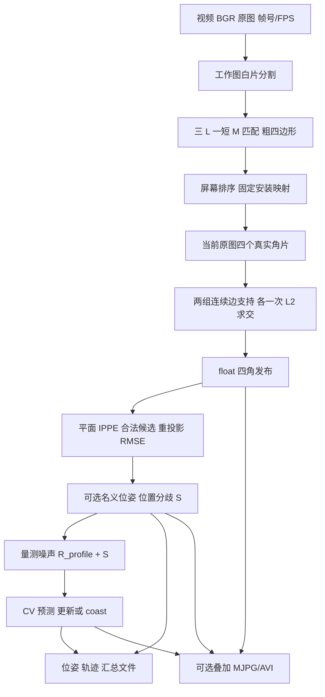

# MARK 主链流程导读

分支：`refactor/vision-lean-fixed`。当前结构、取舍和验证见[视觉管线瘦身报告](VISION_LEAN_REPORT.md)。配置直接读取手填值；位姿输出 schema=6、跟踪输出 schema=2。



## 1. 启动与配置

从仓库根目录执行：

```bash
cmake -S src/tushenghao -B build -DCMAKE_BUILD_TYPE=Release
cmake --build build -j4
ctest --test-dir build --output-on-failure
build/marker_app --video data/raw/marker_video.avi
```

依赖 C++17、OpenCV ≥4.6 和 AprilTag ≥3.3。始终构建检测、位姿和跟踪；`VISION_BUILD_TOOLS=OFF` 关闭应用/标定工具，`BUILD_TESTING=OFF` 关闭测试与验证工具。两者同时关闭时只构建算法库。

入口 `tools/apps/marker/main.cpp` 只接受 `--video VIDEO`，检查未知、缺值、重复参数和把选项误写为值的情况。配置目录固定为源树 `config/`；先分别调用 `mark::detector::load_detector_config` 和 `mark::load_offline_config`，再调用 `run_offline`。位姿和跟踪配置从同目录加载。

| 配置 | 内容与消费者 |
|---|---|
| detector.yaml | preprocess 工作尺寸 960×720、原图白阈 200；geometry 工作白阈 200、轮廓 epsilon=2；corner 固定安装排列 |
| offline.yaml | `run_directory: "outputs/marker"`、`video_filename: "overlay.avi"`、`overlay: true`，三者也是 C++ 默认值 |
| pose.yaml | 相机标定路径与身份；四点平面模型、source_unit、目标身份；Tag 白名单与实际边长 |
| calibration.yaml | K、畸变、1440×1080 分辨率与标定重投影误差 |
| tracking.yaml | source、target、时间界语义、profile 文件路径 |
| tracking_profile.yaml | 初估、待标定的 R、加速度 PSD q 和初速方差 |

`include/vision/config/` 存放配置类型和加载声明，包含应用组合类型 `app_config.hpp`。`src/config/` 的四个 loader 只读取值；`reader/value_reader.hpp` 共享节点到 C++ 值的转换。不检查手填字段的类型、范围、未知/重复键、schema 或排列。配置文件打不开仍报告 I/O 错误。

`pose.yaml` 的 `geometry.model_points: [[0,0],[80,0],[80,80],[0,80]]` 按 P0/P1/P2/P3 排列；`source_unit: "mm"` 把四点变为 `(0,0,0)`、`(.08,0,0)`、`(.08,.08,0)`、`(0,.08,0)` 米。PnP 不读取图案多边形；测试渲染图案由测试夹具保存。115×120 识别板不是四点模型。

固定排列 `physical_to_screen[p]` 表示物理 Pp 对应屏幕哪个槽：0=左上、1=右上、2=右下、3=左下，当前为 `[0,1,2,3]`。内部直接查表，不逐帧重猜身份。

安装核验：拍清晰图，对照实物/图纸标 P0…P3，检查叠加屏幕槽位与配置一致；让轨道走一遍并覆盖预期晃动，确认上下两带和带内次序不交换。换装/换相机后重做。固定映射不支持跨 90° 翻转或使上下带交换的严重透视。

`run_offline` 打开视频，保留 `INPUT_OPEN_FAILED` 与 `INPUT_FPS_INVALID`：FPS 必须有限且为正，才能生成时间戳及跟踪 dt。时间固定为 `llround(frame_id × 1e6 / fps)`，clock_domain 为 `video-fps`；没有实测曝光或时间误差界时保持未知。每帧依次检测、位姿、跟踪、写文件；无检测帧也进入后两步。

## 2. Detection：从当前帧得到真实四角

源码全部平铺在 `src/detection/`，命名空间为 `mark::detector`，与 `mark::pose`、`mark::tracking` 对齐。

| 文件 | 责任 |
|---|---|
| detector.cpp | 公开入口、图像格式与帧序检查、尺寸上下文、结果帧号 |
| preprocess.cpp/hpp | 工作图、原图只读视图、像素中心映射 |
| geometry_observation.cpp/hpp | 工作图白片轮廓、边框和截断事实 |
| match_quad.cpp/hpp、contour_topology.hpp | 白片归组、拓扑检查、粗四边形 |
| screen_order.cpp | 屏幕 LT/RT/RB/LB 排序 |
| corner_observation.cpp/hpp | 按需建立原图轮廓索引、粗角查真实角片 |
| corner_edge_fit.cpp/hpp | 连续支持提取、两条 L2 直线与交点 |
| decode_stage.cpp/hpp | 安装映射、逐角解析、float 发布和检测编排 |

类型在 `include/vision/types/`：`detector_types.hpp` 存帧输入、检测与 `FrameResult`；`corner_types.hpp` 存共享四角类型和排序声明；`prepared_frame_types.hpp` 存工作图、坐标映射与 `WhiteComponent`。解码和公开入口共用 `FrameResult`，没有重复结果容器。所有结构成员使用下划线后缀，普通函数使用 snake_case。

**输入边界。** `Detector::process` 检查非空 2D BGR8、非负时间及递增帧号/不倒退时间，防止非法图像进入 OpenCV。尺寸变化重置上下文；相同时间戳可检测，跟踪另要求不同时间才能测速度。原图只读。preprocess 不重复检查格式或手填配置。

**分割和匹配。** `preprocess` resize 并记录真实宽高比例，使用像素中心映射引导原图搜索。`extract_white_components` 按工作白阈提取白片。`match_quads` 按实测跨度归组，S 片可作空间桥，但不分配模型身份；四个粗角必须属于四个不同完整角片，结构为三 L 加一短 M。22/80 是 14mm 与 30mm 外臂的结构分界近似，非严格投影不变量。

轮廓简化搜索六尺度 `{1,.5,.75,1.25,1.5,2}`，由两个循环共享同一命名常量。拓扑允许直接六点或七点省去一个顶点，合并边须覆盖原弧；凹凸结果只计算一次。缺片、错向 L、矩形替 M、截断或无凸四边形时返回未检出。没有候选角搜索或周期回退。

**排序和角片。** `order_screen_corners` 按 y 分上下带、按 x 分带内左右，检查有限、非零叉积和严格凸。`decode_stage` 查固定排列得到物理角顺序；相邻粗角给出两条指导边。`OriginalContourIndex` 在需要时对整张原图提取完整轮廓，每帧最多一次；各角选择最近真实角片，截断失败，四角不复用原图组件。

**每角一次拟合。** `fit_observed_corner` 以粗角最近轮廓点为锚，两方向各走不足半圈。bbox 尺度的四分之一探针区分两条边；±3 像素切向窗口按指导方向分组，只用首段连续支持。沿弧跳过初始 5 像素（2 像素转折修剪＋3 像素切向半窗），尾端修剪 2 像素。每组至少两点且不重合，各调用一次 `cv::fitLine(DIST_L2)`，两线求交；平行、机器精度不可除或非有限才失败。3/2 像素常量定义支持构造，板端像素尺度、模糊与圆角仍需重验。

**发布。** `publish_float_detection` 将 double 交点转 float 后，再检查有限、图内和凸环，防止舍入破坏几何；输出屏幕四角及固定 P→屏幕排列。未拟合到四个真实角就不发布检测。位姿/跟踪预测不反馈成检测。

## 3. Pose：可选名义估计与多解分歧

`src/pose/` 保持 io、validation、estimation、tag 四个步骤目录。`PoseConfig` 保存相机、四点模型和 Tag 配置；构造求解器克隆 K/dist，防止调用方改 Mat 影响后续求解。配置不另作合法性验证。

公开边界仍检查同帧对应、检测下标、输入检测的排列、相机/图像域及像素凸环；这些是跨模块输入检查。模型非有限/非平面输入不送入求解器；不对手填四点重复检查凸性。

`solvePnPGeneric(SOLVEPNP_IPPE)` 产生平面候选，`evaluate_pose` 独立重投影并排除非有限、非正深度或不可投影坏解。异常/退化可使合法候选减少；没有 RMSE 资格门，也不因两解接近丢掉整帧。

`PoseObservation.estimate_` 有值时包含最低 RMSE 合法支的 `pose_`、二维欧氏重投影 `rmse_px_`、位置分歧 `translation_spread_m2_`。对名义支 t0/e0 与其他支 tj/ej：

`wj=e0²/(e0²+ej²)`，两误差都为零时取 1/2；先按最大误差归一化防平方溢出。`S=Σwj(tj−t0)(tj−t0)^T`。

一个合法解时 S=0，两支平移相同时也可为零；它不是唯一性证明、完整 SE3 协方差或标定后验概率。候选和选支只在求解器内部。状态由 estimate 是否有值生成 `ESTIMATED / UNAVAILABLE`，故障可附 reason。

退出 Tag 用真实 AprilTag 后端独立解码，检查白名单、重复身份、图像/轮廓和 C 句柄；没有实际边长时仍可返回像素角，米制估计为空。Tag 出现不代表控制权或兑换完成。

## 4. Tracking：R＋位置分歧与 CV 滤波

`src/tracking/` 保持 filter、measurement、lifecycle、io 步骤目录。正定检查放在 `filter/covariance_validation.*`，与卡尔曼运行期检查同属跟踪模块。检测的线段距离放在 `contour_topology.hpp`。

输入 `TrackingFrame{stamp_, observations_}` 只含位姿结果，不访问图像和求解器候选。适配器检查同帧、同身份、检测下标不重复、名义平移有限且正深度、实际消费的 S 有限；噪声为 `R_eff=R_profile+S`。没有 RMSE 质量准入门。

时间字段保留。负时刻、曝光晚于接收、非法误差界是运行期坏数据；重复/倒序不提交，上下文变化重建轨迹。未知时间使用名义时刻，只有声明 absolute_bound 且有曝光/误差界才增广 P/R；区间重叠回名义模型。数学异常保留上一次状态。

CV 使用连续白加速度模型，按实际 dt 积分位置/速度/过程噪声，通过 Joseph 更新保持协方差。R/P 正定、量测有限、除法时间间隔和计算溢出检查保留。第一位置没有测得速度；第二个不同时刻初始化速度。多位置候选按 NIS 排序，精确平局或无轨迹时无法确定多目标身份就不硬选；不设 NIS 截断门。

有位置更新为 `MEASURED`；无更新为 `COASTING`，继续输出有限位置/速度/P，没有方差或超时清空有限结果的资格门。下游控制只消费轨迹、最近实测时刻和 P。coast 是预测；相机系速度包含自车运动。

默认 profile 为 `tracking_profile.yaml`：R=diag(2e-8,2e-8,2.5e-7) m²，q=0.5 m²/s³，初速方差=0.25 m²/s²。**初估、待标定**，纵深值还依赖尺度误差假设，推导和限制见报告。`profile: ""` 仍可明确关闭数值跟踪。作业视频没有真实位置/速度 ground truth，不能从本算法输出循环标定 R/Q。

## 5. 输出与验收

| 文件 | 内容 |
|---|---|
| observations.yaml | 每帧名义位姿/空估计、RMSE 和位置分歧，schema=6 |
| tracks.yaml | 每帧相机系位置、可选速度、P、最近实测时刻和轨迹状态，schema=2 |
| summary.yaml | 帧数、检测数、位姿/跟踪/原因计数和总耗时 |
| offline.video_filename | overlay=true 时的 MJPG/AVI 叠加视频，默认 overlay.avi |

已有输出目录可复用；同名文件覆盖，保留多次视频可修改 `.avi` 文件名。overlay=false 时调用方跳过 exporter 的 open/write/finish 和渲染，前三种数据文件照常写。视频临时文件是 `<stem>.partial.avi`，关闭编码器后改名；生产不逐帧读回，验收独立解码。

64 位帧号、轨迹 ID、微秒时刻与计数仍用十进制字符串写 YAML，避免 OpenCV 4.6 的 int 接口窄化或 double 丢精度。流头分别为 `PoseObservations` 和 `TrackingResult`。回放对照仅允许跟踪流头从基线协议名变为 `TrackingResult`，其余字节保持一致。

`run_report.*` 和 `run_console.*` 属于 app/reporting，叠加绘制在 app/rendering；它们只消费结果，不影响算法。验证工具和夹具在 tests，不进入生产库。

固定录像：1676 帧、1088 检测/4352 角，1088 ESTIMATED、588 UNAVAILABLE，1088 MEASURED、588 COASTING。相同输入/模型下，四角文本与位姿文件和 edc9477 逐字节一致；跟踪文件只允许流头协议名变化，其余字节一致，空 profile 也一致。11 项测试、视频帧数/尺寸/源帧周期/MJPG 独立解码与结构检查见[报告](VISION_LEAN_REPORT.md)。板端实测数据与精度标定不在本次范围。
