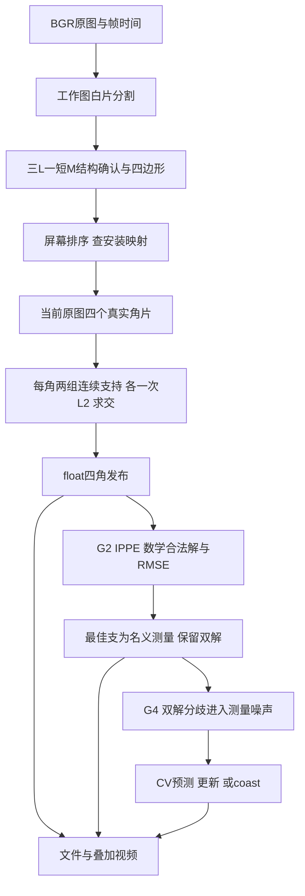

# MARK 主链流程导读

当前分支：`refactor/vision-lean-fixed`。本页对应单候选四边形引导实现；改动和1676帧证据见[修改报告](SINGLE_CANDIDATE_SLIMMING_REPORT.md)，旧156项逐项去向见[落实表](THRESHOLD_GATE_LABEL_IMPLEMENTATION.md)。配置schema为2，位姿输出schema为5，跟踪输出schema为2。

## 先看数据怎么走

没有仿射、hypothesis、补角、候选角排名、周期回退或质量资格链。图案匹配是检测本体，仍须真的看见完整MARK；标签不能替代缺失的图案。G2两支解是平面位姿本身的歧义，与角点拟合的“单候选”不是一回事。

## 1. 启动与安装核验

入口`tools/apps/marker/main.cpp`只负责CLI与启动`runOffline`。`--video`/`--camera`二选一，`--config`默认指向唯一的`config/detector.yaml`。没有debug/verification配置副本。

`src/config/`加载三个模块的配置，不替算法作质量筛选：

- detector.yaml：工作尺寸960×720、原图/工作图白阈200、工作轮廓epsilon=2、固定排列和AVI输出路径。
- pose.yaml：真实相机内参/畸变/分辨率、80×80mm MARK四点模型、退出Tag ID与实际边长。四角模型转换成米；115×120识别板不是PnP四角。
- tracking.yaml：观测source/target、时间界语义和可选profile路径。profile只读R、q、初速方差；R正定，q可为0，初速方差正值。生产profile为空时启动提示一次，检测/G2照常，G4不产生数值轨迹。

固定排列`physical_to_screen[p]`表示物理Pp对应屏幕哪个槽：0=左上、1=右上、2=右下、3=左下，当前为[0,1,2,3]。配置/直接构造时验0…3排列；内部查表不逐帧重猜身份。

赛前核验：按比赛安装拍一张清晰图，对照实物/图纸逐个标P0…P3，检查叠加屏幕槽位与配置一致；不一致就改排列。让轨道走一遍并覆盖预期的小晃动，确认上下两带、每带左右次序没有交换。换装/换相机后重做。固定映射不支持跨90°翻转或严重透视使上下带交换；比赛面朝移动区域的规定本身不能替代这次安装核验。

## 2. Detector：只从当前帧得到四角

**输入边界。** `Detector::process(FrameInput)`检查非空2D BGR8、合法时间和递增帧序，避免OpenCV访问非法图像。尺寸变化重置帧上下文；同一timestamp可检测，G4另要求不同时刻才能建速度。输入图像不被修改。decode内部不再重复格式与配置预算检查。

**分割和坐标。** `preprocess`保留原图引用并生成工作图；`extractWhiteComponents`按工作白阈提轮廓，保存实际轮廓/跨度/截断事实。工作坐标到原图坐标用真实宽高比例，角点精修始终在原图。

**形成MARK四边形。** `matchQuads`按实测白片跨度局部归组，S片可以作空间桥，不分配模型身份；确认六边一凹的L/M及正确外凸角。四边形的四角须来自四个不同完整角片，结构是三L加一短M；短M只确认图案，不决定P编号。22/80是14mm与30mm臂长的结构分界近似，非严格投影不变量。

轮廓简化保留原六尺度{1,.5,.75,1.25,1.5,2}，因为删减会破坏小尺寸/抖动用例。拓扑只允许直接6点或7点去掉一个冗余点，合并边须覆盖原弧；已删8点组合枚举。这里的搜索用于确认图案，角点精修没有候选枚举。缺片、错向L、矩形替M、截断或不存在四边形时，输出未检出。

**排序和身份。** `orderScreenCorners`将四点按y分上下两带、带内按x分左右，形成LT/RT/RB/LB；检查有限、非零叉积且严格凸。`decodeStage`直接查固定排列，得到物理P序的粗角。粗边直接是相邻粗角连线，不推仿射或投影图纸边。

**当前原图来源。** `OriginalContourIndex`按需对原图阈值提完整轮廓，每帧最多一次；各粗角取最近真实角片轮廓。原图截断无完整支持时失败，不裁ROI再人为闭合。resolver只保证四个角不复用同一原图组件，并把各角与前/后邻粗角交给拟合器。不再复制CornerEvidence。

**每角一次拟合。** `fitObservedCorner(contour, corner, adjacent[2], reason)`只返回一个可选double交点：

1. 将四边形两条邻边单位化，取离粗角最近的轮廓点作锚点。
2. 从锚点沿原轮廓两个方向走，两边各不足半圈，互不复用。用随角片bbox尺寸变化的四分之一探针判断这条分支对应哪条邻边；两分支须是不同边。
3. 用±3像素局部切向按两条邻边的方向接近程度分组，只取每边第一段连续支持，不跨断点拼线。沿弧跳过初始5像素（2像素转折修剪加3像素切向半窗），尾端再修剪2像素，避免圆角和栅格转折混进直线。
4. 每组至少两点且不重合，各调用一次`cv::fitLine(DIST_L2)`。两线求交；仅平行/机器精度不可除、非有限才无解。没有10点、14px跨度、3°、9px、13.5px、残差或extension资格门。

3/2像素常量定义支持构造，仍会影响精度，不能因为不叫门就免验证；MaixCam的像素尺度、模糊与圆角需重验。没有候选分数、歧义判断、trace或周期模型。

**发布。** 四个double交点转float后，`publishFloatDetection`再检查有限、图内和凸环，因为舍入可能改变几何；随后输出屏幕顺序四角和固定P→屏幕排列。没有category、confidence、bbox、质量旗或重复Evidence。未拟合到真实四角就不发布Detection；G2/G4预测不能反馈成检测。

## 3. G2：保留双解，给出名义测量

公开`PoseEstimator`独立校验同帧对应、下标/排列、相机和图像域、四角凸环、合法平面模型，便于替换检测器而不依赖其内部类型。相机配置构造时验证并克隆，热路径不反复验证不可变K。

`solvePnPGeneric(SOLVEPNP_IPPE)`产生平面候选。`evaluate_pose`独立重投影，去掉非有限、非正深度和不可投影的数学坏解；每支只保留位姿与二维欧氏RMSE。**没有1.10px绝对预算或0.25px差距门。**

- 没有合法解：NoSolution；未检测到：NotDetected；非法输入：InvalidInput。
- 一个合法解：Unique。
- 多个合法解：Ambiguous，保留所有解；最低RMSE支的索引是名义测量，不改名为Unique。

`PoseObservation::measurement()`只是取这个实际候选。RMSE有名义选支和G4权重两个消费者；没有eligible、reasons.empty总门、control_usable或重复selected_rmse。歧义不是“丢整帧”的理由，也不是证明所选姿态唯一正确。

退出Tag通过真实AprilTag后端独立解码，保留ID白名单/重复ID保护。未知边长仍可返回像素角；只有实际边长存在时才能做米制位姿。退出状态不意味着控制权授予/完成兑换。

## 4. G4：把分歧放入不确定度，不再拒有限测量

输入是同帧`TrackingFrame{stamp, observations}`。模块不访问图像、检测器或模型内部；使用位姿最小接口。时间上下文变化重建轨迹；倒序/重复时刻不提交，数学异常保持上一步有效状态。

Unique和Ambiguous都能输入。重复detection索引、错帧、非法位置/误差仍排除，避免同一数据二次更新。对所选支t0和另一支tj，用相对RMSE构造连续权重：

`wj = e0² / (e0² + ej²)`，两误差都为0时wj=1/2；实现先按最大误差归一化避免平方溢出。

`R_eff = R_profile + Σ wj (tj−t0)(tj−t0)^T`。

等残差时充分表达双解分歧，劣支误差大时影响连续减小。它是简洁的残差权重假设，未经标定，不称为真实后验概率。没有差距阈值或新资格门，且不能表达仅旋转不同、平移相同的全部SE3不确定度；G4本来只估位置/速度。

CV滤波保持原位置/速度积分、过程噪声和Joseph更新。第一位置不能测速度；第二个不同时刻初始化速度。多个位置候选用NIS排序，精确平局或无轨迹时多目标不能确定身份则不硬选；没有NIS限值/高NIS重种。有限大创新也更新，不能把模型不一致直接当观测非法。

时间未知用名义时间，不凭空猜硬界；有实际声明的absolute_bound才使用有界P/R增广，区间重叠回名义模型而非拒更新。没有max_dt/std/qualified/predict_to预算，没有无人消费的世界坐标通用层。

有测量是Measured；没有测量则Coasting并输出有限位置/速度/P。没有靠方差或时间阈值清空有限结果的Lost分支。coast是预测，不是仍看见MARK；长时间预测不等于精度保证，下游依据last_measurement_stamp和P理解它。相机系速度包含自车运动，不是轨道的世界速度。生产profile为空则没有G4数值输出。

## 5. 输出与验证接口

应用写`observations.yaml`、`tracks.yaml`、`summary.yaml`和MJPG的`overlay.avi`，视频完成后全帧读回。writer只有生产应用实际调用的逐帧版本；没有生产反向reader、配置写回或“为了测试”的trace。叠加图只读，不反馈算法。

测试工具`tests/validation/detection_replay.cpp`只调公开Detector，`tracking_replay.cpp`自己读schema5后调用公开G4，`replay_compare.py`对比历史数据；均留在测试侧。`BUILD_TESTING=OFF`不构建测试支撑。各模块可以单独替换：分割/匹配产MatchQuad，拟合收真实轮廓和两条粗边，发布产Detection，G2产PoseObservation，G4产相机系TargetTrack，无跨模块质量预算包。

当前录像：1676帧、1088检测/4352角，1088 Ambiguous但全有名义测量、0 NoSolution；RMSE中位/P95/最大0.357573/0.690671/0.926320px。条件profile回放1088 Measured、588 Coasting；它是合成R/Q复用的诊断，不是MaixCam或真实速度精度证明。完整证据与待验项见修改报告。
