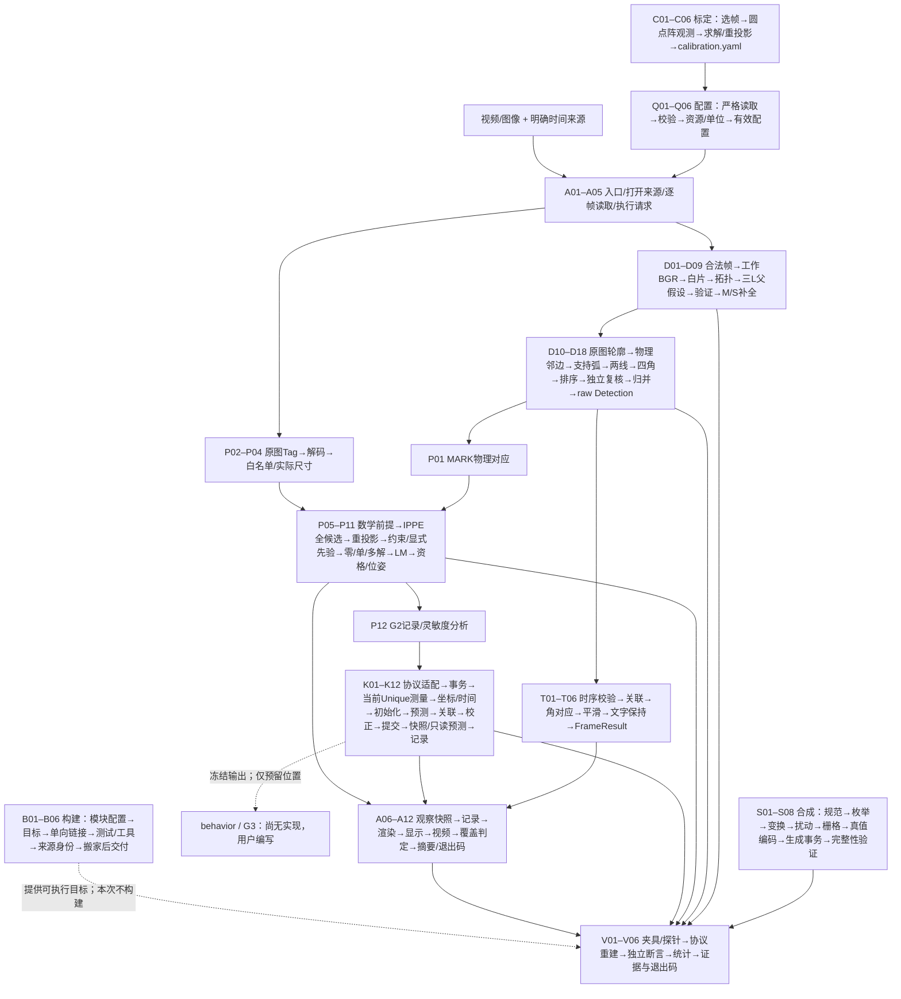

# 全量瘦身审查报告（只审不改）

## 从输入到输出的完整流程

这里的“板块”是一段流程中相对独立的步骤；下面每行就是一个板块，同一文件可以对应多行。raw 是当前帧原始检测，stable 是二维平滑结果；G2 通过已知三维点和图像点求位姿，G4 用常速度模型估计三维运动。JSONL 表示每行一条 JSON 记录。表中“当前责任”定位现行实现，“替换点”是尚未实施的内部边界草案。



运行分支说明：MARK 位姿读取 raw Detection；Tag 从原分辨率图像进入独立检测，不借用 MARK 工作图。二维平滑只供自己的结果与显示；G4 接收明确协议的 G2 当前观测，不能把 held/stable 或先验预测当新测量。Geometry 范围到 D09 停止；Decode 到 D18；Temporal/Full 再执行 T 链。失败/缺测/未就绪均携带现有状态返回，不伪造下游成功。

以下路径以 src/tushenghao/ 为根；未带 app/、tools/、tests/ 等前缀的实现模块路径位于 lib/。每个替换点优先是普通函数与明确的只读参数/返回值；129 个最终步骤（92 个主链入口中有 16 个展开为 53 个子步骤）不要求相同数量的文件、类、target 或虚接口。跨帧状态仅由 Detector、TemporalStabilizer、TargetTracker、DisplayHistory 等对应实例持有，调用时显式给出状态视图/返回下一状态。

### D 检测：当前帧 BGR → 原始 Detection

| 步骤 | 当前责任 | 输入 | 输出 | 传给下一步与替换点 |
|---|---|---|---|---|
| D01 | 校验帧与序列；pipeline/detector.cpp、frame_sequence.cpp | FrameInput（BGR、frame_id、微秒时间戳）+ 实例序列状态 | 合法帧/INVALID_INPUT；坏序列清历史 | D02；替换 validate_frame，显式输入上一帧标记，状态只归 Detector 实例 |
| D02 | 缩放与坐标映射；preprocess/preprocess.cpp | 合法 BGR + PreprocessConfig | PreparedFrame：工作 BGR、原图只读视图、像素中心映射；并非工作二值图 | D03；替换 preprocess，保留原图来源/映射契约 |
| D03 | 工作图阈值与白片轮廓；geometry/geometry_observation.cpp | 工作 BGR + GeometryConfig | 带 component_id 的 WhiteComponent 列表；工作轮廓 CHAIN_APPROX_SIMPLE | D04；替换 extractWhiteComponents，ID 不等于数组下标 |
| D04 | 近似与凹点/拓扑观察；同上、geometry_l_topology.cpp | 白片轮廓 + 观察参数 | ShapeObservation：实测转折点、形状与拓扑候选 | D05；替换 observeShapes/拓扑提取，显式保留 component_id |
| D05 | 枚举三 L 对应；geometry_matcher.cpp | L 观察 + MarkerGeometry（图纸片段） | 三片选择及其模型对应排列、资源截断信息 | D06；替换组合生成；名称 generateSixComponentCombinations 失真 |
| D06 | 枚举锚点元组并拟合仿射；geometry_matcher.cpp、geometry_anchor_evidence.cpp | 对应排列 + 每片实测凹点 + 模型 + 搜索预算 | GeometryBatch：全部可计算父假设及来源证据、截断标记 | D07；替换父假设拟合，输入不能取真值/历史补点 |
| D07 | 复核投影残差、面积、绑定；geometry_validation.cpp | 父假设 + ID→白片/模型 + GeometryConfig | 通过复核的父假设及实测 validation_residual_ | D08；替换 validateGeometryBatch；指标与门限应用可分函数 |
| D08 | 测量 M/S 匹配关系；assignment_match_metrics.hpp、geometry_assignment_completion.cpp | 父变换 + 六片模型 + 当前白片 + 已批准预算 | 每一缺片的实测可匹配候选及拓扑/边界/面积/方向指标 | D09；替换 measureAssignmentMatch，显式输入工作坐标尺度 |
| D09 | 有界一对一补全；geometry_assignment_completion.cpp | 父绑定 + 各缺片候选 + 资源预算 | 六片完整 GeometryBatch；保留竞争分支和 resource_truncated_ | D10，Geometry 范围在此返回；替换补全搜索，边界标记语义不变 |
| D10 | 定位当前原图组件；corners/corner_observation.cpp | PreparedFrame 原图 + 完整假设 + 原图观察预算 | 原图轮廓及来源对应；OriginalContourIndex 是当前帧惰性缓存 | D11；替换原图观察，缓存封装在该步骤，不由下游依赖具体结构 |
| D11 | 解析物理角邻边；corners/corner_resolver.cpp | 完整绑定 + 原图轮廓 + 图纸角身份 | 每个 P0…P3 的组件、顶点和两条模型边 | D12；替换绑定解析，共享只读角身份表，禁止每处重写规则 |
| D12 | 枚举连续支持弧；corners/corner_edge_fit.cpp | 当前轮廓 + 预测邻边方向/位置 + 原图预算 | 原端点/后验端点/完整端点支持弧与连续转折连接 | D13；替换弧提取，保留顺序、重复像素身份及来源 |
| D13 | 拟合两条实测边；corner_edge_fit.cpp、periodic_line_fit.cpp | 支持弧 + 路线/线模型 + 预算 | 两条直线、周期参数、原始与模型残差；失败原因 | D14；替换拟合策略，FastRecovery 顺序及歧义必须可复现 |
| D14 | 交点与证据组装；corner_edge_fit.cpp、corner_resolver.cpp | 两线 + 连续连接弧 + 物理角身份 | CornerMeasurement：四物理角 + CornerEvidence；不制造预测角 | D15；替换交点步骤，显式输出支撑弧/模型元数据 |
| D15 | 屏幕排序；corners/screen_order.cpp | 同一份四物理角 | ScreenOrder：LT/RT/RB/LB、物理→屏幕映射、平局信息 | D16；替换 orderScreenCorners；几何有效且方向未知仍可输出 |
| D16 | 独立复核证据与几何；detection_validator.cpp、corner_evidence_validation.cpp | 测量 + 排序 + 图像尺寸 + 原图预算 | 有效/拒绝原因；独立重拟合、残差/连接/凸性/边界检查 | D17；替换校验器，不能与生产拟合共享计算结果充当独立证明 |
| D17 | 竞争归并与方向判定；corners/semantic_resolver.cpp | 全部有效测量 + 搜索截断标记 + 几何一致性参数 | 保留的真实测量；方向唯一或 unknown；不平均假设 | D18；替换 resolveSemantics，传入完整竞争集合 |
| D18 | float 发布复核；detection_publication.cpp、pipeline/decode_stage.cpp | 保留的 double 测量 + 映射 | DecodeStageResult / raw Detection：原图角、bbox、可空 orientation | T01 / P01 / A06；替换发布适配，float 后仍检查几何；不改变公共 Detection |

### T 二维时序：raw Detection → 稳定显示结果

| 步骤 | 当前责任 | 输入 | 输出 | 传给下一步与替换点 |
|---|---|---|---|---|
| T01 | 检查时序输入与重置；temporal_stabilizer.cpp、frame_sequence.cpp | raw Detection 列表 + 帧标记/尺寸 + 该实例历史 | 合法输入或 INVALID_INPUT；显式下一状态/重置原因 | T02；替换时序输入校验；不能写回 raw |
| T02 | 关联当前目标；temporal_geometry.cpp、temporal_stabilizer.cpp | 当前列表 + 历史目标 + 关联参数 | 唯一历史匹配/歧义；无匹配选当前最大目标 | T03；替换关联，多个匹配不暗选最近 |
| T03 | 解析物理或循环角对应；temporal_geometry.cpp | 当前/历史四角 + 各自 orientation + 对应预算 | 唯一对应或 CORRESPONDENCE_AMBIGUOUS | T04；替换对应解析，unknown 不补成已知方向 |
| T04 | 按真实 dt 平滑与复核；temporal_stabilizer.cpp、temporal_geometry.cpp | 当前角 + 对应 + 历史 + dt + TemporalConfig | Track 或当前 raw 回退、bbox、平滑诊断及下一历史 | T05；替换平滑，零 dt/空帧/超偏离的回退语义保持 |
| T05 | 语义文字保持；display_history.cpp、stabilize_stage.cpp | 本帧有效文字 + 帧标记 + 独立显示历史 | 可空 DisplayState：来源帧、age、is_held | T06；替换文字保持；不得变成历史几何检测 |
| T06 | 组装 FrameResult；stabilize_stage.cpp、detector.cpp | raw detections + tracks + display_state + 状态/原因 | FrameResult；raw 与 stable 各保留自己的来源 | P01 / A06；替换内部组装，公开签名冻结 |

### P G2 位姿与 Tag：真实当前观测 → G2PoseObservation

| 步骤 | 当前责任 | 输入 | 输出 | 传给下一步与替换点 |
|---|---|---|---|---|
| P01 | MARK 来源与物理映射检查；pose/pose_estimator.cpp | 当前 raw Detection + 原图尺寸 + ExposureStamp + G2Config | P0…P3 像素与米制图纸点，或明确状态 | P05；替换 estimate_mark 前置适配；禁止取 stable/held 几何 |
| P02 | Tag 灰度适配；pose/tag_detector.cpp | 原分辨率 BGR + 曝光来源 | 灰度 C API 输入视图，保留生命周期 | P03；替换 Tag 输入适配，不复用工作图缩放 |
| P03 | AprilTag 检测与解码；tag_detector.cpp | 灰度视图 + TagConfig + 每实例原生对象 | TagObservation 列表：id、角、解码信息 | P04；替换检测后端，原生资源由本步骤实例独占 |
| P04 | Tag 白名单与尺寸适配；tag_detector.cpp | TagObservation + id→side_m + 相机参数 | 已知尺寸的四个米制物点与像点，或拒绝状态 | P05；替换 tag_pose 输入转换；未知尺寸不猜 |
| P05 | 检查数学前提与预算存在性；pose_estimator.cpp、pose_geometry.cpp | 四组 3D↔2D 点 + K/dist + 选择配置 | 可求解输入 / BudgetMissing 等现行状态 | P06；替换合法性检查；空预算原样保留，本次不改变门控 |
| P06 | 枚举平面 IPPE 解；pose_estimator.cpp | 合法点对 + K/dist | 所有 solvePnPGeneric 候选 | P07；替换 PnP 求解；不能偷选首解/最小误差当唯一 |
| P07 | 独立重投影与正深度复核；pose_geometry.cpp | 每个姿态候选 + 原始点对/相机 | 重投影误差、深度、物理姿态或数学拒绝 | P08；替换 evaluate_pose，保留独立复核 |
| P08 | 误差/安装约束/可信先验筛查；pose_estimator.cpp | 复核候选 + 已存在预算/选择配置 + 显式 PosePrior | eligible_ 与逐候选 reasons_ | P09；分别替换误差、安装、先验函数；不把硬件确认位作数值总闸 |
| P09 | 零/单/多解分类；pose_estimator.cpp | 完整候选及 eligible_ | NoSolution / Unique / Ambiguous；保留全部证据 | P10；替换分类，保持公开 PoseStatus 与候选语义 |
| P10 | 可选 LM 精修与回退；pose_estimator.cpp | 唯一候选 + refine_lm_ + 原始点对 | 复核后的 refined 或原合法解 | P11；替换精修；精修失败不抹掉原解 |
| P11 | 资格和 G2 输出适配；pose_estimator.cpp、app/pose_main.cpp | 求解状态/姿态 + 来源/硬件资格 | G2PoseObservation；control_usable_ 与硬件信息不冒充测量 | P12 / K01；替换输出适配，公共类型/签名变动均 C |
| P12 | G2 记录与灵敏度回放；pose_main.cpp、tools/validation/pose_sensitivity.cpp | G2 输出或合成点扰动 + 相机/模型 | 现行 JSONL、误差统计；不批准硬件预算 | K01 / V04；替换记录/分析步骤，保留 schema 兼容 |

### K G4 三维跟踪：当前 G2 测量 → 冻结跟踪输出

| 步骤 | 当前责任 | 输入 | 输出 | 传给下一步与替换点 |
|---|---|---|---|---|
| K01 | 读取并适配帧记录；tracking/tracking_io.cpp、app/tracking_main.cpp | G4 v4 / 旧 G2 记录 + 配置 + 显式 replay 来源 | TrackingFrame；完整整数与曝光元数据 | K02；替换 codec/旧版适配，回放不得升级硬件资格 |
| K02 | 核验帧与创建事务状态；tracking/target_tracker.cpp | TrackingFrame + 该实例旧状态 + TrackingConfig | 候选 State；坏数据回滚，原状态不提交 | K03；替换事务外壳，仅复制可变状态 |
| K03 | 选取当前 Unique 测量；tracking/measurement_adapter.cpp | G2PoseObservation + stamp + profile/sidecar | 当前合法 3D 位置 + 测量协方差 R + 来源信息 | K04；替换测量适配；不从 covariance_se3_ 猜 R |
| K04 | 转换坐标及核验时间界；measurement_adapter.cpp | 相机位置/R + 同曝光 EgoTransform + 时间元数据 | camera_relative 或确定 world_frame 的测量与资格 | K05；分别替换坐标/时间检查；缺变换不偷换坐标系 |
| K05 | 初始化或两点重建；target_tracker.cpp、kalman_cv.cpp | 当前/待定测量 + 合法 dt + profile | 新 track_id、CV 状态或 pending；无伪速度 | K06；替换 bootstrap，真实模型前提与事务保持 |
| K06 | 常速度预测；tracking/kalman_cv.cpp | 旧状态 x/P + dt + acceleration PSD | 预测 x/P；dt/有限值/正定检查 | K07；替换 predict，数学有效性错误不能当资格信息放过 |
| K07 | 创新评分与关联；target_tracker.cpp、kalman_cv.cpp | 预测状态 + 本帧候选 z/R | NIS 评分及唯一匹配/拒绝 | K08；替换关联，显式传同帧创新计算结果避免重算 |
| K08 | Joseph 校正；kalman_cv.cpp | 预测状态 + 已选测量/创新 | 校正状态与协方差 | K09；替换 correct，保留独立入口对坏 R 的防御 |
| K09 | Coasting/Lost 与提交；target_tracker.cpp | 有无更新 + gap/不确定性 + 候选状态 | 提交后状态及跟踪事件；必要时丢失 | K10；替换生命周期转换，不跨实例共享可变状态 |
| K10 | 状态快照与资格；target_tracker.cpp | 已提交状态 + profile/时钟/硬件标记 | 冻结 TrackingResult：位置、可空速度、状态及资格 | K11 / K12；替换内部 snapshot；现行速度/预测可用性门控冲突列 C |
| K11 | 指定时刻只读预测；TargetTracker::predict_to、kalman_cv.cpp | 当前状态副本 + 未来时间 | 可空预测；不修改实时状态/track_id | K12；替换未来预测实现，公开输出接口保持 |
| K12 | 跟踪记录与实验评价；tracking_io.cpp、tracking_lab.cpp | TrackingResult/预测 + 显式 truth/profile | JSONL、实验误差、资格与开放关项 | V04；替换记录/指标步骤；G-01/G-02/G-03 仍 OPEN |

### A 应用：输入路径 → 结果/证据/画面/退出码

| 步骤 | 当前责任 | 输入 | 输出 | 传给下一步与替换点 |
|---|---|---|---|---|
| A01 | 解析命令行与装配；app/main.cpp、pose_main.cpp、tracking_main.cpp | 命令行 + 各入口允许的选项 | 输入/输出路径、运行范围与配置路径 | Q01 / A02；替换入口解析，显式选项策略 |
| A02 | 打开来源与运行目录；offline_runner.cpp | 已验证 AppConfig + 视频路径 + 请求 | VideoCapture、RunMetadata、实例资源；失败不伪造成功目录 | A03；替换 source/run 初始化，路径显式传入 |
| A03 | GUI 子进程探测与窗口会话；display_probe.cpp、display_session.cpp | show_window + 可用显示环境 + 已有超时配置 | 可用窗口会话/明确失败；子进程隔离 GUI 崩溃 | A04；替换显示后端，生命周期只属 session |
| A04 | 逐帧读图与曝光标记；offline_runner.cpp、pose_main.cpp | 视频/帧源 + fps/帧号 | FrameInput / ExposureStamp；完整帧处理不被日志抽样裁剪 | A05；替换读取与时间戳适配，各自产物显式输出 |
| A05 | 执行范围与诊断请求；offline_runner.cpp、detector_diagnostics_access.hpp | 帧 + ExecutionScope + DiagnosticsRequest | 显式算法调用参数；现行 prepare/process/take 为兼容桥 | D01 / P01 / K01；替换内部 execute_and_record，保留公共 process |
| A06 | 取得算法结果及观察快照；detector.cpp、diagnostics_context.cpp | 步骤输出 + 请求 + timing 开关 | FrameResult 与独立 FrameRecord；disabled/not_executed 不记假时间 | A07；替换观察适配，诊断不能反向控制数值流程 |
| A07 | 抽样/序列与记录；diagnostics_recorder.cpp | 所有帧的结果 + selected 标记 + record | 统计、选定帧 JSONL、待完成 export 身份 | A08；替换记录存储，单调帧及重复 export 检查保持 |
| A08 | 渲染输入复核及叠图；app/debug_renderer.cpp | 本帧原图 + raw/stable + 本帧 RenderInput | 新画布 + 渲染事件；不写原图/算法结果 | A09；替换各 overlay 函数，勿读取具体 fitter/缓存对象 |
| A09 | 显示等待与用户停止；display_session.cpp、offline_runner.cpp | 画布 + playback 配置 + 会话 | 停止/继续与明确 USER_STOP | A10 / A04；替换 UI 等待策略，不改检测采样 |
| A10 | 写视频与 export timing；video_exporter.cpp、diagnostics_recorder.cpp | 每帧画布 + frame_id + export 身份 | 所有帧视频、独立导出时间记录；未完成视频标 partial | A11 / A04；替换编码器/记录适配，selected 不决定是否写视频 |
| A11 | 判断覆盖并关闭资源；input_completion.cpp、video_exporter.cpp | 实际帧数 + 可用输入总数/显式 subset + 停止原因 | RunOutcome：完成、未验证或不完整；视频读回核验 | A12；替换覆盖判定，未知不能当完整 |
| A12 | 摘要/manifest/控制台；run_report.cpp、run_console.cpp、offline_runner.cpp | RunOutcome + 只读统计快照 + provenance | summary、manifest、中文结论及退出码 | 外部消费者；替换各输出器，禁止借 mutable summary()/字符串 map 暗传数据 |

### Q 配置与只读类型：文件/值 → 已验证模块输入

| 步骤 | 当前责任 | 输入 | 输出 | 传给下一步与替换点 |
|---|---|---|---|---|
| Q01 | 读取并识别协议；lib/config/config.cpp、pose_config.cpp、tracking_config.cpp | 对应 YAML + schema_version | FileNode/原始 token + 键集合 | Q02；替换文件读取器，保留重复/未知键和类型策略 |
| Q02 | 严格字段转换；同上 | 节点/token + 显式数值/字符串/空值策略 | 有类型配置；空预算仍为空，整数不截断 | Q03；替换纯读取原语；不统一成宽松解析 |
| Q03 | 校验各模块参数；config.cpp、pose_config.cpp、tracking_config.cpp | Detector/Temporal/G2/G4 各自配置 | 数学/非法输入错误或已验证配置 | Q04；替换 validate_<module>；不得构造无关 AppConfig |
| Q04 | 解析资源与单位；config.cpp、pose_config.cpp、marker_geometry.cpp | 配置文件所在目录 + 模型/相机/profile 路径 + 单位 | 只读模型、米制点、相机、profile；身份保留 | D01 / P01 / K02；替换解析器，禁止依赖当前工作目录 |
| Q05 | 检查协方差数学前提；tracking_config.cpp、kalman_cv.cpp | R 或 camera_mse_m2_ | 有限、对称、正定结论 | Q03 / K03；替换底层纯数学检查，config 不能依赖私有滤波器 |
| Q06 | 导出 effective 配置；config.cpp | 验证后的 AppConfig + 明确输出路径 | 可往返 YAML、完整整数及既有空字段 | V04；替换严格 writer；保留 OpenCV 整数旁路的真实触发场景 |

### S 合成夹具：冻结规范 → 真值/图像/可复核记录

| 步骤 | 当前责任 | 输入 | 输出 | 传给下一步与替换点 |
|---|---|---|---|---|
| S01 | 加载规范与来源证明；tools/synth_ref/src/model.cpp | configs、inputs、source hash 和明确根目录 | 只读模型/网格/用例规范及批准状态 | S02；替换 load_context；每一步仅接收所需只读切片 |
| S02 | 枚举描述与 case_id；grid.cpp、cases.cpp | 规范 + 模式 + Visitor | 确定顺序的 descriptor/case_id | S03；替换 enumerate；Visitor 是流式输出接口，不能因单消费者删 |
| S03 | 计算几何变换；transforms.cpp | 图纸/独立测试形状 + descriptor | 解析仿射/投影矩阵及理想顶点 | S04；替换 affine/transform，不调用被测检测器生成真值 |
| S04 | 形状扰动与负例构造；perturb.cpp、cases.cpp | 理想几何 + 显式扰动描述 | 扰动多边形或明确无图场景及原因 | S05；替换 perturb/apply_special，理想与扰动几何分存 |
| S05 | 栅格与连通性复核；raster.cpp、cases.cpp | 几何 + 采样约定 | 图像、mask、instance 图及真实桥接连通结论 | S06；替换 rasterize/check_scene，保留独立手算基准测试 |
| S06 | 真值/索引编码；records.cpp | 场景 + 栅格/无图描述 + 来源规范 | truth JSON、index CSV、来源/裁切/可见性记录 | S07；替换 record codec，verify 从声明头调用，不手抄函数声明 |
| S07 | 生成事务与计划；records.cpp、main.cpp | 编码产物 + 明确 run_id/output root | INCOMPLETE 运行目录/计划，不填检测结果或预算 | S08；替换 plan/generate；目录状态显式传参 |
| S08 | 独立完整性与篡改验证；verify.cpp | 运行目录 + 原始规范 + 显式内部事务模式 | 验证记录/失败；成功才完成事务 | V04；替换 verify；公开验证不能接受未完成生成 |

### C 相机标定：视频选帧 → calibration.yaml

| 步骤 | 当前责任 | 输入 | 输出 | 传给下一步与替换点 |
|---|---|---|---|---|
| C01 | 解析标定输入；tools/calibration/calibration_config.cpp | CLI/YAML | 板格/间距/视频/明确 frame_list/输出路径 | C02；替换配置读取；无效 start/end 范围选项列删除候选 |
| C02 | 打开视频并读元信息；calibration_video.cpp | 视频路径 | VideoCapture + VideoInfo（宽/高/fps） | C03；替换视频打开；运行尺寸不回写静态配置 |
| C03 | 选帧；calibration_video.cpp、scripts/frame_picker.py | capture + 显式 frame_list；人工选择工具另行输出列表 | 带源 frame_id 的样本帧或失败 | C04；替换选帧；读失败与人工退出分开 |
| C04 | 圆点阵观测与物点构建；calibration_detection.cpp | 样本帧 + 圆点阵几何 | 带 frame_id 的成功 2D/3D 点对及失败记录 | C05；替换检测，不让丢帧隐藏来源 |
| C05 | 求解并重投影复核；calibration_result.cpp | 点对 + VideoInfo 尺寸 | K、dist、逐样本外参与重投影误差 | C06；分别替换 calibrateCamera 调用与误差计算 |
| C06 | 保存与结果报告；calibration_result.cpp、calibration_main.cpp | CalibrationResult + 图像尺寸 + 输出路径 | calibration.yaml 和统计 | Q04 / V04；替换 writer，不据误差自动批准硬件/预算 |

### V 审计/回放工具与测试：指定场景 → 可追溯判断

| 步骤 | 当前责任 | 输入 | 输出 | 传给下一步与替换点 |
|---|---|---|---|---|
| V01 | 装配场景；test_support、tests/data、tools/block3_fixture/generation/main.cpp | 固定轮廓、解析真值、生成器或显式真实输入 | 与被测算法独立的 Scene/Frame/坏数据 | V02；替换 fixture 构造，真实失败轮廓不能按历史结果重新拟合 |
| V02 | 执行指定步骤/探针；tools/audit/*.cpp、block3_fixture/diagnostics/*.cpp | 场景 + 显式 config/scope/probe | geometry/decode/temporal/角证据与阶段记录 | V03；替换被测步骤，各探针保留目标；不得复制整条流水线 |
| V03 | 重建协议与独立复算；tools/common/frame_record_reader.cpp、path_a_verify.cpp、observability_verify.cpp、final_fixes_verify.cpp | JSONL/manifest/图像 + schema + 独立约束 | 整数/来源/篡改/不完整运行及几何复算结论 | V04；分别替换 codec 与独立 validator，不能让两者共享数值答案 |
| V04 | 比对参考与断言；tests/*.cpp、tests/support/recovery112_reference.cpp、validation/recovery112_*.cpp | 被测输出 + 完整参考/手算/坏数据期望 | 明确 PASS/FAIL 和可追溯错误；本次未执行 | V05；替换断言/参考驱动，参考实现保持独立 |
| V05 | 汇总测量；block3_fixture/reporting/*.py、calibration/measure.cpp、tracking_lab.cpp、pose_sensitivity.cpp | 成功/失败测量及来源，不使用缺失值冒充零 | 统计、无数据状态、误差分布；不新增预算数字 | V06；替换统计函数，失败样本也进入报告 |
| V06 | 证据与进程生命周期；validation/recovery112_check.py、synth_ref/tests/tests.cpp、测试 main | 显式根目录/输出路径/命令结果 + 测试上下文 | 归档/退出码；临时资源清理 | 外部审阅；替换驱动，避免全局 cwd/可变 evidence_directory；历史归档脚本留旧仓 |

### B 构建与交付：源文件 → 目标与证据身份

| 步骤 | 当前责任 | 输入 | 输出 | 传给下一步与替换点 |
|---|---|---|---|---|
| B01 | 配置模块与选项；CMakeLists.txt、cmake/g2.cmake、g4.cmake | 工具链、OpenCV/AprilTag 等依赖可见性 + 构建选项 | 模块配置；未开启功能的依赖不应外溢 | B02；替换模块 CMake，顶层只设置全局/add_subdirectory |
| B02 | 定义接口和实现目标；上述 CMake、tools/*/CMakeLists.txt | 该模块源/私有头/公开头 | vision::<module> 目标与 include 范围 | B03；每模块自己的清单；不靠全树内部 include 导出 |
| B03 | 声明单向链接；各模块 CMake 原型 | types/config、detection、pose、tracking 等目标 | 显式 target_link_libraries DAG（单向依赖图） | B04；替换模块实现只维持边界目标，config 不反依赖 tracking |
| B04 | 登记测试与工具；根/工具/G2/G4 CMake | 模块目标 + 启用选项 | 镜像 tests 与各工具目标 | B05；替换测试装配；真实验证目标均保留，空成功目标删除 |
| B05 | 生成构建来源身份；根 CMake、synth_ref/CMakeLists.txt | 该目标源码/CMake/输入规范清单 | 代码与规范 fingerprint/provenance | B06；替换 provenance 生成，不把未链接模块变化当本目标算法变化 |
| B06 | 搬家后验证与纯文件交付；本底稿的顺序 | 瘦身后的 refactor/lean 文件 + 用户创建的私有空仓 | vision/ 初始提交及重新生成的证据 | 结束；本次只写计划；不搬 .git/build/evidence，不合回 main |


### 文件内部的步骤细化

主链表给顺序和入口；下面把同一文件内可独立替换的子流程展开。有细化的父编号只是定位入口，不额外计作一个独立板块；其边界以子编号为准。没有把每个循环/加减算术或同类每条线机械计为新板块。

#### D03 工作白片提取的内部顺序

| 子步骤 | 当前责任 | 输入 | 输出 | 下一步与替换点 |
|---|---|---|---|---|
| D03.a | 转灰度；geometry_observation.cpp | 工作 BGR | 工作灰度 | D03.b；替换颜色适配，不改坐标域 |
| D03.b | 二值化；geometry_observation.cpp | 工作灰度 + white_threshold_ | 工作 mask | D03.c；替换阈值实现，参数显式给出 |
| D03.c | 外轮廓提取；geometry_observation.cpp | 工作 mask | CHAIN_APPROX_SIMPLE 原始外轮廓序列 | D03.d；替换轮廓后端，输出仍为工作坐标 |
| D03.d | 组件计量与身份；geometry_observation.cpp | 轮廓 + min_area_ + 工作尺寸 | 带稳定 ID、area、bbox、border 的 WhiteComponent | D04；替换组件描述，消费者按 ID join |

#### D04 观察与 L 拓扑的内部顺序

| 子步骤 | 当前责任 | 输入 | 输出 | 下一步与替换点 |
|---|---|---|---|---|
| D04.a | 近似轮廓；geometry_observation.cpp | 组件轮廓 + approximation_epsilon_ | 诊断 simplified_polygon_ | D04.b；替换 approxPolyDP 调用，不把近似点当原图角 |
| D04.b | 转折与基础描述；geometry_observation.cpp | 近似顶点 + 组件来源 | 凸凹 turns/基础 shape 描述 | D04.c；替换转折描述；基础标签不是完整证据 |
| D04.c | 多尺度有界拓扑；geometry_l_topology.cpp | 原组件轮廓 + 明确观察规则 | 合法六顶点 L 候选与对应凹点 | D05/D06；替换拓扑观察，规则与候选顺序显式 |

#### D08 匹配计量的内部顺序

| 子步骤 | 当前责任 | 输入 | 输出 | 下一步与替换点 |
|---|---|---|---|---|
| D08.a | 面积预筛；geometry_assignment_completion.cpp | 实测组件面积 + L 参考面积 + 模型面积 | AreaMetric 或明确不匹配 | D08.b；替换面积度量，F15 复用同值 |
| D08.b | 轮廓拓扑候选；assignment_match_metrics.hpp | 组件轮廓 + 模型顶点数 + epsilon | 合法的实测近似/子序列拓扑 | D08.c；替换候选观察，完整当前轮廓仍是来源 |
| D08.c | 投影与边界采样；assignment_match_metrics.hpp | 模型多边形 + 父仿射 + 采样步长 | 投影边与双向有限边界距离 | D08.d；替换距离计量，不重估父变换 |
| D08.d | 方向与指标组装；assignment_match_metrics.hpp | 拓扑/投影/边界/面积 | valid/topology_valid 与全部匹配指标 | D08.e；替换方向计量，明确工作单位 |
| D08.e | 应用匹配规则；geometry_assignment_completion.cpp | 只读指标 + 已存在预算 | 每个 model_piece 的可匹配 component_id 集合 | D09；替换规则应用，资源搜索不藏在计量函数 |

#### D12/D13 连续弧与线拟合的内部顺序

| 子步骤 | 当前责任 | 输入 | 输出 | 下一步与替换点 |
|---|---|---|---|---|
| D12.a | 提取端点描述；corner_edge_fit.cpp | 完整有序原轮廓 + 当前路线模式 | 原始/后验/完整端点集合 | D12.b；替换端点观察，输出端点仍可追溯 |
| D12.b | 构造连续支持；corner_edge_fit.cpp | 端点区间 + 原轮廓 | 带序列 ID、first/last、支持像素的弧 | D12.c；替换支持提取，重复像素身份不能丢 |
| D12.c | 候选弧筛查；corner_edge_fit.cpp | 支持弧 + 模型边/原图预算 | 有足够独立点/跨度/方向的 eligible arcs | D12.d；替换筛查，拒绝原因显式 |
| D12.d | 有序邻接配对；corner_edge_fit.cpp | eligible arcs + 轮廓顺序/连接弧 | 两条可相邻的支持弧对及连接 | D13.a；替换配对搜索，不按空间邻近拼接 |
| D13.a | 估计线模型；corner_edge_fit.cpp、periodic_line_fit.cpp | 支持点序列 + Legacy/周期模型策略 | 物理线、axis/coefficient 或失败 | D13.b；替换估计器，周期模型保留完整原点 |
| D13.b | 计量原始/模型残差；同上 | 物理线、周期参数、支持像素 | 两套 mean/max 残差 | D13.c；替换计量，不偷换 raw 字段定义 |
| D13.c | 候选合法性与路线选择；corner_edge_fit.cpp | 线/残差 + 连接/跨度/延伸预算 + 明确路线 | 首个满足现行顺序的唯一解或歧义/失败 | D14；替换候选选择，保留 FastRecovery/reference 顺序；缓存只在本次调用 |

#### D15 屏幕排序的内部顺序

| 子步骤 | 当前责任 | 输入 | 输出 | 下一步与替换点 |
|---|---|---|---|---|
| D15.a | 检查有限/重复/凸性；screen_order.cpp | 四个 double 物理角 | 可排序几何或明确失败 | D15.b；替换合法性检查，不新增工程门限 |
| D15.b | 枚举循环起点并规范绕向；screen_order.cpp | 合法四角环 | 固定四个循环候选 | D15.c；替换循环枚举，不能扩成任意标签猜测 |
| D15.c | 坐标归一化；screen_order.cpp | 一个循环候选 | 归一化四点或退化失败 | D15.d；替换 normalize_points，显式传候选 |
| D15.d | 计算屏幕排序能量；screen_order.cpp | 归一化四点 | 候选 energy_ | D15.e；替换 compute_energy，输出标量供选择 |
| D15.e | 最小值/平局/字典序；screen_order.cpp | 全部候选和能量 | best_index + tie | D15.f；替换选择，平局集合基于同一最小值 |
| D15.f | 形成映射结果；screen_order.cpp | 选定点序 + 原物理角身份 + tie | ScreenOrder 或 ScreenCycleOrder 适配 | D16；替换映射组装，不与 float 发布排序共用旧产物 |

#### P08 资格判断的内部顺序

| 子步骤 | 当前责任 | 输入 | 输出 | 下一步与替换点 |
|---|---|---|---|---|
| P08.a | 预算数值比较；pose_estimator.cpp | 候选独立误差/投影面积 + 已有预算 | 误差拒绝原因或通过 | P08.b；替换误差比较，缺预算仍按现行状态处理 |
| P08.b | 安装几何约束；pose_estimator.cpp | 候选姿态 + 显式 selection | z/normal 约束结论 | P08.c；替换 passes_constraints，法向仅需要时计算 |
| P08.c | 可信先验检查；pose_estimator.cpp | 候选 + 显式 PosePrior + 当前 stamp/会话 | 时效/身份/位置/旋转一致性原因 | P09；替换 passes_prior；先验不从 tracker 暗取 |

#### K04/K06/K08 坐标、时间和数值更新的内部顺序

| 子步骤 | 当前责任 | 输入 | 输出 | 下一步与替换点 |
|---|---|---|---|---|
| K04.a | 坐标模式与同曝光变换；measurement_adapter.cpp | 相机 z/R + coordinate_mode + 可空 EgoTransform | 指定 camera/world 坐标的测量 | K04.b；替换坐标适配，缺 world 变换明确拒绝 |
| K04.b | 时间界与来源资格；measurement_adapter.cpp、target_tracker.cpp | stamp/uncertainty/profile 域 | TimeQualification 与合法 dt 信息 | K05；替换时间适配，不以来源确认位代替数值界 |
| K06.a | 构建 F/Q；kalman_cv.cpp | 合法实际 dt + acceleration PSD | 常速度转移与过程噪声矩阵 | K06.b；替换模型离散化，保留单位/维数 |
| K06.b | 传播状态与协方差；kalman_cv.cpp | x/P + F/Q | 预测 x/P | K06.c；替换矩阵预测，不写实时 tracker 副本外状态 |
| K06.c | 预测数值复核；kalman_cv.cpp | 预测 x/P | 有限/对称/正定的预测或数学错误 | K07；替换复核，失败不提交 |
| K08.a | 增益与状态校正；kalman_cv.cpp | 预测 x/P + 当前 z/R/创新 | Kalman gain 与校正 x | K08.b；替换校正，F22 复用同版本创新 |
| K08.b | Joseph 协方差与数值复核；kalman_cv.cpp | 增益、预测 P 与 R | 合法校正 P 或错误 | K09；替换协方差更新，独立入口仍验证坏矩阵 |

#### A10 视频导出的内部顺序

| 子步骤 | 当前责任 | 输入 | 输出 | 下一步与替换点 |
|---|---|---|---|---|
| A10.a | 打开 partial 编码器；video_exporter.cpp | run_dir + size/fps/fourcc | 本会话 writer 与 partial 路径 | A10.b；替换编码后端，不改变协议允许的编码 |
| A10.b | 逐帧校验并写入；video_exporter.cpp | 当前 overlay + writer 状态 | 写入尝试与 written_frames_ | A10.c 或 A04；替换 write，关闭/尺寸错明确失败 |
| A10.c | 关闭并读回；video_exporter.cpp | 已写 partial + 期望尺寸/帧周期/写帧数 | 可解码数量/尺寸/周期核验结果 | A10.d；替换读回验证；write 返回不代表成功落盘 |
| A10.d | 按覆盖结论发布；video_exporter.cpp、input_completion.cpp | 读回合格 + input_complete | complete 才 rename overlay.mp4，否则保留 partial | A12；替换发布动作，不能把未知覆盖当成功 |

#### S06/S07 真值与生成事务的内部顺序

| 子步骤 | 当前责任 | 输入 | 输出 | 下一步与替换点 |
|---|---|---|---|---|
| S06.a | 理想/扰动/可见几何；truth_record.cpp（现 records.cpp） | Scene + 原始几何/变换 + 栅格 | 裁切/可见性/锚点/片段真值 | S06.b；替换真值构造，不读取检测结果 |
| S06.b | JSON/CSV/PNG 编码；record_codec.cpp（现 records.cpp） | 真值与图像 + 固定协议列 | 确定字段/列/字节与 hash | S07.a；替换编码器；verify 共享格式声明，不共享判定 |
| S07.a | 建立生成事务；generation.cpp（现 records.cpp） | 输入规范/批准状态 + run_id/output_root | 拒绝覆盖的新目录与 INCOMPLETE manifest | S07.b；替换事务建立，批准/规范输入显式 |
| S07.b | 枚举并写产物；generation.cpp（现 records.cpp） | descriptor 流 + S03…S06 + 输出目录 | 图像/真值/索引/有效配置及实际计数 | S07.c；替换存储；失败保留 INCOMPLETE 与原因 |
| S07.c | 内部验收并完成；generation.cpp、verify.cpp | 写完产物 + 显式 pending_generation 模式 | verify 合格后 manifest COMPLETE，否则 INCOMPLETE | S08/V04；替换事务完成；公开 verify 不接受 pending 冒充完成 |

#### C04/C05 圆点阵与标定数值的内部顺序

| 子步骤 | 当前责任 | 输入 | 输出 | 下一步与替换点 |
|---|---|---|---|---|
| C04.a | 创建板物点；calibration_detection.cpp | rows/cols + finite 正间距 | 固定米制三维点阵 | C04.b；替换板几何构建，不从像点反推物点 |
| C04.b | 灰度与圆心检测；calibration_detection.cpp | 样本帧 + board_size | findCirclesGrid 对应圆心或未检出 | C04.c；替换观测后端，仍输出真实点阵对应 |
| C04.c | 来源与点对组装；calibration_detection.cpp | frame_id + 圆心 + 板物点 | 成功点对与失败信息 | C05.a；替换组装，保留原帧身份（F60） |
| C05.a | 相机求解；calibration_result.cpp | 合法点对 + 明确 image_size | K/dist、逐样本外参及 OpenCV RMS | C05.b；替换求解器，不自动批准硬件 |
| C05.b | 独立重投影误差；calibration_result.cpp | K/dist/外参 + 原始点对 | 逐点/总体重投影误差 | C06；替换误差复核，不拿 solver 的 RMS 当唯一证据 |

#### V03 协议复算的内部顺序

| 子步骤 | 当前责任 | 输入 | 输出 | 下一步与替换点 |
|---|---|---|---|---|
| V03.a | 解析协议 token；frame_record_reader.cpp、各 verifier | JSONL/manifest 原字节 | 完整整数、字符串、布尔、null 等有类型值 | V03.b；替换 parser，不能经 double 丢整数精度 |
| V03.b | 检查 schema/身份/顺序；各 verifier | 有类型字段 + 显式 expected/source manifest | 本帧且字段完整的证据或非法输入 | V03.c；替换协议校验，不以缺字段默认值蒙混 |
| V03.c | 核验来源与产物；各 verifier | 文件路径/hash + 覆盖/完成状态 | 真实输入/输出身份与完整性结论 | V03.d；替换字节身份检查，旧仓归档不是新运行 |
| V03.d | 独立几何/数值复算；path_a_verify.cpp 等 | 完整证据与原始支持/真值 | 复算匹配或明确篡改/不可复算 | V04；替换独立 validator，生产拟合结果只作待核对象 |


## 审查基线、范围与方法

已先成功读取用户指定的重构提示词，再读取仓库文档，再审当前实现；开始时 git status 确认为 refactor/lean，工作树干净。本文是只读审查建议；唯一交付为本文和 move-layout-draft.md。没有修改代码/配置/依赖/接口，没有编译、配置构建、运行程序/脚本或测试；下文“覆盖”均指已读测试源码中的覆盖，绝不表示本轮运行通过。

| 输入范围 | 数量与处理 |
|---|---|
| src/tushenghao/ 现有文件 | 5,378 个，含隐藏/忽略文件；逐路径登记搬迁去向 |
| 现行源码、头、脚本、配置、格式与 CMake | 222 个，约 36,735 个物理文本行，全部读取；不是只查 G2/G4 |
| 固定测试轮廓文本 | 7 个，全部读取，保留原始数据 |
| Markdown 输入 | 141 份：本模块/工具/历史/evidence 索引、根 README 和根 docs；全文读取，相同副本/段落逐字比对后复用阅读 |
| 非 evidence 区文件 | 302 个：上述 222 + 7 个固定数据 + 61 份 Markdown + 6 个旧架构数据文件 + 6 段历史输出视频 |
| evidence 区文件 | 5,076 个，含嵌套 tools/*/docs/evidence；逐路径登记，已读其全部 Markdown/索引，并核对现行引用 |
| 其中历史代码快照/复现脚本 | 1,217 个，按归档版本/用途识别，保留旧仓原件；不将归档历史版本当作当前构建的另一套待瘦身实现 |
| 旧架构 JSON/CSV/DOT、视频 | 架构数据检查其来源/路径性质，视频只登记为历史输出；没有解码/播放 |

“全量”指当前 222 个代码/配置/构建输入逐文件审阅，外加固定轮廓和全部要求的 Markdown。归档代码按历史证据处理，不声称逐版本重新审计过所有历史实现，也不建议改写它们。当前 CMake 没有把这些归档 .cpp 加入生产目标；现行 recovery112_check.py 读取历史数据的路径依赖已列 F49。逐文件表覆盖所有 5,378 个现有文件，避免任何“只按目录笼统排除”的遗漏。

流程先行：先整理前面的 129 个最终步骤（含文件内部子流程），再核对每一步的显式参数、返回值、状态所有者和消费者；只有步骤内部无实际用途的包装/重复才进入删减候选。单消费者的板块接口保留，“可独立替换实现”本身就是实际触发场景。独立参考、坏数据注入、篡改检查与完整回放不能按重复实现删除。

### 否定结论的可复查检索口径

S1–S7 使用 rg --hidden --no-ignore 与已读取的同一全文清单逐行核对；声明、注释、自调用、配置读写、测试和实际算法消费分开计数。现行检索范围是 src/tushenghao/{app,include,lib,tools,tests,test_support,config,cmake} 与 CMakeLists.txt，排除所有 **/docs/** 和 **/evidence/**；需要查文档引用时另在全部 Markdown 内检索。这里的“无消费者”只针对该明确范围，不推断仓外调用者。

| 编号 | 搜索内容与核对结果 |
|---|---|
| S1 | computePolygonArea、computeCentroid、computeAnchorOffset、computeBoundingBox 与 core/geometry_utils.hpp：只有声明/定义、helper 自调用、geometry_utils_test；CMake 只登记实现/测试；F09 |
| S2 | local_search_margin_ratio_、edge_point_distance_threshold_、reject_truncated_corner_：公开字段、config.cpp 读/验/写和两类测试；无现行算法读取。兼容字段不能直接删，F10 为 C |
| S3 | simplification_error_：类型默认、观察器恒零赋值、serializer 输出；无其他测量赋值/数值消费者；F11 |
| S4 | temporal_audit.cpp 内整词 overwrite：仅声明、重复键检查、赋值；其他工具拒绝覆盖或 realtime slot_overwrite_count 不属于该局部变量；F41 |
| S5 | cases.cpp::check_scene 的局部 center：仅声明、累加、缩放三行；真正 label 从 instance 像素读取；F56 |
| S6 | start_frame/end_frame：calibration_config 的默认/解析/校验与帮助文字；calibration_main 只把 frame_list 交给 extract_frames_by_list；F58 |
| S7 | temporal_record.hpp、audit::frameRecord、audit::quote：头内定义、CMake hash 清单、工具索引；活动源码无 include/调用；F69 |
| S8 | CornerBinding：现行代码只有类型定义，实际 resolver 另有局部 Binding；不简单删除接口，而在 F01 合并为真正被步骤使用的只读角身份契约 |
| S9 | path_a_verify 的 measurement 与 serialize_corner_evidence 函数体逐字段对照 CornerEvidence：缺线模型/周期/模型残差字段；用当前 validator 的 finite/same 条件核对后得 F21，而非仅凭一次搜索断言 |

可复查命令形式如下；符号组替换成上表对应内容即可。配置键还补查 .yaml，声明/使用结果再按函数体判断，不以文本命中数量直接当调用次数。

```text
rg -n --hidden --no-ignore -g '!**/docs/**' -g '!**/evidence/**' -g '*.cpp' -g '*.hpp' -g '*.py' -g '*.cmake' -g CMakeLists.txt '符号组' src/tushenghao
```

## 总览统计

共 **71 项**：**A 6**、**B 59**、**C 6**；其中 **耦合 26 项**。一项按主因/主要所有者计数，跨步骤引用不重复计数。

| 模块 | 条数 | A | B | C | 类别分布 | 可删旧行估算 |
|---|---:|---:|---:|---:|---|---:|
| 检测/角点 | 15 | 1 | 14 | 0 | 耦合 3；AI 味 2；命名 2；可合并 2；逻辑优化 4；过度防御 1；流程不清 1 | 249–345 |
| 可观测性/应用 | 11 | 1 | 10 | 0 | 耦合 7；过度防御 1；可合并 2；命名 1 | 51–127 |
| 配置/构建 | 13 | 1 | 8 | 4 | 耦合 6；AI 味 3；命名 1；可合并 1；流程不清 1；过度设计 1 | 199–327 |
| G2 位姿 | 3 | 0 | 2 | 1 | 耦合 1；可合并 1；逻辑优化 1 | 10–25 |
| G4 跟踪 | 4 | 0 | 3 | 1 | 逻辑优化 3；过度设计 1 | 10–27 |
| 工具/测试 | 24 | 3 | 21 | 0 | 可合并 3；AI 味 5；耦合 9；流程不清 6；过度设计 1 | 228–473 |
| 文档/导航 | 1 | 0 | 1 | 0 | 流程不清 1 | 0–0 |

| 类别 | 条数 | A | B | C |
|---|---:|---:|---:|---:|
| 耦合 | 26 | 0 | 23 | 3 |
| AI 味 | 10 | 3 | 6 | 1 |
| 命名 | 4 | 0 | 3 | 1 |
| 可合并 | 9 | 0 | 9 | 0 |
| 逻辑优化 | 8 | 0 | 8 | 0 |
| 过度防御 | 2 | 2 | 0 | 0 |
| 流程不清 | 9 | 0 | 9 | 0 |
| 过度设计 | 3 | 1 | 1 | 1 |

**可删旧行估算 747–1324 行，其中 A 约 157–160 行。**估算包含失效注释、未使用文件和重复代码；按每项不重叠旧片段计，不把文件移动、函数改名、原封不动移入新 helper 当删除。解耦会新增必要参数/契约/适配代码，因此这不是净行数承诺；C 不计收益，未凭空给接口决策计删减额。每项下方也给自己的估算。

分级：A 可直接删，现有测试覆盖相关实际通路且静态可证不改行为；B 建议改，需按给定方案验证行为/协议；C 需你定，涉及公开接口/配置兼容或冻结输出语义。本文没有执行 A，也没有把 B/C 自动视为实施授权。所有空预算保持现状，G-01/G-02/G-03 均 OPEN。

优先处理顺序：先 F21 的证据协议断链、F44 的 ID 暗约定与 F48/F61/F62 的坏输入/失败表达；再做 A 的小清理；随后按流程切断 F01–F07/F20/F38/F43/F49/F50/F53–F60/F71 的耦合。C 独立保留决策，不阻塞其他内部瘦身；不能用删除验证或填预算换取通过。

## 逐条发现

### F01 · 物理角身份在三个步骤分别硬编码

**B 建议改｜耦合｜检测/角点｜步骤 D11/P01/Q04。**

位置：`src/tushenghao/lib/corners/corner_resolver.cpp:87`；`src/tushenghao/lib/corners/corner_evidence_validation.cpp:33`；`src/tushenghao/lib/config/pose_config.cpp:92`；`src/tushenghao/lib/corners/corner_types.hpp:68`。

证据：resolver、独立证据校验、G2 米制取点分别维护片段/顶点/邻边对应。换模型编号或顶点顺序必须联改；已有 CornerBinding 完全未被使用，另有局部 Binding。

动作：合并身份描述：把现有 CornerBinding 收敛为只读 ModelCornerContract，由模型加载步骤产生并显式传给三处；删未使用的重复类型说明/局部表。只共享身份，不共享拟合结果与验证数值。

覆盖与后续验证：已有 corner_resolver_test、block3_contract_regression_test::invalidEvidence、pose_contract_test 的物理槽置换；尚无跨三个入口的一致契约测试，后续以重排模型顶点的合法 fixture 验证。

可删旧行估算：12–28；零表示主要是边界/语义整理，不虚报删除收益。

### F02 · 观察请求成为算法控制暗道

**B 建议改｜耦合｜可观测性/应用｜步骤 D09/A05/A06。**

位置：`src/tushenghao/lib/pipeline/decode_stage.cpp:197`；`src/tushenghao/app/offline_runner.cpp:304`。

证据：runDecodePipeline 通过可空 FrameDiagnosticsContext 内的 request.scope 决定提前返回。换掉记录实现或漏传 context，执行范围随之改变。

动作：理顺流程：范围成为算法入口的显式输入，先得到 GeometryStepsOutput，再按范围调用 decode/temporal；context 只接收观察。保留 public Detector::process 与 geometry/decode/temporal 工具入口。

覆盖与后续验证：observability_integration_test::scopes、geometry_budget_isolation 覆盖现行范围隔离；后续替换空 observer 与记录 observer，比较同范围全部数值输出。

可删旧行估算：0–10；零表示主要是边界/语义整理，不虚报删除收益。

### F03 · StageDetails 绑住阶段实现并复制阶段状态

**B 建议改｜耦合｜可观测性/应用｜步骤 D02/D03/A06/A08。**

位置：`src/tushenghao/lib/pipeline/diagnostics_context.hpp:20`；`src/tushenghao/lib/pipeline/diagnostics_context.hpp:10`；`src/tushenghao/lib/pipeline/decode_stage.cpp:236`；`src/tushenghao/app/debug_renderer.cpp:12`。

证据：PreparedFrame 同时是预处理结果和后续组件容器；components 又单独复制入 StageDetails。generated/validated/completed/decoded 与实验网格具体结构向 renderer、serializer 泄漏。更换几何步骤会牵连观测与渲染。

动作：理顺流程：PreparedImage、ComponentObservations、GeometryCandidates 按步骤返回；仅 evidence 模式按需保存只读快照，RenderInput 用叠图所需点/线/坐标变换，实验网格归工具适配器。使用普通值/const 引用，不增加虚类框架。

覆盖与后续验证：debug_renderer_test::mapping/mismatch/off、observability_integration_test::raw/consistency、diagnostics_record_test::evidence；后续以同契约替代组件提取器验证下游无需改动。

可删旧行估算：8–24；零表示主要是边界/语义整理，不虚报删除收益。

### F04 · 模块构造绕到全应用配置校验

**B 建议改｜耦合｜配置/构建｜步骤 Q03/T01/D01。**

位置：`src/tushenghao/lib/pipeline/temporal_stabilizer.cpp:32`；`src/tushenghao/lib/pipeline/detector.cpp:39`；`src/tushenghao/lib/config/config.cpp:609`。

证据：TemporalStabilizer 和 Detector 把自己的参数塞进默认 AppConfig 再 validateConfig，依赖无关 output/offline/diagnostics 的默认合法性。

动作：合并校验规则但分开入口：内部 validateDetectorConfig、validateTemporalConfig、validateObservabilityConfig 各显式接收对应配置；现有 validateConfig 仅顺序组合。保留每个可独立替换入口的输入检查。

覆盖与后续验证：config_error_test::temporalErrors、config_roundtrip_test、temporal_stabilizer_test::parameters、observability_integration_test::configCases；后续让无关 AppConfig 部分故意非法，验证模块入口只受自身输入约束。

可删旧行估算：5–15；零表示主要是边界/语义整理，不虚报删除收益。

### F05 · config 反向依赖私有 Kalman 实现

**B 建议改｜耦合｜配置/构建｜步骤 Q05/K03。**

位置：`src/tushenghao/lib/config/tracking_config.cpp:2`；`src/tushenghao/lib/config/tracking_config.cpp:158`；`src/tushenghao/lib/tracking/kalman_cv.cpp:41`。

证据：tracking_config.cpp 只为正定判断引入 kalman_cv.hpp；按文件搬迁将直接破坏 types/config → tracking 的单向边界。

动作：理顺流程：将有限/对称/正定的纯数学契约放到低层私有 math 目标，由 config 与 tracking 链接；滤波器实现只依赖它。保持配置和滤波两个入口均校验非法矩阵。

覆盖与后续验证：tracking_contract_test 的负定/NaN R 与数学检查、配置 profile 负例；后续分别构建 config 和 tracking 目标并检查 config 不含 tracking 私有 include。

可删旧行估算：0–0；零表示主要是边界/语义整理，不虚报删除收益。

### F06 · 报告为 JSON 引号反向包含记录器

**B 建议改｜耦合｜可观测性/应用｜步骤 A07/A12/V03。**

位置：`src/tushenghao/lib/pipeline/run_report.cpp:2`；`src/tushenghao/lib/pipeline/run_report.cpp:66`；`src/tushenghao/lib/pipeline/diagnostics_recorder.hpp:3`。

证据：run_report 只需要 quoteJson，却导入 recorder；recorder 又需要 RunSummary/RunMetadata。格式化和存储互相依赖，不能分别替换。

动作：合并纯 JSON token/字符串转义到 record_codec 私有头及实现；run_report 与 recorder 都只依赖 record_types/codec，文件写入仍归 recorder。

覆盖与后续验证：diagnostics_record_test 的转义、非有限字段、摘要和完整整数用例；后续分别链接报告器/记录器，逐字比较当前协议。

可删旧行估算：0–4；零表示主要是边界/语义整理，不虚报删除收益。

### F07 · 运行结论经可写 summary 和字符串 map 传递

**B 建议改｜耦合｜可观测性/应用｜步骤 A07/A11/A12。**

位置：`src/tushenghao/lib/pipeline/diagnostics_recorder.hpp:25`；`src/tushenghao/app/offline_runner.cpp:491`；`src/tushenghao/app/run_console.cpp:136`；`src/tushenghao/app/run_console.cpp:138`。

证据：runner 直接修改 recorder 的统计与完成状态，console 用 environment 的特定字符串键解码业务结论；替换摘要或存储步骤需要同步知道这些隐约定。

动作：理顺流程：evaluate_input_completion 返回的 RunOutcome 与外部耗时显式交给 finish(outcome, overhead)，summary 仅返回只读快照；console 直接接收 RunOutcome，manifest 适配器再编码原键名。

覆盖与后续验证：observability_integration_test::input_completion/console_contract/video_sampling、diagnostics_record_test::exports；后续分别替换 console 和 recorder，保持 summary/manifest/退出码一致。

可删旧行估算：3–10；零表示主要是边界/语义整理，不虚报删除收益。

### F08 · const config() 仍泄漏相机可变存储

**C 需你定｜耦合｜G2 位姿｜步骤 P01/P11/Q04。**

位置：`src/tushenghao/include/mark/pose_estimator.hpp:30`；`src/tushenghao/lib/pose/pose_estimator.cpp:57`；`src/tushenghao/lib/pose/tag_detector.cpp:134`。

证据：构造器 clone 防住入参别名，但消费者可复制 config().camera_.K_ 到非 const cv::Mat 后改写共享底层数据。换一个读取配置的板块即可改变求解器状态。

动作：需你定：保留旧签名并隔离展示副本只能保护内部求解参数，仍不能让返回值成为不可变配置。彻底隔离推荐按值深拷贝快照或只读相机数值接口；这会影响公共签名、noexcept 及 tag_pose 消费方式，禁止本次实施。

覆盖与后续验证：现有 pose_contract_test 未覆盖通过 config() 复制 Mat 后写入；后续加入 K/dist 别名写入、独立实例及连续求解不变性测试。

可删旧行估算：0–0；零表示主要是边界/语义整理，不虚报删除收益。

### F09 · 旧图纸几何 helper 只被专属测试使用

**B 建议改｜AI 味｜检测/角点｜步骤 Q04。**

位置：`src/tushenghao/lib/core/geometry_utils.hpp:13`；`src/tushenghao/lib/core/geometry_utils.cpp:54`；`src/tushenghao/tests/geometry_utils_test.cpp:11`；`src/tushenghao/CMakeLists.txt:14`。

证据：按 S1 方法检索 computePolygonArea/computeCentroid/computeAnchorOffset/computeBoundingBox；现行调用仅 geometry_utils_test 和 helper 内自调用。正式观察使用 observed_geometry_utils，模型加载有自己的合法性核验。该 helper 不是实际步骤间接口。

动作：删 geometry_utils.hpp/.cpp、仅测试这组未消费 helper 的 geometry_utils_test.cpp 及 CMake 登记；保留 observed_geometry_utils.hpp、geometry_model_test 与全部观察/拓扑验证。因删除测试目标列 B。

覆盖与后续验证：geometry_utils_test 证明其局部数学，不证明有业务消费者；后续正常全目标构建及 detector/geometry_model/geometry_anchor_evidence 回归，并复查符号零引用。

可删旧行估算：194–194；零表示主要是边界/语义整理，不虚报删除收益。

### F10 · 三个公开角点旋钮未被算法消费

**C 需你定｜AI 味｜配置/构建｜步骤 Q02/D10/D12。**

位置：`src/tushenghao/include/mark/detector_config.hpp:123`；`src/tushenghao/include/mark/detector_config.hpp:161`；`src/tushenghao/include/mark/detector_config.hpp:185`；`src/tushenghao/lib/config/config.cpp:293`；`src/tushenghao/tests/block3_contract_regression_test.cpp:190`。

证据：S2 检索显示这三字段只存于公开类型、配置读/验/写和测试；实际原图步骤不用它们。reject_truncated_corner_=false 的负例仍要求拒绝坏角，是刻意行为，不能为让开关生效而放松验证。

动作：需你定：删除公开字段及 YAML 键并版本化配置，或保留旧字段为明确 deprecated 的兼容载荷。推荐待外部调用方确认后删除；绝不实现另一条无预算算法。

覆盖与后续验证：config_roundtrip_test、block3_contract_regression_test::budgetConfig/invalidEvidence 覆盖旧格式；后续旧配置迁移/拒绝策略及截断负例回归。

可删旧行估算：0–0；零表示主要是边界/语义整理，不虚报删除收益。

### F11 · 未测量 simplification_error_ 恒为零

**B 建议改｜AI 味｜检测/角点｜步骤 D04/A07。**

位置：`src/tushenghao/lib/core/geometry_types.hpp:137`；`src/tushenghao/lib/geometry/geometry_observation.cpp:203`；`src/tushenghao/lib/pipeline/diagnostics_recorder.cpp:365`。

证据：观察器不计算该误差，却向 JSON 记录数值零；日志消费者会误读为已测且无误差。S3 检索未发现其他赋值或算法消费。

动作：删内部伪测量成员/赋值；旧记录适配中将其明确编码为 unknown/null 并注明 schema 兼容。不得新增误差门限或把未知补零。

覆盖与后续验证：diagnostics_record_test 只覆盖部分字段，无 unknown 专项；后续检查 Evidence JSON 的字段存在性与旧版读取策略，不改检测数值。

可删旧行估算：3–7；零表示主要是边界/语义整理，不虚报删除收益。

### F12 · 三 L 枚举与诊断仿射的名字混淆用途

**B 建议改｜命名｜检测/角点｜步骤 D05/V02。**

位置：`src/tushenghao/lib/geometry/geometry_matcher.cpp:126`；`src/tushenghao/lib/geometry/geometry_matcher.cpp:247`；`src/tushenghao/tools/block3_fixture/diagnostics/parent_diagnose.cpp:148`。

证据：前者枚举三片 L 的模型对应，六指排列并非六个输入片；后者是首凹点拟合的诊断路径，正式路径使用 fitAnchorTuple。它有真实 alternativeAnchors 调用，不能当未使用算法删除。

动作：改名 generateThreeLAssignments；将仅供探针的首凹点仿射 helper 片段移到 parent_diagnose.cpp，改名 fitFirstConcaveAnchorAffine，并删 geometry_matcher.hpp 对它的生产声明。保留正式候选生成接口和 alternativeAnchors 探针。

覆盖与后续验证：geometry_matcher_test、geometry_anchor_evidence_test；parent_diagnose 没有专用自动回归，后续对同输入比较改名前后的所有诊断行。

可删旧行估算：0–5；零表示主要是边界/语义整理，不虚报删除收益。

### F13 · ID 查找在同帧反复线性遍历

**B 建议改｜可合并｜检测/角点｜步骤 D06/D07/D08。**

位置：`src/tushenghao/lib/geometry/geometry_matcher.cpp:81`；`src/tushenghao/lib/geometry/geometry_validation.cpp:22`；`src/tushenghao/lib/geometry/geometry_validation.cpp:45`；`src/tushenghao/lib/geometry/geometry_assignment_completion.cpp:52`。

证据：matcher、validation、completion 各建或扫描 ID 关系；重复ID合法性与 legacy index fallback 语义散落。ID 不能默认为下标。

动作：合并为本帧只读 ComponentView/ObservationView 与模型只读索引，构造时检验 ID 唯一，按步骤显式传入。legacy 无 ID fixture 适配只在入口，保留各步骤可替换函数，不建跨帧全局缓存。

覆盖与后续验证：geometry_anchor_evidence_test、geometry_l_topology_test、assignment_completion_test 的重排/非连续 ID/重复绑定；后续比较全部候选顺序与截断标记。

可删旧行估算：12–28；零表示主要是边界/语义整理，不虚报删除收益。

### F14 · 同一绑定投影两次再分别验证

**B 建议改｜逻辑优化｜检测/角点｜步骤 D07。**

位置：`src/tushenghao/lib/geometry/geometry_validation.cpp:200`；`src/tushenghao/lib/geometry/geometry_validation.cpp:258`；`src/tushenghao/lib/geometry/geometry_validation.cpp:256`。

证据：残差循环与面积循环都查相同模型/组件并投影，重复的第二处位于 checkAreaRatio 内；这些输入在单次验证中不变。

动作：合并计量：一次得到 AssignmentProjectionMetrics，残差/面积检查分别消费同一只读计量值。保留各入口坏矩阵/缺ID检查及现行首失败顺序。

覆盖与后续验证：geometry_matcher_test、geometry_anchor_evidence_test、path_a_competition_test；后续逐项比较 accepted/rejected、validation_residual_、证据原因及候选顺序。

可删旧行估算：10–22；零表示主要是边界/语义整理，不虚报删除收益。

### F15 · 快速面积筛查与详细计量重复

**B 建议改｜逻辑优化｜检测/角点｜步骤 D08。**

位置：`src/tushenghao/lib/geometry/geometry_assignment_completion.cpp:15`；`src/tushenghao/lib/geometry/geometry_assignment_completion.cpp:24`；`src/tushenghao/lib/geometry/assignment_match_metrics.hpp:17`。

证据：compatible 先计算相对面积，随后 measureAssignmentMatch 又计算同一面积量，再以同一条件比较；完整指标与廉价预筛的职责混在一起。

动作：理顺流程：廉价预筛返回已算 AreaMetric，详细计量显式接收它；独立 measureAssignmentMatch 入口仍自行算/验。预算验证归已验证输入创建步骤，外部入口仍拒绝非法配置。

覆盖与后续验证：assignment_completion_test 的 existing_bindings/resource_boundary/topologyFixture；后续保持所有匹配指标、搜索计数和恰好耗尽的截断语义。

可删旧行估算：2–6；零表示主要是边界/语义整理，不虚报删除收益。

### F16 · 固定四候选之后的空集合兜底不可达

**A 可直接删｜过度防御｜检测/角点｜步骤 D15。**

位置：`src/tushenghao/lib/corners/screen_order.cpp:588`；`src/tushenghao/lib/corners/screen_order.cpp:631`；`src/tushenghao/lib/corners/screen_order.cpp:639`。

证据：循环固定四次；每次要么 push_back，要么整函数提前 return。到达 candidates.empty() 时没有能产生空集合的输入/状态。

动作：删该空集合分支；固定容量容器替换另列实现选择，不改排序、平局或归一化逻辑。

覆盖与后续验证：screen_order_test::StandardRectangle/DiamondNearTie/Rotation90_180_270/TranslationAndScale；block3_contract_regression_test::nearTie/nonFinite。A 指已有这些覆盖且静态可证不改行为，本次未运行。

可删旧行估算：7–7；零表示主要是边界/语义整理，不虚报删除收益。

### F17 · FastRecovery 会重试完全相同的 PhaseMedian 阶段

**B 建议改｜逻辑优化｜检测/角点｜步骤 D12/D13。**

位置：`src/tushenghao/lib/corners/corner_edge_fit.cpp:752`；`src/tushenghao/lib/corners/corner_edge_fit.cpp:768`；`src/tushenghao/lib/corners/corner_edge_fit.cpp:757`；`src/tushenghao/lib/corners/corner_edge_fit.cpp:772`。

证据：快速前缀失败后，完整路线再次执行 PhaseMedian 的原端点和后验端点两个组合；相同 contour/config/模型下重复计量。trace、stage 编号及末尾失败原因可观察，不能直接删整个路线。

动作：合并同帧相同 stage 参数的结果，后次路由复用结果并保持需要的 trace/原因协议；保留完整 reference 和所有其他模型/端点策略。

覆盖与后续验证：corner_edge_fit_test、tests/support/recovery112_reference.cpp、recovery112_synthetic 的完整弧/配对/证据对照；后续精确比较成功证据、歧义、trace 及极近浮点边界。

可删旧行估算：0–8；零表示主要是边界/语义整理，不虚报删除收益。

### F18 · 发布与时序分别实现四点 bbox

**B 建议改｜可合并｜检测/角点｜步骤 D18/T04。**

位置：`src/tushenghao/lib/corners/detection_publication.cpp:69`；`src/tushenghao/lib/pipeline/temporal_geometry.cpp:135`。

证据：两处均按同一 float 四角取 min/max 得连续矩形，换点序/表示时容易联改；core/geometry_utils 的模型 bbox 不是同一输入，不能混为一谈。

动作：合并为 types 层私有 four_corner_bounds 纯函数；publication 与 temporal 分别传最终 float 点。不得让 corners 反向 include temporal 实现，也不得改用整数 cv::boundingRect。

覆盖与后续验证：block3_contract_regression_test::publicationAngles、temporal_stabilizer_test::continuous、assignment_completion_test::stageOutput；后续比较非整数/负零边界 bbox。

可删旧行估算：5–12；零表示主要是边界/语义整理，不虚报删除收益。

### F19 · 成功状态与 optional 载荷由多处独立组装

**B 建议改｜流程不清｜检测/角点｜步骤 D14/D15/D17。**

位置：`src/tushenghao/lib/corners/corner_types.hpp:308`；`src/tushenghao/lib/corners/corner_types.hpp:410`；`src/tushenghao/lib/corners/screen_order.cpp:517`。

证据：status_、optional、rejection_reason_ 表达同一个成功/失败事实，调用方有的看 status 有的看 payload。冗余表示容易在替换步骤时产生矛盾，但载荷与边界本身有替换用途。

动作：理顺流程：内部成功/失败构造函数统一赋值这三项；现行结构和步骤接口保留。若要删公开或已冻结字段，另报 C，不能凭只有一个调用者内联整个步骤。

覆盖与后续验证：corner_resolver_test、screen_order_test、semantic_resolver_test 的成功/失败断言；后续给每个步骤契约增加状态/载荷一致性检查。

可删旧行估算：0–8；零表示主要是边界/语义整理，不虚报删除收益。

### F20 · 原图缓存具体类型穿过角点步骤边界

**B 建议改｜耦合｜检测/角点｜步骤 D10/D11。**

位置：`src/tushenghao/lib/corners/corner_resolver.cpp:26`；`src/tushenghao/lib/corners/corner_observation.hpp:18`；`src/tushenghao/lib/pipeline/decode_stage.cpp:49`。

证据：decode 与 resolver 共同知道 OriginalContourIndex，替换原图组件观察算法需改双方。缓存是帧内惰性优化，不能删除后退回每假设全图重扫。

动作：理顺流程：原图观察拥有 frame session/cache，向 resolver 交付按 component_id 索引的原图轮廓视图及来源；拟合步骤只接收视图。使用普通 facade/函数，不新增通用插件体系。

覆盖与后续验证：corner_resolver_test、corner_edge_fit_test、recovery112_benchmark 的真实回放；后续同一帧多假设验证惰性构建次数、数值和缓存不跨帧。

可删旧行估算：0–0；零表示主要是边界/语义整理，不虚报删除收益。

### F21 · 角证据协议漏掉当前线模型字段

**B 建议改｜耦合｜可观测性/应用｜步骤 D14/A07/V03。**

位置：`src/tushenghao/lib/corners/corner_types.hpp:169`；`src/tushenghao/lib/corners/corner_types.hpp:172`；`src/tushenghao/lib/pipeline/diagnostics_recorder.cpp:219`；`src/tushenghao/tools/validation/path_a_verify.cpp:351`；`src/tushenghao/lib/corners/corner_evidence_validation.cpp:110`。

证据：serializer 和 path_a measurement 重建都未写/读 line_model_kinds_/periodic_axes_/periodic_coefficients_/model_*_residual。重建对象保留默认 Legacy 和无穷 model residual，当前独立 validator 会拒绝；这是静态数据流结论，非本次运行结果。

动作：理顺流程：建立完整、版本化 CornerEvidence codec，生产记录与读取适配共用字段契约；旧记录缺字段明确标不可复算，能由原弧确定性重建的部分走显式旧版适配。validator 继续独立重拟合，不能以删检查修通。

覆盖与后续验证：diagnostics_record_test::evidence 只查子集，periodicEvidenceContract 直连结构未覆盖协议；后续 Legacy/全部周期模型 JSONL 往返 + path_a 独立复算 + 每类字段篡改负例。

可删旧行估算：0–0；零表示主要是边界/语义整理，不虚报删除收益。

### F22 · 同次关联与校正重复创新求解

**B 建议改｜逻辑优化｜G4 跟踪｜步骤 K07/K08。**

位置：`src/tushenghao/lib/tracking/target_tracker.cpp:284`；`src/tushenghao/lib/tracking/target_tracker.cpp:292`；`src/tushenghao/lib/tracking/kalman_cv.cpp:181`。

证据：候选循环算 NIS，选中后再次算，correct 又调用 nis，再构建校正矩阵；其间同一 filter 未更新。

动作：合并为内部 InnovationResult（S、残差、分解/评分、状态版本），本帧关联/校正显式消费同一个结果；standalone correct 仍计算并验证，禁止跨状态复用。

覆盖与后续验证：tracking_contract_test M01–M12、T27/T28 与关联负例；后续核对全部状态、协方差、association_nis_ 和失败事务不提交。

可删旧行估算：7–18；零表示主要是边界/语义整理，不虚报删除收益。

### F23 · 事务复制连同不可变配置一起复制

**B 建议改｜逻辑优化｜G4 跟踪｜步骤 K02/K09。**

位置：`src/tushenghao/lib/tracking/target_tracker.cpp:355`；`src/tushenghao/lib/tracking/target_tracker.cpp:36`。

证据：每帧 candidate=*impl_ 复制 TrackingConfig/profile/字符串与可变状态。复制事务本身是坏输入回滚所需，不能整体删除。

动作：理顺流程：Impl 持有只读 Config 与独立 State；只复制 State 交 advance(config, state, frame)，成功后一次提交。公共 TargetTracker API 和冻结输出保持。

覆盖与后续验证：tracking_contract_test 的坏矩阵/NaN/时间与实例隔离用例；后续比较异常前后状态、track_id 分配、pending 重建和只读预测。

可删旧行估算：0–0；零表示主要是边界/语义整理，不虚报删除收益。

### F24 · 同帧时间资格和同状态标准差反复计算

**B 建议改｜逻辑优化｜G4 跟踪｜步骤 K04/K10。**

位置：`src/tushenghao/lib/tracking/target_tracker.cpp:214`；`src/tushenghao/lib/tracking/target_tracker.cpp:227`；`src/tushenghao/lib/tracking/target_tracker.cpp:120`；`src/tushenghao/lib/tracking/target_tracker.cpp:123`；`src/tushenghao/lib/tracking/target_tracker.cpp:308`。

证据：advance 后续分支再次求相同 frame/config 的 time_bounded；snapshot/资格需要同一状态位置和速度标准差，滤波更新后计算可复用。

动作：合并为每帧 TimeQualification 与每次 snapshot 的 UncertaintySummary 局部值，显式传给判定步骤；状态更新后失效，不能缓存跨帧结果。

覆盖与后续验证：tracking_contract_test T45/T46/T50/T51；后续比较时间界/资格/可空字段和所有输出逐项一致。

可删旧行估算：3–9；零表示主要是边界/语义整理，不虚报删除收益。

### F25 · 精度资格仍决定部分数值字段是否存在

**C 需你定｜过度设计｜G4 跟踪｜步骤 K10/K11。**

位置：`src/tushenghao/lib/tracking/target_tracker.cpp:120`；`src/tushenghao/lib/tracking/target_tracker.cpp:388`；`src/tushenghao/tests/tracking_contract_test.cpp:680`。

证据：snapshot 按速度精度限制 velocity；predict_to 按位置/速度精度返回空。新增“人工判断信息化”与现行已写入契约的可空输出含义存在冲突；数学非法与真正 Lost 另有真实触发，不能混删。

动作：需你定：维持当前冻结 G4 可用性语义；或保留同一类型但把合法估计及资格分离，先与 G3 使用方确认再修订语义/测试。倾向讨论第二项；不改 public signature、不填预算、不关闭三关，本次采用现行行为。

覆盖与后续验证：tracking_contract_test T50/T51 及 predict_to/速度可空用例；若选新语义，补高不确定但数学合法的速度/预测测试，保留 T46 与缺测 Lost 负例。

可删旧行估算：0–0；零表示主要是边界/语义整理，不虚报删除收益。

### F26 · export 全历史 ID 集合不能再拒绝额外状态

**A 可直接删｜过度防御｜可观测性/应用｜步骤 A07/A10。**

位置：`src/tushenghao/lib/pipeline/diagnostics_recorder.hpp:52`；`src/tushenghao/lib/pipeline/diagnostics_recorder.cpp:710`；`src/tushenghao/lib/pipeline/diagnostics_recorder.cpp:751`；`src/tushenghao/lib/pipeline/diagnostics_recorder.cpp:755`。

证据：submit 强制严格递增；complete_export 只允许上一帧且 previous_export_pending_ 为真，首次完成立即置 false。能到历史 vector 检查的 id 尚未完成过导出，没有额外触发场景。

动作：删 export_ids_ 成员、find 条件和 push_back；保留运行状态、上一帧身份、pending、selected、Stage/TimingStatus/elapsed 的全部校验。

覆盖与后续验证：diagnostics_record_test::exports/export_contract 覆盖错帧、重复完成、状态与 timing；后续原用例逐项回归并确认长视频内存不再随导出帧数保留 ID。

可删旧行估算：4–7；零表示主要是边界/语义整理，不虚报删除收益。

### F27 · 同一帧渲染证据重复核验

**B 建议改｜可合并｜可观测性/应用｜步骤 A08。**

位置：`src/tushenghao/app/offline_runner.cpp:387`；`src/tushenghao/app/debug_renderer.cpp:98`。

证据：runner 先复核以记录事件，随后 renderer 又对同一不可变 record 复核。来源检查需要保留，重复计算不需要。

动作：合并为一次 RenderEvidenceCheck，显式传给渲染与事件记录；独立 renderDebugFrame 入口保留自行核验的兼容适配。

覆盖与后续验证：debug_renderer_test::mismatch/off/immutable、observability_integration_test::video_sampling；后续检查事件不重复且错帧证据从不绘制。

可删旧行估算：1–4；零表示主要是边界/语义整理，不虚报删除收益。

### F28 · 公开 DetectorConfig 持有应用显示配置

**C 需你定｜耦合｜配置/构建｜步骤 Q03/A03/A08。**

位置：`src/tushenghao/include/mark/detector_config.hpp:273`；`src/tushenghao/include/mark/detector_config.hpp:275`；`src/tushenghao/app/offline_runner.cpp:88`。

证据：show_window/show_held_state 等由应用消费，但随 DetectorConfig 进入 core，替换 UI 要知道 detector 的公开配置布局；debug.timing 与观察配置也混装，不能整块无差别删除。

动作：需你定：将应用显示项归 AppConfig/RenderConfig，并以旧 DetectorConfig 兼容视图过渡；或保留旧公开布局但在内部转换后仅传所需配置。推荐先内部转换，正式删除字段/改签名须另行决定。

覆盖与后续验证：config_roundtrip_test、debug_renderer_test、observability_integration_test 的 output_config；后续验证旧调用者编译/旧 YAML 往返及 headless 检测。

可删旧行估算：0–0；零表示主要是边界/语义整理，不虚报删除收益。

### F29 · 预处理与映射注释描述的流程已过时

**B 建议改｜命名｜检测/角点｜步骤 D02。**

位置：`src/tushenghao/lib/preprocess/preprocess.hpp:15`；`src/tushenghao/lib/core/prepared_frame.hpp:57`；`src/tushenghao/lib/core/prepared_frame.hpp:47`。

证据：preprocess 实际保留工作 BGR；阈值在工作几何观察及原图观察各自执行。scale 注释忽略像素中心偏移，易使替换实现采用错误坐标式。

动作：改名/理顺说明：PreparedFrame 的职责写为 PreparedImage 契约，注释给出现行像素中心映射与原图只读来源。类型改名先内部别名，保持公共输入输出。

覆盖与后续验证：block3_contract_regression_test::preprocessMapping、debug_renderer_test::mapping；只改说明无需新增测试，后续实现调整时回归原映射测试。

可删旧行估算：2–8；零表示主要是边界/语义整理，不虚报删除收益。

### F30 · 教学复述和过时 TODO 遮住实际配置契约

**B 建议改｜AI 味｜配置/构建｜步骤 Q01/Q03。**

位置：`src/tushenghao/lib/core/config_error.hpp:18`；`src/tushenghao/lib/core/config_error.hpp:32`；`src/tushenghao/lib/config/config.cpp:31`；`src/tushenghao/config/detector.yaml:91`。

证据：ConfigError 仍说等待 config.cpp 实现，注释展开 runtime_error 教学伪实现；config 入口仍称固定旧字段数，YAML 声称时序未实现而已开启。它们没有运行触发，误导流程理解。

动作：删复述/课堂伪代码，改为字段来源、单位、空值语义和错误因果；三份 detector YAML 的过时注释同步清理。不动值、预算、算法说明及历史证据；config.cpp 末尾旧实现单列 F68，估算不重计。

覆盖与后续验证：config_error_test/config_roundtrip_test 与 temporal_stabilizer_test 覆盖真实配置契约；纯注释清理后静态确认数值 token 与字段未变。

可删旧行估算：42–90；零表示主要是边界/语义整理，不虚报删除收益。

### F31 · Skeleton 已表示完整检测实现

**C 需你定｜命名｜配置/构建｜步骤 Q02/D01。**

位置：`src/tushenghao/include/mark/detector_config.hpp:30`；`src/tushenghao/config/detector.yaml:27`；`src/tushenghao/lib/pipeline/detector.cpp:141`。

证据：公开枚举与 YAML 名仍叫 Skeleton，实际执行完整检测/时序；新读者会误判为空占位。

动作：需你定：保留旧拼写为兼容输入并把内部/文档名称改为 SegmentedMark；或版本化枚举与 YAML。推荐兼容输入先行；公共枚举值/配置协议变更须明确审批。

覆盖与后续验证：detector_contract_test、config_error_test 的 modeType/modeValue 与 config_roundtrip_test；后续编译旧调用者并验证旧/新键兼容方案。

可删旧行估算：0–0；零表示主要是边界/语义整理，不虚报删除收益。

### F32 · 严格 CLI 解析在多个入口重复

**B 建议改｜可合并｜工具/测试｜步骤 A01/V02。**

位置：`src/tushenghao/app/pose_main.cpp:96`；`src/tushenghao/app/tracking_main.cpp:41`；`src/tushenghao/tools/audit/geometry_audit.cpp:6`；`src/tushenghao/tools/audit/temporal_audit.cpp:193`；`src/tushenghao/tools/validation/path_a_verify.cpp:1067`。

证据：上述入口分别手写 key/value、重复键、缺值/未知键检查；校验语义相近而各自维护。

动作：合并小型 parse_options(argc, argv, allowed_spec) 纯函数与严格数值转换；每入口显式声明允许键/flag/位置参数，业务执行次序留在 main，不建命令框架。

覆盖与后续验证：manual_validation_check 的 CLI 负例、相关工具现有回放；尚无共用 parser 单元覆盖，后续涵盖重复/未知/缺值/非法数值，并比对原退出码。

可删旧行估算：35–85；零表示主要是边界/语义整理，不虚报删除收益。

### F33 · G2/G4/Detector 重复节点读取原语但策略不同

**B 建议改｜可合并｜配置/构建｜步骤 Q01/Q02。**

位置：`src/tushenghao/lib/config/pose_config.cpp:13`；`src/tushenghao/lib/config/pose_config.cpp:29`；`src/tushenghao/lib/config/tracking_config.cpp:27`；`src/tushenghao/lib/config/config.cpp:137`。

证据：required/text/bool/number、finite 与报错装配重复；G2/G4 允许某些数值字符串，Detector 更严格，可空字符串还代表未测量。直接统一宽松读取会改变契约。

动作：合并配置私有 primitive reader，显式 NumericPolicy/OptionalPolicy/错误路径；模块保留自己的 schema 和步骤入口。剥离 pose_config 中注释掉的旧 optional_number 版本，数值策略保持。

覆盖与后续验证：config_error_test、config_roundtrip_test、pose_contract_test、tracking_contract_test 的配置/预算负例；后续按三种协议分别测数字/数字字符串/空串/NaN/重复键。

可删旧行估算：25–65；零表示主要是边界/语义整理，不虚报删除收益。

### F34 · 整数读取和写回旁路散落在长流程中

**B 建议改｜流程不清｜配置/构建｜步骤 Q02/Q06。**

位置：`src/tushenghao/lib/config/config.cpp:469`；`src/tushenghao/lib/config/config.cpp:1029`；`src/tushenghao/lib/config/config.cpp:1034`。

证据：OpenCV FileStorage 整数范围不足，所以读原文 regex 验证整数、写占位符后替换完整计数；这是有真实溢出/UINT64_MAX 测试的必要机制，但与普通字段装配穿插。

动作：理顺流程：封装 read_exact_integer/write_exact_integer 为严格私有 codec，Q02/Q06 显式调用；保留 token 与节点的交叉校验、重复键/范围/写失败保护，不退回 double 或 int。

覆盖与后续验证：config_error_test 的超范围 hold 与 config_roundtrip_test、observability_integration_test::output_config 的 UINT64_MAX；后续逐字比较导出并重新加载。

可删旧行估算：0–8；零表示主要是边界/语义整理，不虚报删除收益。

### F35 · 空配置测试仍登记为成功目标

**B 建议改｜AI 味｜工具/测试｜步骤 B04/V04。**

位置：`src/tushenghao/tests/config_contract_test.cpp:3`；`src/tushenghao/CMakeLists.txt:73`。

证据：该文件只 return 0，注释也承认不算契约测试；所有非法输入/往返场景由其他真实测试承担，空成功会抬高测试数量。

动作：删 config_contract_test.cpp 与目标登记；保留 config_error_test/config_roundtrip_test。因改变测试清单列 B，不能把减少的用例数描述为覆盖下降或通过率提高。

覆盖与后续验证：空文件没有有效覆盖；后续用真实配置负例和往返测试回归，并更新构建清单中的实际目标计数。

可删旧行估算：6–8；零表示主要是边界/语义整理，不虚报删除收益。

### F36 · Tag 构造与 G2 配置重复参数校验

**B 建议改｜可合并｜G2 位姿｜步骤 Q03/P03。**

位置：`src/tushenghao/lib/pose/tag_detector.cpp:30`；`src/tushenghao/lib/config/pose_config.cpp:247`。

证据：线程、缩放、sigma、sharpening、hamming 等检查重复。TagDetector 可单独构造，绕过 load_pose_config，故两个入口的检查触发都真实，不能删构造检查。

动作：合并为私有 validateTagConfig(const TagConfig&) 纯函数，两入口各调用；C 对象创建失败、family id 范围等原生后端检查仍由 Tag 步骤负责。

覆盖与后续验证：tag_detector_test 的配置/非法尺寸/白名单路径、pose_contract_test 的 G2 配置；后续独立构造与经 loader 构造用同组坏参数验证。

可删旧行估算：8–18；零表示主要是边界/语义整理，不虚报删除收益。

### F37 · 未启用法向约束仍转换 Rodrigues，唯一解统计额外建表

**B 建议改｜逻辑优化｜G2 位姿｜步骤 P08/P09。**

位置：`src/tushenghao/lib/pose/pose_estimator.cpp:15`；`src/tushenghao/lib/pose/pose_estimator.cpp:18`；`src/tushenghao/lib/pose/pose_estimator.cpp:249`。

证据：passes_constraints 无条件求旋转矩阵，但 z 约束或无约束不读取法向；eligible_ 只被用于数量/唯一索引，无需另存索引表。

动作：理顺流程：仅启用 normal_z 约束时求 Rodrigues；以 eligible_count/sole_index 统计唯一性，原候选列表仍全量保留，不把最小误差替代多解歧义。

覆盖与后续验证：pose_contract_test T01/T15、安装/先验路径；后续比较所有 status/reasons/candidates 及 LM 回退，含无约束/仅 z/法向三种输入。

可删旧行估算：2–7；零表示主要是边界/语义整理，不虚报删除收益。

### F38 · prepare/process/take 隐藏一次调用所需状态

**B 建议改｜耦合｜可观测性/应用｜步骤 A05/A06。**

位置：`src/tushenghao/lib/pipeline/detector_diagnostics_access.hpp:8`；`src/tushenghao/lib/pipeline/detector.cpp:176`；`src/tushenghao/tests/observability_integration_test.cpp:17`。

证据：friend 通道以实例内部待取状态把请求与记录跨三次调用拼接；漏 take/重复 prepare/两次 process 会异常。它是保持旧公共 API 的有意兼容机制，但新应用依赖完整时序。

动作：理顺流程：内部增加单次 execute_and_record(detector, frame, request) 适配，显式返回 FrameResult+FrameRecord；三段协议仅由这个兼容桥管理，公开 process 和对象布局不动。不要因单使用者删观察步骤接口。

覆盖与后续验证：observability_integration_test::access/statuses/instances 已覆盖错序及实例隔离；后续适配器异常路径仍清理待取状态，旧公共消费者继续可用。

可删旧行估算：0–4；零表示主要是边界/语义整理，不虚报删除收益。

### F39 · 机器原因通过文字约定再反向分类

**B 建议改｜耦合｜可观测性/应用｜步骤 T04/A06/A12。**

位置：`src/tushenghao/lib/pipeline/stabilize_stage.cpp:71`；`src/tushenghao/lib/pipeline/stabilize_stage.cpp:81`；`src/tushenghao/app/run_console.cpp:26`。

证据：时序步骤输出字符串原因，观察步骤逐字符串翻译 ReasonCode，控制台再映射显示。改一句内部原因文本可能改变机器统计；未映射 fallback 有真实未知错误场景，应保留。

动作：合并内部原因编码：TemporalDiagnostics 返回 typed reason+可选 detail，serializer/console 各自编码旧字符串/中文；步骤之间传 enum 而非解析显示文本。旧协议字符串保持。

覆盖与后续验证：temporal_stabilizer_test 的零 dt/歧义/偏离/重置与 observability_integration_test::console_contract 的未知原因；后续逐原因核对 JSON/console，不删 unknown fallback。

可删旧行估算：5–14；零表示主要是边界/语义整理，不虚报删除收益。

### F40 · 三个完整文件 fingerprint 实现重复

**B 建议改｜可合并｜可观测性/应用｜步骤 A02/V03。**

位置：`src/tushenghao/app/offline_runner.cpp:27`；`src/tushenghao/tools/validation/observability_verify.cpp:78`；`src/tushenghao/tools/validation/path_a_verify.cpp:298`。

证据：均以相同 FNV-1a 字节递推并携带大小，只是 IO 报错文字不同。SHA256 source/protected hash 是另一协议，不应强行统一算法。

动作：合并无业务依赖的 file_fingerprint(path)；上层各包装错误上下文，保持输出格式/读失败策略。只共享字节身份算法，独立数值 validator/reference 不合并。

覆盖与后续验证：observability_integration_test::sampling、observability_verify 与 path_a_verify 的输入身份核验；后续空文件/二进制/读失败三例逐字比较，并保留 SHA256 独立格式。

可删旧行估算：30–50；零表示主要是边界/语义整理，不虚报删除收益。

### F41 · temporal_audit 的 overwrite flag 没有执行作用

**B 建议改｜AI 味｜工具/测试｜步骤 V02。**

位置：`src/tushenghao/tools/audit/temporal_audit.cpp:198`；`src/tushenghao/tools/audit/temporal_audit.cpp:202`。

证据：S4 检索 overwrite 只有声明、重复键检测与赋真，后续未读取；输出目录仍按 runOffline 的拒绝覆盖语义。用户能输入一个看似授权覆盖、实则无效的选项。

动作：删此 flag 的解析/变量与相关说明；不实现覆盖功能，不放松拒绝覆写。命令行兼容行为的变更需在工具说明中明确。

覆盖与后续验证：manual_validation_check/相关 CLI 负例未覆盖此无效选项；后续确认该选项被明确拒绝、目录已有内容时仍拒绝运行。

可删旧行估算：8–12；零表示主要是边界/语义整理，不虚报删除收益。

### F42 · 同一翻译单元重复 include

**A 可直接删｜AI 味｜工具/测试｜步骤 P12/V04。**

位置：`src/tushenghao/tools/validation/pose_sensitivity.cpp:5`；`src/tushenghao/tests/screen_order_test.cpp:21`；`src/tushenghao/tests/screen_order_test.cpp:39`；`src/tushenghao/tools/validation/pose_sensitivity.cpp:6`；`src/tushenghao/tests/screen_order_test.cpp:34`；`src/tushenghao/tests/screen_order_test.cpp:42`。

证据：pose_sensitivity.cpp 第 5/6 行重复同头；screen_order_test.cpp 第 21/34 行重复 cmath，第 39/42 行重复 corner_types.hpp。均已受标准头保护或 pragma once 保护；config.cpp 注释旧版本中的 include 不算活动重复。

动作：删上述第二次 include，共三行；不删实际步骤头，不据此改变 include 对外传播。

覆盖与后续验证：现有 pose_sensitivity 目标以及 screen_order_test 会编译这些单元，后者覆盖排序；后续正常全目标构建即可验证，无需镜像实现的新测试。

可删旧行估算：3–3；零表示主要是边界/语义整理，不虚报删除收益。

### F43 · 诊断工具复制算法前半段的执行顺序

**B 建议改｜耦合｜工具/测试｜步骤 V02/D02…D09。**

位置：`src/tushenghao/tools/block3_fixture/diagnostics/parent_diagnose.cpp:329`；`src/tushenghao/tools/block3_fixture/diagnostics/video_diagnose.cpp:109`；`src/tushenghao/tools/block3_fixture/validation/verify.cpp:130`；`src/tushenghao/lib/pipeline/decode_stage.cpp:236`。

证据：多个工具自己串 preprocess→extract→observe→generate→validate→complete；更换其中一步的产物或顺序，正式链与工具需要联改。诊断直接调用单个步骤本身有价值。

动作：理顺流程：共用显式 runGeometrySteps(frame, config, model) 编排和逐步输出；工具按 probe 选择读取阶段结果或显式替换某一步，禁止再手抄整条顺序。保留诊断模块边界和归因实验。

覆盖与后续验证：geometry/assignment 系测试覆盖正式步骤，工具缺共用编排一致性测试；后续比较正式 Geometry scope 与各工具在同输入上的阶段批次和原因。

可删旧行估算：35–75；零表示主要是边界/语义整理，不虚报删除收益。

### F44 · parent_diagnose 把 component_id 当数组下标

**B 建议改｜耦合｜工具/测试｜步骤 V02/D03/D04。**

位置：`src/tushenghao/tools/block3_fixture/diagnostics/parent_diagnose.cpp:90`；`src/tushenghao/tools/block3_fixture/diagnostics/parent_diagnose.cpp:135`；`src/tushenghao/tools/block3_fixture/diagnostics/parent_diagnose.cpp:61`。

证据：生产 extract 恰好按连续顺序分配 ID，掩盖 cs/os 必须同序的隐约定。替换白片步骤为重排或非连续 ID 后，工具可能越界或把另一组件当证据。

动作：理顺流程：显式按 component_id 查只读 ComponentView/ObservationView；join 时核验同一 ID 的来源，禁止依赖容器顺序。与 F13 共用接口，不重复实现索引。

覆盖与后续验证：geometry_anchor_evidence_test/assignment_completion_test 已有非连续 ID 的正式链触发；该工具无专项覆盖，后续使用同 fixture 运行 probe 并比较按 ID 规范化输出。

可删旧行估算：0–5；零表示主要是边界/语义整理，不虚报删除收益。

### F45 · 相同 gate 归因配置复制两遍

**B 建议改｜可合并｜工具/测试｜步骤 V02。**

位置：`src/tushenghao/tools/block3_fixture/diagnostics/video_diagnose.cpp:133`；`src/tushenghao/tools/block3_fixture/diagnostics/video_diagnose.cpp:149`；`src/tushenghao/tools/block3_fixture/diagnostics/video_diagnose.cpp:239`。

证据：resolver_gates 与单物理角 gates 两处逐项关闭同一批限制，第二套位于第 226 行后。新增或重命名归因项必须联改两套分支。

动作：合并 makeProbeConfig(base, GateProbe)，两处显式调用；GateProbe 顺序/标签/既有测试参数保持，正式配置绝不回写，probe 只作原因观察。

覆盖与后续验证：目前工具没有 gate 成对一致性自动测试；后续按每个 GateProbe 比较两入口生成配置，并对同帧保存旧/新全部归因行。

可删旧行估算：20–35；零表示主要是边界/语义整理，不虚报删除收益。

### F46 · 旧 candidate-config 子命令继续导出历史 recipe

**B 建议改｜流程不清｜工具/测试｜步骤 V02/Q06。**

位置：`src/tushenghao/tools/block3_fixture/validation/verify.cpp:290`；`src/tushenghao/tools/block3_fixture/validation/verify.cpp:304`；`src/tushenghao/tools/block3_fixture/validation/verify.cpp:301`；`src/tushenghao/tools/block3_fixture/validation/verify.cpp:303`。

证据：该子命令硬编码历史 corner/assignment 参数，不从测量记录得到，与后续批准过的现行配置无关；名为候选不能保证消费者知道它已经过时。

动作：删这个静态 recipe 导出子命令及其使用说明，保留 measure、结构失败统计和所有独立验证入口。需要候选配置时只能由明确测量产物与人工决策另行处理；报告不填任何数值。

覆盖与后续验证：无针对该过时 recipe 的有效自动覆盖；后续确认参数被拒绝、现行 detector 配置字节不变，block3_measure/verify 正常路径照旧。

可删旧行估算：18–20；零表示主要是边界/语义整理，不虚报删除收益。

### F47 · Python 证据断言在优化模式会被整体移除

**B 建议改｜流程不清｜工具/测试｜步骤 V03/V04。**

位置：`src/tushenghao/tools/block3_fixture/reporting/report_verification.py:53`；`src/tushenghao/tools/block3_fixture/reporting/summarize_association.py:13`；`src/tushenghao/tools/validation/recovery112_check.py:122`。

证据：这些 assert 是验证输入/结论的实质检查，python -O/PYTHONOPTIMIZE 会跳过；真实触发是以优化解释器启动验证工具。不能因看似重复而删验证。

动作：理顺流程：把必须执行的验证改为显式 require(condition, message) 并抛可追溯错误/非零退出。这些条件必须执行，不能依赖解释器开关；保留条件本身。

覆盖与后续验证：当前无优化解释器路径覆盖；后续同一篡改/缺帧输入在普通和优化解释器下均失败，同一合法输入两模式结论一致。

可删旧行估算：0–0；零表示主要是边界/语义整理，不虚报删除收益。

### F48 · 无有效测量时汇总崩溃或把缺失记零

**B 建议改｜流程不清｜工具/测试｜步骤 V05。**

位置：`src/tushenghao/tools/block3_fixture/reporting/summarize_association.py:66`；`src/tushenghao/tools/block3_fixture/reporting/summarize_video_corners.py:40`；`src/tushenghao/tools/block3_fixture/reporting/summarize_video_corners.py:53`。

证据：全部结构失败时 association rows 为空，写 CSV 先崩溃，失败明细没机会输出；video 汇总对空有效指标 max，表格还用零替代缺失指标。

动作：理顺流程：先落失败/样本完整性结论，再按有效样本生成统计；无分布输出 null/N/A 与原因，不生成候选预算。CSV 列由固定协议声明，不从 rows[0] 猜。

覆盖与后续验证：这些 Python 汇总无对应自动用例；后续验证全失败、样本不足、部分失败和合法输入，确保失败数保留且缺失不等于零。

可删旧行估算：0–5；零表示主要是边界/语义整理，不虚报删除收益。

### F49 · 112 验证驱动绑定本仓目录和历史证据

**B 建议改｜耦合｜工具/测试｜步骤 V06/B06。**

位置：`src/tushenghao/tools/validation/recovery112_check.py:13`；`src/tushenghao/tools/validation/recovery112_check.py:15`；`src/tushenghao/tools/validation/recovery112_check.py:188`。

证据：路径层级、src/tushenghao、历史样本定义及固定测试数量是驱动输入的暗道。按要求不搬 evidence 后，该工具不能原样在 vision/ 运行。

动作：理顺流程：旧仓保留可复现驱动原件；迁移前把 source_root/input_manifest/output_root/build_logs 显式传入并把预期目标集写入 manifest，而非匹配固定总数。未完成参数化前本脚本不搬；真实坏数据/完整 reference 检查全部保留。

覆盖与后续验证：recovery112_* 和独立参考覆盖算法，驱动路径无独立自动覆盖；后续在不同临时根目录、缺历史输入、含新增测试目标的日志下验证，缺输入必须明确失败。

可删旧行估算：0–10；零表示主要是边界/语义整理，不虚报删除收益。

### F50 · 夹具工具递归导入完整 detector 工程

**B 建议改｜耦合｜配置/构建｜步骤 B01/B02。**

位置：`src/tushenghao/tools/block3_fixture/CMakeLists.txt:14`；`src/tushenghao/CMakeLists.txt:49`。

证据：block3_fixture 用 add_subdirectory 整个 detector 根，连同 app/测试/审计依赖配置一起导入；内部头目标再暴露整个 lib。替换某个模块或仅构建探针仍受其他模块配置影响。

动作：理顺流程：vision 由统一父 CMake 装配一次，各工具仅 target_link_libraries 对应模块/私有测试接口；移除工具的向上递归导入。每模块列自己的私有头，保留工具自己的 CMake 与步骤边界。

覆盖与后续验证：现有根/工具构建图为静态证据；本次禁止配置构建。后续在新仓单独构建 detector 与每个工具，检查无重复 target/多余依赖。

可删旧行估算：6–14；零表示主要是边界/语义整理，不虚报删除收益。

### F51 · 全目录源码 hash 与实际目标输入不一致

**B 建议改｜耦合｜配置/构建｜步骤 B05。**

位置：`src/tushenghao/CMakeLists.txt:113`；`src/tushenghao/CMakeLists.txt:139`；`src/tushenghao/tools/synth_ref/CMakeLists.txt:4`。

证据：MARK_SOURCES 把未启用 G2/G4、工具也计入 Detector 身份，而模块 CMake 等构建逻辑不完整归入同一源集合。无关模块修改会改变 detector fingerprint，实际构建规则变化却可能遗漏。

动作：理顺流程：每目标登记源码/生成输入/CMake/配置协议版本 manifest，沿链接图组合 provenance；保持输入文件 hash 与结果 fingerprint 各自语义，不以删 hash 瘦身。

覆盖与后续验证：diagnostics_record_test/observability_verify 检查记录身份但未测试目标输入闭包；后续改变未链接模块与该模块 CMake，验证只有真实依赖变化影响目标身份。

可删旧行估算：0–6；零表示主要是边界/语义整理，不虚报删除收益。

### F52 · 工具依赖和测试登记没有独立构建开关边界

**B 建议改｜过度设计｜配置/构建｜步骤 B01/B04。**

位置：`src/tushenghao/CMakeLists.txt:102`；`src/tushenghao/CMakeLists.txt:90`；`src/tushenghao/cmake/g2.cmake:14`。

证据：OpenSSL 即使只想要 detector 也在顶层强制查找；测试循环无 BUILD_TESTING 围栏。G2/G4 已有选项原型，通用工具/测试未同样分离。

动作：理顺流程：搬家时由模块 BUILD_TESTING/BUILD_TOOLS 边界管理目标及 find_package；OpenSSL/JSON 仅在实际使用的工具模块查找。保持当前默认启用真实验证，不通过关闭失败测试获得通过。

覆盖与后续验证：当前 CMake 登记与链接关系可静态复核；后续验证 core-only、all-tools、G2/G4 开关组合与完整默认测试。涉及公开构建选项兼容时列布局开放问题，不在本次改依赖。

可删旧行估算：0–8；零表示主要是边界/语义整理，不虚报删除收益。

### F53 · 步骤头只是统一 core.hpp 的转发壳

**B 建议改｜耦合｜工具/测试｜步骤 S02…S08。**

位置：`src/tushenghao/tools/synth_ref/include/synthetic_gen/grid.hpp:3`；`src/tushenghao/tools/synth_ref/include/synthetic_gen/records.hpp:3`；`src/tushenghao/tools/synth_ref/include/synthetic_gen/core.hpp:22`。

证据：model/grid/transforms/raster/perturb/cases/records/verify 八个头都把全部声明集中到 core.hpp；换栅格或记录步骤会把全部消费者绑到总头。不能因每个头只有一个使用者删除这些步骤接口。

动作：理顺流程：现有八个头各承接自己已有的声明，core.hpp 只保留必要共享类型/兼容聚合；不增加类、不改现有函数签名。收窄 include 后再讨论删除兼容聚合，公开包含路径兼容见 F65。

覆盖与后续验证：synth_ref/tests/tests.cpp 已分别覆盖 model/transforms/grid/raster/perturb/cases/workflow；后续独立包含每个步骤头编译并检查包含闭包。

可删旧行估算：0–0；零表示主要是边界/语义整理，不虚报删除收益。

### F54 · 大 Context 和混合文件使步骤互知实现

**B 建议改｜耦合｜工具/测试｜步骤 S01/S03/S06/S07。**

位置：`src/tushenghao/tools/synth_ref/include/synthetic_gen/core.hpp:22`；`src/tushenghao/tools/synth_ref/src/model.cpp:162`；`src/tushenghao/tools/synth_ref/src/records.cpp:438`。

证据：Context 暴露 model/grid/cases 等原始 JSON，model.cpp 同时承担来源 IO/模型数学/批准，records.cpp 同时承担真值/索引/生成事务。下游可随意读取其他步骤的原始结构。

动作：理顺流程：保留现有工具公开函数签名作为薄适配；私有实现按 ModelSpec/GridSpec/CaseDescriptor/Scene/Raster/EncodedRecords 的只读输入输出拆普通函数与相应文件。输出根目录/事务状态显式传入；公开 Context 字段或签名删改须另列 C。

覆盖与后续验证：model/grid/cases/workflow 和篡改测试有真实场景；后续用替代 raster/记录器保持各自契约，确认 truth 与字节编码只依赖显式输入。

可删旧行估算：0–15；零表示主要是边界/语义整理，不虚报删除收益。

### F55 · verify 手写另一文件函数声明

**B 建议改｜耦合｜工具/测试｜步骤 S06/S08。**

位置：`src/tushenghao/tools/synth_ref/src/verify.cpp:9`；`src/tushenghao/tools/synth_ref/src/records.cpp:590`。

证据：verify.cpp 私自前向声明 records.cpp 的四个 record_* 函数，编译器无法通过同一声明契约约束两边变更。

动作：合并声明到 records codec 私有头，让 records 与 verify 同时包含。共享格式编码规则合理；独立几何/真值验证不能因此调用生成器的判定结果。

覆盖与后续验证：synth_ref workflow_test 的列头/索引/PNG hash 篡改场景；后续单独构建 verify，签名变化应在编译期集中报错。

可删旧行估算：4–4；零表示主要是边界/语义整理，不虚报删除收益。

### F56 · 桥接连通复核计算未使用中心

**A 可直接删｜AI 味｜工具/测试｜步骤 S05。**

位置：`src/tushenghao/tools/synth_ref/src/cases.cpp:476`；`src/tushenghao/tools/synth_ref/src/cases.cpp:478`。

证据：局部 center 仅累加和缩放，随后实际用 instances 像素寻找 label；S5 检索该局部作用域无读取，没有验证用途。

动作：删三行 center 计算，保留 actual connectedComponents 和两个片段的 label 一致性检查。

覆盖与后续验证：synth_ref/tests/tests.cpp::cases_test 的真实桥接/未连接负例与 check_scene 调用覆盖；局部向量运算无副作用，删除不改连通性判断。

可删旧行估算：3–3；零表示主要是边界/语义整理，不虚报删除收益。

### F57 · 合成测试借全局 evidence_directory 和 cwd 传数据

**B 建议改｜耦合｜工具/测试｜步骤 V06/S01。**

位置：`src/tushenghao/tools/synth_ref/tests/tests.cpp:13`；`src/tushenghao/tools/synth_ref/tests/tests.cpp:458`；`src/tushenghao/tools/synth_ref/tests/tests.cpp:546`。

证据：workflow_test 修改进程 cwd，helper 相对路径与 evidence_directory 全局决定读写位置；替换加载或并行化测试会互相影响。此问题在测试驱动，非生产跨实例共享。

动作：理顺流程：TestContext{source_root, run_root, evidence_root} 显式传递；loader 接收明确根目录。短期保留 cwd 切换时用局部 RAII 恢复，禁止将全局 cwd 当步骤接口。

覆盖与后续验证：workflow_test 已测事务与篡改，未覆盖不同根目录/中途异常后的恢复；后续在两个临时根隔离执行，检查无路径串用。

可删旧行估算：0–5；零表示主要是边界/语义整理，不虚报删除收益。

### F58 · 标定范围选项读验后未参与选帧

**B 建议改｜AI 味｜工具/测试｜步骤 C01/C03。**

位置：`src/tushenghao/tools/calibration/calibration_config.hpp:38`；`src/tushenghao/tools/calibration/calibration_config.cpp:169`；`src/tushenghao/tools/calibration/calibration_main.cpp:77`；`src/tushenghao/tools/calibration/calibration_video.cpp:37`。

证据：S6 检索仅 config 的默认/读取/CLI/合法性与帮助描述消费 start_frame/end_frame；实际选帧只用 frame_list。文档声称范围有效会误导用户。

动作：删工具内部 start_frame/end_frame 字段、CLI/YAML 读取与过时说明，保留明确 frame_list。旧键明确拒绝/迁移，不另写范围抽帧功能。

覆盖与后续验证：calibration/docs/acceptance.md 主要记录手动场景，没有范围功能测试；后续合法 frame_list、空/越界列表与旧范围选项逐项验证。

可删旧行估算：30–48；零表示主要是边界/语义整理，不虚报删除收益。

### F59 · 视频尺寸被回写静态配置传递

**B 建议改｜耦合｜工具/测试｜步骤 C02/C05/C06。**

位置：`src/tushenghao/tools/calibration/calibration_main.cpp:70`；`src/tushenghao/tools/calibration/calibration_result.cpp:73`；`src/tushenghao/tools/calibration/calibration_config.hpp:32`。

证据：打开视频这一步改变 CalibrationConfig，solver/writer 再隐式读取。替换输入源必须知道配置还承载运行元信息的暗约定。

动作：理顺流程：配置只存静态选择；VideoInfo/image_size 显式传给 detect/solve/save；CalibrationResult 保留本次尺寸与来源。工具外层入口作兼容适配，不新增框架。

覆盖与后续验证：目前无自动标定流程契约测试；后续用不同尺寸的固定圆点阵样本验证尺寸传递与校准文件往返，数学求解/独立重投影不合并。

可删旧行估算：2–6；零表示主要是边界/语义整理，不虚报删除收益。

### F60 · 圆点阵失败样本丢掉来源身份

**B 建议改｜流程不清｜工具/测试｜步骤 C03/C04/C05。**

位置：`src/tushenghao/tools/calibration/calibration_video.cpp:28`；`src/tushenghao/tools/calibration/calibration_detection.cpp:46`；`src/tushenghao/tools/calibration/calibration_detection.cpp:66`。

证据：extract_frames_by_list 只返回 Mat；detect 只把成功点对压入向量，失败帧不进结果。后续每帧重投影误差无法稳定对应原 frame_list。

动作：理顺流程：SampledFrame{frame_id,image}→BoardObservation{frame_id,points,status}，solver 显式筛选成功点对并保留来源映射；失败作信息记录，不猜观测。

覆盖与后续验证：当前无 frame_id 往返自动覆盖；后续成功/失败交错样本验证误差行与原视频帧身份，坏样本不进入 calibrateCamera。

可删旧行估算：0–0；零表示主要是边界/语义整理，不虚报删除收益。

### F61 · 标定解析和数值合法性口径不完整

**B 建议改｜流程不清｜工具/测试｜步骤 C01/Q02。**

位置：`src/tushenghao/tools/calibration/calibration_config.cpp:123`；`src/tushenghao/tools/calibration/calibration_config.cpp:141`；`src/tushenghao/tools/calibration/calibration_config.cpp:206`。

证据：extract_config_path 首次命中即返回；后续未知/缺值选项可静默忽略。point_spacing 只比较 <=0，NaN 会进入物点和 OpenCV；触发是坏 YAML/CLI。

动作：理顺流程：复用严格 CLI 原语并显式允许键/重复策略，字段按类型完整读取；创建物点前检查间距 finite 且正。只拒绝数学非法输入，不新增标定质量门限。

覆盖与后续验证：标定说明只有手动验收，无对应自动负例；后续 NaN/Inf、缺值、重复 --config、未知键与合法显式覆盖逐项验证。

可删旧行估算：0–5；零表示主要是边界/语义整理，不虚报删除收益。

### F62 · 选帧工具读帧失败仍返回成功

**B 建议改｜流程不清｜工具/测试｜步骤 C03。**

位置：`src/tushenghao/tools/calibration/scripts/frame_picker.py:46`；`src/tushenghao/tools/calibration/scripts/frame_picker.py:86`；`src/tushenghao/tools/calibration/scripts/frame_picker.py:87`。

证据：capture 打开但定位/解码失败后 break，最终照样打印列表并 return 0，不能区分人工完成与读取失败。

动作：理顺流程：显式区分 USER_FINISH、END_OF_INPUT、READ_ERROR；不可解码目标帧返回失败并保留已选信息，不将失败包装为完整成功。

覆盖与后续验证：当前无脚本自动覆盖；后续模拟打开成功而读失败、正常末尾、人工退出和合法选择，核对退出码与列表来源。

可删旧行估算：0–0；零表示主要是边界/语义整理，不虚报删除收益。

### F63 · 活动导航仍描述没有 G2/G4 的旧系统

**B 建议改｜流程不清｜文档/导航｜步骤 P01/K01/V02。**

位置：`src/tushenghao/docs/dataflow-interfaces.md:890`；`src/tushenghao/tools/INDEX.md:1`；`src/tushenghao/docs/g2.md:1`；`src/tushenghao/docs/g4.md:1`。

证据：dataflow-interfaces.md 末尾否认 calibration/PnP/位姿接口，但当前 pose_estimator/pose_main 已存在；tools/INDEX 没有 pose_sensitivity/tracking_lab 当前入口。

动作：理顺流程：活动 dataflow/工具索引按本文步骤更新，旧段加历史状态/链接；docs/ref、history、evidence 原文原地保留，不批量改历史验收结论。

覆盖与后续验证：本文先完整读 141 份 Markdown 再与当前源码对应；无需运行测试。后续静态核对活动链接、入口/目标名称与历史标记。

可删旧行估算：0–0；零表示主要是边界/语义整理，不虚报删除收益。

### F64 · timing.cpp 混装重置与所有记录枚举命名

**B 建议改｜命名｜可观测性/应用｜步骤 A06/A12。**

位置：`src/tushenghao/lib/core/timing.cpp:9`；`src/tushenghao/lib/core/timing.cpp:42`；`src/tushenghao/lib/core/timing.cpp:71`。

证据：ResetSnapshot、ReasonCode/scope 命名与时间测量不属于同一步骤；更换计时实现要触及无关记录契约，文件名不能表达职责。

动作：改名/拆分：FrameTiming/ScopedStageTimer/时间统计保留 timing.cpp；重置与枚举编码归 frame_events.cpp/record_types.cpp。声明签名保持，不为短函数各建模块。

覆盖与后续验证：timing_test、observability_integration_test::instances 与 diagnostics_record_test；后续原目标链接新文件，序列化标识逐字不变。

可删旧行估算：0–0；零表示主要是边界/语义整理，不虚报删除收益。

### F65 · 公开头路径迁移需要调用方兼容决策

**C 需你定｜耦合｜配置/构建｜步骤 B02/P12。**

位置：`src/tushenghao/include/mark/target_tracker.hpp:3`；`src/tushenghao/include/mark/detector.hpp:4`；`src/tushenghao/tools/validation/pose_sensitivity.cpp:7`。

证据：目标要求 include/vision/<模块>/；消费者现在 include mark/*.hpp，工具还跨目录相对引用 pose 私有头。机械移动会影响公共包含契约及构建。

动作：需你定：实体/namespace mark/签名与 G4 输出保持，选择短期兼容 include shim，或新仓一次更新已知 include 并确认外部消费者。倾向有外部消费者时薄 shim；工具用 PRIVATE include/内部 quad_area 契约，不把私有实现公开。

覆盖与后续验证：公开消费者测试、pose_sensitivity 目标静态可见；后续旧/新 include 最小消费者各编译，G3 仅对冻结 G4 输出写代码。

可删旧行估算：0–0；零表示主要是边界/语义整理，不虚报删除收益。

### F66 · 假设组装接收未使用观察和模型

**B 建议改｜耦合｜检测/角点｜步骤 D06。**

位置：`src/tushenghao/lib/geometry/geometry_matcher.cpp:323`；`src/tushenghao/lib/geometry/geometry_matcher.cpp:418`；`src/tushenghao/lib/geometry/geometry_matcher.cpp:330`；`src/tushenghao/lib/geometry/geometry_matcher.cpp:332`。

证据：函数只组装 assignments/affine 等数据，却接收 observations/model_geometry；签名泄漏无须知道的上游实现，换观察结构会迫使调用链跟改。

动作：理顺流程：内部组装仅显式接收 assignment/affine/必要来源证据；保留组装边界，不以单调用者为由内联整段。同步收窄 lib 内部声明，公共 include/mark 签名不动。

覆盖与后续验证：geometry_matcher_test、geometry_anchor_evidence_test、path_a_competition_test；后续比较 GeometryHypothesis 全字段与顺序。

可删旧行估算：0–4；零表示主要是边界/语义整理，不虚报删除收益。

### F67 · 测试驱动重复，fixture 又互借通用入口

**B 建议改｜可合并｜工具/测试｜步骤 V04/V06。**

位置：`src/tushenghao/tests/corner_resolver_test.cpp:12`；`src/tushenghao/tests/detection_validator_test.cpp:28`；`src/tushenghao/tests/screen_order_test.cpp:328`；`src/tushenghao/test_support/temporal_fixture.hpp:88`；`src/tushenghao/test_support/observability_fixture.hpp:5`。

证据：多个测试复制 check/异常循环/PASS-FAIL 打印，observability fixture 为通用 check/run 能力依赖 temporal fixture。替换一个 fixture 会牵连其他模块。

动作：合并极小 test_support/assertions.hpp 与 case_runner.hpp，显式传 cases；模块 fixture 只造本模块数据。完整 reference、独立手算 oracle 与坏数据生成不合并。

覆盖与后续验证：原 case 清单是覆盖基线；后续核对名称/数量、故意失败退出码与异常清理，不因提取 harness 改断言/期望。

可删旧行估算：45–110；零表示主要是边界/语义整理，不虚报删除收益。

### F68 · config.cpp 留有整段失效注释实现

**A 可直接删｜AI 味｜配置/构建｜步骤 Q01/Q03/Q06。**

位置：`src/tushenghao/lib/config/config.cpp:1045`；`src/tushenghao/lib/config/config.cpp:1046`；`src/tushenghao/lib/config/config.cpp:1165`。

证据：末尾整个 /*…*/ 保存旧 loadConfig、空 validateConfig、空 writer，与上方完整实现相反。没有编译/运行触发；历史由 git 与 docs/history 保存。

动作：删末尾注释骨架，保留上方活动实现与必要因果注释。只删除注释，不修改字段/数值。

覆盖与后续验证：config_error_test/config_roundtrip_test 覆盖活动实现；后续静态确认预处理 token 未变并回归既有配置测试。纯注释删除无行为变化。

可删旧行估算：121–121；零表示主要是边界/语义整理，不虚报删除收益。

### F69 · 旧 temporal_record 薄包装已无消费者

**A 可直接删｜过度设计｜工具/测试｜步骤 V03/A07。**

位置：`src/tushenghao/tools/common/temporal_record.hpp:7`；`src/tushenghao/tools/common/temporal_record.hpp:12`；`src/tushenghao/CMakeLists.txt:127`；`src/tushenghao/tools/INDEX.md:18`。

证据：S7 检索该头、audit::frameRecord、audit::quote：活动源码没有 include/调用，仅剩头自身定义、CMake hash 清单与工具索引。实际工具已直接使用唯一 FrameRecord serializer；该包装不承担任何现行步骤边界。

动作：删 tools/common/temporal_record.hpp、CMake hash 清单项与活动索引行。保留 FrameRecord 编码步骤及其唯一实现，不增加新包装。

覆盖与后续验证：diagnostics_record_test 的 serializer/转义/完整整数与 observability_integration_test 覆盖实际通路；后续全目标构建及 S7 零引用复查。

可删旧行估算：19–19；零表示主要是边界/语义整理，不虚报删除收益。

### F70 · 同一 double 四角被连续排序复核三次

**B 建议改｜逻辑优化｜检测/角点｜步骤 D14/D15/D17。**

位置：`src/tushenghao/lib/corners/corner_resolver.cpp:154`；`src/tushenghao/lib/pipeline/decode_stage.cpp:102`；`src/tushenghao/lib/corners/semantic_resolver.cpp:363`。

证据：resolver 在返回前排序检查；decode 对同一 physical_corners_ 再排序；semantic 再对该测量排序。输入尚未经过 float 舍入，因此不是 publication 的必要重校验。

动作：合并同一次流水线的 ScreenOrder 产物并显式传给几何验证/语义归并；独立调用各入口时仍保留契约验证，float 发布之后的排序绝不复用 double 结果。保留排序步骤可替换接口。

覆盖与后续验证：screen_order_test、semantic_resolver_test、block3_contract_regression_test::publicationAngles；后续比较平局/近对称/歧义及全部输出，确认 float 发布路径仍独立排序。

可删旧行估算：2–8；零表示主要是边界/语义整理，不虚报删除收益。

### F71 · 测试资源定位隐含固定目录深度

**B 建议改｜耦合｜工具/测试｜步骤 Q04/V01/V06。**

位置：`src/tushenghao/test_support/block3_fixture.hpp:28`；`src/tushenghao/test_support/observability_fixture.hpp:15`；`src/tushenghao/tests/observability_integration_test.cpp:200`。

证据：fixture 和测试用固定次数 parent_path 找 config；按 tests 镜像模块增加目录层级就会读错位置，替换 fixture 的文件位置也迫使联改资源定位。

动作：理顺流程：测试 CMake 为每个目标显式传 VISION_SOURCE_ROOT/TestPaths，fixture 接收所需 model/config 路径；运行工作目录不承担资源根契约。冻结 inputs 的 hash 按资源内容保持，不靠绝对机器路径。

覆盖与后续验证：现有 config/observability/geometry 测试在旧层级可读，但没有目录独立性覆盖；后续从不同 build/cwd 运行镜像后的测试并验证资源身份相同。

可删旧行估算：0–0；零表示主要是边界/语义整理，不虚报删除收益。


## 按步骤画边界：替换时谁可以知道什么

| 相邻步骤 | 明确的接口/参数 | 必须封住的内部信息 | 发现 |
|---|---|---|---|
| Q04 → D11 / P01 / D16 | 只读 ModelCornerContract：piece_id、vertex_id、邻边 id；加载时核验 | 各调用点自己的重复绑定表、用容器顺序猜身份 | F01 |
| D02 → D03 / D10 | 原图来源、工作 BGR、尺寸与像素中心变换 | preprocess 输出被下游回填组件；可写 Mat 别名跨步骤泄漏 | F03/F08/F29；G2 Mat 的公共 getter 另为 C |
| D03/D04 → D06/D07/D08 | 帧内 ID→观察/组件只读视图，ID 作为身份 | component_id==下标、两个容器必须同序 | F13/F44 |
| D06 → D07 | hypothesis + assignments + affine + 必要来源 | 组装器无须知道整个 observation/model 容器 | F66 |
| D10 → D11/D12 | 带 frame_id/component_id 的原图轮廓视图 | OriginalContourIndex 的具体缓存和构建细节 | F20 |
| D13/D14 → D16 / A07 / V03 | 完整版本化 CornerEvidence（线模型、参数、原始弧与全部残差） | verifier 手抄生产结构字段；用缺省零/无穷冒充测量 | F21 |
| D15 → D16/D17 | 本次 double 四角的 ScreenOrder 值 | 下游反复隐式排序；float 后必须另算 | F70 |
| A05 → D/T 链；D/T → A06 | ExecutionScope 是显式控制输入，observer 只接收事件/快照 | context.request 决定算法跑到哪一步 | F02/F38 |
| A06 → A08 | 本帧 RenderInput、只读几何、一次 EvidenceCheck | renderer 读取 detector 私有 StageDetails/fitter 结构 | F03/F27 |
| A11 → A12 / A07 完成 | RunOutcome + 统计/开销快照 | mutable summary()、environment 字符串 map 暗传完成语义 | F07 |
| Q05 → Q03 / K03 / K06 | 低层纯矩阵合法性函数 | config 包含 Kalman 状态/滤波器实现 | F05 |
| K07 → K08 | 同一状态版本的 InnovationResult | 对同一测量重解矩阵；跨更新复用失效缓存 | F22 |
| K02 → K09 | immutable Config + 独立 State 的候选事务 | 全 Impl 连同不变配置复制；失败后部分提交 | F23 |
| S01 → S02/S03/S06 | 各自必需的 ModelSpec/GridSpec/CaseDescriptor 只读切片 | 所有步骤随意读写总 Context JSON；隐含 cwd | F53/F54/F57 |
| C02/C03 → C04/C05 | VideoInfo + 带源 frame_id 的样本/点对 | 用 CalibrationConfig 回写运行尺寸；失败压缩后丢失原帧 | F59/F60 |
| 构建 → V01/V06 | 显式 TestPaths/source_root/input_manifest/output_root | 固定 parent_path 深度、本仓目录名、旧 evidence 路径 | F49/F71 |

这些都是内部职责边界，不需要统一 IStage、注册表、依赖注入容器或为每一步新建类。只有纯数值/身份/协议确实重复才共享函数；生产拟合与独立校验、真值生成与被测结果、完整 reference 与优化实现保持不同计算路径。专门验证某种实现的性能探针可以留在该实现旁，由适配器输出固定测量协议，不要求其他业务步骤知道缓存布局或计数器。

### 单调用者抽象的审查结果

| 项 | 判定与动作 |
|---|---|
| preprocess / geometry 生成 / 原图观察 / 两线拟合 / 排序 / 证据校验 / 发布 | 都是独立可替换步骤；无论几个消费者均保留接口。F13/F14/F17/F70 只消除步骤内部重复 |
| EdgePairFitter（每次 fit 创建的局部类） | 保留调用内缓存和 scratch 所有权，真实触发是重复像素/别名连续弧及恢复路线；不把缓存提升到全局。F17 精简重复阶段 |
| OriginalContourIndex | 保留帧内惰性构建能力；F20 收窄传给下游的数据，不因只有 decode/resolver 使用而删除 |
| VideoExporter / DisplaySession / InputCompletion | 编码、显示环境、覆盖判断是独立替换场景，且各有真实异常测试；保留步骤接口 |
| OfflineRunSession | 生命周期集中仍有用途；内部读取/执行/渲染/导出/完成按 A04…A12 显式传值，F07/F38 消除暗道，不新增多层 Session 工厂 |
| G4 one_measurement / CvFilter / snapshot / predict_to | 分别承担测量适配、数值模型、冻结输出和只读预测；保留。F22/F23/F24 处理内部重复与复制 |
| synth_ref 八个步骤头、Visitor 流式枚举 | 可替换/流式输出就是触发场景，保留；F53 让头真正拥有自己声明，不能合并成“只有一个 core.hpp” |
| 旧 geometry_utils 和 temporal_record 包装 | 不在实际步骤通路；已用 S1/S7 给出零消费者证据，F09/F69 才建议删 |
| CornerBinding | 目前只有声明，但它表达的角身份边界有真实用途；F01 与实际局部表合并，不能按零/单消费者直接抹掉角身份接口 |

## 命名、拆分与合并后的形态

| 当前位置/名字 | 处理后的形态与理由 | 对应项 |
|---|---|---|
| generateSixComponentCombinations | generateThreeLAssignments，反映三 L 对应枚举 | F12 |
| fitModelToImageAffine | 探针局部 fitFirstConcaveAnchorAffine，归 parent_diagnose.cpp；不伪装成正式拓扑拟合 | F12 |
| core/prepared_frame.hpp、preprocess.hpp 的说明 | detection/preprocess/prepared_image.hpp；真实内容是工作 BGR/原图/像素中心映射，组件另作输出 | F03/F29 |
| core/geometry_utils.hpp/.cpp + geometry_utils_test.cpp | 不搬/建议删除；不会与真实 observed_geometry.hpp 合并以复活死代码 | F09 |
| corner_types.hpp 的重复绑定描述与 resolver 局部表 | 一个只读 ModelCornerContract，纯身份规则供多个步骤使用 | F01 |
| geometry_validation.cpp 的两遍投影 | AssignmentProjectionMetrics，一次测量、分别按现行规则检查 | F14 |
| corner_edge_fit.cpp 的恢复路由 | 原顺序保留；相同 stage key 复用结果/trace 适配，不重算 | F17 |
| diagnostics_recorder.cpp | lifecycle/IO 留 recorder；record_codec.cpp 管完整版本化字段和纯编码 | F06/F21/F26 |
| core/timing.cpp | observability/timing.cpp + frame_events.cpp；时间测量与事件/枚举编码分开 | F64 |
| config.cpp | 模块校验函数 + strict reader/writer 原语；删注释骨架，外层 AppConfig 兼容入口保留 | F04/F33/F34/F68 |
| tracking/kalman_cv.cpp | 滤波实现保留；纯正定检查进 math/covariance_validation.cpp，config 只依赖低层 | F05 |
| synth_ref/src/model.cpp | model.cpp 保留模型数学，source_inputs.cpp 管来源与输入装配；现有公开 facade 保持 | F54 |
| synth_ref/src/records.cpp | truth_record.cpp / record_codec.cpp / generation.cpp，分别对应 S06/S06/S07 | F54/F55 |
| synth_ref/include 的八个壳头 | 仍保留八个步骤头，各放自己的声明，共享值类型最小化 | F53 |
| test_support 的 check/run | assertions.hpp / case_runner.hpp 极小公共测试能力，模块 fixture 分开 | F67 |
| tools/common/temporal_record.hpp、config_contract_test.cpp | 不搬/建议删除，前者无消费者，后者无断言 | F35/F69 |
| DetectorMode::Skeleton、mark/*.hpp 路径 | 保留现行行为，正式名字/旧 include 兼容方案由 C 决策；不随文件搬家改 namespace 或 G4 类型 | F31/F65 |

拆分并不等于多拷贝一份同实现。布局表中的“一个原文件 → 多个目的文件”是实现片段按职责分配，先瘦身后生成唯一实现，不把旧总文件和新片段同时加入目标。

## 有意保留：每项都有真实触发

| 保留项 | 具体触发输入/状态 | 已有证据或覆盖 |
|---|---|---|
| BGR8/空图/尺寸/finite/时间来源与严格单调序列检查 | 空 Mat、灰度/浮点图、重复/倒退 frame_id、负时间/非法枚举 | detector_contract_test、block3_contract_regression_test::invalidInput/sequence、observability_integration_test::statuses |
| 原图与工作图两套观察/阈值语义 | 缩放丢失原图边证据；不同分辨率下像素中心不等于简单比例 | preprocessMapping、debug_renderer_test::mapping；不能把 preprocess.threshold 与 geometry.white_threshold 合并改值 |
| 三 L 实测拓扑、锚点元组、独立投影残差、面积检查 | 多凹点/圆角、短 M 被误认 L、共线锚点、错误模型对应 | geometry_l_topology_test、geometry_anchor_evidence_test、geometry_matcher_test 与固定真实轮廓 |
| 完整竞争候选、预算恰好耗尽与“还有分支”区分 | 刚好 K 个与第 K+1 个可搜候选，多个真实父解释，资源截断 | assignment_completion_test::resourceBoundary、path_a_competition_test；不为减少循环提前 argmin |
| 当前原图连续弧、完整 CHAIN_APPROX_NONE、重复像素身份 | 锯齿回走/别名弧、空间相邻但轮廓不连续、错误共用支持点 | corner_edge_fit_test、完整 recovery112_reference、rounded_split_boundary/video_fragmented_boundary |
| FastRecovery 与完整参考/多模型回退 | Legacy 失败而周期模型恢复，奇偶相位、后验端点及原端点歧义 | recovery112_synthetic、periodicEvidenceContract、reference 精确比对；F17 只合相同 stage |
| 独立重拟合、原始/模型两套残差、周期参数与连接复核 | 篡改轴/系数/直线/残差、模型绑定、转折弧或支持来源 | corner_evidence_validation、block3_contract_regression_test::invalidEvidence、周期篡改测试；不能与 fitter 自述共用数值答案 |
| double→float 后的几何/排序复核 | 转 float 后点重合/越界/非凸、近对称排序改变 | block3_contract_regression_test::publicationAngles/publicationFailures；F70 不删这一遍 |
| 方向 unknown、屏幕平局与竞争截断信息 | 几何成立但物理朝向不唯一、搜索被截断 | semantic_resolver_test、screen_order_test、path_a_competition_test；有效几何继续输出，不猜 orientation |
| 二维原始输出与平滑/文字保持分离 | 空帧、对应歧义、零 dt、偏离过大、文字需要短暂保持 | temporal_stabilizer_test、display_history_test、temporal_integration_test；没有当前目标不能输出历史框 |
| G2 全 IPPE 候选、正深度/重投影、LM 失败回退 | 平面双解、背面/非正深度、精修失败或超预算 | pose_contract_test T01–T25；不能因单解消费者删候选证据 |
| G2 显式可信先验接口 | 已有独立可信历史可排除候选；跨会话/过期先验必须失效 | pose_contract_test T20/T21/T25；默认不开不等于无真实触发 |
| G2 空预算与当前未就绪协议 | 必须的测量预算未提供时按当前契约 BudgetMissing | pose_contract_test；本次不填空字段、不把历史合成统计升级硬件预算；若改输出语义须另行决定 |
| AprilTag 的原生资源 RAII、输入步长/id/尺寸检查 | 原生对象创建失败、过大 stride、越界 id、未知 tag 实际边长 | tag_detector_test；每实例独占 family/detector，保持释放顺序 |
| G4 当前 Unique/完整元数据/实际位置 R 适配 | Ambiguous/旧帧/不匹配身份/负定 R/NaN；covariance_se3_ 不代表位置 R | tracking_contract_test T27/T28 等、tracking_io_test |
| Joseph、Cholesky、对称/正定/有限值、真实 dt 模型 | 数值坏矩阵、不可解创新、非正真实 dt、时间不确定包络覆盖不了 dt | tracking_contract_test M01–M12、T45/T46；不是人工资格，不降为无阻塞信息 |
| G4 事务、pending 两点初始化、换相机新 ID、只读预测 | 处理到半途失败、初始化第二点缺失、相机变更、预测查询不应写状态 | tracking_contract_test；F23 只复制 State，绝不取消事务 |
| 真实缺测 Lost 与当前测量高不确定的资格区分 | 有当前合法测量应继续更新；真正缺测超位置域才 Lost | tracking_contract_test T50；F25 不一概关闭数值/生命周期门控 |
| 硬件/相机/profile 来源资格信息 | 数值已恢复但来源与旧硬件 profile 不匹配 | tracking_contract_test T51；现行数值继续输出、hardware 资格为 false 的设计保留 |
| 完整整数、空值与 nonfinite JSON 防伪 | frame_id/timestamp/expected_frame_count 超过普通 int/double 精确域，NaN/Inf 不能伪装零 | diagnostics_record_test、tracking_io_test、config_roundtrip_test、output_config |
| recorder 生命周期、export timing 的身份/状态检查 | 重复 start/finish、错 frame_id、缺 elapsed、关闭计时不能记 MEASURED | diagnostics_record_test::exports/export_contract、timing_test；仅 F26 全历史集合多余 |
| GUI 子进程探测、视频读回与 partial 标记 | 假 DISPLAY/Qt 崩溃、打开成功却不可用、视频尺寸错/写中断/缺帧 | display_session/probe、observability_integration_test::video_sampling/errors；单消费者也有替换用途 |
| input completion 与未知覆盖状态 | 视频元信息缺失、提前读停/用户退出、subset 未全读到 | observability_integration_test::input_completion；未知不能填成完整成功 |
| 合成冻结规范、批准来源、无图负例与篡改检查 | 模型未确认不能冒称正式数据，COUNTER_SCENARIO_ONLY 不等于实测、修改 index/PNG/来源 hash | synth_ref model/grid/raster/cases/workflow 测试；自测数值可输出，正式生成资格按原授权契约保留 |
| 独立支持像素计数与 hand-computed oracle | 同一像素沿轮廓重复出现，重复走访不等于独立支持数 | corner_edge_fit_test 与 block3_fixture_tools::count_unique_support_pixels；不合并成生产缓存计数 |
| 历史归档与复现方法原文 | 需要解释某次失败/批准/恢复的证据来源 | 已读所有 evidence Markdown/索引；留旧仓，不改旧日志、不用它们证明新仓运行 |

“需要人判断”在现行代码中多数已是 hardware_verified/control_usable/qualified 等信息；这些信息保留，不能升为阻止位置输出的总闸。F25 是需要明确解决的剩余输出语义冲突。输入非法、数学不可解、来源缺失和真实生命周期边界有上表触发，不能为了去门控让坏数据进入下一步。

## 跨模块反复出现的模式

1. **步骤控制与观察混在一个上下文。** Detector 的 scope、runner 的 summary、标定的尺寸、合成的 cwd 都让下游猜上游状态。统一做法是先写出步骤输入输出和顺序，再只传必要值；不再造一个更大的全局 Context。
2. **协议字段跟着内部结构手抄。** 物理角三份表、CornerEvidence 漏字段、verify 前向声明、console 字符串 map 都使改一处必须改多处。身份与编码规则有单一只读契约；数值验证保持独立。
3. **同帧同状态重复工作。** 重投影、排序、NIS、时间资格、render 复核是可精简位置。复用只限输入/状态版本完全相同的一次调用，任何 float 舍入、状态更新或跨帧都重新算。
4. **没有业务用途的“以后可能”残留。** 旧几何 helper、空测试、无效旋钮/CLI、恒零指标和注释旧实现，应删或显式兼容；板块接口不属于此类。
5. **验证严谨与工程路径绑在一起。** reference/篡改/坏输入要保留，固定旧仓路径、固定测试总数、全局 cwd 要改。抽共享 harness/codec，不合并独立 oracle。
6. **头与构建边界没表达真实依赖。** 全 lib include、工具向上 add_subdirectory、config→kalman、总 core.hpp、全树 hash 都把无关步骤捆绑。用每模块 target 与必要的契约 include，低层不包含上层实现。

## 本轮交付与后续验收界线

本轮只新增 lean-report.md 与 move-layout-draft.md；没有执行任何建议、删除文件、搬目录或改 CMake。后续真正实施瘦身时，先保持每一步的输入/输出和排序/原因/状态语义，按各发现给出的覆盖验证；不得用删严谨测试或补预算消除失败。搬迁应等 refactor/lean 瘦身完成后，再按底稿从该分支纯文件拷贝；main 保持任务指定的 864fbae，不合回 main。

G4 公共输出继续冻结供 G3 使用；behavior 尚无代码，本文没有推测其状态、控制逻辑或测试。G-01/G-02/G-03 仍 OPEN。当前公共 getter/配置字段/模式名/include 兼容与部分数值资格语义的六项 C，仅给方案，未替用户决定。

## 现行文件逐个审阅登记

下表只列当前 222 个源码/配置/构建文件，不将历史快照重复计入现行代码。每个文件的完整搬迁去向及全部归档/数据文件在另一文档的 5,378 行表中；“无独立发现”表示静态审阅未增加单独条目，不代表运行验证通过。同一个文件服务多个流程步骤是正常情况。

| 当前文件（相对 src/tushenghao/） | 流程与处理 | 直接定位的发现 |
|---|---|---|
| `.clang-format` | 保留既有格式约定 | 无独立发现；按所属步骤保留 |
| `CMakeLists.txt` | F50…F52：作为构建原型拆分；顶层最终只全局设置/add_subdirectory，不原样保留源表 | F09、F35、F50、F51、F52、F69 |
| `app/debug_renderer.cpp` | A01…A12；可执行入口与可替换读取/渲染/显示/导出/完成步骤分离；F07/F27/F38 | F03、F27 |
| `app/debug_renderer.hpp` | A01…A12；可执行入口与可替换读取/渲染/显示/导出/完成步骤分离；F07/F27/F38 | 无独立发现；按所属步骤保留 |
| `app/display_probe.cpp` | A01…A12；可执行入口与可替换读取/渲染/显示/导出/完成步骤分离；F07/F27/F38 | 无独立发现；按所属步骤保留 |
| `app/display_session.cpp` | A01…A12；可执行入口与可替换读取/渲染/显示/导出/完成步骤分离；F07/F27/F38 | 无独立发现；按所属步骤保留 |
| `app/display_session.hpp` | A01…A12；可执行入口与可替换读取/渲染/显示/导出/完成步骤分离；F07/F27/F38 | 无独立发现；按所属步骤保留 |
| `app/input_completion.cpp` | A01…A12；可执行入口与可替换读取/渲染/显示/导出/完成步骤分离；F07/F27/F38 | 无独立发现；按所属步骤保留 |
| `app/input_completion.hpp` | A01…A12；可执行入口与可替换读取/渲染/显示/导出/完成步骤分离；F07/F27/F38 | 无独立发现；按所属步骤保留 |
| `app/main.cpp` | A01…A12；可执行入口与可替换读取/渲染/显示/导出/完成步骤分离；F07/F27/F38 | 无独立发现；按所属步骤保留 |
| `app/offline_runner.cpp` | A01…A12；可执行入口与可替换读取/渲染/显示/导出/完成步骤分离；F07/F27/F38 | F02、F07、F27、F28、F40 |
| `app/offline_runner.hpp` | A01…A12；可执行入口与可替换读取/渲染/显示/导出/完成步骤分离；F07/F27/F38 | 无独立发现；按所属步骤保留 |
| `app/pose_main.cpp` | A01…A12；可执行入口与可替换读取/渲染/显示/导出/完成步骤分离；F07/F27/F38 | F32 |
| `app/run_console.cpp` | A01…A12；可执行入口与可替换读取/渲染/显示/导出/完成步骤分离；F07/F27/F38 | F07、F39 |
| `app/run_console.hpp` | A01…A12；可执行入口与可替换读取/渲染/显示/导出/完成步骤分离；F07/F27/F38 | 无独立发现；按所属步骤保留 |
| `app/tracking_main.cpp` | A01…A12；可执行入口与可替换读取/渲染/显示/导出/完成步骤分离；F07/F27/F38 | F32 |
| `app/video_exporter.cpp` | A01…A12；可执行入口与可替换读取/渲染/显示/导出/完成步骤分离；F07/F27/F38 | 无独立发现；按所属步骤保留 |
| `app/video_exporter.hpp` | A01…A12；可执行入口与可替换读取/渲染/显示/导出/完成步骤分离；F07/F27/F38 | 无独立发现；按所属步骤保留 |
| `cmake/g2.cmake` | G2 模块构建原型；测试/app/tool 登记分别归所属目录，不保留 include(g2.cmake) | F52 |
| `cmake/g4.cmake` | G4 模块构建原型；冻结公开输出，链接 pose，消除 config→kalman 反向边 | 无独立发现；按所属步骤保留 |
| `config/calibration.yaml` | 现有值/空预算按字节保留；仅 F10/F28/F31 批准后作协议迁移，当前不填值 | 无独立发现；按所属步骤保留 |
| `config/detector.yaml` | 现有值/空预算按字节保留；仅 F10/F28/F31 批准后作协议迁移，当前不填值 | F30、F31 |
| `config/detector_debug.yaml` | 现有值/空预算按字节保留；仅 F10/F28/F31 批准后作协议迁移，当前不填值 | 无独立发现；按所属步骤保留 |
| `config/detector_verification.yaml` | 现有值/空预算按字节保留；仅 F10/F28/F31 批准后作协议迁移，当前不填值 | 无独立发现；按所属步骤保留 |
| `config/marker_geometry.yaml` | 现有值/空预算按字节保留；仅 F10/F28/F31 批准后作协议迁移，当前不填值 | 无独立发现；按所属步骤保留 |
| `config/pose.yaml` | 现有值/空预算按字节保留；仅 F10/F28/F31 批准后作协议迁移，当前不填值 | 无独立发现；按所属步骤保留 |
| `config/tracking.yaml` | 现有值/空预算按字节保留；仅 F10/F28/F31 批准后作协议迁移，当前不填值 | 无独立发现；按所属步骤保留 |
| `config/tracking_lab.yaml` | 现有值/空预算按字节保留；仅 F10/F28/F31 批准后作协议迁移，当前不填值 | 无独立发现；按所属步骤保留 |
| `include/mark/detector.hpp` | 稳定公共契约；保持 namespace mark/实体/签名/枚举与 G4 输出；F65 决定旧 include 兼容 | F65 |
| `include/mark/detector_config.hpp` | 稳定公共契约；保持 namespace mark/实体/签名/枚举与 G4 输出；F65 决定旧 include 兼容 | F10、F28、F31 |
| `include/mark/detector_types.hpp` | 稳定公共契约；保持 namespace mark/实体/签名/枚举与 G4 输出；F65 决定旧 include 兼容 | 无独立发现；按所属步骤保留 |
| `include/mark/pose_config.hpp` | 稳定公共契约；保持 namespace mark/实体/签名/枚举与 G4 输出；F65 决定旧 include 兼容 | 无独立发现；按所属步骤保留 |
| `include/mark/pose_estimator.hpp` | 稳定公共契约；保持 namespace mark/实体/签名/枚举与 G4 输出；F65 决定旧 include 兼容 | F08 |
| `include/mark/pose_types.hpp` | 稳定公共契约；保持 namespace mark/实体/签名/枚举与 G4 输出；F65 决定旧 include 兼容 | 无独立发现；按所属步骤保留 |
| `include/mark/tag_detector.hpp` | 稳定公共契约；保持 namespace mark/实体/签名/枚举与 G4 输出；F65 决定旧 include 兼容 | 无独立发现；按所属步骤保留 |
| `include/mark/target_tracker.hpp` | 稳定公共契约；保持 namespace mark/实体/签名/枚举与 G4 输出；F65 决定旧 include 兼容 | F65 |
| `include/mark/tracking_config.hpp` | 稳定公共契约；保持 namespace mark/实体/签名/枚举与 G4 输出；F65 决定旧 include 兼容 | 无独立发现；按所属步骤保留 |
| `include/mark/tracking_types.hpp` | 稳定公共契约；保持 namespace mark/实体/签名/枚举与 G4 输出；F65 决定旧 include 兼容 | 无独立发现；按所属步骤保留 |
| `lib/config/app_config.hpp` | Q01…Q06；F04/F05/F33/F34 分模块校验/底层数学，不反依赖 pose/tracking 实现 | 无独立发现；按所属步骤保留 |
| `lib/config/config.cpp` | Q01…Q06；F04/F05/F33/F34 分模块校验/底层数学，不反依赖 pose/tracking 实现 | F04、F10、F30、F33、F34、F68 |
| `lib/config/config.hpp` | Q01…Q06；F04/F05/F33/F34 分模块校验/底层数学，不反依赖 pose/tracking 实现 | 无独立发现；按所属步骤保留 |
| `lib/config/observability_config.hpp` | Q01…Q06；F04/F05/F33/F34 分模块校验/底层数学，不反依赖 pose/tracking 实现 | 无独立发现；按所属步骤保留 |
| `lib/config/pose_config.cpp` | Q01…Q06；F04/F05/F33/F34 分模块校验/底层数学，不反依赖 pose/tracking 实现 | F01、F33、F36 |
| `lib/config/tracking_config.cpp` | Q01…Q06；F04/F05/F33/F34 分模块校验/底层数学，不反依赖 pose/tracking 实现 | F05、F33 |
| `lib/core/config_error.hpp` | Q02/Q03 异常类型；F30 删教学/过时说明 | F30 |
| `lib/core/corner_budget.hpp` | Q03：保留真实坏配置检查；F04 统一规则 | 无独立发现；按所属步骤保留 |
| `lib/core/diagnostics_types.hpp` | A06/A07：F03 后为稳定观察契约，不含 detector 私有实现 | 无独立发现；按所属步骤保留 |
| `lib/core/frame_stamp.hpp` | 帧标记内部值契约，不含算法 | 无独立发现；按所属步骤保留 |
| `lib/core/geometry_types.hpp` | D03…D09 的内部步骤值类型，不泄漏实现给 observer | F11 |
| `lib/core/geometry_utils.cpp` | F09：与旧 helper 声明/专属测试一起删除；仅未来瘦身执行，本次未删 | F09 |
| `lib/core/geometry_utils.hpp` | F09：无现行流程消费者的旧 helper；仅未来瘦身执行，本次未删 | F09 |
| `lib/core/marker_geometry.cpp` | Q04：模型文件读取与合法性核验归 config | 无独立发现；按所属步骤保留 |
| `lib/core/marker_geometry.hpp` | Q04/D11：只读模型值类型与加载声明分开；F01 角身份契约，F65 包含面兼容 | 无独立发现；按所属步骤保留 |
| `lib/core/observed_geometry_utils.hpp` | D06/D12/D16 共用的无状态几何，不同于 F09 旧 helper | 无独立发现；按所属步骤保留 |
| `lib/core/prepared_frame.hpp` | D02：F03/F29 明确 BGR/原图/映射，不再混装后续组件 | F29 |
| `lib/core/timing.cpp` | F64：计时与重置/枚举编码分开；保留声明签名 | F64 |
| `lib/core/timing.hpp` | A06：FrameTiming/RAII 时间步骤 | 无独立发现；按所属步骤保留 |
| `lib/corners/corner_edge_fit.cpp` | D10…D18；独立观察/弧/拟合/证据/排序/校验/发布接口，F01/F17/F20/F70 | F17 |
| `lib/corners/corner_edge_fit.hpp` | D10…D18；独立观察/弧/拟合/证据/排序/校验/发布接口，F01/F17/F20/F70 | 无独立发现；按所属步骤保留 |
| `lib/corners/corner_evidence_validation.cpp` | D10…D18；独立观察/弧/拟合/证据/排序/校验/发布接口，F01/F17/F20/F70 | F01、F21 |
| `lib/corners/corner_evidence_validation.hpp` | D10…D18；独立观察/弧/拟合/证据/排序/校验/发布接口，F01/F17/F20/F70 | 无独立发现；按所属步骤保留 |
| `lib/corners/corner_observation.cpp` | D10…D18；独立观察/弧/拟合/证据/排序/校验/发布接口，F01/F17/F20/F70 | 无独立发现；按所属步骤保留 |
| `lib/corners/corner_observation.hpp` | D10…D18；独立观察/弧/拟合/证据/排序/校验/发布接口，F01/F17/F20/F70 | F20 |
| `lib/corners/corner_resolver.cpp` | D10…D18；独立观察/弧/拟合/证据/排序/校验/发布接口，F01/F17/F20/F70 | F01、F20、F70 |
| `lib/corners/corner_resolver.hpp` | D10…D18；独立观察/弧/拟合/证据/排序/校验/发布接口，F01/F17/F20/F70 | 无独立发现；按所属步骤保留 |
| `lib/corners/corner_types.hpp` | D10…D18；独立观察/弧/拟合/证据/排序/校验/发布接口，F01/F17/F20/F70 | F01、F19、F21 |
| `lib/corners/detection_publication.cpp` | D10…D18；独立观察/弧/拟合/证据/排序/校验/发布接口，F01/F17/F20/F70 | F18 |
| `lib/corners/detection_publication.hpp` | D10…D18；独立观察/弧/拟合/证据/排序/校验/发布接口，F01/F17/F20/F70 | 无独立发现；按所属步骤保留 |
| `lib/corners/detection_validator.cpp` | D10…D18；独立观察/弧/拟合/证据/排序/校验/发布接口，F01/F17/F20/F70 | 无独立发现；按所属步骤保留 |
| `lib/corners/detection_validator.hpp` | D10…D18；独立观察/弧/拟合/证据/排序/校验/发布接口，F01/F17/F20/F70 | 无独立发现；按所属步骤保留 |
| `lib/corners/periodic_line_fit.cpp` | D10…D18；独立观察/弧/拟合/证据/排序/校验/发布接口，F01/F17/F20/F70 | 无独立发现；按所属步骤保留 |
| `lib/corners/periodic_line_fit.hpp` | D10…D18；独立观察/弧/拟合/证据/排序/校验/发布接口，F01/F17/F20/F70 | 无独立发现；按所属步骤保留 |
| `lib/corners/screen_order.cpp` | D10…D18；独立观察/弧/拟合/证据/排序/校验/发布接口，F01/F17/F20/F70 | F16、F19 |
| `lib/corners/screen_order.hpp` | D10…D18；独立观察/弧/拟合/证据/排序/校验/发布接口，F01/F17/F20/F70 | 无独立发现；按所属步骤保留 |
| `lib/corners/semantic_resolver.cpp` | D10…D18；独立观察/弧/拟合/证据/排序/校验/发布接口，F01/F17/F20/F70 | F70 |
| `lib/corners/semantic_resolver.hpp` | D10…D18；独立观察/弧/拟合/证据/排序/校验/发布接口，F01/F17/F20/F70 | 无独立发现；按所属步骤保留 |
| `lib/geometry/assignment_match_metrics.hpp` | D03…D09；保留候选/资源边界/探针，F12/F13/F14/F15/F66 理顺内部步骤 | F15 |
| `lib/geometry/geometry_anchor_evidence.cpp` | D03…D09；保留候选/资源边界/探针，F12/F13/F14/F15/F66 理顺内部步骤 | 无独立发现；按所属步骤保留 |
| `lib/geometry/geometry_anchor_evidence.hpp` | D03…D09；保留候选/资源边界/探针，F12/F13/F14/F15/F66 理顺内部步骤 | 无独立发现；按所属步骤保留 |
| `lib/geometry/geometry_assignment_completion.cpp` | D03…D09；保留候选/资源边界/探针，F12/F13/F14/F15/F66 理顺内部步骤 | F13、F15 |
| `lib/geometry/geometry_assignment_completion.hpp` | D03…D09；保留候选/资源边界/探针，F12/F13/F14/F15/F66 理顺内部步骤 | 无独立发现；按所属步骤保留 |
| `lib/geometry/geometry_l_topology.cpp` | D03…D09；保留候选/资源边界/探针，F12/F13/F14/F15/F66 理顺内部步骤 | 无独立发现；按所属步骤保留 |
| `lib/geometry/geometry_l_topology.hpp` | D03…D09；保留候选/资源边界/探针，F12/F13/F14/F15/F66 理顺内部步骤 | 无独立发现；按所属步骤保留 |
| `lib/geometry/geometry_matcher.cpp` | D05/D06；F12 首凹点诊断 helper 片段先并入 parent_diagnose.cpp，其余按此目的迁移；F13/F66 收窄内部参数 | F12、F13、F66 |
| `lib/geometry/geometry_matcher.hpp` | D03…D09；保留候选/资源边界/探针，F12/F13/F14/F15/F66 理顺内部步骤 | 无独立发现；按所属步骤保留 |
| `lib/geometry/geometry_observation.cpp` | D03…D09；保留候选/资源边界/探针，F12/F13/F14/F15/F66 理顺内部步骤 | F11 |
| `lib/geometry/geometry_observation.hpp` | D03…D09；保留候选/资源边界/探针，F12/F13/F14/F15/F66 理顺内部步骤 | 无独立发现；按所属步骤保留 |
| `lib/geometry/geometry_validation.cpp` | D03…D09；保留候选/资源边界/探针，F12/F13/F14/F15/F66 理顺内部步骤 | F13、F14 |
| `lib/geometry/geometry_validation.hpp` | D03…D09；保留候选/资源边界/探针，F12/F13/F14/F15/F66 理顺内部步骤 | 无独立发现；按所属步骤保留 |
| `lib/pipeline/decode_stage.cpp` | D01/D09…D18/A05；显式步骤编排；friend 兼容桥按 F38 管理 | F02、F03、F20、F43、F70 |
| `lib/pipeline/decode_stage.hpp` | D01/D09…D18/A05；显式步骤编排；friend 兼容桥按 F38 管理 | 无独立发现；按所属步骤保留 |
| `lib/pipeline/detector.cpp` | D01/D09…D18/A05；显式步骤编排；friend 兼容桥按 F38 管理 | F04、F31、F38 |
| `lib/pipeline/detector_diagnostics_access.hpp` | D01/D09…D18/A05；显式步骤编排；friend 兼容桥按 F38 管理 | F38 |
| `lib/pipeline/diagnostics_context.cpp` | A06/A07/A12；先完成 F02/F03/F06/F07/F21 去掉对具体 detector 实现的反向依赖 | 无独立发现；按所属步骤保留 |
| `lib/pipeline/diagnostics_context.hpp` | A06/A07/A12；先完成 F02/F03/F06/F07/F21 去掉对具体 detector 实现的反向依赖 | F03 |
| `lib/pipeline/diagnostics_recorder.cpp` | F06/F21：记录生命周期与完整版本化 codec 分开；独立校验仍重算，F26 删 export 历史冗余 | F11、F21、F26 |
| `lib/pipeline/diagnostics_recorder.hpp` | A06/A07/A12；先完成 F02/F03/F06/F07/F21 去掉对具体 detector 实现的反向依赖 | F06、F07、F26 |
| `lib/pipeline/display_history.cpp` | T01…T06；显式实例状态/raw 不回写/文字保持独立 | 无独立发现；按所属步骤保留 |
| `lib/pipeline/display_history.hpp` | T01…T06；显式实例状态/raw 不回写/文字保持独立 | 无独立发现；按所属步骤保留 |
| `lib/pipeline/frame_sequence.cpp` | D01/D09…D18/A05；显式步骤编排；friend 兼容桥按 F38 管理 | 无独立发现；按所属步骤保留 |
| `lib/pipeline/frame_sequence.hpp` | D01/D09…D18/A05；显式步骤编排；friend 兼容桥按 F38 管理 | 无独立发现；按所属步骤保留 |
| `lib/pipeline/run_report.cpp` | A06/A07/A12；先完成 F02/F03/F06/F07/F21 去掉对具体 detector 实现的反向依赖 | F06 |
| `lib/pipeline/run_report.hpp` | A06/A07/A12；先完成 F02/F03/F06/F07/F21 去掉对具体 detector 实现的反向依赖 | 无独立发现；按所属步骤保留 |
| `lib/pipeline/stabilize_stage.cpp` | T01…T06；显式实例状态/raw 不回写/文字保持独立 | F39 |
| `lib/pipeline/stabilize_stage.hpp` | T01…T06；显式实例状态/raw 不回写/文字保持独立 | 无独立发现；按所属步骤保留 |
| `lib/pipeline/temporal_geometry.cpp` | T01…T06；显式实例状态/raw 不回写/文字保持独立 | F18 |
| `lib/pipeline/temporal_geometry.hpp` | T01…T06；显式实例状态/raw 不回写/文字保持独立 | 无独立发现；按所属步骤保留 |
| `lib/pipeline/temporal_stabilizer.cpp` | T01…T06；显式实例状态/raw 不回写/文字保持独立 | F04 |
| `lib/pipeline/temporal_stabilizer.hpp` | T01…T06；显式实例状态/raw 不回写/文字保持独立 | 无独立发现；按所属步骤保留 |
| `lib/pipeline/temporal_types.hpp` | T01…T06；显式实例状态/raw 不回写/文字保持独立 | 无独立发现；按所属步骤保留 |
| `lib/pose/pose_estimator.cpp` | P01…P11；F08 不改公开 config()，F36/F37 仅内部整理；Tag 资源每实例独占 | F08、F37 |
| `lib/pose/pose_geometry.cpp` | P01…P11；F08 不改公开 config()，F36/F37 仅内部整理；Tag 资源每实例独占 | 无独立发现；按所属步骤保留 |
| `lib/pose/pose_geometry.hpp` | P01…P11；F08 不改公开 config()，F36/F37 仅内部整理；Tag 资源每实例独占 | 无独立发现；按所属步骤保留 |
| `lib/pose/tag_detector.cpp` | P01…P11；F08 不改公开 config()，F36/F37 仅内部整理；Tag 资源每实例独占 | F08、F36 |
| `lib/preprocess/preprocess.cpp` | D02 独立输入输出与替换函数；F29 修正文义 | 无独立发现；按所属步骤保留 |
| `lib/preprocess/preprocess.hpp` | D02 独立输入输出与替换函数；F29 修正文义 | F29 |
| `lib/tracking/kalman_cv.cpp` | F05：抽正定等纯数学检查至低层；K05…K08 滤波器保持独立/事务及矩阵负例 | F05、F22 |
| `lib/tracking/kalman_cv.hpp` | F05：滤波器声明私有；纯矩阵检查声明成为低层契约，config 不再包含滤波实现 | 无独立发现；按所属步骤保留 |
| `lib/tracking/measurement_adapter.cpp` | K01…K12；冻结输出；F05 抽低层数学，F22…F25 不跳过事务/真实数学门控 | 无独立发现；按所属步骤保留 |
| `lib/tracking/measurement_adapter.hpp` | K01…K12；冻结输出；F05 抽低层数学，F22…F25 不跳过事务/真实数学门控 | 无独立发现；按所属步骤保留 |
| `lib/tracking/target_tracker.cpp` | K01…K12；冻结输出；F05 抽低层数学，F22…F25 不跳过事务/真实数学门控 | F22、F23、F24、F25 |
| `lib/tracking/tracking_io.cpp` | K01…K12；冻结输出；F05 抽低层数学，F22…F25 不跳过事务/真实数学门控 | 无独立发现；按所属步骤保留 |
| `lib/tracking/tracking_io.hpp` | K01…K12；冻结输出；F05 抽低层数学，F22…F25 不跳过事务/真实数学门控 | 无独立发现；按所属步骤保留 |
| `test_support/block3_fixture.hpp` | V01/V06；F67 共享极小 harness，F71 明确资源输入；保持 fixture 与参考独立 | F71 |
| `test_support/observability_fixture.hpp` | V01/V06；F67 共享极小 harness，F71 明确资源输入；保持 fixture 与参考独立 | F67、F71 |
| `test_support/recovery112_reference.hpp` | V01/V06；F67 共享极小 harness，F71 明确资源输入；保持 fixture 与参考独立 | 无独立发现；按所属步骤保留 |
| `test_support/temporal_fixture.hpp` | V01/V06；F67 共享极小 harness，F71 明确资源输入；保持 fixture 与参考独立 | F67 |
| `tests/assignment_completion_test.cpp` | D03…D09；与 src 模块镜像；真实断言/负例保留，F67/F71 | 无独立发现；按所属步骤保留 |
| `tests/block3_contract_regression_test.cpp` | D01…D18 的整链/契约竞争；与 src 模块镜像；真实断言/负例保留，F67/F71 | F10 |
| `tests/config_contract_test.cpp` | F35：空成功测试，不提供契约覆盖；仅未来瘦身执行，本次未删 | F35 |
| `tests/config_error_test.cpp` | Q01…Q06；与 src 模块镜像；真实断言/负例保留，F67/F71 | 无独立发现；按所属步骤保留 |
| `tests/config_roundtrip_test.cpp` | Q01…Q06；与 src 模块镜像；真实断言/负例保留，F67/F71 | 无独立发现；按所属步骤保留 |
| `tests/corner_edge_fit_test.cpp` | D10…D18；与 src 模块镜像；真实断言/负例保留，F67/F71 | 无独立发现；按所属步骤保留 |
| `tests/corner_resolver_test.cpp` | D10…D18；与 src 模块镜像；真实断言/负例保留，F67/F71 | F67 |
| `tests/debug_renderer_test.cpp` | A01…A12；与 src 模块镜像；真实断言/负例保留，F67/F71 | 无独立发现；按所属步骤保留 |
| `tests/detection_validator_test.cpp` | D10…D18；与 src 模块镜像；真实断言/负例保留，F67/F71 | F67 |
| `tests/detector_contract_test.cpp` | D01…D18 的整链/契约竞争；与 src 模块镜像；真实断言/负例保留，F67/F71 | 无独立发现；按所属步骤保留 |
| `tests/diagnostics_record_test.cpp` | A06/A07/A12；与 src 模块镜像；真实断言/负例保留，F67/F71 | 无独立发现；按所属步骤保留 |
| `tests/display_history_test.cpp` | T01…T06；与 src 模块镜像；真实断言/负例保留，F67/F71 | 无独立发现；按所属步骤保留 |
| `tests/geometry_anchor_evidence_test.cpp` | D03…D09；与 src 模块镜像；真实断言/负例保留，F67/F71 | 无独立发现；按所属步骤保留 |
| `tests/geometry_l_topology_test.cpp` | D03…D09；与 src 模块镜像；真实断言/负例保留，F67/F71 | 无独立发现；按所属步骤保留 |
| `tests/geometry_matcher_test.cpp` | D03…D09；与 src 模块镜像；真实断言/负例保留，F67/F71 | 无独立发现；按所属步骤保留 |
| `tests/geometry_model_test.cpp` | D03…D09；与 src 模块镜像；真实断言/负例保留，F67/F71 | 无独立发现；按所属步骤保留 |
| `tests/geometry_utils_test.cpp` | F09：只验证被删除且无业务使用的 helper；仅未来瘦身执行，本次未删 | F09 |
| `tests/manual_validation_check.cpp` | A01…A12；与 src 模块镜像；真实断言/负例保留，F67/F71 | 无独立发现；按所属步骤保留 |
| `tests/observability_integration_test.cpp` | A01…A12；与 src 模块镜像；真实断言/负例保留，F67/F71 | F38、F71 |
| `tests/path_a_competition_test.cpp` | D01…D18 的整链/契约竞争；与 src 模块镜像；真实断言/负例保留，F67/F71 | 无独立发现；按所属步骤保留 |
| `tests/pose_contract_test.cpp` | P01…P11；与 src 模块镜像；真实断言/负例保留，F67/F71 | 无独立发现；按所属步骤保留 |
| `tests/screen_order_test.cpp` | D10…D18；与 src 模块镜像；真实断言/负例保留，F67/F71 | F42、F67 |
| `tests/semantic_resolver_test.cpp` | D10…D18；与 src 模块镜像；真实断言/负例保留，F67/F71 | 无独立发现；按所属步骤保留 |
| `tests/support/g2_test_scene.hpp` | G2 独立解析真值 fixture；F71 显式资源路径 | 无独立发现；按所属步骤保留 |
| `tests/support/recovery112_reference.cpp` | 完整独立参考实现；禁止与生产优化/缓存合并，V04 | 无独立发现；按所属步骤保留 |
| `tests/tag_detector_test.cpp` | P01…P11；与 src 模块镜像；真实断言/负例保留，F67/F71 | 无独立发现；按所属步骤保留 |
| `tests/temporal_integration_test.cpp` | T01…T06；与 src 模块镜像；真实断言/负例保留，F67/F71 | 无独立发现；按所属步骤保留 |
| `tests/temporal_stabilizer_test.cpp` | T01…T06；与 src 模块镜像；真实断言/负例保留，F67/F71 | 无独立发现；按所属步骤保留 |
| `tests/timing_test.cpp` | A06/A07/A12；与 src 模块镜像；真实断言/负例保留，F67/F71 | 无独立发现；按所属步骤保留 |
| `tests/tracking_contract_test.cpp` | K02…K11；与 src 模块镜像；真实断言/负例保留，F67/F71 | F25 |
| `tests/tracking_io_test.cpp` | K01/K12；与 src 模块镜像；真实断言/负例保留，F67/F71 | 无独立发现；按所属步骤保留 |
| `tools/audit/decode_audit.cpp` | V02…V06/C01…C06；保留真实探针/坏数据/回放，依各 F 项理顺步骤与路径 | 无独立发现；按所属步骤保留 |
| `tools/audit/geometry_audit.cpp` | V02…V06/C01…C06；保留真实探针/坏数据/回放，依各 F 项理顺步骤与路径 | F32 |
| `tools/audit/temporal_audit.cpp` | V02…V06/C01…C06；保留真实探针/坏数据/回放，依各 F 项理顺步骤与路径 | F32、F41 |
| `tools/block3_fixture/CMakeLists.txt` | F50：只链接对应模块，不再 add_subdirectory 导入 detector 根 | F50 |
| `tools/block3_fixture/calibration/measure.cpp` | V02…V06/C01…C06；保留真实探针/坏数据/回放，依各 F 项理顺步骤与路径 | 无独立发现；按所属步骤保留 |
| `tools/block3_fixture/common/support_pixel_count.hpp` | V02…V06/C01…C06；保留真实探针/坏数据/回放，依各 F 项理顺步骤与路径 | 无独立发现；按所属步骤保留 |
| `tools/block3_fixture/diagnostics/parent_diagnose.cpp` | V02…V06/C01…C06；保留真实探针/坏数据/回放，依各 F 项理顺步骤与路径 | F12、F43、F44 |
| `tools/block3_fixture/diagnostics/video_corner_measure.cpp` | V02…V06/C01…C06；保留真实探针/坏数据/回放，依各 F 项理顺步骤与路径 | 无独立发现；按所属步骤保留 |
| `tools/block3_fixture/diagnostics/video_diagnose.cpp` | V02…V06/C01…C06；保留真实探针/坏数据/回放，依各 F 项理顺步骤与路径 | F43、F45 |
| `tools/block3_fixture/generation/main.cpp` | V02…V06/C01…C06；保留真实探针/坏数据/回放，依各 F 项理顺步骤与路径 | 无独立发现；按所属步骤保留 |
| `tools/block3_fixture/reporting/report_verification.py` | V02…V06/C01…C06；保留真实探针/坏数据/回放，依各 F 项理顺步骤与路径 | F47 |
| `tools/block3_fixture/reporting/summarize.py` | V02…V06/C01…C06；保留真实探针/坏数据/回放，依各 F 项理顺步骤与路径 | 无独立发现；按所属步骤保留 |
| `tools/block3_fixture/reporting/summarize_association.py` | V02…V06/C01…C06；保留真实探针/坏数据/回放，依各 F 项理顺步骤与路径 | F47、F48 |
| `tools/block3_fixture/reporting/summarize_video_corners.py` | V02…V06/C01…C06；保留真实探针/坏数据/回放，依各 F 项理顺步骤与路径 | F48 |
| `tools/block3_fixture/validation/resources.cpp` | V02…V06/C01…C06；保留真实探针/坏数据/回放，依各 F 项理顺步骤与路径 | 无独立发现；按所属步骤保留 |
| `tools/block3_fixture/validation/verify.cpp` | V02…V06/C01…C06；保留真实探针/坏数据/回放，依各 F 项理顺步骤与路径 | F43、F46 |
| `tools/calibration/calibration_config.cpp` | V02…V06/C01…C06；保留真实探针/坏数据/回放，依各 F 项理顺步骤与路径 | F58、F61 |
| `tools/calibration/calibration_config.hpp` | V02…V06/C01…C06；保留真实探针/坏数据/回放，依各 F 项理顺步骤与路径 | F58、F59 |
| `tools/calibration/calibration_detection.cpp` | V02…V06/C01…C06；保留真实探针/坏数据/回放，依各 F 项理顺步骤与路径 | F60 |
| `tools/calibration/calibration_detection.hpp` | V02…V06/C01…C06；保留真实探针/坏数据/回放，依各 F 项理顺步骤与路径 | 无独立发现；按所属步骤保留 |
| `tools/calibration/calibration_main.cpp` | V02…V06/C01…C06；保留真实探针/坏数据/回放，依各 F 项理顺步骤与路径 | F58、F59 |
| `tools/calibration/calibration_result.cpp` | V02…V06/C01…C06；保留真实探针/坏数据/回放，依各 F 项理顺步骤与路径 | F59 |
| `tools/calibration/calibration_result.hpp` | V02…V06/C01…C06；保留真实探针/坏数据/回放，依各 F 项理顺步骤与路径 | 无独立发现；按所属步骤保留 |
| `tools/calibration/calibration_video.cpp` | V02…V06/C01…C06；保留真实探针/坏数据/回放，依各 F 项理顺步骤与路径 | F58、F60 |
| `tools/calibration/calibration_video.hpp` | V02…V06/C01…C06；保留真实探针/坏数据/回放，依各 F 项理顺步骤与路径 | 无独立发现；按所属步骤保留 |
| `tools/calibration/configs/calibration_input.yaml` | V02…V06/C01…C06；保留真实探针/坏数据/回放，依各 F 项理顺步骤与路径 | 无独立发现；按所属步骤保留 |
| `tools/calibration/scripts/frame_picker.py` | V02…V06/C01…C06；保留真实探针/坏数据/回放，依各 F 项理顺步骤与路径 | F62 |
| `tools/common/file_digest.hpp` | V02…V06/C01…C06；保留真实探针/坏数据/回放，依各 F 项理顺步骤与路径 | 无独立发现；按所属步骤保留 |
| `tools/common/frame_record_reader.cpp` | V02…V06/C01…C06；保留真实探针/坏数据/回放，依各 F 项理顺步骤与路径 | 无独立发现；按所属步骤保留 |
| `tools/common/frame_record_reader.hpp` | V02…V06/C01…C06；保留真实探针/坏数据/回放，依各 F 项理顺步骤与路径 | 无独立发现；按所属步骤保留 |
| `tools/common/temporal_record.hpp` | F69：无 include/调用的旧转发包装；仅未来瘦身执行，本次未删 | F69 |
| `tools/synth_ref/CMakeLists.txt` | 现有生成器库/CLI/测试构建原型分属各模块，依赖仍为既有 OpenCV/JSON/OpenSSL | F51 |
| `tools/synth_ref/configs/cases.json` | S01 冻结规范/哈希绑定输入；保留 inputs/ 与 configs/ 相对根及字节，不填预算/approval | 无独立发现；按所属步骤保留 |
| `tools/synth_ref/configs/grid.json` | S01 冻结规范/哈希绑定输入；保留 inputs/ 与 configs/ 相对根及字节，不填预算/approval | 无独立发现；按所属步骤保留 |
| `tools/synth_ref/configs/model.json` | S01 冻结规范/哈希绑定输入；保留 inputs/ 与 configs/ 相对根及字节，不填预算/approval | 无独立发现；按所属步骤保留 |
| `tools/synth_ref/include/synthetic_gen/build_info.hpp.in` | B05/S01 生成模板保留；实际 generated 头只在新 build 生成 | 无独立发现；按所属步骤保留 |
| `tools/synth_ref/include/synthetic_gen/cases.hpp` | S02…S08 步骤接口；F53 迁移已有声明，保留替换边界；原 include 兼容见 F65 | 无独立发现；按所属步骤保留 |
| `tools/synth_ref/include/synthetic_gen/core.hpp` | S02…S08 步骤接口；F53 迁移已有声明，保留替换边界；原 include 兼容见 F65 | F53、F54 |
| `tools/synth_ref/include/synthetic_gen/grid.hpp` | S02…S08 步骤接口；F53 迁移已有声明，保留替换边界；原 include 兼容见 F65 | F53 |
| `tools/synth_ref/include/synthetic_gen/model.hpp` | S02…S08 步骤接口；F53 迁移已有声明，保留替换边界；原 include 兼容见 F65 | 无独立发现；按所属步骤保留 |
| `tools/synth_ref/include/synthetic_gen/perturb.hpp` | S02…S08 步骤接口；F53 迁移已有声明，保留替换边界；原 include 兼容见 F65 | 无独立发现；按所属步骤保留 |
| `tools/synth_ref/include/synthetic_gen/raster.hpp` | S02…S08 步骤接口；F53 迁移已有声明，保留替换边界；原 include 兼容见 F65 | 无独立发现；按所属步骤保留 |
| `tools/synth_ref/include/synthetic_gen/records.hpp` | S02…S08 步骤接口；F53 迁移已有声明，保留替换边界；原 include 兼容见 F65 | F53 |
| `tools/synth_ref/include/synthetic_gen/transforms.hpp` | S02…S08 步骤接口；F53 迁移已有声明，保留替换边界；原 include 兼容见 F65 | 无独立发现；按所属步骤保留 |
| `tools/synth_ref/include/synthetic_gen/verify.hpp` | S02…S08 步骤接口；F53 迁移已有声明，保留替换边界；原 include 兼容见 F65 | 无独立发现；按所属步骤保留 |
| `tools/synth_ref/inputs/sources.json` | S01 冻结规范/哈希绑定输入；保留 inputs/ 与 configs/ 相对根及字节，不填预算/approval | 无独立发现；按所属步骤保留 |
| `tools/synth_ref/src/cases.cpp` | S01…S08；F54 拆私有步骤，F55 codec 声明，F56 删死计算；既有公开签名保留 | F56 |
| `tools/synth_ref/src/grid.cpp` | S01…S08；F54 拆私有步骤，F55 codec 声明，F56 删死计算；既有公开签名保留 | 无独立发现；按所属步骤保留 |
| `tools/synth_ref/src/main.cpp` | 生成器 CLI 入口，链接 vision::synth_ref，不含模块源表 | 无独立发现；按所属步骤保留 |
| `tools/synth_ref/src/model.cpp` | F54：模型数学与来源读取/批准输入分开；显式资源根，不改冻结输入字节 | F54 |
| `tools/synth_ref/src/perturb.cpp` | S01…S08；F54 拆私有步骤，F55 codec 声明，F56 删死计算；既有公开签名保留 | 无独立发现；按所属步骤保留 |
| `tools/synth_ref/src/raster.cpp` | S01…S08；F54 拆私有步骤，F55 codec 声明，F56 删死计算；既有公开签名保留 | 无独立发现；按所属步骤保留 |
| `tools/synth_ref/src/records.cpp` | F54/F55：真值、记录协议和生成事务分别有明确输入输出；不重复复制同一实现 | F54、F55 |
| `tools/synth_ref/src/transforms.cpp` | S01…S08；F54 拆私有步骤，F55 codec 声明，F56 删死计算；既有公开签名保留 | 无独立发现；按所属步骤保留 |
| `tools/synth_ref/src/verify.cpp` | S01…S08；F54 拆私有步骤，F55 codec 声明，F56 删死计算；既有公开签名保留 | F55 |
| `tools/synth_ref/tests/tests.cpp` | S01…S08/V04/V06；F57 显式 TestContext，保留手算/篡改/事务负例 | F57 |
| `tools/validation/final_fixes_verify.cpp` | V02…V06/C01…C06；保留真实探针/坏数据/回放，依各 F 项理顺步骤与路径 | 无独立发现；按所属步骤保留 |
| `tools/validation/observability_verify.cpp` | V02…V06/C01…C06；保留真实探针/坏数据/回放，依各 F 项理顺步骤与路径 | F40 |
| `tools/validation/path_a_verify.cpp` | V02…V06/C01…C06；保留真实探针/坏数据/回放，依各 F 项理顺步骤与路径 | F21、F32、F40 |
| `tools/validation/pose_sensitivity.cpp` | V02…V06/C01…C06；保留真实探针/坏数据/回放，依各 F 项理顺步骤与路径 | F42、F65 |
| `tools/validation/recovery112_benchmark.cpp` | V02…V06/C01…C06；保留真实探针/坏数据/回放，依各 F 项理顺步骤与路径 | 无独立发现；按所属步骤保留 |
| `tools/validation/recovery112_check.py` | 绑定旧仓/evidence；先移除路径暗道，完整验证条件保留，不能原样拷贝后宣称可复现 | F47、F49 |
| `tools/validation/recovery112_synthetic.cpp` | V02…V06/C01…C06；保留真实探针/坏数据/回放，依各 F 项理顺步骤与路径 | 无独立发现；按所属步骤保留 |
| `tools/validation/tracking_lab.cpp` | V02…V06/C01…C06；保留真实探针/坏数据/回放，依各 F 项理顺步骤与路径 | 无独立发现；按所属步骤保留 |

