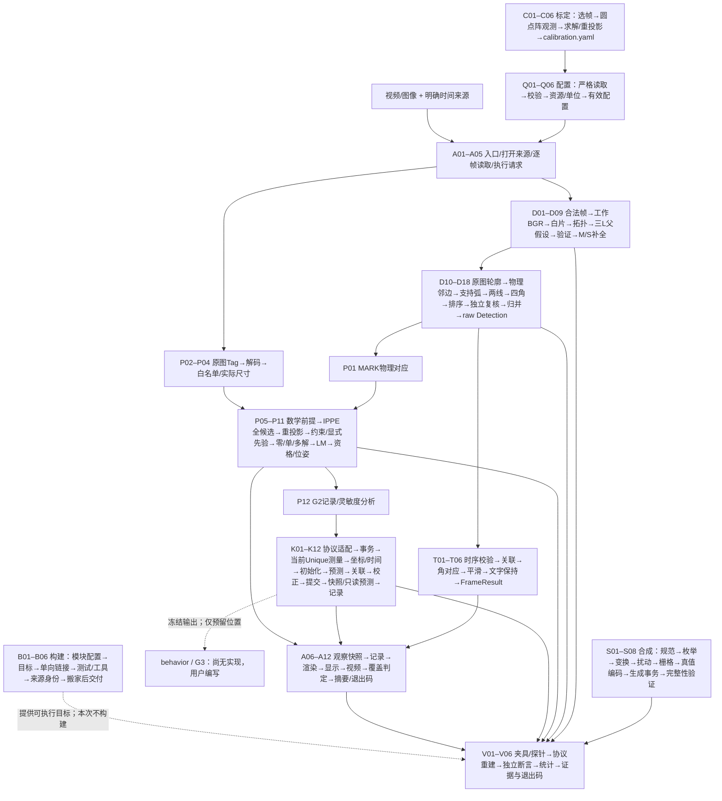
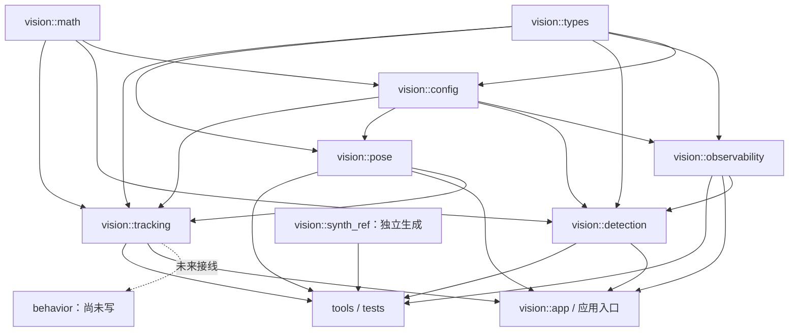

# 搬入新仓后的目录重构底稿（基础版，仅文档）

> 已执行：以瘦后基线 `d70c1af` 适配本仓布局，实际移动、拆分、差异与验证见 [restructure-changes.md](restructure-changes.md)。原底稿正文保留，不代表现行路径。

## 从输入到输出的完整流程

这里的“板块”是一段流程中相对独立的步骤；下面每行就是一个板块，同一文件可以对应多行。raw 是当前帧原始检测，stable 是二维平滑结果；G2 通过已知三维点和图像点求位姿，G4 用常速度模型估计三维运动。JSONL 表示每行一条 JSON 记录。表中“当前责任”定位现行实现，“替换点”是尚未实施的内部边界草案。



运行分支说明：MARK 位姿读取 raw Detection；Tag 从原分辨率图像进入独立检测，不借用 MARK 工作图。二维平滑只供自己的结果与显示；G4 接收明确协议的 G2 当前观测，不能把 held/stable 或先验预测当新测量。Geometry 范围到 D09 停止；Decode 到 D18；Temporal/Full 再执行 T 链。失败/缺测/未就绪均携带现有状态返回，不伪造下游成功。

以下路径以 src/tushenghao/ 为根；未带 app/、tools/、tests/ 等前缀的实现模块路径位于 lib/。每个替换点优先是普通函数与明确的只读参数/返回值；129 个最终步骤（92 个主链入口中有 16 个展开为 53 个子步骤）不要求相同数量的文件、类、target 或虚接口。跨帧状态仅由 Detector、TemporalStabilizer、TargetTracker、DisplayHistory 等对应实例持有，调用时显式给出状态视图/返回下一状态。

### D 检测：当前帧 BGR → 原始 Detection

| 步骤 | 当前责任 | 输入 | 输出 | 传给下一步与替换点 |
|---|---|---|---|---|
| D01 | 校验帧与序列；pipeline/detector.cpp、frame_sequence.cpp | FrameInput（BGR、frame_id、微秒时间戳）+ 实例序列状态 | 合法帧/INVALID_INPUT；坏序列清历史 | D02；替换 validate_frame，显式输入上一帧标记，状态只归 Detector 实例 |
| D02 | 缩放与坐标映射；preprocess/preprocess.cpp | 合法 BGR + PreprocessConfig | PreparedFrame：工作 BGR、原图只读视图、像素中心映射；并非工作二值图 | D03；替换 preprocess，保留原图来源/映射契约 |
| D03 | 工作图阈值与白片轮廓；geometry/geometry_observation.cpp | 工作 BGR + GeometryConfig | 带 component_id 的 WhiteComponent 列表；工作轮廓 CHAIN_APPROX_SIMPLE | D04；替换 extractWhiteComponents，ID 不等于数组下标 |
| D04 | 近似与凹点/拓扑观察；同上、geometry_l_topology.cpp | 白片轮廓 + 观察参数 | ShapeObservation：实测转折点、形状与拓扑候选 | D05；替换 observeShapes/拓扑提取，显式保留 component_id |
| D05 | 枚举三 L 对应；geometry_matcher.cpp | L 观察 + MarkerGeometry（图纸片段） | 三片选择及其模型对应排列、资源截断信息 | D06；替换组合生成；名称 generateSixComponentCombinations 失真 |
| D06 | 枚举锚点元组并拟合仿射；geometry_matcher.cpp、geometry_anchor_evidence.cpp | 对应排列 + 每片实测凹点 + 模型 + 搜索预算 | GeometryBatch：全部可计算父假设及来源证据、截断标记 | D07；替换父假设拟合，输入不能取真值/历史补点 |
| D07 | 复核投影残差、面积、绑定；geometry_validation.cpp | 父假设 + ID→白片/模型 + GeometryConfig | 通过复核的父假设及实测 validation_residual_ | D08；替换 validateGeometryBatch；指标与门限应用可分函数 |
| D08 | 测量 M/S 匹配关系；assignment_match_metrics.hpp、geometry_assignment_completion.cpp | 父变换 + 六片模型 + 当前白片 + 已批准预算 | 每一缺片的实测可匹配候选及拓扑/边界/面积/方向指标 | D09；替换 measureAssignmentMatch，显式输入工作坐标尺度 |
| D09 | 有界一对一补全；geometry_assignment_completion.cpp | 父绑定 + 各缺片候选 + 资源预算 | 六片完整 GeometryBatch；保留竞争分支和 resource_truncated_ | D10，Geometry 范围在此返回；替换补全搜索，边界标记语义不变 |
| D10 | 定位当前原图组件；corners/corner_observation.cpp | PreparedFrame 原图 + 完整假设 + 原图观察预算 | 原图轮廓及来源对应；OriginalContourIndex 是当前帧惰性缓存 | D11；替换原图观察，缓存封装在该步骤，不由下游依赖具体结构 |
| D11 | 解析物理角邻边；corners/corner_resolver.cpp | 完整绑定 + 原图轮廓 + 图纸角身份 | 每个 P0…P3 的组件、顶点和两条模型边 | D12；替换绑定解析，共享只读角身份表，禁止每处重写规则 |
| D12 | 枚举连续支持弧；corners/corner_edge_fit.cpp | 当前轮廓 + 预测邻边方向/位置 + 原图预算 | 原端点/后验端点/完整端点支持弧与连续转折连接 | D13；替换弧提取，保留顺序、重复像素身份及来源 |
| D13 | 拟合两条实测边；corner_edge_fit.cpp、periodic_line_fit.cpp | 支持弧 + 路线/线模型 + 预算 | 两条直线、周期参数、原始与模型残差；失败原因 | D14；替换拟合策略，FastRecovery 顺序及歧义必须可复现 |
| D14 | 交点与证据组装；corner_edge_fit.cpp、corner_resolver.cpp | 两线 + 连续连接弧 + 物理角身份 | CornerMeasurement：四物理角 + CornerEvidence；不制造预测角 | D15；替换交点步骤，显式输出支撑弧/模型元数据 |
| D15 | 屏幕排序；corners/screen_order.cpp | 同一份四物理角 | ScreenOrder：LT/RT/RB/LB、物理→屏幕映射、平局信息 | D16；替换 orderScreenCorners；几何有效且方向未知仍可输出 |
| D16 | 独立复核证据与几何；detection_validator.cpp、corner_evidence_validation.cpp | 测量 + 排序 + 图像尺寸 + 原图预算 | 有效/拒绝原因；独立重拟合、残差/连接/凸性/边界检查 | D17；替换校验器，不能与生产拟合共享计算结果充当独立证明 |
| D17 | 竞争归并与方向判定；corners/semantic_resolver.cpp | 全部有效测量 + 搜索截断标记 + 几何一致性参数 | 保留的真实测量；方向唯一或 unknown；不平均假设 | D18；替换 resolveSemantics，传入完整竞争集合 |
| D18 | float 发布复核；detection_publication.cpp、pipeline/decode_stage.cpp | 保留的 double 测量 + 映射 | DecodeStageResult / raw Detection：原图角、bbox、可空 orientation | T01 / P01 / A06；替换发布适配，float 后仍检查几何；不改变公共 Detection |

### T 二维时序：raw Detection → 稳定显示结果

| 步骤 | 当前责任 | 输入 | 输出 | 传给下一步与替换点 |
|---|---|---|---|---|
| T01 | 检查时序输入与重置；temporal_stabilizer.cpp、frame_sequence.cpp | raw Detection 列表 + 帧标记/尺寸 + 该实例历史 | 合法输入或 INVALID_INPUT；显式下一状态/重置原因 | T02；替换时序输入校验；不能写回 raw |
| T02 | 关联当前目标；temporal_geometry.cpp、temporal_stabilizer.cpp | 当前列表 + 历史目标 + 关联参数 | 唯一历史匹配/歧义；无匹配选当前最大目标 | T03；替换关联，多个匹配不暗选最近 |
| T03 | 解析物理或循环角对应；temporal_geometry.cpp | 当前/历史四角 + 各自 orientation + 对应预算 | 唯一对应或 CORRESPONDENCE_AMBIGUOUS | T04；替换对应解析，unknown 不补成已知方向 |
| T04 | 按真实 dt 平滑与复核；temporal_stabilizer.cpp、temporal_geometry.cpp | 当前角 + 对应 + 历史 + dt + TemporalConfig | Track 或当前 raw 回退、bbox、平滑诊断及下一历史 | T05；替换平滑，零 dt/空帧/超偏离的回退语义保持 |
| T05 | 语义文字保持；display_history.cpp、stabilize_stage.cpp | 本帧有效文字 + 帧标记 + 独立显示历史 | 可空 DisplayState：来源帧、age、is_held | T06；替换文字保持；不得变成历史几何检测 |
| T06 | 组装 FrameResult；stabilize_stage.cpp、detector.cpp | raw detections + tracks + display_state + 状态/原因 | FrameResult；raw 与 stable 各保留自己的来源 | P01 / A06；替换内部组装，公开签名冻结 |

### P G2 位姿与 Tag：真实当前观测 → G2PoseObservation

| 步骤 | 当前责任 | 输入 | 输出 | 传给下一步与替换点 |
|---|---|---|---|---|
| P01 | MARK 来源与物理映射检查；pose/pose_estimator.cpp | 当前 raw Detection + 原图尺寸 + ExposureStamp + G2Config | P0…P3 像素与米制图纸点，或明确状态 | P05；替换 estimate_mark 前置适配；禁止取 stable/held 几何 |
| P02 | Tag 灰度适配；pose/tag_detector.cpp | 原分辨率 BGR + 曝光来源 | 灰度 C API 输入视图，保留生命周期 | P03；替换 Tag 输入适配，不复用工作图缩放 |
| P03 | AprilTag 检测与解码；tag_detector.cpp | 灰度视图 + TagConfig + 每实例原生对象 | TagObservation 列表：id、角、解码信息 | P04；替换检测后端，原生资源由本步骤实例独占 |
| P04 | Tag 白名单与尺寸适配；tag_detector.cpp | TagObservation + id→side_m + 相机参数 | 已知尺寸的四个米制物点与像点，或拒绝状态 | P05；替换 tag_pose 输入转换；未知尺寸不猜 |
| P05 | 检查数学前提与预算存在性；pose_estimator.cpp、pose_geometry.cpp | 四组 3D↔2D 点 + K/dist + 选择配置 | 可求解输入 / BudgetMissing 等现行状态 | P06；替换合法性检查；空预算原样保留，本次不改变门控 |
| P06 | 枚举平面 IPPE 解；pose_estimator.cpp | 合法点对 + K/dist | 所有 solvePnPGeneric 候选 | P07；替换 PnP 求解；不能偷选首解/最小误差当唯一 |
| P07 | 独立重投影与正深度复核；pose_geometry.cpp | 每个姿态候选 + 原始点对/相机 | 重投影误差、深度、物理姿态或数学拒绝 | P08；替换 evaluate_pose，保留独立复核 |
| P08 | 误差/安装约束/可信先验筛查；pose_estimator.cpp | 复核候选 + 已存在预算/选择配置 + 显式 PosePrior | eligible_ 与逐候选 reasons_ | P09；分别替换误差、安装、先验函数；不把硬件确认位作数值总闸 |
| P09 | 零/单/多解分类；pose_estimator.cpp | 完整候选及 eligible_ | NoSolution / Unique / Ambiguous；保留全部证据 | P10；替换分类，保持公开 PoseStatus 与候选语义 |
| P10 | 可选 LM 精修与回退；pose_estimator.cpp | 唯一候选 + refine_lm_ + 原始点对 | 复核后的 refined 或原合法解 | P11；替换精修；精修失败不抹掉原解 |
| P11 | 资格和 G2 输出适配；pose_estimator.cpp、app/pose_main.cpp | 求解状态/姿态 + 来源/硬件资格 | G2PoseObservation；control_usable_ 与硬件信息不冒充测量 | P12 / K01；替换输出适配，公共类型/签名变动均 C |
| P12 | G2 记录与灵敏度回放；pose_main.cpp、tools/validation/pose_sensitivity.cpp | G2 输出或合成点扰动 + 相机/模型 | 现行 JSONL、误差统计；不批准硬件预算 | K01 / V04；替换记录/分析步骤，保留 schema 兼容 |

### K G4 三维跟踪：当前 G2 测量 → 冻结跟踪输出

| 步骤 | 当前责任 | 输入 | 输出 | 传给下一步与替换点 |
|---|---|---|---|---|
| K01 | 读取并适配帧记录；tracking/tracking_io.cpp、app/tracking_main.cpp | G4 v4 / 旧 G2 记录 + 配置 + 显式 replay 来源 | TrackingFrame；完整整数与曝光元数据 | K02；替换 codec/旧版适配，回放不得升级硬件资格 |
| K02 | 核验帧与创建事务状态；tracking/target_tracker.cpp | TrackingFrame + 该实例旧状态 + TrackingConfig | 候选 State；坏数据回滚，原状态不提交 | K03；替换事务外壳，仅复制可变状态 |
| K03 | 选取当前 Unique 测量；tracking/measurement_adapter.cpp | G2PoseObservation + stamp + profile/sidecar | 当前合法 3D 位置 + 测量协方差 R + 来源信息 | K04；替换测量适配；不从 covariance_se3_ 猜 R |
| K04 | 转换坐标及核验时间界；measurement_adapter.cpp | 相机位置/R + 同曝光 EgoTransform + 时间元数据 | camera_relative 或确定 world_frame 的测量与资格 | K05；分别替换坐标/时间检查；缺变换不偷换坐标系 |
| K05 | 初始化或两点重建；target_tracker.cpp、kalman_cv.cpp | 当前/待定测量 + 合法 dt + profile | 新 track_id、CV 状态或 pending；无伪速度 | K06；替换 bootstrap，真实模型前提与事务保持 |
| K06 | 常速度预测；tracking/kalman_cv.cpp | 旧状态 x/P + dt + acceleration PSD | 预测 x/P；dt/有限值/正定检查 | K07；替换 predict，数学有效性错误不能当资格信息放过 |
| K07 | 创新评分与关联；target_tracker.cpp、kalman_cv.cpp | 预测状态 + 本帧候选 z/R | NIS 评分及唯一匹配/拒绝 | K08；替换关联，显式传同帧创新计算结果避免重算 |
| K08 | Joseph 校正；kalman_cv.cpp | 预测状态 + 已选测量/创新 | 校正状态与协方差 | K09；替换 correct，保留独立入口对坏 R 的防御 |
| K09 | Coasting/Lost 与提交；target_tracker.cpp | 有无更新 + gap/不确定性 + 候选状态 | 提交后状态及跟踪事件；必要时丢失 | K10；替换生命周期转换，不跨实例共享可变状态 |
| K10 | 状态快照与资格；target_tracker.cpp | 已提交状态 + profile/时钟/硬件标记 | 冻结 TrackingResult：位置、可空速度、状态及资格 | K11 / K12；替换内部 snapshot；现行速度/预测可用性门控冲突列 C |
| K11 | 指定时刻只读预测；TargetTracker::predict_to、kalman_cv.cpp | 当前状态副本 + 未来时间 | 可空预测；不修改实时状态/track_id | K12；替换未来预测实现，公开输出接口保持 |
| K12 | 跟踪记录与实验评价；tracking_io.cpp、tracking_lab.cpp | TrackingResult/预测 + 显式 truth/profile | JSONL、实验误差、资格与开放关项 | V04；替换记录/指标步骤；G-01/G-02/G-03 仍 OPEN |

### A 应用：输入路径 → 结果/证据/画面/退出码

| 步骤 | 当前责任 | 输入 | 输出 | 传给下一步与替换点 |
|---|---|---|---|---|
| A01 | 解析命令行与装配；app/main.cpp、pose_main.cpp、tracking_main.cpp | 命令行 + 各入口允许的选项 | 输入/输出路径、运行范围与配置路径 | Q01 / A02；替换入口解析，显式选项策略 |
| A02 | 打开来源与运行目录；offline_runner.cpp | 已验证 AppConfig + 视频路径 + 请求 | VideoCapture、RunMetadata、实例资源；失败不伪造成功目录 | A03；替换 source/run 初始化，路径显式传入 |
| A03 | GUI 子进程探测与窗口会话；display_probe.cpp、display_session.cpp | show_window + 可用显示环境 + 已有超时配置 | 可用窗口会话/明确失败；子进程隔离 GUI 崩溃 | A04；替换显示后端，生命周期只属 session |
| A04 | 逐帧读图与曝光标记；offline_runner.cpp、pose_main.cpp | 视频/帧源 + fps/帧号 | FrameInput / ExposureStamp；完整帧处理不被日志抽样裁剪 | A05；替换读取与时间戳适配，各自产物显式输出 |
| A05 | 执行范围与诊断请求；offline_runner.cpp、detector_diagnostics_access.hpp | 帧 + ExecutionScope + DiagnosticsRequest | 显式算法调用参数；现行 prepare/process/take 为兼容桥 | D01 / P01 / K01；替换内部 execute_and_record，保留公共 process |
| A06 | 取得算法结果及观察快照；detector.cpp、diagnostics_context.cpp | 步骤输出 + 请求 + timing 开关 | FrameResult 与独立 FrameRecord；disabled/not_executed 不记假时间 | A07；替换观察适配，诊断不能反向控制数值流程 |
| A07 | 抽样/序列与记录；diagnostics_recorder.cpp | 所有帧的结果 + selected 标记 + record | 统计、选定帧 JSONL、待完成 export 身份 | A08；替换记录存储，单调帧及重复 export 检查保持 |
| A08 | 渲染输入复核及叠图；app/debug_renderer.cpp | 本帧原图 + raw/stable + 本帧 RenderInput | 新画布 + 渲染事件；不写原图/算法结果 | A09；替换各 overlay 函数，勿读取具体 fitter/缓存对象 |
| A09 | 显示等待与用户停止；display_session.cpp、offline_runner.cpp | 画布 + playback 配置 + 会话 | 停止/继续与明确 USER_STOP | A10 / A04；替换 UI 等待策略，不改检测采样 |
| A10 | 写视频与 export timing；video_exporter.cpp、diagnostics_recorder.cpp | 每帧画布 + frame_id + export 身份 | 所有帧视频、独立导出时间记录；未完成视频标 partial | A11 / A04；替换编码器/记录适配，selected 不决定是否写视频 |
| A11 | 判断覆盖并关闭资源；input_completion.cpp、video_exporter.cpp | 实际帧数 + 可用输入总数/显式 subset + 停止原因 | RunOutcome：完成、未验证或不完整；视频读回核验 | A12；替换覆盖判定，未知不能当完整 |
| A12 | 摘要/manifest/控制台；run_report.cpp、run_console.cpp、offline_runner.cpp | RunOutcome + 只读统计快照 + provenance | summary、manifest、中文结论及退出码 | 外部消费者；替换各输出器，禁止借 mutable summary()/字符串 map 暗传数据 |

### Q 配置与只读类型：文件/值 → 已验证模块输入

| 步骤 | 当前责任 | 输入 | 输出 | 传给下一步与替换点 |
|---|---|---|---|---|
| Q01 | 读取并识别协议；lib/config/config.cpp、pose_config.cpp、tracking_config.cpp | 对应 YAML + schema_version | FileNode/原始 token + 键集合 | Q02；替换文件读取器，保留重复/未知键和类型策略 |
| Q02 | 严格字段转换；同上 | 节点/token + 显式数值/字符串/空值策略 | 有类型配置；空预算仍为空，整数不截断 | Q03；替换纯读取原语；不统一成宽松解析 |
| Q03 | 校验各模块参数；config.cpp、pose_config.cpp、tracking_config.cpp | Detector/Temporal/G2/G4 各自配置 | 数学/非法输入错误或已验证配置 | Q04；替换 validate_<module>；不得构造无关 AppConfig |
| Q04 | 解析资源与单位；config.cpp、pose_config.cpp、marker_geometry.cpp | 配置文件所在目录 + 模型/相机/profile 路径 + 单位 | 只读模型、米制点、相机、profile；身份保留 | D01 / P01 / K02；替换解析器，禁止依赖当前工作目录 |
| Q05 | 检查协方差数学前提；tracking_config.cpp、kalman_cv.cpp | R 或 camera_mse_m2_ | 有限、对称、正定结论 | Q03 / K03；替换底层纯数学检查，config 不能依赖私有滤波器 |
| Q06 | 导出 effective 配置；config.cpp | 验证后的 AppConfig + 明确输出路径 | 可往返 YAML、完整整数及既有空字段 | V04；替换严格 writer；保留 OpenCV 整数旁路的真实触发场景 |

### S 合成夹具：冻结规范 → 真值/图像/可复核记录

| 步骤 | 当前责任 | 输入 | 输出 | 传给下一步与替换点 |
|---|---|---|---|---|
| S01 | 加载规范与来源证明；tools/synth_ref/src/model.cpp | configs、inputs、source hash 和明确根目录 | 只读模型/网格/用例规范及批准状态 | S02；替换 load_context；每一步仅接收所需只读切片 |
| S02 | 枚举描述与 case_id；grid.cpp、cases.cpp | 规范 + 模式 + Visitor | 确定顺序的 descriptor/case_id | S03；替换 enumerate；Visitor 是流式输出接口，不能因单消费者删 |
| S03 | 计算几何变换；transforms.cpp | 图纸/独立测试形状 + descriptor | 解析仿射/投影矩阵及理想顶点 | S04；替换 affine/transform，不调用被测检测器生成真值 |
| S04 | 形状扰动与负例构造；perturb.cpp、cases.cpp | 理想几何 + 显式扰动描述 | 扰动多边形或明确无图场景及原因 | S05；替换 perturb/apply_special，理想与扰动几何分存 |
| S05 | 栅格与连通性复核；raster.cpp、cases.cpp | 几何 + 采样约定 | 图像、mask、instance 图及真实桥接连通结论 | S06；替换 rasterize/check_scene，保留独立手算基准测试 |
| S06 | 真值/索引编码；records.cpp | 场景 + 栅格/无图描述 + 来源规范 | truth JSON、index CSV、来源/裁切/可见性记录 | S07；替换 record codec，verify 从声明头调用，不手抄函数声明 |
| S07 | 生成事务与计划；records.cpp、main.cpp | 编码产物 + 明确 run_id/output root | INCOMPLETE 运行目录/计划，不填检测结果或预算 | S08；替换 plan/generate；目录状态显式传参 |
| S08 | 独立完整性与篡改验证；verify.cpp | 运行目录 + 原始规范 + 显式内部事务模式 | 验证记录/失败；成功才完成事务 | V04；替换 verify；公开验证不能接受未完成生成 |

### C 相机标定：视频选帧 → calibration.yaml

| 步骤 | 当前责任 | 输入 | 输出 | 传给下一步与替换点 |
|---|---|---|---|---|
| C01 | 解析标定输入；tools/calibration/calibration_config.cpp | CLI/YAML | 板格/间距/视频/明确 frame_list/输出路径 | C02；替换配置读取；无效 start/end 范围选项列删除候选 |
| C02 | 打开视频并读元信息；calibration_video.cpp | 视频路径 | VideoCapture + VideoInfo（宽/高/fps） | C03；替换视频打开；运行尺寸不回写静态配置 |
| C03 | 选帧；calibration_video.cpp、scripts/frame_picker.py | capture + 显式 frame_list；人工选择工具另行输出列表 | 带源 frame_id 的样本帧或失败 | C04；替换选帧；读失败与人工退出分开 |
| C04 | 圆点阵观测与物点构建；calibration_detection.cpp | 样本帧 + 圆点阵几何 | 带 frame_id 的成功 2D/3D 点对及失败记录 | C05；替换检测，不让丢帧隐藏来源 |
| C05 | 求解并重投影复核；calibration_result.cpp | 点对 + VideoInfo 尺寸 | K、dist、逐样本外参与重投影误差 | C06；分别替换 calibrateCamera 调用与误差计算 |
| C06 | 保存与结果报告；calibration_result.cpp、calibration_main.cpp | CalibrationResult + 图像尺寸 + 输出路径 | calibration.yaml 和统计 | Q04 / V04；替换 writer，不据误差自动批准硬件/预算 |

### V 审计/回放工具与测试：指定场景 → 可追溯判断

| 步骤 | 当前责任 | 输入 | 输出 | 传给下一步与替换点 |
|---|---|---|---|---|
| V01 | 装配场景；test_support、tests/data、tools/block3_fixture/generation/main.cpp | 固定轮廓、解析真值、生成器或显式真实输入 | 与被测算法独立的 Scene/Frame/坏数据 | V02；替换 fixture 构造，真实失败轮廓不能按历史结果重新拟合 |
| V02 | 执行指定步骤/探针；tools/audit/*.cpp、block3_fixture/diagnostics/*.cpp | 场景 + 显式 config/scope/probe | geometry/decode/temporal/角证据与阶段记录 | V03；替换被测步骤，各探针保留目标；不得复制整条流水线 |
| V03 | 重建协议与独立复算；tools/common/frame_record_reader.cpp、path_a_verify.cpp、observability_verify.cpp、final_fixes_verify.cpp | JSONL/manifest/图像 + schema + 独立约束 | 整数/来源/篡改/不完整运行及几何复算结论 | V04；分别替换 codec 与独立 validator，不能让两者共享数值答案 |
| V04 | 比对参考与断言；tests/*.cpp、tests/support/recovery112_reference.cpp、validation/recovery112_*.cpp | 被测输出 + 完整参考/手算/坏数据期望 | 明确 PASS/FAIL 和可追溯错误；本次未执行 | V05；替换断言/参考驱动，参考实现保持独立 |
| V05 | 汇总测量；block3_fixture/reporting/*.py、calibration/measure.cpp、tracking_lab.cpp、pose_sensitivity.cpp | 成功/失败测量及来源，不使用缺失值冒充零 | 统计、无数据状态、误差分布；不新增预算数字 | V06；替换统计函数，失败样本也进入报告 |
| V06 | 证据与进程生命周期；validation/recovery112_check.py、synth_ref/tests/tests.cpp、测试 main | 显式根目录/输出路径/命令结果 + 测试上下文 | 归档/退出码；临时资源清理 | 外部审阅；替换驱动，避免全局 cwd/可变 evidence_directory；历史归档脚本留旧仓 |

### B 构建与交付：源文件 → 目标与证据身份

| 步骤 | 当前责任 | 输入 | 输出 | 传给下一步与替换点 |
|---|---|---|---|---|
| B01 | 配置模块与选项；CMakeLists.txt、cmake/g2.cmake、g4.cmake | 工具链、OpenCV/AprilTag 等依赖可见性 + 构建选项 | 模块配置；未开启功能的依赖不应外溢 | B02；替换模块 CMake，顶层只设置全局/add_subdirectory |
| B02 | 定义接口和实现目标；上述 CMake、tools/*/CMakeLists.txt | 该模块源/私有头/公开头 | vision::<module> 目标与 include 范围 | B03；每模块自己的清单；不靠全树内部 include 导出 |
| B03 | 声明单向链接；各模块 CMake 原型 | types/config、detection、pose、tracking 等目标 | 显式 target_link_libraries DAG（单向依赖图） | B04；替换模块实现只维持边界目标，config 不反依赖 tracking |
| B04 | 登记测试与工具；根/工具/G2/G4 CMake | 模块目标 + 启用选项 | 镜像 tests 与各工具目标 | B05；替换测试装配；真实验证目标均保留，空成功目标删除 |
| B05 | 生成构建来源身份；根 CMake、synth_ref/CMakeLists.txt | 该目标源码/CMake/输入规范清单 | 代码与规范 fingerprint/provenance | B06；替换 provenance 生成，不把未链接模块变化当本目标算法变化 |
| B06 | 搬家后验证与纯文件交付；本底稿的顺序 | 瘦身后的 refactor/lean 文件 + 用户创建的私有空仓 | vision/ 初始提交及重新生成的证据 | 结束；本次只写计划；不搬 .git/build/evidence，不合回 main |


### 文件内部的步骤细化

主链表给顺序和入口；下面把同一文件内可独立替换的子流程展开。有细化的父编号只是定位入口，不额外计作一个独立板块；其边界以子编号为准。没有把每个循环/加减算术或同类每条线机械计为新板块。

#### D03 工作白片提取的内部顺序

| 子步骤 | 当前责任 | 输入 | 输出 | 下一步与替换点 |
|---|---|---|---|---|
| D03.a | 转灰度；geometry_observation.cpp | 工作 BGR | 工作灰度 | D03.b；替换颜色适配，不改坐标域 |
| D03.b | 二值化；geometry_observation.cpp | 工作灰度 + white_threshold_ | 工作 mask | D03.c；替换阈值实现，参数显式给出 |
| D03.c | 外轮廓提取；geometry_observation.cpp | 工作 mask | CHAIN_APPROX_SIMPLE 原始外轮廓序列 | D03.d；替换轮廓后端，输出仍为工作坐标 |
| D03.d | 组件计量与身份；geometry_observation.cpp | 轮廓 + min_area_ + 工作尺寸 | 带稳定 ID、area、bbox、border 的 WhiteComponent | D04；替换组件描述，消费者按 ID join |

#### D04 观察与 L 拓扑的内部顺序

| 子步骤 | 当前责任 | 输入 | 输出 | 下一步与替换点 |
|---|---|---|---|---|
| D04.a | 近似轮廓；geometry_observation.cpp | 组件轮廓 + approximation_epsilon_ | 诊断 simplified_polygon_ | D04.b；替换 approxPolyDP 调用，不把近似点当原图角 |
| D04.b | 转折与基础描述；geometry_observation.cpp | 近似顶点 + 组件来源 | 凸凹 turns/基础 shape 描述 | D04.c；替换转折描述；基础标签不是完整证据 |
| D04.c | 多尺度有界拓扑；geometry_l_topology.cpp | 原组件轮廓 + 明确观察规则 | 合法六顶点 L 候选与对应凹点 | D05/D06；替换拓扑观察，规则与候选顺序显式 |

#### D08 匹配计量的内部顺序

| 子步骤 | 当前责任 | 输入 | 输出 | 下一步与替换点 |
|---|---|---|---|---|
| D08.a | 面积预筛；geometry_assignment_completion.cpp | 实测组件面积 + L 参考面积 + 模型面积 | AreaMetric 或明确不匹配 | D08.b；替换面积度量，F15 复用同值 |
| D08.b | 轮廓拓扑候选；assignment_match_metrics.hpp | 组件轮廓 + 模型顶点数 + epsilon | 合法的实测近似/子序列拓扑 | D08.c；替换候选观察，完整当前轮廓仍是来源 |
| D08.c | 投影与边界采样；assignment_match_metrics.hpp | 模型多边形 + 父仿射 + 采样步长 | 投影边与双向有限边界距离 | D08.d；替换距离计量，不重估父变换 |
| D08.d | 方向与指标组装；assignment_match_metrics.hpp | 拓扑/投影/边界/面积 | valid/topology_valid 与全部匹配指标 | D08.e；替换方向计量，明确工作单位 |
| D08.e | 应用匹配规则；geometry_assignment_completion.cpp | 只读指标 + 已存在预算 | 每个 model_piece 的可匹配 component_id 集合 | D09；替换规则应用，资源搜索不藏在计量函数 |

#### D12/D13 连续弧与线拟合的内部顺序

| 子步骤 | 当前责任 | 输入 | 输出 | 下一步与替换点 |
|---|---|---|---|---|
| D12.a | 提取端点描述；corner_edge_fit.cpp | 完整有序原轮廓 + 当前路线模式 | 原始/后验/完整端点集合 | D12.b；替换端点观察，输出端点仍可追溯 |
| D12.b | 构造连续支持；corner_edge_fit.cpp | 端点区间 + 原轮廓 | 带序列 ID、first/last、支持像素的弧 | D12.c；替换支持提取，重复像素身份不能丢 |
| D12.c | 候选弧筛查；corner_edge_fit.cpp | 支持弧 + 模型边/原图预算 | 有足够独立点/跨度/方向的 eligible arcs | D12.d；替换筛查，拒绝原因显式 |
| D12.d | 有序邻接配对；corner_edge_fit.cpp | eligible arcs + 轮廓顺序/连接弧 | 两条可相邻的支持弧对及连接 | D13.a；替换配对搜索，不按空间邻近拼接 |
| D13.a | 估计线模型；corner_edge_fit.cpp、periodic_line_fit.cpp | 支持点序列 + Legacy/周期模型策略 | 物理线、axis/coefficient 或失败 | D13.b；替换估计器，周期模型保留完整原点 |
| D13.b | 计量原始/模型残差；同上 | 物理线、周期参数、支持像素 | 两套 mean/max 残差 | D13.c；替换计量，不偷换 raw 字段定义 |
| D13.c | 候选合法性与路线选择；corner_edge_fit.cpp | 线/残差 + 连接/跨度/延伸预算 + 明确路线 | 首个满足现行顺序的唯一解或歧义/失败 | D14；替换候选选择，保留 FastRecovery/reference 顺序；缓存只在本次调用 |

#### D15 屏幕排序的内部顺序

| 子步骤 | 当前责任 | 输入 | 输出 | 下一步与替换点 |
|---|---|---|---|---|
| D15.a | 检查有限/重复/凸性；screen_order.cpp | 四个 double 物理角 | 可排序几何或明确失败 | D15.b；替换合法性检查，不新增工程门限 |
| D15.b | 枚举循环起点并规范绕向；screen_order.cpp | 合法四角环 | 固定四个循环候选 | D15.c；替换循环枚举，不能扩成任意标签猜测 |
| D15.c | 坐标归一化；screen_order.cpp | 一个循环候选 | 归一化四点或退化失败 | D15.d；替换 normalize_points，显式传候选 |
| D15.d | 计算屏幕排序能量；screen_order.cpp | 归一化四点 | 候选 energy_ | D15.e；替换 compute_energy，输出标量供选择 |
| D15.e | 最小值/平局/字典序；screen_order.cpp | 全部候选和能量 | best_index + tie | D15.f；替换选择，平局集合基于同一最小值 |
| D15.f | 形成映射结果；screen_order.cpp | 选定点序 + 原物理角身份 + tie | ScreenOrder 或 ScreenCycleOrder 适配 | D16；替换映射组装，不与 float 发布排序共用旧产物 |

#### P08 资格判断的内部顺序

| 子步骤 | 当前责任 | 输入 | 输出 | 下一步与替换点 |
|---|---|---|---|---|
| P08.a | 预算数值比较；pose_estimator.cpp | 候选独立误差/投影面积 + 已有预算 | 误差拒绝原因或通过 | P08.b；替换误差比较，缺预算仍按现行状态处理 |
| P08.b | 安装几何约束；pose_estimator.cpp | 候选姿态 + 显式 selection | z/normal 约束结论 | P08.c；替换 passes_constraints，法向仅需要时计算 |
| P08.c | 可信先验检查；pose_estimator.cpp | 候选 + 显式 PosePrior + 当前 stamp/会话 | 时效/身份/位置/旋转一致性原因 | P09；替换 passes_prior；先验不从 tracker 暗取 |

#### K04/K06/K08 坐标、时间和数值更新的内部顺序

| 子步骤 | 当前责任 | 输入 | 输出 | 下一步与替换点 |
|---|---|---|---|---|
| K04.a | 坐标模式与同曝光变换；measurement_adapter.cpp | 相机 z/R + coordinate_mode + 可空 EgoTransform | 指定 camera/world 坐标的测量 | K04.b；替换坐标适配，缺 world 变换明确拒绝 |
| K04.b | 时间界与来源资格；measurement_adapter.cpp、target_tracker.cpp | stamp/uncertainty/profile 域 | TimeQualification 与合法 dt 信息 | K05；替换时间适配，不以来源确认位代替数值界 |
| K06.a | 构建 F/Q；kalman_cv.cpp | 合法实际 dt + acceleration PSD | 常速度转移与过程噪声矩阵 | K06.b；替换模型离散化，保留单位/维数 |
| K06.b | 传播状态与协方差；kalman_cv.cpp | x/P + F/Q | 预测 x/P | K06.c；替换矩阵预测，不写实时 tracker 副本外状态 |
| K06.c | 预测数值复核；kalman_cv.cpp | 预测 x/P | 有限/对称/正定的预测或数学错误 | K07；替换复核，失败不提交 |
| K08.a | 增益与状态校正；kalman_cv.cpp | 预测 x/P + 当前 z/R/创新 | Kalman gain 与校正 x | K08.b；替换校正，F22 复用同版本创新 |
| K08.b | Joseph 协方差与数值复核；kalman_cv.cpp | 增益、预测 P 与 R | 合法校正 P 或错误 | K09；替换协方差更新，独立入口仍验证坏矩阵 |

#### A10 视频导出的内部顺序

| 子步骤 | 当前责任 | 输入 | 输出 | 下一步与替换点 |
|---|---|---|---|---|
| A10.a | 打开 partial 编码器；video_exporter.cpp | run_dir + size/fps/fourcc | 本会话 writer 与 partial 路径 | A10.b；替换编码后端，不改变协议允许的编码 |
| A10.b | 逐帧校验并写入；video_exporter.cpp | 当前 overlay + writer 状态 | 写入尝试与 written_frames_ | A10.c 或 A04；替换 write，关闭/尺寸错明确失败 |
| A10.c | 关闭并读回；video_exporter.cpp | 已写 partial + 期望尺寸/帧周期/写帧数 | 可解码数量/尺寸/周期核验结果 | A10.d；替换读回验证；write 返回不代表成功落盘 |
| A10.d | 按覆盖结论发布；video_exporter.cpp、input_completion.cpp | 读回合格 + input_complete | complete 才 rename overlay.mp4，否则保留 partial | A12；替换发布动作，不能把未知覆盖当成功 |

#### S06/S07 真值与生成事务的内部顺序

| 子步骤 | 当前责任 | 输入 | 输出 | 下一步与替换点 |
|---|---|---|---|---|
| S06.a | 理想/扰动/可见几何；truth_record.cpp（现 records.cpp） | Scene + 原始几何/变换 + 栅格 | 裁切/可见性/锚点/片段真值 | S06.b；替换真值构造，不读取检测结果 |
| S06.b | JSON/CSV/PNG 编码；record_codec.cpp（现 records.cpp） | 真值与图像 + 固定协议列 | 确定字段/列/字节与 hash | S07.a；替换编码器；verify 共享格式声明，不共享判定 |
| S07.a | 建立生成事务；generation.cpp（现 records.cpp） | 输入规范/批准状态 + run_id/output_root | 拒绝覆盖的新目录与 INCOMPLETE manifest | S07.b；替换事务建立，批准/规范输入显式 |
| S07.b | 枚举并写产物；generation.cpp（现 records.cpp） | descriptor 流 + S03…S06 + 输出目录 | 图像/真值/索引/有效配置及实际计数 | S07.c；替换存储；失败保留 INCOMPLETE 与原因 |
| S07.c | 内部验收并完成；generation.cpp、verify.cpp | 写完产物 + 显式 pending_generation 模式 | verify 合格后 manifest COMPLETE，否则 INCOMPLETE | S08/V04；替换事务完成；公开 verify 不接受 pending 冒充完成 |

#### C04/C05 圆点阵与标定数值的内部顺序

| 子步骤 | 当前责任 | 输入 | 输出 | 下一步与替换点 |
|---|---|---|---|---|
| C04.a | 创建板物点；calibration_detection.cpp | rows/cols + finite 正间距 | 固定米制三维点阵 | C04.b；替换板几何构建，不从像点反推物点 |
| C04.b | 灰度与圆心检测；calibration_detection.cpp | 样本帧 + board_size | findCirclesGrid 对应圆心或未检出 | C04.c；替换观测后端，仍输出真实点阵对应 |
| C04.c | 来源与点对组装；calibration_detection.cpp | frame_id + 圆心 + 板物点 | 成功点对与失败信息 | C05.a；替换组装，保留原帧身份（F60） |
| C05.a | 相机求解；calibration_result.cpp | 合法点对 + 明确 image_size | K/dist、逐样本外参及 OpenCV RMS | C05.b；替换求解器，不自动批准硬件 |
| C05.b | 独立重投影误差；calibration_result.cpp | K/dist/外参 + 原始点对 | 逐点/总体重投影误差 | C06；替换误差复核，不拿 solver 的 RMS 当唯一证据 |

#### V03 协议复算的内部顺序

| 子步骤 | 当前责任 | 输入 | 输出 | 下一步与替换点 |
|---|---|---|---|---|
| V03.a | 解析协议 token；frame_record_reader.cpp、各 verifier | JSONL/manifest 原字节 | 完整整数、字符串、布尔、null 等有类型值 | V03.b；替换 parser，不能经 double 丢整数精度 |
| V03.b | 检查 schema/身份/顺序；各 verifier | 有类型字段 + 显式 expected/source manifest | 本帧且字段完整的证据或非法输入 | V03.c；替换协议校验，不以缺字段默认值蒙混 |
| V03.c | 核验来源与产物；各 verifier | 文件路径/hash + 覆盖/完成状态 | 真实输入/输出身份与完整性结论 | V03.d；替换字节身份检查，旧仓归档不是新运行 |
| V03.d | 独立几何/数值复算；path_a_verify.cpp 等 | 完整证据与原始支持/真值 | 复算匹配或明确篡改/不可复算 | V04；替换独立 validator，生产拟合结果只作待核对象 |


## 底稿适用范围与固定前提

这是布局基础版，只写方案；没有搬文件、改 CMake、改依赖、创建新仓或执行构建。审查基线为开始时干净的 refactor/lean；现状清单为 src/tushenghao/ 的 5,378 个文件。本文与 lean-report.md 共享同一批输入与逐步骤边界，两份文档均可独立读流程。

既定顺序：先在 refactor/lean 实施并验证获准的瘦身，再从该分支拷贝进私有新仓 pnx-intramural-robot/vision/。main 保持任务指定的 864fbae，不把 refactor/lean 合回 main。新仓有自己的初始文件提交；旧仓 git 历史、证据和历史运行仍在本仓。

“公共头改签名需你定”持续有效；G4 输出冻结。目标 include/vision/<模块>/ 是文件布局要求，不能据此自动把 namespace mark 改掉。所有空预算字段不填值，G-01/G-02/G-03 保持 OPEN。behavior/G3 只留用户未来写单枚举+switch 文件的位置。

表中 Fxx 是对应瘦身发现的编号，结论在这里也直接说明。建议删除的五个现行文件不搬；有多个目的文件表示职责片段分配，不是把同一个实现复制多份。最终拷贝前应重新枚举瘦身完成后的 refactor/lean 提交，补登记必要的新 helper，删除项不能重新进入允许拷贝集合。


## 目标目录与模块所有权

目标固定为私有单仓 pnx-intramural-robot，视觉代码位于 vision/；本作业仓继续作为档案。types/config → pose → tracking → behavior 表示从被依赖的低层走向使用者，用 target_link_libraries 表达依赖。文件可以有多个步骤函数；每一步有明确输入输出，不要求每步一个文件、类或 target。

```text
pnx-intramural-robot/
  CMakeLists.txt                 # 全局设置与 add_subdirectory(vision)
  vision/
    CMakeLists.txt               # 全局设置与 add_subdirectory；不列源文件
    .clang-format
    include/vision/
      types/ math/ config/      # 只读值类型、纯数学、公开配置契约
      detection/ pose/ tracking/ # 公开入口；namespace mark/实体/签名保持
      observability/ synth_ref/ # 观察数据与生成器既有步骤契约
    src/
      types/CMakeLists.txt       # header-only 类型目标
      math/CMakeLists.txt
      config/CMakeLists.txt
      detection/CMakeLists.txt
        contracts/ preprocess/ geometry/ corners/ temporal/ pipeline/
      pose/CMakeLists.txt
      tracking/CMakeLists.txt
        io/
      observability/CMakeLists.txt
      app/CMakeLists.txt
      synth_ref/CMakeLists.txt
      behavior/                 # 只预留位置；无实现/编译目标
        behavior.cpp            # 仅示意未来路径，用户写枚举+switch；本次不创建
    tests/
      CMakeLists.txt
      config/ detection/ pose/ tracking/ observability/ app/ synth_ref/
      support/                  # fixture、完整 reference、极小测试 harness
      detection/data/           # 固定真实失败轮廓，逐字保留
    tools/
      CMakeLists.txt
      apps/ audit/ validation/ common/ calibration/ block3_fixture/
      synth_ref/
        inputs/                 # 冻结来源与 sources.json，字节/相对根保留
        configs/                # 与生成规范绑定的工具私有 JSON
    config/                     # 8 份现行运行 YAML，值/空预算不变
    docs/                       # 活动指南、历史规范、工具说明、两份重构文档
```

公开头放 include/vision/<模块>/，实现与私有头放 src/<模块>/，tests 按 src 模块/步骤镜像。工具生成器库归 src/synth_ref，CLI 留 tools/synth_ref；其冻结输入保留 tools/synth_ref/{inputs,configs} 的相对根，避免改 sources.json 的事实含义。原 mark/*.hpp/synthetic_gen/*.hpp 包含兼容由 F65 决定，目录名不触发 namespace 或 G4 类型改名。

behavior 的示意路径不代表已有文件。不创建占位枚举、switch、硬件输出或测试，不添加编译不存在源码的目标；用户写好单文件后才接入自己的 CMake。

### 单向依赖图



这是瘦身后的目标图：F03 先把观察契约从 detector 私有结构中解开，F05 把纯矩阵检查下沉，F04 分离模块校验。未完成这些前提时，移动目录不能宣称解耦。raw Detection → pose 是数据方向；pose 库只需要低层检测值类型，pose_app 再显式链接 detection 与 pose。synth_ref 不链接生产检测/拟合生成真值，完整 reference 不链接生产优化实现充当自证。

### 每模块目标与源文件所有权

| 模块 CMakeLists.txt | 目标/别名 | 自己拥有的源与依赖 |
|---|---|---|
| src/types | vision_types / vision::types（INTERFACE） | Detector/G2/G4 值类型、只读模型与 FrameStamp；不链接算法 |
| src/math | vision_math / vision::math | observed_geometry.hpp 与从 kalman_cv 抽出的 covariance_validation.cpp；只依赖低层/OpenCV |
| src/config | vision_config / vision::config | config.cpp、pose_config.cpp、tracking_config.cpp、marker_geometry.cpp；依赖 types/math，禁止反依赖 pose/tracking |
| src/observability | vision_observability / vision::observability | timing、frame_events、context、record_codec、recorder、run_report、file_fingerprint；依赖 types/config，不能反依赖 detection |
| src/detection | vision_detection / vision::detection | preprocess/geometry/corners/temporal/pipeline 的全部实现；依赖 types/config/math/observability |
| src/pose | vision_pose / vision::pose | pose_geometry、pose_estimator、tag_detector；types/config/OpenCV 与既有 AprilTag；g2.cmake 为原型 |
| src/tracking | vision_tracking / vision::tracking | kalman_cv、measurement_adapter、target_tracker、io/tracking_io；依赖 pose/types/config/math；g4.cmake 为原型 |
| src/app | vision_app / vision::app | offline_runner、renderer、input_completion、display_session、video_exporter、run_console；依赖 detection/observability；特定入口另链 pose/tracking |
| src/synth_ref | vision_synth_ref / vision::synth_ref | model/source_inputs/grid/transforms/perturb/raster/cases/truth_record/record_codec/generation/verify；既有 OpenCV/JSON/OpenSSL |
| tools/common | vision_record_reader（工具内部） | frame_record_reader.cpp 及窄协议；由需要的工具/测试链接 |
| tools/apps、audit、validation、calibration、block3_fixture、synth_ref | 各现有 executable | 各目录 CMake 自己列入口，只链接模块；不向上递归导入整个工程 |
| tests/<模块> | 各真实测试 executable | 模块自己的测试/fixture/reference，不复制生产源表 |
| src/behavior | 未定义编译目标 | 仅未来单文件位置；没有生成新实现 |

### 顶层草图

下面仅是结构草图，未配置/构建/编译过。每模块源表以逐文件映射为完整依据；新 helper 名为建议目的名，尚不存在。当前不改依赖包/版本；旧 target 名与开关兼容列开放问题。

```cmake
# pnx-intramural-robot/CMakeLists.txt
cmake_minimum_required(VERSION 3.16)
project(pnx_intramural_robot LANGUAGES CXX)
add_subdirectory(vision)

# vision/CMakeLists.txt：只全局设置与子目录，不列源码
set(CMAKE_CXX_STANDARD 17)
set(CMAKE_CXX_STANDARD_REQUIRED ON)
set(VISION_ROOT "${CMAKE_CURRENT_SOURCE_DIR}")
include(CTest)
option(VISION_BUILD_TOOLS "Build existing tools" ON)
option(MARK_BUILD_G2 "Build existing G2" OFF)
option(MARK_BUILD_G4 "Build existing G4" OFF)
find_package(OpenCV REQUIRED)
add_subdirectory(src/types)
add_subdirectory(src/math)
add_subdirectory(src/config)
add_subdirectory(src/observability)
add_subdirectory(src/detection)
add_subdirectory(src/pose)
add_subdirectory(src/tracking)
add_subdirectory(src/app)
add_subdirectory(src/synth_ref)
add_subdirectory(tools)
add_subdirectory(tests)
# behavior 尚无源码，用户写好后再 add_subdirectory(src/behavior)
```

顶层没有 add_library/add_executable/target_sources/源文件变量或全树 .cpp GLOB。OpenSSL、JSON、AprilTag/pkg-config/Threads 在真正需要的模块/工具中查找。保留原依赖身份，不在本次安装、升级或切换依赖。

### 模块自己列源与 target_link_libraries

```cmake
# src/types/CMakeLists.txt
add_library(vision_types INTERFACE)
add_library(vision::types ALIAS vision_types)
target_include_directories(vision_types INTERFACE "${VISION_ROOT}/include")
target_compile_features(vision_types INTERFACE cxx_std_17)

# src/math/CMakeLists.txt
add_library(vision_math covariance_validation.cpp)
add_library(vision::math ALIAS vision_math)
target_include_directories(vision_math PUBLIC "${VISION_ROOT}/include")
target_link_libraries(vision_math PUBLIC vision::types ${OpenCV_LIBS})

# src/config/CMakeLists.txt
add_library(vision_config config.cpp pose_config.cpp tracking_config.cpp marker_geometry.cpp)
add_library(vision::config ALIAS vision_config)
target_include_directories(vision_config
    PUBLIC "${VISION_ROOT}/include" PRIVATE "${CMAKE_CURRENT_SOURCE_DIR}")
target_link_libraries(vision_config PUBLIC vision::types PRIVATE vision::math ${OpenCV_LIBS})

# src/observability/CMakeLists.txt
add_library(vision_observability
    timing.cpp frame_events.cpp diagnostics_context.cpp
    diagnostics_recorder.cpp record_codec.cpp run_report.cpp file_fingerprint.cpp)
add_library(vision::observability ALIAS vision_observability)
target_include_directories(vision_observability
    PUBLIC "${VISION_ROOT}/include" PRIVATE "${CMAKE_CURRENT_SOURCE_DIR}")
target_link_libraries(vision_observability PUBLIC vision::types PRIVATE vision::config ${OpenCV_LIBS})

# src/detection/CMakeLists.txt
add_library(vision_detection
    preprocess/preprocess.cpp
    geometry/geometry_observation.cpp geometry/geometry_l_topology.cpp
    geometry/geometry_anchor_evidence.cpp geometry/geometry_matcher.cpp
    geometry/geometry_validation.cpp geometry/geometry_assignment_completion.cpp
    corners/corner_observation.cpp corners/corner_edge_fit.cpp corners/periodic_line_fit.cpp
    corners/corner_resolver.cpp corners/screen_order.cpp corners/corner_evidence_validation.cpp
    corners/detection_validator.cpp corners/semantic_resolver.cpp corners/detection_publication.cpp
    temporal/temporal_geometry.cpp temporal/temporal_stabilizer.cpp
    temporal/display_history.cpp temporal/stabilize_stage.cpp
    pipeline/frame_sequence.cpp pipeline/decode_stage.cpp pipeline/detector.cpp)
add_library(vision::detection ALIAS vision_detection)
target_include_directories(vision_detection
    PUBLIC "${VISION_ROOT}/include" PRIVATE "${CMAKE_CURRENT_SOURCE_DIR}")
target_link_libraries(vision_detection PUBLIC vision::types vision::config
    PRIVATE vision::math vision::observability ${OpenCV_LIBS})
```

F03/F21 完成后，observability 才能独立于 detector 具体结构编译。用于探针/测试的步骤声明以单独工程内 test_access 目标提供所需契约；普通消费者不获得整树 src/。工具可以看到稳定的步骤输入输出声明，不能依赖缓存布局/局部实现类。现有 app/工具内部端口的头可由该程序内部契约目标提供；是否成为仓外公共头属于 F65 的包含面决策，不能机械全部公开。

```cmake
# src/pose/CMakeLists.txt：从 cmake/g2.cmake 拆出模块
if(NOT MARK_BUILD_G2)
    return()
endif()
# 在此保留原 OpenCV 版本检查和 AprilTag/pkg-config/Threads 封装。
# vision_apriltag 是既有原生封装的目标改名示例，不代表新增依赖。
add_library(vision_pose pose_geometry.cpp pose_estimator.cpp tag_detector.cpp)
add_library(vision::pose ALIAS vision_pose)
target_include_directories(vision_pose
    PUBLIC "${VISION_ROOT}/include" PRIVATE "${CMAKE_CURRENT_SOURCE_DIR}")
target_link_libraries(vision_pose PUBLIC vision::types vision::config
    PRIVATE vision_apriltag ${OpenCV_LIBS})

# src/tracking/CMakeLists.txt：从 cmake/g4.cmake 拆出模块
if(NOT MARK_BUILD_G4)
    return()
endif()
if(NOT MARK_BUILD_G2)
    message(FATAL_ERROR "G4 requires existing G2 contracts/target")
endif()
add_library(vision_tracking
    kalman_cv.cpp measurement_adapter.cpp target_tracker.cpp io/tracking_io.cpp)
add_library(vision::tracking ALIAS vision_tracking)
target_include_directories(vision_tracking
    PUBLIC "${VISION_ROOT}/include" PRIVATE "${CMAKE_CURRENT_SOURCE_DIR}")
target_link_libraries(vision_tracking PUBLIC vision::pose vision::types vision::config
    PRIVATE vision::math ${OpenCV_LIBS})

# src/app/CMakeLists.txt
add_library(vision_app
    offline_runner.cpp debug_renderer.cpp input_completion.cpp
    display_session.cpp video_exporter.cpp run_console.cpp)
add_library(vision::app ALIAS vision_app)
target_include_directories(vision_app PRIVATE "${CMAKE_CURRENT_SOURCE_DIR}")
target_link_libraries(vision_app PRIVATE vision::detection vision::observability ${OpenCV_LIBS})

# src/synth_ref/CMakeLists.txt：仅在工具/对应测试启用时装配
# 本模块查找既有 nlohmann_json/OpenSSL，不放到 detector-only 配置路径。
add_library(vision_synth_ref
    source_inputs.cpp model.cpp grid.cpp transforms.cpp perturb.cpp raster.cpp
    cases.cpp truth_record.cpp record_codec.cpp generation.cpp verify.cpp)
add_library(vision::synth_ref ALIAS vision_synth_ref)
target_include_directories(vision_synth_ref
    PUBLIC "${VISION_ROOT}/include" PRIVATE "${CMAKE_CURRENT_SOURCE_DIR}")
target_link_libraries(vision_synth_ref PRIVATE
    ${OpenCV_LIBS} nlohmann_json::nlohmann_json OpenSSL::Crypto)
# build_info.hpp.in 仅在本 build 的 generated/ 下 configure_file。
```

pose_config/tracking_config 放 config，故只读相应 types/config 头；不靠链接 pose/tracking 反向补实现符号。生成器独立数学不能因复用生产 validator 而丢掉独立性。

### 工具/测试装配草图与来源身份

```cmake
# tools/CMakeLists.txt
if(NOT VISION_BUILD_TOOLS)
    return()
endif()
add_subdirectory(common)
add_subdirectory(apps)
add_subdirectory(audit)
add_subdirectory(validation)
add_subdirectory(calibration)
add_subdirectory(block3_fixture)
add_subdirectory(synth_ref)

# tools/apps/CMakeLists.txt（其余入口在所属工具目录同样登记）
add_executable(marker_app main.cpp)
target_link_libraries(marker_app PRIVATE vision::app)
if(MARK_BUILD_G2)
    add_executable(pose_app pose_main.cpp)
    target_link_libraries(pose_app PRIVATE vision::pose vision::detection vision::app)
endif()
if(MARK_BUILD_G4)
    add_executable(tracking_app tracking_main.cpp)
    target_link_libraries(tracking_app PRIVATE vision::tracking)
endif()
# 保留 display_probe 独立进程以及依赖它的入口/测试 add_dependencies。
# app 端口/工具私有声明只给对应内部目标，不通过主库公开整个实现目录。

# tests/CMakeLists.txt
if(NOT BUILD_TESTING)
    return()
endif()
add_subdirectory(config)
add_subdirectory(detection)
add_subdirectory(observability)
add_subdirectory(app)
add_subdirectory(pose)
add_subdirectory(tracking)
add_subdirectory(synth_ref)
# 模块分别登记真实测试，G2/G4 按原开关装配。
# corner_edge_fit_test 只在测试目标链接独立 recovery112_reference.cpp。
# 显式注入 VISION_SOURCE_ROOT/TestPaths；不靠 cwd/固定 parent_path 深度。
```

所有真实用例、独立参考、坏数据/篡改与回放程序保留。config_contract_test、geometry_utils_test 分别随 F35/F09 删除；旧测试总数不作为新日志的硬编码断言。synth_ref 的 model/transforms/grid/raster/perturb/cases/workflow 仍分别登记。

F51 的每目标 provenance manifest 应包含本目标实现、模块 CMake、生成输入与真实链接依赖；MARK_COMMIT_LABEL 只作外部标签。未链接模块的改动不能冒充当前算法变化；不以删 hash 来瘦身。源清单以实施完成后的树重新枚举，不把建议新 helper 当已存在文件，也不把源清单放回顶层。


## 不搬与重生成：用途决定去留

| 项 | 处置与理由 |
|---|---|
| 所有 evidence/，包括 tools/calibration/docs/evidence 和 tools/synth_ref/docs/evidence | 5,076 个文件逐行排除；历史日志/PNG/源码快照/复现脚本留作业仓，新仓按自己的代码/环境重新生成 |
| .git/ | 只允许新仓 clone 自己产生的 .git；绝不从旧仓拷入对象、引用或历史，不用 cherry-pick/merge/filter-repo 搬历史 |
| build/、build-*、cmake-build-* | 不搬生成文件/缓存/二进制；新仓另建 build。build_info.hpp.in 是源码模板，明确保留，不误删为 build 目录 |
| g4-delivery.zip | 不搬历史交付包；需要时从新仓重新打包，不能借旧包证明新仓 |
| submissions/ 的六段 overlay 视频 | 不搬，属于历史展示输出；原始输入和固定 tests/data 不同，后者保留 |
| 六个旧架构 JSON/CSV/DOT 数据文件 | 不照抄旧路径/hash/include 边，搬后依据实际树重生成；旧 Markdown 记录注明原基线 |
| lib/core/geometry_utils.hpp/.cpp、tests/geometry_utils_test.cpp | F09：只被专属测试使用的旧 helper，建议删除，不拷贝 |
| tests/config_contract_test.cpp | F35：空成功目标，建议删除，不拷贝 |
| tools/common/temporal_record.hpp | F69：无活动 include/调用的包装，建议删除，不拷贝 |
| 当前 recovery112_check.py 原件 | F49：固定旧仓/evidence/测试总数；原件留档，先参数化 source_root/input_manifest/output_root/build_logs，完成后才搬便携驱动 |

不搬证据不等于删原件，也不等于取消独立验证。7 个 tests/data 真实失败轮廓、完整 recovery112_reference、合成冻结 inputs 与全部真实坏数据/篡改测试保留。历史工具/验收文档中的旧 evidence 引用应明确标“旧仓档案”；旧仓 URL 未提供，先记为待定出处，不伪造 URL、不造空 evidence 目录骗链接检查。新仓活动验收只链接新生成证据；冻结 inputs 不改原字节。

### 拆分后新增位置（仅计划，不是本轮新增文件）

- src/math/covariance_validation.*：从 Kalman 实现提取底层数学检查，config/tracking 共用。
- src/observability/record_codec.*、frame_events.cpp、file_fingerprint.*：从既有代码分出协议、事件、字节身份；不引入新格式/新功能。
- src/synth_ref/source_inputs.cpp、truth_record.cpp、record_codec.cpp、generation.cpp：分配现有模型装配/记录代码的片段。
- tests/support/assertions.hpp、case_runner.hpp 与显式 TestPaths：共享最小测试能力，完整参考与模块 fixture 保持独立。
- 各模块/工具/测试 CMakeLists.txt：由现有根 CMake、g2.cmake、g4.cmake 和工具 CMake 分配规则生成。
- 模型身份、观察和 RenderInput 等契约优先是小的只读值/函数声明；可在现有模块头内完成，不为每一步再建框架/目录。

## 纯文件拷贝的实施顺序（本轮不执行）

1. 在本仓 refactor/lean 完成已经决定的瘦身，保留公开 API 和冻结 G4 输出；对实际修改运行原有必要回归。记录瘦身提交，保持 main 不动，不合回 main。
2. clone 旧仓的 refactor/lean 到独立来源目录，clone 已创建的私有 pnx-intramural-robot 到目标目录；远端 URL/权限尚未提供，不能声称已创建或验证私有性。
3. 依下面逐文件表建立正向允许拷贝集合。只 cp 源/头/配置/文档/真实测试/构建原型到 vision/，逐个建立目的目录；不 cp -r 整个旧树后再猜要删什么，不从 main 取文件。
4. 在新仓内完成机械布局清理：include 路径、模块 CMake、resource roots、测试路径、provenance 清单和活动文档导航；兼容方案先遵守六项 C 的决定。相同实现只留一份，不保留旧总源表继续链接旧路径。
5. 在新仓另建 build；按原依赖检查 detector-only、工具、G2/G4 开关与完整测试组合。重点验证证据完整往返/独立复算、非连续 ID、输入失败非零退出、frame/source 身份、事务/只读预测、相对路径与固定输入 hash。
6. 只在新仓重新生成架构图/manifest/运行 evidence，并记录新代码与构建输入身份。原历史验收不升级为新仓通过记录，G-01/G-02/G-03 仍 OPEN。
7. 新仓检查允许拷贝清单与差异、确认没有旧 .git/build/evidence/zip/删除候选，再 git add vision、commit、push。没有本次部署/发布/推送动作。

下面仅示意 clone/cp 的来源与目的；变量是将来填入的路径/URL，不是当前已知远端。其余文件按表逐条同样处理；任何不存在的目的片段先由瘦身生成，不复制空占位实现。

```bash
git clone --branch refactor/lean --single-branch "$MIGRATION_ARCHIVE_URL" "$MIGRATION_ARCHIVE_CHECKOUT"
git clone "$MIGRATION_TARGET_URL" "$MIGRATION_TARGET_CHECKOUT"
mkdir -p "$MIGRATION_TARGET_CHECKOUT/vision/src/pose"
cp -- "$MIGRATION_ARCHIVE_CHECKOUT/src/tushenghao/lib/pose/pose_estimator.cpp" "$MIGRATION_TARGET_CHECKOUT/vision/src/pose/pose_estimator.cpp"
```

这里 clone 旧仓用于读取其 refactor/lean 文件；旧 .git 从不进入新仓。实际 build/test/add/commit/push 均发生在新仓，并在瘦身与新布局验证完成之后；本轮只写底稿，未调用这些命令。

## 待你定的开放问题

这些问题不改变既定新仓名、vision/、私有单仓、不搬历史、先瘦身后拷贝等目标。当前保留现行接口/语义，未替你选择 C。

| 发现/问题 | 选项 | 倾向与影响 |
|---|---|---|
| F08：PoseEstimator::config() 的 cv::Mat 别名 | 旧签名+隔离展示副本 / 深拷贝按值快照 / 不含可变 Mat 的只读值接口 | 倾向后两者彻底隔离；涉及公共签名/noexcept/tag_pose 调用，不自动实施 |
| F10：三个不消费的 CornerConfig 字段/旧 YAML 键 | 删除并升级配置协议 / deprecated 兼容载荷 | 倾向确认消费者后删除；不能让旧 reject_truncated=false 绕过证据验证 |
| F25：G4 数值估计与精度资格 | 保持当前可空输出语义 / 同一类型中保留合法估计、资格单独标记 | 倾向先与未来 G3 确认第二项；公共签名与输出语义冻结期间不改变、不填预算 |
| F28：应用显示字段所有权 | 保留公开 DetectorConfig 兼容布局，仅内部转换 / 正式迁到 AppConfig/RenderConfig | 倾向先内部转换；公开字段删除或签名变化须单独决定 |
| F31：Skeleton 命名 | 保留旧名，文档说明 / 新名兼容旧输入 / 版本化去旧名 | 倾向兼容旧输入再改内部可读名；公开枚举/YAML 协议不能静默改 |
| F65：公开包含面与旧路径 | 薄兼容 shim / 一次更新全部已知 include 并确认外部使用者 | 外部消费者未知时倾向 shim；实体/namespace/G4 类型保持。app/工具内部端口是否公开也需界定 |
| 旧构建 target/选项兼容 | 保留 mark_detector/mark_pose 等别名及现行开关 / 新仓一次迁移 | 倾向先保持消费兼容；不是新增算法/依赖，示例 vision::* 目标名仍是底稿 |
| 原始视频与历史样本清单来源 | 外部显式路径/数据 manifest / 另定数据目录与领取流程 | 现有根 data/raw 等不在 src 清单；倾向显式路径，不能把 evidence 偷拷回新仓补缺 |
| 新仓/旧仓远端 URL、私有仓是否已有 | 提供已建私有仓 / 实施时另行创建并确认远端 | 尚未知；本轮不创建外部仓、不发消息、不推送 |

### 不确定性与边界

新 helper 的精确文件名、src/app 内部契约的公开面、兼容 shim 生命周期、最终 target 兼容列表仍是基础版设计；不能将草图当已编译事实。底层数学下沉、观察契约拆开与完整 codec 是单向依赖的必要前提，未来实施必须证明；若只改路径仍有反向 include，应判未完成。

所有数值/预算沿用现状，空字段保持空；没有给新的阈值/预算建议。新仓构建可用性、依赖安装、硬件身份与运行证据本轮均未验证。G3 没有代码，未知行为不在本底稿编造。历史原文/归档保持可追溯，新证据以后生成。


## 现状 → 目标逐文件映射

下表基线为本轮开始时的所有现有文件。当前路径统一相对 src/tushenghao/；目的路径统一相对新仓根。每个现有文件恰好一行，没有用目录/通配符代替实际文件。两份本轮新增文档另列，未挤入 5,378 的基线计数。

| 处置 | 现有文件数 |
|---|---:|
| 搬 | 272 |
| 拆分 | 12 |
| 重生成 | 12 |
| 不搬 | 5076 |
| 删除候选 | 5 |
| 条件搬 | 1 |
| 合计 | 5378 |

### 非 evidence 区：302 个文件

| 当前文件 | 新仓目的位置/处置 | 理由/与瘦身结论的关系 |
|---|---|---|
| `.clang-format` | vision/.clang-format | 保留既有格式约定 |
| `app/debug_renderer.cpp` | vision/src/app/debug_renderer.cpp | A01…A12；可执行入口与可替换读取/渲染/显示/导出/完成步骤分离；F07/F27/F38 |
| `app/debug_renderer.hpp` | vision/src/app/debug_renderer.hpp | A01…A12；可执行入口与可替换读取/渲染/显示/导出/完成步骤分离；F07/F27/F38 |
| `app/display_probe.cpp` | vision/tools/apps/display_probe.cpp | A01…A12；可执行入口与可替换读取/渲染/显示/导出/完成步骤分离；F07/F27/F38 |
| `app/display_session.cpp` | vision/src/app/display_session.cpp | A01…A12；可执行入口与可替换读取/渲染/显示/导出/完成步骤分离；F07/F27/F38 |
| `app/display_session.hpp` | vision/src/app/display_session.hpp | A01…A12；可执行入口与可替换读取/渲染/显示/导出/完成步骤分离；F07/F27/F38 |
| `app/input_completion.cpp` | vision/src/app/input_completion.cpp | A01…A12；可执行入口与可替换读取/渲染/显示/导出/完成步骤分离；F07/F27/F38 |
| `app/input_completion.hpp` | vision/src/app/input_completion.hpp | A01…A12；可执行入口与可替换读取/渲染/显示/导出/完成步骤分离；F07/F27/F38 |
| `app/main.cpp` | vision/tools/apps/main.cpp | A01…A12；可执行入口与可替换读取/渲染/显示/导出/完成步骤分离；F07/F27/F38 |
| `app/offline_runner.cpp` | vision/src/app/offline_runner.cpp | A01…A12；可执行入口与可替换读取/渲染/显示/导出/完成步骤分离；F07/F27/F38 |
| `app/offline_runner.hpp` | vision/src/app/offline_runner.hpp | A01…A12；可执行入口与可替换读取/渲染/显示/导出/完成步骤分离；F07/F27/F38 |
| `app/pose_main.cpp` | vision/tools/apps/pose_main.cpp | A01…A12；可执行入口与可替换读取/渲染/显示/导出/完成步骤分离；F07/F27/F38 |
| `app/run_console.cpp` | vision/src/app/run_console.cpp | A01…A12；可执行入口与可替换读取/渲染/显示/导出/完成步骤分离；F07/F27/F38 |
| `app/run_console.hpp` | vision/src/app/run_console.hpp | A01…A12；可执行入口与可替换读取/渲染/显示/导出/完成步骤分离；F07/F27/F38 |
| `app/tracking_main.cpp` | vision/tools/apps/tracking_main.cpp | A01…A12；可执行入口与可替换读取/渲染/显示/导出/完成步骤分离；F07/F27/F38 |
| `app/video_exporter.cpp` | vision/src/app/video_exporter.cpp | A01…A12；可执行入口与可替换读取/渲染/显示/导出/完成步骤分离；F07/F27/F38 |
| `app/video_exporter.hpp` | vision/src/app/video_exporter.hpp | A01…A12；可执行入口与可替换读取/渲染/显示/导出/完成步骤分离；F07/F27/F38 |
| `cmake/g2.cmake` | vision/src/pose/CMakeLists.txt；配置源归 vision/src/config/CMakeLists.txt | G2 模块构建原型；测试/app/tool 登记分别归所属目录，不保留 include(g2.cmake) |
| `cmake/g4.cmake` | vision/src/tracking/CMakeLists.txt；配置源归 vision/src/config/CMakeLists.txt | G4 模块构建原型；冻结公开输出，链接 pose，消除 config→kalman 反向边 |
| `CMakeLists.txt` | vision/CMakeLists.txt + 各模块/测试/工具 CMakeLists.txt | F50…F52：作为构建原型拆分；顶层最终只全局设置/add_subdirectory，不原样保留源表 |
| `config/calibration.yaml` | vision/config/calibration.yaml | 现有值/空预算按字节保留；仅 F10/F28/F31 批准后作协议迁移，当前不填值 |
| `config/detector_debug.yaml` | vision/config/detector_debug.yaml | 现有值/空预算按字节保留；仅 F10/F28/F31 批准后作协议迁移，当前不填值 |
| `config/detector_verification.yaml` | vision/config/detector_verification.yaml | 现有值/空预算按字节保留；仅 F10/F28/F31 批准后作协议迁移，当前不填值 |
| `config/detector.yaml` | vision/config/detector.yaml | 现有值/空预算按字节保留；仅 F10/F28/F31 批准后作协议迁移，当前不填值 |
| `config/marker_geometry.yaml` | vision/config/marker_geometry.yaml | 现有值/空预算按字节保留；仅 F10/F28/F31 批准后作协议迁移，当前不填值 |
| `config/pose.yaml` | vision/config/pose.yaml | 现有值/空预算按字节保留；仅 F10/F28/F31 批准后作协议迁移，当前不填值 |
| `config/tracking_lab.yaml` | vision/config/tracking_lab.yaml | 现有值/空预算按字节保留；仅 F10/F28/F31 批准后作协议迁移，当前不填值 |
| `config/tracking.yaml` | vision/config/tracking.yaml | 现有值/空预算按字节保留；仅 F10/F28/F31 批准后作协议迁移，当前不填值 |
| `docs/architecture/docs-tools-organization-manifest.json` | 重生成 → vision/docs/architecture/docs-tools-organization-manifest.json | 旧仓路径/hash/include 图；按搬家后实际目标重生成，不能冒充新仓验证 |
| `docs/architecture/docs-tools-organization.md` | vision/docs/architecture/docs-tools-organization.md | 旧布局记录标明基线/历史；活动 include 图与 manifest 由新树重生成 |
| `docs/architecture/include-dependency-analysis.md` | vision/docs/architecture/include-dependency-analysis.md | 旧布局记录标明基线/历史；活动 include 图与 manifest 由新树重生成 |
| `docs/architecture/include-dependency-edges.csv` | 重生成 → vision/docs/architecture/include-dependency-edges.csv | 旧仓路径/hash/include 图；按搬家后实际目标重生成，不能冒充新仓验证 |
| `docs/architecture/include-dependency-graph.dot` | 重生成 → vision/docs/architecture/include-dependency-graph.dot | 旧仓路径/hash/include 图；按搬家后实际目标重生成，不能冒充新仓验证 |
| `docs/architecture/include-dependency-graph.json` | 重生成 → vision/docs/architecture/include-dependency-graph.json | 旧仓路径/hash/include 图；按搬家后实际目标重生成，不能冒充新仓验证 |
| `docs/architecture/INDEX.md` | vision/docs/architecture/INDEX.md | 旧布局记录标明基线/历史；活动 include 图与 manifest 由新树重生成 |
| `docs/architecture/layout-reorganization-manifest.json` | 重生成 → vision/docs/architecture/layout-reorganization-manifest.json | 旧仓路径/hash/include 图；按搬家后实际目标重生成，不能冒充新仓验证 |
| `docs/architecture/layout-reorganization-verification.json` | 重生成 → vision/docs/architecture/layout-reorganization-verification.json | 旧仓路径/hash/include 图；按搬家后实际目标重生成，不能冒充新仓验证 |
| `docs/architecture/layout-reorganization.md` | vision/docs/architecture/layout-reorganization.md | 旧布局记录标明基线/历史；活动 include 图与 manifest 由新树重生成 |
| `docs/block1.md` | vision/docs/block1.md | F63 更新活动导航/新路径；历史验收结论不冒充新仓验证，三关保持 OPEN |
| `docs/block2.md` | vision/docs/block2.md | F63 更新活动导航/新路径；历史验收结论不冒充新仓验证，三关保持 OPEN |
| `docs/block3_budget.md` | vision/docs/block3_budget.md | F63 更新活动导航/新路径；历史验收结论不冒充新仓验证，三关保持 OPEN |
| `docs/block3_fixture_reuse.md` | vision/docs/block3_fixture_reuse.md | F63 更新活动导航/新路径；历史验收结论不冒充新仓验证，三关保持 OPEN |
| `docs/block3.md` | vision/docs/block3.md | F63 更新活动导航/新路径；历史验收结论不冒充新仓验证，三关保持 OPEN |
| `docs/block4_acceptance.md` | vision/docs/block4_acceptance.md | F63 更新活动导航/新路径；历史验收结论不冒充新仓验证，三关保持 OPEN |
| `docs/block4_budget.md` | vision/docs/block4_budget.md | F63 更新活动导航/新路径；历史验收结论不冒充新仓验证，三关保持 OPEN |
| `docs/block5_acceptance.md` | vision/docs/block5_acceptance.md | F63 更新活动导航/新路径；历史验收结论不冒充新仓验证，三关保持 OPEN |
| `docs/corner_semantics.md` | vision/docs/corner_semantics.md | F63 更新活动导航/新路径；历史验收结论不冒充新仓验证，三关保持 OPEN |
| `docs/dataflow-interfaces.md` | vision/docs/dataflow-interfaces.md | F63 更新活动导航/新路径；历史验收结论不冒充新仓验证，三关保持 OPEN |
| `docs/diagnostics_schema.md` | vision/docs/diagnostics_schema.md | F63 更新活动导航/新路径；历史验收结论不冒充新仓验证，三关保持 OPEN |
| `docs/final-fixes_acceptance.md` | vision/docs/final-fixes_acceptance.md | F63 更新活动导航/新路径；历史验收结论不冒充新仓验证，三关保持 OPEN |
| `docs/fix112_recovery_acceptance.md` | vision/docs/fix112_recovery_acceptance.md | F63 更新活动导航/新路径；历史验收结论不冒充新仓验证，三关保持 OPEN |
| `docs/fix112_recovery_log.md` | vision/docs/fix112_recovery_log.md | F63 更新活动导航/新路径；历史验收结论不冒充新仓验证，三关保持 OPEN |
| `docs/fix2_followup_acceptance.md` | vision/docs/fix2_followup_acceptance.md | F63 更新活动导航/新路径；历史验收结论不冒充新仓验证，三关保持 OPEN |
| `docs/fix2_followup_log.md` | vision/docs/fix2_followup_log.md | F63 更新活动导航/新路径；历史验收结论不冒充新仓验证，三关保持 OPEN |
| `docs/fix2_sweep_report.md` | vision/docs/fix2_sweep_report.md | F63 更新活动导航/新路径；历史验收结论不冒充新仓验证，三关保持 OPEN |
| `docs/g2_acceptance.md` | vision/docs/g2_acceptance.md | F63 更新活动导航/新路径；历史验收结论不冒充新仓验证，三关保持 OPEN |
| `docs/g2.md` | vision/docs/g2.md | F63 更新活动导航/新路径；历史验收结论不冒充新仓验证，三关保持 OPEN |
| `docs/g4_acceptance.md` | vision/docs/g4_acceptance.md | F63 更新活动导航/新路径；历史验收结论不冒充新仓验证，三关保持 OPEN |
| `docs/g4.md` | vision/docs/g4.md | F63 更新活动导航/新路径；历史验收结论不冒充新仓验证，三关保持 OPEN |
| `docs/history/block3-before-final-organization.md` | vision/docs/history/block3-before-final-organization.md | 历史规范/过程原文留存；新仓导航标历史，不提升为当前实测证据 |
| `docs/history/README_before_112_recovery.md` | vision/docs/history/README_before_112_recovery.md | 历史规范/过程原文留存；新仓导航标历史，不提升为当前实测证据 |
| `docs/history/README_before_fix2_followup.md` | vision/docs/history/README_before_fix2_followup.md | 历史规范/过程原文留存；新仓导航标历史，不提升为当前实测证据 |
| `docs/INDEX.md` | vision/docs/INDEX.md | F63 更新活动导航/新路径；历史验收结论不冒充新仓验证，三关保持 OPEN |
| `docs/path_a_acceptance.md` | vision/docs/path_a_acceptance.md | F63 更新活动导航/新路径；历史验收结论不冒充新仓验证，三关保持 OPEN |
| `docs/path_a_fix_log.md` | vision/docs/path_a_fix_log.md | F63 更新活动导航/新路径；历史验收结论不冒充新仓验证，三关保持 OPEN |
| `docs/ref/1.md` | vision/docs/ref/1.md | 历史规范/过程原文留存；新仓导航标历史，不提升为当前实测证据 |
| `docs/ref/2.md` | vision/docs/ref/2.md | 历史规范/过程原文留存；新仓导航标历史，不提升为当前实测证据 |
| `docs/ref/3-2.md` | vision/docs/ref/3-2.md | 历史规范/过程原文留存；新仓导航标历史，不提升为当前实测证据 |
| `docs/ref/4.md` | vision/docs/ref/4.md | 历史规范/过程原文留存；新仓导航标历史，不提升为当前实测证据 |
| `docs/ref/5.md` | vision/docs/ref/5.md | 历史规范/过程原文留存；新仓导航标历史，不提升为当前实测证据 |
| `docs/ref/Block3_偏离审计与Codex修复方案_终稿.md` | vision/docs/ref/Block3_偏离审计与Codex修复方案_终稿.md | 历史规范/过程原文留存；新仓导航标历史，不提升为当前实测证据 |
| `docs/ref/Block4_输出稳定层_Codex完整实现方案_终稿.md` | vision/docs/ref/Block4_输出稳定层_Codex完整实现方案_终稿.md | 历史规范/过程原文留存；新仓导航标历史，不提升为当前实测证据 |
| `docs/ref/Block5_可观测性_Codex完整实现方案_终稿.md` | vision/docs/ref/Block5_可观测性_Codex完整实现方案_终稿.md | 历史规范/过程原文留存；新仓导航标历史，不提升为当前实测证据 |
| `docs/ref/codex_dataflow_doc_prompt.md` | vision/docs/ref/codex_dataflow_doc_prompt.md | 历史规范/过程原文留存；新仓导航标历史，不提升为当前实测证据 |
| `docs/ref/codex-112-implementation-prompt.md` | vision/docs/ref/codex-112-implementation-prompt.md | 历史规范/过程原文留存；新仓导航标历史，不提升为当前实测证据 |
| `docs/ref/Final-fixes_PathA_锚点竞争_Codex执行方案_终稿.md` | vision/docs/ref/Final-fixes_PathA_锚点竞争_Codex执行方案_终稿.md | 历史规范/过程原文留存；新仓导航标历史，不提升为当前实测证据 |
| `docs/ref/FinalFixes_Codex执行方案_终稿.md` | vision/docs/ref/FinalFixes_Codex执行方案_终稿.md | 历史规范/过程原文留存；新仓导航标历史，不提升为当前实测证据 |
| `docs/ref/Fix2-sweep_后续小修_Codex执行方案.md` | vision/docs/ref/Fix2-sweep_后续小修_Codex执行方案.md | 历史规范/过程原文留存；新仓导航标历史，不提升为当前实测证据 |
| `docs/ref/G2_位姿与退出感知_完整实现方案.md` | vision/docs/ref/G2_位姿与退出感知_完整实现方案.md | 历史规范/过程原文留存；新仓导航标历史，不提升为当前实测证据 |
| `docs/ref/G4-Codex.md` | vision/docs/ref/G4-Codex.md | 历史规范/过程原文留存；新仓导航标历史，不提升为当前实测证据 |
| `docs/ref/v0.8.1_Detector.md` | vision/docs/ref/v0.8.1_Detector.md | 历史规范/过程原文留存；新仓导航标历史，不提升为当前实测证据 |
| `include/mark/detector_config.hpp` | vision/include/vision/config/detector_config.hpp | 稳定公共契约；保持 namespace mark/实体/签名/枚举与 G4 输出；F65 决定旧 include 兼容 |
| `include/mark/detector_types.hpp` | vision/include/vision/types/detector_types.hpp | 稳定公共契约；保持 namespace mark/实体/签名/枚举与 G4 输出；F65 决定旧 include 兼容 |
| `include/mark/detector.hpp` | vision/include/vision/detection/detector.hpp | 稳定公共契约；保持 namespace mark/实体/签名/枚举与 G4 输出；F65 决定旧 include 兼容 |
| `include/mark/pose_config.hpp` | vision/include/vision/config/pose_config.hpp | 稳定公共契约；保持 namespace mark/实体/签名/枚举与 G4 输出；F65 决定旧 include 兼容 |
| `include/mark/pose_estimator.hpp` | vision/include/vision/pose/pose_estimator.hpp | 稳定公共契约；保持 namespace mark/实体/签名/枚举与 G4 输出；F65 决定旧 include 兼容 |
| `include/mark/pose_types.hpp` | vision/include/vision/types/pose_types.hpp | 稳定公共契约；保持 namespace mark/实体/签名/枚举与 G4 输出；F65 决定旧 include 兼容 |
| `include/mark/tag_detector.hpp` | vision/include/vision/pose/tag_detector.hpp | 稳定公共契约；保持 namespace mark/实体/签名/枚举与 G4 输出；F65 决定旧 include 兼容 |
| `include/mark/target_tracker.hpp` | vision/include/vision/tracking/target_tracker.hpp | 稳定公共契约；保持 namespace mark/实体/签名/枚举与 G4 输出；F65 决定旧 include 兼容 |
| `include/mark/tracking_config.hpp` | vision/include/vision/config/tracking_config.hpp | 稳定公共契约；保持 namespace mark/实体/签名/枚举与 G4 输出；F65 决定旧 include 兼容 |
| `include/mark/tracking_types.hpp` | vision/include/vision/types/tracking_types.hpp | 稳定公共契约；保持 namespace mark/实体/签名/枚举与 G4 输出；F65 决定旧 include 兼容 |
| `lib/config/app_config.hpp` | vision/src/config/app_config.hpp | Q01…Q06；F04/F05/F33/F34 分模块校验/底层数学，不反依赖 pose/tracking 实现 |
| `lib/config/config.cpp` | vision/src/config/config.cpp | Q01…Q06；F04/F05/F33/F34 分模块校验/底层数学，不反依赖 pose/tracking 实现 |
| `lib/config/config.hpp` | vision/src/config/config.hpp | Q01…Q06；F04/F05/F33/F34 分模块校验/底层数学，不反依赖 pose/tracking 实现 |
| `lib/config/observability_config.hpp` | vision/src/config/observability_config.hpp | Q01…Q06；F04/F05/F33/F34 分模块校验/底层数学，不反依赖 pose/tracking 实现 |
| `lib/config/pose_config.cpp` | vision/src/config/pose_config.cpp | Q01…Q06；F04/F05/F33/F34 分模块校验/底层数学，不反依赖 pose/tracking 实现 |
| `lib/config/tracking_config.cpp` | vision/src/config/tracking_config.cpp | Q01…Q06；F04/F05/F33/F34 分模块校验/底层数学，不反依赖 pose/tracking 实现 |
| `lib/core/config_error.hpp` | vision/src/config/config_error.hpp | Q02/Q03 异常类型；F30 删教学/过时说明 |
| `lib/core/corner_budget.hpp` | vision/src/config/corner_budget_validation.hpp | Q03：保留真实坏配置检查；F04 统一规则 |
| `lib/core/diagnostics_types.hpp` | vision/include/vision/observability/frame_record.hpp | A06/A07：F03 后为稳定观察契约，不含 detector 私有实现 |
| `lib/core/frame_stamp.hpp` | vision/include/vision/types/frame_stamp.hpp | 帧标记内部值契约，不含算法 |
| `lib/core/geometry_types.hpp` | vision/src/detection/contracts/geometry_types.hpp | D03…D09 的内部步骤值类型，不泄漏实现给 observer |
| `lib/core/geometry_utils.cpp` | 不搬／建议删除 | F09：与旧 helper 声明/专属测试一起删除；仅未来瘦身执行，本次未删 |
| `lib/core/geometry_utils.hpp` | 不搬／建议删除 | F09：无现行流程消费者的旧 helper；仅未来瘦身执行，本次未删 |
| `lib/core/marker_geometry.cpp` | vision/src/config/marker_geometry.cpp | Q04：模型文件读取与合法性核验归 config |
| `lib/core/marker_geometry.hpp` | vision/include/vision/types/marker_geometry.hpp + vision/src/config/marker_geometry_loader.hpp | Q04/D11：只读模型值类型与加载声明分开；F01 角身份契约，F65 包含面兼容 |
| `lib/core/observed_geometry_utils.hpp` | vision/include/vision/math/observed_geometry.hpp | D06/D12/D16 共用的无状态几何，不同于 F09 旧 helper |
| `lib/core/prepared_frame.hpp` | vision/src/detection/preprocess/prepared_image.hpp | D02：F03/F29 明确 BGR/原图/映射，不再混装后续组件 |
| `lib/core/timing.cpp` | vision/src/observability/timing.cpp + vision/src/observability/frame_events.cpp | F64：计时与重置/枚举编码分开；保留声明签名 |
| `lib/core/timing.hpp` | vision/src/observability/timing.hpp | A06：FrameTiming/RAII 时间步骤 |
| `lib/corners/corner_edge_fit.cpp` | vision/src/detection/corners/corner_edge_fit.cpp | D10…D18；独立观察/弧/拟合/证据/排序/校验/发布接口，F01/F17/F20/F70 |
| `lib/corners/corner_edge_fit.hpp` | vision/src/detection/corners/corner_edge_fit.hpp | D10…D18；独立观察/弧/拟合/证据/排序/校验/发布接口，F01/F17/F20/F70 |
| `lib/corners/corner_evidence_validation.cpp` | vision/src/detection/corners/corner_evidence_validation.cpp | D10…D18；独立观察/弧/拟合/证据/排序/校验/发布接口，F01/F17/F20/F70 |
| `lib/corners/corner_evidence_validation.hpp` | vision/src/detection/corners/corner_evidence_validation.hpp | D10…D18；独立观察/弧/拟合/证据/排序/校验/发布接口，F01/F17/F20/F70 |
| `lib/corners/corner_observation.cpp` | vision/src/detection/corners/corner_observation.cpp | D10…D18；独立观察/弧/拟合/证据/排序/校验/发布接口，F01/F17/F20/F70 |
| `lib/corners/corner_observation.hpp` | vision/src/detection/corners/corner_observation.hpp | D10…D18；独立观察/弧/拟合/证据/排序/校验/发布接口，F01/F17/F20/F70 |
| `lib/corners/corner_resolver.cpp` | vision/src/detection/corners/corner_resolver.cpp | D10…D18；独立观察/弧/拟合/证据/排序/校验/发布接口，F01/F17/F20/F70 |
| `lib/corners/corner_resolver.hpp` | vision/src/detection/corners/corner_resolver.hpp | D10…D18；独立观察/弧/拟合/证据/排序/校验/发布接口，F01/F17/F20/F70 |
| `lib/corners/corner_types.hpp` | vision/src/detection/corners/corner_types.hpp | D10…D18；独立观察/弧/拟合/证据/排序/校验/发布接口，F01/F17/F20/F70 |
| `lib/corners/detection_publication.cpp` | vision/src/detection/corners/detection_publication.cpp | D10…D18；独立观察/弧/拟合/证据/排序/校验/发布接口，F01/F17/F20/F70 |
| `lib/corners/detection_publication.hpp` | vision/src/detection/corners/detection_publication.hpp | D10…D18；独立观察/弧/拟合/证据/排序/校验/发布接口，F01/F17/F20/F70 |
| `lib/corners/detection_validator.cpp` | vision/src/detection/corners/detection_validator.cpp | D10…D18；独立观察/弧/拟合/证据/排序/校验/发布接口，F01/F17/F20/F70 |
| `lib/corners/detection_validator.hpp` | vision/src/detection/corners/detection_validator.hpp | D10…D18；独立观察/弧/拟合/证据/排序/校验/发布接口，F01/F17/F20/F70 |
| `lib/corners/periodic_line_fit.cpp` | vision/src/detection/corners/periodic_line_fit.cpp | D10…D18；独立观察/弧/拟合/证据/排序/校验/发布接口，F01/F17/F20/F70 |
| `lib/corners/periodic_line_fit.hpp` | vision/src/detection/corners/periodic_line_fit.hpp | D10…D18；独立观察/弧/拟合/证据/排序/校验/发布接口，F01/F17/F20/F70 |
| `lib/corners/screen_order.cpp` | vision/src/detection/corners/screen_order.cpp | D10…D18；独立观察/弧/拟合/证据/排序/校验/发布接口，F01/F17/F20/F70 |
| `lib/corners/screen_order.hpp` | vision/src/detection/corners/screen_order.hpp | D10…D18；独立观察/弧/拟合/证据/排序/校验/发布接口，F01/F17/F20/F70 |
| `lib/corners/semantic_resolver.cpp` | vision/src/detection/corners/semantic_resolver.cpp | D10…D18；独立观察/弧/拟合/证据/排序/校验/发布接口，F01/F17/F20/F70 |
| `lib/corners/semantic_resolver.hpp` | vision/src/detection/corners/semantic_resolver.hpp | D10…D18；独立观察/弧/拟合/证据/排序/校验/发布接口，F01/F17/F20/F70 |
| `lib/geometry/assignment_match_metrics.hpp` | vision/src/detection/geometry/assignment_match_metrics.hpp | D03…D09；保留候选/资源边界/探针，F12/F13/F14/F15/F66 理顺内部步骤 |
| `lib/geometry/geometry_anchor_evidence.cpp` | vision/src/detection/geometry/geometry_anchor_evidence.cpp | D03…D09；保留候选/资源边界/探针，F12/F13/F14/F15/F66 理顺内部步骤 |
| `lib/geometry/geometry_anchor_evidence.hpp` | vision/src/detection/geometry/geometry_anchor_evidence.hpp | D03…D09；保留候选/资源边界/探针，F12/F13/F14/F15/F66 理顺内部步骤 |
| `lib/geometry/geometry_assignment_completion.cpp` | vision/src/detection/geometry/geometry_assignment_completion.cpp | D03…D09；保留候选/资源边界/探针，F12/F13/F14/F15/F66 理顺内部步骤 |
| `lib/geometry/geometry_assignment_completion.hpp` | vision/src/detection/geometry/geometry_assignment_completion.hpp | D03…D09；保留候选/资源边界/探针，F12/F13/F14/F15/F66 理顺内部步骤 |
| `lib/geometry/geometry_l_topology.cpp` | vision/src/detection/geometry/geometry_l_topology.cpp | D03…D09；保留候选/资源边界/探针，F12/F13/F14/F15/F66 理顺内部步骤 |
| `lib/geometry/geometry_l_topology.hpp` | vision/src/detection/geometry/geometry_l_topology.hpp | D03…D09；保留候选/资源边界/探针，F12/F13/F14/F15/F66 理顺内部步骤 |
| `lib/geometry/geometry_matcher.cpp` | vision/src/detection/geometry/geometry_matcher.cpp | D05/D06；F12 首凹点诊断 helper 片段先并入 parent_diagnose.cpp，其余按此目的迁移；F13/F66 收窄内部参数 |
| `lib/geometry/geometry_matcher.hpp` | vision/src/detection/geometry/geometry_matcher.hpp | D03…D09；保留候选/资源边界/探针，F12/F13/F14/F15/F66 理顺内部步骤 |
| `lib/geometry/geometry_observation.cpp` | vision/src/detection/geometry/geometry_observation.cpp | D03…D09；保留候选/资源边界/探针，F12/F13/F14/F15/F66 理顺内部步骤 |
| `lib/geometry/geometry_observation.hpp` | vision/src/detection/geometry/geometry_observation.hpp | D03…D09；保留候选/资源边界/探针，F12/F13/F14/F15/F66 理顺内部步骤 |
| `lib/geometry/geometry_validation.cpp` | vision/src/detection/geometry/geometry_validation.cpp | D03…D09；保留候选/资源边界/探针，F12/F13/F14/F15/F66 理顺内部步骤 |
| `lib/geometry/geometry_validation.hpp` | vision/src/detection/geometry/geometry_validation.hpp | D03…D09；保留候选/资源边界/探针，F12/F13/F14/F15/F66 理顺内部步骤 |
| `lib/pipeline/decode_stage.cpp` | vision/src/detection/pipeline/decode_stage.cpp | D01/D09…D18/A05；显式步骤编排；friend 兼容桥按 F38 管理 |
| `lib/pipeline/decode_stage.hpp` | vision/src/detection/pipeline/decode_stage.hpp | D01/D09…D18/A05；显式步骤编排；friend 兼容桥按 F38 管理 |
| `lib/pipeline/detector_diagnostics_access.hpp` | vision/src/detection/pipeline/detector_diagnostics_access.hpp | D01/D09…D18/A05；显式步骤编排；friend 兼容桥按 F38 管理 |
| `lib/pipeline/detector.cpp` | vision/src/detection/pipeline/detector.cpp | D01/D09…D18/A05；显式步骤编排；friend 兼容桥按 F38 管理 |
| `lib/pipeline/diagnostics_context.cpp` | vision/src/observability/diagnostics_context.cpp | A06/A07/A12；先完成 F02/F03/F06/F07/F21 去掉对具体 detector 实现的反向依赖 |
| `lib/pipeline/diagnostics_context.hpp` | vision/src/observability/diagnostics_context.hpp | A06/A07/A12；先完成 F02/F03/F06/F07/F21 去掉对具体 detector 实现的反向依赖 |
| `lib/pipeline/diagnostics_recorder.cpp` | vision/src/observability/diagnostics_recorder.cpp + vision/src/observability/record_codec.cpp | F06/F21：记录生命周期与完整版本化 codec 分开；独立校验仍重算，F26 删 export 历史冗余 |
| `lib/pipeline/diagnostics_recorder.hpp` | vision/src/observability/diagnostics_recorder.hpp | A06/A07/A12；先完成 F02/F03/F06/F07/F21 去掉对具体 detector 实现的反向依赖 |
| `lib/pipeline/display_history.cpp` | vision/src/detection/temporal/display_history.cpp | T01…T06；显式实例状态/raw 不回写/文字保持独立 |
| `lib/pipeline/display_history.hpp` | vision/src/detection/temporal/display_history.hpp | T01…T06；显式实例状态/raw 不回写/文字保持独立 |
| `lib/pipeline/frame_sequence.cpp` | vision/src/detection/pipeline/frame_sequence.cpp | D01/D09…D18/A05；显式步骤编排；friend 兼容桥按 F38 管理 |
| `lib/pipeline/frame_sequence.hpp` | vision/src/detection/pipeline/frame_sequence.hpp | D01/D09…D18/A05；显式步骤编排；friend 兼容桥按 F38 管理 |
| `lib/pipeline/run_report.cpp` | vision/src/observability/run_report.cpp | A06/A07/A12；先完成 F02/F03/F06/F07/F21 去掉对具体 detector 实现的反向依赖 |
| `lib/pipeline/run_report.hpp` | vision/src/observability/run_report.hpp | A06/A07/A12；先完成 F02/F03/F06/F07/F21 去掉对具体 detector 实现的反向依赖 |
| `lib/pipeline/stabilize_stage.cpp` | vision/src/detection/temporal/stabilize_stage.cpp | T01…T06；显式实例状态/raw 不回写/文字保持独立 |
| `lib/pipeline/stabilize_stage.hpp` | vision/src/detection/temporal/stabilize_stage.hpp | T01…T06；显式实例状态/raw 不回写/文字保持独立 |
| `lib/pipeline/temporal_geometry.cpp` | vision/src/detection/temporal/temporal_geometry.cpp | T01…T06；显式实例状态/raw 不回写/文字保持独立 |
| `lib/pipeline/temporal_geometry.hpp` | vision/src/detection/temporal/temporal_geometry.hpp | T01…T06；显式实例状态/raw 不回写/文字保持独立 |
| `lib/pipeline/temporal_stabilizer.cpp` | vision/src/detection/temporal/temporal_stabilizer.cpp | T01…T06；显式实例状态/raw 不回写/文字保持独立 |
| `lib/pipeline/temporal_stabilizer.hpp` | vision/src/detection/temporal/temporal_stabilizer.hpp | T01…T06；显式实例状态/raw 不回写/文字保持独立 |
| `lib/pipeline/temporal_types.hpp` | vision/src/detection/temporal/temporal_types.hpp | T01…T06；显式实例状态/raw 不回写/文字保持独立 |
| `lib/pose/pose_estimator.cpp` | vision/src/pose/pose_estimator.cpp | P01…P11；F08 不改公开 config()，F36/F37 仅内部整理；Tag 资源每实例独占 |
| `lib/pose/pose_geometry.cpp` | vision/src/pose/pose_geometry.cpp | P01…P11；F08 不改公开 config()，F36/F37 仅内部整理；Tag 资源每实例独占 |
| `lib/pose/pose_geometry.hpp` | vision/src/pose/pose_geometry.hpp | P01…P11；F08 不改公开 config()，F36/F37 仅内部整理；Tag 资源每实例独占 |
| `lib/pose/tag_detector.cpp` | vision/src/pose/tag_detector.cpp | P01…P11；F08 不改公开 config()，F36/F37 仅内部整理；Tag 资源每实例独占 |
| `lib/preprocess/preprocess.cpp` | vision/src/detection/preprocess/preprocess.cpp | D02 独立输入输出与替换函数；F29 修正文义 |
| `lib/preprocess/preprocess.hpp` | vision/src/detection/preprocess/preprocess.hpp | D02 独立输入输出与替换函数；F29 修正文义 |
| `lib/tracking/kalman_cv.cpp` | vision/src/tracking/kalman_cv.cpp + vision/src/math/covariance_validation.cpp | F05：抽正定等纯数学检查至低层；K05…K08 滤波器保持独立/事务及矩阵负例 |
| `lib/tracking/kalman_cv.hpp` | vision/src/tracking/kalman_cv.hpp + vision/include/vision/math/covariance_validation.hpp | F05：滤波器声明私有；纯矩阵检查声明成为低层契约，config 不再包含滤波实现 |
| `lib/tracking/measurement_adapter.cpp` | vision/src/tracking/measurement_adapter.cpp | K01…K12；冻结输出；F05 抽低层数学，F22…F25 不跳过事务/真实数学门控 |
| `lib/tracking/measurement_adapter.hpp` | vision/src/tracking/measurement_adapter.hpp | K01…K12；冻结输出；F05 抽低层数学，F22…F25 不跳过事务/真实数学门控 |
| `lib/tracking/target_tracker.cpp` | vision/src/tracking/target_tracker.cpp | K01…K12；冻结输出；F05 抽低层数学，F22…F25 不跳过事务/真实数学门控 |
| `lib/tracking/tracking_io.cpp` | vision/src/tracking/io/tracking_io.cpp | K01…K12；冻结输出；F05 抽低层数学，F22…F25 不跳过事务/真实数学门控 |
| `lib/tracking/tracking_io.hpp` | vision/src/tracking/io/tracking_io.hpp | K01…K12；冻结输出；F05 抽低层数学，F22…F25 不跳过事务/真实数学门控 |
| `README.md` | vision/README.md | F63 更新活动入口/构建/新仓路径；不改历史事实 |
| `submissions/fail-case/quickstart-verification/overlay_h264.mp4` | 不搬；展示视频按新运行重生成 | 历史输出，不是 tests/data 的真实轮廓输入 |
| `submissions/fail-case/quickstart-verification/overlay.mp4` | 不搬；展示视频按新运行重生成 | 历史输出，不是 tests/data 的真实轮廓输入 |
| `submissions/fixed/overlay_h264.mp4` | 不搬；展示视频按新运行重生成 | 历史输出，不是 tests/data 的真实轮廓输入 |
| `submissions/fixed/overlay.mp4` | 不搬；展示视频按新运行重生成 | 历史输出，不是 tests/data 的真实轮廓输入 |
| `submissions/quickstart-verification-diff/overlay_h264.mp4` | 不搬；展示视频按新运行重生成 | 历史输出，不是 tests/data 的真实轮廓输入 |
| `submissions/quickstart-verification-diff/overlay.mp4` | 不搬；展示视频按新运行重生成 | 历史输出，不是 tests/data 的真实轮廓输入 |
| `test_support/block3_fixture.hpp` | vision/tests/support/detection/block3_fixture.hpp | V01/V06；F67 共享极小 harness，F71 明确资源输入；保持 fixture 与参考独立 |
| `test_support/observability_fixture.hpp` | vision/tests/support/observability/observability_fixture.hpp | V01/V06；F67 共享极小 harness，F71 明确资源输入；保持 fixture 与参考独立 |
| `test_support/recovery112_reference.hpp` | vision/tests/support/detection/corners/recovery112_reference.hpp | V01/V06；F67 共享极小 harness，F71 明确资源输入；保持 fixture 与参考独立 |
| `test_support/temporal_fixture.hpp` | vision/tests/support/detection/temporal/temporal_fixture.hpp | V01/V06；F67 共享极小 harness，F71 明确资源输入；保持 fixture 与参考独立 |
| `tests/assignment_completion_test.cpp` | vision/tests/detection/geometry/assignment_completion_test.cpp | D03…D09；与 src 模块镜像；真实断言/负例保留，F67/F71 |
| `tests/block3_contract_regression_test.cpp` | vision/tests/detection/pipeline/block3_contract_regression_test.cpp | D01…D18 的整链/契约竞争；与 src 模块镜像；真实断言/负例保留，F67/F71 |
| `tests/config_contract_test.cpp` | 不搬／建议删除 | F35：空成功测试，不提供契约覆盖；仅未来瘦身执行，本次未删 |
| `tests/config_error_test.cpp` | vision/tests/config/config_error_test.cpp | Q01…Q06；与 src 模块镜像；真实断言/负例保留，F67/F71 |
| `tests/config_roundtrip_test.cpp` | vision/tests/config/config_roundtrip_test.cpp | Q01…Q06；与 src 模块镜像；真实断言/负例保留，F67/F71 |
| `tests/corner_edge_fit_test.cpp` | vision/tests/detection/corners/corner_edge_fit_test.cpp | D10…D18；与 src 模块镜像；真实断言/负例保留，F67/F71 |
| `tests/corner_resolver_test.cpp` | vision/tests/detection/corners/corner_resolver_test.cpp | D10…D18；与 src 模块镜像；真实断言/负例保留，F67/F71 |
| `tests/data/l-topology-rounded-L3.txt` | vision/tests/detection/data/l-topology-rounded-L3.txt | 真实失败轮廓/变换/面积固定输入；不是可丢弃 evidence，逐字保留 |
| `tests/data/l-topology-short-M1.txt` | vision/tests/detection/data/l-topology-short-M1.txt | 真实失败轮廓/变换/面积固定输入；不是可丢弃 evidence，逐字保留 |
| `tests/data/l-topology-video2-L.txt` | vision/tests/detection/data/l-topology-video2-L.txt | 真实失败轮廓/变换/面积固定输入；不是可丢弃 evidence，逐字保留 |
| `tests/data/ms-topology-skipped-six.txt` | vision/tests/detection/data/ms-topology-skipped-six.txt | 真实失败轮廓/变换/面积固定输入；不是可丢弃 evidence，逐字保留 |
| `tests/data/ms-video638-topology.txt` | vision/tests/detection/data/ms-video638-topology.txt | 真实失败轮廓/变换/面积固定输入；不是可丢弃 evidence，逐字保留 |
| `tests/data/rounded_split_boundary.txt` | vision/tests/detection/data/rounded_split_boundary.txt | 真实失败轮廓/变换/面积固定输入；不是可丢弃 evidence，逐字保留 |
| `tests/data/video_fragmented_boundary.txt` | vision/tests/detection/data/video_fragmented_boundary.txt | 真实失败轮廓/变换/面积固定输入；不是可丢弃 evidence，逐字保留 |
| `tests/debug_renderer_test.cpp` | vision/tests/app/debug_renderer_test.cpp | A01…A12；与 src 模块镜像；真实断言/负例保留，F67/F71 |
| `tests/detection_validator_test.cpp` | vision/tests/detection/corners/detection_validator_test.cpp | D10…D18；与 src 模块镜像；真实断言/负例保留，F67/F71 |
| `tests/detector_contract_test.cpp` | vision/tests/detection/pipeline/detector_contract_test.cpp | D01…D18 的整链/契约竞争；与 src 模块镜像；真实断言/负例保留，F67/F71 |
| `tests/diagnostics_record_test.cpp` | vision/tests/observability/diagnostics_record_test.cpp | A06/A07/A12；与 src 模块镜像；真实断言/负例保留，F67/F71 |
| `tests/display_history_test.cpp` | vision/tests/detection/temporal/display_history_test.cpp | T01…T06；与 src 模块镜像；真实断言/负例保留，F67/F71 |
| `tests/geometry_anchor_evidence_test.cpp` | vision/tests/detection/geometry/geometry_anchor_evidence_test.cpp | D03…D09；与 src 模块镜像；真实断言/负例保留，F67/F71 |
| `tests/geometry_l_topology_test.cpp` | vision/tests/detection/geometry/geometry_l_topology_test.cpp | D03…D09；与 src 模块镜像；真实断言/负例保留，F67/F71 |
| `tests/geometry_matcher_test.cpp` | vision/tests/detection/geometry/geometry_matcher_test.cpp | D03…D09；与 src 模块镜像；真实断言/负例保留，F67/F71 |
| `tests/geometry_model_test.cpp` | vision/tests/detection/geometry/geometry_model_test.cpp | D03…D09；与 src 模块镜像；真实断言/负例保留，F67/F71 |
| `tests/geometry_utils_test.cpp` | 不搬／建议删除 | F09：只验证被删除且无业务使用的 helper；仅未来瘦身执行，本次未删 |
| `tests/manual_validation_check.cpp` | vision/tests/app/manual_validation_check.cpp | A01…A12；与 src 模块镜像；真实断言/负例保留，F67/F71 |
| `tests/observability_integration_test.cpp` | vision/tests/app/observability_integration_test.cpp | A01…A12；与 src 模块镜像；真实断言/负例保留，F67/F71 |
| `tests/path_a_competition_test.cpp` | vision/tests/detection/pipeline/path_a_competition_test.cpp | D01…D18 的整链/契约竞争；与 src 模块镜像；真实断言/负例保留，F67/F71 |
| `tests/pose_contract_test.cpp` | vision/tests/pose/pose_contract_test.cpp | P01…P11；与 src 模块镜像；真实断言/负例保留，F67/F71 |
| `tests/screen_order_test.cpp` | vision/tests/detection/corners/screen_order_test.cpp | D10…D18；与 src 模块镜像；真实断言/负例保留，F67/F71 |
| `tests/semantic_resolver_test.cpp` | vision/tests/detection/corners/semantic_resolver_test.cpp | D10…D18；与 src 模块镜像；真实断言/负例保留，F67/F71 |
| `tests/support/g2_test_scene.hpp` | vision/tests/support/pose/g2_test_scene.hpp | G2 独立解析真值 fixture；F71 显式资源路径 |
| `tests/support/recovery112_reference.cpp` | vision/tests/support/detection/corners/recovery112_reference.cpp | 完整独立参考实现；禁止与生产优化/缓存合并，V04 |
| `tests/tag_detector_test.cpp` | vision/tests/pose/tag_detector_test.cpp | P01…P11；与 src 模块镜像；真实断言/负例保留，F67/F71 |
| `tests/temporal_integration_test.cpp` | vision/tests/detection/temporal/temporal_integration_test.cpp | T01…T06；与 src 模块镜像；真实断言/负例保留，F67/F71 |
| `tests/temporal_stabilizer_test.cpp` | vision/tests/detection/temporal/temporal_stabilizer_test.cpp | T01…T06；与 src 模块镜像；真实断言/负例保留，F67/F71 |
| `tests/timing_test.cpp` | vision/tests/observability/timing_test.cpp | A06/A07/A12；与 src 模块镜像；真实断言/负例保留，F67/F71 |
| `tests/tracking_contract_test.cpp` | vision/tests/tracking/tracking_contract_test.cpp | K02…K11；与 src 模块镜像；真实断言/负例保留，F67/F71 |
| `tests/tracking_io_test.cpp` | vision/tests/tracking/io/tracking_io_test.cpp | K01/K12；与 src 模块镜像；真实断言/负例保留，F67/F71 |
| `tools/audit/decode_audit.cpp` | vision/tools/audit/decode_audit.cpp | V02…V06/C01…C06；保留真实探针/坏数据/回放，依各 F 项理顺步骤与路径 |
| `tools/audit/geometry_audit.cpp` | vision/tools/audit/geometry_audit.cpp | V02…V06/C01…C06；保留真实探针/坏数据/回放，依各 F 项理顺步骤与路径 |
| `tools/audit/temporal_audit.cpp` | vision/tools/audit/temporal_audit.cpp | V02…V06/C01…C06；保留真实探针/坏数据/回放，依各 F 项理顺步骤与路径 |
| `tools/block3_fixture/calibration/measure.cpp` | vision/tools/block3_fixture/calibration/measure.cpp | V02…V06/C01…C06；保留真实探针/坏数据/回放，依各 F 项理顺步骤与路径 |
| `tools/block3_fixture/CMakeLists.txt` | vision/tools/block3_fixture/CMakeLists.txt | F50：只链接对应模块，不再 add_subdirectory 导入 detector 根 |
| `tools/block3_fixture/common/support_pixel_count.hpp` | vision/tools/block3_fixture/common/support_pixel_count.hpp | V02…V06/C01…C06；保留真实探针/坏数据/回放，依各 F 项理顺步骤与路径 |
| `tools/block3_fixture/diagnostics/parent_diagnose.cpp` | vision/tools/block3_fixture/diagnostics/parent_diagnose.cpp | V02…V06/C01…C06；保留真实探针/坏数据/回放，依各 F 项理顺步骤与路径 |
| `tools/block3_fixture/diagnostics/video_corner_measure.cpp` | vision/tools/block3_fixture/diagnostics/video_corner_measure.cpp | V02…V06/C01…C06；保留真实探针/坏数据/回放，依各 F 项理顺步骤与路径 |
| `tools/block3_fixture/diagnostics/video_diagnose.cpp` | vision/tools/block3_fixture/diagnostics/video_diagnose.cpp | V02…V06/C01…C06；保留真实探针/坏数据/回放，依各 F 项理顺步骤与路径 |
| `tools/block3_fixture/generation/main.cpp` | vision/tools/block3_fixture/generation/main.cpp | V02…V06/C01…C06；保留真实探针/坏数据/回放，依各 F 项理顺步骤与路径 |
| `tools/block3_fixture/reporting/report_verification.py` | vision/tools/block3_fixture/reporting/report_verification.py | V02…V06/C01…C06；保留真实探针/坏数据/回放，依各 F 项理顺步骤与路径 |
| `tools/block3_fixture/reporting/summarize_association.py` | vision/tools/block3_fixture/reporting/summarize_association.py | V02…V06/C01…C06；保留真实探针/坏数据/回放，依各 F 项理顺步骤与路径 |
| `tools/block3_fixture/reporting/summarize_video_corners.py` | vision/tools/block3_fixture/reporting/summarize_video_corners.py | V02…V06/C01…C06；保留真实探针/坏数据/回放，依各 F 项理顺步骤与路径 |
| `tools/block3_fixture/reporting/summarize.py` | vision/tools/block3_fixture/reporting/summarize.py | V02…V06/C01…C06；保留真实探针/坏数据/回放，依各 F 项理顺步骤与路径 |
| `tools/block3_fixture/validation/resources.cpp` | vision/tools/block3_fixture/validation/resources.cpp | V02…V06/C01…C06；保留真实探针/坏数据/回放，依各 F 项理顺步骤与路径 |
| `tools/block3_fixture/validation/verify.cpp` | vision/tools/block3_fixture/validation/verify.cpp | V02…V06/C01…C06；保留真实探针/坏数据/回放，依各 F 项理顺步骤与路径 |
| `tools/calibration/calibration_config.cpp` | vision/tools/calibration/calibration_config.cpp | V02…V06/C01…C06；保留真实探针/坏数据/回放，依各 F 项理顺步骤与路径 |
| `tools/calibration/calibration_config.hpp` | vision/tools/calibration/calibration_config.hpp | V02…V06/C01…C06；保留真实探针/坏数据/回放，依各 F 项理顺步骤与路径 |
| `tools/calibration/calibration_detection.cpp` | vision/tools/calibration/calibration_detection.cpp | V02…V06/C01…C06；保留真实探针/坏数据/回放，依各 F 项理顺步骤与路径 |
| `tools/calibration/calibration_detection.hpp` | vision/tools/calibration/calibration_detection.hpp | V02…V06/C01…C06；保留真实探针/坏数据/回放，依各 F 项理顺步骤与路径 |
| `tools/calibration/calibration_main.cpp` | vision/tools/calibration/calibration_main.cpp | V02…V06/C01…C06；保留真实探针/坏数据/回放，依各 F 项理顺步骤与路径 |
| `tools/calibration/calibration_result.cpp` | vision/tools/calibration/calibration_result.cpp | V02…V06/C01…C06；保留真实探针/坏数据/回放，依各 F 项理顺步骤与路径 |
| `tools/calibration/calibration_result.hpp` | vision/tools/calibration/calibration_result.hpp | V02…V06/C01…C06；保留真实探针/坏数据/回放，依各 F 项理顺步骤与路径 |
| `tools/calibration/calibration_video.cpp` | vision/tools/calibration/calibration_video.cpp | V02…V06/C01…C06；保留真实探针/坏数据/回放，依各 F 项理顺步骤与路径 |
| `tools/calibration/calibration_video.hpp` | vision/tools/calibration/calibration_video.hpp | V02…V06/C01…C06；保留真实探针/坏数据/回放，依各 F 项理顺步骤与路径 |
| `tools/calibration/configs/calibration_input.yaml` | vision/tools/calibration/configs/calibration_input.yaml | V02…V06/C01…C06；保留真实探针/坏数据/回放，依各 F 项理顺步骤与路径 |
| `tools/calibration/docs/acceptance.md` | vision/docs/tools/calibration/acceptance.md | C01…C06 活动说明；F58/F61/F62 明确有效选帧/坏输入/退出状态 |
| `tools/calibration/README.md` | vision/docs/tools/calibration/README.md | C01…C06 活动说明；F58/F61/F62 明确有效选帧/坏输入/退出状态 |
| `tools/calibration/REPORT.md` | vision/docs/tools/calibration/REPORT.md | C01…C06 活动说明；F58/F61/F62 明确有效选帧/坏输入/退出状态 |
| `tools/calibration/scripts/frame_picker_README.md` | vision/docs/tools/calibration/frame_picker.md | C01…C06 活动说明；F58/F61/F62 明确有效选帧/坏输入/退出状态 |
| `tools/calibration/scripts/frame_picker.py` | vision/tools/calibration/scripts/frame_picker.py | V02…V06/C01…C06；保留真实探针/坏数据/回放，依各 F 项理顺步骤与路径 |
| `tools/common/file_digest.hpp` | vision/tools/common/file_digest.hpp | V02…V06/C01…C06；保留真实探针/坏数据/回放，依各 F 项理顺步骤与路径 |
| `tools/common/frame_record_reader.cpp` | vision/tools/common/frame_record_reader.cpp | V02…V06/C01…C06；保留真实探针/坏数据/回放，依各 F 项理顺步骤与路径 |
| `tools/common/frame_record_reader.hpp` | vision/tools/common/frame_record_reader.hpp | V02…V06/C01…C06；保留真实探针/坏数据/回放，依各 F 项理顺步骤与路径 |
| `tools/common/temporal_record.hpp` | 不搬／建议删除 | F69：无 include/调用的旧转发包装；仅未来瘦身执行，本次未删 |
| `tools/INDEX.md` | vision/docs/tools/INDEX.md | F63：补当前 G2/G4/标定/合成工具入口与阶段 |
| `tools/synth_ref/CMakeLists.txt` | vision/src/synth_ref/CMakeLists.txt + vision/tools/synth_ref/CMakeLists.txt + vision/tests/synth_ref/CMakeLists.txt | 现有生成器库/CLI/测试构建原型分属各模块，依赖仍为既有 OpenCV/JSON/OpenSSL |
| `tools/synth_ref/configs/cases.json` | vision/tools/synth_ref/configs/cases.json | S01 冻结规范/哈希绑定输入；保留 inputs/ 与 configs/ 相对根及字节，不填预算/approval |
| `tools/synth_ref/configs/grid.json` | vision/tools/synth_ref/configs/grid.json | S01 冻结规范/哈希绑定输入；保留 inputs/ 与 configs/ 相对根及字节，不填预算/approval |
| `tools/synth_ref/configs/model.json` | vision/tools/synth_ref/configs/model.json | S01 冻结规范/哈希绑定输入；保留 inputs/ 与 configs/ 相对根及字节，不填预算/approval |
| `tools/synth_ref/docs/acceptance.md` | vision/docs/tools/synth_ref/acceptance.md | 生成/验证说明；更新新入口，冻结输入原文另在 inputs 不改 |
| `tools/synth_ref/docs/fixture_protocol.md` | vision/docs/tools/synth_ref/fixture_protocol.md | 生成/验证说明；更新新入口，冻结输入原文另在 inputs 不改 |
| `tools/synth_ref/docs/source_mapping.md` | vision/docs/tools/synth_ref/source_mapping.md | 生成/验证说明；更新新入口，冻结输入原文另在 inputs 不改 |
| `tools/synth_ref/include/synthetic_gen/build_info.hpp.in` | vision/src/synth_ref/build_info.hpp.in | B05/S01 生成模板保留；实际 generated 头只在新 build 生成 |
| `tools/synth_ref/include/synthetic_gen/cases.hpp` | vision/include/vision/synth_ref/cases.hpp | S02…S08 步骤接口；F53 迁移已有声明，保留替换边界；原 include 兼容见 F65 |
| `tools/synth_ref/include/synthetic_gen/core.hpp` | vision/include/vision/synth_ref/core.hpp | S02…S08 步骤接口；F53 迁移已有声明，保留替换边界；原 include 兼容见 F65 |
| `tools/synth_ref/include/synthetic_gen/grid.hpp` | vision/include/vision/synth_ref/grid.hpp | S02…S08 步骤接口；F53 迁移已有声明，保留替换边界；原 include 兼容见 F65 |
| `tools/synth_ref/include/synthetic_gen/model.hpp` | vision/include/vision/synth_ref/model.hpp | S02…S08 步骤接口；F53 迁移已有声明，保留替换边界；原 include 兼容见 F65 |
| `tools/synth_ref/include/synthetic_gen/perturb.hpp` | vision/include/vision/synth_ref/perturb.hpp | S02…S08 步骤接口；F53 迁移已有声明，保留替换边界；原 include 兼容见 F65 |
| `tools/synth_ref/include/synthetic_gen/raster.hpp` | vision/include/vision/synth_ref/raster.hpp | S02…S08 步骤接口；F53 迁移已有声明，保留替换边界；原 include 兼容见 F65 |
| `tools/synth_ref/include/synthetic_gen/records.hpp` | vision/include/vision/synth_ref/records.hpp | S02…S08 步骤接口；F53 迁移已有声明，保留替换边界；原 include 兼容见 F65 |
| `tools/synth_ref/include/synthetic_gen/transforms.hpp` | vision/include/vision/synth_ref/transforms.hpp | S02…S08 步骤接口；F53 迁移已有声明，保留替换边界；原 include 兼容见 F65 |
| `tools/synth_ref/include/synthetic_gen/verify.hpp` | vision/include/vision/synth_ref/verify.hpp | S02…S08 步骤接口；F53 迁移已有声明，保留替换边界；原 include 兼容见 F65 |
| `tools/synth_ref/inputs/2.md` | vision/tools/synth_ref/inputs/2.md | S01 冻结规范/哈希绑定输入；保留 inputs/ 与 configs/ 相对根及字节，不填预算/approval |
| `tools/synth_ref/inputs/error_budget.md` | vision/tools/synth_ref/inputs/error_budget.md | S01 冻结规范/哈希绑定输入；保留 inputs/ 与 configs/ 相对根及字节，不填预算/approval |
| `tools/synth_ref/inputs/model_coordinates.md` | vision/tools/synth_ref/inputs/model_coordinates.md | S01 冻结规范/哈希绑定输入；保留 inputs/ 与 configs/ 相对根及字节，不填预算/approval |
| `tools/synth_ref/inputs/sources.json` | vision/tools/synth_ref/inputs/sources.json | S01 冻结规范/哈希绑定输入；保留 inputs/ 与 configs/ 相对根及字节，不填预算/approval |
| `tools/synth_ref/inputs/synthetic_gen_spec_Oyster_reviewed.md` | vision/tools/synth_ref/inputs/synthetic_gen_spec_Oyster_reviewed.md | S01 冻结规范/哈希绑定输入；保留 inputs/ 与 configs/ 相对根及字节，不填预算/approval |
| `tools/synth_ref/README.md` | vision/docs/tools/synth_ref/README.md | 生成/验证说明；更新新入口，冻结输入原文另在 inputs 不改 |
| `tools/synth_ref/src/cases.cpp` | vision/src/synth_ref/cases.cpp | S01…S08；F54 拆私有步骤，F55 codec 声明，F56 删死计算；既有公开签名保留 |
| `tools/synth_ref/src/grid.cpp` | vision/src/synth_ref/grid.cpp | S01…S08；F54 拆私有步骤，F55 codec 声明，F56 删死计算；既有公开签名保留 |
| `tools/synth_ref/src/main.cpp` | vision/tools/synth_ref/main.cpp | 生成器 CLI 入口，链接 vision::synth_ref，不含模块源表 |
| `tools/synth_ref/src/model.cpp` | vision/src/synth_ref/model.cpp + vision/src/synth_ref/source_inputs.cpp | F54：模型数学与来源读取/批准输入分开；显式资源根，不改冻结输入字节 |
| `tools/synth_ref/src/perturb.cpp` | vision/src/synth_ref/perturb.cpp | S01…S08；F54 拆私有步骤，F55 codec 声明，F56 删死计算；既有公开签名保留 |
| `tools/synth_ref/src/raster.cpp` | vision/src/synth_ref/raster.cpp | S01…S08；F54 拆私有步骤，F55 codec 声明，F56 删死计算；既有公开签名保留 |
| `tools/synth_ref/src/records.cpp` | vision/src/synth_ref/truth_record.cpp + vision/src/synth_ref/record_codec.cpp + vision/src/synth_ref/generation.cpp | F54/F55：真值、记录协议和生成事务分别有明确输入输出；不重复复制同一实现 |
| `tools/synth_ref/src/transforms.cpp` | vision/src/synth_ref/transforms.cpp | S01…S08；F54 拆私有步骤，F55 codec 声明，F56 删死计算；既有公开签名保留 |
| `tools/synth_ref/src/verify.cpp` | vision/src/synth_ref/verify.cpp | S01…S08；F54 拆私有步骤，F55 codec 声明，F56 删死计算；既有公开签名保留 |
| `tools/synth_ref/tests/tests.cpp` | vision/tests/synth_ref/tests.cpp | S01…S08/V04/V06；F57 显式 TestContext，保留手算/篡改/事务负例 |
| `tools/validation/final_fixes_verify.cpp` | vision/tools/validation/final_fixes_verify.cpp | V02…V06/C01…C06；保留真实探针/坏数据/回放，依各 F 项理顺步骤与路径 |
| `tools/validation/observability_verify.cpp` | vision/tools/validation/observability_verify.cpp | V02…V06/C01…C06；保留真实探针/坏数据/回放，依各 F 项理顺步骤与路径 |
| `tools/validation/path_a_verify.cpp` | vision/tools/validation/path_a_verify.cpp | V02…V06/C01…C06；保留真实探针/坏数据/回放，依各 F 项理顺步骤与路径 |
| `tools/validation/pose_sensitivity.cpp` | vision/tools/validation/pose_sensitivity.cpp | V02…V06/C01…C06；保留真实探针/坏数据/回放，依各 F 项理顺步骤与路径 |
| `tools/validation/recovery112_benchmark.cpp` | vision/tools/validation/recovery112_benchmark.cpp | V02…V06/C01…C06；保留真实探针/坏数据/回放，依各 F 项理顺步骤与路径 |
| `tools/validation/recovery112_check.py` | 当前原件不搬；F49 参数化后 → vision/tools/validation/recovery112_check.py | 绑定旧仓/evidence；先移除路径暗道，完整验证条件保留，不能原样拷贝后宣称可复现 |
| `tools/validation/recovery112_synthetic.cpp` | vision/tools/validation/recovery112_synthetic.cpp | V02…V06/C01…C06；保留真实探针/坏数据/回放，依各 F 项理顺步骤与路径 |
| `tools/validation/tracking_lab.cpp` | vision/tools/validation/tracking_lab.cpp | V02…V06/C01…C06；保留真实探针/坏数据/回放，依各 F 项理顺步骤与路径 |

### 本轮两份新增文档的去向（另计）

| 当前新增交付 | 建议新仓位置 | 理由 |
|---|---|---|
| docs/lean-report.md | vision/docs/refactor/lean-report.md | 保存原审查基线/发现，不冒充新仓运行结果 |
| docs/move-layout-draft.md | vision/docs/refactor/move-layout-draft.md | 作为基础方案版本保留，实施后再记录实际布局 |

### evidence 区：5076 个文件，逐行列出

<details>
<summary>展开完整归档文件映射（每个文件一行，全部留旧仓；新仓证据重生成）</summary>

| 当前文件 | 新仓目的位置/处置 | 理由 |
|---|---|---|
| `docs/evidence/112-forensics/analysis_method.txt` | 不搬；新仓按新运行重生成 | 历史证据/运行产物，原件留作业仓；不把旧结论当新仓证据 |
| `docs/evidence/112-forensics/ANALYSIS_REPORT.md` | 不搬；新仓按新运行重生成 | 历史证据索引/说明，原件留作业仓；不把旧结论当新仓证据 |
| `docs/evidence/112-forensics/build.log` | 不搬；新仓按新运行重生成 | 历史证据/运行产物，原件留作业仓；不把旧结论当新仓证据 |
| `docs/evidence/112-forensics/configure.log` | 不搬；新仓按新运行重生成 | 历史证据/运行产物，原件留作业仓；不把旧结论当新仓证据 |
| `docs/evidence/112-forensics/deep/all_frame_ids.txt` | 不搬；新仓按新运行重生成 | 历史证据/运行产物，原件留作业仓；不把旧结论当新仓证据 |
| `docs/evidence/112-forensics/deep/corner_inputs.txt` | 不搬；新仓按新运行重生成 | 历史证据/运行产物，原件留作业仓；不把旧结论当新仓证据 |
| `docs/evidence/112-forensics/deep/DEEP_ANALYSIS_REPORT.md` | 不搬；新仓按新运行重生成 | 历史证据索引/说明，原件留作业仓；不把旧结论当新仓证据 |
| `docs/evidence/112-forensics/deep/deep_summary.json` | 不搬；新仓按新运行重生成 | 历史证据/运行产物，原件留作业仓；不把旧结论当新仓证据 |
| `docs/evidence/112-forensics/deep/envelope-refit.json` | 不搬；新仓按新运行重生成 | 历史证据/运行产物，原件留作业仓；不把旧结论当新仓证据 |
| `docs/evidence/112-forensics/deep/extract.stderr.log` | 不搬；新仓按新运行重生成 | 历史证据/运行产物，原件留作业仓；不把旧结论当新仓证据 |
| `docs/evidence/112-forensics/deep/extract.stdout.log` | 不搬；新仓按新运行重生成 | 历史证据/运行产物，原件留作业仓；不把旧结论当新仓证据 |
| `docs/evidence/112-forensics/deep/failed_corner_inputs.txt` | 不搬；新仓按新运行重生成 | 历史证据/运行产物，原件留作业仓；不把旧结论当新仓证据 |
| `docs/evidence/112-forensics/deep/frame382_competition.json` | 不搬；新仓按新运行重生成 | 历史证据/运行产物，原件留作业仓；不把旧结论当新仓证据 |
| `docs/evidence/112-forensics/deep/frame784_position_values.json` | 不搬；新仓按新运行重生成 | 历史证据/运行产物，原件留作业仓；不把旧结论当新仓证据 |
| `docs/evidence/112-forensics/deep/images/f1029-h0-p2.png` | 不搬；新仓按新运行重生成 | 历史证据/运行产物，原件留作业仓；不把旧结论当新仓证据 |
| `docs/evidence/112-forensics/deep/images/f1039-h0-p2.png` | 不搬；新仓按新运行重生成 | 历史证据/运行产物，原件留作业仓；不把旧结论当新仓证据 |
| `docs/evidence/112-forensics/deep/images/f1041-h0-p2.png` | 不搬；新仓按新运行重生成 | 历史证据/运行产物，原件留作业仓；不把旧结论当新仓证据 |
| `docs/evidence/112-forensics/deep/images/f1043-h0-p2.png` | 不搬；新仓按新运行重生成 | 历史证据/运行产物，原件留作业仓；不把旧结论当新仓证据 |
| `docs/evidence/112-forensics/deep/images/f1047-h0-p1.png` | 不搬；新仓按新运行重生成 | 历史证据/运行产物，原件留作业仓；不把旧结论当新仓证据 |
| `docs/evidence/112-forensics/deep/images/f1059-h0-p1.png` | 不搬；新仓按新运行重生成 | 历史证据/运行产物，原件留作业仓；不把旧结论当新仓证据 |
| `docs/evidence/112-forensics/deep/images/f1062-h0-p2.png` | 不搬；新仓按新运行重生成 | 历史证据/运行产物，原件留作业仓；不把旧结论当新仓证据 |
| `docs/evidence/112-forensics/deep/images/f1098-h0-p2.png` | 不搬；新仓按新运行重生成 | 历史证据/运行产物，原件留作业仓；不把旧结论当新仓证据 |
| `docs/evidence/112-forensics/deep/images/f1108-h0-p0.png` | 不搬；新仓按新运行重生成 | 历史证据/运行产物，原件留作业仓；不把旧结论当新仓证据 |
| `docs/evidence/112-forensics/deep/images/f1111-h0-p1.png` | 不搬；新仓按新运行重生成 | 历史证据/运行产物，原件留作业仓；不把旧结论当新仓证据 |
| `docs/evidence/112-forensics/deep/images/f1122-h0-p2.png` | 不搬；新仓按新运行重生成 | 历史证据/运行产物，原件留作业仓；不把旧结论当新仓证据 |
| `docs/evidence/112-forensics/deep/images/f1132-h0-p2.png` | 不搬；新仓按新运行重生成 | 历史证据/运行产物，原件留作业仓；不把旧结论当新仓证据 |
| `docs/evidence/112-forensics/deep/images/f1150-h0-p1.png` | 不搬；新仓按新运行重生成 | 历史证据/运行产物，原件留作业仓；不把旧结论当新仓证据 |
| `docs/evidence/112-forensics/deep/images/f1156-h0-p2.png` | 不搬；新仓按新运行重生成 | 历史证据/运行产物，原件留作业仓；不把旧结论当新仓证据 |
| `docs/evidence/112-forensics/deep/images/f1160-h0-p1.png` | 不搬；新仓按新运行重生成 | 历史证据/运行产物，原件留作业仓；不把旧结论当新仓证据 |
| `docs/evidence/112-forensics/deep/images/f129-h0-p3.png` | 不搬；新仓按新运行重生成 | 历史证据/运行产物，原件留作业仓；不把旧结论当新仓证据 |
| `docs/evidence/112-forensics/deep/images/f134-h0-p1.png` | 不搬；新仓按新运行重生成 | 历史证据/运行产物，原件留作业仓；不把旧结论当新仓证据 |
| `docs/evidence/112-forensics/deep/images/f1399-h0-p1.png` | 不搬；新仓按新运行重生成 | 历史证据/运行产物，原件留作业仓；不把旧结论当新仓证据 |
| `docs/evidence/112-forensics/deep/images/f14-h0-p0.png` | 不搬；新仓按新运行重生成 | 历史证据/运行产物，原件留作业仓；不把旧结论当新仓证据 |
| `docs/evidence/112-forensics/deep/images/f1406-h0-p1.png` | 不搬；新仓按新运行重生成 | 历史证据/运行产物，原件留作业仓；不把旧结论当新仓证据 |
| `docs/evidence/112-forensics/deep/images/f1414-h0-p1.png` | 不搬；新仓按新运行重生成 | 历史证据/运行产物，原件留作业仓；不把旧结论当新仓证据 |
| `docs/evidence/112-forensics/deep/images/f1442-h0-p1.png` | 不搬；新仓按新运行重生成 | 历史证据/运行产物，原件留作业仓；不把旧结论当新仓证据 |
| `docs/evidence/112-forensics/deep/images/f1455-h0-p1.png` | 不搬；新仓按新运行重生成 | 历史证据/运行产物，原件留作业仓；不把旧结论当新仓证据 |
| `docs/evidence/112-forensics/deep/images/f1462-h0-p2.png` | 不搬；新仓按新运行重生成 | 历史证据/运行产物，原件留作业仓；不把旧结论当新仓证据 |
| `docs/evidence/112-forensics/deep/images/f148-h0-p1.png` | 不搬；新仓按新运行重生成 | 历史证据/运行产物，原件留作业仓；不把旧结论当新仓证据 |
| `docs/evidence/112-forensics/deep/images/f148-h0-p2.png` | 不搬；新仓按新运行重生成 | 历史证据/运行产物，原件留作业仓；不把旧结论当新仓证据 |
| `docs/evidence/112-forensics/deep/images/f1488-h0-p1.png` | 不搬；新仓按新运行重生成 | 历史证据/运行产物，原件留作业仓；不把旧结论当新仓证据 |
| `docs/evidence/112-forensics/deep/images/f1489-h0-p1.png` | 不搬；新仓按新运行重生成 | 历史证据/运行产物，原件留作业仓；不把旧结论当新仓证据 |
| `docs/evidence/112-forensics/deep/images/f1490-h0-p1.png` | 不搬；新仓按新运行重生成 | 历史证据/运行产物，原件留作业仓；不把旧结论当新仓证据 |
| `docs/evidence/112-forensics/deep/images/f1491-h0-p1.png` | 不搬；新仓按新运行重生成 | 历史证据/运行产物，原件留作业仓；不把旧结论当新仓证据 |
| `docs/evidence/112-forensics/deep/images/f150-h0-p0.png` | 不搬；新仓按新运行重生成 | 历史证据/运行产物，原件留作业仓；不把旧结论当新仓证据 |
| `docs/evidence/112-forensics/deep/images/f1500-h0-p1.png` | 不搬；新仓按新运行重生成 | 历史证据/运行产物，原件留作业仓；不把旧结论当新仓证据 |
| `docs/evidence/112-forensics/deep/images/f1528-h0-p1.png` | 不搬；新仓按新运行重生成 | 历史证据/运行产物，原件留作业仓；不把旧结论当新仓证据 |
| `docs/evidence/112-forensics/deep/images/f153-h0-p2.png` | 不搬；新仓按新运行重生成 | 历史证据/运行产物，原件留作业仓；不把旧结论当新仓证据 |
| `docs/evidence/112-forensics/deep/images/f1536-h0-p1.png` | 不搬；新仓按新运行重生成 | 历史证据/运行产物，原件留作业仓；不把旧结论当新仓证据 |
| `docs/evidence/112-forensics/deep/images/f154-h0-p1.png` | 不搬；新仓按新运行重生成 | 历史证据/运行产物，原件留作业仓；不把旧结论当新仓证据 |
| `docs/evidence/112-forensics/deep/images/f1552-h0-p1.png` | 不搬；新仓按新运行重生成 | 历史证据/运行产物，原件留作业仓；不把旧结论当新仓证据 |
| `docs/evidence/112-forensics/deep/images/f1573-h0-p1.png` | 不搬；新仓按新运行重生成 | 历史证据/运行产物，原件留作业仓；不把旧结论当新仓证据 |
| `docs/evidence/112-forensics/deep/images/f1666-h0-p1.png` | 不搬；新仓按新运行重生成 | 历史证据/运行产物，原件留作业仓；不把旧结论当新仓证据 |
| `docs/evidence/112-forensics/deep/images/f1669-h0-p1.png` | 不搬；新仓按新运行重生成 | 历史证据/运行产物，原件留作业仓；不把旧结论当新仓证据 |
| `docs/evidence/112-forensics/deep/images/f1673-h0-p1.png` | 不搬；新仓按新运行重生成 | 历史证据/运行产物，原件留作业仓；不把旧结论当新仓证据 |
| `docs/evidence/112-forensics/deep/images/f17-h0-p2.png` | 不搬；新仓按新运行重生成 | 历史证据/运行产物，原件留作业仓；不把旧结论当新仓证据 |
| `docs/evidence/112-forensics/deep/images/f177-h0-p2.png` | 不搬；新仓按新运行重生成 | 历史证据/运行产物，原件留作业仓；不把旧结论当新仓证据 |
| `docs/evidence/112-forensics/deep/images/f193-h0-p3.png` | 不搬；新仓按新运行重生成 | 历史证据/运行产物，原件留作业仓；不把旧结论当新仓证据 |
| `docs/evidence/112-forensics/deep/images/f206-h0-p1.png` | 不搬；新仓按新运行重生成 | 历史证据/运行产物，原件留作业仓；不把旧结论当新仓证据 |
| `docs/evidence/112-forensics/deep/images/f207-h0-p1.png` | 不搬；新仓按新运行重生成 | 历史证据/运行产物，原件留作业仓；不把旧结论当新仓证据 |
| `docs/evidence/112-forensics/deep/images/f21-h0-p1.png` | 不搬；新仓按新运行重生成 | 历史证据/运行产物，原件留作业仓；不把旧结论当新仓证据 |
| `docs/evidence/112-forensics/deep/images/f21-h0-p3.png` | 不搬；新仓按新运行重生成 | 历史证据/运行产物，原件留作业仓；不把旧结论当新仓证据 |
| `docs/evidence/112-forensics/deep/images/f215-h0-p0.png` | 不搬；新仓按新运行重生成 | 历史证据/运行产物，原件留作业仓；不把旧结论当新仓证据 |
| `docs/evidence/112-forensics/deep/images/f22-h0-p2.png` | 不搬；新仓按新运行重生成 | 历史证据/运行产物，原件留作业仓；不把旧结论当新仓证据 |
| `docs/evidence/112-forensics/deep/images/f226-h0-p1.png` | 不搬；新仓按新运行重生成 | 历史证据/运行产物，原件留作业仓；不把旧结论当新仓证据 |
| `docs/evidence/112-forensics/deep/images/f228-h0-p1.png` | 不搬；新仓按新运行重生成 | 历史证据/运行产物，原件留作业仓；不把旧结论当新仓证据 |
| `docs/evidence/112-forensics/deep/images/f234-h0-p3.png` | 不搬；新仓按新运行重生成 | 历史证据/运行产物，原件留作业仓；不把旧结论当新仓证据 |
| `docs/evidence/112-forensics/deep/images/f239-h0-p1.png` | 不搬；新仓按新运行重生成 | 历史证据/运行产物，原件留作业仓；不把旧结论当新仓证据 |
| `docs/evidence/112-forensics/deep/images/f245-h0-p1.png` | 不搬；新仓按新运行重生成 | 历史证据/运行产物，原件留作业仓；不把旧结论当新仓证据 |
| `docs/evidence/112-forensics/deep/images/f246-h0-p1.png` | 不搬；新仓按新运行重生成 | 历史证据/运行产物，原件留作业仓；不把旧结论当新仓证据 |
| `docs/evidence/112-forensics/deep/images/f25-h0-p2.png` | 不搬；新仓按新运行重生成 | 历史证据/运行产物，原件留作业仓；不把旧结论当新仓证据 |
| `docs/evidence/112-forensics/deep/images/f261-h0-p1.png` | 不搬；新仓按新运行重生成 | 历史证据/运行产物，原件留作业仓；不把旧结论当新仓证据 |
| `docs/evidence/112-forensics/deep/images/f278-h0-p2.png` | 不搬；新仓按新运行重生成 | 历史证据/运行产物，原件留作业仓；不把旧结论当新仓证据 |
| `docs/evidence/112-forensics/deep/images/f280-h0-p3.png` | 不搬；新仓按新运行重生成 | 历史证据/运行产物，原件留作业仓；不把旧结论当新仓证据 |
| `docs/evidence/112-forensics/deep/images/f291-h0-p1.png` | 不搬；新仓按新运行重生成 | 历史证据/运行产物，原件留作业仓；不把旧结论当新仓证据 |
| `docs/evidence/112-forensics/deep/images/f297-h0-p1.png` | 不搬；新仓按新运行重生成 | 历史证据/运行产物，原件留作业仓；不把旧结论当新仓证据 |
| `docs/evidence/112-forensics/deep/images/f299-h0-p1.png` | 不搬；新仓按新运行重生成 | 历史证据/运行产物，原件留作业仓；不把旧结论当新仓证据 |
| `docs/evidence/112-forensics/deep/images/f300-h0-p2.png` | 不搬；新仓按新运行重生成 | 历史证据/运行产物，原件留作业仓；不把旧结论当新仓证据 |
| `docs/evidence/112-forensics/deep/images/f305-h0-p1.png` | 不搬；新仓按新运行重生成 | 历史证据/运行产物，原件留作业仓；不把旧结论当新仓证据 |
| `docs/evidence/112-forensics/deep/images/f307-h0-p1.png` | 不搬；新仓按新运行重生成 | 历史证据/运行产物，原件留作业仓；不把旧结论当新仓证据 |
| `docs/evidence/112-forensics/deep/images/f32-h0-p3.png` | 不搬；新仓按新运行重生成 | 历史证据/运行产物，原件留作业仓；不把旧结论当新仓证据 |
| `docs/evidence/112-forensics/deep/images/f322-h0-p2.png` | 不搬；新仓按新运行重生成 | 历史证据/运行产物，原件留作业仓；不把旧结论当新仓证据 |
| `docs/evidence/112-forensics/deep/images/f332-h0-p2.png` | 不搬；新仓按新运行重生成 | 历史证据/运行产物，原件留作业仓；不把旧结论当新仓证据 |
| `docs/evidence/112-forensics/deep/images/f366-h0-p3.png` | 不搬；新仓按新运行重生成 | 历史证据/运行产物，原件留作业仓；不把旧结论当新仓证据 |
| `docs/evidence/112-forensics/deep/images/f369-h0-p1.png` | 不搬；新仓按新运行重生成 | 历史证据/运行产物，原件留作业仓；不把旧结论当新仓证据 |
| `docs/evidence/112-forensics/deep/images/f369-h0-p2.png` | 不搬；新仓按新运行重生成 | 历史证据/运行产物，原件留作业仓；不把旧结论当新仓证据 |
| `docs/evidence/112-forensics/deep/images/f373-h0-p1.png` | 不搬；新仓按新运行重生成 | 历史证据/运行产物，原件留作业仓；不把旧结论当新仓证据 |
| `docs/evidence/112-forensics/deep/images/f374-h0-p1.png` | 不搬；新仓按新运行重生成 | 历史证据/运行产物，原件留作业仓；不把旧结论当新仓证据 |
| `docs/evidence/112-forensics/deep/images/f376-h0-p1.png` | 不搬；新仓按新运行重生成 | 历史证据/运行产物，原件留作业仓；不把旧结论当新仓证据 |
| `docs/evidence/112-forensics/deep/images/f377-h0-p3.png` | 不搬；新仓按新运行重生成 | 历史证据/运行产物，原件留作业仓；不把旧结论当新仓证据 |
| `docs/evidence/112-forensics/deep/images/f382-h1-p2.png` | 不搬；新仓按新运行重生成 | 历史证据/运行产物，原件留作业仓；不把旧结论当新仓证据 |
| `docs/evidence/112-forensics/deep/images/f383-h0-p2.png` | 不搬；新仓按新运行重生成 | 历史证据/运行产物，原件留作业仓；不把旧结论当新仓证据 |
| `docs/evidence/112-forensics/deep/images/f384-h0-p1.png` | 不搬；新仓按新运行重生成 | 历史证据/运行产物，原件留作业仓；不把旧结论当新仓证据 |
| `docs/evidence/112-forensics/deep/images/f394-h0-p3.png` | 不搬；新仓按新运行重生成 | 历史证据/运行产物，原件留作业仓；不把旧结论当新仓证据 |
| `docs/evidence/112-forensics/deep/images/f395-h0-p2.png` | 不搬；新仓按新运行重生成 | 历史证据/运行产物，原件留作业仓；不把旧结论当新仓证据 |
| `docs/evidence/112-forensics/deep/images/f4-h0-p2.png` | 不搬；新仓按新运行重生成 | 历史证据/运行产物，原件留作业仓；不把旧结论当新仓证据 |
| `docs/evidence/112-forensics/deep/images/f408-h0-p2.png` | 不搬；新仓按新运行重生成 | 历史证据/运行产物，原件留作业仓；不把旧结论当新仓证据 |
| `docs/evidence/112-forensics/deep/images/f409-h0-p1.png` | 不搬；新仓按新运行重生成 | 历史证据/运行产物，原件留作业仓；不把旧结论当新仓证据 |
| `docs/evidence/112-forensics/deep/images/f422-h0-p3.png` | 不搬；新仓按新运行重生成 | 历史证据/运行产物，原件留作业仓；不把旧结论当新仓证据 |
| `docs/evidence/112-forensics/deep/images/f472-h0-p1.png` | 不搬；新仓按新运行重生成 | 历史证据/运行产物，原件留作业仓；不把旧结论当新仓证据 |
| `docs/evidence/112-forensics/deep/images/f478-h0-p3.png` | 不搬；新仓按新运行重生成 | 历史证据/运行产物，原件留作业仓；不把旧结论当新仓证据 |
| `docs/evidence/112-forensics/deep/images/f480-h0-p2.png` | 不搬；新仓按新运行重生成 | 历史证据/运行产物，原件留作业仓；不把旧结论当新仓证据 |
| `docs/evidence/112-forensics/deep/images/f511-h0-p0.png` | 不搬；新仓按新运行重生成 | 历史证据/运行产物，原件留作业仓；不把旧结论当新仓证据 |
| `docs/evidence/112-forensics/deep/images/f512-h0-p2.png` | 不搬；新仓按新运行重生成 | 历史证据/运行产物，原件留作业仓；不把旧结论当新仓证据 |
| `docs/evidence/112-forensics/deep/images/f515-h0-p2.png` | 不搬；新仓按新运行重生成 | 历史证据/运行产物，原件留作业仓；不把旧结论当新仓证据 |
| `docs/evidence/112-forensics/deep/images/f533-h0-p1.png` | 不搬；新仓按新运行重生成 | 历史证据/运行产物，原件留作业仓；不把旧结论当新仓证据 |
| `docs/evidence/112-forensics/deep/images/f538-h0-p0.png` | 不搬；新仓按新运行重生成 | 历史证据/运行产物，原件留作业仓；不把旧结论当新仓证据 |
| `docs/evidence/112-forensics/deep/images/f538-h0-p2.png` | 不搬；新仓按新运行重生成 | 历史证据/运行产物，原件留作业仓；不把旧结论当新仓证据 |
| `docs/evidence/112-forensics/deep/images/f565-h0-p2.png` | 不搬；新仓按新运行重生成 | 历史证据/运行产物，原件留作业仓；不把旧结论当新仓证据 |
| `docs/evidence/112-forensics/deep/images/f579-h0-p1.png` | 不搬；新仓按新运行重生成 | 历史证据/运行产物，原件留作业仓；不把旧结论当新仓证据 |
| `docs/evidence/112-forensics/deep/images/f610-h0-p1.png` | 不搬；新仓按新运行重生成 | 历史证据/运行产物，原件留作业仓；不把旧结论当新仓证据 |
| `docs/evidence/112-forensics/deep/images/f614-h0-p0.png` | 不搬；新仓按新运行重生成 | 历史证据/运行产物，原件留作业仓；不把旧结论当新仓证据 |
| `docs/evidence/112-forensics/deep/images/f620-h0-p2.png` | 不搬；新仓按新运行重生成 | 历史证据/运行产物，原件留作业仓；不把旧结论当新仓证据 |
| `docs/evidence/112-forensics/deep/images/f623-h0-p0.png` | 不搬；新仓按新运行重生成 | 历史证据/运行产物，原件留作业仓；不把旧结论当新仓证据 |
| `docs/evidence/112-forensics/deep/images/f635-h0-p2.png` | 不搬；新仓按新运行重生成 | 历史证据/运行产物，原件留作业仓；不把旧结论当新仓证据 |
| `docs/evidence/112-forensics/deep/images/f648-h0-p1.png` | 不搬；新仓按新运行重生成 | 历史证据/运行产物，原件留作业仓；不把旧结论当新仓证据 |
| `docs/evidence/112-forensics/deep/images/f659-h0-p1.png` | 不搬；新仓按新运行重生成 | 历史证据/运行产物，原件留作业仓；不把旧结论当新仓证据 |
| `docs/evidence/112-forensics/deep/images/f661-h0-p1.png` | 不搬；新仓按新运行重生成 | 历史证据/运行产物，原件留作业仓；不把旧结论当新仓证据 |
| `docs/evidence/112-forensics/deep/images/f678-h0-p3.png` | 不搬；新仓按新运行重生成 | 历史证据/运行产物，原件留作业仓；不把旧结论当新仓证据 |
| `docs/evidence/112-forensics/deep/images/f679-h0-p2.png` | 不搬；新仓按新运行重生成 | 历史证据/运行产物，原件留作业仓；不把旧结论当新仓证据 |
| `docs/evidence/112-forensics/deep/images/f695-h0-p1.png` | 不搬；新仓按新运行重生成 | 历史证据/运行产物，原件留作业仓；不把旧结论当新仓证据 |
| `docs/evidence/112-forensics/deep/images/f7-h0-p2.png` | 不搬；新仓按新运行重生成 | 历史证据/运行产物，原件留作业仓；不把旧结论当新仓证据 |
| `docs/evidence/112-forensics/deep/images/f704-h0-p1.png` | 不搬；新仓按新运行重生成 | 历史证据/运行产物，原件留作业仓；不把旧结论当新仓证据 |
| `docs/evidence/112-forensics/deep/images/f710-h0-p1.png` | 不搬；新仓按新运行重生成 | 历史证据/运行产物，原件留作业仓；不把旧结论当新仓证据 |
| `docs/evidence/112-forensics/deep/images/f716-h0-p2.png` | 不搬；新仓按新运行重生成 | 历史证据/运行产物，原件留作业仓；不把旧结论当新仓证据 |
| `docs/evidence/112-forensics/deep/images/f720-h0-p1.png` | 不搬；新仓按新运行重生成 | 历史证据/运行产物，原件留作业仓；不把旧结论当新仓证据 |
| `docs/evidence/112-forensics/deep/images/f754-h0-p1.png` | 不搬；新仓按新运行重生成 | 历史证据/运行产物，原件留作业仓；不把旧结论当新仓证据 |
| `docs/evidence/112-forensics/deep/images/f763-h0-p2.png` | 不搬；新仓按新运行重生成 | 历史证据/运行产物，原件留作业仓；不把旧结论当新仓证据 |
| `docs/evidence/112-forensics/deep/images/f784-h0-p1.png` | 不搬；新仓按新运行重生成 | 历史证据/运行产物，原件留作业仓；不把旧结论当新仓证据 |
| `docs/evidence/112-forensics/deep/images/f984-h0-p2.png` | 不搬；新仓按新运行重生成 | 历史证据/运行产物，原件留作业仓；不把旧结论当新仓证据 |
| `docs/evidence/112-forensics/deep/images/recovered-contact.png` | 不搬；新仓按新运行重生成 | 历史证据/运行产物，原件留作业仓；不把旧结论当新仓证据 |
| `docs/evidence/112-forensics/deep/images/recovered-f1029.png` | 不搬；新仓按新运行重生成 | 历史证据/运行产物，原件留作业仓；不把旧结论当新仓证据 |
| `docs/evidence/112-forensics/deep/images/recovered-f1043.png` | 不搬；新仓按新运行重生成 | 历史证据/运行产物，原件留作业仓；不把旧结论当新仓证据 |
| `docs/evidence/112-forensics/deep/images/recovered-f1132.png` | 不搬；新仓按新运行重生成 | 历史证据/运行产物，原件留作业仓；不把旧结论当新仓证据 |
| `docs/evidence/112-forensics/deep/images/recovered-f150.png` | 不搬；新仓按新运行重生成 | 历史证据/运行产物，原件留作业仓；不把旧结论当新仓证据 |
| `docs/evidence/112-forensics/deep/images/recovered-f177.png` | 不搬；新仓按新运行重生成 | 历史证据/运行产物，原件留作业仓；不把旧结论当新仓证据 |
| `docs/evidence/112-forensics/deep/images/recovered-f193.png` | 不搬；新仓按新运行重生成 | 历史证据/运行产物，原件留作业仓；不把旧结论当新仓证据 |
| `docs/evidence/112-forensics/deep/images/recovered-f300.png` | 不搬；新仓按新运行重生成 | 历史证据/运行产物，原件留作业仓；不把旧结论当新仓证据 |
| `docs/evidence/112-forensics/deep/images/recovered-f332.png` | 不搬；新仓按新运行重生成 | 历史证据/运行产物，原件留作业仓；不把旧结论当新仓证据 |
| `docs/evidence/112-forensics/deep/images/recovered-f366.png` | 不搬；新仓按新运行重生成 | 历史证据/运行产物，原件留作业仓；不把旧结论当新仓证据 |
| `docs/evidence/112-forensics/deep/images/recovered-f376.png` | 不搬；新仓按新运行重生成 | 历史证据/运行产物，原件留作业仓；不把旧结论当新仓证据 |
| `docs/evidence/112-forensics/deep/images/recovered-f383.png` | 不搬；新仓按新运行重生成 | 历史证据/运行产物，原件留作业仓；不把旧结论当新仓证据 |
| `docs/evidence/112-forensics/deep/images/recovered-f409.png` | 不搬；新仓按新运行重生成 | 历史证据/运行产物，原件留作业仓；不把旧结论当新仓证据 |
| `docs/evidence/112-forensics/deep/images/recovered-f422.png` | 不搬；新仓按新运行重生成 | 历史证据/运行产物，原件留作业仓；不把旧结论当新仓证据 |
| `docs/evidence/112-forensics/deep/images/recovered-f480.png` | 不搬；新仓按新运行重生成 | 历史证据/运行产物，原件留作业仓；不把旧结论当新仓证据 |
| `docs/evidence/112-forensics/deep/images/recovered-f511.png` | 不搬；新仓按新运行重生成 | 历史证据/运行产物，原件留作业仓；不把旧结论当新仓证据 |
| `docs/evidence/112-forensics/deep/images/recovered-f565.png` | 不搬；新仓按新运行重生成 | 历史证据/运行产物，原件留作业仓；不把旧结论当新仓证据 |
| `docs/evidence/112-forensics/deep/images/recovered-f678.png` | 不搬；新仓按新运行重生成 | 历史证据/运行产物，原件留作业仓；不把旧结论当新仓证据 |
| `docs/evidence/112-forensics/deep/images/recovered-f695.png` | 不搬；新仓按新运行重生成 | 历史证据/运行产物，原件留作业仓；不把旧结论当新仓证据 |
| `docs/evidence/112-forensics/deep/images/recovered-f784.png` | 不搬；新仓按新运行重生成 | 历史证据/运行产物，原件留作业仓；不把旧结论当新仓证据 |
| `docs/evidence/112-forensics/deep/images/recovered-f984.png` | 不搬；新仓按新运行重生成 | 历史证据/运行产物，原件留作业仓；不把旧结论当新仓证据 |
| `docs/evidence/112-forensics/deep/manifest.json` | 不搬；新仓按新运行重生成 | 历史证据/运行产物，原件留作业仓；不把旧结论当新仓证据 |
| `docs/evidence/112-forensics/deep/method/marker112_deep_summary.py.txt` | 不搬；新仓按新运行重生成 | 历史证据/运行产物，原件留作业仓；不把旧结论当新仓证据 |
| `docs/evidence/112-forensics/deep/method/marker112_envelope.py.txt` | 不搬；新仓按新运行重生成 | 历史证据/运行产物，原件留作业仓；不把旧结论当新仓证据 |
| `docs/evidence/112-forensics/deep/method/marker112_extract.cpp.txt` | 不搬；新仓按新运行重生成 | 历史证据/运行产物，原件留作业仓；不把旧结论当新仓证据 |
| `docs/evidence/112-forensics/deep/method/marker112_periodic_cv.py.txt` | 不搬；新仓按新运行重生成 | 历史证据/运行产物，原件留作业仓；不把旧结论当新仓证据 |
| `docs/evidence/112-forensics/deep/method/marker112_periodic.py.txt` | 不搬；新仓按新运行重生成 | 历史证据/运行产物，原件留作业仓；不把旧结论当新仓证据 |
| `docs/evidence/112-forensics/deep/method/marker112_photometric.cpp.txt` | 不搬；新仓按新运行重生成 | 历史证据/运行产物，原件留作业仓；不把旧结论当新仓证据 |
| `docs/evidence/112-forensics/deep/method/marker112_pipeline.cpp.txt` | 不搬；新仓按新运行重生成 | 历史证据/运行产物，原件留作业仓；不把旧结论当新仓证据 |
| `docs/evidence/112-forensics/deep/method/marker112_probe_fit.cpp.txt` | 不搬；新仓按新运行重生成 | 历史证据/运行产物，原件留作业仓；不把旧结论当新仓证据 |
| `docs/evidence/112-forensics/deep/method/marker112_probe_main.cpp.txt` | 不搬；新仓按新运行重生成 | 历史证据/运行产物，原件留作业仓；不把旧结论当新仓证据 |
| `docs/evidence/112-forensics/deep/method/marker112_recovered_render.cpp.txt` | 不搬；新仓按新运行重生成 | 历史证据/运行产物，原件留作业仓；不把旧结论当新仓证据 |
| `docs/evidence/112-forensics/deep/method/marker112_render.cpp.txt` | 不搬；新仓按新运行重生成 | 历史证据/运行产物，原件留作业仓；不把旧结论当新仓证据 |
| `docs/evidence/112-forensics/deep/method/marker112_scanline.py.txt` | 不搬；新仓按新运行重生成 | 历史证据/运行产物，原件留作业仓；不把旧结论当新仓证据 |
| `docs/evidence/112-forensics/deep/parity-refit.json` | 不搬；新仓按新运行重生成 | 历史证据/运行产物，原件留作业仓；不把旧结论当新仓证据 |
| `docs/evidence/112-forensics/deep/periodic-heldout-summary.log` | 不搬；新仓按新运行重生成 | 历史证据/运行产物，原件留作业仓；不把旧结论当新仓证据 |
| `docs/evidence/112-forensics/deep/periodic-heldout.json` | 不搬；新仓按新运行重生成 | 历史证据/运行产物，原件留作业仓；不把旧结论当新仓证据 |
| `docs/evidence/112-forensics/deep/periodic-refit.json` | 不搬；新仓按新运行重生成 | 历史证据/运行产物，原件留作业仓；不把旧结论当新仓证据 |
| `docs/evidence/112-forensics/deep/photometric-refit.jsonl` | 不搬；新仓按新运行重生成 | 历史证据/运行产物，原件留作业仓；不把旧结论当新仓证据 |
| `docs/evidence/112-forensics/deep/pipeline-cascade-full.jsonl` | 不搬；新仓按新运行重生成 | 历史证据/运行产物，原件留作业仓；不把旧结论当新仓证据 |
| `docs/evidence/112-forensics/deep/pipeline-cascade.jsonl` | 不搬；新仓按新运行重生成 | 历史证据/运行产物，原件留作业仓；不把旧结论当新仓证据 |
| `docs/evidence/112-forensics/deep/pipeline-positionfit.jsonl` | 不搬；新仓按新运行重生成 | 历史证据/运行产物，原件留作业仓；不把旧结论当新仓证据 |
| `docs/evidence/112-forensics/deep/probe-784-positionfit-strict.jsonl` | 不搬；新仓按新运行重生成 | 历史证据/运行产物，原件留作业仓；不把旧结论当新仓证据 |
| `docs/evidence/112-forensics/deep/probe-784-positionfit.jsonl` | 不搬；新仓按新运行重生成 | 历史证据/运行产物，原件留作业仓；不把旧结论当新仓证据 |
| `docs/evidence/112-forensics/deep/probe-784-residual-endpoints.jsonl` | 不搬；新仓按新运行重生成 | 历史证据/运行产物，原件留作业仓；不把旧结论当新仓证据 |
| `docs/evidence/112-forensics/deep/probe-base.jsonl` | 不搬；新仓按新运行重生成 | 历史证据/运行产物，原件留作业仓；不把旧结论当新仓证据 |
| `docs/evidence/112-forensics/deep/probe-connection.jsonl` | 不搬；新仓按新运行重生成 | 历史证据/运行产物，原件留作业仓；不把旧结论当新仓证据 |
| `docs/evidence/112-forensics/deep/probe-direction.jsonl` | 不搬；新仓按新运行重生成 | 历史证据/运行产物，原件留作业仓；不把旧结论当新仓证据 |
| `docs/evidence/112-forensics/deep/probe-endpoints-first5.jsonl` | 不搬；新仓按新运行重生成 | 历史证据/运行产物，原件留作业仓；不把旧结论当新仓证据 |
| `docs/evidence/112-forensics/deep/probe-endpoints.jsonl` | 不搬；新仓按新运行重生成 | 历史证据/运行产物，原件留作业仓；不把旧结论当新仓证据 |
| `docs/evidence/112-forensics/deep/probe-extension.jsonl` | 不搬；新仓按新运行重生成 | 历史证据/运行产物，原件留作业仓；不把旧结论当新仓证据 |
| `docs/evidence/112-forensics/deep/probe-position.jsonl` | 不搬；新仓按新运行重生成 | 历史证据/运行产物，原件留作业仓；不把旧结论当新仓证据 |
| `docs/evidence/112-forensics/deep/probe-residual-evidence.jsonl` | 不搬；新仓按新运行重生成 | 历史证据/运行产物，原件留作业仓；不把旧结论当新仓证据 |
| `docs/evidence/112-forensics/deep/probe-residual.jsonl` | 不搬；新仓按新运行重生成 | 历史证据/运行产物，原件留作业仓；不把旧结论当新仓证据 |
| `docs/evidence/112-forensics/deep/probe-tls.jsonl` | 不搬；新仓按新运行重生成 | 历史证据/运行产物，原件留作业仓；不把旧结论当新仓证据 |
| `docs/evidence/112-forensics/deep/probe-unique.jsonl` | 不搬；新仓按新运行重生成 | 历史证据/运行产物，原件留作业仓；不把旧结论当新仓证据 |
| `docs/evidence/112-forensics/deep/recovered_ids.txt` | 不搬；新仓按新运行重生成 | 历史证据/运行产物，原件留作业仓；不把旧结论当新仓证据 |
| `docs/evidence/112-forensics/deep/render.log` | 不搬；新仓按新运行重生成 | 历史证据/运行产物，原件留作业仓；不把旧结论当新仓证据 |
| `docs/evidence/112-forensics/deep/REPRODUCE.md` | 不搬；新仓按新运行重生成 | 历史证据索引/说明，原件留作业仓；不把旧结论当新仓证据 |
| `docs/evidence/112-forensics/deep/sample_definition.json` | 不搬；新仓按新运行重生成 | 历史证据/运行产物，原件留作业仓；不把旧结论当新仓证据 |
| `docs/evidence/112-forensics/deep/scanline-median-refit.json` | 不搬；新仓按新运行重生成 | 历史证据/运行产物，原件留作业仓；不把旧结论当新仓证据 |
| `docs/evidence/112-forensics/deep/scanline-summary.log` | 不搬；新仓按新运行重生成 | 历史证据/运行产物，原件留作业仓；不把旧结论当新仓证据 |
| `docs/evidence/112-forensics/deep/selected_ids.txt` | 不搬；新仓按新运行重生成 | 历史证据/运行产物，原件留作业仓；不把旧结论当新仓证据 |
| `docs/evidence/112-forensics/deep/summary.log` | 不搬；新仓按新运行重生成 | 历史证据/运行产物，原件留作业仓；不把旧结论当新仓证据 |
| `docs/evidence/112-forensics/deep/validation.json` | 不搬；新仓按新运行重生成 | 历史证据/运行产物，原件留作业仓；不把旧结论当新仓证据 |
| `docs/evidence/112-forensics/deep/video_metadata.json` | 不搬；新仓按新运行重生成 | 历史证据/运行产物，原件留作业仓；不把旧结论当新仓证据 |
| `docs/evidence/112-forensics/deep/workspace_check.txt` | 不搬；新仓按新运行重生成 | 历史证据/运行产物，原件留作业仓；不把旧结论当新仓证据 |
| `docs/evidence/112-forensics/forensics_summary.csv` | 不搬；新仓按新运行重生成 | 历史证据/运行产物，原件留作业仓；不把旧结论当新仓证据 |
| `docs/evidence/112-forensics/manifest.json` | 不搬；新仓按新运行重生成 | 历史证据/运行产物，原件留作业仓；不把旧结论当新仓证据 |
| `docs/evidence/112-forensics/rejection_distribution.json` | 不搬；新仓按新运行重生成 | 历史证据/运行产物，原件留作业仓；不把旧结论当新仓证据 |
| `docs/evidence/112-forensics/run.log` | 不搬；新仓按新运行重生成 | 历史证据/运行产物，原件留作业仓；不把旧结论当新仓证据 |
| `docs/evidence/112-forensics/run/effective_config.yaml` | 不搬；新仓按新运行重生成 | 历史证据/运行产物，原件留作业仓；不把旧结论当新仓证据 |
| `docs/evidence/112-forensics/run/export_timings.jsonl` | 不搬；新仓按新运行重生成 | 历史证据/运行产物，原件留作业仓；不把旧结论当新仓证据 |
| `docs/evidence/112-forensics/run/frames.jsonl` | 不搬；新仓按新运行重生成 | 历史证据/运行产物，原件留作业仓；不把旧结论当新仓证据 |
| `docs/evidence/112-forensics/run/manifest.yaml` | 不搬；新仓按新运行重生成 | 历史证据/运行产物，原件留作业仓；不把旧结论当新仓证据 |
| `docs/evidence/112-forensics/run/run_export.yaml` | 不搬；新仓按新运行重生成 | 历史证据/运行产物，原件留作业仓；不把旧结论当新仓证据 |
| `docs/evidence/112-forensics/run/summary.yaml` | 不搬；新仓按新运行重生成 | 历史证据/运行产物，原件留作业仓；不把旧结论当新仓证据 |
| `docs/evidence/112-forensics/selected_frames.jsonl` | 不搬；新仓按新运行重生成 | 历史证据/运行产物，原件留作业仓；不把旧结论当新仓证据 |
| `docs/evidence/112-forensics/statistics.log` | 不搬；新仓按新运行重生成 | 历史证据/运行产物，原件留作业仓；不把旧结论当新仓证据 |
| `docs/evidence/112-forensics/workspace_check.txt` | 不搬；新仓按新运行重生成 | 历史证据/运行产物，原件留作业仓；不把旧结论当新仓证据 |
| `docs/evidence/112-recovery/baseline-build.log` | 不搬；新仓按新运行重生成 | 历史证据/运行产物，原件留作业仓；不把旧结论当新仓证据 |
| `docs/evidence/112-recovery/baseline-configure.log` | 不搬；新仓按新运行重生成 | 历史证据/运行产物，原件留作业仓；不把旧结论当新仓证据 |
| `docs/evidence/112-recovery/baseline-ctest.log` | 不搬；新仓按新运行重生成 | 历史证据/运行产物，原件留作业仓；不把旧结论当新仓证据 |
| `docs/evidence/112-recovery/baseline/frames.jsonl` | 不搬；新仓按新运行重生成 | 历史证据/运行产物，原件留作业仓；不把旧结论当新仓证据 |
| `docs/evidence/112-recovery/baseline/manifest.json` | 不搬；新仓按新运行重生成 | 历史证据/运行产物，原件留作业仓；不把旧结论当新仓证据 |
| `docs/evidence/112-recovery/baseline/run.log` | 不搬；新仓按新运行重生成 | 历史证据/运行产物，原件留作业仓；不把旧结论当新仓证据 |
| `docs/evidence/112-recovery/baseline/source/lib/config/app_config.hpp` | 不搬；新仓按新运行重生成 | 历史代码快照，保留作业仓；不把旧结论当新仓证据 |
| `docs/evidence/112-recovery/baseline/source/lib/config/config.cpp` | 不搬；新仓按新运行重生成 | 历史代码快照，保留作业仓；不把旧结论当新仓证据 |
| `docs/evidence/112-recovery/baseline/source/lib/config/config.hpp` | 不搬；新仓按新运行重生成 | 历史代码快照，保留作业仓；不把旧结论当新仓证据 |
| `docs/evidence/112-recovery/baseline/source/lib/config/observability_config.hpp` | 不搬；新仓按新运行重生成 | 历史代码快照，保留作业仓；不把旧结论当新仓证据 |
| `docs/evidence/112-recovery/baseline/source/lib/core/config_error.hpp` | 不搬；新仓按新运行重生成 | 历史代码快照，保留作业仓；不把旧结论当新仓证据 |
| `docs/evidence/112-recovery/baseline/source/lib/core/corner_budget.hpp` | 不搬；新仓按新运行重生成 | 历史代码快照，保留作业仓；不把旧结论当新仓证据 |
| `docs/evidence/112-recovery/baseline/source/lib/core/diagnostics_types.hpp` | 不搬；新仓按新运行重生成 | 历史代码快照，保留作业仓；不把旧结论当新仓证据 |
| `docs/evidence/112-recovery/baseline/source/lib/core/frame_stamp.hpp` | 不搬；新仓按新运行重生成 | 历史代码快照，保留作业仓；不把旧结论当新仓证据 |
| `docs/evidence/112-recovery/baseline/source/lib/core/geometry_types.hpp` | 不搬；新仓按新运行重生成 | 历史代码快照，保留作业仓；不把旧结论当新仓证据 |
| `docs/evidence/112-recovery/baseline/source/lib/core/geometry_utils.cpp` | 不搬；新仓按新运行重生成 | 历史代码快照，保留作业仓；不把旧结论当新仓证据 |
| `docs/evidence/112-recovery/baseline/source/lib/core/geometry_utils.hpp` | 不搬；新仓按新运行重生成 | 历史代码快照，保留作业仓；不把旧结论当新仓证据 |
| `docs/evidence/112-recovery/baseline/source/lib/core/marker_geometry.cpp` | 不搬；新仓按新运行重生成 | 历史代码快照，保留作业仓；不把旧结论当新仓证据 |
| `docs/evidence/112-recovery/baseline/source/lib/core/marker_geometry.hpp` | 不搬；新仓按新运行重生成 | 历史代码快照，保留作业仓；不把旧结论当新仓证据 |
| `docs/evidence/112-recovery/baseline/source/lib/core/observed_geometry_utils.hpp` | 不搬；新仓按新运行重生成 | 历史代码快照，保留作业仓；不把旧结论当新仓证据 |
| `docs/evidence/112-recovery/baseline/source/lib/core/prepared_frame.hpp` | 不搬；新仓按新运行重生成 | 历史代码快照，保留作业仓；不把旧结论当新仓证据 |
| `docs/evidence/112-recovery/baseline/source/lib/core/timing.cpp` | 不搬；新仓按新运行重生成 | 历史代码快照，保留作业仓；不把旧结论当新仓证据 |
| `docs/evidence/112-recovery/baseline/source/lib/core/timing.hpp` | 不搬；新仓按新运行重生成 | 历史代码快照，保留作业仓；不把旧结论当新仓证据 |
| `docs/evidence/112-recovery/baseline/source/lib/corners/corner_edge_fit.cpp` | 不搬；新仓按新运行重生成 | 历史代码快照，保留作业仓；不把旧结论当新仓证据 |
| `docs/evidence/112-recovery/baseline/source/lib/corners/corner_edge_fit.hpp` | 不搬；新仓按新运行重生成 | 历史代码快照，保留作业仓；不把旧结论当新仓证据 |
| `docs/evidence/112-recovery/baseline/source/lib/corners/corner_evidence_validation.cpp` | 不搬；新仓按新运行重生成 | 历史代码快照，保留作业仓；不把旧结论当新仓证据 |
| `docs/evidence/112-recovery/baseline/source/lib/corners/corner_evidence_validation.hpp` | 不搬；新仓按新运行重生成 | 历史代码快照，保留作业仓；不把旧结论当新仓证据 |
| `docs/evidence/112-recovery/baseline/source/lib/corners/corner_observation.cpp` | 不搬；新仓按新运行重生成 | 历史代码快照，保留作业仓；不把旧结论当新仓证据 |
| `docs/evidence/112-recovery/baseline/source/lib/corners/corner_observation.hpp` | 不搬；新仓按新运行重生成 | 历史代码快照，保留作业仓；不把旧结论当新仓证据 |
| `docs/evidence/112-recovery/baseline/source/lib/corners/corner_resolver.cpp` | 不搬；新仓按新运行重生成 | 历史代码快照，保留作业仓；不把旧结论当新仓证据 |
| `docs/evidence/112-recovery/baseline/source/lib/corners/corner_resolver.hpp` | 不搬；新仓按新运行重生成 | 历史代码快照，保留作业仓；不把旧结论当新仓证据 |
| `docs/evidence/112-recovery/baseline/source/lib/corners/corner_types.hpp` | 不搬；新仓按新运行重生成 | 历史代码快照，保留作业仓；不把旧结论当新仓证据 |
| `docs/evidence/112-recovery/baseline/source/lib/corners/detection_publication.cpp` | 不搬；新仓按新运行重生成 | 历史代码快照，保留作业仓；不把旧结论当新仓证据 |
| `docs/evidence/112-recovery/baseline/source/lib/corners/detection_publication.hpp` | 不搬；新仓按新运行重生成 | 历史代码快照，保留作业仓；不把旧结论当新仓证据 |
| `docs/evidence/112-recovery/baseline/source/lib/corners/detection_validator.cpp` | 不搬；新仓按新运行重生成 | 历史代码快照，保留作业仓；不把旧结论当新仓证据 |
| `docs/evidence/112-recovery/baseline/source/lib/corners/detection_validator.hpp` | 不搬；新仓按新运行重生成 | 历史代码快照，保留作业仓；不把旧结论当新仓证据 |
| `docs/evidence/112-recovery/baseline/source/lib/corners/screen_order.cpp` | 不搬；新仓按新运行重生成 | 历史代码快照，保留作业仓；不把旧结论当新仓证据 |
| `docs/evidence/112-recovery/baseline/source/lib/corners/screen_order.hpp` | 不搬；新仓按新运行重生成 | 历史代码快照，保留作业仓；不把旧结论当新仓证据 |
| `docs/evidence/112-recovery/baseline/source/lib/corners/semantic_resolver.cpp` | 不搬；新仓按新运行重生成 | 历史代码快照，保留作业仓；不把旧结论当新仓证据 |
| `docs/evidence/112-recovery/baseline/source/lib/corners/semantic_resolver.hpp` | 不搬；新仓按新运行重生成 | 历史代码快照，保留作业仓；不把旧结论当新仓证据 |
| `docs/evidence/112-recovery/baseline/source/lib/geometry/assignment_match_metrics.hpp` | 不搬；新仓按新运行重生成 | 历史代码快照，保留作业仓；不把旧结论当新仓证据 |
| `docs/evidence/112-recovery/baseline/source/lib/geometry/geometry_anchor_evidence.cpp` | 不搬；新仓按新运行重生成 | 历史代码快照，保留作业仓；不把旧结论当新仓证据 |
| `docs/evidence/112-recovery/baseline/source/lib/geometry/geometry_anchor_evidence.hpp` | 不搬；新仓按新运行重生成 | 历史代码快照，保留作业仓；不把旧结论当新仓证据 |
| `docs/evidence/112-recovery/baseline/source/lib/geometry/geometry_assignment_completion.cpp` | 不搬；新仓按新运行重生成 | 历史代码快照，保留作业仓；不把旧结论当新仓证据 |
| `docs/evidence/112-recovery/baseline/source/lib/geometry/geometry_assignment_completion.hpp` | 不搬；新仓按新运行重生成 | 历史代码快照，保留作业仓；不把旧结论当新仓证据 |
| `docs/evidence/112-recovery/baseline/source/lib/geometry/geometry_l_topology.cpp` | 不搬；新仓按新运行重生成 | 历史代码快照，保留作业仓；不把旧结论当新仓证据 |
| `docs/evidence/112-recovery/baseline/source/lib/geometry/geometry_l_topology.hpp` | 不搬；新仓按新运行重生成 | 历史代码快照，保留作业仓；不把旧结论当新仓证据 |
| `docs/evidence/112-recovery/baseline/source/lib/geometry/geometry_matcher.cpp` | 不搬；新仓按新运行重生成 | 历史代码快照，保留作业仓；不把旧结论当新仓证据 |
| `docs/evidence/112-recovery/baseline/source/lib/geometry/geometry_matcher.hpp` | 不搬；新仓按新运行重生成 | 历史代码快照，保留作业仓；不把旧结论当新仓证据 |
| `docs/evidence/112-recovery/baseline/source/lib/geometry/geometry_observation.cpp` | 不搬；新仓按新运行重生成 | 历史代码快照，保留作业仓；不把旧结论当新仓证据 |
| `docs/evidence/112-recovery/baseline/source/lib/geometry/geometry_observation.hpp` | 不搬；新仓按新运行重生成 | 历史代码快照，保留作业仓；不把旧结论当新仓证据 |
| `docs/evidence/112-recovery/baseline/source/lib/geometry/geometry_validation.cpp` | 不搬；新仓按新运行重生成 | 历史代码快照，保留作业仓；不把旧结论当新仓证据 |
| `docs/evidence/112-recovery/baseline/source/lib/geometry/geometry_validation.hpp` | 不搬；新仓按新运行重生成 | 历史代码快照，保留作业仓；不把旧结论当新仓证据 |
| `docs/evidence/112-recovery/baseline/source/lib/pipeline/decode_stage.cpp` | 不搬；新仓按新运行重生成 | 历史代码快照，保留作业仓；不把旧结论当新仓证据 |
| `docs/evidence/112-recovery/baseline/source/lib/pipeline/decode_stage.hpp` | 不搬；新仓按新运行重生成 | 历史代码快照，保留作业仓；不把旧结论当新仓证据 |
| `docs/evidence/112-recovery/baseline/source/lib/pipeline/detector_diagnostics_access.hpp` | 不搬；新仓按新运行重生成 | 历史代码快照，保留作业仓；不把旧结论当新仓证据 |
| `docs/evidence/112-recovery/baseline/source/lib/pipeline/detector.cpp` | 不搬；新仓按新运行重生成 | 历史代码快照，保留作业仓；不把旧结论当新仓证据 |
| `docs/evidence/112-recovery/baseline/source/lib/pipeline/diagnostics_context.cpp` | 不搬；新仓按新运行重生成 | 历史代码快照，保留作业仓；不把旧结论当新仓证据 |
| `docs/evidence/112-recovery/baseline/source/lib/pipeline/diagnostics_context.hpp` | 不搬；新仓按新运行重生成 | 历史代码快照，保留作业仓；不把旧结论当新仓证据 |
| `docs/evidence/112-recovery/baseline/source/lib/pipeline/diagnostics_recorder.cpp` | 不搬；新仓按新运行重生成 | 历史代码快照，保留作业仓；不把旧结论当新仓证据 |
| `docs/evidence/112-recovery/baseline/source/lib/pipeline/diagnostics_recorder.hpp` | 不搬；新仓按新运行重生成 | 历史代码快照，保留作业仓；不把旧结论当新仓证据 |
| `docs/evidence/112-recovery/baseline/source/lib/pipeline/display_history.cpp` | 不搬；新仓按新运行重生成 | 历史代码快照，保留作业仓；不把旧结论当新仓证据 |
| `docs/evidence/112-recovery/baseline/source/lib/pipeline/display_history.hpp` | 不搬；新仓按新运行重生成 | 历史代码快照，保留作业仓；不把旧结论当新仓证据 |
| `docs/evidence/112-recovery/baseline/source/lib/pipeline/frame_sequence.cpp` | 不搬；新仓按新运行重生成 | 历史代码快照，保留作业仓；不把旧结论当新仓证据 |
| `docs/evidence/112-recovery/baseline/source/lib/pipeline/frame_sequence.hpp` | 不搬；新仓按新运行重生成 | 历史代码快照，保留作业仓；不把旧结论当新仓证据 |
| `docs/evidence/112-recovery/baseline/source/lib/pipeline/run_report.cpp` | 不搬；新仓按新运行重生成 | 历史代码快照，保留作业仓；不把旧结论当新仓证据 |
| `docs/evidence/112-recovery/baseline/source/lib/pipeline/run_report.hpp` | 不搬；新仓按新运行重生成 | 历史代码快照，保留作业仓；不把旧结论当新仓证据 |
| `docs/evidence/112-recovery/baseline/source/lib/pipeline/stabilize_stage.cpp` | 不搬；新仓按新运行重生成 | 历史代码快照，保留作业仓；不把旧结论当新仓证据 |
| `docs/evidence/112-recovery/baseline/source/lib/pipeline/stabilize_stage.hpp` | 不搬；新仓按新运行重生成 | 历史代码快照，保留作业仓；不把旧结论当新仓证据 |
| `docs/evidence/112-recovery/baseline/source/lib/pipeline/temporal_geometry.cpp` | 不搬；新仓按新运行重生成 | 历史代码快照，保留作业仓；不把旧结论当新仓证据 |
| `docs/evidence/112-recovery/baseline/source/lib/pipeline/temporal_geometry.hpp` | 不搬；新仓按新运行重生成 | 历史代码快照，保留作业仓；不把旧结论当新仓证据 |
| `docs/evidence/112-recovery/baseline/source/lib/pipeline/temporal_stabilizer.cpp` | 不搬；新仓按新运行重生成 | 历史代码快照，保留作业仓；不把旧结论当新仓证据 |
| `docs/evidence/112-recovery/baseline/source/lib/pipeline/temporal_stabilizer.hpp` | 不搬；新仓按新运行重生成 | 历史代码快照，保留作业仓；不把旧结论当新仓证据 |
| `docs/evidence/112-recovery/baseline/source/lib/pipeline/temporal_types.hpp` | 不搬；新仓按新运行重生成 | 历史代码快照，保留作业仓；不把旧结论当新仓证据 |
| `docs/evidence/112-recovery/baseline/source/lib/preprocess/preprocess.cpp` | 不搬；新仓按新运行重生成 | 历史代码快照，保留作业仓；不把旧结论当新仓证据 |
| `docs/evidence/112-recovery/baseline/source/lib/preprocess/preprocess.hpp` | 不搬；新仓按新运行重生成 | 历史代码快照，保留作业仓；不把旧结论当新仓证据 |
| `docs/evidence/112-recovery/baseline/summary.json` | 不搬；新仓按新运行重生成 | 历史证据/运行产物，原件留作业仓；不把旧结论当新仓证据 |
| `docs/evidence/112-recovery/build-metadata/binary-hashes.json` | 不搬；新仓按新运行重生成 | 历史证据/运行产物，原件留作业仓；不把旧结论当新仓证据 |
| `docs/evidence/112-recovery/build-metadata/debug/CMakeCache.txt` | 不搬；新仓按新运行重生成 | 历史证据/运行产物，原件留作业仓；不把旧结论当新仓证据 |
| `docs/evidence/112-recovery/build-metadata/debug/CTestTestfile.cmake` | 不搬；新仓按新运行重生成 | 历史复现/探针，原件留作业仓；不把旧结论当新仓证据 |
| `docs/evidence/112-recovery/build-metadata/debug/flags.make` | 不搬；新仓按新运行重生成 | 历史证据/运行产物，原件留作业仓；不把旧结论当新仓证据 |
| `docs/evidence/112-recovery/build-metadata/debug/LastTest.log` | 不搬；新仓按新运行重生成 | 历史证据/运行产物，原件留作业仓；不把旧结论当新仓证据 |
| `docs/evidence/112-recovery/build-metadata/release/CMakeCache.txt` | 不搬；新仓按新运行重生成 | 历史证据/运行产物，原件留作业仓；不把旧结论当新仓证据 |
| `docs/evidence/112-recovery/build-metadata/release/CTestTestfile.cmake` | 不搬；新仓按新运行重生成 | 历史复现/探针，原件留作业仓；不把旧结论当新仓证据 |
| `docs/evidence/112-recovery/build-metadata/release/flags.make` | 不搬；新仓按新运行重生成 | 历史证据/运行产物，原件留作业仓；不把旧结论当新仓证据 |
| `docs/evidence/112-recovery/build-metadata/release/LastTest.log` | 不搬；新仓按新运行重生成 | 历史证据/运行产物，原件留作业仓；不把旧结论当新仓证据 |
| `docs/evidence/112-recovery/clang-format-check.log` | 不搬；新仓按新运行重生成 | 历史证据/运行产物，原件留作业仓；不把旧结论当新仓证据 |
| `docs/evidence/112-recovery/cleanup.json` | 不搬；新仓按新运行重生成 | 历史证据/运行产物，原件留作业仓；不把旧结论当新仓证据 |
| `docs/evidence/112-recovery/environment.json` | 不搬；新仓按新运行重生成 | 历史证据/运行产物，原件留作业仓；不把旧结论当新仓证据 |
| `docs/evidence/112-recovery/final-calibration.jsonl` | 不搬；新仓按新运行重生成 | 历史证据/运行产物，原件留作业仓；不把旧结论当新仓证据 |
| `docs/evidence/112-recovery/final-calibration.log` | 不搬；新仓按新运行重生成 | 历史证据/运行产物，原件留作业仓；不把旧结论当新仓证据 |
| `docs/evidence/112-recovery/final-debug-build.log` | 不搬；新仓按新运行重生成 | 历史证据/运行产物，原件留作业仓；不把旧结论当新仓证据 |
| `docs/evidence/112-recovery/final-debug-configure.log` | 不搬；新仓按新运行重生成 | 历史证据/运行产物，原件留作业仓；不把旧结论当新仓证据 |
| `docs/evidence/112-recovery/final-debug-ctest.log` | 不搬；新仓按新运行重生成 | 历史证据/运行产物，原件留作业仓；不把旧结论当新仓证据 |
| `docs/evidence/112-recovery/final-reference.log` | 不搬；新仓按新运行重生成 | 历史证据/运行产物，原件留作业仓；不把旧结论当新仓证据 |
| `docs/evidence/112-recovery/final-release-build.log` | 不搬；新仓按新运行重生成 | 历史证据/运行产物，原件留作业仓；不把旧结论当新仓证据 |
| `docs/evidence/112-recovery/final-release-ctest.log` | 不搬；新仓按新运行重生成 | 历史证据/运行产物，原件留作业仓；不把旧结论当新仓证据 |
| `docs/evidence/112-recovery/final-repeat1/frames.jsonl` | 不搬；新仓按新运行重生成 | 历史证据/运行产物，原件留作业仓；不把旧结论当新仓证据 |
| `docs/evidence/112-recovery/final-repeat1/manifest.json` | 不搬；新仓按新运行重生成 | 历史证据/运行产物，原件留作业仓；不把旧结论当新仓证据 |
| `docs/evidence/112-recovery/final-repeat1/run.log` | 不搬；新仓按新运行重生成 | 历史证据/运行产物，原件留作业仓；不把旧结论当新仓证据 |
| `docs/evidence/112-recovery/final-repeat1/source/lib/config/app_config.hpp` | 不搬；新仓按新运行重生成 | 历史代码快照，保留作业仓；不把旧结论当新仓证据 |
| `docs/evidence/112-recovery/final-repeat1/source/lib/config/config.cpp` | 不搬；新仓按新运行重生成 | 历史代码快照，保留作业仓；不把旧结论当新仓证据 |
| `docs/evidence/112-recovery/final-repeat1/source/lib/config/config.hpp` | 不搬；新仓按新运行重生成 | 历史代码快照，保留作业仓；不把旧结论当新仓证据 |
| `docs/evidence/112-recovery/final-repeat1/source/lib/config/observability_config.hpp` | 不搬；新仓按新运行重生成 | 历史代码快照，保留作业仓；不把旧结论当新仓证据 |
| `docs/evidence/112-recovery/final-repeat1/source/lib/core/config_error.hpp` | 不搬；新仓按新运行重生成 | 历史代码快照，保留作业仓；不把旧结论当新仓证据 |
| `docs/evidence/112-recovery/final-repeat1/source/lib/core/corner_budget.hpp` | 不搬；新仓按新运行重生成 | 历史代码快照，保留作业仓；不把旧结论当新仓证据 |
| `docs/evidence/112-recovery/final-repeat1/source/lib/core/diagnostics_types.hpp` | 不搬；新仓按新运行重生成 | 历史代码快照，保留作业仓；不把旧结论当新仓证据 |
| `docs/evidence/112-recovery/final-repeat1/source/lib/core/frame_stamp.hpp` | 不搬；新仓按新运行重生成 | 历史代码快照，保留作业仓；不把旧结论当新仓证据 |
| `docs/evidence/112-recovery/final-repeat1/source/lib/core/geometry_types.hpp` | 不搬；新仓按新运行重生成 | 历史代码快照，保留作业仓；不把旧结论当新仓证据 |
| `docs/evidence/112-recovery/final-repeat1/source/lib/core/geometry_utils.cpp` | 不搬；新仓按新运行重生成 | 历史代码快照，保留作业仓；不把旧结论当新仓证据 |
| `docs/evidence/112-recovery/final-repeat1/source/lib/core/geometry_utils.hpp` | 不搬；新仓按新运行重生成 | 历史代码快照，保留作业仓；不把旧结论当新仓证据 |
| `docs/evidence/112-recovery/final-repeat1/source/lib/core/marker_geometry.cpp` | 不搬；新仓按新运行重生成 | 历史代码快照，保留作业仓；不把旧结论当新仓证据 |
| `docs/evidence/112-recovery/final-repeat1/source/lib/core/marker_geometry.hpp` | 不搬；新仓按新运行重生成 | 历史代码快照，保留作业仓；不把旧结论当新仓证据 |
| `docs/evidence/112-recovery/final-repeat1/source/lib/core/observed_geometry_utils.hpp` | 不搬；新仓按新运行重生成 | 历史代码快照，保留作业仓；不把旧结论当新仓证据 |
| `docs/evidence/112-recovery/final-repeat1/source/lib/core/prepared_frame.hpp` | 不搬；新仓按新运行重生成 | 历史代码快照，保留作业仓；不把旧结论当新仓证据 |
| `docs/evidence/112-recovery/final-repeat1/source/lib/core/timing.cpp` | 不搬；新仓按新运行重生成 | 历史代码快照，保留作业仓；不把旧结论当新仓证据 |
| `docs/evidence/112-recovery/final-repeat1/source/lib/core/timing.hpp` | 不搬；新仓按新运行重生成 | 历史代码快照，保留作业仓；不把旧结论当新仓证据 |
| `docs/evidence/112-recovery/final-repeat1/source/lib/corners/corner_edge_fit.cpp` | 不搬；新仓按新运行重生成 | 历史代码快照，保留作业仓；不把旧结论当新仓证据 |
| `docs/evidence/112-recovery/final-repeat1/source/lib/corners/corner_edge_fit.hpp` | 不搬；新仓按新运行重生成 | 历史代码快照，保留作业仓；不把旧结论当新仓证据 |
| `docs/evidence/112-recovery/final-repeat1/source/lib/corners/corner_evidence_validation.cpp` | 不搬；新仓按新运行重生成 | 历史代码快照，保留作业仓；不把旧结论当新仓证据 |
| `docs/evidence/112-recovery/final-repeat1/source/lib/corners/corner_evidence_validation.hpp` | 不搬；新仓按新运行重生成 | 历史代码快照，保留作业仓；不把旧结论当新仓证据 |
| `docs/evidence/112-recovery/final-repeat1/source/lib/corners/corner_observation.cpp` | 不搬；新仓按新运行重生成 | 历史代码快照，保留作业仓；不把旧结论当新仓证据 |
| `docs/evidence/112-recovery/final-repeat1/source/lib/corners/corner_observation.hpp` | 不搬；新仓按新运行重生成 | 历史代码快照，保留作业仓；不把旧结论当新仓证据 |
| `docs/evidence/112-recovery/final-repeat1/source/lib/corners/corner_resolver.cpp` | 不搬；新仓按新运行重生成 | 历史代码快照，保留作业仓；不把旧结论当新仓证据 |
| `docs/evidence/112-recovery/final-repeat1/source/lib/corners/corner_resolver.hpp` | 不搬；新仓按新运行重生成 | 历史代码快照，保留作业仓；不把旧结论当新仓证据 |
| `docs/evidence/112-recovery/final-repeat1/source/lib/corners/corner_types.hpp` | 不搬；新仓按新运行重生成 | 历史代码快照，保留作业仓；不把旧结论当新仓证据 |
| `docs/evidence/112-recovery/final-repeat1/source/lib/corners/detection_publication.cpp` | 不搬；新仓按新运行重生成 | 历史代码快照，保留作业仓；不把旧结论当新仓证据 |
| `docs/evidence/112-recovery/final-repeat1/source/lib/corners/detection_publication.hpp` | 不搬；新仓按新运行重生成 | 历史代码快照，保留作业仓；不把旧结论当新仓证据 |
| `docs/evidence/112-recovery/final-repeat1/source/lib/corners/detection_validator.cpp` | 不搬；新仓按新运行重生成 | 历史代码快照，保留作业仓；不把旧结论当新仓证据 |
| `docs/evidence/112-recovery/final-repeat1/source/lib/corners/detection_validator.hpp` | 不搬；新仓按新运行重生成 | 历史代码快照，保留作业仓；不把旧结论当新仓证据 |
| `docs/evidence/112-recovery/final-repeat1/source/lib/corners/periodic_line_fit.cpp` | 不搬；新仓按新运行重生成 | 历史代码快照，保留作业仓；不把旧结论当新仓证据 |
| `docs/evidence/112-recovery/final-repeat1/source/lib/corners/periodic_line_fit.hpp` | 不搬；新仓按新运行重生成 | 历史代码快照，保留作业仓；不把旧结论当新仓证据 |
| `docs/evidence/112-recovery/final-repeat1/source/lib/corners/screen_order.cpp` | 不搬；新仓按新运行重生成 | 历史代码快照，保留作业仓；不把旧结论当新仓证据 |
| `docs/evidence/112-recovery/final-repeat1/source/lib/corners/screen_order.hpp` | 不搬；新仓按新运行重生成 | 历史代码快照，保留作业仓；不把旧结论当新仓证据 |
| `docs/evidence/112-recovery/final-repeat1/source/lib/corners/semantic_resolver.cpp` | 不搬；新仓按新运行重生成 | 历史代码快照，保留作业仓；不把旧结论当新仓证据 |
| `docs/evidence/112-recovery/final-repeat1/source/lib/corners/semantic_resolver.hpp` | 不搬；新仓按新运行重生成 | 历史代码快照，保留作业仓；不把旧结论当新仓证据 |
| `docs/evidence/112-recovery/final-repeat1/source/lib/geometry/assignment_match_metrics.hpp` | 不搬；新仓按新运行重生成 | 历史代码快照，保留作业仓；不把旧结论当新仓证据 |
| `docs/evidence/112-recovery/final-repeat1/source/lib/geometry/geometry_anchor_evidence.cpp` | 不搬；新仓按新运行重生成 | 历史代码快照，保留作业仓；不把旧结论当新仓证据 |
| `docs/evidence/112-recovery/final-repeat1/source/lib/geometry/geometry_anchor_evidence.hpp` | 不搬；新仓按新运行重生成 | 历史代码快照，保留作业仓；不把旧结论当新仓证据 |
| `docs/evidence/112-recovery/final-repeat1/source/lib/geometry/geometry_assignment_completion.cpp` | 不搬；新仓按新运行重生成 | 历史代码快照，保留作业仓；不把旧结论当新仓证据 |
| `docs/evidence/112-recovery/final-repeat1/source/lib/geometry/geometry_assignment_completion.hpp` | 不搬；新仓按新运行重生成 | 历史代码快照，保留作业仓；不把旧结论当新仓证据 |
| `docs/evidence/112-recovery/final-repeat1/source/lib/geometry/geometry_l_topology.cpp` | 不搬；新仓按新运行重生成 | 历史代码快照，保留作业仓；不把旧结论当新仓证据 |
| `docs/evidence/112-recovery/final-repeat1/source/lib/geometry/geometry_l_topology.hpp` | 不搬；新仓按新运行重生成 | 历史代码快照，保留作业仓；不把旧结论当新仓证据 |
| `docs/evidence/112-recovery/final-repeat1/source/lib/geometry/geometry_matcher.cpp` | 不搬；新仓按新运行重生成 | 历史代码快照，保留作业仓；不把旧结论当新仓证据 |
| `docs/evidence/112-recovery/final-repeat1/source/lib/geometry/geometry_matcher.hpp` | 不搬；新仓按新运行重生成 | 历史代码快照，保留作业仓；不把旧结论当新仓证据 |
| `docs/evidence/112-recovery/final-repeat1/source/lib/geometry/geometry_observation.cpp` | 不搬；新仓按新运行重生成 | 历史代码快照，保留作业仓；不把旧结论当新仓证据 |
| `docs/evidence/112-recovery/final-repeat1/source/lib/geometry/geometry_observation.hpp` | 不搬；新仓按新运行重生成 | 历史代码快照，保留作业仓；不把旧结论当新仓证据 |
| `docs/evidence/112-recovery/final-repeat1/source/lib/geometry/geometry_validation.cpp` | 不搬；新仓按新运行重生成 | 历史代码快照，保留作业仓；不把旧结论当新仓证据 |
| `docs/evidence/112-recovery/final-repeat1/source/lib/geometry/geometry_validation.hpp` | 不搬；新仓按新运行重生成 | 历史代码快照，保留作业仓；不把旧结论当新仓证据 |
| `docs/evidence/112-recovery/final-repeat1/source/lib/pipeline/decode_stage.cpp` | 不搬；新仓按新运行重生成 | 历史代码快照，保留作业仓；不把旧结论当新仓证据 |
| `docs/evidence/112-recovery/final-repeat1/source/lib/pipeline/decode_stage.hpp` | 不搬；新仓按新运行重生成 | 历史代码快照，保留作业仓；不把旧结论当新仓证据 |
| `docs/evidence/112-recovery/final-repeat1/source/lib/pipeline/detector_diagnostics_access.hpp` | 不搬；新仓按新运行重生成 | 历史代码快照，保留作业仓；不把旧结论当新仓证据 |
| `docs/evidence/112-recovery/final-repeat1/source/lib/pipeline/detector.cpp` | 不搬；新仓按新运行重生成 | 历史代码快照，保留作业仓；不把旧结论当新仓证据 |
| `docs/evidence/112-recovery/final-repeat1/source/lib/pipeline/diagnostics_context.cpp` | 不搬；新仓按新运行重生成 | 历史代码快照，保留作业仓；不把旧结论当新仓证据 |
| `docs/evidence/112-recovery/final-repeat1/source/lib/pipeline/diagnostics_context.hpp` | 不搬；新仓按新运行重生成 | 历史代码快照，保留作业仓；不把旧结论当新仓证据 |
| `docs/evidence/112-recovery/final-repeat1/source/lib/pipeline/diagnostics_recorder.cpp` | 不搬；新仓按新运行重生成 | 历史代码快照，保留作业仓；不把旧结论当新仓证据 |
| `docs/evidence/112-recovery/final-repeat1/source/lib/pipeline/diagnostics_recorder.hpp` | 不搬；新仓按新运行重生成 | 历史代码快照，保留作业仓；不把旧结论当新仓证据 |
| `docs/evidence/112-recovery/final-repeat1/source/lib/pipeline/display_history.cpp` | 不搬；新仓按新运行重生成 | 历史代码快照，保留作业仓；不把旧结论当新仓证据 |
| `docs/evidence/112-recovery/final-repeat1/source/lib/pipeline/display_history.hpp` | 不搬；新仓按新运行重生成 | 历史代码快照，保留作业仓；不把旧结论当新仓证据 |
| `docs/evidence/112-recovery/final-repeat1/source/lib/pipeline/frame_sequence.cpp` | 不搬；新仓按新运行重生成 | 历史代码快照，保留作业仓；不把旧结论当新仓证据 |
| `docs/evidence/112-recovery/final-repeat1/source/lib/pipeline/frame_sequence.hpp` | 不搬；新仓按新运行重生成 | 历史代码快照，保留作业仓；不把旧结论当新仓证据 |
| `docs/evidence/112-recovery/final-repeat1/source/lib/pipeline/run_report.cpp` | 不搬；新仓按新运行重生成 | 历史代码快照，保留作业仓；不把旧结论当新仓证据 |
| `docs/evidence/112-recovery/final-repeat1/source/lib/pipeline/run_report.hpp` | 不搬；新仓按新运行重生成 | 历史代码快照，保留作业仓；不把旧结论当新仓证据 |
| `docs/evidence/112-recovery/final-repeat1/source/lib/pipeline/stabilize_stage.cpp` | 不搬；新仓按新运行重生成 | 历史代码快照，保留作业仓；不把旧结论当新仓证据 |
| `docs/evidence/112-recovery/final-repeat1/source/lib/pipeline/stabilize_stage.hpp` | 不搬；新仓按新运行重生成 | 历史代码快照，保留作业仓；不把旧结论当新仓证据 |
| `docs/evidence/112-recovery/final-repeat1/source/lib/pipeline/temporal_geometry.cpp` | 不搬；新仓按新运行重生成 | 历史代码快照，保留作业仓；不把旧结论当新仓证据 |
| `docs/evidence/112-recovery/final-repeat1/source/lib/pipeline/temporal_geometry.hpp` | 不搬；新仓按新运行重生成 | 历史代码快照，保留作业仓；不把旧结论当新仓证据 |
| `docs/evidence/112-recovery/final-repeat1/source/lib/pipeline/temporal_stabilizer.cpp` | 不搬；新仓按新运行重生成 | 历史代码快照，保留作业仓；不把旧结论当新仓证据 |
| `docs/evidence/112-recovery/final-repeat1/source/lib/pipeline/temporal_stabilizer.hpp` | 不搬；新仓按新运行重生成 | 历史代码快照，保留作业仓；不把旧结论当新仓证据 |
| `docs/evidence/112-recovery/final-repeat1/source/lib/pipeline/temporal_types.hpp` | 不搬；新仓按新运行重生成 | 历史代码快照，保留作业仓；不把旧结论当新仓证据 |
| `docs/evidence/112-recovery/final-repeat1/source/lib/preprocess/preprocess.cpp` | 不搬；新仓按新运行重生成 | 历史代码快照，保留作业仓；不把旧结论当新仓证据 |
| `docs/evidence/112-recovery/final-repeat1/source/lib/preprocess/preprocess.hpp` | 不搬；新仓按新运行重生成 | 历史代码快照，保留作业仓；不把旧结论当新仓证据 |
| `docs/evidence/112-recovery/final-repeat1/summary.json` | 不搬；新仓按新运行重生成 | 历史证据/运行产物，原件留作业仓；不把旧结论当新仓证据 |
| `docs/evidence/112-recovery/final-repeat2/frames.jsonl` | 不搬；新仓按新运行重生成 | 历史证据/运行产物，原件留作业仓；不把旧结论当新仓证据 |
| `docs/evidence/112-recovery/final-repeat2/manifest.json` | 不搬；新仓按新运行重生成 | 历史证据/运行产物，原件留作业仓；不把旧结论当新仓证据 |
| `docs/evidence/112-recovery/final-repeat2/run.log` | 不搬；新仓按新运行重生成 | 历史证据/运行产物，原件留作业仓；不把旧结论当新仓证据 |
| `docs/evidence/112-recovery/final-repeat2/source/lib/config/app_config.hpp` | 不搬；新仓按新运行重生成 | 历史代码快照，保留作业仓；不把旧结论当新仓证据 |
| `docs/evidence/112-recovery/final-repeat2/source/lib/config/config.cpp` | 不搬；新仓按新运行重生成 | 历史代码快照，保留作业仓；不把旧结论当新仓证据 |
| `docs/evidence/112-recovery/final-repeat2/source/lib/config/config.hpp` | 不搬；新仓按新运行重生成 | 历史代码快照，保留作业仓；不把旧结论当新仓证据 |
| `docs/evidence/112-recovery/final-repeat2/source/lib/config/observability_config.hpp` | 不搬；新仓按新运行重生成 | 历史代码快照，保留作业仓；不把旧结论当新仓证据 |
| `docs/evidence/112-recovery/final-repeat2/source/lib/core/config_error.hpp` | 不搬；新仓按新运行重生成 | 历史代码快照，保留作业仓；不把旧结论当新仓证据 |
| `docs/evidence/112-recovery/final-repeat2/source/lib/core/corner_budget.hpp` | 不搬；新仓按新运行重生成 | 历史代码快照，保留作业仓；不把旧结论当新仓证据 |
| `docs/evidence/112-recovery/final-repeat2/source/lib/core/diagnostics_types.hpp` | 不搬；新仓按新运行重生成 | 历史代码快照，保留作业仓；不把旧结论当新仓证据 |
| `docs/evidence/112-recovery/final-repeat2/source/lib/core/frame_stamp.hpp` | 不搬；新仓按新运行重生成 | 历史代码快照，保留作业仓；不把旧结论当新仓证据 |
| `docs/evidence/112-recovery/final-repeat2/source/lib/core/geometry_types.hpp` | 不搬；新仓按新运行重生成 | 历史代码快照，保留作业仓；不把旧结论当新仓证据 |
| `docs/evidence/112-recovery/final-repeat2/source/lib/core/geometry_utils.cpp` | 不搬；新仓按新运行重生成 | 历史代码快照，保留作业仓；不把旧结论当新仓证据 |
| `docs/evidence/112-recovery/final-repeat2/source/lib/core/geometry_utils.hpp` | 不搬；新仓按新运行重生成 | 历史代码快照，保留作业仓；不把旧结论当新仓证据 |
| `docs/evidence/112-recovery/final-repeat2/source/lib/core/marker_geometry.cpp` | 不搬；新仓按新运行重生成 | 历史代码快照，保留作业仓；不把旧结论当新仓证据 |
| `docs/evidence/112-recovery/final-repeat2/source/lib/core/marker_geometry.hpp` | 不搬；新仓按新运行重生成 | 历史代码快照，保留作业仓；不把旧结论当新仓证据 |
| `docs/evidence/112-recovery/final-repeat2/source/lib/core/observed_geometry_utils.hpp` | 不搬；新仓按新运行重生成 | 历史代码快照，保留作业仓；不把旧结论当新仓证据 |
| `docs/evidence/112-recovery/final-repeat2/source/lib/core/prepared_frame.hpp` | 不搬；新仓按新运行重生成 | 历史代码快照，保留作业仓；不把旧结论当新仓证据 |
| `docs/evidence/112-recovery/final-repeat2/source/lib/core/timing.cpp` | 不搬；新仓按新运行重生成 | 历史代码快照，保留作业仓；不把旧结论当新仓证据 |
| `docs/evidence/112-recovery/final-repeat2/source/lib/core/timing.hpp` | 不搬；新仓按新运行重生成 | 历史代码快照，保留作业仓；不把旧结论当新仓证据 |
| `docs/evidence/112-recovery/final-repeat2/source/lib/corners/corner_edge_fit.cpp` | 不搬；新仓按新运行重生成 | 历史代码快照，保留作业仓；不把旧结论当新仓证据 |
| `docs/evidence/112-recovery/final-repeat2/source/lib/corners/corner_edge_fit.hpp` | 不搬；新仓按新运行重生成 | 历史代码快照，保留作业仓；不把旧结论当新仓证据 |
| `docs/evidence/112-recovery/final-repeat2/source/lib/corners/corner_evidence_validation.cpp` | 不搬；新仓按新运行重生成 | 历史代码快照，保留作业仓；不把旧结论当新仓证据 |
| `docs/evidence/112-recovery/final-repeat2/source/lib/corners/corner_evidence_validation.hpp` | 不搬；新仓按新运行重生成 | 历史代码快照，保留作业仓；不把旧结论当新仓证据 |
| `docs/evidence/112-recovery/final-repeat2/source/lib/corners/corner_observation.cpp` | 不搬；新仓按新运行重生成 | 历史代码快照，保留作业仓；不把旧结论当新仓证据 |
| `docs/evidence/112-recovery/final-repeat2/source/lib/corners/corner_observation.hpp` | 不搬；新仓按新运行重生成 | 历史代码快照，保留作业仓；不把旧结论当新仓证据 |
| `docs/evidence/112-recovery/final-repeat2/source/lib/corners/corner_resolver.cpp` | 不搬；新仓按新运行重生成 | 历史代码快照，保留作业仓；不把旧结论当新仓证据 |
| `docs/evidence/112-recovery/final-repeat2/source/lib/corners/corner_resolver.hpp` | 不搬；新仓按新运行重生成 | 历史代码快照，保留作业仓；不把旧结论当新仓证据 |
| `docs/evidence/112-recovery/final-repeat2/source/lib/corners/corner_types.hpp` | 不搬；新仓按新运行重生成 | 历史代码快照，保留作业仓；不把旧结论当新仓证据 |
| `docs/evidence/112-recovery/final-repeat2/source/lib/corners/detection_publication.cpp` | 不搬；新仓按新运行重生成 | 历史代码快照，保留作业仓；不把旧结论当新仓证据 |
| `docs/evidence/112-recovery/final-repeat2/source/lib/corners/detection_publication.hpp` | 不搬；新仓按新运行重生成 | 历史代码快照，保留作业仓；不把旧结论当新仓证据 |
| `docs/evidence/112-recovery/final-repeat2/source/lib/corners/detection_validator.cpp` | 不搬；新仓按新运行重生成 | 历史代码快照，保留作业仓；不把旧结论当新仓证据 |
| `docs/evidence/112-recovery/final-repeat2/source/lib/corners/detection_validator.hpp` | 不搬；新仓按新运行重生成 | 历史代码快照，保留作业仓；不把旧结论当新仓证据 |
| `docs/evidence/112-recovery/final-repeat2/source/lib/corners/periodic_line_fit.cpp` | 不搬；新仓按新运行重生成 | 历史代码快照，保留作业仓；不把旧结论当新仓证据 |
| `docs/evidence/112-recovery/final-repeat2/source/lib/corners/periodic_line_fit.hpp` | 不搬；新仓按新运行重生成 | 历史代码快照，保留作业仓；不把旧结论当新仓证据 |
| `docs/evidence/112-recovery/final-repeat2/source/lib/corners/screen_order.cpp` | 不搬；新仓按新运行重生成 | 历史代码快照，保留作业仓；不把旧结论当新仓证据 |
| `docs/evidence/112-recovery/final-repeat2/source/lib/corners/screen_order.hpp` | 不搬；新仓按新运行重生成 | 历史代码快照，保留作业仓；不把旧结论当新仓证据 |
| `docs/evidence/112-recovery/final-repeat2/source/lib/corners/semantic_resolver.cpp` | 不搬；新仓按新运行重生成 | 历史代码快照，保留作业仓；不把旧结论当新仓证据 |
| `docs/evidence/112-recovery/final-repeat2/source/lib/corners/semantic_resolver.hpp` | 不搬；新仓按新运行重生成 | 历史代码快照，保留作业仓；不把旧结论当新仓证据 |
| `docs/evidence/112-recovery/final-repeat2/source/lib/geometry/assignment_match_metrics.hpp` | 不搬；新仓按新运行重生成 | 历史代码快照，保留作业仓；不把旧结论当新仓证据 |
| `docs/evidence/112-recovery/final-repeat2/source/lib/geometry/geometry_anchor_evidence.cpp` | 不搬；新仓按新运行重生成 | 历史代码快照，保留作业仓；不把旧结论当新仓证据 |
| `docs/evidence/112-recovery/final-repeat2/source/lib/geometry/geometry_anchor_evidence.hpp` | 不搬；新仓按新运行重生成 | 历史代码快照，保留作业仓；不把旧结论当新仓证据 |
| `docs/evidence/112-recovery/final-repeat2/source/lib/geometry/geometry_assignment_completion.cpp` | 不搬；新仓按新运行重生成 | 历史代码快照，保留作业仓；不把旧结论当新仓证据 |
| `docs/evidence/112-recovery/final-repeat2/source/lib/geometry/geometry_assignment_completion.hpp` | 不搬；新仓按新运行重生成 | 历史代码快照，保留作业仓；不把旧结论当新仓证据 |
| `docs/evidence/112-recovery/final-repeat2/source/lib/geometry/geometry_l_topology.cpp` | 不搬；新仓按新运行重生成 | 历史代码快照，保留作业仓；不把旧结论当新仓证据 |
| `docs/evidence/112-recovery/final-repeat2/source/lib/geometry/geometry_l_topology.hpp` | 不搬；新仓按新运行重生成 | 历史代码快照，保留作业仓；不把旧结论当新仓证据 |
| `docs/evidence/112-recovery/final-repeat2/source/lib/geometry/geometry_matcher.cpp` | 不搬；新仓按新运行重生成 | 历史代码快照，保留作业仓；不把旧结论当新仓证据 |
| `docs/evidence/112-recovery/final-repeat2/source/lib/geometry/geometry_matcher.hpp` | 不搬；新仓按新运行重生成 | 历史代码快照，保留作业仓；不把旧结论当新仓证据 |
| `docs/evidence/112-recovery/final-repeat2/source/lib/geometry/geometry_observation.cpp` | 不搬；新仓按新运行重生成 | 历史代码快照，保留作业仓；不把旧结论当新仓证据 |
| `docs/evidence/112-recovery/final-repeat2/source/lib/geometry/geometry_observation.hpp` | 不搬；新仓按新运行重生成 | 历史代码快照，保留作业仓；不把旧结论当新仓证据 |
| `docs/evidence/112-recovery/final-repeat2/source/lib/geometry/geometry_validation.cpp` | 不搬；新仓按新运行重生成 | 历史代码快照，保留作业仓；不把旧结论当新仓证据 |
| `docs/evidence/112-recovery/final-repeat2/source/lib/geometry/geometry_validation.hpp` | 不搬；新仓按新运行重生成 | 历史代码快照，保留作业仓；不把旧结论当新仓证据 |
| `docs/evidence/112-recovery/final-repeat2/source/lib/pipeline/decode_stage.cpp` | 不搬；新仓按新运行重生成 | 历史代码快照，保留作业仓；不把旧结论当新仓证据 |
| `docs/evidence/112-recovery/final-repeat2/source/lib/pipeline/decode_stage.hpp` | 不搬；新仓按新运行重生成 | 历史代码快照，保留作业仓；不把旧结论当新仓证据 |
| `docs/evidence/112-recovery/final-repeat2/source/lib/pipeline/detector_diagnostics_access.hpp` | 不搬；新仓按新运行重生成 | 历史代码快照，保留作业仓；不把旧结论当新仓证据 |
| `docs/evidence/112-recovery/final-repeat2/source/lib/pipeline/detector.cpp` | 不搬；新仓按新运行重生成 | 历史代码快照，保留作业仓；不把旧结论当新仓证据 |
| `docs/evidence/112-recovery/final-repeat2/source/lib/pipeline/diagnostics_context.cpp` | 不搬；新仓按新运行重生成 | 历史代码快照，保留作业仓；不把旧结论当新仓证据 |
| `docs/evidence/112-recovery/final-repeat2/source/lib/pipeline/diagnostics_context.hpp` | 不搬；新仓按新运行重生成 | 历史代码快照，保留作业仓；不把旧结论当新仓证据 |
| `docs/evidence/112-recovery/final-repeat2/source/lib/pipeline/diagnostics_recorder.cpp` | 不搬；新仓按新运行重生成 | 历史代码快照，保留作业仓；不把旧结论当新仓证据 |
| `docs/evidence/112-recovery/final-repeat2/source/lib/pipeline/diagnostics_recorder.hpp` | 不搬；新仓按新运行重生成 | 历史代码快照，保留作业仓；不把旧结论当新仓证据 |
| `docs/evidence/112-recovery/final-repeat2/source/lib/pipeline/display_history.cpp` | 不搬；新仓按新运行重生成 | 历史代码快照，保留作业仓；不把旧结论当新仓证据 |
| `docs/evidence/112-recovery/final-repeat2/source/lib/pipeline/display_history.hpp` | 不搬；新仓按新运行重生成 | 历史代码快照，保留作业仓；不把旧结论当新仓证据 |
| `docs/evidence/112-recovery/final-repeat2/source/lib/pipeline/frame_sequence.cpp` | 不搬；新仓按新运行重生成 | 历史代码快照，保留作业仓；不把旧结论当新仓证据 |
| `docs/evidence/112-recovery/final-repeat2/source/lib/pipeline/frame_sequence.hpp` | 不搬；新仓按新运行重生成 | 历史代码快照，保留作业仓；不把旧结论当新仓证据 |
| `docs/evidence/112-recovery/final-repeat2/source/lib/pipeline/run_report.cpp` | 不搬；新仓按新运行重生成 | 历史代码快照，保留作业仓；不把旧结论当新仓证据 |
| `docs/evidence/112-recovery/final-repeat2/source/lib/pipeline/run_report.hpp` | 不搬；新仓按新运行重生成 | 历史代码快照，保留作业仓；不把旧结论当新仓证据 |
| `docs/evidence/112-recovery/final-repeat2/source/lib/pipeline/stabilize_stage.cpp` | 不搬；新仓按新运行重生成 | 历史代码快照，保留作业仓；不把旧结论当新仓证据 |
| `docs/evidence/112-recovery/final-repeat2/source/lib/pipeline/stabilize_stage.hpp` | 不搬；新仓按新运行重生成 | 历史代码快照，保留作业仓；不把旧结论当新仓证据 |
| `docs/evidence/112-recovery/final-repeat2/source/lib/pipeline/temporal_geometry.cpp` | 不搬；新仓按新运行重生成 | 历史代码快照，保留作业仓；不把旧结论当新仓证据 |
| `docs/evidence/112-recovery/final-repeat2/source/lib/pipeline/temporal_geometry.hpp` | 不搬；新仓按新运行重生成 | 历史代码快照，保留作业仓；不把旧结论当新仓证据 |
| `docs/evidence/112-recovery/final-repeat2/source/lib/pipeline/temporal_stabilizer.cpp` | 不搬；新仓按新运行重生成 | 历史代码快照，保留作业仓；不把旧结论当新仓证据 |
| `docs/evidence/112-recovery/final-repeat2/source/lib/pipeline/temporal_stabilizer.hpp` | 不搬；新仓按新运行重生成 | 历史代码快照，保留作业仓；不把旧结论当新仓证据 |
| `docs/evidence/112-recovery/final-repeat2/source/lib/pipeline/temporal_types.hpp` | 不搬；新仓按新运行重生成 | 历史代码快照，保留作业仓；不把旧结论当新仓证据 |
| `docs/evidence/112-recovery/final-repeat2/source/lib/preprocess/preprocess.cpp` | 不搬；新仓按新运行重生成 | 历史代码快照，保留作业仓；不把旧结论当新仓证据 |
| `docs/evidence/112-recovery/final-repeat2/source/lib/preprocess/preprocess.hpp` | 不搬；新仓按新运行重生成 | 历史代码快照，保留作业仓；不把旧结论当新仓证据 |
| `docs/evidence/112-recovery/final-repeat2/summary.json` | 不搬；新仓按新运行重生成 | 历史证据/运行产物，原件留作业仓；不把旧结论当新仓证据 |
| `docs/evidence/112-recovery/final-test.jsonl` | 不搬；新仓按新运行重生成 | 历史证据/运行产物，原件留作业仓；不把旧结论当新仓证据 |
| `docs/evidence/112-recovery/final-test.log` | 不搬；新仓按新运行重生成 | 历史证据/运行产物，原件留作业仓；不把旧结论当新仓证据 |
| `docs/evidence/112-recovery/final-verification.log` | 不搬；新仓按新运行重生成 | 历史证据/运行产物，原件留作业仓；不把旧结论当新仓证据 |
| `docs/evidence/112-recovery/format-install-approved.log` | 不搬；新仓按新运行重生成 | 历史证据/运行产物，原件留作业仓；不把旧结论当新仓证据 |
| `docs/evidence/112-recovery/format-install.log` | 不搬；新仓按新运行重生成 | 历史证据/运行产物，原件留作业仓；不把旧结论当新仓证据 |
| `docs/evidence/112-recovery/INDEX.md` | 不搬；新仓按新运行重生成 | 历史证据索引/说明，原件留作业仓；不把旧结论当新仓证据 |
| `docs/evidence/112-recovery/manifest.json` | 不搬；新仓按新运行重生成 | 历史证据/运行产物，原件留作业仓；不把旧结论当新仓证据 |
| `docs/evidence/112-recovery/protected-before.json` | 不搬；新仓按新运行重生成 | 历史证据/运行产物，原件留作业仓；不把旧结论当新仓证据 |
| `docs/evidence/112-recovery/REPRODUCE.md` | 不搬；新仓按新运行重生成 | 历史证据索引/说明，原件留作业仓；不把旧结论当新仓证据 |
| `docs/evidence/112-recovery/source-final-hashes.json` | 不搬；新仓按新运行重生成 | 历史证据/运行产物，原件留作业仓；不把旧结论当新仓证据 |
| `docs/evidence/112-recovery/source-final/.clang-format` | 不搬；新仓按新运行重生成 | 历史代码快照，保留作业仓；不把旧结论当新仓证据 |
| `docs/evidence/112-recovery/source-final/app/debug_renderer.cpp` | 不搬；新仓按新运行重生成 | 历史代码快照，保留作业仓；不把旧结论当新仓证据 |
| `docs/evidence/112-recovery/source-final/app/debug_renderer.hpp` | 不搬；新仓按新运行重生成 | 历史代码快照，保留作业仓；不把旧结论当新仓证据 |
| `docs/evidence/112-recovery/source-final/app/display_probe.cpp` | 不搬；新仓按新运行重生成 | 历史代码快照，保留作业仓；不把旧结论当新仓证据 |
| `docs/evidence/112-recovery/source-final/app/display_session.cpp` | 不搬；新仓按新运行重生成 | 历史代码快照，保留作业仓；不把旧结论当新仓证据 |
| `docs/evidence/112-recovery/source-final/app/display_session.hpp` | 不搬；新仓按新运行重生成 | 历史代码快照，保留作业仓；不把旧结论当新仓证据 |
| `docs/evidence/112-recovery/source-final/app/input_completion.cpp` | 不搬；新仓按新运行重生成 | 历史代码快照，保留作业仓；不把旧结论当新仓证据 |
| `docs/evidence/112-recovery/source-final/app/input_completion.hpp` | 不搬；新仓按新运行重生成 | 历史代码快照，保留作业仓；不把旧结论当新仓证据 |
| `docs/evidence/112-recovery/source-final/app/main.cpp` | 不搬；新仓按新运行重生成 | 历史代码快照，保留作业仓；不把旧结论当新仓证据 |
| `docs/evidence/112-recovery/source-final/app/offline_runner.cpp` | 不搬；新仓按新运行重生成 | 历史代码快照，保留作业仓；不把旧结论当新仓证据 |
| `docs/evidence/112-recovery/source-final/app/offline_runner.hpp` | 不搬；新仓按新运行重生成 | 历史代码快照，保留作业仓；不把旧结论当新仓证据 |
| `docs/evidence/112-recovery/source-final/app/run_console.cpp` | 不搬；新仓按新运行重生成 | 历史代码快照，保留作业仓；不把旧结论当新仓证据 |
| `docs/evidence/112-recovery/source-final/app/run_console.hpp` | 不搬；新仓按新运行重生成 | 历史代码快照，保留作业仓；不把旧结论当新仓证据 |
| `docs/evidence/112-recovery/source-final/app/video_exporter.cpp` | 不搬；新仓按新运行重生成 | 历史代码快照，保留作业仓；不把旧结论当新仓证据 |
| `docs/evidence/112-recovery/source-final/app/video_exporter.hpp` | 不搬；新仓按新运行重生成 | 历史代码快照，保留作业仓；不把旧结论当新仓证据 |
| `docs/evidence/112-recovery/source-final/CMakeLists.txt` | 不搬；新仓按新运行重生成 | 历史代码快照，保留作业仓；不把旧结论当新仓证据 |
| `docs/evidence/112-recovery/source-final/config/detector_debug.yaml` | 不搬；新仓按新运行重生成 | 历史代码快照，保留作业仓；不把旧结论当新仓证据 |
| `docs/evidence/112-recovery/source-final/config/detector_verification.yaml` | 不搬；新仓按新运行重生成 | 历史代码快照，保留作业仓；不把旧结论当新仓证据 |
| `docs/evidence/112-recovery/source-final/config/detector.yaml` | 不搬；新仓按新运行重生成 | 历史代码快照，保留作业仓；不把旧结论当新仓证据 |
| `docs/evidence/112-recovery/source-final/config/marker_geometry.yaml` | 不搬；新仓按新运行重生成 | 历史代码快照，保留作业仓；不把旧结论当新仓证据 |
| `docs/evidence/112-recovery/source-final/include/mark/detector_config.hpp` | 不搬；新仓按新运行重生成 | 历史代码快照，保留作业仓；不把旧结论当新仓证据 |
| `docs/evidence/112-recovery/source-final/include/mark/detector_types.hpp` | 不搬；新仓按新运行重生成 | 历史代码快照，保留作业仓；不把旧结论当新仓证据 |
| `docs/evidence/112-recovery/source-final/include/mark/detector.hpp` | 不搬；新仓按新运行重生成 | 历史代码快照，保留作业仓；不把旧结论当新仓证据 |
| `docs/evidence/112-recovery/source-final/lib/config/app_config.hpp` | 不搬；新仓按新运行重生成 | 历史代码快照，保留作业仓；不把旧结论当新仓证据 |
| `docs/evidence/112-recovery/source-final/lib/config/config.cpp` | 不搬；新仓按新运行重生成 | 历史代码快照，保留作业仓；不把旧结论当新仓证据 |
| `docs/evidence/112-recovery/source-final/lib/config/config.hpp` | 不搬；新仓按新运行重生成 | 历史代码快照，保留作业仓；不把旧结论当新仓证据 |
| `docs/evidence/112-recovery/source-final/lib/config/observability_config.hpp` | 不搬；新仓按新运行重生成 | 历史代码快照，保留作业仓；不把旧结论当新仓证据 |
| `docs/evidence/112-recovery/source-final/lib/core/config_error.hpp` | 不搬；新仓按新运行重生成 | 历史代码快照，保留作业仓；不把旧结论当新仓证据 |
| `docs/evidence/112-recovery/source-final/lib/core/corner_budget.hpp` | 不搬；新仓按新运行重生成 | 历史代码快照，保留作业仓；不把旧结论当新仓证据 |
| `docs/evidence/112-recovery/source-final/lib/core/diagnostics_types.hpp` | 不搬；新仓按新运行重生成 | 历史代码快照，保留作业仓；不把旧结论当新仓证据 |
| `docs/evidence/112-recovery/source-final/lib/core/frame_stamp.hpp` | 不搬；新仓按新运行重生成 | 历史代码快照，保留作业仓；不把旧结论当新仓证据 |
| `docs/evidence/112-recovery/source-final/lib/core/geometry_types.hpp` | 不搬；新仓按新运行重生成 | 历史代码快照，保留作业仓；不把旧结论当新仓证据 |
| `docs/evidence/112-recovery/source-final/lib/core/geometry_utils.cpp` | 不搬；新仓按新运行重生成 | 历史代码快照，保留作业仓；不把旧结论当新仓证据 |
| `docs/evidence/112-recovery/source-final/lib/core/geometry_utils.hpp` | 不搬；新仓按新运行重生成 | 历史代码快照，保留作业仓；不把旧结论当新仓证据 |
| `docs/evidence/112-recovery/source-final/lib/core/marker_geometry.cpp` | 不搬；新仓按新运行重生成 | 历史代码快照，保留作业仓；不把旧结论当新仓证据 |
| `docs/evidence/112-recovery/source-final/lib/core/marker_geometry.hpp` | 不搬；新仓按新运行重生成 | 历史代码快照，保留作业仓；不把旧结论当新仓证据 |
| `docs/evidence/112-recovery/source-final/lib/core/observed_geometry_utils.hpp` | 不搬；新仓按新运行重生成 | 历史代码快照，保留作业仓；不把旧结论当新仓证据 |
| `docs/evidence/112-recovery/source-final/lib/core/prepared_frame.hpp` | 不搬；新仓按新运行重生成 | 历史代码快照，保留作业仓；不把旧结论当新仓证据 |
| `docs/evidence/112-recovery/source-final/lib/core/timing.cpp` | 不搬；新仓按新运行重生成 | 历史代码快照，保留作业仓；不把旧结论当新仓证据 |
| `docs/evidence/112-recovery/source-final/lib/core/timing.hpp` | 不搬；新仓按新运行重生成 | 历史代码快照，保留作业仓；不把旧结论当新仓证据 |
| `docs/evidence/112-recovery/source-final/lib/corners/corner_edge_fit.cpp` | 不搬；新仓按新运行重生成 | 历史代码快照，保留作业仓；不把旧结论当新仓证据 |
| `docs/evidence/112-recovery/source-final/lib/corners/corner_edge_fit.hpp` | 不搬；新仓按新运行重生成 | 历史代码快照，保留作业仓；不把旧结论当新仓证据 |
| `docs/evidence/112-recovery/source-final/lib/corners/corner_evidence_validation.cpp` | 不搬；新仓按新运行重生成 | 历史代码快照，保留作业仓；不把旧结论当新仓证据 |
| `docs/evidence/112-recovery/source-final/lib/corners/corner_evidence_validation.hpp` | 不搬；新仓按新运行重生成 | 历史代码快照，保留作业仓；不把旧结论当新仓证据 |
| `docs/evidence/112-recovery/source-final/lib/corners/corner_observation.cpp` | 不搬；新仓按新运行重生成 | 历史代码快照，保留作业仓；不把旧结论当新仓证据 |
| `docs/evidence/112-recovery/source-final/lib/corners/corner_observation.hpp` | 不搬；新仓按新运行重生成 | 历史代码快照，保留作业仓；不把旧结论当新仓证据 |
| `docs/evidence/112-recovery/source-final/lib/corners/corner_resolver.cpp` | 不搬；新仓按新运行重生成 | 历史代码快照，保留作业仓；不把旧结论当新仓证据 |
| `docs/evidence/112-recovery/source-final/lib/corners/corner_resolver.hpp` | 不搬；新仓按新运行重生成 | 历史代码快照，保留作业仓；不把旧结论当新仓证据 |
| `docs/evidence/112-recovery/source-final/lib/corners/corner_types.hpp` | 不搬；新仓按新运行重生成 | 历史代码快照，保留作业仓；不把旧结论当新仓证据 |
| `docs/evidence/112-recovery/source-final/lib/corners/detection_publication.cpp` | 不搬；新仓按新运行重生成 | 历史代码快照，保留作业仓；不把旧结论当新仓证据 |
| `docs/evidence/112-recovery/source-final/lib/corners/detection_publication.hpp` | 不搬；新仓按新运行重生成 | 历史代码快照，保留作业仓；不把旧结论当新仓证据 |
| `docs/evidence/112-recovery/source-final/lib/corners/detection_validator.cpp` | 不搬；新仓按新运行重生成 | 历史代码快照，保留作业仓；不把旧结论当新仓证据 |
| `docs/evidence/112-recovery/source-final/lib/corners/detection_validator.hpp` | 不搬；新仓按新运行重生成 | 历史代码快照，保留作业仓；不把旧结论当新仓证据 |
| `docs/evidence/112-recovery/source-final/lib/corners/periodic_line_fit.cpp` | 不搬；新仓按新运行重生成 | 历史代码快照，保留作业仓；不把旧结论当新仓证据 |
| `docs/evidence/112-recovery/source-final/lib/corners/periodic_line_fit.hpp` | 不搬；新仓按新运行重生成 | 历史代码快照，保留作业仓；不把旧结论当新仓证据 |
| `docs/evidence/112-recovery/source-final/lib/corners/screen_order.cpp` | 不搬；新仓按新运行重生成 | 历史代码快照，保留作业仓；不把旧结论当新仓证据 |
| `docs/evidence/112-recovery/source-final/lib/corners/screen_order.hpp` | 不搬；新仓按新运行重生成 | 历史代码快照，保留作业仓；不把旧结论当新仓证据 |
| `docs/evidence/112-recovery/source-final/lib/corners/semantic_resolver.cpp` | 不搬；新仓按新运行重生成 | 历史代码快照，保留作业仓；不把旧结论当新仓证据 |
| `docs/evidence/112-recovery/source-final/lib/corners/semantic_resolver.hpp` | 不搬；新仓按新运行重生成 | 历史代码快照，保留作业仓；不把旧结论当新仓证据 |
| `docs/evidence/112-recovery/source-final/lib/geometry/assignment_match_metrics.hpp` | 不搬；新仓按新运行重生成 | 历史代码快照，保留作业仓；不把旧结论当新仓证据 |
| `docs/evidence/112-recovery/source-final/lib/geometry/geometry_anchor_evidence.cpp` | 不搬；新仓按新运行重生成 | 历史代码快照，保留作业仓；不把旧结论当新仓证据 |
| `docs/evidence/112-recovery/source-final/lib/geometry/geometry_anchor_evidence.hpp` | 不搬；新仓按新运行重生成 | 历史代码快照，保留作业仓；不把旧结论当新仓证据 |
| `docs/evidence/112-recovery/source-final/lib/geometry/geometry_assignment_completion.cpp` | 不搬；新仓按新运行重生成 | 历史代码快照，保留作业仓；不把旧结论当新仓证据 |
| `docs/evidence/112-recovery/source-final/lib/geometry/geometry_assignment_completion.hpp` | 不搬；新仓按新运行重生成 | 历史代码快照，保留作业仓；不把旧结论当新仓证据 |
| `docs/evidence/112-recovery/source-final/lib/geometry/geometry_l_topology.cpp` | 不搬；新仓按新运行重生成 | 历史代码快照，保留作业仓；不把旧结论当新仓证据 |
| `docs/evidence/112-recovery/source-final/lib/geometry/geometry_l_topology.hpp` | 不搬；新仓按新运行重生成 | 历史代码快照，保留作业仓；不把旧结论当新仓证据 |
| `docs/evidence/112-recovery/source-final/lib/geometry/geometry_matcher.cpp` | 不搬；新仓按新运行重生成 | 历史代码快照，保留作业仓；不把旧结论当新仓证据 |
| `docs/evidence/112-recovery/source-final/lib/geometry/geometry_matcher.hpp` | 不搬；新仓按新运行重生成 | 历史代码快照，保留作业仓；不把旧结论当新仓证据 |
| `docs/evidence/112-recovery/source-final/lib/geometry/geometry_observation.cpp` | 不搬；新仓按新运行重生成 | 历史代码快照，保留作业仓；不把旧结论当新仓证据 |
| `docs/evidence/112-recovery/source-final/lib/geometry/geometry_observation.hpp` | 不搬；新仓按新运行重生成 | 历史代码快照，保留作业仓；不把旧结论当新仓证据 |
| `docs/evidence/112-recovery/source-final/lib/geometry/geometry_validation.cpp` | 不搬；新仓按新运行重生成 | 历史代码快照，保留作业仓；不把旧结论当新仓证据 |
| `docs/evidence/112-recovery/source-final/lib/geometry/geometry_validation.hpp` | 不搬；新仓按新运行重生成 | 历史代码快照，保留作业仓；不把旧结论当新仓证据 |
| `docs/evidence/112-recovery/source-final/lib/pipeline/decode_stage.cpp` | 不搬；新仓按新运行重生成 | 历史代码快照，保留作业仓；不把旧结论当新仓证据 |
| `docs/evidence/112-recovery/source-final/lib/pipeline/decode_stage.hpp` | 不搬；新仓按新运行重生成 | 历史代码快照，保留作业仓；不把旧结论当新仓证据 |
| `docs/evidence/112-recovery/source-final/lib/pipeline/detector_diagnostics_access.hpp` | 不搬；新仓按新运行重生成 | 历史代码快照，保留作业仓；不把旧结论当新仓证据 |
| `docs/evidence/112-recovery/source-final/lib/pipeline/detector.cpp` | 不搬；新仓按新运行重生成 | 历史代码快照，保留作业仓；不把旧结论当新仓证据 |
| `docs/evidence/112-recovery/source-final/lib/pipeline/diagnostics_context.cpp` | 不搬；新仓按新运行重生成 | 历史代码快照，保留作业仓；不把旧结论当新仓证据 |
| `docs/evidence/112-recovery/source-final/lib/pipeline/diagnostics_context.hpp` | 不搬；新仓按新运行重生成 | 历史代码快照，保留作业仓；不把旧结论当新仓证据 |
| `docs/evidence/112-recovery/source-final/lib/pipeline/diagnostics_recorder.cpp` | 不搬；新仓按新运行重生成 | 历史代码快照，保留作业仓；不把旧结论当新仓证据 |
| `docs/evidence/112-recovery/source-final/lib/pipeline/diagnostics_recorder.hpp` | 不搬；新仓按新运行重生成 | 历史代码快照，保留作业仓；不把旧结论当新仓证据 |
| `docs/evidence/112-recovery/source-final/lib/pipeline/display_history.cpp` | 不搬；新仓按新运行重生成 | 历史代码快照，保留作业仓；不把旧结论当新仓证据 |
| `docs/evidence/112-recovery/source-final/lib/pipeline/display_history.hpp` | 不搬；新仓按新运行重生成 | 历史代码快照，保留作业仓；不把旧结论当新仓证据 |
| `docs/evidence/112-recovery/source-final/lib/pipeline/frame_sequence.cpp` | 不搬；新仓按新运行重生成 | 历史代码快照，保留作业仓；不把旧结论当新仓证据 |
| `docs/evidence/112-recovery/source-final/lib/pipeline/frame_sequence.hpp` | 不搬；新仓按新运行重生成 | 历史代码快照，保留作业仓；不把旧结论当新仓证据 |
| `docs/evidence/112-recovery/source-final/lib/pipeline/run_report.cpp` | 不搬；新仓按新运行重生成 | 历史代码快照，保留作业仓；不把旧结论当新仓证据 |
| `docs/evidence/112-recovery/source-final/lib/pipeline/run_report.hpp` | 不搬；新仓按新运行重生成 | 历史代码快照，保留作业仓；不把旧结论当新仓证据 |
| `docs/evidence/112-recovery/source-final/lib/pipeline/stabilize_stage.cpp` | 不搬；新仓按新运行重生成 | 历史代码快照，保留作业仓；不把旧结论当新仓证据 |
| `docs/evidence/112-recovery/source-final/lib/pipeline/stabilize_stage.hpp` | 不搬；新仓按新运行重生成 | 历史代码快照，保留作业仓；不把旧结论当新仓证据 |
| `docs/evidence/112-recovery/source-final/lib/pipeline/temporal_geometry.cpp` | 不搬；新仓按新运行重生成 | 历史代码快照，保留作业仓；不把旧结论当新仓证据 |
| `docs/evidence/112-recovery/source-final/lib/pipeline/temporal_geometry.hpp` | 不搬；新仓按新运行重生成 | 历史代码快照，保留作业仓；不把旧结论当新仓证据 |
| `docs/evidence/112-recovery/source-final/lib/pipeline/temporal_stabilizer.cpp` | 不搬；新仓按新运行重生成 | 历史代码快照，保留作业仓；不把旧结论当新仓证据 |
| `docs/evidence/112-recovery/source-final/lib/pipeline/temporal_stabilizer.hpp` | 不搬；新仓按新运行重生成 | 历史代码快照，保留作业仓；不把旧结论当新仓证据 |
| `docs/evidence/112-recovery/source-final/lib/pipeline/temporal_types.hpp` | 不搬；新仓按新运行重生成 | 历史代码快照，保留作业仓；不把旧结论当新仓证据 |
| `docs/evidence/112-recovery/source-final/lib/preprocess/preprocess.cpp` | 不搬；新仓按新运行重生成 | 历史代码快照，保留作业仓；不把旧结论当新仓证据 |
| `docs/evidence/112-recovery/source-final/lib/preprocess/preprocess.hpp` | 不搬；新仓按新运行重生成 | 历史代码快照，保留作业仓；不把旧结论当新仓证据 |
| `docs/evidence/112-recovery/source-final/test_support/block3_fixture.hpp` | 不搬；新仓按新运行重生成 | 历史代码快照，保留作业仓；不把旧结论当新仓证据 |
| `docs/evidence/112-recovery/source-final/test_support/observability_fixture.hpp` | 不搬；新仓按新运行重生成 | 历史代码快照，保留作业仓；不把旧结论当新仓证据 |
| `docs/evidence/112-recovery/source-final/test_support/recovery112_reference.hpp` | 不搬；新仓按新运行重生成 | 历史代码快照，保留作业仓；不把旧结论当新仓证据 |
| `docs/evidence/112-recovery/source-final/test_support/temporal_fixture.hpp` | 不搬；新仓按新运行重生成 | 历史代码快照，保留作业仓；不把旧结论当新仓证据 |
| `docs/evidence/112-recovery/source-final/tests/assignment_completion_test.cpp` | 不搬；新仓按新运行重生成 | 历史代码快照，保留作业仓；不把旧结论当新仓证据 |
| `docs/evidence/112-recovery/source-final/tests/block3_contract_regression_test.cpp` | 不搬；新仓按新运行重生成 | 历史代码快照，保留作业仓；不把旧结论当新仓证据 |
| `docs/evidence/112-recovery/source-final/tests/config_contract_test.cpp` | 不搬；新仓按新运行重生成 | 历史代码快照，保留作业仓；不把旧结论当新仓证据 |
| `docs/evidence/112-recovery/source-final/tests/config_error_test.cpp` | 不搬；新仓按新运行重生成 | 历史代码快照，保留作业仓；不把旧结论当新仓证据 |
| `docs/evidence/112-recovery/source-final/tests/config_roundtrip_test.cpp` | 不搬；新仓按新运行重生成 | 历史代码快照，保留作业仓；不把旧结论当新仓证据 |
| `docs/evidence/112-recovery/source-final/tests/corner_edge_fit_test.cpp` | 不搬；新仓按新运行重生成 | 历史代码快照，保留作业仓；不把旧结论当新仓证据 |
| `docs/evidence/112-recovery/source-final/tests/corner_resolver_test.cpp` | 不搬；新仓按新运行重生成 | 历史代码快照，保留作业仓；不把旧结论当新仓证据 |
| `docs/evidence/112-recovery/source-final/tests/data/l-topology-rounded-L3.txt` | 不搬；新仓按新运行重生成 | 历史代码快照，保留作业仓；不把旧结论当新仓证据 |
| `docs/evidence/112-recovery/source-final/tests/data/l-topology-short-M1.txt` | 不搬；新仓按新运行重生成 | 历史代码快照，保留作业仓；不把旧结论当新仓证据 |
| `docs/evidence/112-recovery/source-final/tests/data/l-topology-video2-L.txt` | 不搬；新仓按新运行重生成 | 历史代码快照，保留作业仓；不把旧结论当新仓证据 |
| `docs/evidence/112-recovery/source-final/tests/data/ms-topology-skipped-six.txt` | 不搬；新仓按新运行重生成 | 历史代码快照，保留作业仓；不把旧结论当新仓证据 |
| `docs/evidence/112-recovery/source-final/tests/data/ms-video638-topology.txt` | 不搬；新仓按新运行重生成 | 历史代码快照，保留作业仓；不把旧结论当新仓证据 |
| `docs/evidence/112-recovery/source-final/tests/data/rounded_split_boundary.txt` | 不搬；新仓按新运行重生成 | 历史代码快照，保留作业仓；不把旧结论当新仓证据 |
| `docs/evidence/112-recovery/source-final/tests/data/video_fragmented_boundary.txt` | 不搬；新仓按新运行重生成 | 历史代码快照，保留作业仓；不把旧结论当新仓证据 |
| `docs/evidence/112-recovery/source-final/tests/debug_renderer_test.cpp` | 不搬；新仓按新运行重生成 | 历史代码快照，保留作业仓；不把旧结论当新仓证据 |
| `docs/evidence/112-recovery/source-final/tests/detection_validator_test.cpp` | 不搬；新仓按新运行重生成 | 历史代码快照，保留作业仓；不把旧结论当新仓证据 |
| `docs/evidence/112-recovery/source-final/tests/detector_contract_test.cpp` | 不搬；新仓按新运行重生成 | 历史代码快照，保留作业仓；不把旧结论当新仓证据 |
| `docs/evidence/112-recovery/source-final/tests/diagnostics_record_test.cpp` | 不搬；新仓按新运行重生成 | 历史代码快照，保留作业仓；不把旧结论当新仓证据 |
| `docs/evidence/112-recovery/source-final/tests/display_history_test.cpp` | 不搬；新仓按新运行重生成 | 历史代码快照，保留作业仓；不把旧结论当新仓证据 |
| `docs/evidence/112-recovery/source-final/tests/geometry_anchor_evidence_test.cpp` | 不搬；新仓按新运行重生成 | 历史代码快照，保留作业仓；不把旧结论当新仓证据 |
| `docs/evidence/112-recovery/source-final/tests/geometry_l_topology_test.cpp` | 不搬；新仓按新运行重生成 | 历史代码快照，保留作业仓；不把旧结论当新仓证据 |
| `docs/evidence/112-recovery/source-final/tests/geometry_matcher_test.cpp` | 不搬；新仓按新运行重生成 | 历史代码快照，保留作业仓；不把旧结论当新仓证据 |
| `docs/evidence/112-recovery/source-final/tests/geometry_model_test.cpp` | 不搬；新仓按新运行重生成 | 历史代码快照，保留作业仓；不把旧结论当新仓证据 |
| `docs/evidence/112-recovery/source-final/tests/geometry_utils_test.cpp` | 不搬；新仓按新运行重生成 | 历史代码快照，保留作业仓；不把旧结论当新仓证据 |
| `docs/evidence/112-recovery/source-final/tests/manual_validation_check.cpp` | 不搬；新仓按新运行重生成 | 历史代码快照，保留作业仓；不把旧结论当新仓证据 |
| `docs/evidence/112-recovery/source-final/tests/observability_integration_test.cpp` | 不搬；新仓按新运行重生成 | 历史代码快照，保留作业仓；不把旧结论当新仓证据 |
| `docs/evidence/112-recovery/source-final/tests/path_a_competition_test.cpp` | 不搬；新仓按新运行重生成 | 历史代码快照，保留作业仓；不把旧结论当新仓证据 |
| `docs/evidence/112-recovery/source-final/tests/screen_order_test.cpp` | 不搬；新仓按新运行重生成 | 历史代码快照，保留作业仓；不把旧结论当新仓证据 |
| `docs/evidence/112-recovery/source-final/tests/semantic_resolver_test.cpp` | 不搬；新仓按新运行重生成 | 历史代码快照，保留作业仓；不把旧结论当新仓证据 |
| `docs/evidence/112-recovery/source-final/tests/support/recovery112_reference.cpp` | 不搬；新仓按新运行重生成 | 历史代码快照，保留作业仓；不把旧结论当新仓证据 |
| `docs/evidence/112-recovery/source-final/tests/temporal_integration_test.cpp` | 不搬；新仓按新运行重生成 | 历史代码快照，保留作业仓；不把旧结论当新仓证据 |
| `docs/evidence/112-recovery/source-final/tests/temporal_stabilizer_test.cpp` | 不搬；新仓按新运行重生成 | 历史代码快照，保留作业仓；不把旧结论当新仓证据 |
| `docs/evidence/112-recovery/source-final/tests/timing_test.cpp` | 不搬；新仓按新运行重生成 | 历史代码快照，保留作业仓；不把旧结论当新仓证据 |
| `docs/evidence/112-recovery/source-final/tools/audit/decode_audit.cpp` | 不搬；新仓按新运行重生成 | 历史代码快照，保留作业仓；不把旧结论当新仓证据 |
| `docs/evidence/112-recovery/source-final/tools/audit/geometry_audit.cpp` | 不搬；新仓按新运行重生成 | 历史代码快照，保留作业仓；不把旧结论当新仓证据 |
| `docs/evidence/112-recovery/source-final/tools/audit/temporal_audit.cpp` | 不搬；新仓按新运行重生成 | 历史代码快照，保留作业仓；不把旧结论当新仓证据 |
| `docs/evidence/112-recovery/source-final/tools/block3_fixture/common/support_pixel_count.hpp` | 不搬；新仓按新运行重生成 | 历史代码快照，保留作业仓；不把旧结论当新仓证据 |
| `docs/evidence/112-recovery/source-final/tools/common/file_digest.hpp` | 不搬；新仓按新运行重生成 | 历史代码快照，保留作业仓；不把旧结论当新仓证据 |
| `docs/evidence/112-recovery/source-final/tools/common/frame_record_reader.cpp` | 不搬；新仓按新运行重生成 | 历史代码快照，保留作业仓；不把旧结论当新仓证据 |
| `docs/evidence/112-recovery/source-final/tools/common/frame_record_reader.hpp` | 不搬；新仓按新运行重生成 | 历史代码快照，保留作业仓；不把旧结论当新仓证据 |
| `docs/evidence/112-recovery/source-final/tools/common/temporal_record.hpp` | 不搬；新仓按新运行重生成 | 历史代码快照，保留作业仓；不把旧结论当新仓证据 |
| `docs/evidence/112-recovery/source-final/tools/validation/final_fixes_verify.cpp` | 不搬；新仓按新运行重生成 | 历史代码快照，保留作业仓；不把旧结论当新仓证据 |
| `docs/evidence/112-recovery/source-final/tools/validation/observability_verify.cpp` | 不搬；新仓按新运行重生成 | 历史代码快照，保留作业仓；不把旧结论当新仓证据 |
| `docs/evidence/112-recovery/source-final/tools/validation/path_a_verify.cpp` | 不搬；新仓按新运行重生成 | 历史代码快照，保留作业仓；不把旧结论当新仓证据 |
| `docs/evidence/112-recovery/source-final/tools/validation/recovery112_benchmark.cpp` | 不搬；新仓按新运行重生成 | 历史代码快照，保留作业仓；不把旧结论当新仓证据 |
| `docs/evidence/112-recovery/source-final/tools/validation/recovery112_check.py` | 不搬；新仓按新运行重生成 | 历史代码快照，保留作业仓；不把旧结论当新仓证据 |
| `docs/evidence/112-recovery/source-final/tools/validation/recovery112_synthetic.cpp` | 不搬；新仓按新运行重生成 | 历史代码快照，保留作业仓；不把旧结论当新仓证据 |
| `docs/evidence/112-recovery/step1-build.log` | 不搬；新仓按新运行重生成 | 历史证据/运行产物，原件留作业仓；不把旧结论当新仓证据 |
| `docs/evidence/112-recovery/step1-ctest.log` | 不搬；新仓按新运行重生成 | 历史证据/运行产物，原件留作业仓；不把旧结论当新仓证据 |
| `docs/evidence/112-recovery/step1-index/frames.jsonl` | 不搬；新仓按新运行重生成 | 历史证据/运行产物，原件留作业仓；不把旧结论当新仓证据 |
| `docs/evidence/112-recovery/step1-index/manifest.json` | 不搬；新仓按新运行重生成 | 历史证据/运行产物，原件留作业仓；不把旧结论当新仓证据 |
| `docs/evidence/112-recovery/step1-index/run.log` | 不搬；新仓按新运行重生成 | 历史证据/运行产物，原件留作业仓；不把旧结论当新仓证据 |
| `docs/evidence/112-recovery/step1-index/source/lib/config/app_config.hpp` | 不搬；新仓按新运行重生成 | 历史代码快照，保留作业仓；不把旧结论当新仓证据 |
| `docs/evidence/112-recovery/step1-index/source/lib/config/config.cpp` | 不搬；新仓按新运行重生成 | 历史代码快照，保留作业仓；不把旧结论当新仓证据 |
| `docs/evidence/112-recovery/step1-index/source/lib/config/config.hpp` | 不搬；新仓按新运行重生成 | 历史代码快照，保留作业仓；不把旧结论当新仓证据 |
| `docs/evidence/112-recovery/step1-index/source/lib/config/observability_config.hpp` | 不搬；新仓按新运行重生成 | 历史代码快照，保留作业仓；不把旧结论当新仓证据 |
| `docs/evidence/112-recovery/step1-index/source/lib/core/config_error.hpp` | 不搬；新仓按新运行重生成 | 历史代码快照，保留作业仓；不把旧结论当新仓证据 |
| `docs/evidence/112-recovery/step1-index/source/lib/core/corner_budget.hpp` | 不搬；新仓按新运行重生成 | 历史代码快照，保留作业仓；不把旧结论当新仓证据 |
| `docs/evidence/112-recovery/step1-index/source/lib/core/diagnostics_types.hpp` | 不搬；新仓按新运行重生成 | 历史代码快照，保留作业仓；不把旧结论当新仓证据 |
| `docs/evidence/112-recovery/step1-index/source/lib/core/frame_stamp.hpp` | 不搬；新仓按新运行重生成 | 历史代码快照，保留作业仓；不把旧结论当新仓证据 |
| `docs/evidence/112-recovery/step1-index/source/lib/core/geometry_types.hpp` | 不搬；新仓按新运行重生成 | 历史代码快照，保留作业仓；不把旧结论当新仓证据 |
| `docs/evidence/112-recovery/step1-index/source/lib/core/geometry_utils.cpp` | 不搬；新仓按新运行重生成 | 历史代码快照，保留作业仓；不把旧结论当新仓证据 |
| `docs/evidence/112-recovery/step1-index/source/lib/core/geometry_utils.hpp` | 不搬；新仓按新运行重生成 | 历史代码快照，保留作业仓；不把旧结论当新仓证据 |
| `docs/evidence/112-recovery/step1-index/source/lib/core/marker_geometry.cpp` | 不搬；新仓按新运行重生成 | 历史代码快照，保留作业仓；不把旧结论当新仓证据 |
| `docs/evidence/112-recovery/step1-index/source/lib/core/marker_geometry.hpp` | 不搬；新仓按新运行重生成 | 历史代码快照，保留作业仓；不把旧结论当新仓证据 |
| `docs/evidence/112-recovery/step1-index/source/lib/core/observed_geometry_utils.hpp` | 不搬；新仓按新运行重生成 | 历史代码快照，保留作业仓；不把旧结论当新仓证据 |
| `docs/evidence/112-recovery/step1-index/source/lib/core/prepared_frame.hpp` | 不搬；新仓按新运行重生成 | 历史代码快照，保留作业仓；不把旧结论当新仓证据 |
| `docs/evidence/112-recovery/step1-index/source/lib/core/timing.cpp` | 不搬；新仓按新运行重生成 | 历史代码快照，保留作业仓；不把旧结论当新仓证据 |
| `docs/evidence/112-recovery/step1-index/source/lib/core/timing.hpp` | 不搬；新仓按新运行重生成 | 历史代码快照，保留作业仓；不把旧结论当新仓证据 |
| `docs/evidence/112-recovery/step1-index/source/lib/corners/corner_edge_fit.cpp` | 不搬；新仓按新运行重生成 | 历史代码快照，保留作业仓；不把旧结论当新仓证据 |
| `docs/evidence/112-recovery/step1-index/source/lib/corners/corner_edge_fit.hpp` | 不搬；新仓按新运行重生成 | 历史代码快照，保留作业仓；不把旧结论当新仓证据 |
| `docs/evidence/112-recovery/step1-index/source/lib/corners/corner_evidence_validation.cpp` | 不搬；新仓按新运行重生成 | 历史代码快照，保留作业仓；不把旧结论当新仓证据 |
| `docs/evidence/112-recovery/step1-index/source/lib/corners/corner_evidence_validation.hpp` | 不搬；新仓按新运行重生成 | 历史代码快照，保留作业仓；不把旧结论当新仓证据 |
| `docs/evidence/112-recovery/step1-index/source/lib/corners/corner_observation.cpp` | 不搬；新仓按新运行重生成 | 历史代码快照，保留作业仓；不把旧结论当新仓证据 |
| `docs/evidence/112-recovery/step1-index/source/lib/corners/corner_observation.hpp` | 不搬；新仓按新运行重生成 | 历史代码快照，保留作业仓；不把旧结论当新仓证据 |
| `docs/evidence/112-recovery/step1-index/source/lib/corners/corner_resolver.cpp` | 不搬；新仓按新运行重生成 | 历史代码快照，保留作业仓；不把旧结论当新仓证据 |
| `docs/evidence/112-recovery/step1-index/source/lib/corners/corner_resolver.hpp` | 不搬；新仓按新运行重生成 | 历史代码快照，保留作业仓；不把旧结论当新仓证据 |
| `docs/evidence/112-recovery/step1-index/source/lib/corners/corner_types.hpp` | 不搬；新仓按新运行重生成 | 历史代码快照，保留作业仓；不把旧结论当新仓证据 |
| `docs/evidence/112-recovery/step1-index/source/lib/corners/detection_publication.cpp` | 不搬；新仓按新运行重生成 | 历史代码快照，保留作业仓；不把旧结论当新仓证据 |
| `docs/evidence/112-recovery/step1-index/source/lib/corners/detection_publication.hpp` | 不搬；新仓按新运行重生成 | 历史代码快照，保留作业仓；不把旧结论当新仓证据 |
| `docs/evidence/112-recovery/step1-index/source/lib/corners/detection_validator.cpp` | 不搬；新仓按新运行重生成 | 历史代码快照，保留作业仓；不把旧结论当新仓证据 |
| `docs/evidence/112-recovery/step1-index/source/lib/corners/detection_validator.hpp` | 不搬；新仓按新运行重生成 | 历史代码快照，保留作业仓；不把旧结论当新仓证据 |
| `docs/evidence/112-recovery/step1-index/source/lib/corners/screen_order.cpp` | 不搬；新仓按新运行重生成 | 历史代码快照，保留作业仓；不把旧结论当新仓证据 |
| `docs/evidence/112-recovery/step1-index/source/lib/corners/screen_order.hpp` | 不搬；新仓按新运行重生成 | 历史代码快照，保留作业仓；不把旧结论当新仓证据 |
| `docs/evidence/112-recovery/step1-index/source/lib/corners/semantic_resolver.cpp` | 不搬；新仓按新运行重生成 | 历史代码快照，保留作业仓；不把旧结论当新仓证据 |
| `docs/evidence/112-recovery/step1-index/source/lib/corners/semantic_resolver.hpp` | 不搬；新仓按新运行重生成 | 历史代码快照，保留作业仓；不把旧结论当新仓证据 |
| `docs/evidence/112-recovery/step1-index/source/lib/geometry/assignment_match_metrics.hpp` | 不搬；新仓按新运行重生成 | 历史代码快照，保留作业仓；不把旧结论当新仓证据 |
| `docs/evidence/112-recovery/step1-index/source/lib/geometry/geometry_anchor_evidence.cpp` | 不搬；新仓按新运行重生成 | 历史代码快照，保留作业仓；不把旧结论当新仓证据 |
| `docs/evidence/112-recovery/step1-index/source/lib/geometry/geometry_anchor_evidence.hpp` | 不搬；新仓按新运行重生成 | 历史代码快照，保留作业仓；不把旧结论当新仓证据 |
| `docs/evidence/112-recovery/step1-index/source/lib/geometry/geometry_assignment_completion.cpp` | 不搬；新仓按新运行重生成 | 历史代码快照，保留作业仓；不把旧结论当新仓证据 |
| `docs/evidence/112-recovery/step1-index/source/lib/geometry/geometry_assignment_completion.hpp` | 不搬；新仓按新运行重生成 | 历史代码快照，保留作业仓；不把旧结论当新仓证据 |
| `docs/evidence/112-recovery/step1-index/source/lib/geometry/geometry_l_topology.cpp` | 不搬；新仓按新运行重生成 | 历史代码快照，保留作业仓；不把旧结论当新仓证据 |
| `docs/evidence/112-recovery/step1-index/source/lib/geometry/geometry_l_topology.hpp` | 不搬；新仓按新运行重生成 | 历史代码快照，保留作业仓；不把旧结论当新仓证据 |
| `docs/evidence/112-recovery/step1-index/source/lib/geometry/geometry_matcher.cpp` | 不搬；新仓按新运行重生成 | 历史代码快照，保留作业仓；不把旧结论当新仓证据 |
| `docs/evidence/112-recovery/step1-index/source/lib/geometry/geometry_matcher.hpp` | 不搬；新仓按新运行重生成 | 历史代码快照，保留作业仓；不把旧结论当新仓证据 |
| `docs/evidence/112-recovery/step1-index/source/lib/geometry/geometry_observation.cpp` | 不搬；新仓按新运行重生成 | 历史代码快照，保留作业仓；不把旧结论当新仓证据 |
| `docs/evidence/112-recovery/step1-index/source/lib/geometry/geometry_observation.hpp` | 不搬；新仓按新运行重生成 | 历史代码快照，保留作业仓；不把旧结论当新仓证据 |
| `docs/evidence/112-recovery/step1-index/source/lib/geometry/geometry_validation.cpp` | 不搬；新仓按新运行重生成 | 历史代码快照，保留作业仓；不把旧结论当新仓证据 |
| `docs/evidence/112-recovery/step1-index/source/lib/geometry/geometry_validation.hpp` | 不搬；新仓按新运行重生成 | 历史代码快照，保留作业仓；不把旧结论当新仓证据 |
| `docs/evidence/112-recovery/step1-index/source/lib/pipeline/decode_stage.cpp` | 不搬；新仓按新运行重生成 | 历史代码快照，保留作业仓；不把旧结论当新仓证据 |
| `docs/evidence/112-recovery/step1-index/source/lib/pipeline/decode_stage.hpp` | 不搬；新仓按新运行重生成 | 历史代码快照，保留作业仓；不把旧结论当新仓证据 |
| `docs/evidence/112-recovery/step1-index/source/lib/pipeline/detector_diagnostics_access.hpp` | 不搬；新仓按新运行重生成 | 历史代码快照，保留作业仓；不把旧结论当新仓证据 |
| `docs/evidence/112-recovery/step1-index/source/lib/pipeline/detector.cpp` | 不搬；新仓按新运行重生成 | 历史代码快照，保留作业仓；不把旧结论当新仓证据 |
| `docs/evidence/112-recovery/step1-index/source/lib/pipeline/diagnostics_context.cpp` | 不搬；新仓按新运行重生成 | 历史代码快照，保留作业仓；不把旧结论当新仓证据 |
| `docs/evidence/112-recovery/step1-index/source/lib/pipeline/diagnostics_context.hpp` | 不搬；新仓按新运行重生成 | 历史代码快照，保留作业仓；不把旧结论当新仓证据 |
| `docs/evidence/112-recovery/step1-index/source/lib/pipeline/diagnostics_recorder.cpp` | 不搬；新仓按新运行重生成 | 历史代码快照，保留作业仓；不把旧结论当新仓证据 |
| `docs/evidence/112-recovery/step1-index/source/lib/pipeline/diagnostics_recorder.hpp` | 不搬；新仓按新运行重生成 | 历史代码快照，保留作业仓；不把旧结论当新仓证据 |
| `docs/evidence/112-recovery/step1-index/source/lib/pipeline/display_history.cpp` | 不搬；新仓按新运行重生成 | 历史代码快照，保留作业仓；不把旧结论当新仓证据 |
| `docs/evidence/112-recovery/step1-index/source/lib/pipeline/display_history.hpp` | 不搬；新仓按新运行重生成 | 历史代码快照，保留作业仓；不把旧结论当新仓证据 |
| `docs/evidence/112-recovery/step1-index/source/lib/pipeline/frame_sequence.cpp` | 不搬；新仓按新运行重生成 | 历史代码快照，保留作业仓；不把旧结论当新仓证据 |
| `docs/evidence/112-recovery/step1-index/source/lib/pipeline/frame_sequence.hpp` | 不搬；新仓按新运行重生成 | 历史代码快照，保留作业仓；不把旧结论当新仓证据 |
| `docs/evidence/112-recovery/step1-index/source/lib/pipeline/run_report.cpp` | 不搬；新仓按新运行重生成 | 历史代码快照，保留作业仓；不把旧结论当新仓证据 |
| `docs/evidence/112-recovery/step1-index/source/lib/pipeline/run_report.hpp` | 不搬；新仓按新运行重生成 | 历史代码快照，保留作业仓；不把旧结论当新仓证据 |
| `docs/evidence/112-recovery/step1-index/source/lib/pipeline/stabilize_stage.cpp` | 不搬；新仓按新运行重生成 | 历史代码快照，保留作业仓；不把旧结论当新仓证据 |
| `docs/evidence/112-recovery/step1-index/source/lib/pipeline/stabilize_stage.hpp` | 不搬；新仓按新运行重生成 | 历史代码快照，保留作业仓；不把旧结论当新仓证据 |
| `docs/evidence/112-recovery/step1-index/source/lib/pipeline/temporal_geometry.cpp` | 不搬；新仓按新运行重生成 | 历史代码快照，保留作业仓；不把旧结论当新仓证据 |
| `docs/evidence/112-recovery/step1-index/source/lib/pipeline/temporal_geometry.hpp` | 不搬；新仓按新运行重生成 | 历史代码快照，保留作业仓；不把旧结论当新仓证据 |
| `docs/evidence/112-recovery/step1-index/source/lib/pipeline/temporal_stabilizer.cpp` | 不搬；新仓按新运行重生成 | 历史代码快照，保留作业仓；不把旧结论当新仓证据 |
| `docs/evidence/112-recovery/step1-index/source/lib/pipeline/temporal_stabilizer.hpp` | 不搬；新仓按新运行重生成 | 历史代码快照，保留作业仓；不把旧结论当新仓证据 |
| `docs/evidence/112-recovery/step1-index/source/lib/pipeline/temporal_types.hpp` | 不搬；新仓按新运行重生成 | 历史代码快照，保留作业仓；不把旧结论当新仓证据 |
| `docs/evidence/112-recovery/step1-index/source/lib/preprocess/preprocess.cpp` | 不搬；新仓按新运行重生成 | 历史代码快照，保留作业仓；不把旧结论当新仓证据 |
| `docs/evidence/112-recovery/step1-index/source/lib/preprocess/preprocess.hpp` | 不搬；新仓按新运行重生成 | 历史代码快照，保留作业仓；不把旧结论当新仓证据 |
| `docs/evidence/112-recovery/step1-index/summary.json` | 不搬；新仓按新运行重生成 | 历史证据/运行产物，原件留作业仓；不把旧结论当新仓证据 |
| `docs/evidence/112-recovery/step2-build.log` | 不搬；新仓按新运行重生成 | 历史证据/运行产物，原件留作业仓；不把旧结论当新仓证据 |
| `docs/evidence/112-recovery/step2-ctest.log` | 不搬；新仓按新运行重生成 | 历史证据/运行产物，原件留作业仓；不把旧结论当新仓证据 |
| `docs/evidence/112-recovery/step2-search/frames.jsonl` | 不搬；新仓按新运行重生成 | 历史证据/运行产物，原件留作业仓；不把旧结论当新仓证据 |
| `docs/evidence/112-recovery/step2-search/manifest.json` | 不搬；新仓按新运行重生成 | 历史证据/运行产物，原件留作业仓；不把旧结论当新仓证据 |
| `docs/evidence/112-recovery/step2-search/run.log` | 不搬；新仓按新运行重生成 | 历史证据/运行产物，原件留作业仓；不把旧结论当新仓证据 |
| `docs/evidence/112-recovery/step2-search/source/lib/config/app_config.hpp` | 不搬；新仓按新运行重生成 | 历史代码快照，保留作业仓；不把旧结论当新仓证据 |
| `docs/evidence/112-recovery/step2-search/source/lib/config/config.cpp` | 不搬；新仓按新运行重生成 | 历史代码快照，保留作业仓；不把旧结论当新仓证据 |
| `docs/evidence/112-recovery/step2-search/source/lib/config/config.hpp` | 不搬；新仓按新运行重生成 | 历史代码快照，保留作业仓；不把旧结论当新仓证据 |
| `docs/evidence/112-recovery/step2-search/source/lib/config/observability_config.hpp` | 不搬；新仓按新运行重生成 | 历史代码快照，保留作业仓；不把旧结论当新仓证据 |
| `docs/evidence/112-recovery/step2-search/source/lib/core/config_error.hpp` | 不搬；新仓按新运行重生成 | 历史代码快照，保留作业仓；不把旧结论当新仓证据 |
| `docs/evidence/112-recovery/step2-search/source/lib/core/corner_budget.hpp` | 不搬；新仓按新运行重生成 | 历史代码快照，保留作业仓；不把旧结论当新仓证据 |
| `docs/evidence/112-recovery/step2-search/source/lib/core/diagnostics_types.hpp` | 不搬；新仓按新运行重生成 | 历史代码快照，保留作业仓；不把旧结论当新仓证据 |
| `docs/evidence/112-recovery/step2-search/source/lib/core/frame_stamp.hpp` | 不搬；新仓按新运行重生成 | 历史代码快照，保留作业仓；不把旧结论当新仓证据 |
| `docs/evidence/112-recovery/step2-search/source/lib/core/geometry_types.hpp` | 不搬；新仓按新运行重生成 | 历史代码快照，保留作业仓；不把旧结论当新仓证据 |
| `docs/evidence/112-recovery/step2-search/source/lib/core/geometry_utils.cpp` | 不搬；新仓按新运行重生成 | 历史代码快照，保留作业仓；不把旧结论当新仓证据 |
| `docs/evidence/112-recovery/step2-search/source/lib/core/geometry_utils.hpp` | 不搬；新仓按新运行重生成 | 历史代码快照，保留作业仓；不把旧结论当新仓证据 |
| `docs/evidence/112-recovery/step2-search/source/lib/core/marker_geometry.cpp` | 不搬；新仓按新运行重生成 | 历史代码快照，保留作业仓；不把旧结论当新仓证据 |
| `docs/evidence/112-recovery/step2-search/source/lib/core/marker_geometry.hpp` | 不搬；新仓按新运行重生成 | 历史代码快照，保留作业仓；不把旧结论当新仓证据 |
| `docs/evidence/112-recovery/step2-search/source/lib/core/observed_geometry_utils.hpp` | 不搬；新仓按新运行重生成 | 历史代码快照，保留作业仓；不把旧结论当新仓证据 |
| `docs/evidence/112-recovery/step2-search/source/lib/core/prepared_frame.hpp` | 不搬；新仓按新运行重生成 | 历史代码快照，保留作业仓；不把旧结论当新仓证据 |
| `docs/evidence/112-recovery/step2-search/source/lib/core/timing.cpp` | 不搬；新仓按新运行重生成 | 历史代码快照，保留作业仓；不把旧结论当新仓证据 |
| `docs/evidence/112-recovery/step2-search/source/lib/core/timing.hpp` | 不搬；新仓按新运行重生成 | 历史代码快照，保留作业仓；不把旧结论当新仓证据 |
| `docs/evidence/112-recovery/step2-search/source/lib/corners/corner_edge_fit.cpp` | 不搬；新仓按新运行重生成 | 历史代码快照，保留作业仓；不把旧结论当新仓证据 |
| `docs/evidence/112-recovery/step2-search/source/lib/corners/corner_edge_fit.hpp` | 不搬；新仓按新运行重生成 | 历史代码快照，保留作业仓；不把旧结论当新仓证据 |
| `docs/evidence/112-recovery/step2-search/source/lib/corners/corner_evidence_validation.cpp` | 不搬；新仓按新运行重生成 | 历史代码快照，保留作业仓；不把旧结论当新仓证据 |
| `docs/evidence/112-recovery/step2-search/source/lib/corners/corner_evidence_validation.hpp` | 不搬；新仓按新运行重生成 | 历史代码快照，保留作业仓；不把旧结论当新仓证据 |
| `docs/evidence/112-recovery/step2-search/source/lib/corners/corner_observation.cpp` | 不搬；新仓按新运行重生成 | 历史代码快照，保留作业仓；不把旧结论当新仓证据 |
| `docs/evidence/112-recovery/step2-search/source/lib/corners/corner_observation.hpp` | 不搬；新仓按新运行重生成 | 历史代码快照，保留作业仓；不把旧结论当新仓证据 |
| `docs/evidence/112-recovery/step2-search/source/lib/corners/corner_resolver.cpp` | 不搬；新仓按新运行重生成 | 历史代码快照，保留作业仓；不把旧结论当新仓证据 |
| `docs/evidence/112-recovery/step2-search/source/lib/corners/corner_resolver.hpp` | 不搬；新仓按新运行重生成 | 历史代码快照，保留作业仓；不把旧结论当新仓证据 |
| `docs/evidence/112-recovery/step2-search/source/lib/corners/corner_types.hpp` | 不搬；新仓按新运行重生成 | 历史代码快照，保留作业仓；不把旧结论当新仓证据 |
| `docs/evidence/112-recovery/step2-search/source/lib/corners/detection_publication.cpp` | 不搬；新仓按新运行重生成 | 历史代码快照，保留作业仓；不把旧结论当新仓证据 |
| `docs/evidence/112-recovery/step2-search/source/lib/corners/detection_publication.hpp` | 不搬；新仓按新运行重生成 | 历史代码快照，保留作业仓；不把旧结论当新仓证据 |
| `docs/evidence/112-recovery/step2-search/source/lib/corners/detection_validator.cpp` | 不搬；新仓按新运行重生成 | 历史代码快照，保留作业仓；不把旧结论当新仓证据 |
| `docs/evidence/112-recovery/step2-search/source/lib/corners/detection_validator.hpp` | 不搬；新仓按新运行重生成 | 历史代码快照，保留作业仓；不把旧结论当新仓证据 |
| `docs/evidence/112-recovery/step2-search/source/lib/corners/screen_order.cpp` | 不搬；新仓按新运行重生成 | 历史代码快照，保留作业仓；不把旧结论当新仓证据 |
| `docs/evidence/112-recovery/step2-search/source/lib/corners/screen_order.hpp` | 不搬；新仓按新运行重生成 | 历史代码快照，保留作业仓；不把旧结论当新仓证据 |
| `docs/evidence/112-recovery/step2-search/source/lib/corners/semantic_resolver.cpp` | 不搬；新仓按新运行重生成 | 历史代码快照，保留作业仓；不把旧结论当新仓证据 |
| `docs/evidence/112-recovery/step2-search/source/lib/corners/semantic_resolver.hpp` | 不搬；新仓按新运行重生成 | 历史代码快照，保留作业仓；不把旧结论当新仓证据 |
| `docs/evidence/112-recovery/step2-search/source/lib/geometry/assignment_match_metrics.hpp` | 不搬；新仓按新运行重生成 | 历史代码快照，保留作业仓；不把旧结论当新仓证据 |
| `docs/evidence/112-recovery/step2-search/source/lib/geometry/geometry_anchor_evidence.cpp` | 不搬；新仓按新运行重生成 | 历史代码快照，保留作业仓；不把旧结论当新仓证据 |
| `docs/evidence/112-recovery/step2-search/source/lib/geometry/geometry_anchor_evidence.hpp` | 不搬；新仓按新运行重生成 | 历史代码快照，保留作业仓；不把旧结论当新仓证据 |
| `docs/evidence/112-recovery/step2-search/source/lib/geometry/geometry_assignment_completion.cpp` | 不搬；新仓按新运行重生成 | 历史代码快照，保留作业仓；不把旧结论当新仓证据 |
| `docs/evidence/112-recovery/step2-search/source/lib/geometry/geometry_assignment_completion.hpp` | 不搬；新仓按新运行重生成 | 历史代码快照，保留作业仓；不把旧结论当新仓证据 |
| `docs/evidence/112-recovery/step2-search/source/lib/geometry/geometry_l_topology.cpp` | 不搬；新仓按新运行重生成 | 历史代码快照，保留作业仓；不把旧结论当新仓证据 |
| `docs/evidence/112-recovery/step2-search/source/lib/geometry/geometry_l_topology.hpp` | 不搬；新仓按新运行重生成 | 历史代码快照，保留作业仓；不把旧结论当新仓证据 |
| `docs/evidence/112-recovery/step2-search/source/lib/geometry/geometry_matcher.cpp` | 不搬；新仓按新运行重生成 | 历史代码快照，保留作业仓；不把旧结论当新仓证据 |
| `docs/evidence/112-recovery/step2-search/source/lib/geometry/geometry_matcher.hpp` | 不搬；新仓按新运行重生成 | 历史代码快照，保留作业仓；不把旧结论当新仓证据 |
| `docs/evidence/112-recovery/step2-search/source/lib/geometry/geometry_observation.cpp` | 不搬；新仓按新运行重生成 | 历史代码快照，保留作业仓；不把旧结论当新仓证据 |
| `docs/evidence/112-recovery/step2-search/source/lib/geometry/geometry_observation.hpp` | 不搬；新仓按新运行重生成 | 历史代码快照，保留作业仓；不把旧结论当新仓证据 |
| `docs/evidence/112-recovery/step2-search/source/lib/geometry/geometry_validation.cpp` | 不搬；新仓按新运行重生成 | 历史代码快照，保留作业仓；不把旧结论当新仓证据 |
| `docs/evidence/112-recovery/step2-search/source/lib/geometry/geometry_validation.hpp` | 不搬；新仓按新运行重生成 | 历史代码快照，保留作业仓；不把旧结论当新仓证据 |
| `docs/evidence/112-recovery/step2-search/source/lib/pipeline/decode_stage.cpp` | 不搬；新仓按新运行重生成 | 历史代码快照，保留作业仓；不把旧结论当新仓证据 |
| `docs/evidence/112-recovery/step2-search/source/lib/pipeline/decode_stage.hpp` | 不搬；新仓按新运行重生成 | 历史代码快照，保留作业仓；不把旧结论当新仓证据 |
| `docs/evidence/112-recovery/step2-search/source/lib/pipeline/detector_diagnostics_access.hpp` | 不搬；新仓按新运行重生成 | 历史代码快照，保留作业仓；不把旧结论当新仓证据 |
| `docs/evidence/112-recovery/step2-search/source/lib/pipeline/detector.cpp` | 不搬；新仓按新运行重生成 | 历史代码快照，保留作业仓；不把旧结论当新仓证据 |
| `docs/evidence/112-recovery/step2-search/source/lib/pipeline/diagnostics_context.cpp` | 不搬；新仓按新运行重生成 | 历史代码快照，保留作业仓；不把旧结论当新仓证据 |
| `docs/evidence/112-recovery/step2-search/source/lib/pipeline/diagnostics_context.hpp` | 不搬；新仓按新运行重生成 | 历史代码快照，保留作业仓；不把旧结论当新仓证据 |
| `docs/evidence/112-recovery/step2-search/source/lib/pipeline/diagnostics_recorder.cpp` | 不搬；新仓按新运行重生成 | 历史代码快照，保留作业仓；不把旧结论当新仓证据 |
| `docs/evidence/112-recovery/step2-search/source/lib/pipeline/diagnostics_recorder.hpp` | 不搬；新仓按新运行重生成 | 历史代码快照，保留作业仓；不把旧结论当新仓证据 |
| `docs/evidence/112-recovery/step2-search/source/lib/pipeline/display_history.cpp` | 不搬；新仓按新运行重生成 | 历史代码快照，保留作业仓；不把旧结论当新仓证据 |
| `docs/evidence/112-recovery/step2-search/source/lib/pipeline/display_history.hpp` | 不搬；新仓按新运行重生成 | 历史代码快照，保留作业仓；不把旧结论当新仓证据 |
| `docs/evidence/112-recovery/step2-search/source/lib/pipeline/frame_sequence.cpp` | 不搬；新仓按新运行重生成 | 历史代码快照，保留作业仓；不把旧结论当新仓证据 |
| `docs/evidence/112-recovery/step2-search/source/lib/pipeline/frame_sequence.hpp` | 不搬；新仓按新运行重生成 | 历史代码快照，保留作业仓；不把旧结论当新仓证据 |
| `docs/evidence/112-recovery/step2-search/source/lib/pipeline/run_report.cpp` | 不搬；新仓按新运行重生成 | 历史代码快照，保留作业仓；不把旧结论当新仓证据 |
| `docs/evidence/112-recovery/step2-search/source/lib/pipeline/run_report.hpp` | 不搬；新仓按新运行重生成 | 历史代码快照，保留作业仓；不把旧结论当新仓证据 |
| `docs/evidence/112-recovery/step2-search/source/lib/pipeline/stabilize_stage.cpp` | 不搬；新仓按新运行重生成 | 历史代码快照，保留作业仓；不把旧结论当新仓证据 |
| `docs/evidence/112-recovery/step2-search/source/lib/pipeline/stabilize_stage.hpp` | 不搬；新仓按新运行重生成 | 历史代码快照，保留作业仓；不把旧结论当新仓证据 |
| `docs/evidence/112-recovery/step2-search/source/lib/pipeline/temporal_geometry.cpp` | 不搬；新仓按新运行重生成 | 历史代码快照，保留作业仓；不把旧结论当新仓证据 |
| `docs/evidence/112-recovery/step2-search/source/lib/pipeline/temporal_geometry.hpp` | 不搬；新仓按新运行重生成 | 历史代码快照，保留作业仓；不把旧结论当新仓证据 |
| `docs/evidence/112-recovery/step2-search/source/lib/pipeline/temporal_stabilizer.cpp` | 不搬；新仓按新运行重生成 | 历史代码快照，保留作业仓；不把旧结论当新仓证据 |
| `docs/evidence/112-recovery/step2-search/source/lib/pipeline/temporal_stabilizer.hpp` | 不搬；新仓按新运行重生成 | 历史代码快照，保留作业仓；不把旧结论当新仓证据 |
| `docs/evidence/112-recovery/step2-search/source/lib/pipeline/temporal_types.hpp` | 不搬；新仓按新运行重生成 | 历史代码快照，保留作业仓；不把旧结论当新仓证据 |
| `docs/evidence/112-recovery/step2-search/source/lib/preprocess/preprocess.cpp` | 不搬；新仓按新运行重生成 | 历史代码快照，保留作业仓；不把旧结论当新仓证据 |
| `docs/evidence/112-recovery/step2-search/source/lib/preprocess/preprocess.hpp` | 不搬；新仓按新运行重生成 | 历史代码快照，保留作业仓；不把旧结论当新仓证据 |
| `docs/evidence/112-recovery/step2-search/summary.json` | 不搬；新仓按新运行重生成 | 历史证据/运行产物，原件留作业仓；不把旧结论当新仓证据 |
| `docs/evidence/112-recovery/step3-ab/frames.jsonl` | 不搬；新仓按新运行重生成 | 历史证据/运行产物，原件留作业仓；不把旧结论当新仓证据 |
| `docs/evidence/112-recovery/step3-ab/manifest.json` | 不搬；新仓按新运行重生成 | 历史证据/运行产物，原件留作业仓；不把旧结论当新仓证据 |
| `docs/evidence/112-recovery/step3-ab/run.log` | 不搬；新仓按新运行重生成 | 历史证据/运行产物，原件留作业仓；不把旧结论当新仓证据 |
| `docs/evidence/112-recovery/step3-ab/source/lib/config/app_config.hpp` | 不搬；新仓按新运行重生成 | 历史代码快照，保留作业仓；不把旧结论当新仓证据 |
| `docs/evidence/112-recovery/step3-ab/source/lib/config/config.cpp` | 不搬；新仓按新运行重生成 | 历史代码快照，保留作业仓；不把旧结论当新仓证据 |
| `docs/evidence/112-recovery/step3-ab/source/lib/config/config.hpp` | 不搬；新仓按新运行重生成 | 历史代码快照，保留作业仓；不把旧结论当新仓证据 |
| `docs/evidence/112-recovery/step3-ab/source/lib/config/observability_config.hpp` | 不搬；新仓按新运行重生成 | 历史代码快照，保留作业仓；不把旧结论当新仓证据 |
| `docs/evidence/112-recovery/step3-ab/source/lib/core/config_error.hpp` | 不搬；新仓按新运行重生成 | 历史代码快照，保留作业仓；不把旧结论当新仓证据 |
| `docs/evidence/112-recovery/step3-ab/source/lib/core/corner_budget.hpp` | 不搬；新仓按新运行重生成 | 历史代码快照，保留作业仓；不把旧结论当新仓证据 |
| `docs/evidence/112-recovery/step3-ab/source/lib/core/diagnostics_types.hpp` | 不搬；新仓按新运行重生成 | 历史代码快照，保留作业仓；不把旧结论当新仓证据 |
| `docs/evidence/112-recovery/step3-ab/source/lib/core/frame_stamp.hpp` | 不搬；新仓按新运行重生成 | 历史代码快照，保留作业仓；不把旧结论当新仓证据 |
| `docs/evidence/112-recovery/step3-ab/source/lib/core/geometry_types.hpp` | 不搬；新仓按新运行重生成 | 历史代码快照，保留作业仓；不把旧结论当新仓证据 |
| `docs/evidence/112-recovery/step3-ab/source/lib/core/geometry_utils.cpp` | 不搬；新仓按新运行重生成 | 历史代码快照，保留作业仓；不把旧结论当新仓证据 |
| `docs/evidence/112-recovery/step3-ab/source/lib/core/geometry_utils.hpp` | 不搬；新仓按新运行重生成 | 历史代码快照，保留作业仓；不把旧结论当新仓证据 |
| `docs/evidence/112-recovery/step3-ab/source/lib/core/marker_geometry.cpp` | 不搬；新仓按新运行重生成 | 历史代码快照，保留作业仓；不把旧结论当新仓证据 |
| `docs/evidence/112-recovery/step3-ab/source/lib/core/marker_geometry.hpp` | 不搬；新仓按新运行重生成 | 历史代码快照，保留作业仓；不把旧结论当新仓证据 |
| `docs/evidence/112-recovery/step3-ab/source/lib/core/observed_geometry_utils.hpp` | 不搬；新仓按新运行重生成 | 历史代码快照，保留作业仓；不把旧结论当新仓证据 |
| `docs/evidence/112-recovery/step3-ab/source/lib/core/prepared_frame.hpp` | 不搬；新仓按新运行重生成 | 历史代码快照，保留作业仓；不把旧结论当新仓证据 |
| `docs/evidence/112-recovery/step3-ab/source/lib/core/timing.cpp` | 不搬；新仓按新运行重生成 | 历史代码快照，保留作业仓；不把旧结论当新仓证据 |
| `docs/evidence/112-recovery/step3-ab/source/lib/core/timing.hpp` | 不搬；新仓按新运行重生成 | 历史代码快照，保留作业仓；不把旧结论当新仓证据 |
| `docs/evidence/112-recovery/step3-ab/source/lib/corners/corner_edge_fit.cpp` | 不搬；新仓按新运行重生成 | 历史代码快照，保留作业仓；不把旧结论当新仓证据 |
| `docs/evidence/112-recovery/step3-ab/source/lib/corners/corner_edge_fit.hpp` | 不搬；新仓按新运行重生成 | 历史代码快照，保留作业仓；不把旧结论当新仓证据 |
| `docs/evidence/112-recovery/step3-ab/source/lib/corners/corner_evidence_validation.cpp` | 不搬；新仓按新运行重生成 | 历史代码快照，保留作业仓；不把旧结论当新仓证据 |
| `docs/evidence/112-recovery/step3-ab/source/lib/corners/corner_evidence_validation.hpp` | 不搬；新仓按新运行重生成 | 历史代码快照，保留作业仓；不把旧结论当新仓证据 |
| `docs/evidence/112-recovery/step3-ab/source/lib/corners/corner_observation.cpp` | 不搬；新仓按新运行重生成 | 历史代码快照，保留作业仓；不把旧结论当新仓证据 |
| `docs/evidence/112-recovery/step3-ab/source/lib/corners/corner_observation.hpp` | 不搬；新仓按新运行重生成 | 历史代码快照，保留作业仓；不把旧结论当新仓证据 |
| `docs/evidence/112-recovery/step3-ab/source/lib/corners/corner_resolver.cpp` | 不搬；新仓按新运行重生成 | 历史代码快照，保留作业仓；不把旧结论当新仓证据 |
| `docs/evidence/112-recovery/step3-ab/source/lib/corners/corner_resolver.hpp` | 不搬；新仓按新运行重生成 | 历史代码快照，保留作业仓；不把旧结论当新仓证据 |
| `docs/evidence/112-recovery/step3-ab/source/lib/corners/corner_types.hpp` | 不搬；新仓按新运行重生成 | 历史代码快照，保留作业仓；不把旧结论当新仓证据 |
| `docs/evidence/112-recovery/step3-ab/source/lib/corners/detection_publication.cpp` | 不搬；新仓按新运行重生成 | 历史代码快照，保留作业仓；不把旧结论当新仓证据 |
| `docs/evidence/112-recovery/step3-ab/source/lib/corners/detection_publication.hpp` | 不搬；新仓按新运行重生成 | 历史代码快照，保留作业仓；不把旧结论当新仓证据 |
| `docs/evidence/112-recovery/step3-ab/source/lib/corners/detection_validator.cpp` | 不搬；新仓按新运行重生成 | 历史代码快照，保留作业仓；不把旧结论当新仓证据 |
| `docs/evidence/112-recovery/step3-ab/source/lib/corners/detection_validator.hpp` | 不搬；新仓按新运行重生成 | 历史代码快照，保留作业仓；不把旧结论当新仓证据 |
| `docs/evidence/112-recovery/step3-ab/source/lib/corners/screen_order.cpp` | 不搬；新仓按新运行重生成 | 历史代码快照，保留作业仓；不把旧结论当新仓证据 |
| `docs/evidence/112-recovery/step3-ab/source/lib/corners/screen_order.hpp` | 不搬；新仓按新运行重生成 | 历史代码快照，保留作业仓；不把旧结论当新仓证据 |
| `docs/evidence/112-recovery/step3-ab/source/lib/corners/semantic_resolver.cpp` | 不搬；新仓按新运行重生成 | 历史代码快照，保留作业仓；不把旧结论当新仓证据 |
| `docs/evidence/112-recovery/step3-ab/source/lib/corners/semantic_resolver.hpp` | 不搬；新仓按新运行重生成 | 历史代码快照，保留作业仓；不把旧结论当新仓证据 |
| `docs/evidence/112-recovery/step3-ab/source/lib/geometry/assignment_match_metrics.hpp` | 不搬；新仓按新运行重生成 | 历史代码快照，保留作业仓；不把旧结论当新仓证据 |
| `docs/evidence/112-recovery/step3-ab/source/lib/geometry/geometry_anchor_evidence.cpp` | 不搬；新仓按新运行重生成 | 历史代码快照，保留作业仓；不把旧结论当新仓证据 |
| `docs/evidence/112-recovery/step3-ab/source/lib/geometry/geometry_anchor_evidence.hpp` | 不搬；新仓按新运行重生成 | 历史代码快照，保留作业仓；不把旧结论当新仓证据 |
| `docs/evidence/112-recovery/step3-ab/source/lib/geometry/geometry_assignment_completion.cpp` | 不搬；新仓按新运行重生成 | 历史代码快照，保留作业仓；不把旧结论当新仓证据 |
| `docs/evidence/112-recovery/step3-ab/source/lib/geometry/geometry_assignment_completion.hpp` | 不搬；新仓按新运行重生成 | 历史代码快照，保留作业仓；不把旧结论当新仓证据 |
| `docs/evidence/112-recovery/step3-ab/source/lib/geometry/geometry_l_topology.cpp` | 不搬；新仓按新运行重生成 | 历史代码快照，保留作业仓；不把旧结论当新仓证据 |
| `docs/evidence/112-recovery/step3-ab/source/lib/geometry/geometry_l_topology.hpp` | 不搬；新仓按新运行重生成 | 历史代码快照，保留作业仓；不把旧结论当新仓证据 |
| `docs/evidence/112-recovery/step3-ab/source/lib/geometry/geometry_matcher.cpp` | 不搬；新仓按新运行重生成 | 历史代码快照，保留作业仓；不把旧结论当新仓证据 |
| `docs/evidence/112-recovery/step3-ab/source/lib/geometry/geometry_matcher.hpp` | 不搬；新仓按新运行重生成 | 历史代码快照，保留作业仓；不把旧结论当新仓证据 |
| `docs/evidence/112-recovery/step3-ab/source/lib/geometry/geometry_observation.cpp` | 不搬；新仓按新运行重生成 | 历史代码快照，保留作业仓；不把旧结论当新仓证据 |
| `docs/evidence/112-recovery/step3-ab/source/lib/geometry/geometry_observation.hpp` | 不搬；新仓按新运行重生成 | 历史代码快照，保留作业仓；不把旧结论当新仓证据 |
| `docs/evidence/112-recovery/step3-ab/source/lib/geometry/geometry_validation.cpp` | 不搬；新仓按新运行重生成 | 历史代码快照，保留作业仓；不把旧结论当新仓证据 |
| `docs/evidence/112-recovery/step3-ab/source/lib/geometry/geometry_validation.hpp` | 不搬；新仓按新运行重生成 | 历史代码快照，保留作业仓；不把旧结论当新仓证据 |
| `docs/evidence/112-recovery/step3-ab/source/lib/pipeline/decode_stage.cpp` | 不搬；新仓按新运行重生成 | 历史代码快照，保留作业仓；不把旧结论当新仓证据 |
| `docs/evidence/112-recovery/step3-ab/source/lib/pipeline/decode_stage.hpp` | 不搬；新仓按新运行重生成 | 历史代码快照，保留作业仓；不把旧结论当新仓证据 |
| `docs/evidence/112-recovery/step3-ab/source/lib/pipeline/detector_diagnostics_access.hpp` | 不搬；新仓按新运行重生成 | 历史代码快照，保留作业仓；不把旧结论当新仓证据 |
| `docs/evidence/112-recovery/step3-ab/source/lib/pipeline/detector.cpp` | 不搬；新仓按新运行重生成 | 历史代码快照，保留作业仓；不把旧结论当新仓证据 |
| `docs/evidence/112-recovery/step3-ab/source/lib/pipeline/diagnostics_context.cpp` | 不搬；新仓按新运行重生成 | 历史代码快照，保留作业仓；不把旧结论当新仓证据 |
| `docs/evidence/112-recovery/step3-ab/source/lib/pipeline/diagnostics_context.hpp` | 不搬；新仓按新运行重生成 | 历史代码快照，保留作业仓；不把旧结论当新仓证据 |
| `docs/evidence/112-recovery/step3-ab/source/lib/pipeline/diagnostics_recorder.cpp` | 不搬；新仓按新运行重生成 | 历史代码快照，保留作业仓；不把旧结论当新仓证据 |
| `docs/evidence/112-recovery/step3-ab/source/lib/pipeline/diagnostics_recorder.hpp` | 不搬；新仓按新运行重生成 | 历史代码快照，保留作业仓；不把旧结论当新仓证据 |
| `docs/evidence/112-recovery/step3-ab/source/lib/pipeline/display_history.cpp` | 不搬；新仓按新运行重生成 | 历史代码快照，保留作业仓；不把旧结论当新仓证据 |
| `docs/evidence/112-recovery/step3-ab/source/lib/pipeline/display_history.hpp` | 不搬；新仓按新运行重生成 | 历史代码快照，保留作业仓；不把旧结论当新仓证据 |
| `docs/evidence/112-recovery/step3-ab/source/lib/pipeline/frame_sequence.cpp` | 不搬；新仓按新运行重生成 | 历史代码快照，保留作业仓；不把旧结论当新仓证据 |
| `docs/evidence/112-recovery/step3-ab/source/lib/pipeline/frame_sequence.hpp` | 不搬；新仓按新运行重生成 | 历史代码快照，保留作业仓；不把旧结论当新仓证据 |
| `docs/evidence/112-recovery/step3-ab/source/lib/pipeline/run_report.cpp` | 不搬；新仓按新运行重生成 | 历史代码快照，保留作业仓；不把旧结论当新仓证据 |
| `docs/evidence/112-recovery/step3-ab/source/lib/pipeline/run_report.hpp` | 不搬；新仓按新运行重生成 | 历史代码快照，保留作业仓；不把旧结论当新仓证据 |
| `docs/evidence/112-recovery/step3-ab/source/lib/pipeline/stabilize_stage.cpp` | 不搬；新仓按新运行重生成 | 历史代码快照，保留作业仓；不把旧结论当新仓证据 |
| `docs/evidence/112-recovery/step3-ab/source/lib/pipeline/stabilize_stage.hpp` | 不搬；新仓按新运行重生成 | 历史代码快照，保留作业仓；不把旧结论当新仓证据 |
| `docs/evidence/112-recovery/step3-ab/source/lib/pipeline/temporal_geometry.cpp` | 不搬；新仓按新运行重生成 | 历史代码快照，保留作业仓；不把旧结论当新仓证据 |
| `docs/evidence/112-recovery/step3-ab/source/lib/pipeline/temporal_geometry.hpp` | 不搬；新仓按新运行重生成 | 历史代码快照，保留作业仓；不把旧结论当新仓证据 |
| `docs/evidence/112-recovery/step3-ab/source/lib/pipeline/temporal_stabilizer.cpp` | 不搬；新仓按新运行重生成 | 历史代码快照，保留作业仓；不把旧结论当新仓证据 |
| `docs/evidence/112-recovery/step3-ab/source/lib/pipeline/temporal_stabilizer.hpp` | 不搬；新仓按新运行重生成 | 历史代码快照，保留作业仓；不把旧结论当新仓证据 |
| `docs/evidence/112-recovery/step3-ab/source/lib/pipeline/temporal_types.hpp` | 不搬；新仓按新运行重生成 | 历史代码快照，保留作业仓；不把旧结论当新仓证据 |
| `docs/evidence/112-recovery/step3-ab/source/lib/preprocess/preprocess.cpp` | 不搬；新仓按新运行重生成 | 历史代码快照，保留作业仓；不把旧结论当新仓证据 |
| `docs/evidence/112-recovery/step3-ab/source/lib/preprocess/preprocess.hpp` | 不搬；新仓按新运行重生成 | 历史代码快照，保留作业仓；不把旧结论当新仓证据 |
| `docs/evidence/112-recovery/step3-ab/summary.json` | 不搬；新仓按新运行重生成 | 历史证据/运行产物，原件留作业仓；不把旧结论当新仓证据 |
| `docs/evidence/112-recovery/step3-build.log` | 不搬；新仓按新运行重生成 | 历史证据/运行产物，原件留作业仓；不把旧结论当新仓证据 |
| `docs/evidence/112-recovery/step3-ctest.log` | 不搬；新仓按新运行重生成 | 历史证据/运行产物，原件留作业仓；不把旧结论当新仓证据 |
| `docs/evidence/112-recovery/step4-build.log` | 不搬；新仓按新运行重生成 | 历史证据/运行产物，原件留作业仓；不把旧结论当新仓证据 |
| `docs/evidence/112-recovery/step4-ctest.log` | 不搬；新仓按新运行重生成 | 历史证据/运行产物，原件留作业仓；不把旧结论当新仓证据 |
| `docs/evidence/112-recovery/step4-periodic/frames.jsonl` | 不搬；新仓按新运行重生成 | 历史证据/运行产物，原件留作业仓；不把旧结论当新仓证据 |
| `docs/evidence/112-recovery/step4-periodic/manifest.json` | 不搬；新仓按新运行重生成 | 历史证据/运行产物，原件留作业仓；不把旧结论当新仓证据 |
| `docs/evidence/112-recovery/step4-periodic/run.log` | 不搬；新仓按新运行重生成 | 历史证据/运行产物，原件留作业仓；不把旧结论当新仓证据 |
| `docs/evidence/112-recovery/step4-periodic/source/lib/config/app_config.hpp` | 不搬；新仓按新运行重生成 | 历史代码快照，保留作业仓；不把旧结论当新仓证据 |
| `docs/evidence/112-recovery/step4-periodic/source/lib/config/config.cpp` | 不搬；新仓按新运行重生成 | 历史代码快照，保留作业仓；不把旧结论当新仓证据 |
| `docs/evidence/112-recovery/step4-periodic/source/lib/config/config.hpp` | 不搬；新仓按新运行重生成 | 历史代码快照，保留作业仓；不把旧结论当新仓证据 |
| `docs/evidence/112-recovery/step4-periodic/source/lib/config/observability_config.hpp` | 不搬；新仓按新运行重生成 | 历史代码快照，保留作业仓；不把旧结论当新仓证据 |
| `docs/evidence/112-recovery/step4-periodic/source/lib/core/config_error.hpp` | 不搬；新仓按新运行重生成 | 历史代码快照，保留作业仓；不把旧结论当新仓证据 |
| `docs/evidence/112-recovery/step4-periodic/source/lib/core/corner_budget.hpp` | 不搬；新仓按新运行重生成 | 历史代码快照，保留作业仓；不把旧结论当新仓证据 |
| `docs/evidence/112-recovery/step4-periodic/source/lib/core/diagnostics_types.hpp` | 不搬；新仓按新运行重生成 | 历史代码快照，保留作业仓；不把旧结论当新仓证据 |
| `docs/evidence/112-recovery/step4-periodic/source/lib/core/frame_stamp.hpp` | 不搬；新仓按新运行重生成 | 历史代码快照，保留作业仓；不把旧结论当新仓证据 |
| `docs/evidence/112-recovery/step4-periodic/source/lib/core/geometry_types.hpp` | 不搬；新仓按新运行重生成 | 历史代码快照，保留作业仓；不把旧结论当新仓证据 |
| `docs/evidence/112-recovery/step4-periodic/source/lib/core/geometry_utils.cpp` | 不搬；新仓按新运行重生成 | 历史代码快照，保留作业仓；不把旧结论当新仓证据 |
| `docs/evidence/112-recovery/step4-periodic/source/lib/core/geometry_utils.hpp` | 不搬；新仓按新运行重生成 | 历史代码快照，保留作业仓；不把旧结论当新仓证据 |
| `docs/evidence/112-recovery/step4-periodic/source/lib/core/marker_geometry.cpp` | 不搬；新仓按新运行重生成 | 历史代码快照，保留作业仓；不把旧结论当新仓证据 |
| `docs/evidence/112-recovery/step4-periodic/source/lib/core/marker_geometry.hpp` | 不搬；新仓按新运行重生成 | 历史代码快照，保留作业仓；不把旧结论当新仓证据 |
| `docs/evidence/112-recovery/step4-periodic/source/lib/core/observed_geometry_utils.hpp` | 不搬；新仓按新运行重生成 | 历史代码快照，保留作业仓；不把旧结论当新仓证据 |
| `docs/evidence/112-recovery/step4-periodic/source/lib/core/prepared_frame.hpp` | 不搬；新仓按新运行重生成 | 历史代码快照，保留作业仓；不把旧结论当新仓证据 |
| `docs/evidence/112-recovery/step4-periodic/source/lib/core/timing.cpp` | 不搬；新仓按新运行重生成 | 历史代码快照，保留作业仓；不把旧结论当新仓证据 |
| `docs/evidence/112-recovery/step4-periodic/source/lib/core/timing.hpp` | 不搬；新仓按新运行重生成 | 历史代码快照，保留作业仓；不把旧结论当新仓证据 |
| `docs/evidence/112-recovery/step4-periodic/source/lib/corners/corner_edge_fit.cpp` | 不搬；新仓按新运行重生成 | 历史代码快照，保留作业仓；不把旧结论当新仓证据 |
| `docs/evidence/112-recovery/step4-periodic/source/lib/corners/corner_edge_fit.hpp` | 不搬；新仓按新运行重生成 | 历史代码快照，保留作业仓；不把旧结论当新仓证据 |
| `docs/evidence/112-recovery/step4-periodic/source/lib/corners/corner_evidence_validation.cpp` | 不搬；新仓按新运行重生成 | 历史代码快照，保留作业仓；不把旧结论当新仓证据 |
| `docs/evidence/112-recovery/step4-periodic/source/lib/corners/corner_evidence_validation.hpp` | 不搬；新仓按新运行重生成 | 历史代码快照，保留作业仓；不把旧结论当新仓证据 |
| `docs/evidence/112-recovery/step4-periodic/source/lib/corners/corner_observation.cpp` | 不搬；新仓按新运行重生成 | 历史代码快照，保留作业仓；不把旧结论当新仓证据 |
| `docs/evidence/112-recovery/step4-periodic/source/lib/corners/corner_observation.hpp` | 不搬；新仓按新运行重生成 | 历史代码快照，保留作业仓；不把旧结论当新仓证据 |
| `docs/evidence/112-recovery/step4-periodic/source/lib/corners/corner_resolver.cpp` | 不搬；新仓按新运行重生成 | 历史代码快照，保留作业仓；不把旧结论当新仓证据 |
| `docs/evidence/112-recovery/step4-periodic/source/lib/corners/corner_resolver.hpp` | 不搬；新仓按新运行重生成 | 历史代码快照，保留作业仓；不把旧结论当新仓证据 |
| `docs/evidence/112-recovery/step4-periodic/source/lib/corners/corner_types.hpp` | 不搬；新仓按新运行重生成 | 历史代码快照，保留作业仓；不把旧结论当新仓证据 |
| `docs/evidence/112-recovery/step4-periodic/source/lib/corners/detection_publication.cpp` | 不搬；新仓按新运行重生成 | 历史代码快照，保留作业仓；不把旧结论当新仓证据 |
| `docs/evidence/112-recovery/step4-periodic/source/lib/corners/detection_publication.hpp` | 不搬；新仓按新运行重生成 | 历史代码快照，保留作业仓；不把旧结论当新仓证据 |
| `docs/evidence/112-recovery/step4-periodic/source/lib/corners/detection_validator.cpp` | 不搬；新仓按新运行重生成 | 历史代码快照，保留作业仓；不把旧结论当新仓证据 |
| `docs/evidence/112-recovery/step4-periodic/source/lib/corners/detection_validator.hpp` | 不搬；新仓按新运行重生成 | 历史代码快照，保留作业仓；不把旧结论当新仓证据 |
| `docs/evidence/112-recovery/step4-periodic/source/lib/corners/periodic_line_fit.cpp` | 不搬；新仓按新运行重生成 | 历史代码快照，保留作业仓；不把旧结论当新仓证据 |
| `docs/evidence/112-recovery/step4-periodic/source/lib/corners/periodic_line_fit.hpp` | 不搬；新仓按新运行重生成 | 历史代码快照，保留作业仓；不把旧结论当新仓证据 |
| `docs/evidence/112-recovery/step4-periodic/source/lib/corners/screen_order.cpp` | 不搬；新仓按新运行重生成 | 历史代码快照，保留作业仓；不把旧结论当新仓证据 |
| `docs/evidence/112-recovery/step4-periodic/source/lib/corners/screen_order.hpp` | 不搬；新仓按新运行重生成 | 历史代码快照，保留作业仓；不把旧结论当新仓证据 |
| `docs/evidence/112-recovery/step4-periodic/source/lib/corners/semantic_resolver.cpp` | 不搬；新仓按新运行重生成 | 历史代码快照，保留作业仓；不把旧结论当新仓证据 |
| `docs/evidence/112-recovery/step4-periodic/source/lib/corners/semantic_resolver.hpp` | 不搬；新仓按新运行重生成 | 历史代码快照，保留作业仓；不把旧结论当新仓证据 |
| `docs/evidence/112-recovery/step4-periodic/source/lib/geometry/assignment_match_metrics.hpp` | 不搬；新仓按新运行重生成 | 历史代码快照，保留作业仓；不把旧结论当新仓证据 |
| `docs/evidence/112-recovery/step4-periodic/source/lib/geometry/geometry_anchor_evidence.cpp` | 不搬；新仓按新运行重生成 | 历史代码快照，保留作业仓；不把旧结论当新仓证据 |
| `docs/evidence/112-recovery/step4-periodic/source/lib/geometry/geometry_anchor_evidence.hpp` | 不搬；新仓按新运行重生成 | 历史代码快照，保留作业仓；不把旧结论当新仓证据 |
| `docs/evidence/112-recovery/step4-periodic/source/lib/geometry/geometry_assignment_completion.cpp` | 不搬；新仓按新运行重生成 | 历史代码快照，保留作业仓；不把旧结论当新仓证据 |
| `docs/evidence/112-recovery/step4-periodic/source/lib/geometry/geometry_assignment_completion.hpp` | 不搬；新仓按新运行重生成 | 历史代码快照，保留作业仓；不把旧结论当新仓证据 |
| `docs/evidence/112-recovery/step4-periodic/source/lib/geometry/geometry_l_topology.cpp` | 不搬；新仓按新运行重生成 | 历史代码快照，保留作业仓；不把旧结论当新仓证据 |
| `docs/evidence/112-recovery/step4-periodic/source/lib/geometry/geometry_l_topology.hpp` | 不搬；新仓按新运行重生成 | 历史代码快照，保留作业仓；不把旧结论当新仓证据 |
| `docs/evidence/112-recovery/step4-periodic/source/lib/geometry/geometry_matcher.cpp` | 不搬；新仓按新运行重生成 | 历史代码快照，保留作业仓；不把旧结论当新仓证据 |
| `docs/evidence/112-recovery/step4-periodic/source/lib/geometry/geometry_matcher.hpp` | 不搬；新仓按新运行重生成 | 历史代码快照，保留作业仓；不把旧结论当新仓证据 |
| `docs/evidence/112-recovery/step4-periodic/source/lib/geometry/geometry_observation.cpp` | 不搬；新仓按新运行重生成 | 历史代码快照，保留作业仓；不把旧结论当新仓证据 |
| `docs/evidence/112-recovery/step4-periodic/source/lib/geometry/geometry_observation.hpp` | 不搬；新仓按新运行重生成 | 历史代码快照，保留作业仓；不把旧结论当新仓证据 |
| `docs/evidence/112-recovery/step4-periodic/source/lib/geometry/geometry_validation.cpp` | 不搬；新仓按新运行重生成 | 历史代码快照，保留作业仓；不把旧结论当新仓证据 |
| `docs/evidence/112-recovery/step4-periodic/source/lib/geometry/geometry_validation.hpp` | 不搬；新仓按新运行重生成 | 历史代码快照，保留作业仓；不把旧结论当新仓证据 |
| `docs/evidence/112-recovery/step4-periodic/source/lib/pipeline/decode_stage.cpp` | 不搬；新仓按新运行重生成 | 历史代码快照，保留作业仓；不把旧结论当新仓证据 |
| `docs/evidence/112-recovery/step4-periodic/source/lib/pipeline/decode_stage.hpp` | 不搬；新仓按新运行重生成 | 历史代码快照，保留作业仓；不把旧结论当新仓证据 |
| `docs/evidence/112-recovery/step4-periodic/source/lib/pipeline/detector_diagnostics_access.hpp` | 不搬；新仓按新运行重生成 | 历史代码快照，保留作业仓；不把旧结论当新仓证据 |
| `docs/evidence/112-recovery/step4-periodic/source/lib/pipeline/detector.cpp` | 不搬；新仓按新运行重生成 | 历史代码快照，保留作业仓；不把旧结论当新仓证据 |
| `docs/evidence/112-recovery/step4-periodic/source/lib/pipeline/diagnostics_context.cpp` | 不搬；新仓按新运行重生成 | 历史代码快照，保留作业仓；不把旧结论当新仓证据 |
| `docs/evidence/112-recovery/step4-periodic/source/lib/pipeline/diagnostics_context.hpp` | 不搬；新仓按新运行重生成 | 历史代码快照，保留作业仓；不把旧结论当新仓证据 |
| `docs/evidence/112-recovery/step4-periodic/source/lib/pipeline/diagnostics_recorder.cpp` | 不搬；新仓按新运行重生成 | 历史代码快照，保留作业仓；不把旧结论当新仓证据 |
| `docs/evidence/112-recovery/step4-periodic/source/lib/pipeline/diagnostics_recorder.hpp` | 不搬；新仓按新运行重生成 | 历史代码快照，保留作业仓；不把旧结论当新仓证据 |
| `docs/evidence/112-recovery/step4-periodic/source/lib/pipeline/display_history.cpp` | 不搬；新仓按新运行重生成 | 历史代码快照，保留作业仓；不把旧结论当新仓证据 |
| `docs/evidence/112-recovery/step4-periodic/source/lib/pipeline/display_history.hpp` | 不搬；新仓按新运行重生成 | 历史代码快照，保留作业仓；不把旧结论当新仓证据 |
| `docs/evidence/112-recovery/step4-periodic/source/lib/pipeline/frame_sequence.cpp` | 不搬；新仓按新运行重生成 | 历史代码快照，保留作业仓；不把旧结论当新仓证据 |
| `docs/evidence/112-recovery/step4-periodic/source/lib/pipeline/frame_sequence.hpp` | 不搬；新仓按新运行重生成 | 历史代码快照，保留作业仓；不把旧结论当新仓证据 |
| `docs/evidence/112-recovery/step4-periodic/source/lib/pipeline/run_report.cpp` | 不搬；新仓按新运行重生成 | 历史代码快照，保留作业仓；不把旧结论当新仓证据 |
| `docs/evidence/112-recovery/step4-periodic/source/lib/pipeline/run_report.hpp` | 不搬；新仓按新运行重生成 | 历史代码快照，保留作业仓；不把旧结论当新仓证据 |
| `docs/evidence/112-recovery/step4-periodic/source/lib/pipeline/stabilize_stage.cpp` | 不搬；新仓按新运行重生成 | 历史代码快照，保留作业仓；不把旧结论当新仓证据 |
| `docs/evidence/112-recovery/step4-periodic/source/lib/pipeline/stabilize_stage.hpp` | 不搬；新仓按新运行重生成 | 历史代码快照，保留作业仓；不把旧结论当新仓证据 |
| `docs/evidence/112-recovery/step4-periodic/source/lib/pipeline/temporal_geometry.cpp` | 不搬；新仓按新运行重生成 | 历史代码快照，保留作业仓；不把旧结论当新仓证据 |
| `docs/evidence/112-recovery/step4-periodic/source/lib/pipeline/temporal_geometry.hpp` | 不搬；新仓按新运行重生成 | 历史代码快照，保留作业仓；不把旧结论当新仓证据 |
| `docs/evidence/112-recovery/step4-periodic/source/lib/pipeline/temporal_stabilizer.cpp` | 不搬；新仓按新运行重生成 | 历史代码快照，保留作业仓；不把旧结论当新仓证据 |
| `docs/evidence/112-recovery/step4-periodic/source/lib/pipeline/temporal_stabilizer.hpp` | 不搬；新仓按新运行重生成 | 历史代码快照，保留作业仓；不把旧结论当新仓证据 |
| `docs/evidence/112-recovery/step4-periodic/source/lib/pipeline/temporal_types.hpp` | 不搬；新仓按新运行重生成 | 历史代码快照，保留作业仓；不把旧结论当新仓证据 |
| `docs/evidence/112-recovery/step4-periodic/source/lib/preprocess/preprocess.cpp` | 不搬；新仓按新运行重生成 | 历史代码快照，保留作业仓；不把旧结论当新仓证据 |
| `docs/evidence/112-recovery/step4-periodic/source/lib/preprocess/preprocess.hpp` | 不搬；新仓按新运行重生成 | 历史代码快照，保留作业仓；不把旧结论当新仓证据 |
| `docs/evidence/112-recovery/step4-periodic/summary.json` | 不搬；新仓按新运行重生成 | 历史证据/运行产物，原件留作业仓；不把旧结论当新仓证据 |
| `docs/evidence/112-recovery/step5-build-fixed.log` | 不搬；新仓按新运行重生成 | 历史证据/运行产物，原件留作业仓；不把旧结论当新仓证据 |
| `docs/evidence/112-recovery/step5-build.log` | 不搬；新仓按新运行重生成 | 历史证据/运行产物，原件留作业仓；不把旧结论当新仓证据 |
| `docs/evidence/112-recovery/step5-calibration.jsonl` | 不搬；新仓按新运行重生成 | 历史证据/运行产物，原件留作业仓；不把旧结论当新仓证据 |
| `docs/evidence/112-recovery/step5-calibration.log` | 不搬；新仓按新运行重生成 | 历史证据/运行产物，原件留作业仓；不把旧结论当新仓证据 |
| `docs/evidence/112-recovery/step5-contract.log` | 不搬；新仓按新运行重生成 | 历史证据/运行产物，原件留作业仓；不把旧结论当新仓证据 |
| `docs/evidence/112-recovery/step5-ctest-first.log` | 不搬；新仓按新运行重生成 | 历史证据/运行产物，原件留作业仓；不把旧结论当新仓证据 |
| `docs/evidence/112-recovery/step5-ctest.log` | 不搬；新仓按新运行重生成 | 历史证据/运行产物，原件留作业仓；不把旧结论当新仓证据 |
| `docs/evidence/112-recovery/step5-manifest.json` | 不搬；新仓按新运行重生成 | 历史证据/运行产物，原件留作业仓；不把旧结论当新仓证据 |
| `docs/evidence/112-recovery/step5-test.jsonl` | 不搬；新仓按新运行重生成 | 历史证据/运行产物，原件留作业仓；不把旧结论当新仓证据 |
| `docs/evidence/112-recovery/step5-test.log` | 不搬；新仓按新运行重生成 | 历史证据/运行产物，原件留作业仓；不把旧结论当新仓证据 |
| `docs/evidence/112-recovery/step6-build.log` | 不搬；新仓按新运行重生成 | 历史证据/运行产物，原件留作业仓；不把旧结论当新仓证据 |
| `docs/evidence/112-recovery/step6-ctest.log` | 不搬；新仓按新运行重生成 | 历史证据/运行产物，原件留作业仓；不把旧结论当新仓证据 |
| `docs/evidence/112-recovery/step6-first/frames.jsonl` | 不搬；新仓按新运行重生成 | 历史证据/运行产物，原件留作业仓；不把旧结论当新仓证据 |
| `docs/evidence/112-recovery/step6-first/manifest.json` | 不搬；新仓按新运行重生成 | 历史证据/运行产物，原件留作业仓；不把旧结论当新仓证据 |
| `docs/evidence/112-recovery/step6-first/run.log` | 不搬；新仓按新运行重生成 | 历史证据/运行产物，原件留作业仓；不把旧结论当新仓证据 |
| `docs/evidence/112-recovery/step6-first/source/lib/config/app_config.hpp` | 不搬；新仓按新运行重生成 | 历史代码快照，保留作业仓；不把旧结论当新仓证据 |
| `docs/evidence/112-recovery/step6-first/source/lib/config/config.cpp` | 不搬；新仓按新运行重生成 | 历史代码快照，保留作业仓；不把旧结论当新仓证据 |
| `docs/evidence/112-recovery/step6-first/source/lib/config/config.hpp` | 不搬；新仓按新运行重生成 | 历史代码快照，保留作业仓；不把旧结论当新仓证据 |
| `docs/evidence/112-recovery/step6-first/source/lib/config/observability_config.hpp` | 不搬；新仓按新运行重生成 | 历史代码快照，保留作业仓；不把旧结论当新仓证据 |
| `docs/evidence/112-recovery/step6-first/source/lib/core/config_error.hpp` | 不搬；新仓按新运行重生成 | 历史代码快照，保留作业仓；不把旧结论当新仓证据 |
| `docs/evidence/112-recovery/step6-first/source/lib/core/corner_budget.hpp` | 不搬；新仓按新运行重生成 | 历史代码快照，保留作业仓；不把旧结论当新仓证据 |
| `docs/evidence/112-recovery/step6-first/source/lib/core/diagnostics_types.hpp` | 不搬；新仓按新运行重生成 | 历史代码快照，保留作业仓；不把旧结论当新仓证据 |
| `docs/evidence/112-recovery/step6-first/source/lib/core/frame_stamp.hpp` | 不搬；新仓按新运行重生成 | 历史代码快照，保留作业仓；不把旧结论当新仓证据 |
| `docs/evidence/112-recovery/step6-first/source/lib/core/geometry_types.hpp` | 不搬；新仓按新运行重生成 | 历史代码快照，保留作业仓；不把旧结论当新仓证据 |
| `docs/evidence/112-recovery/step6-first/source/lib/core/geometry_utils.cpp` | 不搬；新仓按新运行重生成 | 历史代码快照，保留作业仓；不把旧结论当新仓证据 |
| `docs/evidence/112-recovery/step6-first/source/lib/core/geometry_utils.hpp` | 不搬；新仓按新运行重生成 | 历史代码快照，保留作业仓；不把旧结论当新仓证据 |
| `docs/evidence/112-recovery/step6-first/source/lib/core/marker_geometry.cpp` | 不搬；新仓按新运行重生成 | 历史代码快照，保留作业仓；不把旧结论当新仓证据 |
| `docs/evidence/112-recovery/step6-first/source/lib/core/marker_geometry.hpp` | 不搬；新仓按新运行重生成 | 历史代码快照，保留作业仓；不把旧结论当新仓证据 |
| `docs/evidence/112-recovery/step6-first/source/lib/core/observed_geometry_utils.hpp` | 不搬；新仓按新运行重生成 | 历史代码快照，保留作业仓；不把旧结论当新仓证据 |
| `docs/evidence/112-recovery/step6-first/source/lib/core/prepared_frame.hpp` | 不搬；新仓按新运行重生成 | 历史代码快照，保留作业仓；不把旧结论当新仓证据 |
| `docs/evidence/112-recovery/step6-first/source/lib/core/timing.cpp` | 不搬；新仓按新运行重生成 | 历史代码快照，保留作业仓；不把旧结论当新仓证据 |
| `docs/evidence/112-recovery/step6-first/source/lib/core/timing.hpp` | 不搬；新仓按新运行重生成 | 历史代码快照，保留作业仓；不把旧结论当新仓证据 |
| `docs/evidence/112-recovery/step6-first/source/lib/corners/corner_edge_fit.cpp` | 不搬；新仓按新运行重生成 | 历史代码快照，保留作业仓；不把旧结论当新仓证据 |
| `docs/evidence/112-recovery/step6-first/source/lib/corners/corner_edge_fit.hpp` | 不搬；新仓按新运行重生成 | 历史代码快照，保留作业仓；不把旧结论当新仓证据 |
| `docs/evidence/112-recovery/step6-first/source/lib/corners/corner_evidence_validation.cpp` | 不搬；新仓按新运行重生成 | 历史代码快照，保留作业仓；不把旧结论当新仓证据 |
| `docs/evidence/112-recovery/step6-first/source/lib/corners/corner_evidence_validation.hpp` | 不搬；新仓按新运行重生成 | 历史代码快照，保留作业仓；不把旧结论当新仓证据 |
| `docs/evidence/112-recovery/step6-first/source/lib/corners/corner_observation.cpp` | 不搬；新仓按新运行重生成 | 历史代码快照，保留作业仓；不把旧结论当新仓证据 |
| `docs/evidence/112-recovery/step6-first/source/lib/corners/corner_observation.hpp` | 不搬；新仓按新运行重生成 | 历史代码快照，保留作业仓；不把旧结论当新仓证据 |
| `docs/evidence/112-recovery/step6-first/source/lib/corners/corner_resolver.cpp` | 不搬；新仓按新运行重生成 | 历史代码快照，保留作业仓；不把旧结论当新仓证据 |
| `docs/evidence/112-recovery/step6-first/source/lib/corners/corner_resolver.hpp` | 不搬；新仓按新运行重生成 | 历史代码快照，保留作业仓；不把旧结论当新仓证据 |
| `docs/evidence/112-recovery/step6-first/source/lib/corners/corner_types.hpp` | 不搬；新仓按新运行重生成 | 历史代码快照，保留作业仓；不把旧结论当新仓证据 |
| `docs/evidence/112-recovery/step6-first/source/lib/corners/detection_publication.cpp` | 不搬；新仓按新运行重生成 | 历史代码快照，保留作业仓；不把旧结论当新仓证据 |
| `docs/evidence/112-recovery/step6-first/source/lib/corners/detection_publication.hpp` | 不搬；新仓按新运行重生成 | 历史代码快照，保留作业仓；不把旧结论当新仓证据 |
| `docs/evidence/112-recovery/step6-first/source/lib/corners/detection_validator.cpp` | 不搬；新仓按新运行重生成 | 历史代码快照，保留作业仓；不把旧结论当新仓证据 |
| `docs/evidence/112-recovery/step6-first/source/lib/corners/detection_validator.hpp` | 不搬；新仓按新运行重生成 | 历史代码快照，保留作业仓；不把旧结论当新仓证据 |
| `docs/evidence/112-recovery/step6-first/source/lib/corners/periodic_line_fit.cpp` | 不搬；新仓按新运行重生成 | 历史代码快照，保留作业仓；不把旧结论当新仓证据 |
| `docs/evidence/112-recovery/step6-first/source/lib/corners/periodic_line_fit.hpp` | 不搬；新仓按新运行重生成 | 历史代码快照，保留作业仓；不把旧结论当新仓证据 |
| `docs/evidence/112-recovery/step6-first/source/lib/corners/screen_order.cpp` | 不搬；新仓按新运行重生成 | 历史代码快照，保留作业仓；不把旧结论当新仓证据 |
| `docs/evidence/112-recovery/step6-first/source/lib/corners/screen_order.hpp` | 不搬；新仓按新运行重生成 | 历史代码快照，保留作业仓；不把旧结论当新仓证据 |
| `docs/evidence/112-recovery/step6-first/source/lib/corners/semantic_resolver.cpp` | 不搬；新仓按新运行重生成 | 历史代码快照，保留作业仓；不把旧结论当新仓证据 |
| `docs/evidence/112-recovery/step6-first/source/lib/corners/semantic_resolver.hpp` | 不搬；新仓按新运行重生成 | 历史代码快照，保留作业仓；不把旧结论当新仓证据 |
| `docs/evidence/112-recovery/step6-first/source/lib/geometry/assignment_match_metrics.hpp` | 不搬；新仓按新运行重生成 | 历史代码快照，保留作业仓；不把旧结论当新仓证据 |
| `docs/evidence/112-recovery/step6-first/source/lib/geometry/geometry_anchor_evidence.cpp` | 不搬；新仓按新运行重生成 | 历史代码快照，保留作业仓；不把旧结论当新仓证据 |
| `docs/evidence/112-recovery/step6-first/source/lib/geometry/geometry_anchor_evidence.hpp` | 不搬；新仓按新运行重生成 | 历史代码快照，保留作业仓；不把旧结论当新仓证据 |
| `docs/evidence/112-recovery/step6-first/source/lib/geometry/geometry_assignment_completion.cpp` | 不搬；新仓按新运行重生成 | 历史代码快照，保留作业仓；不把旧结论当新仓证据 |
| `docs/evidence/112-recovery/step6-first/source/lib/geometry/geometry_assignment_completion.hpp` | 不搬；新仓按新运行重生成 | 历史代码快照，保留作业仓；不把旧结论当新仓证据 |
| `docs/evidence/112-recovery/step6-first/source/lib/geometry/geometry_l_topology.cpp` | 不搬；新仓按新运行重生成 | 历史代码快照，保留作业仓；不把旧结论当新仓证据 |
| `docs/evidence/112-recovery/step6-first/source/lib/geometry/geometry_l_topology.hpp` | 不搬；新仓按新运行重生成 | 历史代码快照，保留作业仓；不把旧结论当新仓证据 |
| `docs/evidence/112-recovery/step6-first/source/lib/geometry/geometry_matcher.cpp` | 不搬；新仓按新运行重生成 | 历史代码快照，保留作业仓；不把旧结论当新仓证据 |
| `docs/evidence/112-recovery/step6-first/source/lib/geometry/geometry_matcher.hpp` | 不搬；新仓按新运行重生成 | 历史代码快照，保留作业仓；不把旧结论当新仓证据 |
| `docs/evidence/112-recovery/step6-first/source/lib/geometry/geometry_observation.cpp` | 不搬；新仓按新运行重生成 | 历史代码快照，保留作业仓；不把旧结论当新仓证据 |
| `docs/evidence/112-recovery/step6-first/source/lib/geometry/geometry_observation.hpp` | 不搬；新仓按新运行重生成 | 历史代码快照，保留作业仓；不把旧结论当新仓证据 |
| `docs/evidence/112-recovery/step6-first/source/lib/geometry/geometry_validation.cpp` | 不搬；新仓按新运行重生成 | 历史代码快照，保留作业仓；不把旧结论当新仓证据 |
| `docs/evidence/112-recovery/step6-first/source/lib/geometry/geometry_validation.hpp` | 不搬；新仓按新运行重生成 | 历史代码快照，保留作业仓；不把旧结论当新仓证据 |
| `docs/evidence/112-recovery/step6-first/source/lib/pipeline/decode_stage.cpp` | 不搬；新仓按新运行重生成 | 历史代码快照，保留作业仓；不把旧结论当新仓证据 |
| `docs/evidence/112-recovery/step6-first/source/lib/pipeline/decode_stage.hpp` | 不搬；新仓按新运行重生成 | 历史代码快照，保留作业仓；不把旧结论当新仓证据 |
| `docs/evidence/112-recovery/step6-first/source/lib/pipeline/detector_diagnostics_access.hpp` | 不搬；新仓按新运行重生成 | 历史代码快照，保留作业仓；不把旧结论当新仓证据 |
| `docs/evidence/112-recovery/step6-first/source/lib/pipeline/detector.cpp` | 不搬；新仓按新运行重生成 | 历史代码快照，保留作业仓；不把旧结论当新仓证据 |
| `docs/evidence/112-recovery/step6-first/source/lib/pipeline/diagnostics_context.cpp` | 不搬；新仓按新运行重生成 | 历史代码快照，保留作业仓；不把旧结论当新仓证据 |
| `docs/evidence/112-recovery/step6-first/source/lib/pipeline/diagnostics_context.hpp` | 不搬；新仓按新运行重生成 | 历史代码快照，保留作业仓；不把旧结论当新仓证据 |
| `docs/evidence/112-recovery/step6-first/source/lib/pipeline/diagnostics_recorder.cpp` | 不搬；新仓按新运行重生成 | 历史代码快照，保留作业仓；不把旧结论当新仓证据 |
| `docs/evidence/112-recovery/step6-first/source/lib/pipeline/diagnostics_recorder.hpp` | 不搬；新仓按新运行重生成 | 历史代码快照，保留作业仓；不把旧结论当新仓证据 |
| `docs/evidence/112-recovery/step6-first/source/lib/pipeline/display_history.cpp` | 不搬；新仓按新运行重生成 | 历史代码快照，保留作业仓；不把旧结论当新仓证据 |
| `docs/evidence/112-recovery/step6-first/source/lib/pipeline/display_history.hpp` | 不搬；新仓按新运行重生成 | 历史代码快照，保留作业仓；不把旧结论当新仓证据 |
| `docs/evidence/112-recovery/step6-first/source/lib/pipeline/frame_sequence.cpp` | 不搬；新仓按新运行重生成 | 历史代码快照，保留作业仓；不把旧结论当新仓证据 |
| `docs/evidence/112-recovery/step6-first/source/lib/pipeline/frame_sequence.hpp` | 不搬；新仓按新运行重生成 | 历史代码快照，保留作业仓；不把旧结论当新仓证据 |
| `docs/evidence/112-recovery/step6-first/source/lib/pipeline/run_report.cpp` | 不搬；新仓按新运行重生成 | 历史代码快照，保留作业仓；不把旧结论当新仓证据 |
| `docs/evidence/112-recovery/step6-first/source/lib/pipeline/run_report.hpp` | 不搬；新仓按新运行重生成 | 历史代码快照，保留作业仓；不把旧结论当新仓证据 |
| `docs/evidence/112-recovery/step6-first/source/lib/pipeline/stabilize_stage.cpp` | 不搬；新仓按新运行重生成 | 历史代码快照，保留作业仓；不把旧结论当新仓证据 |
| `docs/evidence/112-recovery/step6-first/source/lib/pipeline/stabilize_stage.hpp` | 不搬；新仓按新运行重生成 | 历史代码快照，保留作业仓；不把旧结论当新仓证据 |
| `docs/evidence/112-recovery/step6-first/source/lib/pipeline/temporal_geometry.cpp` | 不搬；新仓按新运行重生成 | 历史代码快照，保留作业仓；不把旧结论当新仓证据 |
| `docs/evidence/112-recovery/step6-first/source/lib/pipeline/temporal_geometry.hpp` | 不搬；新仓按新运行重生成 | 历史代码快照，保留作业仓；不把旧结论当新仓证据 |
| `docs/evidence/112-recovery/step6-first/source/lib/pipeline/temporal_stabilizer.cpp` | 不搬；新仓按新运行重生成 | 历史代码快照，保留作业仓；不把旧结论当新仓证据 |
| `docs/evidence/112-recovery/step6-first/source/lib/pipeline/temporal_stabilizer.hpp` | 不搬；新仓按新运行重生成 | 历史代码快照，保留作业仓；不把旧结论当新仓证据 |
| `docs/evidence/112-recovery/step6-first/source/lib/pipeline/temporal_types.hpp` | 不搬；新仓按新运行重生成 | 历史代码快照，保留作业仓；不把旧结论当新仓证据 |
| `docs/evidence/112-recovery/step6-first/source/lib/preprocess/preprocess.cpp` | 不搬；新仓按新运行重生成 | 历史代码快照，保留作业仓；不把旧结论当新仓证据 |
| `docs/evidence/112-recovery/step6-first/source/lib/preprocess/preprocess.hpp` | 不搬；新仓按新运行重生成 | 历史代码快照，保留作业仓；不把旧结论当新仓证据 |
| `docs/evidence/112-recovery/step6-first/summary.json` | 不搬；新仓按新运行重生成 | 历史证据/运行产物，原件留作业仓；不把旧结论当新仓证据 |
| `docs/evidence/112-recovery/step6-model-scratch-build.log` | 不搬；新仓按新运行重生成 | 历史证据/运行产物，原件留作业仓；不把旧结论当新仓证据 |
| `docs/evidence/112-recovery/step6-model-scratch-reference.log` | 不搬；新仓按新运行重生成 | 历史证据/运行产物，原件留作业仓；不把旧结论当新仓证据 |
| `docs/evidence/112-recovery/step6-model-scratch/frames.jsonl` | 不搬；新仓按新运行重生成 | 历史证据/运行产物，原件留作业仓；不把旧结论当新仓证据 |
| `docs/evidence/112-recovery/step6-model-scratch/manifest.json` | 不搬；新仓按新运行重生成 | 历史证据/运行产物，原件留作业仓；不把旧结论当新仓证据 |
| `docs/evidence/112-recovery/step6-model-scratch/run.log` | 不搬；新仓按新运行重生成 | 历史证据/运行产物，原件留作业仓；不把旧结论当新仓证据 |
| `docs/evidence/112-recovery/step6-model-scratch/source/lib/config/app_config.hpp` | 不搬；新仓按新运行重生成 | 历史代码快照，保留作业仓；不把旧结论当新仓证据 |
| `docs/evidence/112-recovery/step6-model-scratch/source/lib/config/config.cpp` | 不搬；新仓按新运行重生成 | 历史代码快照，保留作业仓；不把旧结论当新仓证据 |
| `docs/evidence/112-recovery/step6-model-scratch/source/lib/config/config.hpp` | 不搬；新仓按新运行重生成 | 历史代码快照，保留作业仓；不把旧结论当新仓证据 |
| `docs/evidence/112-recovery/step6-model-scratch/source/lib/config/observability_config.hpp` | 不搬；新仓按新运行重生成 | 历史代码快照，保留作业仓；不把旧结论当新仓证据 |
| `docs/evidence/112-recovery/step6-model-scratch/source/lib/core/config_error.hpp` | 不搬；新仓按新运行重生成 | 历史代码快照，保留作业仓；不把旧结论当新仓证据 |
| `docs/evidence/112-recovery/step6-model-scratch/source/lib/core/corner_budget.hpp` | 不搬；新仓按新运行重生成 | 历史代码快照，保留作业仓；不把旧结论当新仓证据 |
| `docs/evidence/112-recovery/step6-model-scratch/source/lib/core/diagnostics_types.hpp` | 不搬；新仓按新运行重生成 | 历史代码快照，保留作业仓；不把旧结论当新仓证据 |
| `docs/evidence/112-recovery/step6-model-scratch/source/lib/core/frame_stamp.hpp` | 不搬；新仓按新运行重生成 | 历史代码快照，保留作业仓；不把旧结论当新仓证据 |
| `docs/evidence/112-recovery/step6-model-scratch/source/lib/core/geometry_types.hpp` | 不搬；新仓按新运行重生成 | 历史代码快照，保留作业仓；不把旧结论当新仓证据 |
| `docs/evidence/112-recovery/step6-model-scratch/source/lib/core/geometry_utils.cpp` | 不搬；新仓按新运行重生成 | 历史代码快照，保留作业仓；不把旧结论当新仓证据 |
| `docs/evidence/112-recovery/step6-model-scratch/source/lib/core/geometry_utils.hpp` | 不搬；新仓按新运行重生成 | 历史代码快照，保留作业仓；不把旧结论当新仓证据 |
| `docs/evidence/112-recovery/step6-model-scratch/source/lib/core/marker_geometry.cpp` | 不搬；新仓按新运行重生成 | 历史代码快照，保留作业仓；不把旧结论当新仓证据 |
| `docs/evidence/112-recovery/step6-model-scratch/source/lib/core/marker_geometry.hpp` | 不搬；新仓按新运行重生成 | 历史代码快照，保留作业仓；不把旧结论当新仓证据 |
| `docs/evidence/112-recovery/step6-model-scratch/source/lib/core/observed_geometry_utils.hpp` | 不搬；新仓按新运行重生成 | 历史代码快照，保留作业仓；不把旧结论当新仓证据 |
| `docs/evidence/112-recovery/step6-model-scratch/source/lib/core/prepared_frame.hpp` | 不搬；新仓按新运行重生成 | 历史代码快照，保留作业仓；不把旧结论当新仓证据 |
| `docs/evidence/112-recovery/step6-model-scratch/source/lib/core/timing.cpp` | 不搬；新仓按新运行重生成 | 历史代码快照，保留作业仓；不把旧结论当新仓证据 |
| `docs/evidence/112-recovery/step6-model-scratch/source/lib/core/timing.hpp` | 不搬；新仓按新运行重生成 | 历史代码快照，保留作业仓；不把旧结论当新仓证据 |
| `docs/evidence/112-recovery/step6-model-scratch/source/lib/corners/corner_edge_fit.cpp` | 不搬；新仓按新运行重生成 | 历史代码快照，保留作业仓；不把旧结论当新仓证据 |
| `docs/evidence/112-recovery/step6-model-scratch/source/lib/corners/corner_edge_fit.hpp` | 不搬；新仓按新运行重生成 | 历史代码快照，保留作业仓；不把旧结论当新仓证据 |
| `docs/evidence/112-recovery/step6-model-scratch/source/lib/corners/corner_evidence_validation.cpp` | 不搬；新仓按新运行重生成 | 历史代码快照，保留作业仓；不把旧结论当新仓证据 |
| `docs/evidence/112-recovery/step6-model-scratch/source/lib/corners/corner_evidence_validation.hpp` | 不搬；新仓按新运行重生成 | 历史代码快照，保留作业仓；不把旧结论当新仓证据 |
| `docs/evidence/112-recovery/step6-model-scratch/source/lib/corners/corner_observation.cpp` | 不搬；新仓按新运行重生成 | 历史代码快照，保留作业仓；不把旧结论当新仓证据 |
| `docs/evidence/112-recovery/step6-model-scratch/source/lib/corners/corner_observation.hpp` | 不搬；新仓按新运行重生成 | 历史代码快照，保留作业仓；不把旧结论当新仓证据 |
| `docs/evidence/112-recovery/step6-model-scratch/source/lib/corners/corner_resolver.cpp` | 不搬；新仓按新运行重生成 | 历史代码快照，保留作业仓；不把旧结论当新仓证据 |
| `docs/evidence/112-recovery/step6-model-scratch/source/lib/corners/corner_resolver.hpp` | 不搬；新仓按新运行重生成 | 历史代码快照，保留作业仓；不把旧结论当新仓证据 |
| `docs/evidence/112-recovery/step6-model-scratch/source/lib/corners/corner_types.hpp` | 不搬；新仓按新运行重生成 | 历史代码快照，保留作业仓；不把旧结论当新仓证据 |
| `docs/evidence/112-recovery/step6-model-scratch/source/lib/corners/detection_publication.cpp` | 不搬；新仓按新运行重生成 | 历史代码快照，保留作业仓；不把旧结论当新仓证据 |
| `docs/evidence/112-recovery/step6-model-scratch/source/lib/corners/detection_publication.hpp` | 不搬；新仓按新运行重生成 | 历史代码快照，保留作业仓；不把旧结论当新仓证据 |
| `docs/evidence/112-recovery/step6-model-scratch/source/lib/corners/detection_validator.cpp` | 不搬；新仓按新运行重生成 | 历史代码快照，保留作业仓；不把旧结论当新仓证据 |
| `docs/evidence/112-recovery/step6-model-scratch/source/lib/corners/detection_validator.hpp` | 不搬；新仓按新运行重生成 | 历史代码快照，保留作业仓；不把旧结论当新仓证据 |
| `docs/evidence/112-recovery/step6-model-scratch/source/lib/corners/periodic_line_fit.cpp` | 不搬；新仓按新运行重生成 | 历史代码快照，保留作业仓；不把旧结论当新仓证据 |
| `docs/evidence/112-recovery/step6-model-scratch/source/lib/corners/periodic_line_fit.hpp` | 不搬；新仓按新运行重生成 | 历史代码快照，保留作业仓；不把旧结论当新仓证据 |
| `docs/evidence/112-recovery/step6-model-scratch/source/lib/corners/screen_order.cpp` | 不搬；新仓按新运行重生成 | 历史代码快照，保留作业仓；不把旧结论当新仓证据 |
| `docs/evidence/112-recovery/step6-model-scratch/source/lib/corners/screen_order.hpp` | 不搬；新仓按新运行重生成 | 历史代码快照，保留作业仓；不把旧结论当新仓证据 |
| `docs/evidence/112-recovery/step6-model-scratch/source/lib/corners/semantic_resolver.cpp` | 不搬；新仓按新运行重生成 | 历史代码快照，保留作业仓；不把旧结论当新仓证据 |
| `docs/evidence/112-recovery/step6-model-scratch/source/lib/corners/semantic_resolver.hpp` | 不搬；新仓按新运行重生成 | 历史代码快照，保留作业仓；不把旧结论当新仓证据 |
| `docs/evidence/112-recovery/step6-model-scratch/source/lib/geometry/assignment_match_metrics.hpp` | 不搬；新仓按新运行重生成 | 历史代码快照，保留作业仓；不把旧结论当新仓证据 |
| `docs/evidence/112-recovery/step6-model-scratch/source/lib/geometry/geometry_anchor_evidence.cpp` | 不搬；新仓按新运行重生成 | 历史代码快照，保留作业仓；不把旧结论当新仓证据 |
| `docs/evidence/112-recovery/step6-model-scratch/source/lib/geometry/geometry_anchor_evidence.hpp` | 不搬；新仓按新运行重生成 | 历史代码快照，保留作业仓；不把旧结论当新仓证据 |
| `docs/evidence/112-recovery/step6-model-scratch/source/lib/geometry/geometry_assignment_completion.cpp` | 不搬；新仓按新运行重生成 | 历史代码快照，保留作业仓；不把旧结论当新仓证据 |
| `docs/evidence/112-recovery/step6-model-scratch/source/lib/geometry/geometry_assignment_completion.hpp` | 不搬；新仓按新运行重生成 | 历史代码快照，保留作业仓；不把旧结论当新仓证据 |
| `docs/evidence/112-recovery/step6-model-scratch/source/lib/geometry/geometry_l_topology.cpp` | 不搬；新仓按新运行重生成 | 历史代码快照，保留作业仓；不把旧结论当新仓证据 |
| `docs/evidence/112-recovery/step6-model-scratch/source/lib/geometry/geometry_l_topology.hpp` | 不搬；新仓按新运行重生成 | 历史代码快照，保留作业仓；不把旧结论当新仓证据 |
| `docs/evidence/112-recovery/step6-model-scratch/source/lib/geometry/geometry_matcher.cpp` | 不搬；新仓按新运行重生成 | 历史代码快照，保留作业仓；不把旧结论当新仓证据 |
| `docs/evidence/112-recovery/step6-model-scratch/source/lib/geometry/geometry_matcher.hpp` | 不搬；新仓按新运行重生成 | 历史代码快照，保留作业仓；不把旧结论当新仓证据 |
| `docs/evidence/112-recovery/step6-model-scratch/source/lib/geometry/geometry_observation.cpp` | 不搬；新仓按新运行重生成 | 历史代码快照，保留作业仓；不把旧结论当新仓证据 |
| `docs/evidence/112-recovery/step6-model-scratch/source/lib/geometry/geometry_observation.hpp` | 不搬；新仓按新运行重生成 | 历史代码快照，保留作业仓；不把旧结论当新仓证据 |
| `docs/evidence/112-recovery/step6-model-scratch/source/lib/geometry/geometry_validation.cpp` | 不搬；新仓按新运行重生成 | 历史代码快照，保留作业仓；不把旧结论当新仓证据 |
| `docs/evidence/112-recovery/step6-model-scratch/source/lib/geometry/geometry_validation.hpp` | 不搬；新仓按新运行重生成 | 历史代码快照，保留作业仓；不把旧结论当新仓证据 |
| `docs/evidence/112-recovery/step6-model-scratch/source/lib/pipeline/decode_stage.cpp` | 不搬；新仓按新运行重生成 | 历史代码快照，保留作业仓；不把旧结论当新仓证据 |
| `docs/evidence/112-recovery/step6-model-scratch/source/lib/pipeline/decode_stage.hpp` | 不搬；新仓按新运行重生成 | 历史代码快照，保留作业仓；不把旧结论当新仓证据 |
| `docs/evidence/112-recovery/step6-model-scratch/source/lib/pipeline/detector_diagnostics_access.hpp` | 不搬；新仓按新运行重生成 | 历史代码快照，保留作业仓；不把旧结论当新仓证据 |
| `docs/evidence/112-recovery/step6-model-scratch/source/lib/pipeline/detector.cpp` | 不搬；新仓按新运行重生成 | 历史代码快照，保留作业仓；不把旧结论当新仓证据 |
| `docs/evidence/112-recovery/step6-model-scratch/source/lib/pipeline/diagnostics_context.cpp` | 不搬；新仓按新运行重生成 | 历史代码快照，保留作业仓；不把旧结论当新仓证据 |
| `docs/evidence/112-recovery/step6-model-scratch/source/lib/pipeline/diagnostics_context.hpp` | 不搬；新仓按新运行重生成 | 历史代码快照，保留作业仓；不把旧结论当新仓证据 |
| `docs/evidence/112-recovery/step6-model-scratch/source/lib/pipeline/diagnostics_recorder.cpp` | 不搬；新仓按新运行重生成 | 历史代码快照，保留作业仓；不把旧结论当新仓证据 |
| `docs/evidence/112-recovery/step6-model-scratch/source/lib/pipeline/diagnostics_recorder.hpp` | 不搬；新仓按新运行重生成 | 历史代码快照，保留作业仓；不把旧结论当新仓证据 |
| `docs/evidence/112-recovery/step6-model-scratch/source/lib/pipeline/display_history.cpp` | 不搬；新仓按新运行重生成 | 历史代码快照，保留作业仓；不把旧结论当新仓证据 |
| `docs/evidence/112-recovery/step6-model-scratch/source/lib/pipeline/display_history.hpp` | 不搬；新仓按新运行重生成 | 历史代码快照，保留作业仓；不把旧结论当新仓证据 |
| `docs/evidence/112-recovery/step6-model-scratch/source/lib/pipeline/frame_sequence.cpp` | 不搬；新仓按新运行重生成 | 历史代码快照，保留作业仓；不把旧结论当新仓证据 |
| `docs/evidence/112-recovery/step6-model-scratch/source/lib/pipeline/frame_sequence.hpp` | 不搬；新仓按新运行重生成 | 历史代码快照，保留作业仓；不把旧结论当新仓证据 |
| `docs/evidence/112-recovery/step6-model-scratch/source/lib/pipeline/run_report.cpp` | 不搬；新仓按新运行重生成 | 历史代码快照，保留作业仓；不把旧结论当新仓证据 |
| `docs/evidence/112-recovery/step6-model-scratch/source/lib/pipeline/run_report.hpp` | 不搬；新仓按新运行重生成 | 历史代码快照，保留作业仓；不把旧结论当新仓证据 |
| `docs/evidence/112-recovery/step6-model-scratch/source/lib/pipeline/stabilize_stage.cpp` | 不搬；新仓按新运行重生成 | 历史代码快照，保留作业仓；不把旧结论当新仓证据 |
| `docs/evidence/112-recovery/step6-model-scratch/source/lib/pipeline/stabilize_stage.hpp` | 不搬；新仓按新运行重生成 | 历史代码快照，保留作业仓；不把旧结论当新仓证据 |
| `docs/evidence/112-recovery/step6-model-scratch/source/lib/pipeline/temporal_geometry.cpp` | 不搬；新仓按新运行重生成 | 历史代码快照，保留作业仓；不把旧结论当新仓证据 |
| `docs/evidence/112-recovery/step6-model-scratch/source/lib/pipeline/temporal_geometry.hpp` | 不搬；新仓按新运行重生成 | 历史代码快照，保留作业仓；不把旧结论当新仓证据 |
| `docs/evidence/112-recovery/step6-model-scratch/source/lib/pipeline/temporal_stabilizer.cpp` | 不搬；新仓按新运行重生成 | 历史代码快照，保留作业仓；不把旧结论当新仓证据 |
| `docs/evidence/112-recovery/step6-model-scratch/source/lib/pipeline/temporal_stabilizer.hpp` | 不搬；新仓按新运行重生成 | 历史代码快照，保留作业仓；不把旧结论当新仓证据 |
| `docs/evidence/112-recovery/step6-model-scratch/source/lib/pipeline/temporal_types.hpp` | 不搬；新仓按新运行重生成 | 历史代码快照，保留作业仓；不把旧结论当新仓证据 |
| `docs/evidence/112-recovery/step6-model-scratch/source/lib/preprocess/preprocess.cpp` | 不搬；新仓按新运行重生成 | 历史代码快照，保留作业仓；不把旧结论当新仓证据 |
| `docs/evidence/112-recovery/step6-model-scratch/source/lib/preprocess/preprocess.hpp` | 不搬；新仓按新运行重生成 | 历史代码快照，保留作业仓；不把旧结论当新仓证据 |
| `docs/evidence/112-recovery/step6-model-scratch/summary.json` | 不搬；新仓按新运行重生成 | 历史证据/运行产物，原件留作业仓；不把旧结论当新仓证据 |
| `docs/evidence/112-recovery/step6-ref-build.log` | 不搬；新仓按新运行重生成 | 历史证据/运行产物，原件留作业仓；不把旧结论当新仓证据 |
| `docs/evidence/112-recovery/step6-reference.log` | 不搬；新仓按新运行重生成 | 历史证据/运行产物，原件留作业仓；不把旧结论当新仓证据 |
| `docs/evidence/112-recovery/step6-scratch/frames.jsonl` | 不搬；新仓按新运行重生成 | 历史证据/运行产物，原件留作业仓；不把旧结论当新仓证据 |
| `docs/evidence/112-recovery/step6-scratch/manifest.json` | 不搬；新仓按新运行重生成 | 历史证据/运行产物，原件留作业仓；不把旧结论当新仓证据 |
| `docs/evidence/112-recovery/step6-scratch/run.log` | 不搬；新仓按新运行重生成 | 历史证据/运行产物，原件留作业仓；不把旧结论当新仓证据 |
| `docs/evidence/112-recovery/step6-scratch/source/lib/config/app_config.hpp` | 不搬；新仓按新运行重生成 | 历史代码快照，保留作业仓；不把旧结论当新仓证据 |
| `docs/evidence/112-recovery/step6-scratch/source/lib/config/config.cpp` | 不搬；新仓按新运行重生成 | 历史代码快照，保留作业仓；不把旧结论当新仓证据 |
| `docs/evidence/112-recovery/step6-scratch/source/lib/config/config.hpp` | 不搬；新仓按新运行重生成 | 历史代码快照，保留作业仓；不把旧结论当新仓证据 |
| `docs/evidence/112-recovery/step6-scratch/source/lib/config/observability_config.hpp` | 不搬；新仓按新运行重生成 | 历史代码快照，保留作业仓；不把旧结论当新仓证据 |
| `docs/evidence/112-recovery/step6-scratch/source/lib/core/config_error.hpp` | 不搬；新仓按新运行重生成 | 历史代码快照，保留作业仓；不把旧结论当新仓证据 |
| `docs/evidence/112-recovery/step6-scratch/source/lib/core/corner_budget.hpp` | 不搬；新仓按新运行重生成 | 历史代码快照，保留作业仓；不把旧结论当新仓证据 |
| `docs/evidence/112-recovery/step6-scratch/source/lib/core/diagnostics_types.hpp` | 不搬；新仓按新运行重生成 | 历史代码快照，保留作业仓；不把旧结论当新仓证据 |
| `docs/evidence/112-recovery/step6-scratch/source/lib/core/frame_stamp.hpp` | 不搬；新仓按新运行重生成 | 历史代码快照，保留作业仓；不把旧结论当新仓证据 |
| `docs/evidence/112-recovery/step6-scratch/source/lib/core/geometry_types.hpp` | 不搬；新仓按新运行重生成 | 历史代码快照，保留作业仓；不把旧结论当新仓证据 |
| `docs/evidence/112-recovery/step6-scratch/source/lib/core/geometry_utils.cpp` | 不搬；新仓按新运行重生成 | 历史代码快照，保留作业仓；不把旧结论当新仓证据 |
| `docs/evidence/112-recovery/step6-scratch/source/lib/core/geometry_utils.hpp` | 不搬；新仓按新运行重生成 | 历史代码快照，保留作业仓；不把旧结论当新仓证据 |
| `docs/evidence/112-recovery/step6-scratch/source/lib/core/marker_geometry.cpp` | 不搬；新仓按新运行重生成 | 历史代码快照，保留作业仓；不把旧结论当新仓证据 |
| `docs/evidence/112-recovery/step6-scratch/source/lib/core/marker_geometry.hpp` | 不搬；新仓按新运行重生成 | 历史代码快照，保留作业仓；不把旧结论当新仓证据 |
| `docs/evidence/112-recovery/step6-scratch/source/lib/core/observed_geometry_utils.hpp` | 不搬；新仓按新运行重生成 | 历史代码快照，保留作业仓；不把旧结论当新仓证据 |
| `docs/evidence/112-recovery/step6-scratch/source/lib/core/prepared_frame.hpp` | 不搬；新仓按新运行重生成 | 历史代码快照，保留作业仓；不把旧结论当新仓证据 |
| `docs/evidence/112-recovery/step6-scratch/source/lib/core/timing.cpp` | 不搬；新仓按新运行重生成 | 历史代码快照，保留作业仓；不把旧结论当新仓证据 |
| `docs/evidence/112-recovery/step6-scratch/source/lib/core/timing.hpp` | 不搬；新仓按新运行重生成 | 历史代码快照，保留作业仓；不把旧结论当新仓证据 |
| `docs/evidence/112-recovery/step6-scratch/source/lib/corners/corner_edge_fit.cpp` | 不搬；新仓按新运行重生成 | 历史代码快照，保留作业仓；不把旧结论当新仓证据 |
| `docs/evidence/112-recovery/step6-scratch/source/lib/corners/corner_edge_fit.hpp` | 不搬；新仓按新运行重生成 | 历史代码快照，保留作业仓；不把旧结论当新仓证据 |
| `docs/evidence/112-recovery/step6-scratch/source/lib/corners/corner_evidence_validation.cpp` | 不搬；新仓按新运行重生成 | 历史代码快照，保留作业仓；不把旧结论当新仓证据 |
| `docs/evidence/112-recovery/step6-scratch/source/lib/corners/corner_evidence_validation.hpp` | 不搬；新仓按新运行重生成 | 历史代码快照，保留作业仓；不把旧结论当新仓证据 |
| `docs/evidence/112-recovery/step6-scratch/source/lib/corners/corner_observation.cpp` | 不搬；新仓按新运行重生成 | 历史代码快照，保留作业仓；不把旧结论当新仓证据 |
| `docs/evidence/112-recovery/step6-scratch/source/lib/corners/corner_observation.hpp` | 不搬；新仓按新运行重生成 | 历史代码快照，保留作业仓；不把旧结论当新仓证据 |
| `docs/evidence/112-recovery/step6-scratch/source/lib/corners/corner_resolver.cpp` | 不搬；新仓按新运行重生成 | 历史代码快照，保留作业仓；不把旧结论当新仓证据 |
| `docs/evidence/112-recovery/step6-scratch/source/lib/corners/corner_resolver.hpp` | 不搬；新仓按新运行重生成 | 历史代码快照，保留作业仓；不把旧结论当新仓证据 |
| `docs/evidence/112-recovery/step6-scratch/source/lib/corners/corner_types.hpp` | 不搬；新仓按新运行重生成 | 历史代码快照，保留作业仓；不把旧结论当新仓证据 |
| `docs/evidence/112-recovery/step6-scratch/source/lib/corners/detection_publication.cpp` | 不搬；新仓按新运行重生成 | 历史代码快照，保留作业仓；不把旧结论当新仓证据 |
| `docs/evidence/112-recovery/step6-scratch/source/lib/corners/detection_publication.hpp` | 不搬；新仓按新运行重生成 | 历史代码快照，保留作业仓；不把旧结论当新仓证据 |
| `docs/evidence/112-recovery/step6-scratch/source/lib/corners/detection_validator.cpp` | 不搬；新仓按新运行重生成 | 历史代码快照，保留作业仓；不把旧结论当新仓证据 |
| `docs/evidence/112-recovery/step6-scratch/source/lib/corners/detection_validator.hpp` | 不搬；新仓按新运行重生成 | 历史代码快照，保留作业仓；不把旧结论当新仓证据 |
| `docs/evidence/112-recovery/step6-scratch/source/lib/corners/periodic_line_fit.cpp` | 不搬；新仓按新运行重生成 | 历史代码快照，保留作业仓；不把旧结论当新仓证据 |
| `docs/evidence/112-recovery/step6-scratch/source/lib/corners/periodic_line_fit.hpp` | 不搬；新仓按新运行重生成 | 历史代码快照，保留作业仓；不把旧结论当新仓证据 |
| `docs/evidence/112-recovery/step6-scratch/source/lib/corners/screen_order.cpp` | 不搬；新仓按新运行重生成 | 历史代码快照，保留作业仓；不把旧结论当新仓证据 |
| `docs/evidence/112-recovery/step6-scratch/source/lib/corners/screen_order.hpp` | 不搬；新仓按新运行重生成 | 历史代码快照，保留作业仓；不把旧结论当新仓证据 |
| `docs/evidence/112-recovery/step6-scratch/source/lib/corners/semantic_resolver.cpp` | 不搬；新仓按新运行重生成 | 历史代码快照，保留作业仓；不把旧结论当新仓证据 |
| `docs/evidence/112-recovery/step6-scratch/source/lib/corners/semantic_resolver.hpp` | 不搬；新仓按新运行重生成 | 历史代码快照，保留作业仓；不把旧结论当新仓证据 |
| `docs/evidence/112-recovery/step6-scratch/source/lib/geometry/assignment_match_metrics.hpp` | 不搬；新仓按新运行重生成 | 历史代码快照，保留作业仓；不把旧结论当新仓证据 |
| `docs/evidence/112-recovery/step6-scratch/source/lib/geometry/geometry_anchor_evidence.cpp` | 不搬；新仓按新运行重生成 | 历史代码快照，保留作业仓；不把旧结论当新仓证据 |
| `docs/evidence/112-recovery/step6-scratch/source/lib/geometry/geometry_anchor_evidence.hpp` | 不搬；新仓按新运行重生成 | 历史代码快照，保留作业仓；不把旧结论当新仓证据 |
| `docs/evidence/112-recovery/step6-scratch/source/lib/geometry/geometry_assignment_completion.cpp` | 不搬；新仓按新运行重生成 | 历史代码快照，保留作业仓；不把旧结论当新仓证据 |
| `docs/evidence/112-recovery/step6-scratch/source/lib/geometry/geometry_assignment_completion.hpp` | 不搬；新仓按新运行重生成 | 历史代码快照，保留作业仓；不把旧结论当新仓证据 |
| `docs/evidence/112-recovery/step6-scratch/source/lib/geometry/geometry_l_topology.cpp` | 不搬；新仓按新运行重生成 | 历史代码快照，保留作业仓；不把旧结论当新仓证据 |
| `docs/evidence/112-recovery/step6-scratch/source/lib/geometry/geometry_l_topology.hpp` | 不搬；新仓按新运行重生成 | 历史代码快照，保留作业仓；不把旧结论当新仓证据 |
| `docs/evidence/112-recovery/step6-scratch/source/lib/geometry/geometry_matcher.cpp` | 不搬；新仓按新运行重生成 | 历史代码快照，保留作业仓；不把旧结论当新仓证据 |
| `docs/evidence/112-recovery/step6-scratch/source/lib/geometry/geometry_matcher.hpp` | 不搬；新仓按新运行重生成 | 历史代码快照，保留作业仓；不把旧结论当新仓证据 |
| `docs/evidence/112-recovery/step6-scratch/source/lib/geometry/geometry_observation.cpp` | 不搬；新仓按新运行重生成 | 历史代码快照，保留作业仓；不把旧结论当新仓证据 |
| `docs/evidence/112-recovery/step6-scratch/source/lib/geometry/geometry_observation.hpp` | 不搬；新仓按新运行重生成 | 历史代码快照，保留作业仓；不把旧结论当新仓证据 |
| `docs/evidence/112-recovery/step6-scratch/source/lib/geometry/geometry_validation.cpp` | 不搬；新仓按新运行重生成 | 历史代码快照，保留作业仓；不把旧结论当新仓证据 |
| `docs/evidence/112-recovery/step6-scratch/source/lib/geometry/geometry_validation.hpp` | 不搬；新仓按新运行重生成 | 历史代码快照，保留作业仓；不把旧结论当新仓证据 |
| `docs/evidence/112-recovery/step6-scratch/source/lib/pipeline/decode_stage.cpp` | 不搬；新仓按新运行重生成 | 历史代码快照，保留作业仓；不把旧结论当新仓证据 |
| `docs/evidence/112-recovery/step6-scratch/source/lib/pipeline/decode_stage.hpp` | 不搬；新仓按新运行重生成 | 历史代码快照，保留作业仓；不把旧结论当新仓证据 |
| `docs/evidence/112-recovery/step6-scratch/source/lib/pipeline/detector_diagnostics_access.hpp` | 不搬；新仓按新运行重生成 | 历史代码快照，保留作业仓；不把旧结论当新仓证据 |
| `docs/evidence/112-recovery/step6-scratch/source/lib/pipeline/detector.cpp` | 不搬；新仓按新运行重生成 | 历史代码快照，保留作业仓；不把旧结论当新仓证据 |
| `docs/evidence/112-recovery/step6-scratch/source/lib/pipeline/diagnostics_context.cpp` | 不搬；新仓按新运行重生成 | 历史代码快照，保留作业仓；不把旧结论当新仓证据 |
| `docs/evidence/112-recovery/step6-scratch/source/lib/pipeline/diagnostics_context.hpp` | 不搬；新仓按新运行重生成 | 历史代码快照，保留作业仓；不把旧结论当新仓证据 |
| `docs/evidence/112-recovery/step6-scratch/source/lib/pipeline/diagnostics_recorder.cpp` | 不搬；新仓按新运行重生成 | 历史代码快照，保留作业仓；不把旧结论当新仓证据 |
| `docs/evidence/112-recovery/step6-scratch/source/lib/pipeline/diagnostics_recorder.hpp` | 不搬；新仓按新运行重生成 | 历史代码快照，保留作业仓；不把旧结论当新仓证据 |
| `docs/evidence/112-recovery/step6-scratch/source/lib/pipeline/display_history.cpp` | 不搬；新仓按新运行重生成 | 历史代码快照，保留作业仓；不把旧结论当新仓证据 |
| `docs/evidence/112-recovery/step6-scratch/source/lib/pipeline/display_history.hpp` | 不搬；新仓按新运行重生成 | 历史代码快照，保留作业仓；不把旧结论当新仓证据 |
| `docs/evidence/112-recovery/step6-scratch/source/lib/pipeline/frame_sequence.cpp` | 不搬；新仓按新运行重生成 | 历史代码快照，保留作业仓；不把旧结论当新仓证据 |
| `docs/evidence/112-recovery/step6-scratch/source/lib/pipeline/frame_sequence.hpp` | 不搬；新仓按新运行重生成 | 历史代码快照，保留作业仓；不把旧结论当新仓证据 |
| `docs/evidence/112-recovery/step6-scratch/source/lib/pipeline/run_report.cpp` | 不搬；新仓按新运行重生成 | 历史代码快照，保留作业仓；不把旧结论当新仓证据 |
| `docs/evidence/112-recovery/step6-scratch/source/lib/pipeline/run_report.hpp` | 不搬；新仓按新运行重生成 | 历史代码快照，保留作业仓；不把旧结论当新仓证据 |
| `docs/evidence/112-recovery/step6-scratch/source/lib/pipeline/stabilize_stage.cpp` | 不搬；新仓按新运行重生成 | 历史代码快照，保留作业仓；不把旧结论当新仓证据 |
| `docs/evidence/112-recovery/step6-scratch/source/lib/pipeline/stabilize_stage.hpp` | 不搬；新仓按新运行重生成 | 历史代码快照，保留作业仓；不把旧结论当新仓证据 |
| `docs/evidence/112-recovery/step6-scratch/source/lib/pipeline/temporal_geometry.cpp` | 不搬；新仓按新运行重生成 | 历史代码快照，保留作业仓；不把旧结论当新仓证据 |
| `docs/evidence/112-recovery/step6-scratch/source/lib/pipeline/temporal_geometry.hpp` | 不搬；新仓按新运行重生成 | 历史代码快照，保留作业仓；不把旧结论当新仓证据 |
| `docs/evidence/112-recovery/step6-scratch/source/lib/pipeline/temporal_stabilizer.cpp` | 不搬；新仓按新运行重生成 | 历史代码快照，保留作业仓；不把旧结论当新仓证据 |
| `docs/evidence/112-recovery/step6-scratch/source/lib/pipeline/temporal_stabilizer.hpp` | 不搬；新仓按新运行重生成 | 历史代码快照，保留作业仓；不把旧结论当新仓证据 |
| `docs/evidence/112-recovery/step6-scratch/source/lib/pipeline/temporal_types.hpp` | 不搬；新仓按新运行重生成 | 历史代码快照，保留作业仓；不把旧结论当新仓证据 |
| `docs/evidence/112-recovery/step6-scratch/source/lib/preprocess/preprocess.cpp` | 不搬；新仓按新运行重生成 | 历史代码快照，保留作业仓；不把旧结论当新仓证据 |
| `docs/evidence/112-recovery/step6-scratch/source/lib/preprocess/preprocess.hpp` | 不搬；新仓按新运行重生成 | 历史代码快照，保留作业仓；不把旧结论当新仓证据 |
| `docs/evidence/112-recovery/step6-scratch/summary.json` | 不搬；新仓按新运行重生成 | 历史证据/运行产物，原件留作业仓；不把旧结论当新仓证据 |
| `docs/evidence/112-recovery/summary.json` | 不搬；新仓按新运行重生成 | 历史证据/运行产物，原件留作业仓；不把旧结论当新仓证据 |
| `docs/evidence/112-sandbox/ab-naive-threads1.jsonl` | 不搬；新仓按新运行重生成 | 历史证据/运行产物，原件留作业仓；不把旧结论当新仓证据 |
| `docs/evidence/112-sandbox/ab-naive-threads1.log` | 不搬；新仓按新运行重生成 | 历史证据/运行产物，原件留作业仓；不把旧结论当新仓证据 |
| `docs/evidence/112-sandbox/ab-optimized-threads1.jsonl` | 不搬；新仓按新运行重生成 | 历史证据/运行产物，原件留作业仓；不把旧结论当新仓证据 |
| `docs/evidence/112-sandbox/ab-optimized-threads1.log` | 不搬；新仓按新运行重生成 | 历史证据/运行产物，原件留作业仓；不把旧结论当新仓证据 |
| `docs/evidence/112-sandbox/baseline-interrupted.jsonl` | 不搬；新仓按新运行重生成 | 历史证据/运行产物，原件留作业仓；不把旧结论当新仓证据 |
| `docs/evidence/112-sandbox/baseline-interrupted.log` | 不搬；新仓按新运行重生成 | 历史证据/运行产物，原件留作业仓；不把旧结论当新仓证据 |
| `docs/evidence/112-sandbox/baseline-profile.jsonl` | 不搬；新仓按新运行重生成 | 历史证据/运行产物，原件留作业仓；不把旧结论当新仓证据 |
| `docs/evidence/112-sandbox/baseline-profile.log` | 不搬；新仓按新运行重生成 | 历史证据/运行产物，原件留作业仓；不把旧结论当新仓证据 |
| `docs/evidence/112-sandbox/baseline-repeat.jsonl` | 不搬；新仓按新运行重生成 | 历史证据/运行产物，原件留作业仓；不把旧结论当新仓证据 |
| `docs/evidence/112-sandbox/baseline-repeat.log` | 不搬；新仓按新运行重生成 | 历史证据/运行产物，原件留作业仓；不把旧结论当新仓证据 |
| `docs/evidence/112-sandbox/baseline-threads1.jsonl` | 不搬；新仓按新运行重生成 | 历史证据/运行产物，原件留作业仓；不把旧结论当新仓证据 |
| `docs/evidence/112-sandbox/baseline-threads1.log` | 不搬；新仓按新运行重生成 | 历史证据/运行产物，原件留作业仓；不把旧结论当新仓证据 |
| `docs/evidence/112-sandbox/build-ab.log` | 不搬；新仓按新运行重生成 | 历史证据/运行产物，原件留作业仓；不把旧结论当新仓证据 |
| `docs/evidence/112-sandbox/build-c1median.log` | 不搬；新仓按新运行重生成 | 历史证据/运行产物，原件留作业仓；不把旧结论当新仓证据 |
| `docs/evidence/112-sandbox/build-certified.log` | 不搬；新仓按新运行重生成 | 历史证据/运行产物，原件留作业仓；不把旧结论当新仓证据 |
| `docs/evidence/112-sandbox/build-debug.log` | 不搬；新仓按新运行重生成 | 历史证据/运行产物，原件留作业仓；不把旧结论当新仓证据 |
| `docs/evidence/112-sandbox/build-fast-evidence.log` | 不搬；新仓按新运行重生成 | 历史证据/运行产物，原件留作业仓；不把旧结论当新仓证据 |
| `docs/evidence/112-sandbox/build-final.log` | 不搬；新仓按新运行重生成 | 历史证据/运行产物，原件留作业仓；不把旧结论当新仓证据 |
| `docs/evidence/112-sandbox/build-lad.log` | 不搬；新仓按新运行重生成 | 历史证据/运行产物，原件留作业仓；不把旧结论当新仓证据 |
| `docs/evidence/112-sandbox/build-models.log` | 不搬；新仓按新运行重生成 | 历史证据/运行产物，原件留作业仓；不把旧结论当新仓证据 |
| `docs/evidence/112-sandbox/build-opt.log` | 不搬；新仓按新运行重生成 | 历史证据/运行产物，原件留作业仓；不把旧结论当新仓证据 |
| `docs/evidence/112-sandbox/build-profile.log` | 不搬；新仓按新运行重生成 | 历史证据/运行产物，原件留作业仓；不把旧结论当新仓证据 |
| `docs/evidence/112-sandbox/build-validated-models.log` | 不搬；新仓按新运行重生成 | 历史证据/运行产物，原件留作业仓；不把旧结论当新仓证据 |
| `docs/evidence/112-sandbox/c1-threads1.jsonl` | 不搬；新仓按新运行重生成 | 历史证据/运行产物，原件留作业仓；不把旧结论当新仓证据 |
| `docs/evidence/112-sandbox/c1-threads1.log` | 不搬；新仓按新运行重生成 | 历史证据/运行产物，原件留作业仓；不把旧结论当新仓证据 |
| `docs/evidence/112-sandbox/c1median-fast-threads1.jsonl` | 不搬；新仓按新运行重生成 | 历史证据/运行产物，原件留作业仓；不把旧结论当新仓证据 |
| `docs/evidence/112-sandbox/c1median-fast-threads1.log` | 不搬；新仓按新运行重生成 | 历史证据/运行产物，原件留作业仓；不把旧结论当新仓证据 |
| `docs/evidence/112-sandbox/c1median-threads1.jsonl` | 不搬；新仓按新运行重生成 | 历史证据/运行产物，原件留作业仓；不把旧结论当新仓证据 |
| `docs/evidence/112-sandbox/c1median-threads1.log` | 不搬；新仓按新运行重生成 | 历史证据/运行产物，原件留作业仓；不把旧结论当新仓证据 |
| `docs/evidence/112-sandbox/c2-threads1.jsonl` | 不搬；新仓按新运行重生成 | 历史证据/运行产物，原件留作业仓；不把旧结论当新仓证据 |
| `docs/evidence/112-sandbox/c2-threads1.log` | 不搬；新仓按新运行重生成 | 历史证据/运行产物，原件留作业仓；不把旧结论当新仓证据 |
| `docs/evidence/112-sandbox/configure-debug.log` | 不搬；新仓按新运行重生成 | 历史证据/运行产物，原件留作业仓；不把旧结论当新仓证据 |
| `docs/evidence/112-sandbox/configure.log` | 不搬；新仓按新运行重生成 | 历史证据/运行产物，原件留作业仓；不把旧结论当新仓证据 |
| `docs/evidence/112-sandbox/ctest-baseline.log` | 不搬；新仓按新运行重生成 | 历史证据/运行产物，原件留作业仓；不把旧结论当新仓证据 |
| `docs/evidence/112-sandbox/ctest-debug-baseline.log` | 不搬；新仓按新运行重生成 | 历史证据/运行产物，原件留作业仓；不把旧结论当新仓证据 |
| `docs/evidence/112-sandbox/ctest-debug-final.log` | 不搬；新仓按新运行重生成 | 历史证据/运行产物，原件留作业仓；不把旧结论当新仓证据 |
| `docs/evidence/112-sandbox/ctest-final.log` | 不搬；新仓按新运行重生成 | 历史证据/运行产物，原件留作业仓；不把旧结论当新仓证据 |
| `docs/evidence/112-sandbox/EXECUTION_PLAN.md` | 不搬；新仓按新运行重生成 | 历史证据索引/说明，原件留作业仓；不把旧结论当新仓证据 |
| `docs/evidence/112-sandbox/final-first.jsonl` | 不搬；新仓按新运行重生成 | 历史证据/运行产物，原件留作业仓；不把旧结论当新仓证据 |
| `docs/evidence/112-sandbox/final-first.log` | 不搬；新仓按新运行重生成 | 历史证据/运行产物，原件留作业仓；不把旧结论当新仓证据 |
| `docs/evidence/112-sandbox/final-profile.jsonl` | 不搬；新仓按新运行重生成 | 历史证据/运行产物，原件留作业仓；不把旧结论当新仓证据 |
| `docs/evidence/112-sandbox/final-profile.log` | 不搬；新仓按新运行重生成 | 历史证据/运行产物，原件留作业仓；不把旧结论当新仓证据 |
| `docs/evidence/112-sandbox/final-repeat1.jsonl` | 不搬；新仓按新运行重生成 | 历史证据/运行产物，原件留作业仓；不把旧结论当新仓证据 |
| `docs/evidence/112-sandbox/final-repeat1.log` | 不搬；新仓按新运行重生成 | 历史证据/运行产物，原件留作业仓；不把旧结论当新仓证据 |
| `docs/evidence/112-sandbox/final-repeat2.jsonl` | 不搬；新仓按新运行重生成 | 历史证据/运行产物，原件留作业仓；不把旧结论当新仓证据 |
| `docs/evidence/112-sandbox/final-repeat2.log` | 不搬；新仓按新运行重生成 | 历史证据/运行产物，原件留作业仓；不把旧结论当新仓证据 |
| `docs/evidence/112-sandbox/final-worktree-status.txt` | 不搬；新仓按新运行重生成 | 历史证据/运行产物，原件留作业仓；不把旧结论当新仓证据 |
| `docs/evidence/112-sandbox/images/contact-1.png` | 不搬；新仓按新运行重生成 | 历史证据/运行产物，原件留作业仓；不把旧结论当新仓证据 |
| `docs/evidence/112-sandbox/images/contact-2.png` | 不搬；新仓按新运行重生成 | 历史证据/运行产物，原件留作业仓；不把旧结论当新仓证据 |
| `docs/evidence/112-sandbox/images/contact-3.png` | 不搬；新仓按新运行重生成 | 历史证据/运行产物，原件留作业仓；不把旧结论当新仓证据 |
| `docs/evidence/112-sandbox/images/contact-4.png` | 不搬；新仓按新运行重生成 | 历史证据/运行产物，原件留作业仓；不把旧结论当新仓证据 |
| `docs/evidence/112-sandbox/images/contact-5.png` | 不搬；新仓按新运行重生成 | 历史证据/运行产物，原件留作业仓；不把旧结论当新仓证据 |
| `docs/evidence/112-sandbox/images/contact-6.png` | 不搬；新仓按新运行重生成 | 历史证据/运行产物，原件留作业仓；不把旧结论当新仓证据 |
| `docs/evidence/112-sandbox/images/contact-7.png` | 不搬；新仓按新运行重生成 | 历史证据/运行产物，原件留作业仓；不把旧结论当新仓证据 |
| `docs/evidence/112-sandbox/images/recovered-f1029.png` | 不搬；新仓按新运行重生成 | 历史证据/运行产物，原件留作业仓；不把旧结论当新仓证据 |
| `docs/evidence/112-sandbox/images/recovered-f1039.png` | 不搬；新仓按新运行重生成 | 历史证据/运行产物，原件留作业仓；不把旧结论当新仓证据 |
| `docs/evidence/112-sandbox/images/recovered-f1041.png` | 不搬；新仓按新运行重生成 | 历史证据/运行产物，原件留作业仓；不把旧结论当新仓证据 |
| `docs/evidence/112-sandbox/images/recovered-f1043.png` | 不搬；新仓按新运行重生成 | 历史证据/运行产物，原件留作业仓；不把旧结论当新仓证据 |
| `docs/evidence/112-sandbox/images/recovered-f1047.png` | 不搬；新仓按新运行重生成 | 历史证据/运行产物，原件留作业仓；不把旧结论当新仓证据 |
| `docs/evidence/112-sandbox/images/recovered-f1059.png` | 不搬；新仓按新运行重生成 | 历史证据/运行产物，原件留作业仓；不把旧结论当新仓证据 |
| `docs/evidence/112-sandbox/images/recovered-f1062.png` | 不搬；新仓按新运行重生成 | 历史证据/运行产物，原件留作业仓；不把旧结论当新仓证据 |
| `docs/evidence/112-sandbox/images/recovered-f1098.png` | 不搬；新仓按新运行重生成 | 历史证据/运行产物，原件留作业仓；不把旧结论当新仓证据 |
| `docs/evidence/112-sandbox/images/recovered-f1108.png` | 不搬；新仓按新运行重生成 | 历史证据/运行产物，原件留作业仓；不把旧结论当新仓证据 |
| `docs/evidence/112-sandbox/images/recovered-f1111.png` | 不搬；新仓按新运行重生成 | 历史证据/运行产物，原件留作业仓；不把旧结论当新仓证据 |
| `docs/evidence/112-sandbox/images/recovered-f1122.png` | 不搬；新仓按新运行重生成 | 历史证据/运行产物，原件留作业仓；不把旧结论当新仓证据 |
| `docs/evidence/112-sandbox/images/recovered-f1132.png` | 不搬；新仓按新运行重生成 | 历史证据/运行产物，原件留作业仓；不把旧结论当新仓证据 |
| `docs/evidence/112-sandbox/images/recovered-f1150.png` | 不搬；新仓按新运行重生成 | 历史证据/运行产物，原件留作业仓；不把旧结论当新仓证据 |
| `docs/evidence/112-sandbox/images/recovered-f1156.png` | 不搬；新仓按新运行重生成 | 历史证据/运行产物，原件留作业仓；不把旧结论当新仓证据 |
| `docs/evidence/112-sandbox/images/recovered-f1160.png` | 不搬；新仓按新运行重生成 | 历史证据/运行产物，原件留作业仓；不把旧结论当新仓证据 |
| `docs/evidence/112-sandbox/images/recovered-f129.png` | 不搬；新仓按新运行重生成 | 历史证据/运行产物，原件留作业仓；不把旧结论当新仓证据 |
| `docs/evidence/112-sandbox/images/recovered-f134.png` | 不搬；新仓按新运行重生成 | 历史证据/运行产物，原件留作业仓；不把旧结论当新仓证据 |
| `docs/evidence/112-sandbox/images/recovered-f1399.png` | 不搬；新仓按新运行重生成 | 历史证据/运行产物，原件留作业仓；不把旧结论当新仓证据 |
| `docs/evidence/112-sandbox/images/recovered-f14.png` | 不搬；新仓按新运行重生成 | 历史证据/运行产物，原件留作业仓；不把旧结论当新仓证据 |
| `docs/evidence/112-sandbox/images/recovered-f1406.png` | 不搬；新仓按新运行重生成 | 历史证据/运行产物，原件留作业仓；不把旧结论当新仓证据 |
| `docs/evidence/112-sandbox/images/recovered-f1414.png` | 不搬；新仓按新运行重生成 | 历史证据/运行产物，原件留作业仓；不把旧结论当新仓证据 |
| `docs/evidence/112-sandbox/images/recovered-f1442.png` | 不搬；新仓按新运行重生成 | 历史证据/运行产物，原件留作业仓；不把旧结论当新仓证据 |
| `docs/evidence/112-sandbox/images/recovered-f1455.png` | 不搬；新仓按新运行重生成 | 历史证据/运行产物，原件留作业仓；不把旧结论当新仓证据 |
| `docs/evidence/112-sandbox/images/recovered-f1462.png` | 不搬；新仓按新运行重生成 | 历史证据/运行产物，原件留作业仓；不把旧结论当新仓证据 |
| `docs/evidence/112-sandbox/images/recovered-f148.png` | 不搬；新仓按新运行重生成 | 历史证据/运行产物，原件留作业仓；不把旧结论当新仓证据 |
| `docs/evidence/112-sandbox/images/recovered-f1488.png` | 不搬；新仓按新运行重生成 | 历史证据/运行产物，原件留作业仓；不把旧结论当新仓证据 |
| `docs/evidence/112-sandbox/images/recovered-f1489.png` | 不搬；新仓按新运行重生成 | 历史证据/运行产物，原件留作业仓；不把旧结论当新仓证据 |
| `docs/evidence/112-sandbox/images/recovered-f1490.png` | 不搬；新仓按新运行重生成 | 历史证据/运行产物，原件留作业仓；不把旧结论当新仓证据 |
| `docs/evidence/112-sandbox/images/recovered-f1491.png` | 不搬；新仓按新运行重生成 | 历史证据/运行产物，原件留作业仓；不把旧结论当新仓证据 |
| `docs/evidence/112-sandbox/images/recovered-f150.png` | 不搬；新仓按新运行重生成 | 历史证据/运行产物，原件留作业仓；不把旧结论当新仓证据 |
| `docs/evidence/112-sandbox/images/recovered-f1500.png` | 不搬；新仓按新运行重生成 | 历史证据/运行产物，原件留作业仓；不把旧结论当新仓证据 |
| `docs/evidence/112-sandbox/images/recovered-f1528.png` | 不搬；新仓按新运行重生成 | 历史证据/运行产物，原件留作业仓；不把旧结论当新仓证据 |
| `docs/evidence/112-sandbox/images/recovered-f153.png` | 不搬；新仓按新运行重生成 | 历史证据/运行产物，原件留作业仓；不把旧结论当新仓证据 |
| `docs/evidence/112-sandbox/images/recovered-f1536.png` | 不搬；新仓按新运行重生成 | 历史证据/运行产物，原件留作业仓；不把旧结论当新仓证据 |
| `docs/evidence/112-sandbox/images/recovered-f154.png` | 不搬；新仓按新运行重生成 | 历史证据/运行产物，原件留作业仓；不把旧结论当新仓证据 |
| `docs/evidence/112-sandbox/images/recovered-f1552.png` | 不搬；新仓按新运行重生成 | 历史证据/运行产物，原件留作业仓；不把旧结论当新仓证据 |
| `docs/evidence/112-sandbox/images/recovered-f1573.png` | 不搬；新仓按新运行重生成 | 历史证据/运行产物，原件留作业仓；不把旧结论当新仓证据 |
| `docs/evidence/112-sandbox/images/recovered-f1666.png` | 不搬；新仓按新运行重生成 | 历史证据/运行产物，原件留作业仓；不把旧结论当新仓证据 |
| `docs/evidence/112-sandbox/images/recovered-f1669.png` | 不搬；新仓按新运行重生成 | 历史证据/运行产物，原件留作业仓；不把旧结论当新仓证据 |
| `docs/evidence/112-sandbox/images/recovered-f1673.png` | 不搬；新仓按新运行重生成 | 历史证据/运行产物，原件留作业仓；不把旧结论当新仓证据 |
| `docs/evidence/112-sandbox/images/recovered-f17.png` | 不搬；新仓按新运行重生成 | 历史证据/运行产物，原件留作业仓；不把旧结论当新仓证据 |
| `docs/evidence/112-sandbox/images/recovered-f177.png` | 不搬；新仓按新运行重生成 | 历史证据/运行产物，原件留作业仓；不把旧结论当新仓证据 |
| `docs/evidence/112-sandbox/images/recovered-f193.png` | 不搬；新仓按新运行重生成 | 历史证据/运行产物，原件留作业仓；不把旧结论当新仓证据 |
| `docs/evidence/112-sandbox/images/recovered-f206.png` | 不搬；新仓按新运行重生成 | 历史证据/运行产物，原件留作业仓；不把旧结论当新仓证据 |
| `docs/evidence/112-sandbox/images/recovered-f207.png` | 不搬；新仓按新运行重生成 | 历史证据/运行产物，原件留作业仓；不把旧结论当新仓证据 |
| `docs/evidence/112-sandbox/images/recovered-f21.png` | 不搬；新仓按新运行重生成 | 历史证据/运行产物，原件留作业仓；不把旧结论当新仓证据 |
| `docs/evidence/112-sandbox/images/recovered-f215.png` | 不搬；新仓按新运行重生成 | 历史证据/运行产物，原件留作业仓；不把旧结论当新仓证据 |
| `docs/evidence/112-sandbox/images/recovered-f22.png` | 不搬；新仓按新运行重生成 | 历史证据/运行产物，原件留作业仓；不把旧结论当新仓证据 |
| `docs/evidence/112-sandbox/images/recovered-f226.png` | 不搬；新仓按新运行重生成 | 历史证据/运行产物，原件留作业仓；不把旧结论当新仓证据 |
| `docs/evidence/112-sandbox/images/recovered-f228.png` | 不搬；新仓按新运行重生成 | 历史证据/运行产物，原件留作业仓；不把旧结论当新仓证据 |
| `docs/evidence/112-sandbox/images/recovered-f234.png` | 不搬；新仓按新运行重生成 | 历史证据/运行产物，原件留作业仓；不把旧结论当新仓证据 |
| `docs/evidence/112-sandbox/images/recovered-f239.png` | 不搬；新仓按新运行重生成 | 历史证据/运行产物，原件留作业仓；不把旧结论当新仓证据 |
| `docs/evidence/112-sandbox/images/recovered-f245.png` | 不搬；新仓按新运行重生成 | 历史证据/运行产物，原件留作业仓；不把旧结论当新仓证据 |
| `docs/evidence/112-sandbox/images/recovered-f246.png` | 不搬；新仓按新运行重生成 | 历史证据/运行产物，原件留作业仓；不把旧结论当新仓证据 |
| `docs/evidence/112-sandbox/images/recovered-f25.png` | 不搬；新仓按新运行重生成 | 历史证据/运行产物，原件留作业仓；不把旧结论当新仓证据 |
| `docs/evidence/112-sandbox/images/recovered-f261.png` | 不搬；新仓按新运行重生成 | 历史证据/运行产物，原件留作业仓；不把旧结论当新仓证据 |
| `docs/evidence/112-sandbox/images/recovered-f278.png` | 不搬；新仓按新运行重生成 | 历史证据/运行产物，原件留作业仓；不把旧结论当新仓证据 |
| `docs/evidence/112-sandbox/images/recovered-f280.png` | 不搬；新仓按新运行重生成 | 历史证据/运行产物，原件留作业仓；不把旧结论当新仓证据 |
| `docs/evidence/112-sandbox/images/recovered-f291.png` | 不搬；新仓按新运行重生成 | 历史证据/运行产物，原件留作业仓；不把旧结论当新仓证据 |
| `docs/evidence/112-sandbox/images/recovered-f297.png` | 不搬；新仓按新运行重生成 | 历史证据/运行产物，原件留作业仓；不把旧结论当新仓证据 |
| `docs/evidence/112-sandbox/images/recovered-f299.png` | 不搬；新仓按新运行重生成 | 历史证据/运行产物，原件留作业仓；不把旧结论当新仓证据 |
| `docs/evidence/112-sandbox/images/recovered-f300.png` | 不搬；新仓按新运行重生成 | 历史证据/运行产物，原件留作业仓；不把旧结论当新仓证据 |
| `docs/evidence/112-sandbox/images/recovered-f305.png` | 不搬；新仓按新运行重生成 | 历史证据/运行产物，原件留作业仓；不把旧结论当新仓证据 |
| `docs/evidence/112-sandbox/images/recovered-f307.png` | 不搬；新仓按新运行重生成 | 历史证据/运行产物，原件留作业仓；不把旧结论当新仓证据 |
| `docs/evidence/112-sandbox/images/recovered-f32.png` | 不搬；新仓按新运行重生成 | 历史证据/运行产物，原件留作业仓；不把旧结论当新仓证据 |
| `docs/evidence/112-sandbox/images/recovered-f322.png` | 不搬；新仓按新运行重生成 | 历史证据/运行产物，原件留作业仓；不把旧结论当新仓证据 |
| `docs/evidence/112-sandbox/images/recovered-f332.png` | 不搬；新仓按新运行重生成 | 历史证据/运行产物，原件留作业仓；不把旧结论当新仓证据 |
| `docs/evidence/112-sandbox/images/recovered-f366.png` | 不搬；新仓按新运行重生成 | 历史证据/运行产物，原件留作业仓；不把旧结论当新仓证据 |
| `docs/evidence/112-sandbox/images/recovered-f369.png` | 不搬；新仓按新运行重生成 | 历史证据/运行产物，原件留作业仓；不把旧结论当新仓证据 |
| `docs/evidence/112-sandbox/images/recovered-f373.png` | 不搬；新仓按新运行重生成 | 历史证据/运行产物，原件留作业仓；不把旧结论当新仓证据 |
| `docs/evidence/112-sandbox/images/recovered-f374.png` | 不搬；新仓按新运行重生成 | 历史证据/运行产物，原件留作业仓；不把旧结论当新仓证据 |
| `docs/evidence/112-sandbox/images/recovered-f376.png` | 不搬；新仓按新运行重生成 | 历史证据/运行产物，原件留作业仓；不把旧结论当新仓证据 |
| `docs/evidence/112-sandbox/images/recovered-f377.png` | 不搬；新仓按新运行重生成 | 历史证据/运行产物，原件留作业仓；不把旧结论当新仓证据 |
| `docs/evidence/112-sandbox/images/recovered-f382.png` | 不搬；新仓按新运行重生成 | 历史证据/运行产物，原件留作业仓；不把旧结论当新仓证据 |
| `docs/evidence/112-sandbox/images/recovered-f383.png` | 不搬；新仓按新运行重生成 | 历史证据/运行产物，原件留作业仓；不把旧结论当新仓证据 |
| `docs/evidence/112-sandbox/images/recovered-f384.png` | 不搬；新仓按新运行重生成 | 历史证据/运行产物，原件留作业仓；不把旧结论当新仓证据 |
| `docs/evidence/112-sandbox/images/recovered-f394.png` | 不搬；新仓按新运行重生成 | 历史证据/运行产物，原件留作业仓；不把旧结论当新仓证据 |
| `docs/evidence/112-sandbox/images/recovered-f395.png` | 不搬；新仓按新运行重生成 | 历史证据/运行产物，原件留作业仓；不把旧结论当新仓证据 |
| `docs/evidence/112-sandbox/images/recovered-f4.png` | 不搬；新仓按新运行重生成 | 历史证据/运行产物，原件留作业仓；不把旧结论当新仓证据 |
| `docs/evidence/112-sandbox/images/recovered-f408.png` | 不搬；新仓按新运行重生成 | 历史证据/运行产物，原件留作业仓；不把旧结论当新仓证据 |
| `docs/evidence/112-sandbox/images/recovered-f409.png` | 不搬；新仓按新运行重生成 | 历史证据/运行产物，原件留作业仓；不把旧结论当新仓证据 |
| `docs/evidence/112-sandbox/images/recovered-f422.png` | 不搬；新仓按新运行重生成 | 历史证据/运行产物，原件留作业仓；不把旧结论当新仓证据 |
| `docs/evidence/112-sandbox/images/recovered-f472.png` | 不搬；新仓按新运行重生成 | 历史证据/运行产物，原件留作业仓；不把旧结论当新仓证据 |
| `docs/evidence/112-sandbox/images/recovered-f478.png` | 不搬；新仓按新运行重生成 | 历史证据/运行产物，原件留作业仓；不把旧结论当新仓证据 |
| `docs/evidence/112-sandbox/images/recovered-f480.png` | 不搬；新仓按新运行重生成 | 历史证据/运行产物，原件留作业仓；不把旧结论当新仓证据 |
| `docs/evidence/112-sandbox/images/recovered-f511.png` | 不搬；新仓按新运行重生成 | 历史证据/运行产物，原件留作业仓；不把旧结论当新仓证据 |
| `docs/evidence/112-sandbox/images/recovered-f512.png` | 不搬；新仓按新运行重生成 | 历史证据/运行产物，原件留作业仓；不把旧结论当新仓证据 |
| `docs/evidence/112-sandbox/images/recovered-f515.png` | 不搬；新仓按新运行重生成 | 历史证据/运行产物，原件留作业仓；不把旧结论当新仓证据 |
| `docs/evidence/112-sandbox/images/recovered-f533.png` | 不搬；新仓按新运行重生成 | 历史证据/运行产物，原件留作业仓；不把旧结论当新仓证据 |
| `docs/evidence/112-sandbox/images/recovered-f538.png` | 不搬；新仓按新运行重生成 | 历史证据/运行产物，原件留作业仓；不把旧结论当新仓证据 |
| `docs/evidence/112-sandbox/images/recovered-f565.png` | 不搬；新仓按新运行重生成 | 历史证据/运行产物，原件留作业仓；不把旧结论当新仓证据 |
| `docs/evidence/112-sandbox/images/recovered-f579.png` | 不搬；新仓按新运行重生成 | 历史证据/运行产物，原件留作业仓；不把旧结论当新仓证据 |
| `docs/evidence/112-sandbox/images/recovered-f610.png` | 不搬；新仓按新运行重生成 | 历史证据/运行产物，原件留作业仓；不把旧结论当新仓证据 |
| `docs/evidence/112-sandbox/images/recovered-f614.png` | 不搬；新仓按新运行重生成 | 历史证据/运行产物，原件留作业仓；不把旧结论当新仓证据 |
| `docs/evidence/112-sandbox/images/recovered-f620.png` | 不搬；新仓按新运行重生成 | 历史证据/运行产物，原件留作业仓；不把旧结论当新仓证据 |
| `docs/evidence/112-sandbox/images/recovered-f623.png` | 不搬；新仓按新运行重生成 | 历史证据/运行产物，原件留作业仓；不把旧结论当新仓证据 |
| `docs/evidence/112-sandbox/images/recovered-f635.png` | 不搬；新仓按新运行重生成 | 历史证据/运行产物，原件留作业仓；不把旧结论当新仓证据 |
| `docs/evidence/112-sandbox/images/recovered-f648.png` | 不搬；新仓按新运行重生成 | 历史证据/运行产物，原件留作业仓；不把旧结论当新仓证据 |
| `docs/evidence/112-sandbox/images/recovered-f659.png` | 不搬；新仓按新运行重生成 | 历史证据/运行产物，原件留作业仓；不把旧结论当新仓证据 |
| `docs/evidence/112-sandbox/images/recovered-f661.png` | 不搬；新仓按新运行重生成 | 历史证据/运行产物，原件留作业仓；不把旧结论当新仓证据 |
| `docs/evidence/112-sandbox/images/recovered-f678.png` | 不搬；新仓按新运行重生成 | 历史证据/运行产物，原件留作业仓；不把旧结论当新仓证据 |
| `docs/evidence/112-sandbox/images/recovered-f679.png` | 不搬；新仓按新运行重生成 | 历史证据/运行产物，原件留作业仓；不把旧结论当新仓证据 |
| `docs/evidence/112-sandbox/images/recovered-f695.png` | 不搬；新仓按新运行重生成 | 历史证据/运行产物，原件留作业仓；不把旧结论当新仓证据 |
| `docs/evidence/112-sandbox/images/recovered-f7.png` | 不搬；新仓按新运行重生成 | 历史证据/运行产物，原件留作业仓；不把旧结论当新仓证据 |
| `docs/evidence/112-sandbox/images/recovered-f704.png` | 不搬；新仓按新运行重生成 | 历史证据/运行产物，原件留作业仓；不把旧结论当新仓证据 |
| `docs/evidence/112-sandbox/images/recovered-f710.png` | 不搬；新仓按新运行重生成 | 历史证据/运行产物，原件留作业仓；不把旧结论当新仓证据 |
| `docs/evidence/112-sandbox/images/recovered-f716.png` | 不搬；新仓按新运行重生成 | 历史证据/运行产物，原件留作业仓；不把旧结论当新仓证据 |
| `docs/evidence/112-sandbox/images/recovered-f720.png` | 不搬；新仓按新运行重生成 | 历史证据/运行产物，原件留作业仓；不把旧结论当新仓证据 |
| `docs/evidence/112-sandbox/images/recovered-f754.png` | 不搬；新仓按新运行重生成 | 历史证据/运行产物，原件留作业仓；不把旧结论当新仓证据 |
| `docs/evidence/112-sandbox/images/recovered-f763.png` | 不搬；新仓按新运行重生成 | 历史证据/运行产物，原件留作业仓；不把旧结论当新仓证据 |
| `docs/evidence/112-sandbox/images/recovered-f784.png` | 不搬；新仓按新运行重生成 | 历史证据/运行产物，原件留作业仓；不把旧结论当新仓证据 |
| `docs/evidence/112-sandbox/images/recovered-f984.png` | 不搬；新仓按新运行重生成 | 历史证据/运行产物，原件留作业仓；不把旧结论当新仓证据 |
| `docs/evidence/112-sandbox/independent-calibration-exploratory.jsonl` | 不搬；新仓按新运行重生成 | 历史证据/运行产物，原件留作业仓；不把旧结论当新仓证据 |
| `docs/evidence/112-sandbox/independent-calibration.jsonl` | 不搬；新仓按新运行重生成 | 历史证据/运行产物，原件留作业仓；不把旧结论当新仓证据 |
| `docs/evidence/112-sandbox/independent-chain-budget.jsonl` | 不搬；新仓按新运行重生成 | 历史证据/运行产物，原件留作业仓；不把旧结论当新仓证据 |
| `docs/evidence/112-sandbox/independent-test-baseline.jsonl` | 不搬；新仓按新运行重生成 | 历史证据/运行产物，原件留作业仓；不把旧结论当新仓证据 |
| `docs/evidence/112-sandbox/independent-test-c1.jsonl` | 不搬；新仓按新运行重生成 | 历史证据/运行产物，原件留作业仓；不把旧结论当新仓证据 |
| `docs/evidence/112-sandbox/independent-test-c2.jsonl` | 不搬；新仓按新运行重生成 | 历史证据/运行产物，原件留作业仓；不把旧结论当新仓证据 |
| `docs/evidence/112-sandbox/lad-dedup-exploratory.jsonl` | 不搬；新仓按新运行重生成 | 历史证据/运行产物，原件留作业仓；不把旧结论当新仓证据 |
| `docs/evidence/112-sandbox/lad-dedup-exploratory.log` | 不搬；新仓按新运行重生成 | 历史证据/运行产物，原件留作业仓；不把旧结论当新仓证据 |
| `docs/evidence/112-sandbox/manifest.json` | 不搬；新仓按新运行重生成 | 历史证据/运行产物，原件留作业仓；不把旧结论当新仓证据 |
| `docs/evidence/112-sandbox/method/benchmark.cpp` | 不搬；新仓按新运行重生成 | 历史复现/探针，原件留作业仓；不把旧结论当新仓证据 |
| `docs/evidence/112-sandbox/method/chain_budget.cpp` | 不搬；新仓按新运行重生成 | 历史复现/探针，原件留作业仓；不把旧结论当新仓证据 |
| `docs/evidence/112-sandbox/method/install_marker112_ab.py` | 不搬；新仓按新运行重生成 | 历史复现/探针，原件留作业仓；不把旧结论当新仓证据 |
| `docs/evidence/112-sandbox/method/install_marker112_arc_prune.py` | 不搬；新仓按新运行重生成 | 历史复现/探针，原件留作业仓；不把旧结论当新仓证据 |
| `docs/evidence/112-sandbox/method/install_marker112_cache.py` | 不搬；新仓按新运行重生成 | 历史复现/探针，原件留作业仓；不把旧结论当新仓证据 |
| `docs/evidence/112-sandbox/method/install_marker112_materialize.py` | 不搬；新仓按新运行重生成 | 历史复现/探针，原件留作业仓；不把旧结论当新仓证据 |
| `docs/evidence/112-sandbox/method/install_marker112_models.py` | 不搬；新仓按新运行重生成 | 历史复现/探针，原件留作业仓；不把旧结论当新仓证据 |
| `docs/evidence/112-sandbox/method/install_marker112_pairs.py` | 不搬；新仓按新运行重生成 | 历史复现/探针，原件留作业仓；不把旧结论当新仓证据 |
| `docs/evidence/112-sandbox/method/install_marker112_profile.py` | 不搬；新仓按新运行重生成 | 历史复现/探针，原件留作业仓；不把旧结论当新仓证据 |
| `docs/evidence/112-sandbox/method/render-historical.cpp` | 不搬；新仓按新运行重生成 | 历史复现/探针，原件留作业仓；不把旧结论当新仓证据 |
| `docs/evidence/112-sandbox/method/render.cpp` | 不搬；新仓按新运行重生成 | 历史复现/探针，原件留作业仓；不把旧结论当新仓证据 |
| `docs/evidence/112-sandbox/method/replay.cpp` | 不搬；新仓按新运行重生成 | 历史复现/探针，原件留作业仓；不把旧结论当新仓证据 |
| `docs/evidence/112-sandbox/method/summarize.py` | 不搬；新仓按新运行重生成 | 历史复现/探针，原件留作业仓；不把旧结论当新仓证据 |
| `docs/evidence/112-sandbox/optimized-baseline-correctness.jsonl` | 不搬；新仓按新运行重生成 | 历史证据/运行产物，原件留作业仓；不把旧结论当新仓证据 |
| `docs/evidence/112-sandbox/optimized-baseline-correctness.log` | 不搬；新仓按新运行重生成 | 历史证据/运行产物，原件留作业仓；不把旧结论当新仓证据 |
| `docs/evidence/112-sandbox/remaining-c1-ids.txt` | 不搬；新仓按新运行重生成 | 历史证据/运行产物，原件留作业仓；不把旧结论当新仓证据 |
| `docs/evidence/112-sandbox/REPRODUCE.md` | 不搬；新仓按新运行重生成 | 历史证据索引/说明，原件留作业仓；不把旧结论当新仓证据 |
| `docs/evidence/112-sandbox/sandbox.patch` | 不搬；新仓按新运行重生成 | 历史证据/运行产物，原件留作业仓；不把旧结论当新仓证据 |
| `docs/evidence/112-sandbox/selected-evidence.jsonl` | 不搬；新仓按新运行重生成 | 历史证据/运行产物，原件留作业仓；不把旧结论当新仓证据 |
| `docs/evidence/112-sandbox/source-final/src/tushenghao/lib/corners/corner_edge_fit.cpp` | 不搬；新仓按新运行重生成 | 历史代码快照，保留作业仓；不把旧结论当新仓证据 |
| `docs/evidence/112-sandbox/source-final/src/tushenghao/lib/corners/corner_evidence_validation.cpp` | 不搬；新仓按新运行重生成 | 历史代码快照，保留作业仓；不把旧结论当新仓证据 |
| `docs/evidence/112-sandbox/source-final/src/tushenghao/lib/corners/corner_observation.cpp` | 不搬；新仓按新运行重生成 | 历史代码快照，保留作业仓；不把旧结论当新仓证据 |
| `docs/evidence/112-sandbox/source-final/src/tushenghao/lib/corners/corner_observation.hpp` | 不搬；新仓按新运行重生成 | 历史代码快照，保留作业仓；不把旧结论当新仓证据 |
| `docs/evidence/112-sandbox/source-final/src/tushenghao/lib/corners/corner_resolver.cpp` | 不搬；新仓按新运行重生成 | 历史代码快照，保留作业仓；不把旧结论当新仓证据 |
| `docs/evidence/112-sandbox/source-final/src/tushenghao/lib/corners/corner_resolver.hpp` | 不搬；新仓按新运行重生成 | 历史代码快照，保留作业仓；不把旧结论当新仓证据 |
| `docs/evidence/112-sandbox/source-final/src/tushenghao/lib/corners/corner_types.hpp` | 不搬；新仓按新运行重生成 | 历史代码快照，保留作业仓；不把旧结论当新仓证据 |
| `docs/evidence/112-sandbox/source-final/src/tushenghao/lib/corners/sandbox_periodic.hpp` | 不搬；新仓按新运行重生成 | 历史代码快照，保留作业仓；不把旧结论当新仓证据 |
| `docs/evidence/112-sandbox/source-final/src/tushenghao/lib/corners/sandbox_profile.hpp` | 不搬；新仓按新运行重生成 | 历史代码快照，保留作业仓；不把旧结论当新仓证据 |
| `docs/evidence/112-sandbox/source-final/src/tushenghao/lib/pipeline/decode_stage.cpp` | 不搬；新仓按新运行重生成 | 历史代码快照，保留作业仓；不把旧结论当新仓证据 |
| `docs/evidence/112-sandbox/source-final/src/tushenghao/tools/validation/sandbox_model_verify.cpp` | 不搬；新仓按新运行重生成 | 历史代码快照，保留作业仓；不把旧结论当新仓证据 |
| `docs/evidence/112-sandbox/summary.json` | 不搬；新仓按新运行重生成 | 历史证据/运行产物，原件留作业仓；不把旧结论当新仓证据 |
| `docs/evidence/112-sandbox/validation-summary.log` | 不搬；新仓按新运行重生成 | 历史证据/运行产物，原件留作业仓；不把旧结论当新仓证据 |
| `docs/evidence/112-worstframe/before/cache-index.cpp` | 不搬；新仓按新运行重生成 | 历史代码快照，保留作业仓；不把旧结论当新仓证据 |
| `docs/evidence/112-worstframe/before/corner_edge_fit.cpp` | 不搬；新仓按新运行重生成 | 历史代码快照，保留作业仓；不把旧结论当新仓证据 |
| `docs/evidence/112-worstframe/before/descriptors.cpp` | 不搬；新仓按新运行重生成 | 历史代码快照，保留作业仓；不把旧结论当新仓证据 |
| `docs/evidence/112-worstframe/before/EXECUTION_PLAN.md` | 不搬；新仓按新运行重生成 | 历史代码快照，保留作业仓；不把旧结论当新仓证据 |
| `docs/evidence/112-worstframe/before/manifest.json` | 不搬；新仓按新运行重生成 | 历史代码快照，保留作业仓；不把旧结论当新仓证据 |
| `docs/evidence/112-worstframe/before/pre-counter.cpp` | 不搬；新仓按新运行重生成 | 历史代码快照，保留作业仓；不把旧结论当新仓证据 |
| `docs/evidence/112-worstframe/before/pre-pair-cache.cpp` | 不搬；新仓按新运行重生成 | 历史代码快照，保留作业仓；不把旧结论当新仓证据 |
| `docs/evidence/112-worstframe/before/priority-periodic.hpp` | 不搬；新仓按新运行重生成 | 历史代码快照，保留作业仓；不把旧结论当新仓证据 |
| `docs/evidence/112-worstframe/before/ranges.cpp` | 不搬；新仓按新运行重生成 | 历史代码快照，保留作业仓；不把旧结论当新仓证据 |
| `docs/evidence/112-worstframe/before/sandbox_periodic.hpp` | 不搬；新仓按新运行重生成 | 历史代码快照，保留作业仓；不把旧结论当新仓证据 |
| `docs/evidence/112-worstframe/build-cache.log` | 不搬；新仓按新运行重生成 | 历史证据/运行产物，原件留作业仓；不把旧结论当新仓证据 |
| `docs/evidence/112-worstframe/build-counter.log` | 不搬；新仓按新运行重生成 | 历史证据/运行产物，原件留作业仓；不把旧结论当新仓证据 |
| `docs/evidence/112-worstframe/build-debug.log` | 不搬；新仓按新运行重生成 | 历史证据/运行产物，原件留作业仓；不把旧结论当新仓证据 |
| `docs/evidence/112-worstframe/build-descriptors.log` | 不搬；新仓按新运行重生成 | 历史证据/运行产物，原件留作业仓；不把旧结论当新仓证据 |
| `docs/evidence/112-worstframe/build-final.log` | 不搬；新仓按新运行重生成 | 历史证据/运行产物，原件留作业仓；不把旧结论当新仓证据 |
| `docs/evidence/112-worstframe/build-lazy.log` | 不搬；新仓按新运行重生成 | 历史证据/运行产物，原件留作业仓；不把旧结论当新仓证据 |
| `docs/evidence/112-worstframe/build-pair-cache.log` | 不搬；新仓按新运行重生成 | 历史证据/运行产物，原件留作业仓；不把旧结论当新仓证据 |
| `docs/evidence/112-worstframe/build-priority.log` | 不搬；新仓按新运行重生成 | 历史证据/运行产物，原件留作业仓；不把旧结论当新仓证据 |
| `docs/evidence/112-worstframe/build-ranges.log` | 不搬；新仓按新运行重生成 | 历史证据/运行产物，原件留作业仓；不把旧结论当新仓证据 |
| `docs/evidence/112-worstframe/build-zero-index.log` | 不搬；新仓按新运行重生成 | 历史证据/运行产物，原件留作业仓；不把旧结论当新仓证据 |
| `docs/evidence/112-worstframe/cache-profile.jsonl` | 不搬；新仓按新运行重生成 | 历史证据/运行产物，原件留作业仓；不把旧结论当新仓证据 |
| `docs/evidence/112-worstframe/cache-profile.log` | 不搬；新仓按新运行重生成 | 历史证据/运行产物，原件留作业仓；不把旧结论当新仓证据 |
| `docs/evidence/112-worstframe/ctest-debug-baseline.log` | 不搬；新仓按新运行重生成 | 历史证据/运行产物，原件留作业仓；不把旧结论当新仓证据 |
| `docs/evidence/112-worstframe/ctest-debug-final.log` | 不搬；新仓按新运行重生成 | 历史证据/运行产物，原件留作业仓；不把旧结论当新仓证据 |
| `docs/evidence/112-worstframe/ctest-release-baseline.log` | 不搬；新仓按新运行重生成 | 历史证据/运行产物，原件留作业仓；不把旧结论当新仓证据 |
| `docs/evidence/112-worstframe/ctest-release-final.log` | 不搬；新仓按新运行重生成 | 历史证据/运行产物，原件留作业仓；不把旧结论当新仓证据 |
| `docs/evidence/112-worstframe/descriptors-first.jsonl` | 不搬；新仓按新运行重生成 | 历史证据/运行产物，原件留作业仓；不把旧结论当新仓证据 |
| `docs/evidence/112-worstframe/descriptors-first.log` | 不搬；新仓按新运行重生成 | 历史证据/运行产物，原件留作业仓；不把旧结论当新仓证据 |
| `docs/evidence/112-worstframe/exact-final.jsonl` | 不搬；新仓按新运行重生成 | 历史证据/运行产物，原件留作业仓；不把旧结论当新仓证据 |
| `docs/evidence/112-worstframe/exact-final.log` | 不搬；新仓按新运行重生成 | 历史证据/运行产物，原件留作业仓；不把旧结论当新仓证据 |
| `docs/evidence/112-worstframe/final-profile.jsonl` | 不搬；新仓按新运行重生成 | 历史证据/运行产物，原件留作业仓；不把旧结论当新仓证据 |
| `docs/evidence/112-worstframe/final-profile.log` | 不搬；新仓按新运行重生成 | 历史证据/运行产物，原件留作业仓；不把旧结论当新仓证据 |
| `docs/evidence/112-worstframe/final-repeat1.jsonl` | 不搬；新仓按新运行重生成 | 历史证据/运行产物，原件留作业仓；不把旧结论当新仓证据 |
| `docs/evidence/112-worstframe/final-repeat1.log` | 不搬；新仓按新运行重生成 | 历史证据/运行产物，原件留作业仓；不把旧结论当新仓证据 |
| `docs/evidence/112-worstframe/final-repeat2.jsonl` | 不搬；新仓按新运行重生成 | 历史证据/运行产物，原件留作业仓；不把旧结论当新仓证据 |
| `docs/evidence/112-worstframe/final-repeat2.log` | 不搬；新仓按新运行重生成 | 历史证据/运行产物，原件留作业仓；不把旧结论当新仓证据 |
| `docs/evidence/112-worstframe/final-worktree-status.txt` | 不搬；新仓按新运行重生成 | 历史证据/运行产物，原件留作业仓；不把旧结论当新仓证据 |
| `docs/evidence/112-worstframe/frozen-repeat.jsonl` | 不搬；新仓按新运行重生成 | 历史证据/运行产物，原件留作业仓；不把旧结论当新仓证据 |
| `docs/evidence/112-worstframe/frozen-repeat.log` | 不搬；新仓按新运行重生成 | 历史证据/运行产物，原件留作业仓；不把旧结论当新仓证据 |
| `docs/evidence/112-worstframe/images/contact-1.png` | 不搬；新仓按新运行重生成 | 历史证据/运行产物，原件留作业仓；不把旧结论当新仓证据 |
| `docs/evidence/112-worstframe/images/contact-2.png` | 不搬；新仓按新运行重生成 | 历史证据/运行产物，原件留作业仓；不把旧结论当新仓证据 |
| `docs/evidence/112-worstframe/images/contact-3.png` | 不搬；新仓按新运行重生成 | 历史证据/运行产物，原件留作业仓；不把旧结论当新仓证据 |
| `docs/evidence/112-worstframe/images/contact-4.png` | 不搬；新仓按新运行重生成 | 历史证据/运行产物，原件留作业仓；不把旧结论当新仓证据 |
| `docs/evidence/112-worstframe/images/contact-5.png` | 不搬；新仓按新运行重生成 | 历史证据/运行产物，原件留作业仓；不把旧结论当新仓证据 |
| `docs/evidence/112-worstframe/images/contact-6.png` | 不搬；新仓按新运行重生成 | 历史证据/运行产物，原件留作业仓；不把旧结论当新仓证据 |
| `docs/evidence/112-worstframe/images/contact-7.png` | 不搬；新仓按新运行重生成 | 历史证据/运行产物，原件留作业仓；不把旧结论当新仓证据 |
| `docs/evidence/112-worstframe/images/recovered-f1029.png` | 不搬；新仓按新运行重生成 | 历史证据/运行产物，原件留作业仓；不把旧结论当新仓证据 |
| `docs/evidence/112-worstframe/images/recovered-f1039.png` | 不搬；新仓按新运行重生成 | 历史证据/运行产物，原件留作业仓；不把旧结论当新仓证据 |
| `docs/evidence/112-worstframe/images/recovered-f1041.png` | 不搬；新仓按新运行重生成 | 历史证据/运行产物，原件留作业仓；不把旧结论当新仓证据 |
| `docs/evidence/112-worstframe/images/recovered-f1043.png` | 不搬；新仓按新运行重生成 | 历史证据/运行产物，原件留作业仓；不把旧结论当新仓证据 |
| `docs/evidence/112-worstframe/images/recovered-f1047.png` | 不搬；新仓按新运行重生成 | 历史证据/运行产物，原件留作业仓；不把旧结论当新仓证据 |
| `docs/evidence/112-worstframe/images/recovered-f1059.png` | 不搬；新仓按新运行重生成 | 历史证据/运行产物，原件留作业仓；不把旧结论当新仓证据 |
| `docs/evidence/112-worstframe/images/recovered-f1062.png` | 不搬；新仓按新运行重生成 | 历史证据/运行产物，原件留作业仓；不把旧结论当新仓证据 |
| `docs/evidence/112-worstframe/images/recovered-f1098.png` | 不搬；新仓按新运行重生成 | 历史证据/运行产物，原件留作业仓；不把旧结论当新仓证据 |
| `docs/evidence/112-worstframe/images/recovered-f1108.png` | 不搬；新仓按新运行重生成 | 历史证据/运行产物，原件留作业仓；不把旧结论当新仓证据 |
| `docs/evidence/112-worstframe/images/recovered-f1111.png` | 不搬；新仓按新运行重生成 | 历史证据/运行产物，原件留作业仓；不把旧结论当新仓证据 |
| `docs/evidence/112-worstframe/images/recovered-f1122.png` | 不搬；新仓按新运行重生成 | 历史证据/运行产物，原件留作业仓；不把旧结论当新仓证据 |
| `docs/evidence/112-worstframe/images/recovered-f1132.png` | 不搬；新仓按新运行重生成 | 历史证据/运行产物，原件留作业仓；不把旧结论当新仓证据 |
| `docs/evidence/112-worstframe/images/recovered-f1150.png` | 不搬；新仓按新运行重生成 | 历史证据/运行产物，原件留作业仓；不把旧结论当新仓证据 |
| `docs/evidence/112-worstframe/images/recovered-f1156.png` | 不搬；新仓按新运行重生成 | 历史证据/运行产物，原件留作业仓；不把旧结论当新仓证据 |
| `docs/evidence/112-worstframe/images/recovered-f1160.png` | 不搬；新仓按新运行重生成 | 历史证据/运行产物，原件留作业仓；不把旧结论当新仓证据 |
| `docs/evidence/112-worstframe/images/recovered-f129.png` | 不搬；新仓按新运行重生成 | 历史证据/运行产物，原件留作业仓；不把旧结论当新仓证据 |
| `docs/evidence/112-worstframe/images/recovered-f134.png` | 不搬；新仓按新运行重生成 | 历史证据/运行产物，原件留作业仓；不把旧结论当新仓证据 |
| `docs/evidence/112-worstframe/images/recovered-f1399.png` | 不搬；新仓按新运行重生成 | 历史证据/运行产物，原件留作业仓；不把旧结论当新仓证据 |
| `docs/evidence/112-worstframe/images/recovered-f14.png` | 不搬；新仓按新运行重生成 | 历史证据/运行产物，原件留作业仓；不把旧结论当新仓证据 |
| `docs/evidence/112-worstframe/images/recovered-f1406.png` | 不搬；新仓按新运行重生成 | 历史证据/运行产物，原件留作业仓；不把旧结论当新仓证据 |
| `docs/evidence/112-worstframe/images/recovered-f1414.png` | 不搬；新仓按新运行重生成 | 历史证据/运行产物，原件留作业仓；不把旧结论当新仓证据 |
| `docs/evidence/112-worstframe/images/recovered-f1442.png` | 不搬；新仓按新运行重生成 | 历史证据/运行产物，原件留作业仓；不把旧结论当新仓证据 |
| `docs/evidence/112-worstframe/images/recovered-f1455.png` | 不搬；新仓按新运行重生成 | 历史证据/运行产物，原件留作业仓；不把旧结论当新仓证据 |
| `docs/evidence/112-worstframe/images/recovered-f1462.png` | 不搬；新仓按新运行重生成 | 历史证据/运行产物，原件留作业仓；不把旧结论当新仓证据 |
| `docs/evidence/112-worstframe/images/recovered-f148.png` | 不搬；新仓按新运行重生成 | 历史证据/运行产物，原件留作业仓；不把旧结论当新仓证据 |
| `docs/evidence/112-worstframe/images/recovered-f1488.png` | 不搬；新仓按新运行重生成 | 历史证据/运行产物，原件留作业仓；不把旧结论当新仓证据 |
| `docs/evidence/112-worstframe/images/recovered-f1489.png` | 不搬；新仓按新运行重生成 | 历史证据/运行产物，原件留作业仓；不把旧结论当新仓证据 |
| `docs/evidence/112-worstframe/images/recovered-f1490.png` | 不搬；新仓按新运行重生成 | 历史证据/运行产物，原件留作业仓；不把旧结论当新仓证据 |
| `docs/evidence/112-worstframe/images/recovered-f1491.png` | 不搬；新仓按新运行重生成 | 历史证据/运行产物，原件留作业仓；不把旧结论当新仓证据 |
| `docs/evidence/112-worstframe/images/recovered-f150.png` | 不搬；新仓按新运行重生成 | 历史证据/运行产物，原件留作业仓；不把旧结论当新仓证据 |
| `docs/evidence/112-worstframe/images/recovered-f1500.png` | 不搬；新仓按新运行重生成 | 历史证据/运行产物，原件留作业仓；不把旧结论当新仓证据 |
| `docs/evidence/112-worstframe/images/recovered-f1528.png` | 不搬；新仓按新运行重生成 | 历史证据/运行产物，原件留作业仓；不把旧结论当新仓证据 |
| `docs/evidence/112-worstframe/images/recovered-f153.png` | 不搬；新仓按新运行重生成 | 历史证据/运行产物，原件留作业仓；不把旧结论当新仓证据 |
| `docs/evidence/112-worstframe/images/recovered-f1536.png` | 不搬；新仓按新运行重生成 | 历史证据/运行产物，原件留作业仓；不把旧结论当新仓证据 |
| `docs/evidence/112-worstframe/images/recovered-f154.png` | 不搬；新仓按新运行重生成 | 历史证据/运行产物，原件留作业仓；不把旧结论当新仓证据 |
| `docs/evidence/112-worstframe/images/recovered-f1552.png` | 不搬；新仓按新运行重生成 | 历史证据/运行产物，原件留作业仓；不把旧结论当新仓证据 |
| `docs/evidence/112-worstframe/images/recovered-f1573.png` | 不搬；新仓按新运行重生成 | 历史证据/运行产物，原件留作业仓；不把旧结论当新仓证据 |
| `docs/evidence/112-worstframe/images/recovered-f1666.png` | 不搬；新仓按新运行重生成 | 历史证据/运行产物，原件留作业仓；不把旧结论当新仓证据 |
| `docs/evidence/112-worstframe/images/recovered-f1669.png` | 不搬；新仓按新运行重生成 | 历史证据/运行产物，原件留作业仓；不把旧结论当新仓证据 |
| `docs/evidence/112-worstframe/images/recovered-f1673.png` | 不搬；新仓按新运行重生成 | 历史证据/运行产物，原件留作业仓；不把旧结论当新仓证据 |
| `docs/evidence/112-worstframe/images/recovered-f17.png` | 不搬；新仓按新运行重生成 | 历史证据/运行产物，原件留作业仓；不把旧结论当新仓证据 |
| `docs/evidence/112-worstframe/images/recovered-f177.png` | 不搬；新仓按新运行重生成 | 历史证据/运行产物，原件留作业仓；不把旧结论当新仓证据 |
| `docs/evidence/112-worstframe/images/recovered-f193.png` | 不搬；新仓按新运行重生成 | 历史证据/运行产物，原件留作业仓；不把旧结论当新仓证据 |
| `docs/evidence/112-worstframe/images/recovered-f206.png` | 不搬；新仓按新运行重生成 | 历史证据/运行产物，原件留作业仓；不把旧结论当新仓证据 |
| `docs/evidence/112-worstframe/images/recovered-f207.png` | 不搬；新仓按新运行重生成 | 历史证据/运行产物，原件留作业仓；不把旧结论当新仓证据 |
| `docs/evidence/112-worstframe/images/recovered-f21.png` | 不搬；新仓按新运行重生成 | 历史证据/运行产物，原件留作业仓；不把旧结论当新仓证据 |
| `docs/evidence/112-worstframe/images/recovered-f215.png` | 不搬；新仓按新运行重生成 | 历史证据/运行产物，原件留作业仓；不把旧结论当新仓证据 |
| `docs/evidence/112-worstframe/images/recovered-f22.png` | 不搬；新仓按新运行重生成 | 历史证据/运行产物，原件留作业仓；不把旧结论当新仓证据 |
| `docs/evidence/112-worstframe/images/recovered-f226.png` | 不搬；新仓按新运行重生成 | 历史证据/运行产物，原件留作业仓；不把旧结论当新仓证据 |
| `docs/evidence/112-worstframe/images/recovered-f228.png` | 不搬；新仓按新运行重生成 | 历史证据/运行产物，原件留作业仓；不把旧结论当新仓证据 |
| `docs/evidence/112-worstframe/images/recovered-f234.png` | 不搬；新仓按新运行重生成 | 历史证据/运行产物，原件留作业仓；不把旧结论当新仓证据 |
| `docs/evidence/112-worstframe/images/recovered-f239.png` | 不搬；新仓按新运行重生成 | 历史证据/运行产物，原件留作业仓；不把旧结论当新仓证据 |
| `docs/evidence/112-worstframe/images/recovered-f245.png` | 不搬；新仓按新运行重生成 | 历史证据/运行产物，原件留作业仓；不把旧结论当新仓证据 |
| `docs/evidence/112-worstframe/images/recovered-f246.png` | 不搬；新仓按新运行重生成 | 历史证据/运行产物，原件留作业仓；不把旧结论当新仓证据 |
| `docs/evidence/112-worstframe/images/recovered-f25.png` | 不搬；新仓按新运行重生成 | 历史证据/运行产物，原件留作业仓；不把旧结论当新仓证据 |
| `docs/evidence/112-worstframe/images/recovered-f261.png` | 不搬；新仓按新运行重生成 | 历史证据/运行产物，原件留作业仓；不把旧结论当新仓证据 |
| `docs/evidence/112-worstframe/images/recovered-f278.png` | 不搬；新仓按新运行重生成 | 历史证据/运行产物，原件留作业仓；不把旧结论当新仓证据 |
| `docs/evidence/112-worstframe/images/recovered-f280.png` | 不搬；新仓按新运行重生成 | 历史证据/运行产物，原件留作业仓；不把旧结论当新仓证据 |
| `docs/evidence/112-worstframe/images/recovered-f291.png` | 不搬；新仓按新运行重生成 | 历史证据/运行产物，原件留作业仓；不把旧结论当新仓证据 |
| `docs/evidence/112-worstframe/images/recovered-f297.png` | 不搬；新仓按新运行重生成 | 历史证据/运行产物，原件留作业仓；不把旧结论当新仓证据 |
| `docs/evidence/112-worstframe/images/recovered-f299.png` | 不搬；新仓按新运行重生成 | 历史证据/运行产物，原件留作业仓；不把旧结论当新仓证据 |
| `docs/evidence/112-worstframe/images/recovered-f300.png` | 不搬；新仓按新运行重生成 | 历史证据/运行产物，原件留作业仓；不把旧结论当新仓证据 |
| `docs/evidence/112-worstframe/images/recovered-f305.png` | 不搬；新仓按新运行重生成 | 历史证据/运行产物，原件留作业仓；不把旧结论当新仓证据 |
| `docs/evidence/112-worstframe/images/recovered-f307.png` | 不搬；新仓按新运行重生成 | 历史证据/运行产物，原件留作业仓；不把旧结论当新仓证据 |
| `docs/evidence/112-worstframe/images/recovered-f32.png` | 不搬；新仓按新运行重生成 | 历史证据/运行产物，原件留作业仓；不把旧结论当新仓证据 |
| `docs/evidence/112-worstframe/images/recovered-f322.png` | 不搬；新仓按新运行重生成 | 历史证据/运行产物，原件留作业仓；不把旧结论当新仓证据 |
| `docs/evidence/112-worstframe/images/recovered-f332.png` | 不搬；新仓按新运行重生成 | 历史证据/运行产物，原件留作业仓；不把旧结论当新仓证据 |
| `docs/evidence/112-worstframe/images/recovered-f366.png` | 不搬；新仓按新运行重生成 | 历史证据/运行产物，原件留作业仓；不把旧结论当新仓证据 |
| `docs/evidence/112-worstframe/images/recovered-f369.png` | 不搬；新仓按新运行重生成 | 历史证据/运行产物，原件留作业仓；不把旧结论当新仓证据 |
| `docs/evidence/112-worstframe/images/recovered-f373.png` | 不搬；新仓按新运行重生成 | 历史证据/运行产物，原件留作业仓；不把旧结论当新仓证据 |
| `docs/evidence/112-worstframe/images/recovered-f374.png` | 不搬；新仓按新运行重生成 | 历史证据/运行产物，原件留作业仓；不把旧结论当新仓证据 |
| `docs/evidence/112-worstframe/images/recovered-f376.png` | 不搬；新仓按新运行重生成 | 历史证据/运行产物，原件留作业仓；不把旧结论当新仓证据 |
| `docs/evidence/112-worstframe/images/recovered-f377.png` | 不搬；新仓按新运行重生成 | 历史证据/运行产物，原件留作业仓；不把旧结论当新仓证据 |
| `docs/evidence/112-worstframe/images/recovered-f382.png` | 不搬；新仓按新运行重生成 | 历史证据/运行产物，原件留作业仓；不把旧结论当新仓证据 |
| `docs/evidence/112-worstframe/images/recovered-f383.png` | 不搬；新仓按新运行重生成 | 历史证据/运行产物，原件留作业仓；不把旧结论当新仓证据 |
| `docs/evidence/112-worstframe/images/recovered-f384.png` | 不搬；新仓按新运行重生成 | 历史证据/运行产物，原件留作业仓；不把旧结论当新仓证据 |
| `docs/evidence/112-worstframe/images/recovered-f394.png` | 不搬；新仓按新运行重生成 | 历史证据/运行产物，原件留作业仓；不把旧结论当新仓证据 |
| `docs/evidence/112-worstframe/images/recovered-f395.png` | 不搬；新仓按新运行重生成 | 历史证据/运行产物，原件留作业仓；不把旧结论当新仓证据 |
| `docs/evidence/112-worstframe/images/recovered-f4.png` | 不搬；新仓按新运行重生成 | 历史证据/运行产物，原件留作业仓；不把旧结论当新仓证据 |
| `docs/evidence/112-worstframe/images/recovered-f408.png` | 不搬；新仓按新运行重生成 | 历史证据/运行产物，原件留作业仓；不把旧结论当新仓证据 |
| `docs/evidence/112-worstframe/images/recovered-f409.png` | 不搬；新仓按新运行重生成 | 历史证据/运行产物，原件留作业仓；不把旧结论当新仓证据 |
| `docs/evidence/112-worstframe/images/recovered-f422.png` | 不搬；新仓按新运行重生成 | 历史证据/运行产物，原件留作业仓；不把旧结论当新仓证据 |
| `docs/evidence/112-worstframe/images/recovered-f472.png` | 不搬；新仓按新运行重生成 | 历史证据/运行产物，原件留作业仓；不把旧结论当新仓证据 |
| `docs/evidence/112-worstframe/images/recovered-f478.png` | 不搬；新仓按新运行重生成 | 历史证据/运行产物，原件留作业仓；不把旧结论当新仓证据 |
| `docs/evidence/112-worstframe/images/recovered-f480.png` | 不搬；新仓按新运行重生成 | 历史证据/运行产物，原件留作业仓；不把旧结论当新仓证据 |
| `docs/evidence/112-worstframe/images/recovered-f511.png` | 不搬；新仓按新运行重生成 | 历史证据/运行产物，原件留作业仓；不把旧结论当新仓证据 |
| `docs/evidence/112-worstframe/images/recovered-f512.png` | 不搬；新仓按新运行重生成 | 历史证据/运行产物，原件留作业仓；不把旧结论当新仓证据 |
| `docs/evidence/112-worstframe/images/recovered-f515.png` | 不搬；新仓按新运行重生成 | 历史证据/运行产物，原件留作业仓；不把旧结论当新仓证据 |
| `docs/evidence/112-worstframe/images/recovered-f533.png` | 不搬；新仓按新运行重生成 | 历史证据/运行产物，原件留作业仓；不把旧结论当新仓证据 |
| `docs/evidence/112-worstframe/images/recovered-f538.png` | 不搬；新仓按新运行重生成 | 历史证据/运行产物，原件留作业仓；不把旧结论当新仓证据 |
| `docs/evidence/112-worstframe/images/recovered-f565.png` | 不搬；新仓按新运行重生成 | 历史证据/运行产物，原件留作业仓；不把旧结论当新仓证据 |
| `docs/evidence/112-worstframe/images/recovered-f579.png` | 不搬；新仓按新运行重生成 | 历史证据/运行产物，原件留作业仓；不把旧结论当新仓证据 |
| `docs/evidence/112-worstframe/images/recovered-f610.png` | 不搬；新仓按新运行重生成 | 历史证据/运行产物，原件留作业仓；不把旧结论当新仓证据 |
| `docs/evidence/112-worstframe/images/recovered-f614.png` | 不搬；新仓按新运行重生成 | 历史证据/运行产物，原件留作业仓；不把旧结论当新仓证据 |
| `docs/evidence/112-worstframe/images/recovered-f620.png` | 不搬；新仓按新运行重生成 | 历史证据/运行产物，原件留作业仓；不把旧结论当新仓证据 |
| `docs/evidence/112-worstframe/images/recovered-f623.png` | 不搬；新仓按新运行重生成 | 历史证据/运行产物，原件留作业仓；不把旧结论当新仓证据 |
| `docs/evidence/112-worstframe/images/recovered-f635.png` | 不搬；新仓按新运行重生成 | 历史证据/运行产物，原件留作业仓；不把旧结论当新仓证据 |
| `docs/evidence/112-worstframe/images/recovered-f648.png` | 不搬；新仓按新运行重生成 | 历史证据/运行产物，原件留作业仓；不把旧结论当新仓证据 |
| `docs/evidence/112-worstframe/images/recovered-f659.png` | 不搬；新仓按新运行重生成 | 历史证据/运行产物，原件留作业仓；不把旧结论当新仓证据 |
| `docs/evidence/112-worstframe/images/recovered-f661.png` | 不搬；新仓按新运行重生成 | 历史证据/运行产物，原件留作业仓；不把旧结论当新仓证据 |
| `docs/evidence/112-worstframe/images/recovered-f678.png` | 不搬；新仓按新运行重生成 | 历史证据/运行产物，原件留作业仓；不把旧结论当新仓证据 |
| `docs/evidence/112-worstframe/images/recovered-f679.png` | 不搬；新仓按新运行重生成 | 历史证据/运行产物，原件留作业仓；不把旧结论当新仓证据 |
| `docs/evidence/112-worstframe/images/recovered-f695.png` | 不搬；新仓按新运行重生成 | 历史证据/运行产物，原件留作业仓；不把旧结论当新仓证据 |
| `docs/evidence/112-worstframe/images/recovered-f7.png` | 不搬；新仓按新运行重生成 | 历史证据/运行产物，原件留作业仓；不把旧结论当新仓证据 |
| `docs/evidence/112-worstframe/images/recovered-f704.png` | 不搬；新仓按新运行重生成 | 历史证据/运行产物，原件留作业仓；不把旧结论当新仓证据 |
| `docs/evidence/112-worstframe/images/recovered-f710.png` | 不搬；新仓按新运行重生成 | 历史证据/运行产物，原件留作业仓；不把旧结论当新仓证据 |
| `docs/evidence/112-worstframe/images/recovered-f716.png` | 不搬；新仓按新运行重生成 | 历史证据/运行产物，原件留作业仓；不把旧结论当新仓证据 |
| `docs/evidence/112-worstframe/images/recovered-f720.png` | 不搬；新仓按新运行重生成 | 历史证据/运行产物，原件留作业仓；不把旧结论当新仓证据 |
| `docs/evidence/112-worstframe/images/recovered-f754.png` | 不搬；新仓按新运行重生成 | 历史证据/运行产物，原件留作业仓；不把旧结论当新仓证据 |
| `docs/evidence/112-worstframe/images/recovered-f763.png` | 不搬；新仓按新运行重生成 | 历史证据/运行产物，原件留作业仓；不把旧结论当新仓证据 |
| `docs/evidence/112-worstframe/images/recovered-f784.png` | 不搬；新仓按新运行重生成 | 历史证据/运行产物，原件留作业仓；不把旧结论当新仓证据 |
| `docs/evidence/112-worstframe/images/recovered-f984.png` | 不搬；新仓按新运行重生成 | 历史证据/运行产物，原件留作业仓；不把旧结论当新仓证据 |
| `docs/evidence/112-worstframe/independent-calibration.jsonl` | 不搬；新仓按新运行重生成 | 历史证据/运行产物，原件留作业仓；不把旧结论当新仓证据 |
| `docs/evidence/112-worstframe/independent-test.jsonl` | 不搬；新仓按新运行重生成 | 历史证据/运行产物，原件留作业仓；不把旧结论当新仓证据 |
| `docs/evidence/112-worstframe/manifest.json` | 不搬；新仓按新运行重生成 | 历史证据/运行产物，原件留作业仓；不把旧结论当新仓证据 |
| `docs/evidence/112-worstframe/method/marker112_worst_cache.py` | 不搬；新仓按新运行重生成 | 历史复现/探针，原件留作业仓；不把旧结论当新仓证据 |
| `docs/evidence/112-worstframe/method/marker112_worst_descriptors.py` | 不搬；新仓按新运行重生成 | 历史复现/探针，原件留作业仓；不把旧结论当新仓证据 |
| `docs/evidence/112-worstframe/method/marker112_worst_lazy.py` | 不搬；新仓按新运行重生成 | 历史复现/探针，原件留作业仓；不把旧结论当新仓证据 |
| `docs/evidence/112-worstframe/method/marker112_worst_opt.py` | 不搬；新仓按新运行重生成 | 历史复现/探针，原件留作业仓；不把旧结论当新仓证据 |
| `docs/evidence/112-worstframe/method/marker112_worst_paircache.py` | 不搬；新仓按新运行重生成 | 历史复现/探针，原件留作业仓；不把旧结论当新仓证据 |
| `docs/evidence/112-worstframe/method/marker112_worst_ranges.py` | 不搬；新仓按新运行重生成 | 历史复现/探针，原件留作业仓；不把旧结论当新仓证据 |
| `docs/evidence/112-worstframe/method/render.cpp` | 不搬；新仓按新运行重生成 | 历史复现/探针，原件留作业仓；不把旧结论当新仓证据 |
| `docs/evidence/112-worstframe/method/summarize.py` | 不搬；新仓按新运行重生成 | 历史复现/探针，原件留作业仓；不把旧结论当新仓证据 |
| `docs/evidence/112-worstframe/method/write_report.py` | 不搬；新仓按新运行重生成 | 历史复现/探针，原件留作业仓；不把旧结论当新仓证据 |
| `docs/evidence/112-worstframe/optimized-baseline.jsonl` | 不搬；新仓按新运行重生成 | 历史证据/运行产物，原件留作业仓；不把旧结论当新仓证据 |
| `docs/evidence/112-worstframe/optimized-baseline.log` | 不搬；新仓按新运行重生成 | 历史证据/运行产物，原件留作业仓；不把旧结论当新仓证据 |
| `docs/evidence/112-worstframe/pair-cache-ctest-debug-baseline.log` | 不搬；新仓按新运行重生成 | 历史证据/运行产物，原件留作业仓；不把旧结论当新仓证据 |
| `docs/evidence/112-worstframe/pair-cache-ctest-debug-final.log` | 不搬；新仓按新运行重生成 | 历史证据/运行产物，原件留作业仓；不把旧结论当新仓证据 |
| `docs/evidence/112-worstframe/pair-cache-ctest-release-baseline.log` | 不搬；新仓按新运行重生成 | 历史证据/运行产物，原件留作业仓；不把旧结论当新仓证据 |
| `docs/evidence/112-worstframe/pair-cache-ctest-release-final.log` | 不搬；新仓按新运行重生成 | 历史证据/运行产物，原件留作业仓；不把旧结论当新仓证据 |
| `docs/evidence/112-worstframe/pair-cache-exact-final.jsonl` | 不搬；新仓按新运行重生成 | 历史证据/运行产物，原件留作业仓；不把旧结论当新仓证据 |
| `docs/evidence/112-worstframe/pair-cache-exact-final.log` | 不搬；新仓按新运行重生成 | 历史证据/运行产物，原件留作业仓；不把旧结论当新仓证据 |
| `docs/evidence/112-worstframe/pair-cache-final-profile.jsonl` | 不搬；新仓按新运行重生成 | 历史证据/运行产物，原件留作业仓；不把旧结论当新仓证据 |
| `docs/evidence/112-worstframe/pair-cache-final-profile.log` | 不搬；新仓按新运行重生成 | 历史证据/运行产物，原件留作业仓；不把旧结论当新仓证据 |
| `docs/evidence/112-worstframe/pair-cache-final-repeat1.jsonl` | 不搬；新仓按新运行重生成 | 历史证据/运行产物，原件留作业仓；不把旧结论当新仓证据 |
| `docs/evidence/112-worstframe/pair-cache-final-repeat1.log` | 不搬；新仓按新运行重生成 | 历史证据/运行产物，原件留作业仓；不把旧结论当新仓证据 |
| `docs/evidence/112-worstframe/pair-cache-final-repeat2.jsonl` | 不搬；新仓按新运行重生成 | 历史证据/运行产物，原件留作业仓；不把旧结论当新仓证据 |
| `docs/evidence/112-worstframe/pair-cache-final-repeat2.log` | 不搬；新仓按新运行重生成 | 历史证据/运行产物，原件留作业仓；不把旧结论当新仓证据 |
| `docs/evidence/112-worstframe/pair-cache-independent-calibration.jsonl` | 不搬；新仓按新运行重生成 | 历史证据/运行产物，原件留作业仓；不把旧结论当新仓证据 |
| `docs/evidence/112-worstframe/pair-cache-independent-test.jsonl` | 不搬；新仓按新运行重生成 | 历史证据/运行产物，原件留作业仓；不把旧结论当新仓证据 |
| `docs/evidence/112-worstframe/pair-cache-optimized-baseline.jsonl` | 不搬；新仓按新运行重生成 | 历史证据/运行产物，原件留作业仓；不把旧结论当新仓证据 |
| `docs/evidence/112-worstframe/pair-cache-optimized-baseline.log` | 不搬；新仓按新运行重生成 | 历史证据/运行产物，原件留作业仓；不把旧结论当新仓证据 |
| `docs/evidence/112-worstframe/pre-pair-baseline.jsonl` | 不搬；新仓按新运行重生成 | 历史证据/运行产物，原件留作业仓；不把旧结论当新仓证据 |
| `docs/evidence/112-worstframe/pre-pair-exact.jsonl` | 不搬；新仓按新运行重生成 | 历史证据/运行产物，原件留作业仓；不把旧结论当新仓证据 |
| `docs/evidence/112-worstframe/pre-pair-profile.jsonl` | 不搬；新仓按新运行重生成 | 历史证据/运行产物，原件留作业仓；不把旧结论当新仓证据 |
| `docs/evidence/112-worstframe/pre-pair-repeat1.jsonl` | 不搬；新仓按新运行重生成 | 历史证据/运行产物，原件留作业仓；不把旧结论当新仓证据 |
| `docs/evidence/112-worstframe/pre-pair-repeat2.jsonl` | 不搬；新仓按新运行重生成 | 历史证据/运行产物，原件留作业仓；不把旧结论当新仓证据 |
| `docs/evidence/112-worstframe/priority-first.jsonl` | 不搬；新仓按新运行重生成 | 历史证据/运行产物，原件留作业仓；不把旧结论当新仓证据 |
| `docs/evidence/112-worstframe/priority-first.log` | 不搬；新仓按新运行重生成 | 历史证据/运行产物，原件留作业仓；不把旧结论当新仓证据 |
| `docs/evidence/112-worstframe/ranges-first.jsonl` | 不搬；新仓按新运行重生成 | 历史证据/运行产物，原件留作业仓；不把旧结论当新仓证据 |
| `docs/evidence/112-worstframe/ranges-first.log` | 不搬；新仓按新运行重生成 | 历史证据/运行产物，原件留作业仓；不把旧结论当新仓证据 |
| `docs/evidence/112-worstframe/ranges-profile.jsonl` | 不搬；新仓按新运行重生成 | 历史证据/运行产物，原件留作业仓；不把旧结论当新仓证据 |
| `docs/evidence/112-worstframe/ranges-profile.log` | 不搬；新仓按新运行重生成 | 历史证据/运行产物，原件留作业仓；不把旧结论当新仓证据 |
| `docs/evidence/112-worstframe/REPORT.md` | 不搬；新仓按新运行重生成 | 历史证据索引/说明，原件留作业仓；不把旧结论当新仓证据 |
| `docs/evidence/112-worstframe/REPRODUCE.md` | 不搬；新仓按新运行重生成 | 历史证据索引/说明，原件留作业仓；不把旧结论当新仓证据 |
| `docs/evidence/112-worstframe/sandbox.patch` | 不搬；新仓按新运行重生成 | 历史证据/运行产物，原件留作业仓；不把旧结论当新仓证据 |
| `docs/evidence/112-worstframe/selected-evidence.jsonl` | 不搬；新仓按新运行重生成 | 历史证据/运行产物，原件留作业仓；不把旧结论当新仓证据 |
| `docs/evidence/112-worstframe/source-final/src/tushenghao/lib/corners/corner_edge_fit.cpp` | 不搬；新仓按新运行重生成 | 历史代码快照，保留作业仓；不把旧结论当新仓证据 |
| `docs/evidence/112-worstframe/source-final/src/tushenghao/lib/corners/corner_evidence_validation.cpp` | 不搬；新仓按新运行重生成 | 历史代码快照，保留作业仓；不把旧结论当新仓证据 |
| `docs/evidence/112-worstframe/source-final/src/tushenghao/lib/corners/corner_observation.cpp` | 不搬；新仓按新运行重生成 | 历史代码快照，保留作业仓；不把旧结论当新仓证据 |
| `docs/evidence/112-worstframe/source-final/src/tushenghao/lib/corners/corner_observation.hpp` | 不搬；新仓按新运行重生成 | 历史代码快照，保留作业仓；不把旧结论当新仓证据 |
| `docs/evidence/112-worstframe/source-final/src/tushenghao/lib/corners/corner_resolver.cpp` | 不搬；新仓按新运行重生成 | 历史代码快照，保留作业仓；不把旧结论当新仓证据 |
| `docs/evidence/112-worstframe/source-final/src/tushenghao/lib/corners/corner_resolver.hpp` | 不搬；新仓按新运行重生成 | 历史代码快照，保留作业仓；不把旧结论当新仓证据 |
| `docs/evidence/112-worstframe/source-final/src/tushenghao/lib/corners/corner_types.hpp` | 不搬；新仓按新运行重生成 | 历史代码快照，保留作业仓；不把旧结论当新仓证据 |
| `docs/evidence/112-worstframe/source-final/src/tushenghao/lib/corners/sandbox_periodic.hpp` | 不搬；新仓按新运行重生成 | 历史代码快照，保留作业仓；不把旧结论当新仓证据 |
| `docs/evidence/112-worstframe/source-final/src/tushenghao/lib/corners/sandbox_profile.hpp` | 不搬；新仓按新运行重生成 | 历史代码快照，保留作业仓；不把旧结论当新仓证据 |
| `docs/evidence/112-worstframe/source-final/src/tushenghao/lib/pipeline/decode_stage.cpp` | 不搬；新仓按新运行重生成 | 历史代码快照，保留作业仓；不把旧结论当新仓证据 |
| `docs/evidence/112-worstframe/source-final/src/tushenghao/tools/validation/sandbox_model_verify.cpp` | 不搬；新仓按新运行重生成 | 历史代码快照，保留作业仓；不把旧结论当新仓证据 |
| `docs/evidence/112-worstframe/summary.json` | 不搬；新仓按新运行重生成 | 历史证据/运行产物，原件留作业仓；不把旧结论当新仓证据 |
| `docs/evidence/112-worstframe/validation-summary.log` | 不搬；新仓按新运行重生成 | 历史证据/运行产物，原件留作业仓；不把旧结论当新仓证据 |
| `docs/evidence/112-worstframe/worstframe.patch` | 不搬；新仓按新运行重生成 | 历史证据/运行产物，原件留作业仓；不把旧结论当新仓证据 |
| `docs/evidence/112-worstframe/zero-index.jsonl` | 不搬；新仓按新运行重生成 | 历史证据/运行产物，原件留作业仓；不把旧结论当新仓证据 |
| `docs/evidence/112-worstframe/zero-index.log` | 不搬；新仓按新运行重生成 | 历史证据/运行产物，原件留作业仓；不把旧结论当新仓证据 |
| `docs/evidence/block3/01-contract/01-red.md` | 不搬；新仓按新运行重生成 | 历史证据索引/说明，原件留作业仓；不把旧结论当新仓证据 |
| `docs/evidence/block3/01-contract/02-validation.md` | 不搬；新仓按新运行重生成 | 历史证据索引/说明，原件留作业仓；不把旧结论当新仓证据 |
| `docs/evidence/block3/01-contract/INDEX.md` | 不搬；新仓按新运行重生成 | 历史证据索引/说明，原件留作业仓；不把旧结论当新仓证据 |
| `docs/evidence/block3/02-calibration/C-candidate-v2-pipeline.json` | 不搬；新仓按新运行重生成 | 历史证据/运行产物，原件留作业仓；不把旧结论当新仓证据 |
| `docs/evidence/block3/02-calibration/C-v1-summary.csv` | 不搬；新仓按新运行重生成 | 历史证据/运行产物，原件留作业仓；不把旧结论当新仓证据 |
| `docs/evidence/block3/02-calibration/C-v1-summary.md` | 不搬；新仓按新运行重生成 | 历史证据索引/说明，原件留作业仓；不把旧结论当新仓证据 |
| `docs/evidence/block3/02-calibration/C-v2-association.csv` | 不搬；新仓按新运行重生成 | 历史证据/运行产物，原件留作业仓；不把旧结论当新仓证据 |
| `docs/evidence/block3/02-calibration/C-v2-association.md` | 不搬；新仓按新运行重生成 | 历史证据索引/说明，原件留作业仓；不把旧结论当新仓证据 |
| `docs/evidence/block3/02-calibration/C-v4-association.csv` | 不搬；新仓按新运行重生成 | 历史证据/运行产物，原件留作业仓；不把旧结论当新仓证据 |
| `docs/evidence/block3/02-calibration/C-v4-association.md` | 不搬；新仓按新运行重生成 | 历史证据索引/说明，原件留作业仓；不把旧结论当新仓证据 |
| `docs/evidence/block3/02-calibration/C-v5-association.csv` | 不搬；新仓按新运行重生成 | 历史证据/运行产物，原件留作业仓；不把旧结论当新仓证据 |
| `docs/evidence/block3/02-calibration/C-v5-association.md` | 不搬；新仓按新运行重生成 | 历史证据索引/说明，原件留作业仓；不把旧结论当新仓证据 |
| `docs/evidence/block3/02-calibration/C-v5-summary.csv` | 不搬；新仓按新运行重生成 | 历史证据/运行产物，原件留作业仓；不把旧结论当新仓证据 |
| `docs/evidence/block3/02-calibration/C-v5-summary.md` | 不搬；新仓按新运行重生成 | 历史证据索引/说明，原件留作业仓；不把旧结论当新仓证据 |
| `docs/evidence/block3/02-calibration/C-v6-association.csv` | 不搬；新仓按新运行重生成 | 历史证据/运行产物，原件留作业仓；不把旧结论当新仓证据 |
| `docs/evidence/block3/02-calibration/C-v6-association.md` | 不搬；新仓按新运行重生成 | 历史证据索引/说明，原件留作业仓；不把旧结论当新仓证据 |
| `docs/evidence/block3/02-calibration/INDEX.md` | 不搬；新仓按新运行重生成 | 历史证据索引/说明，原件留作业仓；不把旧结论当新仓证据 |
| `docs/evidence/block3/03-baseline-v1-v2/03-rounded-red.txt` | 不搬；新仓按新运行重生成 | 历史证据/运行产物，原件留作业仓；不把旧结论当新仓证据 |
| `docs/evidence/block3/03-baseline-v1-v2/04-frozen-v2-validation.md` | 不搬；新仓按新运行重生成 | 历史证据索引/说明，原件留作业仓；不把旧结论当新仓证据 |
| `docs/evidence/block3/03-baseline-v1-v2/final-run-provenance-v2.json` | 不搬；新仓按新运行重生成 | 历史证据/运行产物，原件留作业仓；不把旧结论当新仓证据 |
| `docs/evidence/block3/03-baseline-v1-v2/H-v2-all-failure-diagnostics.jsonl` | 不搬；新仓按新运行重生成 | 历史证据/运行产物，原件留作业仓；不把旧结论当新仓证据 |
| `docs/evidence/block3/03-baseline-v1-v2/H-v2-stage-counterexamples.jsonl` | 不搬；新仓按新运行重生成 | 历史证据/运行产物，原件留作业仓；不把旧结论当新仓证据 |
| `docs/evidence/block3/03-baseline-v1-v2/H-video-v2.failures.json` | 不搬；新仓按新运行重生成 | 历史证据/运行产物，原件留作业仓；不把旧结论当新仓证据 |
| `docs/evidence/block3/03-baseline-v1-v2/H-video-v2.json` | 不搬；新仓按新运行重生成 | 历史证据/运行产物，原件留作业仓；不把旧结论当新仓证据 |
| `docs/evidence/block3/03-baseline-v1-v2/H-video-v2.md` | 不搬；新仓按新运行重生成 | 历史证据索引/说明，原件留作业仓；不把旧结论当新仓证据 |
| `docs/evidence/block3/03-baseline-v1-v2/INDEX.md` | 不搬；新仓按新运行重生成 | 历史证据索引/说明，原件留作业仓；不把旧结论当新仓证据 |
| `docs/evidence/block3/03-baseline-v1-v2/resources-v4.json` | 不搬；新仓按新运行重生成 | 历史证据/运行产物，原件留作业仓；不把旧结论当新仓证据 |
| `docs/evidence/block3/03-baseline-v1-v2/resources-v4.md` | 不搬；新仓按新运行重生成 | 历史证据索引/说明，原件留作业仓；不把旧结论当新仓证据 |
| `docs/evidence/block3/03-baseline-v1-v2/video-v1-budget-latest-code.json` | 不搬；新仓按新运行重生成 | 历史证据/运行产物，原件留作业仓；不把旧结论当新仓证据 |
| `docs/evidence/block3/03-baseline-v1-v2/video-v2-gate-diagnosis.json` | 不搬；新仓按新运行重生成 | 历史证据/运行产物，原件留作业仓；不把旧结论当新仓证据 |
| `docs/evidence/block3/03-baseline-v1-v2/video-v2-root-cause.md` | 不搬；新仓按新运行重生成 | 历史证据索引/说明，原件留作业仓；不把旧结论当新仓证据 |
| `docs/evidence/block3/03-baseline-v1-v2/video-v2-selected-raw-diagnostics.jsonl` | 不搬；新仓按新运行重生成 | 历史证据/运行产物，原件留作业仓；不把旧结论当新仓证据 |
| `docs/evidence/block3/03-baseline-v1-v2/video-v2-stage-census.json` | 不搬；新仓按新运行重生成 | 历史证据/运行产物，原件留作业仓；不把旧结论当新仓证据 |
| `docs/evidence/block3/04-four-track-v3-v4/05-ms-topology-green.txt` | 不搬；新仓按新运行重生成 | 历史证据/运行产物，原件留作业仓；不把旧结论当新仓证据 |
| `docs/evidence/block3/04-four-track-v3-v4/05-ms-topology-red.txt` | 不搬；新仓按新运行重生成 | 历史证据/运行产物，原件留作业仓；不把旧结论当新仓证据 |
| `docs/evidence/block3/04-four-track-v3-v4/05-video-arc-benchmark.cpp` | 不搬；新仓按新运行重生成 | 历史复现/探针，原件留作业仓；不把旧结论当新仓证据 |
| `docs/evidence/block3/04-four-track-v3-v4/05-video-arc-benchmark.txt` | 不搬；新仓按新运行重生成 | 历史证据/运行产物，原件留作业仓；不把旧结论当新仓证据 |
| `docs/evidence/block3/04-four-track-v3-v4/05-video-arc-controlled-red.txt` | 不搬；新仓按新运行重生成 | 历史证据/运行产物，原件留作业仓；不把旧结论当新仓证据 |
| `docs/evidence/block3/04-four-track-v3-v4/05-video-arc-green.txt` | 不搬；新仓按新运行重生成 | 历史证据/运行产物，原件留作业仓；不把旧结论当新仓证据 |
| `docs/evidence/block3/04-four-track-v3-v4/05-video-arc-red.txt` | 不搬；新仓按新运行重生成 | 历史证据/运行产物，原件留作业仓；不把旧结论当新仓证据 |
| `docs/evidence/block3/04-four-track-v3-v4/05-video-arc-repair.md` | 不搬；新仓按新运行重生成 | 历史证据索引/说明，原件留作业仓；不把旧结论当新仓证据 |
| `docs/evidence/block3/04-four-track-v3-v4/06-four-track-repair.md` | 不搬；新仓按新运行重生成 | 历史证据索引/说明，原件留作业仓；不把旧结论当新仓证据 |
| `docs/evidence/block3/04-four-track-v3-v4/C-final-v4.jsonl.gz` | 不搬；新仓按新运行重生成 | 历史证据/运行产物，原件留作业仓；不把旧结论当新仓证据 |
| `docs/evidence/block3/04-four-track-v3-v4/four-track-final-provenance.json` | 不搬；新仓按新运行重生成 | 历史证据/运行产物，原件留作业仓；不把旧结论当新仓证据 |
| `docs/evidence/block3/04-four-track-v3-v4/four-track-H-nonregression.json` | 不搬；新仓按新运行重生成 | 历史证据/运行产物，原件留作业仓；不把旧结论当新仓证据 |
| `docs/evidence/block3/04-four-track-v3-v4/four-track-raw-archives.json` | 不搬；新仓按新运行重生成 | 历史证据/运行产物，原件留作业仓；不把旧结论当新仓证据 |
| `docs/evidence/block3/04-four-track-v3-v4/H-arcs-only-v1.jsonl.gz` | 不搬；新仓按新运行重生成 | 历史证据/运行产物，原件留作业仓；不把旧结论当新仓证据 |
| `docs/evidence/block3/04-four-track-v3-v4/H-budget-only-v3.jsonl.gz` | 不搬；新仓按新运行重生成 | 历史证据/运行产物，原件留作业仓；不把旧结论当新仓证据 |
| `docs/evidence/block3/04-four-track-v3-v4/H-final-v4.jsonl.gz` | 不搬；新仓按新运行重生成 | 历史证据/运行产物，原件留作业仓；不把旧结论当新仓证据 |
| `docs/evidence/block3/04-four-track-v3-v4/H-ms-only-v1.jsonl.gz` | 不搬；新仓按新运行重生成 | 历史证据/运行产物，原件留作业仓；不把旧结论当新仓证据 |
| `docs/evidence/block3/04-four-track-v3-v4/H-video-v4.failures.json` | 不搬；新仓按新运行重生成 | 历史证据/运行产物，原件留作业仓；不把旧结论当新仓证据 |
| `docs/evidence/block3/04-four-track-v3-v4/H-video-v4.json` | 不搬；新仓按新运行重生成 | 历史证据/运行产物，原件留作业仓；不把旧结论当新仓证据 |
| `docs/evidence/block3/04-four-track-v3-v4/H-video-v4.md` | 不搬；新仓按新运行重生成 | 历史证据索引/说明，原件留作业仓；不把旧结论当新仓证据 |
| `docs/evidence/block3/04-four-track-v3-v4/INDEX.md` | 不搬；新仓按新运行重生成 | 历史证据索引/说明，原件留作业仓；不把旧结论当新仓证据 |
| `docs/evidence/block3/04-four-track-v3-v4/logs/block3-C-final-v4.txt` | 不搬；新仓按新运行重生成 | 历史证据/运行产物，原件留作业仓；不把旧结论当新仓证据 |
| `docs/evidence/block3/04-four-track-v3-v4/logs/block3-clean-v4-build.txt` | 不搬；新仓按新运行重生成 | 历史证据/运行产物，原件留作业仓；不把旧结论当新仓证据 |
| `docs/evidence/block3/04-four-track-v3-v4/logs/block3-fixture-v4-build.txt` | 不搬；新仓按新运行重生成 | 历史证据/运行产物，原件留作业仓；不把旧结论当新仓证据 |
| `docs/evidence/block3/04-four-track-v3-v4/logs/block3-H-final-v4.txt` | 不搬；新仓按新运行重生成 | 历史证据/运行产物，原件留作业仓；不把旧结论当新仓证据 |
| `docs/evidence/block3/04-four-track-v3-v4/logs/block3-repair-v4-build.txt` | 不搬；新仓按新运行重生成 | 历史证据/运行产物，原件留作业仓；不把旧结论当新仓证据 |
| `docs/evidence/block3/04-four-track-v3-v4/logs/block3-video-final-v4.txt` | 不搬；新仓按新运行重生成 | 历史证据/运行产物，原件留作业仓；不把旧结论当新仓证据 |
| `docs/evidence/block3/04-four-track-v3-v4/ms_stage_diagnose.cpp` | 不搬；新仓按新运行重生成 | 历史复现/探针，原件留作业仓；不把旧结论当新仓证据 |
| `docs/evidence/block3/04-four-track-v3-v4/ms-H31-after.jsonl` | 不搬；新仓按新运行重生成 | 历史证据/运行产物，原件留作业仓；不把旧结论当新仓证据 |
| `docs/evidence/block3/04-four-track-v3-v4/ms-H31-before.jsonl` | 不搬；新仓按新运行重生成 | 历史证据/运行产物，原件留作业仓；不把旧结论当新仓证据 |
| `docs/evidence/block3/04-four-track-v3-v4/ms-stage-manifest.json` | 不搬；新仓按新运行重生成 | 历史证据/运行产物，原件留作业仓；不把旧结论当新仓证据 |
| `docs/evidence/block3/04-four-track-v3-v4/ms-topology-validation-repair.md` | 不搬；新仓按新运行重生成 | 历史证据索引/说明，原件留作业仓；不把旧结论当新仓证据 |
| `docs/evidence/block3/04-four-track-v3-v4/ms-video58-after.jsonl` | 不搬；新仓按新运行重生成 | 历史证据/运行产物，原件留作业仓；不把旧结论当新仓证据 |
| `docs/evidence/block3/04-four-track-v3-v4/ms-video58-before.jsonl` | 不搬；新仓按新运行重生成 | 历史证据/运行产物，原件留作业仓；不把旧结论当新仓证据 |
| `docs/evidence/block3/04-four-track-v3-v4/parent-v2-all-frames.csv` | 不搬；新仓按新运行重生成 | 历史证据/运行产物，原件留作业仓；不把旧结论当新仓证据 |
| `docs/evidence/block3/04-four-track-v3-v4/parent-v2-all-frames.jsonl.gz` | 不搬；新仓按新运行重生成 | 历史证据/运行产物，原件留作业仓；不把旧结论当新仓证据 |
| `docs/evidence/block3/04-four-track-v3-v4/parent-v2-diagnosis.md` | 不搬；新仓按新运行重生成 | 历史证据索引/说明，原件留作业仓；不把旧结论当新仓证据 |
| `docs/evidence/block3/04-four-track-v3-v4/parent-v2-frames/frame-128.png` | 不搬；新仓按新运行重生成 | 历史证据/运行产物，原件留作业仓；不把旧结论当新仓证据 |
| `docs/evidence/block3/04-four-track-v3-v4/parent-v2-frames/frame-34.png` | 不搬；新仓按新运行重生成 | 历史证据/运行产物，原件留作业仓；不把旧结论当新仓证据 |
| `docs/evidence/block3/04-four-track-v3-v4/parent-v2-frames/frame-37.png` | 不搬；新仓按新运行重生成 | 历史证据/运行产物，原件留作业仓；不把旧结论当新仓证据 |
| `docs/evidence/block3/04-four-track-v3-v4/parent-v2-frames/frame-4.png` | 不搬；新仓按新运行重生成 | 历史证据/运行产物，原件留作业仓；不把旧结论当新仓证据 |
| `docs/evidence/block3/04-four-track-v3-v4/parent-v2-frames/frame-60.png` | 不搬；新仓按新运行重生成 | 历史证据/运行产物，原件留作业仓；不把旧结论当新仓证据 |
| `docs/evidence/block3/04-four-track-v3-v4/parent-v2-H15-anchor-diagnosis.jsonl` | 不搬；新仓按新运行重生成 | 历史证据/运行产物，原件留作业仓；不把旧结论当新仓证据 |
| `docs/evidence/block3/04-four-track-v3-v4/parent-v2-H31-instance-identities.jsonl` | 不搬；新仓按新运行重生成 | 历史证据/运行产物，原件留作业仓；不把旧结论当新仓证据 |
| `docs/evidence/block3/04-four-track-v3-v4/parent-v2-selected.jsonl` | 不搬；新仓按新运行重生成 | 历史证据/运行产物，原件留作业仓；不把旧结论当新仓证据 |
| `docs/evidence/block3/04-four-track-v3-v4/parent-v2-summary.json` | 不搬；新仓按新运行重生成 | 历史证据/运行产物，原件留作业仓；不把旧结论当新仓证据 |
| `docs/evidence/block3/04-four-track-v3-v4/resources-v5.json` | 不搬；新仓按新运行重生成 | 历史证据/运行产物，原件留作业仓；不把旧结论当新仓证据 |
| `docs/evidence/block3/04-four-track-v3-v4/resources-v5.md` | 不搬；新仓按新运行重生成 | 历史证据索引/说明，原件留作业仓；不把旧结论当新仓证据 |
| `docs/evidence/block3/04-four-track-v3-v4/video-713-corner-budget-v3.json` | 不搬；新仓按新运行重生成 | 历史证据/运行产物，原件留作业仓；不把旧结论当新仓证据 |
| `docs/evidence/block3/04-four-track-v3-v4/video-713-corner-budget-v3.md` | 不搬；新仓按新运行重生成 | 历史证据索引/说明，原件留作业仓；不把旧结论当新仓证据 |
| `docs/evidence/block3/04-four-track-v3-v4/video-713-corners-baseline.jsonl.gz` | 不搬；新仓按新运行重生成 | 历史证据/运行产物，原件留作业仓；不把旧结论当新仓证据 |
| `docs/evidence/block3/04-four-track-v3-v4/video-713-corners-expanded.jsonl.gz` | 不搬；新仓按新运行重生成 | 历史证据/运行产物，原件留作业仓；不把旧结论当新仓证据 |
| `docs/evidence/block3/04-four-track-v3-v4/video-final-v4.jsonl.gz` | 不搬；新仓按新运行重生成 | 历史证据/运行产物，原件留作业仓；不把旧结论当新仓证据 |
| `docs/evidence/block3/04-four-track-v3-v4/video-v4-stage-census.json` | 不搬；新仓按新运行重生成 | 历史证据/运行产物，原件留作业仓；不把旧结论当新仓证据 |
| `docs/evidence/block3/05-L-observation-v5-v7/07-L-observation-repair.md` | 不搬；新仓按新运行重生成 | 历史证据索引/说明，原件留作业仓；不把旧结论当新仓证据 |
| `docs/evidence/block3/05-L-observation-v5-v7/07-l-topology-green.txt` | 不搬；新仓按新运行重生成 | 历史证据/运行产物，原件留作业仓；不把旧结论当新仓证据 |
| `docs/evidence/block3/05-L-observation-v5-v7/07-l-topology-red.txt` | 不搬；新仓按新运行重生成 | 历史证据/运行产物，原件留作业仓；不把旧结论当新仓证据 |
| `docs/evidence/block3/05-L-observation-v5-v7/block3-C-final-v6.jsonl.gz` | 不搬；新仓按新运行重生成 | 历史证据/运行产物，原件留作业仓；不把旧结论当新仓证据 |
| `docs/evidence/block3/05-L-observation-v5-v7/block3-C-final-v7.jsonl.gz` | 不搬；新仓按新运行重生成 | 历史证据/运行产物，原件留作业仓；不把旧结论当新仓证据 |
| `docs/evidence/block3/05-L-observation-v5-v7/block3-C-L-closure-v5.jsonl.gz` | 不搬；新仓按新运行重生成 | 历史证据/运行产物，原件留作业仓；不把旧结论当新仓证据 |
| `docs/evidence/block3/05-L-observation-v5-v7/block3-H-final-v6.jsonl.gz` | 不搬；新仓按新运行重生成 | 历史证据/运行产物，原件留作业仓；不把旧结论当新仓证据 |
| `docs/evidence/block3/05-L-observation-v5-v7/block3-H-final-v7.jsonl.gz` | 不搬；新仓按新运行重生成 | 历史证据/运行产物，原件留作业仓；不把旧结论当新仓证据 |
| `docs/evidence/block3/05-L-observation-v5-v7/block3-H-L-closure-v5.jsonl.gz` | 不搬；新仓按新运行重生成 | 历史证据/运行产物，原件留作业仓；不把旧结论当新仓证据 |
| `docs/evidence/block3/05-L-observation-v5-v7/block3-parent-final-v5-parents.jsonl.gz` | 不搬；新仓按新运行重生成 | 历史证据/运行产物，原件留作业仓；不把旧结论当新仓证据 |
| `docs/evidence/block3/05-L-observation-v5-v7/block3-parent-final-v6-parents.jsonl.gz` | 不搬；新仓按新运行重生成 | 历史证据/运行产物，原件留作业仓；不把旧结论当新仓证据 |
| `docs/evidence/block3/05-L-observation-v5-v7/block3-parent-final-v7-parents.jsonl.gz` | 不搬；新仓按新运行重生成 | 历史证据/运行产物，原件留作业仓；不把旧结论当新仓证据 |
| `docs/evidence/block3/05-L-observation-v5-v7/block3-video-final-v6.jsonl.gz` | 不搬；新仓按新运行重生成 | 历史证据/运行产物，原件留作业仓；不把旧结论当新仓证据 |
| `docs/evidence/block3/05-L-observation-v5-v7/block3-video-final-v7.jsonl.gz` | 不搬；新仓按新运行重生成 | 历史证据/运行产物，原件留作业仓；不把旧结论当新仓证据 |
| `docs/evidence/block3/05-L-observation-v5-v7/block3-video-L-closure-v5.jsonl.gz` | 不搬；新仓按新运行重生成 | 历史证据/运行产物，原件留作业仓；不把旧结论当新仓证据 |
| `docs/evidence/block3/05-L-observation-v5-v7/H-video-v6.failures.json` | 不搬；新仓按新运行重生成 | 历史证据/运行产物，原件留作业仓；不把旧结论当新仓证据 |
| `docs/evidence/block3/05-L-observation-v5-v7/H-video-v6.json` | 不搬；新仓按新运行重生成 | 历史证据/运行产物，原件留作业仓；不把旧结论当新仓证据 |
| `docs/evidence/block3/05-L-observation-v5-v7/H-video-v6.md` | 不搬；新仓按新运行重生成 | 历史证据索引/说明，原件留作业仓；不把旧结论当新仓证据 |
| `docs/evidence/block3/05-L-observation-v5-v7/H-video-v7.failures.json` | 不搬；新仓按新运行重生成 | 历史证据/运行产物，原件留作业仓；不把旧结论当新仓证据 |
| `docs/evidence/block3/05-L-observation-v5-v7/H-video-v7.json` | 不搬；新仓按新运行重生成 | 历史证据/运行产物，原件留作业仓；不把旧结论当新仓证据 |
| `docs/evidence/block3/05-L-observation-v5-v7/H-video-v7.md` | 不搬；新仓按新运行重生成 | 历史证据索引/说明，原件留作业仓；不把旧结论当新仓证据 |
| `docs/evidence/block3/05-L-observation-v5-v7/INDEX.md` | 不搬；新仓按新运行重生成 | 历史证据索引/说明，原件留作业仓；不把旧结论当新仓证据 |
| `docs/evidence/block3/05-L-observation-v5-v7/L-observation-dark-frames.json` | 不搬；新仓按新运行重生成 | 历史证据/运行产物，原件留作业仓；不把旧结论当新仓证据 |
| `docs/evidence/block3/05-L-observation-v5-v7/L-observation-H-nonregression.json` | 不搬；新仓按新运行重生成 | 历史证据/运行产物，原件留作业仓；不把旧结论当新仓证据 |
| `docs/evidence/block3/05-L-observation-v5-v7/L-observation-provenance.json` | 不搬；新仓按新运行重生成 | 历史证据/运行产物，原件留作业仓；不把旧结论当新仓证据 |
| `docs/evidence/block3/05-L-observation-v5-v7/L-observation-raw-archives.json` | 不搬；新仓按新运行重生成 | 历史证据/运行产物，原件留作业仓；不把旧结论当新仓证据 |
| `docs/evidence/block3/05-L-observation-v5-v7/L-observation-v6-H-nonregression.json` | 不搬；新仓按新运行重生成 | 历史证据/运行产物，原件留作业仓；不把旧结论当新仓证据 |
| `docs/evidence/block3/05-L-observation-v5-v7/L-observation-v6-provenance.json` | 不搬；新仓按新运行重生成 | 历史证据/运行产物，原件留作业仓；不把旧结论当新仓证据 |
| `docs/evidence/block3/05-L-observation-v5-v7/logs/block3-C-final-v6.log` | 不搬；新仓按新运行重生成 | 历史证据/运行产物，原件留作业仓；不把旧结论当新仓证据 |
| `docs/evidence/block3/05-L-observation-v5-v7/logs/block3-C-final-v7.log` | 不搬；新仓按新运行重生成 | 历史证据/运行产物，原件留作业仓；不把旧结论当新仓证据 |
| `docs/evidence/block3/05-L-observation-v5-v7/logs/block3-H-final-v6.log` | 不搬；新仓按新运行重生成 | 历史证据/运行产物，原件留作业仓；不把旧结论当新仓证据 |
| `docs/evidence/block3/05-L-observation-v5-v7/logs/block3-H-final-v7.log` | 不搬；新仓按新运行重生成 | 历史证据/运行产物，原件留作业仓；不把旧结论当新仓证据 |
| `docs/evidence/block3/05-L-observation-v5-v7/logs/block3-L-clean-build.log` | 不搬；新仓按新运行重生成 | 历史证据/运行产物，原件留作业仓；不把旧结论当新仓证据 |
| `docs/evidence/block3/05-L-observation-v5-v7/logs/block3-L-clean-configure.log` | 不搬；新仓按新运行重生成 | 历史证据/运行产物，原件留作业仓；不把旧结论当新仓证据 |
| `docs/evidence/block3/05-L-observation-v5-v7/logs/block3-L-clean-ctest.log` | 不搬；新仓按新运行重生成 | 历史证据/运行产物，原件留作业仓；不把旧结论当新仓证据 |
| `docs/evidence/block3/05-L-observation-v5-v7/logs/block3-L-clean-final-build.log` | 不搬；新仓按新运行重生成 | 历史证据/运行产物，原件留作业仓；不把旧结论当新仓证据 |
| `docs/evidence/block3/05-L-observation-v5-v7/logs/block3-L-clean-v6-ctest.log` | 不搬；新仓按新运行重生成 | 历史证据/运行产物，原件留作业仓；不把旧结论当新仓证据 |
| `docs/evidence/block3/05-L-observation-v5-v7/logs/block3-L-clean-v7-build.log` | 不搬；新仓按新运行重生成 | 历史证据/运行产物，原件留作业仓；不把旧结论当新仓证据 |
| `docs/evidence/block3/05-L-observation-v5-v7/logs/block3-L-clean-v7-ctest.log` | 不搬；新仓按新运行重生成 | 历史证据/运行产物，原件留作业仓；不把旧结论当新仓证据 |
| `docs/evidence/block3/05-L-observation-v5-v7/logs/block3-L-ctest-final.log` | 不搬；新仓按新运行重生成 | 历史证据/运行产物，原件留作业仓；不把旧结论当新仓证据 |
| `docs/evidence/block3/05-L-observation-v5-v7/logs/block3-L-ctest.log` | 不搬；新仓按新运行重生成 | 历史证据/运行产物，原件留作业仓；不把旧结论当新仓证据 |
| `docs/evidence/block3/05-L-observation-v5-v7/logs/block3-L-final-build.log` | 不搬；新仓按新运行重生成 | 历史证据/运行产物，原件留作业仓；不把旧结论当新仓证据 |
| `docs/evidence/block3/05-L-observation-v5-v7/logs/block3-L-final-config-check.log` | 不搬；新仓按新运行重生成 | 历史证据/运行产物，原件留作业仓；不把旧结论当新仓证据 |
| `docs/evidence/block3/05-L-observation-v5-v7/logs/block3-L-final-diff-check.log` | 不搬；新仓按新运行重生成 | 历史证据/运行产物，原件留作业仓；不把旧结论当新仓证据 |
| `docs/evidence/block3/05-L-observation-v5-v7/logs/block3-L-final-fixture-build.log` | 不搬；新仓按新运行重生成 | 历史证据/运行产物，原件留作业仓；不把旧结论当新仓证据 |
| `docs/evidence/block3/05-L-observation-v5-v7/logs/block3-L-independent-report.log` | 不搬；新仓按新运行重生成 | 历史证据/运行产物，原件留作业仓；不把旧结论当新仓证据 |
| `docs/evidence/block3/05-L-observation-v5-v7/logs/block3-L-parent-detail-build.log` | 不搬；新仓按新运行重生成 | 历史证据/运行产物，原件留作业仓；不把旧结论当新仓证据 |
| `docs/evidence/block3/05-L-observation-v5-v7/logs/block3-L-parent-detail-run.log` | 不搬；新仓按新运行重生成 | 历史证据/运行产物，原件留作业仓；不把旧结论当新仓证据 |
| `docs/evidence/block3/05-L-observation-v5-v7/logs/block3-L-test-rebuild.log` | 不搬；新仓按新运行重生成 | 历史证据/运行产物，原件留作业仓；不把旧结论当新仓证据 |
| `docs/evidence/block3/05-L-observation-v5-v7/logs/block3-L-v1-fixture-build.log` | 不搬；新仓按新运行重生成 | 历史证据/运行产物，原件留作业仓；不把旧结论当新仓证据 |
| `docs/evidence/block3/05-L-observation-v5-v7/logs/block3-L-v1-test-build.log` | 不搬；新仓按新运行重生成 | 历史证据/运行产物，原件留作业仓；不把旧结论当新仓证据 |
| `docs/evidence/block3/05-L-observation-v5-v7/logs/block3-L-v1-test-build2.log` | 不搬；新仓按新运行重生成 | 历史证据/运行产物，原件留作业仓；不把旧结论当新仓证据 |
| `docs/evidence/block3/05-L-observation-v5-v7/logs/block3-L-v6-build.log` | 不搬；新仓按新运行重生成 | 历史证据/运行产物，原件留作业仓；不把旧结论当新仓证据 |
| `docs/evidence/block3/05-L-observation-v5-v7/logs/block3-L-v6-ctest.log` | 不搬；新仓按新运行重生成 | 历史证据/运行产物，原件留作业仓；不把旧结论当新仓证据 |
| `docs/evidence/block3/05-L-observation-v5-v7/logs/block3-L-v6-fixture-build.log` | 不搬；新仓按新运行重生成 | 历史证据/运行产物，原件留作业仓；不把旧结论当新仓证据 |
| `docs/evidence/block3/05-L-observation-v5-v7/logs/block3-L-v6-test-build.log` | 不搬；新仓按新运行重生成 | 历史证据/运行产物，原件留作业仓；不把旧结论当新仓证据 |
| `docs/evidence/block3/05-L-observation-v5-v7/logs/block3-L-v7-build.log` | 不搬；新仓按新运行重生成 | 历史证据/运行产物，原件留作业仓；不把旧结论当新仓证据 |
| `docs/evidence/block3/05-L-observation-v5-v7/logs/block3-L-v7-ctest.log` | 不搬；新仓按新运行重生成 | 历史证据/运行产物，原件留作业仓；不把旧结论当新仓证据 |
| `docs/evidence/block3/05-L-observation-v5-v7/logs/block3-L-v7-fixture-build.log` | 不搬；新仓按新运行重生成 | 历史证据/运行产物，原件留作业仓；不把旧结论当新仓证据 |
| `docs/evidence/block3/05-L-observation-v5-v7/logs/block3-L-v7-independent-report.log` | 不搬；新仓按新运行重生成 | 历史证据/运行产物，原件留作业仓；不把旧结论当新仓证据 |
| `docs/evidence/block3/05-L-observation-v5-v7/logs/block3-parent-final-v6.log` | 不搬；新仓按新运行重生成 | 历史证据/运行产物，原件留作业仓；不把旧结论当新仓证据 |
| `docs/evidence/block3/05-L-observation-v5-v7/logs/block3-parent-final-v7.log` | 不搬；新仓按新运行重生成 | 历史证据/运行产物，原件留作业仓；不把旧结论当新仓证据 |
| `docs/evidence/block3/05-L-observation-v5-v7/logs/block3-video-final-v6.log` | 不搬；新仓按新运行重生成 | 历史证据/运行产物，原件留作业仓；不把旧结论当新仓证据 |
| `docs/evidence/block3/05-L-observation-v5-v7/logs/block3-video-final-v7.log` | 不搬；新仓按新运行重生成 | 历史证据/运行产物，原件留作业仓；不把旧结论当新仓证据 |
| `docs/evidence/block3/05-L-observation-v5-v7/parent-v2-v6-transition.json` | 不搬；新仓按新运行重生成 | 历史证据/运行产物，原件留作业仓；不把旧结论当新仓证据 |
| `docs/evidence/block3/05-L-observation-v5-v7/parent-v2-v7-transition.json` | 不搬；新仓按新运行重生成 | 历史证据/运行产物，原件留作业仓；不把旧结论当新仓证据 |
| `docs/evidence/block3/05-L-observation-v5-v7/parent-v6-all-frames.csv` | 不搬；新仓按新运行重生成 | 历史证据/运行产物，原件留作业仓；不把旧结论当新仓证据 |
| `docs/evidence/block3/05-L-observation-v5-v7/parent-v6-summary.json` | 不搬；新仓按新运行重生成 | 历史证据/运行产物，原件留作业仓；不把旧结论当新仓证据 |
| `docs/evidence/block3/05-L-observation-v5-v7/parent-v7-all-frames.csv` | 不搬；新仓按新运行重生成 | 历史证据/运行产物，原件留作业仓；不把旧结论当新仓证据 |
| `docs/evidence/block3/05-L-observation-v5-v7/parent-v7-full-topologies-anchors.jsonl.gz` | 不搬；新仓按新运行重生成 | 历史证据/运行产物，原件留作业仓；不把旧结论当新仓证据 |
| `docs/evidence/block3/05-L-observation-v5-v7/parent-v7-summary.json` | 不搬；新仓按新运行重生成 | 历史证据/运行产物，原件留作业仓；不把旧结论当新仓证据 |
| `docs/evidence/block3/05-L-observation-v5-v7/video-v6-all-frames.csv` | 不搬；新仓按新运行重生成 | 历史证据/运行产物，原件留作业仓；不把旧结论当新仓证据 |
| `docs/evidence/block3/05-L-observation-v5-v7/video-v6-failed-frames.jsonl` | 不搬；新仓按新运行重生成 | 历史证据/运行产物，原件留作业仓；不把旧结论当新仓证据 |
| `docs/evidence/block3/05-L-observation-v5-v7/video-v6-stage-census.json` | 不搬；新仓按新运行重生成 | 历史证据/运行产物，原件留作业仓；不把旧结论当新仓证据 |
| `docs/evidence/block3/05-L-observation-v5-v7/video-v7-all-frames.csv` | 不搬；新仓按新运行重生成 | 历史证据/运行产物，原件留作业仓；不把旧结论当新仓证据 |
| `docs/evidence/block3/05-L-observation-v5-v7/video-v7-failed-frames.jsonl` | 不搬；新仓按新运行重生成 | 历史证据/运行产物，原件留作业仓；不把旧结论当新仓证据 |
| `docs/evidence/block3/05-L-observation-v5-v7/video-v7-stage-census.json` | 不搬；新仓按新运行重生成 | 历史证据/运行产物，原件留作业仓；不把旧结论当新仓证据 |
| `docs/evidence/block3/05-L-observation-v5-v7/video-v7-v4-lost-frames.jsonl` | 不搬；新仓按新运行重生成 | 历史证据/运行产物，原件留作业仓；不把旧结论当新仓证据 |
| `docs/evidence/block3/05-L-observation-v5-v7/适用边界与已知局限.md` | 不搬；新仓按新运行重生成 | 历史证据索引/说明，原件留作业仓；不把旧结论当新仓证据 |
| `docs/evidence/block3/candidate_detector_v2.yaml` | 不搬；新仓按新运行重生成 | 历史证据/运行产物，原件留作业仓；不把旧结论当新仓证据 |
| `docs/evidence/block3/frozen_detector_v1.yaml` | 不搬；新仓按新运行重生成 | 历史证据/运行产物，原件留作业仓；不把旧结论当新仓证据 |
| `docs/evidence/block3/frozen_detector_v2.yaml` | 不搬；新仓按新运行重生成 | 历史证据/运行产物，原件留作业仓；不把旧结论当新仓证据 |
| `docs/evidence/block3/frozen_detector_v3.yaml` | 不搬；新仓按新运行重生成 | 历史证据/运行产物，原件留作业仓；不把旧结论当新仓证据 |
| `docs/evidence/block3/frozen_detector_v4.yaml` | 不搬；新仓按新运行重生成 | 历史证据/运行产物，原件留作业仓；不把旧结论当新仓证据 |
| `docs/evidence/block3/frozen_detector_v5.yaml` | 不搬；新仓按新运行重生成 | 历史证据/运行产物，原件留作业仓；不把旧结论当新仓证据 |
| `docs/evidence/block3/frozen_detector_v6.yaml` | 不搬；新仓按新运行重生成 | 历史证据/运行产物，原件留作业仓；不把旧结论当新仓证据 |
| `docs/evidence/block3/frozen_detector_v7.yaml` | 不搬；新仓按新运行重生成 | 历史证据/运行产物，原件留作业仓；不把旧结论当新仓证据 |
| `docs/evidence/block3/INDEX.md` | 不搬；新仓按新运行重生成 | 历史证据索引/说明，原件留作业仓；不把旧结论当新仓证据 |
| `docs/evidence/block4/active-cases.log` | 不搬；新仓按新运行重生成 | 历史证据/运行产物，原件留作业仓；不把旧结论当新仓证据 |
| `docs/evidence/block4/approved-comparison.json` | 不搬；新仓按新运行重生成 | 历史证据/运行产物，原件留作业仓；不把旧结论当新仓证据 |
| `docs/evidence/block4/approved-comparison.log` | 不搬；新仓按新运行重生成 | 历史证据/运行产物，原件留作业仓；不把旧结论当新仓证据 |
| `docs/evidence/block4/artifact-manifest.json` | 不搬；新仓按新运行重生成 | 历史证据/运行产物，原件留作业仓；不把旧结论当新仓证据 |
| `docs/evidence/block4/audit-negative-tests.json` | 不搬；新仓按新运行重生成 | 历史证据/运行产物，原件留作业仓；不把旧结论当新仓证据 |
| `docs/evidence/block4/baseline.json` | 不搬；新仓按新运行重生成 | 历史证据/运行产物，原件留作业仓；不把旧结论当新仓证据 |
| `docs/evidence/block4/build-approved.log` | 不搬；新仓按新运行重生成 | 历史证据/运行产物，原件留作业仓；不把旧结论当新仓证据 |
| `docs/evidence/block4/build-delivery.log` | 不搬；新仓按新运行重生成 | 历史证据/运行产物，原件留作业仓；不把旧结论当新仓证据 |
| `docs/evidence/block4/build-double-history.log` | 不搬；新仓按新运行重生成 | 历史证据/运行产物，原件留作业仓；不把旧结论当新仓证据 |
| `docs/evidence/block4/build-final.log` | 不搬；新仓按新运行重生成 | 历史证据/运行产物，原件留作业仓；不把旧结论当新仓证据 |
| `docs/evidence/block4/build-final2.log` | 不搬；新仓按新运行重生成 | 历史证据/运行产物，原件留作业仓；不把旧结论当新仓证据 |
| `docs/evidence/block4/build-fix1.log` | 不搬；新仓按新运行重生成 | 历史证据/运行产物，原件留作业仓；不把旧结论当新仓证据 |
| `docs/evidence/block4/build-fix2.log` | 不搬；新仓按新运行重生成 | 历史证据/运行产物，原件留作业仓；不把旧结论当新仓证据 |
| `docs/evidence/block4/build-retry.log` | 不搬；新仓按新运行重生成 | 历史证据/运行产物，原件留作业仓；不把旧结论当新仓证据 |
| `docs/evidence/block4/build.log` | 不搬；新仓按新运行重生成 | 历史证据/运行产物，原件留作业仓；不把旧结论当新仓证据 |
| `docs/evidence/block4/C-corner-errors.csv` | 不搬；新仓按新运行重生成 | 历史证据/运行产物，原件留作业仓；不把旧结论当新仓证据 |
| `docs/evidence/block4/C-fixed-noise.csv` | 不搬；新仓按新运行重生成 | 历史证据/运行产物，原件留作业仓；不把旧结论当新仓证据 |
| `docs/evidence/block4/commands.json` | 不搬；新仓按新运行重生成 | 历史证据/运行产物，原件留作业仓；不把旧结论当新仓证据 |
| `docs/evidence/block4/compare_approved.py` | 不搬；新仓按新运行重生成 | 历史复现/探针，原件留作业仓；不把旧结论当新仓证据 |
| `docs/evidence/block4/compare_regression.py` | 不搬；新仓按新运行重生成 | 历史复现/探针，原件留作业仓；不把旧结论当新仓证据 |
| `docs/evidence/block4/configure.log` | 不搬；新仓按新运行重生成 | 历史证据/运行产物，原件留作业仓；不把旧结论当新仓证据 |
| `docs/evidence/block4/ctest-approved.log` | 不搬；新仓按新运行重生成 | 历史证据/运行产物，原件留作业仓；不把旧结论当新仓证据 |
| `docs/evidence/block4/ctest-debug-approved.log` | 不搬；新仓按新运行重生成 | 历史证据/运行产物，原件留作业仓；不把旧结论当新仓证据 |
| `docs/evidence/block4/ctest-debug.log` | 不搬；新仓按新运行重生成 | 历史证据/运行产物，原件留作业仓；不把旧结论当新仓证据 |
| `docs/evidence/block4/ctest-delivery.log` | 不搬；新仓按新运行重生成 | 历史证据/运行产物，原件留作业仓；不把旧结论当新仓证据 |
| `docs/evidence/block4/ctest-final.log` | 不搬；新仓按新运行重生成 | 历史证据/运行产物，原件留作业仓；不把旧结论当新仓证据 |
| `docs/evidence/block4/ctest-final2.log` | 不搬；新仓按新运行重生成 | 历史证据/运行产物，原件留作业仓；不把旧结论当新仓证据 |
| `docs/evidence/block4/ctest-first.log` | 不搬；新仓按新运行重生成 | 历史证据/运行产物，原件留作业仓；不把旧结论当新仓证据 |
| `docs/evidence/block4/ctest-release-final.log` | 不搬；新仓按新运行重生成 | 历史证据/运行产物，原件留作业仓；不把旧结论当新仓证据 |
| `docs/evidence/block4/ctest-release.log` | 不搬；新仓按新运行重生成 | 历史证据/运行产物，原件留作业仓；不把旧结论当新仓证据 |
| `docs/evidence/block4/debug-build-approved.log` | 不搬；新仓按新运行重生成 | 历史证据/运行产物，原件留作业仓；不把旧结论当新仓证据 |
| `docs/evidence/block4/debug-build.log` | 不搬；新仓按新运行重生成 | 历史证据/运行产物，原件留作业仓；不把旧结论当新仓证据 |
| `docs/evidence/block4/debug-configure.log` | 不搬；新仓按新运行重生成 | 历史证据/运行产物，原件留作业仓；不把旧结论当新仓证据 |
| `docs/evidence/block4/delivery-check-final.json` | 不搬；新仓按新运行重生成 | 历史证据/运行产物，原件留作业仓；不把旧结论当新仓证据 |
| `docs/evidence/block4/delivery-check.json` | 不搬；新仓按新运行重生成 | 历史证据/运行产物，原件留作业仓；不把旧结论当新仓证据 |
| `docs/evidence/block4/display-synthetic.jsonl` | 不搬；新仓按新运行重生成 | 历史证据/运行产物，原件留作业仓；不把旧结论当新仓证据 |
| `docs/evidence/block4/EXPERIMENTAL-detector.yaml` | 不搬；新仓按新运行重生成 | 历史证据/运行产物，原件留作业仓；不把旧结论当新仓证据 |
| `docs/evidence/block4/fixture-build.log` | 不搬；新仓按新运行重生成 | 历史证据/运行产物，原件留作业仓；不把旧结论当新仓证据 |
| `docs/evidence/block4/fixture-configure.log` | 不搬；新仓按新运行重生成 | 历史证据/运行产物，原件留作业仓；不把旧结论当新仓证据 |
| `docs/evidence/block4/fixture-rebuild.log` | 不搬；新仓按新运行重生成 | 历史证据/运行产物，原件留作业仓；不把旧结论当新仓证据 |
| `docs/evidence/block4/G-B-approval.json` | 不搬；新仓按新运行重生成 | 历史证据/运行产物，原件留作业仓；不把旧结论当新仓证据 |
| `docs/evidence/block4/grid-final.jsonl` | 不搬；新仓按新运行重生成 | 历史证据/运行产物，原件留作业仓；不把旧结论当新仓证据 |
| `docs/evidence/block4/grid-final.jsonl.effective.yaml` | 不搬；新仓按新运行重生成 | 历史证据/运行产物，原件留作业仓；不把旧结论当新仓证据 |
| `docs/evidence/block4/grid-final.log` | 不搬；新仓按新运行重生成 | 历史证据/运行产物，原件留作业仓；不把旧结论当新仓证据 |
| `docs/evidence/block4/grid-summary.csv` | 不搬；新仓按新运行重生成 | 历史证据/运行产物，原件留作业仓；不把旧结论当新仓证据 |
| `docs/evidence/block4/grid-summary.json` | 不搬；新仓按新运行重生成 | 历史证据/运行产物，原件留作业仓；不把旧结论当新仓证据 |
| `docs/evidence/block4/grid-summary.log` | 不搬；新仓按新运行重生成 | 历史证据/运行产物，原件留作业仓；不把旧结论当新仓证据 |
| `docs/evidence/block4/grid.jsonl` | 不搬；新仓按新运行重生成 | 历史证据/运行产物，原件留作业仓；不把旧结论当新仓证据 |
| `docs/evidence/block4/grid.jsonl.effective.yaml` | 不搬；新仓按新运行重生成 | 历史证据/运行产物，原件留作业仓；不把旧结论当新仓证据 |
| `docs/evidence/block4/grid.log` | 不搬；新仓按新运行重生成 | 历史证据/运行产物，原件留作业仓；不把旧结论当新仓证据 |
| `docs/evidence/block4/H-comparison.json` | 不搬；新仓按新运行重生成 | 历史证据/运行产物，原件留作业仓；不把旧结论当新仓证据 |
| `docs/evidence/block4/H-corner-errors.csv` | 不搬；新仓按新运行重生成 | 历史证据/运行产物，原件留作业仓；不把旧结论当新仓证据 |
| `docs/evidence/block4/H-regression.jsonl` | 不搬；新仓按新运行重生成 | 历史证据/运行产物，原件留作业仓；不把旧结论当新仓证据 |
| `docs/evidence/block4/H-regression.log` | 不搬；新仓按新运行重生成 | 历史证据/运行产物，原件留作业仓；不把旧结论当新仓证据 |
| `docs/evidence/block4/localization-statistics.csv` | 不搬；新仓按新运行重生成 | 历史证据/运行产物，原件留作业仓；不把旧结论当新仓证据 |
| `docs/evidence/block4/localization-statistics.json` | 不搬；新仓按新运行重生成 | 历史证据/运行产物，原件留作业仓；不把旧结论当新仓证据 |
| `docs/evidence/block4/measure_budget.py` | 不搬；新仓按新运行重生成 | 历史复现/探针，原件留作业仓；不把旧结论当新仓证据 |
| `docs/evidence/block4/measure-budget.log` | 不搬；新仓按新运行重生成 | 历史证据/运行产物，原件留作业仓；不把旧结论当新仓证据 |
| `docs/evidence/block4/missing-video.jsonl` | 不搬；新仓按新运行重生成 | 历史证据/运行产物，原件留作业仓；不把旧结论当新仓证据 |
| `docs/evidence/block4/missing-video.jsonl.effective.yaml` | 不搬；新仓按新运行重生成 | 历史证据/运行产物，原件留作业仓；不把旧结论当新仓证据 |
| `docs/evidence/block4/scope-check.json` | 不搬；新仓按新运行重生成 | 历史证据/运行产物，原件留作业仓；不把旧结论当新仓证据 |
| `docs/evidence/block4/summarize_grid.py` | 不搬；新仓按新运行重生成 | 历史复现/探针，原件留作业仓；不把旧结论当新仓证据 |
| `docs/evidence/block4/temporal-approved.jsonl` | 不搬；新仓按新运行重生成 | 历史证据/运行产物，原件留作业仓；不把旧结论当新仓证据 |
| `docs/evidence/block4/temporal-approved.jsonl.effective.yaml` | 不搬；新仓按新运行重生成 | 历史证据/运行产物，原件留作业仓；不把旧结论当新仓证据 |
| `docs/evidence/block4/temporal-production-pending.jsonl` | 不搬；新仓按新运行重生成 | 历史证据/运行产物，原件留作业仓；不把旧结论当新仓证据 |
| `docs/evidence/block4/temporal-production-pending.jsonl.effective.yaml` | 不搬；新仓按新运行重生成 | 历史证据/运行产物，原件留作业仓；不把旧结论当新仓证据 |
| `docs/evidence/block4/video-approved.log` | 不搬；新仓按新运行重生成 | 历史证据/运行产物，原件留作业仓；不把旧结论当新仓证据 |
| `docs/evidence/block4/video-comparison.json` | 不搬；新仓按新运行重生成 | 历史证据/运行产物，原件留作业仓；不把旧结论当新仓证据 |
| `docs/evidence/block4/video-comparison.log` | 不搬；新仓按新运行重生成 | 历史证据/运行产物，原件留作业仓；不把旧结论当新仓证据 |
| `docs/evidence/block4/video.log` | 不搬；新仓按新运行重生成 | 历史证据/运行产物，原件留作业仓；不把旧结论当新仓证据 |
| `docs/evidence/block4/write_docs.py` | 不搬；新仓按新运行重生成 | 历史复现/探针，原件留作业仓；不把旧结论当新仓证据 |
| `docs/evidence/block5/archive_checks.py` | 不搬；新仓按新运行重生成 | 历史复现/探针，原件留作业仓；不把旧结论当新仓证据 |
| `docs/evidence/block5/archive_inputs.py` | 不搬；新仓按新运行重生成 | 历史复现/探针，原件留作业仓；不把旧结论当新仓证据 |
| `docs/evidence/block5/archive/.commands.lock` | 不搬；新仓按新运行重生成 | 历史证据/运行产物，原件留作业仓；不把旧结论当新仓证据 |
| `docs/evidence/block5/archive/artifact-manifest.json` | 不搬；新仓按新运行重生成 | 历史证据/运行产物，原件留作业仓；不把旧结论当新仓证据 |
| `docs/evidence/block5/archive/commands.json` | 不搬；新仓按新运行重生成 | 历史证据/运行产物，原件留作业仓；不把旧结论当新仓证据 |
| `docs/evidence/block5/archive/final-archive-check-after-cleanup.json` | 不搬；新仓按新运行重生成 | 历史证据/运行产物，原件留作业仓；不把旧结论当新仓证据 |
| `docs/evidence/block5/archive/final-archive-check-after-cleanup.log` | 不搬；新仓按新运行重生成 | 历史证据/运行产物，原件留作业仓；不把旧结论当新仓证据 |
| `docs/evidence/block5/archive/final-archive-check-before-cleanup.json` | 不搬；新仓按新运行重生成 | 历史证据/运行产物，原件留作业仓；不把旧结论当新仓证据 |
| `docs/evidence/block5/archive/final-archive-check-before-cleanup.log` | 不搬；新仓按新运行重生成 | 历史证据/运行产物，原件留作业仓；不把旧结论当新仓证据 |
| `docs/evidence/block5/archive/final-archive-check-cleanup.json` | 不搬；新仓按新运行重生成 | 历史证据/运行产物，原件留作业仓；不把旧结论当新仓证据 |
| `docs/evidence/block5/archive/final-archive-check-commands.json` | 不搬；新仓按新运行重生成 | 历史证据/运行产物，原件留作业仓；不把旧结论当新仓证据 |
| `docs/evidence/block5/archive/final-archive-check-manifest.log` | 不搬；新仓按新运行重生成 | 历史证据/运行产物，原件留作业仓；不把旧结论当新仓证据 |
| `docs/evidence/block5/archive/H-existing-input.tar.gz` | 不搬；新仓按新运行重生成 | 历史证据/运行产物，原件留作业仓；不把旧结论当新仓证据 |
| `docs/evidence/block5/archive/H-input-manifest.json` | 不搬；新仓按新运行重生成 | 历史证据/运行产物，原件留作业仓；不把旧结论当新仓证据 |
| `docs/evidence/block5/archive/supplementary-check.json` | 不搬；新仓按新运行重生成 | 历史证据/运行产物，原件留作业仓；不把旧结论当新仓证据 |
| `docs/evidence/block5/compare_grid.py` | 不搬；新仓按新运行重生成 | 历史复现/探针，原件留作业仓；不把旧结论当新仓证据 |
| `docs/evidence/block5/comparison/archived-legacy-replay.json` | 不搬；新仓按新运行重生成 | 历史证据/运行产物，原件留作业仓；不把旧结论当新仓证据 |
| `docs/evidence/block5/comparison/baseline-check-01.json` | 不搬；新仓按新运行重生成 | 历史证据/运行产物，原件留作业仓；不把旧结论当新仓证据 |
| `docs/evidence/block5/comparison/baseline-check-02.json` | 不搬；新仓按新运行重生成 | 历史证据/运行产物，原件留作业仓；不把旧结论当新仓证据 |
| `docs/evidence/block5/comparison/baseline-check-03.json` | 不搬；新仓按新运行重生成 | 历史证据/运行产物，原件留作业仓；不把旧结论当新仓证据 |
| `docs/evidence/block5/comparison/baseline-effective-config-issue.json` | 不搬；新仓按新运行重生成 | 历史证据/运行产物，原件留作业仓；不把旧结论当新仓证据 |
| `docs/evidence/block5/comparison/block4-final-readonly-check.json` | 不搬；新仓按新运行重生成 | 历史证据/运行产物，原件留作业仓；不把旧结论当新仓证据 |
| `docs/evidence/block5/comparison/debug-check-01.json` | 不搬；新仓按新运行重生成 | 历史证据/运行产物，原件留作业仓；不把旧结论当新仓证据 |
| `docs/evidence/block5/comparison/debug-check-03.json` | 不搬；新仓按新运行重生成 | 历史证据/运行产物，原件留作业仓；不把旧结论当新仓证据 |
| `docs/evidence/block5/comparison/decode-all-01-check.json` | 不搬；新仓按新运行重生成 | 历史证据/运行产物，原件留作业仓；不把旧结论当新仓证据 |
| `docs/evidence/block5/comparison/geometry-all-01-check.json` | 不搬；新仓按新运行重生成 | 历史证据/运行产物，原件留作业仓；不把旧结论当新仓证据 |
| `docs/evidence/block5/comparison/grid-01-check.json` | 不搬；新仓按新运行重生成 | 历史证据/运行产物，原件留作业仓；不把旧结论当新仓证据 |
| `docs/evidence/block5/comparison/grid-comparison-first-unadapted.json` | 不搬；新仓按新运行重生成 | 历史证据/运行产物，原件留作业仓；不把旧结论当新仓证据 |
| `docs/evidence/block5/comparison/grid-comparison.json` | 不搬；新仓按新运行重生成 | 历史证据/运行产物，原件留作业仓；不把旧结论当新仓证据 |
| `docs/evidence/block5/comparison/H-comparison.json` | 不搬；新仓按新运行重生成 | 历史证据/运行产物，原件留作业仓；不把旧结论当新仓证据 |
| `docs/evidence/block5/comparison/H-final-comparison.json` | 不搬；新仓按新运行重生成 | 历史证据/运行产物，原件留作业仓；不把旧结论当新仓证据 |
| `docs/evidence/block5/comparison/H-final-regression.jsonl` | 不搬；新仓按新运行重生成 | 历史证据/运行产物，原件留作业仓；不把旧结论当新仓证据 |
| `docs/evidence/block5/comparison/H-first-run-missing-records.json` | 不搬；新仓按新运行重生成 | 历史证据/运行产物，原件留作业仓；不把旧结论当新仓证据 |
| `docs/evidence/block5/comparison/H-regression.jsonl` | 不搬；新仓按新运行重生成 | 历史证据/运行产物，原件留作业仓；不把旧结论当新仓证据 |
| `docs/evidence/block5/comparison/legacy_debug_failure.json` | 不搬；新仓按新运行重生成 | 历史证据/运行产物，原件留作业仓；不把旧结论当新仓证据 |
| `docs/evidence/block5/comparison/negative-cases.json` | 不搬；新仓按新运行重生成 | 历史证据/运行产物，原件留作业仓；不把旧结论当新仓证据 |
| `docs/evidence/block5/comparison/patched-debug-01.json` | 不搬；新仓按新运行重生成 | 历史证据/运行产物，原件留作业仓；不把旧结论当新仓证据 |
| `docs/evidence/block5/comparison/patched-debug-03.json` | 不搬；新仓按新运行重生成 | 历史证据/运行产物，原件留作业仓；不把旧结论当新仓证据 |
| `docs/evidence/block5/comparison/patched-decode-all.json` | 不搬；新仓按新运行重生成 | 历史证据/运行产物，原件留作业仓；不把旧结论当新仓证据 |
| `docs/evidence/block5/comparison/patched-temporal-all.json` | 不搬；新仓按新运行重生成 | 历史证据/运行产物，原件留作业仓；不把旧结论当新仓证据 |
| `docs/evidence/block5/comparison/route-b-cpp-check.json` | 不搬；新仓按新运行重生成 | 历史证据/运行产物，原件留作业仓；不把旧结论当新仓证据 |
| `docs/evidence/block5/comparison/temporal-all-01-check.json` | 不搬；新仓按新运行重生成 | 历史证据/运行产物，原件留作业仓；不把旧结论当新仓证据 |
| `docs/evidence/block5/comparison/video-invariants.json` | 不搬；新仓按新运行重生成 | 历史证据/运行产物，原件留作业仓；不把旧结论当新仓证据 |
| `docs/evidence/block5/comparison/zero-frame-check.json` | 不搬；新仓按新运行重生成 | 历史证据/运行产物，原件留作业仓；不把旧结论当新仓证据 |
| `docs/evidence/block5/empty_video_fixture.cpp` | 不搬；新仓按新运行重生成 | 历史复现/探针，原件留作业仓；不把旧结论当新仓证据 |
| `docs/evidence/block5/environment/debug_config.yaml` | 不搬；新仓按新运行重生成 | 历史证据/运行产物，原件留作业仓；不把旧结论当新仓证据 |
| `docs/evidence/block5/environment/delivery_documents_manifest.json` | 不搬；新仓按新运行重生成 | 历史证据/运行产物，原件留作业仓；不把旧结论当新仓证据 |
| `docs/evidence/block5/environment/final_branch_state.json` | 不搬；新仓按新运行重生成 | 历史证据/运行产物，原件留作业仓；不把旧结论当新仓证据 |
| `docs/evidence/block5/environment/final_source_manifest.json` | 不搬；新仓按新运行重生成 | 历史证据/运行产物，原件留作业仓；不把旧结论当新仓证据 |
| `docs/evidence/block5/environment/negative_float_first.yaml` | 不搬；新仓按新运行重生成 | 历史证据/运行产物，原件留作业仓；不把旧结论当新仓证据 |
| `docs/evidence/block5/environment/negative_gui.yaml` | 不搬；新仓按新运行重生成 | 历史证据/运行产物，原件留作业仓；不把旧结论当新仓证据 |
| `docs/evidence/block5/environment/negative_invalid_boolean.yaml` | 不搬；新仓按新运行重生成 | 历史证据/运行产物，原件留作业仓；不把旧结论当新仓证据 |
| `docs/evidence/block5/environment/negative_negative_first.yaml` | 不搬；新仓按新运行重生成 | 历史证据/运行产物，原件留作业仓；不把旧结论当新仓证据 |
| `docs/evidence/block5/environment/negative_negative_fps.yaml` | 不搬；新仓按新运行重生成 | 历史证据/运行产物，原件留作业仓；不把旧结论当新仓证据 |
| `docs/evidence/block5/environment/negative_overflow_first.yaml` | 不搬；新仓按新运行重生成 | 历史证据/运行产物，原件留作业仓；不把旧结论当新仓证据 |
| `docs/evidence/block5/environment/negative_video_not_implemented.yaml` | 不搬；新仓按新运行重生成 | 历史证据/运行产物，原件留作业仓；不把旧结论当新仓证据 |
| `docs/evidence/block5/environment/negative_zero_interval.yaml` | 不搬；新仓按新运行重生成 | 历史证据/运行产物，原件留作业仓；不把旧结论当新仓证据 |
| `docs/evidence/block5/environment/original_cmake_git_check.json` | 不搬；新仓按新运行重生成 | 历史证据/运行产物，原件留作业仓；不把旧结论当新仓证据 |
| `docs/evidence/block5/environment/pre_evidence_fix_source_manifest.json` | 不搬；新仓按新运行重生成 | 历史证据/运行产物，原件留作业仓；不把旧结论当新仓证据 |
| `docs/evidence/block5/environment/pre_path_fix_source_manifest.json` | 不搬；新仓按新运行重生成 | 历史证据/运行产物，原件留作业仓；不把旧结论当新仓证据 |
| `docs/evidence/block5/environment/toolchain.json` | 不搬；新仓按新运行重生成 | 历史证据/运行产物，原件留作业仓；不把旧结论当新仓证据 |
| `docs/evidence/block5/environment/verification_config.yaml` | 不搬；新仓按新运行重生成 | 历史证据/运行产物，原件留作业仓；不把旧结论当新仓证据 |
| `docs/evidence/block5/environment/video_identity.json` | 不搬；新仓按新运行重生成 | 历史证据/运行产物，原件留作业仓；不把旧结论当新仓证据 |
| `docs/evidence/block5/finalize_archive.py` | 不搬；新仓按新运行重生成 | 历史复现/探针，原件留作业仓；不把旧结论当新仓证据 |
| `docs/evidence/block5/INDEX.md` | 不搬；新仓按新运行重生成 | 历史证据索引/说明，原件留作业仓；不把旧结论当新仓证据 |
| `docs/evidence/block5/make_io_fixture.py` | 不搬；新仓按新运行重生成 | 历史复现/探针，原件留作业仓；不把旧结论当新仓证据 |
| `docs/evidence/block5/negative_cases.py` | 不搬；新仓按新运行重生成 | 历史复现/探针，原件留作业仓；不把旧结论当新仓证据 |
| `docs/evidence/block5/run_command.py` | 不搬；新仓按新运行重生成 | 历史复现/探针，原件留作业仓；不把旧结论当新仓证据 |
| `docs/evidence/block5/run_stage_audits.py` | 不搬；新仓按新运行重生成 | 历史复现/探针，原件留作业仓；不把旧结论当新仓证据 |
| `docs/evidence/block5/runs/app-baseline-01/effective_config.yaml` | 不搬；新仓按新运行重生成 | 历史证据/运行产物，原件留作业仓；不把旧结论当新仓证据 |
| `docs/evidence/block5/runs/app-baseline-01/manifest.yaml` | 不搬；新仓按新运行重生成 | 历史证据/运行产物，原件留作业仓；不把旧结论当新仓证据 |
| `docs/evidence/block5/runs/app-baseline-01/run_export.yaml` | 不搬；新仓按新运行重生成 | 历史证据/运行产物，原件留作业仓；不把旧结论当新仓证据 |
| `docs/evidence/block5/runs/app-baseline-01/summary.yaml` | 不搬；新仓按新运行重生成 | 历史证据/运行产物，原件留作业仓；不把旧结论当新仓证据 |
| `docs/evidence/block5/runs/app-baseline-02/effective_config.yaml` | 不搬；新仓按新运行重生成 | 历史证据/运行产物，原件留作业仓；不把旧结论当新仓证据 |
| `docs/evidence/block5/runs/app-baseline-02/manifest.yaml` | 不搬；新仓按新运行重生成 | 历史证据/运行产物，原件留作业仓；不把旧结论当新仓证据 |
| `docs/evidence/block5/runs/app-baseline-02/run_export.yaml` | 不搬；新仓按新运行重生成 | 历史证据/运行产物，原件留作业仓；不把旧结论当新仓证据 |
| `docs/evidence/block5/runs/app-baseline-02/summary.yaml` | 不搬；新仓按新运行重生成 | 历史证据/运行产物，原件留作业仓；不把旧结论当新仓证据 |
| `docs/evidence/block5/runs/app-baseline-03/effective_config.yaml` | 不搬；新仓按新运行重生成 | 历史证据/运行产物，原件留作业仓；不把旧结论当新仓证据 |
| `docs/evidence/block5/runs/app-baseline-03/manifest.yaml` | 不搬；新仓按新运行重生成 | 历史证据/运行产物，原件留作业仓；不把旧结论当新仓证据 |
| `docs/evidence/block5/runs/app-baseline-03/run_export.yaml` | 不搬；新仓按新运行重生成 | 历史证据/运行产物，原件留作业仓；不把旧结论当新仓证据 |
| `docs/evidence/block5/runs/app-baseline-03/summary.yaml` | 不搬；新仓按新运行重生成 | 历史证据/运行产物，原件留作业仓；不把旧结论当新仓证据 |
| `docs/evidence/block5/runs/app-debug-01/effective_config.yaml` | 不搬；新仓按新运行重生成 | 历史证据/运行产物，原件留作业仓；不把旧结论当新仓证据 |
| `docs/evidence/block5/runs/app-debug-01/export_timings.jsonl` | 不搬；新仓按新运行重生成 | 历史证据/运行产物，原件留作业仓；不把旧结论当新仓证据 |
| `docs/evidence/block5/runs/app-debug-01/frames.jsonl` | 不搬；新仓按新运行重生成 | 历史证据/运行产物，原件留作业仓；不把旧结论当新仓证据 |
| `docs/evidence/block5/runs/app-debug-01/manifest.yaml` | 不搬；新仓按新运行重生成 | 历史证据/运行产物，原件留作业仓；不把旧结论当新仓证据 |
| `docs/evidence/block5/runs/app-debug-01/run_export.yaml` | 不搬；新仓按新运行重生成 | 历史证据/运行产物，原件留作业仓；不把旧结论当新仓证据 |
| `docs/evidence/block5/runs/app-debug-01/summary.yaml` | 不搬；新仓按新运行重生成 | 历史证据/运行产物，原件留作业仓；不把旧结论当新仓证据 |
| `docs/evidence/block5/runs/app-debug-02/effective_config.yaml` | 不搬；新仓按新运行重生成 | 历史证据/运行产物，原件留作业仓；不把旧结论当新仓证据 |
| `docs/evidence/block5/runs/app-debug-02/export_timings.jsonl` | 不搬；新仓按新运行重生成 | 历史证据/运行产物，原件留作业仓；不把旧结论当新仓证据 |
| `docs/evidence/block5/runs/app-debug-02/frames.jsonl` | 不搬；新仓按新运行重生成 | 历史证据/运行产物，原件留作业仓；不把旧结论当新仓证据 |
| `docs/evidence/block5/runs/app-debug-02/manifest.yaml` | 不搬；新仓按新运行重生成 | 历史证据/运行产物，原件留作业仓；不把旧结论当新仓证据 |
| `docs/evidence/block5/runs/app-debug-02/run_export.yaml` | 不搬；新仓按新运行重生成 | 历史证据/运行产物，原件留作业仓；不把旧结论当新仓证据 |
| `docs/evidence/block5/runs/app-debug-02/summary.yaml` | 不搬；新仓按新运行重生成 | 历史证据/运行产物，原件留作业仓；不把旧结论当新仓证据 |
| `docs/evidence/block5/runs/app-debug-03/effective_config.yaml` | 不搬；新仓按新运行重生成 | 历史证据/运行产物，原件留作业仓；不把旧结论当新仓证据 |
| `docs/evidence/block5/runs/app-debug-03/export_timings.jsonl` | 不搬；新仓按新运行重生成 | 历史证据/运行产物，原件留作业仓；不把旧结论当新仓证据 |
| `docs/evidence/block5/runs/app-debug-03/frames.jsonl` | 不搬；新仓按新运行重生成 | 历史证据/运行产物，原件留作业仓；不把旧结论当新仓证据 |
| `docs/evidence/block5/runs/app-debug-03/manifest.yaml` | 不搬；新仓按新运行重生成 | 历史证据/运行产物，原件留作业仓；不把旧结论当新仓证据 |
| `docs/evidence/block5/runs/app-debug-03/run_export.yaml` | 不搬；新仓按新运行重生成 | 历史证据/运行产物，原件留作业仓；不把旧结论当新仓证据 |
| `docs/evidence/block5/runs/app-debug-03/summary.yaml` | 不搬；新仓按新运行重生成 | 历史证据/运行产物，原件留作业仓；不把旧结论当新仓证据 |
| `docs/evidence/block5/runs/decode-all-01/effective_config.yaml` | 不搬；新仓按新运行重生成 | 历史证据/运行产物，原件留作业仓；不把旧结论当新仓证据 |
| `docs/evidence/block5/runs/decode-all-01/export_timings.jsonl` | 不搬；新仓按新运行重生成 | 历史证据/运行产物，原件留作业仓；不把旧结论当新仓证据 |
| `docs/evidence/block5/runs/decode-all-01/frames.jsonl` | 不搬；新仓按新运行重生成 | 历史证据/运行产物，原件留作业仓；不把旧结论当新仓证据 |
| `docs/evidence/block5/runs/decode-all-01/manifest.yaml` | 不搬；新仓按新运行重生成 | 历史证据/运行产物，原件留作业仓；不把旧结论当新仓证据 |
| `docs/evidence/block5/runs/decode-all-01/run_export.yaml` | 不搬；新仓按新运行重生成 | 历史证据/运行产物，原件留作业仓；不把旧结论当新仓证据 |
| `docs/evidence/block5/runs/decode-all-01/summary.yaml` | 不搬；新仓按新运行重生成 | 历史证据/运行产物，原件留作业仓；不把旧结论当新仓证据 |
| `docs/evidence/block5/runs/geometry-all-01/effective_config.yaml` | 不搬；新仓按新运行重生成 | 历史证据/运行产物，原件留作业仓；不把旧结论当新仓证据 |
| `docs/evidence/block5/runs/geometry-all-01/export_timings.jsonl` | 不搬；新仓按新运行重生成 | 历史证据/运行产物，原件留作业仓；不把旧结论当新仓证据 |
| `docs/evidence/block5/runs/geometry-all-01/frames.jsonl` | 不搬；新仓按新运行重生成 | 历史证据/运行产物，原件留作业仓；不把旧结论当新仓证据 |
| `docs/evidence/block5/runs/geometry-all-01/manifest.yaml` | 不搬；新仓按新运行重生成 | 历史证据/运行产物，原件留作业仓；不把旧结论当新仓证据 |
| `docs/evidence/block5/runs/geometry-all-01/run_export.yaml` | 不搬；新仓按新运行重生成 | 历史证据/运行产物，原件留作业仓；不把旧结论当新仓证据 |
| `docs/evidence/block5/runs/geometry-all-01/summary.yaml` | 不搬；新仓按新运行重生成 | 历史证据/运行产物，原件留作业仓；不把旧结论当新仓证据 |
| `docs/evidence/block5/runs/grid-01/effective_config.yaml` | 不搬；新仓按新运行重生成 | 历史证据/运行产物，原件留作业仓；不把旧结论当新仓证据 |
| `docs/evidence/block5/runs/grid-01/export_timings.jsonl` | 不搬；新仓按新运行重生成 | 历史证据/运行产物，原件留作业仓；不把旧结论当新仓证据 |
| `docs/evidence/block5/runs/grid-01/frames.jsonl` | 不搬；新仓按新运行重生成 | 历史证据/运行产物，原件留作业仓；不把旧结论当新仓证据 |
| `docs/evidence/block5/runs/grid-01/manifest.yaml` | 不搬；新仓按新运行重生成 | 历史证据/运行产物，原件留作业仓；不把旧结论当新仓证据 |
| `docs/evidence/block5/runs/grid-01/summary.yaml` | 不搬；新仓按新运行重生成 | 历史证据/运行产物，原件留作业仓；不把旧结论当新仓证据 |
| `docs/evidence/block5/runs/negative-zero-frame/effective_config.yaml` | 不搬；新仓按新运行重生成 | 历史证据/运行产物，原件留作业仓；不把旧结论当新仓证据 |
| `docs/evidence/block5/runs/negative-zero-frame/export_timings.jsonl` | 不搬；新仓按新运行重生成 | 历史证据/运行产物，原件留作业仓；不把旧结论当新仓证据 |
| `docs/evidence/block5/runs/negative-zero-frame/FAILED.json` | 不搬；新仓按新运行重生成 | 历史证据/运行产物，原件留作业仓；不把旧结论当新仓证据 |
| `docs/evidence/block5/runs/negative-zero-frame/frames.jsonl` | 不搬；新仓按新运行重生成 | 历史证据/运行产物，原件留作业仓；不把旧结论当新仓证据 |
| `docs/evidence/block5/runs/negative-zero-frame/manifest.yaml` | 不搬；新仓按新运行重生成 | 历史证据/运行产物，原件留作业仓；不把旧结论当新仓证据 |
| `docs/evidence/block5/runs/temporal-all-01/effective_config.yaml` | 不搬；新仓按新运行重生成 | 历史证据/运行产物，原件留作业仓；不把旧结论当新仓证据 |
| `docs/evidence/block5/runs/temporal-all-01/export_timings.jsonl` | 不搬；新仓按新运行重生成 | 历史证据/运行产物，原件留作业仓；不把旧结论当新仓证据 |
| `docs/evidence/block5/runs/temporal-all-01/frames.jsonl` | 不搬；新仓按新运行重生成 | 历史证据/运行产物，原件留作业仓；不把旧结论当新仓证据 |
| `docs/evidence/block5/runs/temporal-all-01/manifest.yaml` | 不搬；新仓按新运行重生成 | 历史证据/运行产物，原件留作业仓；不把旧结论当新仓证据 |
| `docs/evidence/block5/runs/temporal-all-01/run_export.yaml` | 不搬；新仓按新运行重生成 | 历史证据/运行产物，原件留作业仓；不把旧结论当新仓证据 |
| `docs/evidence/block5/runs/temporal-all-01/summary.yaml` | 不搬；新仓按新运行重生成 | 历史证据/运行产物，原件留作业仓；不把旧结论当新仓证据 |
| `docs/evidence/block5/step0/baseline.json` | 不搬；新仓按新运行重生成 | 历史证据/运行产物，原件留作业仓；不把旧结论当新仓证据 |
| `docs/evidence/block5/step0/block4_archive_check.json` | 不搬；新仓按新运行重生成 | 历史证据/运行产物，原件留作业仓；不把旧结论当新仓证据 |
| `docs/evidence/block5/step0/compare_route_b.py` | 不搬；新仓按新运行重生成 | 历史复现/探针，原件留作业仓；不把旧结论当新仓证据 |
| `docs/evidence/block5/step0/original_archive_comparison.json` | 不搬；新仓按新运行重生成 | 历史证据/运行产物，原件留作业仓；不把旧结论当新仓证据 |
| `docs/evidence/block5/step0/original_binary_manifest.json` | 不搬；新仓按新运行重生成 | 历史证据/运行产物，原件留作业仓；不把旧结论当新仓证据 |
| `docs/evidence/block5/step0/original_geometry_binary_manifest.json` | 不搬；新仓按新运行重生成 | 历史证据/运行产物，原件留作业仓；不把旧结论当新仓证据 |
| `docs/evidence/block5/step0/original-baseline.jsonl` | 不搬；新仓按新运行重生成 | 历史证据/运行产物，原件留作业仓；不把旧结论当新仓证据 |
| `docs/evidence/block5/step0/original-baseline.jsonl.effective.yaml` | 不搬；新仓按新运行重生成 | 历史证据/运行产物，原件留作业仓；不把旧结论当新仓证据 |
| `docs/evidence/block5/step0/original-geometry-matcher-assert-linux-x86_64` | 不搬；新仓按新运行重生成 | 历史证据/运行产物，原件留作业仓；不把旧结论当新仓证据 |
| `docs/evidence/block5/step0/original-temporal-audit-linux-x86_64` | 不搬；新仓按新运行重生成 | 历史证据/运行产物，原件留作业仓；不把旧结论当新仓证据 |
| `docs/evidence/block5/step0/patched_baseline_manifest.yaml` | 不搬；新仓按新运行重生成 | 历史证据/运行产物，原件留作业仓；不把旧结论当新仓证据 |
| `docs/evidence/block5/step0/patched_source_manifest.json` | 不搬；新仓按新运行重生成 | 历史证据/运行产物，原件留作业仓；不把旧结论当新仓证据 |
| `docs/evidence/block5/step0/patched-baseline.jsonl` | 不搬；新仓按新运行重生成 | 历史证据/运行产物，原件留作业仓；不把旧结论当新仓证据 |
| `docs/evidence/block5/step0/patched-baseline.jsonl.effective.yaml` | 不搬；新仓按新运行重生成 | 历史证据/运行产物，原件留作业仓；不把旧结论当新仓证据 |
| `docs/evidence/block5/step0/route_b_comparison.json` | 不搬；新仓按新运行重生成 | 历史证据/运行产物，原件留作业仓；不把旧结论当新仓证据 |
| `docs/evidence/block5/step0/route_b_failure_indices.json` | 不搬；新仓按新运行重生成 | 历史证据/运行产物，原件留作业仓；不把旧结论当新仓证据 |
| `docs/evidence/block5/tests/legacy-geometry-matcher-baseline-build.log` | 不搬；新仓按新运行重生成 | 历史证据/运行产物，原件留作业仓；不把旧结论当新仓证据 |
| `docs/evidence/block5/tests/legacy-geometry-matcher-baseline-run.log` | 不搬；新仓按新运行重生成 | 历史证据/运行产物，原件留作业仓；不把旧结论当新仓证据 |
| `docs/evidence/block5/tests/step0-baseline-archive-compare-01.log` | 不搬；新仓按新运行重生成 | 历史证据/运行产物，原件留作业仓；不把旧结论当新仓证据 |
| `docs/evidence/block5/tests/step0-baseline-build-01.log` | 不搬；新仓按新运行重生成 | 历史证据/运行产物，原件留作业仓；不把旧结论当新仓证据 |
| `docs/evidence/block5/tests/step0-baseline-configure-01.log` | 不搬；新仓按新运行重生成 | 历史证据/运行产物，原件留作业仓；不把旧结论当新仓证据 |
| `docs/evidence/block5/tests/step0-baseline-ctest-01.log` | 不搬；新仓按新运行重生成 | 历史证据/运行产物，原件留作业仓；不把旧结论当新仓证据 |
| `docs/evidence/block5/tests/step0-baseline-source-check-01.log` | 不搬；新仓按新运行重生成 | 历史证据/运行产物，原件留作业仓；不把旧结论当新仓证据 |
| `docs/evidence/block5/tests/step0-baseline-video-01.log` | 不搬；新仓按新运行重生成 | 历史证据/运行产物，原件留作业仓；不把旧结论当新仓证据 |
| `docs/evidence/block5/tests/step0-route-b-active-integration-01.log` | 不搬；新仓按新运行重生成 | 历史证据/运行产物，原件留作业仓；不把旧结论当新仓证据 |
| `docs/evidence/block5/tests/step0-route-b-active-publication-01.log` | 不搬；新仓按新运行重生成 | 历史证据/运行产物，原件留作业仓；不把旧结论当新仓证据 |
| `docs/evidence/block5/tests/step0-route-b-active-publication-02.log` | 不搬；新仓按新运行重生成 | 历史证据/运行产物，原件留作业仓；不把旧结论当新仓证据 |
| `docs/evidence/block5/tests/step0-route-b-build-01.log` | 不搬；新仓按新运行重生成 | 历史证据/运行产物，原件留作业仓；不把旧结论当新仓证据 |
| `docs/evidence/block5/tests/step0-route-b-compare-01.log` | 不搬；新仓按新运行重生成 | 历史证据/运行产物，原件留作业仓；不把旧结论当新仓证据 |
| `docs/evidence/block5/tests/step0-route-b-configure-01.log` | 不搬；新仓按新运行重生成 | 历史证据/运行产物，原件留作业仓；不把旧结论当新仓证据 |
| `docs/evidence/block5/tests/step0-route-b-ctest-01.log` | 不搬；新仓按新运行重生成 | 历史证据/运行产物，原件留作业仓；不把旧结论当新仓证据 |
| `docs/evidence/block5/tests/step0-route-b-ctest-02.log` | 不搬；新仓按新运行重生成 | 历史证据/运行产物，原件留作业仓；不把旧结论当新仓证据 |
| `docs/evidence/block5/tests/step0-route-b-debug-build-01.log` | 不搬；新仓按新运行重生成 | 历史证据/运行产物，原件留作业仓；不把旧结论当新仓证据 |
| `docs/evidence/block5/tests/step0-route-b-debug-configure-01.log` | 不搬；新仓按新运行重生成 | 历史证据/运行产物，原件留作业仓；不把旧结论当新仓证据 |
| `docs/evidence/block5/tests/step0-route-b-debug-ctest-01.log` | 不搬；新仓按新运行重生成 | 历史证据/运行产物，原件留作业仓；不把旧结论当新仓证据 |
| `docs/evidence/block5/tests/step0-route-b-debug-ctest-02.log` | 不搬；新仓按新运行重生成 | 历史证据/运行产物，原件留作业仓；不把旧结论当新仓证据 |
| `docs/evidence/block5/tests/step0-route-b-debug-tests-build-02.log` | 不搬；新仓按新运行重生成 | 历史证据/运行产物，原件留作业仓；不把旧结论当新仓证据 |
| `docs/evidence/block5/tests/step0-route-b-tests-build-02.log` | 不搬；新仓按新运行重生成 | 历史证据/运行产物，原件留作业仓；不把旧结论当新仓证据 |
| `docs/evidence/block5/tests/step0-route-b-video-01.log` | 不搬；新仓按新运行重生成 | 历史证据/运行产物，原件留作业仓；不把旧结论当新仓证据 |
| `docs/evidence/block5/tests/step1-build-01.log` | 不搬；新仓按新运行重生成 | 历史证据/运行产物，原件留作业仓；不把旧结论当新仓证据 |
| `docs/evidence/block5/tests/step1-build-02.log` | 不搬；新仓按新运行重生成 | 历史证据/运行产物，原件留作业仓；不把旧结论当新仓证据 |
| `docs/evidence/block5/tests/step1-ctest-02.log` | 不搬；新仓按新运行重生成 | 历史证据/运行产物，原件留作业仓；不把旧结论当新仓证据 |
| `docs/evidence/block5/tests/step1-fix-build-04.log` | 不搬；新仓按新运行重生成 | 历史证据/运行产物，原件留作业仓；不把旧结论当新仓证据 |
| `docs/evidence/block5/tests/step1-integration-01.log` | 不搬；新仓按新运行重生成 | 历史证据/运行产物，原件留作业仓；不把旧结论当新仓证据 |
| `docs/evidence/block5/tests/step1-stage-build-03.log` | 不搬；新仓按新运行重生成 | 历史证据/运行产物，原件留作业仓；不把旧结论当新仓证据 |
| `docs/evidence/block5/tests/step2-build-01.log` | 不搬；新仓按新运行重生成 | 历史证据/运行产物，原件留作业仓；不把旧结论当新仓证据 |
| `docs/evidence/block5/tests/step2-config-build-02.log` | 不搬；新仓按新运行重生成 | 历史证据/运行产物，原件留作业仓；不把旧结论当新仓证据 |
| `docs/evidence/block5/tests/step3-build-01.log` | 不搬；新仓按新运行重生成 | 历史证据/运行产物，原件留作业仓；不把旧结论当新仓证据 |
| `docs/evidence/block5/tests/step4-audits-build-03.log` | 不搬；新仓按新运行重生成 | 历史证据/运行产物，原件留作业仓；不把旧结论当新仓证据 |
| `docs/evidence/block5/tests/step4-runner-build-01.log` | 不搬；新仓按新运行重生成 | 历史证据/运行产物，原件留作业仓；不把旧结论当新仓证据 |
| `docs/evidence/block5/tests/step4-runner-build-02.log` | 不搬；新仓按新运行重生成 | 历史证据/运行产物，原件留作业仓；不把旧结论当新仓证据 |
| `docs/evidence/block5/tests/step4-verify-build-04.log` | 不搬；新仓按新运行重生成 | 历史证据/运行产物，原件留作业仓；不把旧结论当新仓证据 |
| `docs/evidence/block5/tests/step5-tests-build-01.log` | 不搬；新仓按新运行重生成 | 历史证据/运行产物，原件留作业仓；不把旧结论当新仓证据 |
| `docs/evidence/block5/tests/step5-tests-build-02.log` | 不搬；新仓按新运行重生成 | 历史证据/运行产物，原件留作业仓；不把旧结论当新仓证据 |
| `docs/evidence/block5/tests/step6-ctest-01.log` | 不搬；新仓按新运行重生成 | 历史证据/运行产物，原件留作业仓；不把旧结论当新仓证据 |
| `docs/evidence/block5/tests/step6-debug-build-01.log` | 不搬；新仓按新运行重生成 | 历史证据/运行产物，原件留作业仓；不把旧结论当新仓证据 |
| `docs/evidence/block5/tests/step6-debug-configure-01.log` | 不搬；新仓按新运行重生成 | 历史证据/运行产物，原件留作业仓；不把旧结论当新仓证据 |
| `docs/evidence/block5/tests/step6-debug-ctest-01.log` | 不搬；新仓按新运行重生成 | 历史证据/运行产物，原件留作业仓；不把旧结论当新仓证据 |
| `docs/evidence/block5/tests/step6-final-build-03.log` | 不搬；新仓按新运行重生成 | 历史证据/运行产物，原件留作业仓；不把旧结论当新仓证据 |
| `docs/evidence/block5/tests/step6-final-ctest-02.log` | 不搬；新仓按新运行重生成 | 历史证据/运行产物，原件留作业仓；不把旧结论当新仓证据 |
| `docs/evidence/block5/tests/step6-integration-build-01.log` | 不搬；新仓按新运行重生成 | 历史证据/运行产物，原件留作业仓；不把旧结论当新仓证据 |
| `docs/evidence/block5/tests/step6-overhead-build-02.log` | 不搬；新仓按新运行重生成 | 历史证据/运行产物，原件留作业仓；不把旧结论当新仓证据 |
| `docs/evidence/block5/tests/step7-active-all-01.log` | 不搬；新仓按新运行重生成 | 历史证据/运行产物，原件留作业仓；不把旧结论当新仓证据 |
| `docs/evidence/block5/tests/step7-app-baseline-01.log` | 不搬；新仓按新运行重生成 | 历史证据/运行产物，原件留作业仓；不把旧结论当新仓证据 |
| `docs/evidence/block5/tests/step7-app-baseline-02.log` | 不搬；新仓按新运行重生成 | 历史证据/运行产物，原件留作业仓；不把旧结论当新仓证据 |
| `docs/evidence/block5/tests/step7-app-baseline-03.log` | 不搬；新仓按新运行重生成 | 历史证据/运行产物，原件留作业仓；不把旧结论当新仓证据 |
| `docs/evidence/block5/tests/step7-app-debug-01.log` | 不搬；新仓按新运行重生成 | 历史证据/运行产物，原件留作业仓；不把旧结论当新仓证据 |
| `docs/evidence/block5/tests/step7-app-debug-02.log` | 不搬；新仓按新运行重生成 | 历史证据/运行产物，原件留作业仓；不把旧结论当新仓证据 |
| `docs/evidence/block5/tests/step7-app-debug-03.log` | 不搬；新仓按新运行重生成 | 历史证据/运行产物，原件留作业仓；不把旧结论当新仓证据 |
| `docs/evidence/block5/tests/step7-baseline-check-01.log` | 不搬；新仓按新运行重生成 | 历史证据/运行产物，原件留作业仓；不把旧结论当新仓证据 |
| `docs/evidence/block5/tests/step7-cli-negative-02.log` | 不搬；新仓按新运行重生成 | 历史证据/运行产物，原件留作业仓；不把旧结论当新仓证据 |
| `docs/evidence/block5/tests/step7-debug-check-01.log` | 不搬；新仓按新运行重生成 | 历史证据/运行产物，原件留作业仓；不把旧结论当新仓证据 |
| `docs/evidence/block5/tests/step7-debug-related-02.log` | 不搬；新仓按新运行重生成 | 历史证据/运行产物，原件留作业仓；不把旧结论当新仓证据 |
| `docs/evidence/block5/tests/step7-decode-all-01-check.log` | 不搬；新仓按新运行重生成 | 历史证据/运行产物，原件留作业仓；不把旧结论当新仓证据 |
| `docs/evidence/block5/tests/step7-decode-all-01.log` | 不搬；新仓按新运行重生成 | 历史证据/运行产物，原件留作业仓；不把旧结论当新仓证据 |
| `docs/evidence/block5/tests/step7-evidence-debug-build-05.log` | 不搬；新仓按新运行重生成 | 历史证据/运行产物，原件留作业仓；不把旧结论当新仓证据 |
| `docs/evidence/block5/tests/step7-evidence-debug-full-03.log` | 不搬；新仓按新运行重生成 | 历史证据/运行产物，原件留作业仓；不把旧结论当新仓证据 |
| `docs/evidence/block5/tests/step7-evidence-release-ctest-05.log` | 不搬；新仓按新运行重生成 | 历史证据/运行产物，原件留作业仓；不把旧结论当新仓证据 |
| `docs/evidence/block5/tests/step7-final-active-02.log` | 不搬；新仓按新运行重生成 | 历史证据/运行产物，原件留作业仓；不把旧结论当新仓证据 |
| `docs/evidence/block5/tests/step7-final-baseline-check-02.log` | 不搬；新仓按新运行重生成 | 历史证据/运行产物，原件留作业仓；不把旧结论当新仓证据 |
| `docs/evidence/block5/tests/step7-final-baseline-check-03.log` | 不搬；新仓按新运行重生成 | 历史证据/运行产物，原件留作业仓；不把旧结论当新仓证据 |
| `docs/evidence/block5/tests/step7-final-build-04.log` | 不搬；新仓按新运行重生成 | 历史证据/运行产物，原件留作业仓；不把旧结论当新仓证据 |
| `docs/evidence/block5/tests/step7-final-debug-build-04.log` | 不搬；新仓按新运行重生成 | 历史证据/运行产物，原件留作业仓；不把旧结论当新仓证据 |
| `docs/evidence/block5/tests/step7-final-debug-check-03.log` | 不搬；新仓按新运行重生成 | 历史证据/运行产物，原件留作业仓；不把旧结论当新仓证据 |
| `docs/evidence/block5/tests/step7-final-debug-ctest-02.log` | 不搬；新仓按新运行重生成 | 历史证据/运行产物，原件留作业仓；不把旧结论当新仓证据 |
| `docs/evidence/block5/tests/step7-final-debug-related-03.log` | 不搬；新仓按新运行重生成 | 历史证据/运行产物，原件留作业仓；不把旧结论当新仓证据 |
| `docs/evidence/block5/tests/step7-final-debug-related-04.log` | 不搬；新仓按新运行重生成 | 历史证据/运行产物，原件留作业仓；不把旧结论当新仓证据 |
| `docs/evidence/block5/tests/step7-final-decode-compare-01.log` | 不搬；新仓按新运行重生成 | 历史证据/运行产物，原件留作业仓；不把旧结论当新仓证据 |
| `docs/evidence/block5/tests/step7-final-fixture-build-02.log` | 不搬；新仓按新运行重生成 | 历史证据/运行产物，原件留作业仓；不把旧结论当新仓证据 |
| `docs/evidence/block5/tests/step7-final-publication-verify-01.log` | 不搬；新仓按新运行重生成 | 历史证据/运行产物，原件留作业仓；不把旧结论当新仓证据 |
| `docs/evidence/block5/tests/step7-final-release-ctest-04.log` | 不搬；新仓按新运行重生成 | 历史证据/运行产物，原件留作业仓；不把旧结论当新仓证据 |
| `docs/evidence/block5/tests/step7-final-reset-build-07.log` | 不搬；新仓按新运行重生成 | 历史证据/运行产物，原件留作业仓；不把旧结论当新仓证据 |
| `docs/evidence/block5/tests/step7-final-source-build-09.log` | 不搬；新仓按新运行重生成 | 历史证据/运行产物，原件留作业仓；不把旧结论当新仓证据 |
| `docs/evidence/block5/tests/step7-final-temporal-compare-01.log` | 不搬；新仓按新运行重生成 | 历史证据/运行产物，原件留作业仓；不把旧结论当新仓证据 |
| `docs/evidence/block5/tests/step7-final-verifier-build-11.log` | 不搬；新仓按新运行重生成 | 历史证据/运行产物，原件留作业仓；不把旧结论当新仓证据 |
| `docs/evidence/block5/tests/step7-fixture-build-01.log` | 不搬；新仓按新运行重生成 | 历史证据/运行产物，原件留作业仓；不把旧结论当新仓证据 |
| `docs/evidence/block5/tests/step7-fixture-configure-01.log` | 不搬；新仓按新运行重生成 | 历史证据/运行产物，原件留作业仓；不把旧结论当新仓证据 |
| `docs/evidence/block5/tests/step7-frozen-build-10.log` | 不搬；新仓按新运行重生成 | 历史证据/运行产物，原件留作业仓；不把旧结论当新仓证据 |
| `docs/evidence/block5/tests/step7-frozen-debug-build-03.log` | 不搬；新仓按新运行重生成 | 历史证据/运行产物，原件留作业仓；不把旧结论当新仓证据 |
| `docs/evidence/block5/tests/step7-frozen-release-ctest-03.log` | 不搬；新仓按新运行重生成 | 历史证据/运行产物，原件留作业仓；不把旧结论当新仓证据 |
| `docs/evidence/block5/tests/step7-geometry-all-01-check.log` | 不搬；新仓按新运行重生成 | 历史证据/运行产物，原件留作业仓；不把旧结论当新仓证据 |
| `docs/evidence/block5/tests/step7-geometry-all-01.log` | 不搬；新仓按新运行重生成 | 历史证据/运行产物，原件留作业仓；不把旧结论当新仓证据 |
| `docs/evidence/block5/tests/step7-grid-01-check.log` | 不搬；新仓按新运行重生成 | 历史证据/运行产物，原件留作业仓；不把旧结论当新仓证据 |
| `docs/evidence/block5/tests/step7-grid-01.log` | 不搬；新仓按新运行重生成 | 历史证据/运行产物，原件留作业仓；不把旧结论当新仓证据 |
| `docs/evidence/block5/tests/step7-grid-compare-01.log` | 不搬；新仓按新运行重生成 | 历史证据/运行产物，原件留作业仓；不把旧结论当新仓证据 |
| `docs/evidence/block5/tests/step7-grid-compare-02.log` | 不搬；新仓按新运行重生成 | 历史证据/运行产物，原件留作业仓；不把旧结论当新仓证据 |
| `docs/evidence/block5/tests/step7-H-final-run-03.log` | 不搬；新仓按新运行重生成 | 历史证据/运行产物，原件留作业仓；不把旧结论当新仓证据 |
| `docs/evidence/block5/tests/step7-H-run-01.log` | 不搬；新仓按新运行重生成 | 历史证据/运行产物，原件留作业仓；不把旧结论当新仓证据 |
| `docs/evidence/block5/tests/step7-H-run-02.log` | 不搬；新仓按新运行重生成 | 历史证据/运行产物，原件留作业仓；不把旧结论当新仓证据 |
| `docs/evidence/block5/tests/step7-last-evidence-build-12.log` | 不搬；新仓按新运行重生成 | 历史证据/运行产物，原件留作业仓；不把旧结论当新仓证据 |
| `docs/evidence/block5/tests/step7-patched-debug-compare-01.log` | 不搬；新仓按新运行重生成 | 历史证据/运行产物，原件留作业仓；不把旧结论当新仓证据 |
| `docs/evidence/block5/tests/step7-patched-final-debug-03.log` | 不搬；新仓按新运行重生成 | 历史证据/运行产物，原件留作业仓；不把旧结论当新仓证据 |
| `docs/evidence/block5/tests/step7-path-fix-build-05.log` | 不搬；新仓按新运行重生成 | 历史证据/运行产物，原件留作业仓；不把旧结论当新仓证据 |
| `docs/evidence/block5/tests/step7-path-tests-build-06.log` | 不搬；新仓按新运行重生成 | 历史证据/运行产物，原件留作业仓；不把旧结论当新仓证据 |
| `docs/evidence/block5/tests/step7-public-config-negative-01.log` | 不搬；新仓按新运行重生成 | 历史证据/运行产物，原件留作业仓；不把旧结论当新仓证据 |
| `docs/evidence/block5/tests/step7-schema-build-08.log` | 不搬；新仓按新运行重生成 | 历史证据/运行产物，原件留作业仓；不把旧结论当新仓证据 |
| `docs/evidence/block5/tests/step7-stage-batch-01.log` | 不搬；新仓按新运行重生成 | 历史证据/运行产物，原件留作业仓；不把旧结论当新仓证据 |
| `docs/evidence/block5/tests/step7-temporal-all-01-check.log` | 不搬；新仓按新运行重生成 | 历史证据/运行产物，原件留作业仓；不把旧结论当新仓证据 |
| `docs/evidence/block5/tests/step7-temporal-all-01.log` | 不搬；新仓按新运行重生成 | 历史证据/运行产物，原件留作业仓；不把旧结论当新仓证据 |
| `docs/evidence/block5/tests/step7-video-invariants-01.log` | 不搬；新仓按新运行重生成 | 历史证据/运行产物，原件留作业仓；不把旧结论当新仓证据 |
| `docs/evidence/block5/tests/step7-zero-frame-01.log` | 不搬；新仓按新运行重生成 | 历史证据/运行产物，原件留作业仓；不把旧结论当新仓证据 |
| `docs/evidence/block5/tests/step8-archive-inputs-01.log` | 不搬；新仓按新运行重生成 | 历史证据/运行产物，原件留作业仓；不把旧结论当新仓证据 |
| `docs/evidence/block5/tests/step8-archived-legacy-replay-01.log` | 不搬；新仓按新运行重生成 | 历史证据/运行产物，原件留作业仓；不把旧结论当新仓证据 |
| `docs/evidence/block5/tests/step8-delivery-documents-01.log` | 不搬；新仓按新运行重生成 | 历史证据/运行产物，原件留作业仓；不把旧结论当新仓证据 |
| `docs/evidence/block5/tests/step8-links-source-coverage-01.log` | 不搬；新仓按新运行重生成 | 历史证据/运行产物，原件留作业仓；不把旧结论当新仓证据 |
| `docs/evidence/block5/video_invariants.py` | 不搬；新仓按新运行重生成 | 历史复现/探针，原件留作业仓；不把旧结论当新仓证据 |
| `docs/evidence/block5/write_delivery.py` | 不搬；新仓按新运行重生成 | 历史复现/探针，原件留作业仓；不把旧结论当新仓证据 |
| `docs/evidence/docs-tools-organization/final-docs-tools-audit-default.jsonl` | 不搬；新仓按新运行重生成 | 历史证据/运行产物，原件留作业仓；不把旧结论当新仓证据 |
| `docs/evidence/docs-tools-organization/final-docs-tools-audit-tmp.jsonl` | 不搬；新仓按新运行重生成 | 历史证据/运行产物，原件留作业仓；不把旧结论当新仓证据 |
| `docs/evidence/docs-tools-organization/final-docs-tools-independent-report.failures.json` | 不搬；新仓按新运行重生成 | 历史证据/运行产物，原件留作业仓；不把旧结论当新仓证据 |
| `docs/evidence/docs-tools-organization/final-docs-tools-independent-report.json` | 不搬；新仓按新运行重生成 | 历史证据/运行产物，原件留作业仓；不把旧结论当新仓证据 |
| `docs/evidence/docs-tools-organization/H-final-layout-archive.json` | 不搬；新仓按新运行重生成 | 历史证据/运行产物，原件留作业仓；不把旧结论当新仓证据 |
| `docs/evidence/docs-tools-organization/H-final-layout.jsonl.gz` | 不搬；新仓按新运行重生成 | 历史证据/运行产物，原件留作业仓；不把旧结论当新仓证据 |
| `docs/evidence/docs-tools-organization/INDEX.md` | 不搬；新仓按新运行重生成 | 历史证据索引/说明，原件留作业仓；不把旧结论当新仓证据 |
| `docs/evidence/docs-tools-organization/integrity.json` | 不搬；新仓按新运行重生成 | 历史证据/运行产物，原件留作业仓；不把旧结论当新仓证据 |
| `docs/evidence/docs-tools-organization/links.json` | 不搬；新仓按新运行重生成 | 历史证据/运行产物，原件留作业仓；不把旧结论当新仓证据 |
| `docs/evidence/docs-tools-organization/logs/final-docs-tools-app-check-tmp.log` | 不搬；新仓按新运行重生成 | 历史证据/运行产物，原件留作业仓；不把旧结论当新仓证据 |
| `docs/evidence/docs-tools-organization/logs/final-docs-tools-app-check.log` | 不搬；新仓按新运行重生成 | 历史证据/运行产物，原件留作业仓；不把旧结论当新仓证据 |
| `docs/evidence/docs-tools-organization/logs/final-docs-tools-audit-default.log` | 不搬；新仓按新运行重生成 | 历史证据/运行产物，原件留作业仓；不把旧结论当新仓证据 |
| `docs/evidence/docs-tools-organization/logs/final-docs-tools-audit-tmp.log` | 不搬；新仓按新运行重生成 | 历史证据/运行产物，原件留作业仓；不把旧结论当新仓证据 |
| `docs/evidence/docs-tools-organization/logs/final-docs-tools-build.log` | 不搬；新仓按新运行重生成 | 历史证据/运行产物，原件留作业仓；不把旧结论当新仓证据 |
| `docs/evidence/docs-tools-organization/logs/final-docs-tools-configure.log` | 不搬；新仓按新运行重生成 | 历史证据/运行产物，原件留作业仓；不把旧结论当新仓证据 |
| `docs/evidence/docs-tools-organization/logs/final-docs-tools-ctest.log` | 不搬；新仓按新运行重生成 | 历史证据/运行产物，原件留作业仓；不把旧结论当新仓证据 |
| `docs/evidence/docs-tools-organization/logs/final-docs-tools-fixture-build.log` | 不搬；新仓按新运行重生成 | 历史证据/运行产物，原件留作业仓；不把旧结论当新仓证据 |
| `docs/evidence/docs-tools-organization/logs/final-docs-tools-fixture-configure.log` | 不搬；新仓按新运行重生成 | 历史证据/运行产物，原件留作业仓；不把旧结论当新仓证据 |
| `docs/evidence/docs-tools-organization/logs/final-docs-tools-H.log` | 不搬；新仓按新运行重生成 | 历史证据/运行产物，原件留作业仓；不把旧结论当新仓证据 |
| `docs/evidence/docs-tools-organization/logs/final-docs-tools-python-report.log` | 不搬；新仓按新运行重生成 | 历史证据/运行产物，原件留作业仓；不把旧结论当新仓证据 |
| `docs/evidence/docs-tools-organization/verification.json` | 不搬；新仓按新运行重生成 | 历史证据/运行产物，原件留作业仓；不把旧结论当新仓证据 |
| `docs/evidence/final-fixes/app-output/baseline-conflict-display.stderr` | 不搬；新仓按新运行重生成 | 历史证据/运行产物，原件留作业仓；不把旧结论当新仓证据 |
| `docs/evidence/final-fixes/app-output/baseline-conflict-display.stdout` | 不搬；新仓按新运行重生成 | 历史证据/运行产物，原件留作业仓；不把旧结论当新仓证据 |
| `docs/evidence/final-fixes/app-output/baseline-conflict-export-video.stderr` | 不搬；新仓按新运行重生成 | 历史证据/运行产物，原件留作业仓；不把旧结论当新仓证据 |
| `docs/evidence/final-fixes/app-output/baseline-conflict-export-video.stdout` | 不搬；新仓按新运行重生成 | 历史证据/运行产物，原件留作业仓；不把旧结论当新仓证据 |
| `docs/evidence/final-fixes/app-output/build-debug-final.stderr` | 不搬；新仓按新运行重生成 | 历史证据/运行产物，原件留作业仓；不把旧结论当新仓证据 |
| `docs/evidence/final-fixes/app-output/build-debug-final.stdout` | 不搬；新仓按新运行重生成 | 历史证据/运行产物，原件留作业仓；不把旧结论当新仓证据 |
| `docs/evidence/final-fixes/app-output/build-debug.stderr` | 不搬；新仓按新运行重生成 | 历史证据/运行产物，原件留作业仓；不把旧结论当新仓证据 |
| `docs/evidence/final-fixes/app-output/build-debug.stdout` | 不搬；新仓按新运行重生成 | 历史证据/运行产物，原件留作业仓；不把旧结论当新仓证据 |
| `docs/evidence/final-fixes/app-output/build-release-02.stderr` | 不搬；新仓按新运行重生成 | 历史证据/运行产物，原件留作业仓；不把旧结论当新仓证据 |
| `docs/evidence/final-fixes/app-output/build-release-02.stdout` | 不搬；新仓按新运行重生成 | 历史证据/运行产物，原件留作业仓；不把旧结论当新仓证据 |
| `docs/evidence/final-fixes/app-output/build-release-03.stderr` | 不搬；新仓按新运行重生成 | 历史证据/运行产物，原件留作业仓；不把旧结论当新仓证据 |
| `docs/evidence/final-fixes/app-output/build-release-03.stdout` | 不搬；新仓按新运行重生成 | 历史证据/运行产物，原件留作业仓；不把旧结论当新仓证据 |
| `docs/evidence/final-fixes/app-output/build-release-04.stderr` | 不搬；新仓按新运行重生成 | 历史证据/运行产物，原件留作业仓；不把旧结论当新仓证据 |
| `docs/evidence/final-fixes/app-output/build-release-04.stdout` | 不搬；新仓按新运行重生成 | 历史证据/运行产物，原件留作业仓；不把旧结论当新仓证据 |
| `docs/evidence/final-fixes/app-output/build-release-final.stderr` | 不搬；新仓按新运行重生成 | 历史证据/运行产物，原件留作业仓；不把旧结论当新仓证据 |
| `docs/evidence/final-fixes/app-output/build-release-final.stdout` | 不搬；新仓按新运行重生成 | 历史证据/运行产物，原件留作业仓；不把旧结论当新仓证据 |
| `docs/evidence/final-fixes/app-output/build-release.stderr` | 不搬；新仓按新运行重生成 | 历史证据/运行产物，原件留作业仓；不把旧结论当新仓证据 |
| `docs/evidence/final-fixes/app-output/build-release.stdout` | 不搬；新仓按新运行重生成 | 历史证据/运行产物，原件留作业仓；不把旧结论当新仓证据 |
| `docs/evidence/final-fixes/app-output/cannot-open-check.json` | 不搬；新仓按新运行重生成 | 历史证据/运行产物，原件留作业仓；不把旧结论当新仓证据 |
| `docs/evidence/final-fixes/app-output/cannot-open.stderr` | 不搬；新仓按新运行重生成 | 历史证据/运行产物，原件留作业仓；不把旧结论当新仓证据 |
| `docs/evidence/final-fixes/app-output/cannot-open.stdout` | 不搬；新仓按新运行重生成 | 历史证据/运行产物，原件留作业仓；不把旧结论当新仓证据 |
| `docs/evidence/final-fixes/app-output/cannot-open/effective_config.yaml` | 不搬；新仓按新运行重生成 | 历史证据/运行产物，原件留作业仓；不把旧结论当新仓证据 |
| `docs/evidence/final-fixes/app-output/cannot-open/export_timings.jsonl` | 不搬；新仓按新运行重生成 | 历史证据/运行产物，原件留作业仓；不把旧结论当新仓证据 |
| `docs/evidence/final-fixes/app-output/cannot-open/FAILED.json` | 不搬；新仓按新运行重生成 | 历史证据/运行产物，原件留作业仓；不把旧结论当新仓证据 |
| `docs/evidence/final-fixes/app-output/cannot-open/frames.jsonl` | 不搬；新仓按新运行重生成 | 历史证据/运行产物，原件留作业仓；不把旧结论当新仓证据 |
| `docs/evidence/final-fixes/app-output/cannot-open/manifest.yaml` | 不搬；新仓按新运行重生成 | 历史证据/运行产物，原件留作业仓；不把旧结论当新仓证据 |
| `docs/evidence/final-fixes/app-output/check-conflict.stderr` | 不搬；新仓按新运行重生成 | 历史证据/运行产物，原件留作业仓；不把旧结论当新仓证据 |
| `docs/evidence/final-fixes/app-output/check-conflict.stdout` | 不搬；新仓按新运行重生成 | 历史证据/运行产物，原件留作业仓；不把旧结论当新仓证据 |
| `docs/evidence/final-fixes/app-output/check-disabled-video.json` | 不搬；新仓按新运行重生成 | 历史证据/运行产物，原件留作业仓；不把旧结论当新仓证据 |
| `docs/evidence/final-fixes/app-output/check-disabled-video.stderr` | 不搬；新仓按新运行重生成 | 历史证据/运行产物，原件留作业仓；不把旧结论当新仓证据 |
| `docs/evidence/final-fixes/app-output/check-disabled-video.stdout` | 不搬；新仓按新运行重生成 | 历史证据/运行产物，原件留作业仓；不把旧结论当新仓证据 |
| `docs/evidence/final-fixes/app-output/check-headless.json` | 不搬；新仓按新运行重生成 | 历史证据/运行产物，原件留作业仓；不把旧结论当新仓证据 |
| `docs/evidence/final-fixes/app-output/check-headless.stderr` | 不搬；新仓按新运行重生成 | 历史证据/运行产物，原件留作业仓；不把旧结论当新仓证据 |
| `docs/evidence/final-fixes/app-output/check-headless.stdout` | 不搬；新仓按新运行重生成 | 历史证据/运行产物，原件留作业仓；不把旧结论当新仓证据 |
| `docs/evidence/final-fixes/app-output/check-invalid-display.json` | 不搬；新仓按新运行重生成 | 历史证据/运行产物，原件留作业仓；不把旧结论当新仓证据 |
| `docs/evidence/final-fixes/app-output/check-invalid-display.stderr` | 不搬；新仓按新运行重生成 | 历史证据/运行产物，原件留作业仓；不把旧结论当新仓证据 |
| `docs/evidence/final-fixes/app-output/check-invalid-display.stdout` | 不搬；新仓按新运行重生成 | 历史证据/运行产物，原件留作业仓；不把旧结论当新仓证据 |
| `docs/evidence/final-fixes/app-output/check-short-video.stderr` | 不搬；新仓按新运行重生成 | 历史证据/运行产物，原件留作业仓；不把旧结论当新仓证据 |
| `docs/evidence/final-fixes/app-output/check-short-video.stdout` | 不搬；新仓按新运行重生成 | 历史证据/运行产物，原件留作业仓；不把旧结论当新仓证据 |
| `docs/evidence/final-fixes/app-output/cli-display-value.stderr` | 不搬；新仓按新运行重生成 | 历史证据/运行产物，原件留作业仓；不把旧结论当新仓证据 |
| `docs/evidence/final-fixes/app-output/cli-display-value.stdout` | 不搬；新仓按新运行重生成 | 历史证据/运行产物，原件留作业仓；不把旧结论当新仓证据 |
| `docs/evidence/final-fixes/app-output/cli-duplicate-display.stderr` | 不搬；新仓按新运行重生成 | 历史证据/运行产物，原件留作业仓；不把旧结论当新仓证据 |
| `docs/evidence/final-fixes/app-output/cli-duplicate-display.stdout` | 不搬；新仓按新运行重生成 | 历史证据/运行产物，原件留作业仓；不把旧结论当新仓证据 |
| `docs/evidence/final-fixes/app-output/cli-duplicate-expected.stderr` | 不搬；新仓按新运行重生成 | 历史证据/运行产物，原件留作业仓；不把旧结论当新仓证据 |
| `docs/evidence/final-fixes/app-output/cli-duplicate-expected.stdout` | 不搬；新仓按新运行重生成 | 历史证据/运行产物，原件留作业仓；不把旧结论当新仓证据 |
| `docs/evidence/final-fixes/app-output/cli-duplicate-video.stderr` | 不搬；新仓按新运行重生成 | 历史证据/运行产物，原件留作业仓；不把旧结论当新仓证据 |
| `docs/evidence/final-fixes/app-output/cli-duplicate-video.stdout` | 不搬；新仓按新运行重生成 | 历史证据/运行产物，原件留作业仓；不把旧结论当新仓证据 |
| `docs/evidence/final-fixes/app-output/cli-float-expected.stderr` | 不搬；新仓按新运行重生成 | 历史证据/运行产物，原件留作业仓；不把旧结论当新仓证据 |
| `docs/evidence/final-fixes/app-output/cli-float-expected.stdout` | 不搬；新仓按新运行重生成 | 历史证据/运行产物，原件留作业仓；不把旧结论当新仓证据 |
| `docs/evidence/final-fixes/app-output/cli-missing-expected.stderr` | 不搬；新仓按新运行重生成 | 历史证据/运行产物，原件留作业仓；不把旧结论当新仓证据 |
| `docs/evidence/final-fixes/app-output/cli-missing-expected.stdout` | 不搬；新仓按新运行重生成 | 历史证据/运行产物，原件留作业仓；不把旧结论当新仓证据 |
| `docs/evidence/final-fixes/app-output/cli-negative-expected.stderr` | 不搬；新仓按新运行重生成 | 历史证据/运行产物，原件留作业仓；不把旧结论当新仓证据 |
| `docs/evidence/final-fixes/app-output/cli-negative-expected.stdout` | 不搬；新仓按新运行重生成 | 历史证据/运行产物，原件留作业仓；不把旧结论当新仓证据 |
| `docs/evidence/final-fixes/app-output/cli-overflow-expected.stderr` | 不搬；新仓按新运行重生成 | 历史证据/运行产物，原件留作业仓；不把旧结论当新仓证据 |
| `docs/evidence/final-fixes/app-output/cli-overflow-expected.stdout` | 不搬；新仓按新运行重生成 | 历史证据/运行产物，原件留作业仓；不把旧结论当新仓证据 |
| `docs/evidence/final-fixes/app-output/cli-unknown.stderr` | 不搬；新仓按新运行重生成 | 历史证据/运行产物，原件留作业仓；不把旧结论当新仓证据 |
| `docs/evidence/final-fixes/app-output/cli-unknown.stdout` | 不搬；新仓按新运行重生成 | 历史证据/运行产物，原件留作业仓；不把旧结论当新仓证据 |
| `docs/evidence/final-fixes/app-output/cli-video-value.stderr` | 不搬；新仓按新运行重生成 | 历史证据/运行产物，原件留作业仓；不把旧结论当新仓证据 |
| `docs/evidence/final-fixes/app-output/cli-video-value.stdout` | 不搬；新仓按新运行重生成 | 历史证据/运行产物，原件留作业仓；不把旧结论当新仓证据 |
| `docs/evidence/final-fixes/app-output/cli-zero-expected.stderr` | 不搬；新仓按新运行重生成 | 历史证据/运行产物，原件留作业仓；不把旧结论当新仓证据 |
| `docs/evidence/final-fixes/app-output/cli-zero-expected.stdout` | 不搬；新仓按新运行重生成 | 历史证据/运行产物，原件留作业仓；不把旧结论当新仓证据 |
| `docs/evidence/final-fixes/app-output/codec-short.stderr` | 不搬；新仓按新运行重生成 | 历史证据/运行产物，原件留作业仓；不把旧结论当新仓证据 |
| `docs/evidence/final-fixes/app-output/codec-short.stdout` | 不搬；新仓按新运行重生成 | 历史证据/运行产物，原件留作业仓；不把旧结论当新仓证据 |
| `docs/evidence/final-fixes/app-output/console-disabled-video.json` | 不搬；新仓按新运行重生成 | 历史证据/运行产物，原件留作业仓；不把旧结论当新仓证据 |
| `docs/evidence/final-fixes/app-output/console-disabled-video.stderr` | 不搬；新仓按新运行重生成 | 历史证据/运行产物，原件留作业仓；不把旧结论当新仓证据 |
| `docs/evidence/final-fixes/app-output/console-disabled-video.stdout` | 不搬；新仓按新运行重生成 | 历史证据/运行产物，原件留作业仓；不把旧结论当新仓证据 |
| `docs/evidence/final-fixes/app-output/console-headless.json` | 不搬；新仓按新运行重生成 | 历史证据/运行产物，原件留作业仓；不把旧结论当新仓证据 |
| `docs/evidence/final-fixes/app-output/console-headless.stderr` | 不搬；新仓按新运行重生成 | 历史证据/运行产物，原件留作业仓；不把旧结论当新仓证据 |
| `docs/evidence/final-fixes/app-output/console-headless.stdout` | 不搬；新仓按新运行重生成 | 历史证据/运行产物，原件留作业仓；不把旧结论当新仓证据 |
| `docs/evidence/final-fixes/app-output/console-truncated.json` | 不搬；新仓按新运行重生成 | 历史证据/运行产物，原件留作业仓；不把旧结论当新仓证据 |
| `docs/evidence/final-fixes/app-output/console-truncated.stderr` | 不搬；新仓按新运行重生成 | 历史证据/运行产物，原件留作业仓；不把旧结论当新仓证据 |
| `docs/evidence/final-fixes/app-output/console-truncated.stdout` | 不搬；新仓按新运行重生成 | 历史证据/运行产物，原件留作业仓；不把旧结论当新仓证据 |
| `docs/evidence/final-fixes/app-output/ctest-release-02.stderr` | 不搬；新仓按新运行重生成 | 历史证据/运行产物，原件留作业仓；不把旧结论当新仓证据 |
| `docs/evidence/final-fixes/app-output/ctest-release-02.stdout` | 不搬；新仓按新运行重生成 | 历史证据/运行产物，原件留作业仓；不把旧结论当新仓证据 |
| `docs/evidence/final-fixes/app-output/ctest-release.stderr` | 不搬；新仓按新运行重生成 | 历史证据/运行产物，原件留作业仓；不把旧结论当新仓证据 |
| `docs/evidence/final-fixes/app-output/ctest-release.stdout` | 不搬；新仓按新运行重生成 | 历史证据/运行产物，原件留作业仓；不把旧结论当新仓证据 |
| `docs/evidence/final-fixes/app-output/disabled-video.stderr` | 不搬；新仓按新运行重生成 | 历史证据/运行产物，原件留作业仓；不把旧结论当新仓证据 |
| `docs/evidence/final-fixes/app-output/disabled-video.stdout` | 不搬；新仓按新运行重生成 | 历史证据/运行产物，原件留作业仓；不把旧结论当新仓证据 |
| `docs/evidence/final-fixes/app-output/disabled-video/effective_config.yaml` | 不搬；新仓按新运行重生成 | 历史证据/运行产物，原件留作业仓；不把旧结论当新仓证据 |
| `docs/evidence/final-fixes/app-output/disabled-video/export_timings.jsonl` | 不搬；新仓按新运行重生成 | 历史证据/运行产物，原件留作业仓；不把旧结论当新仓证据 |
| `docs/evidence/final-fixes/app-output/disabled-video/frames.jsonl` | 不搬；新仓按新运行重生成 | 历史证据/运行产物，原件留作业仓；不把旧结论当新仓证据 |
| `docs/evidence/final-fixes/app-output/disabled-video/manifest.yaml` | 不搬；新仓按新运行重生成 | 历史证据/运行产物，原件留作业仓；不把旧结论当新仓证据 |
| `docs/evidence/final-fixes/app-output/disabled-video/run_export.yaml` | 不搬；新仓按新运行重生成 | 历史证据/运行产物，原件留作业仓；不把旧结论当新仓证据 |
| `docs/evidence/final-fixes/app-output/disabled-video/summary.yaml` | 不搬；新仓按新运行重生成 | 历史证据/运行产物，原件留作业仓；不把旧结论当新仓证据 |
| `docs/evidence/final-fixes/app-output/explicit-expectation.stderr` | 不搬；新仓按新运行重生成 | 历史证据/运行产物，原件留作业仓；不把旧结论当新仓证据 |
| `docs/evidence/final-fixes/app-output/explicit-expectation.stdout` | 不搬；新仓按新运行重生成 | 历史证据/运行产物，原件留作业仓；不把旧结论当新仓证据 |
| `docs/evidence/final-fixes/app-output/explicit-expectation/effective_config.yaml` | 不搬；新仓按新运行重生成 | 历史证据/运行产物，原件留作业仓；不把旧结论当新仓证据 |
| `docs/evidence/final-fixes/app-output/explicit-expectation/export_timings.jsonl` | 不搬；新仓按新运行重生成 | 历史证据/运行产物，原件留作业仓；不把旧结论当新仓证据 |
| `docs/evidence/final-fixes/app-output/explicit-expectation/frames.jsonl` | 不搬；新仓按新运行重生成 | 历史证据/运行产物，原件留作业仓；不把旧结论当新仓证据 |
| `docs/evidence/final-fixes/app-output/explicit-expectation/INCOMPLETE.json` | 不搬；新仓按新运行重生成 | 历史证据/运行产物，原件留作业仓；不把旧结论当新仓证据 |
| `docs/evidence/final-fixes/app-output/explicit-expectation/manifest.yaml` | 不搬；新仓按新运行重生成 | 历史证据/运行产物，原件留作业仓；不把旧结论当新仓证据 |
| `docs/evidence/final-fixes/app-output/explicit-expectation/run_export.yaml` | 不搬；新仓按新运行重生成 | 历史证据/运行产物，原件留作业仓；不把旧结论当新仓证据 |
| `docs/evidence/final-fixes/app-output/explicit-expectation/summary.yaml` | 不搬；新仓按新运行重生成 | 历史证据/运行产物，原件留作业仓；不把旧结论当新仓证据 |
| `docs/evidence/final-fixes/app-output/headless.stderr` | 不搬；新仓按新运行重生成 | 历史证据/运行产物，原件留作业仓；不把旧结论当新仓证据 |
| `docs/evidence/final-fixes/app-output/headless.stdout` | 不搬；新仓按新运行重生成 | 历史证据/运行产物，原件留作业仓；不把旧结论当新仓证据 |
| `docs/evidence/final-fixes/app-output/headless/effective_config.yaml` | 不搬；新仓按新运行重生成 | 历史证据/运行产物，原件留作业仓；不把旧结论当新仓证据 |
| `docs/evidence/final-fixes/app-output/headless/export_timings.jsonl` | 不搬；新仓按新运行重生成 | 历史证据/运行产物，原件留作业仓；不把旧结论当新仓证据 |
| `docs/evidence/final-fixes/app-output/headless/frames.jsonl` | 不搬；新仓按新运行重生成 | 历史证据/运行产物，原件留作业仓；不把旧结论当新仓证据 |
| `docs/evidence/final-fixes/app-output/headless/manifest.yaml` | 不搬；新仓按新运行重生成 | 历史证据/运行产物，原件留作业仓；不把旧结论当新仓证据 |
| `docs/evidence/final-fixes/app-output/headless/run_export.yaml` | 不搬；新仓按新运行重生成 | 历史证据/运行产物，原件留作业仓；不把旧结论当新仓证据 |
| `docs/evidence/final-fixes/app-output/headless/summary.yaml` | 不搬；新仓按新运行重生成 | 历史证据/运行产物，原件留作业仓；不把旧结论当新仓证据 |
| `docs/evidence/final-fixes/app-output/invalid-display.stderr` | 不搬；新仓按新运行重生成 | 历史证据/运行产物，原件留作业仓；不把旧结论当新仓证据 |
| `docs/evidence/final-fixes/app-output/invalid-display.stdout` | 不搬；新仓按新运行重生成 | 历史证据/运行产物，原件留作业仓；不把旧结论当新仓证据 |
| `docs/evidence/final-fixes/app-output/invalid-display/effective_config.yaml` | 不搬；新仓按新运行重生成 | 历史证据/运行产物，原件留作业仓；不把旧结论当新仓证据 |
| `docs/evidence/final-fixes/app-output/invalid-display/export_timings.jsonl` | 不搬；新仓按新运行重生成 | 历史证据/运行产物，原件留作业仓；不把旧结论当新仓证据 |
| `docs/evidence/final-fixes/app-output/invalid-display/frames.jsonl` | 不搬；新仓按新运行重生成 | 历史证据/运行产物，原件留作业仓；不把旧结论当新仓证据 |
| `docs/evidence/final-fixes/app-output/invalid-display/manifest.yaml` | 不搬；新仓按新运行重生成 | 历史证据/运行产物，原件留作业仓；不把旧结论当新仓证据 |
| `docs/evidence/final-fixes/app-output/invalid-display/run_export.yaml` | 不搬；新仓按新运行重生成 | 历史证据/运行产物，原件留作业仓；不把旧结论当新仓证据 |
| `docs/evidence/final-fixes/app-output/invalid-display/summary.yaml` | 不搬；新仓按新运行重生成 | 历史证据/运行产物，原件留作业仓；不把旧结论当新仓证据 |
| `docs/evidence/final-fixes/app-output/matrix.json` | 不搬；新仓按新运行重生成 | 历史证据/运行产物，原件留作业仓；不把旧结论当新仓证据 |
| `docs/evidence/final-fixes/app-output/missing-input.stderr` | 不搬；新仓按新运行重生成 | 历史证据/运行产物，原件留作业仓；不把旧结论当新仓证据 |
| `docs/evidence/final-fixes/app-output/missing-input.stdout` | 不搬；新仓按新运行重生成 | 历史证据/运行产物，原件留作业仓；不把旧结论当新仓证据 |
| `docs/evidence/final-fixes/app-output/missing-subset/effective_config.yaml` | 不搬；新仓按新运行重生成 | 历史证据/运行产物，原件留作业仓；不把旧结论当新仓证据 |
| `docs/evidence/final-fixes/app-output/missing-subset/export_timings.jsonl` | 不搬；新仓按新运行重生成 | 历史证据/运行产物，原件留作业仓；不把旧结论当新仓证据 |
| `docs/evidence/final-fixes/app-output/missing-subset/frames.jsonl` | 不搬；新仓按新运行重生成 | 历史证据/运行产物，原件留作业仓；不把旧结论当新仓证据 |
| `docs/evidence/final-fixes/app-output/missing-subset/INCOMPLETE.json` | 不搬；新仓按新运行重生成 | 历史证据/运行产物，原件留作业仓；不把旧结论当新仓证据 |
| `docs/evidence/final-fixes/app-output/missing-subset/manifest.yaml` | 不搬；新仓按新运行重生成 | 历史证据/运行产物，原件留作业仓；不把旧结论当新仓证据 |
| `docs/evidence/final-fixes/app-output/missing-subset/run_export.yaml` | 不搬；新仓按新运行重生成 | 历史证据/运行产物，原件留作业仓；不把旧结论当新仓证据 |
| `docs/evidence/final-fixes/app-output/missing-subset/summary.yaml` | 不搬；新仓按新运行重生成 | 历史证据/运行产物，原件留作业仓；不把旧结论当新仓证据 |
| `docs/evidence/final-fixes/app-output/short-video.stderr` | 不搬；新仓按新运行重生成 | 历史证据/运行产物，原件留作业仓；不把旧结论当新仓证据 |
| `docs/evidence/final-fixes/app-output/short-video.stdout` | 不搬；新仓按新运行重生成 | 历史证据/运行产物，原件留作业仓；不把旧结论当新仓证据 |
| `docs/evidence/final-fixes/app-output/tool-duplicate.stderr` | 不搬；新仓按新运行重生成 | 历史证据/运行产物，原件留作业仓；不把旧结论当新仓证据 |
| `docs/evidence/final-fixes/app-output/tool-duplicate.stdout` | 不搬；新仓按新运行重生成 | 历史证据/运行产物，原件留作业仓；不把旧结论当新仓证据 |
| `docs/evidence/final-fixes/app-output/tool-missing.stderr` | 不搬；新仓按新运行重生成 | 历史证据/运行产物，原件留作业仓；不把旧结论当新仓证据 |
| `docs/evidence/final-fixes/app-output/tool-missing.stdout` | 不搬；新仓按新运行重生成 | 历史证据/运行产物，原件留作业仓；不把旧结论当新仓证据 |
| `docs/evidence/final-fixes/app-output/tool-option.stderr` | 不搬；新仓按新运行重生成 | 历史证据/运行产物，原件留作业仓；不把旧结论当新仓证据 |
| `docs/evidence/final-fixes/app-output/tool-option.stdout` | 不搬；新仓按新运行重生成 | 历史证据/运行产物，原件留作业仓；不把旧结论当新仓证据 |
| `docs/evidence/final-fixes/app-output/tool-overwrite.stderr` | 不搬；新仓按新运行重生成 | 历史证据/运行产物，原件留作业仓；不把旧结论当新仓证据 |
| `docs/evidence/final-fixes/app-output/tool-overwrite.stdout` | 不搬；新仓按新运行重生成 | 历史证据/运行产物，原件留作业仓；不把旧结论当新仓证据 |
| `docs/evidence/final-fixes/app-output/tool-unknown.stderr` | 不搬；新仓按新运行重生成 | 历史证据/运行产物，原件留作业仓；不把旧结论当新仓证据 |
| `docs/evidence/final-fixes/app-output/tool-unknown.stdout` | 不搬；新仓按新运行重生成 | 历史证据/运行产物，原件留作业仓；不把旧结论当新仓证据 |
| `docs/evidence/final-fixes/app-output/truncated.stderr` | 不搬；新仓按新运行重生成 | 历史证据/运行产物，原件留作业仓；不把旧结论当新仓证据 |
| `docs/evidence/final-fixes/app-output/truncated.stdout` | 不搬；新仓按新运行重生成 | 历史证据/运行产物，原件留作业仓；不把旧结论当新仓证据 |
| `docs/evidence/final-fixes/app-output/truncated/effective_config.yaml` | 不搬；新仓按新运行重生成 | 历史证据/运行产物，原件留作业仓；不把旧结论当新仓证据 |
| `docs/evidence/final-fixes/app-output/truncated/export_timings.jsonl` | 不搬；新仓按新运行重生成 | 历史证据/运行产物，原件留作业仓；不把旧结论当新仓证据 |
| `docs/evidence/final-fixes/app-output/truncated/frames.jsonl` | 不搬；新仓按新运行重生成 | 历史证据/运行产物，原件留作业仓；不把旧结论当新仓证据 |
| `docs/evidence/final-fixes/app-output/truncated/INCOMPLETE.json` | 不搬；新仓按新运行重生成 | 历史证据/运行产物，原件留作业仓；不把旧结论当新仓证据 |
| `docs/evidence/final-fixes/app-output/truncated/manifest.yaml` | 不搬；新仓按新运行重生成 | 历史证据/运行产物，原件留作业仓；不把旧结论当新仓证据 |
| `docs/evidence/final-fixes/app-output/truncated/run_export.yaml` | 不搬；新仓按新运行重生成 | 历史证据/运行产物，原件留作业仓；不把旧结论当新仓证据 |
| `docs/evidence/final-fixes/app-output/truncated/summary.yaml` | 不搬；新仓按新运行重生成 | 历史证据/运行产物，原件留作业仓；不把旧结论当新仓证据 |
| `docs/evidence/final-fixes/app-output/unknown-subset.stderr` | 不搬；新仓按新运行重生成 | 历史证据/运行产物，原件留作业仓；不把旧结论当新仓证据 |
| `docs/evidence/final-fixes/app-output/unknown-subset.stdout` | 不搬；新仓按新运行重生成 | 历史证据/运行产物，原件留作业仓；不把旧结论当新仓证据 |
| `docs/evidence/final-fixes/app-output/video-readback-short.stderr` | 不搬；新仓按新运行重生成 | 历史证据/运行产物，原件留作业仓；不把旧结论当新仓证据 |
| `docs/evidence/final-fixes/app-output/video-readback-short.stdout` | 不搬；新仓按新运行重生成 | 历史证据/运行产物，原件留作业仓；不把旧结论当新仓证据 |
| `docs/evidence/final-fixes/app-output/video-short.json` | 不搬；新仓按新运行重生成 | 历史证据/运行产物，原件留作业仓；不把旧结论当新仓证据 |
| `docs/evidence/final-fixes/app-output/zero.stderr` | 不搬；新仓按新运行重生成 | 历史证据/运行产物，原件留作业仓；不把旧结论当新仓证据 |
| `docs/evidence/final-fixes/app-output/zero.stdout` | 不搬；新仓按新运行重生成 | 历史证据/运行产物，原件留作业仓；不把旧结论当新仓证据 |
| `docs/evidence/final-fixes/app-output/zero/effective_config.yaml` | 不搬；新仓按新运行重生成 | 历史证据/运行产物，原件留作业仓；不把旧结论当新仓证据 |
| `docs/evidence/final-fixes/app-output/zero/export_timings.jsonl` | 不搬；新仓按新运行重生成 | 历史证据/运行产物，原件留作业仓；不把旧结论当新仓证据 |
| `docs/evidence/final-fixes/app-output/zero/FAILED.json` | 不搬；新仓按新运行重生成 | 历史证据/运行产物，原件留作业仓；不把旧结论当新仓证据 |
| `docs/evidence/final-fixes/app-output/zero/frames.jsonl` | 不搬；新仓按新运行重生成 | 历史证据/运行产物，原件留作业仓；不把旧结论当新仓证据 |
| `docs/evidence/final-fixes/app-output/zero/INCOMPLETE.json` | 不搬；新仓按新运行重生成 | 历史证据/运行产物，原件留作业仓；不把旧结论当新仓证据 |
| `docs/evidence/final-fixes/app-output/zero/manifest.yaml` | 不搬；新仓按新运行重生成 | 历史证据/运行产物，原件留作业仓；不把旧结论当新仓证据 |
| `docs/evidence/final-fixes/archive/artifact-manifest.json` | 不搬；新仓按新运行重生成 | 历史证据/运行产物，原件留作业仓；不把旧结论当新仓证据 |
| `docs/evidence/final-fixes/archive/check-before-cleanup.json` | 不搬；新仓按新运行重生成 | 历史证据/运行产物，原件留作业仓；不把旧结论当新仓证据 |
| `docs/evidence/final-fixes/archive/check-before-cleanup.stderr` | 不搬；新仓按新运行重生成 | 历史证据/运行产物，原件留作业仓；不把旧结论当新仓证据 |
| `docs/evidence/final-fixes/archive/check-before-cleanup.stdout` | 不搬；新仓按新运行重生成 | 历史证据/运行产物，原件留作业仓；不把旧结论当新仓证据 |
| `docs/evidence/final-fixes/archive/cleanup.json` | 不搬；新仓按新运行重生成 | 历史证据/运行产物，原件留作业仓；不把旧结论当新仓证据 |
| `docs/evidence/final-fixes/archive/cleanup.stderr` | 不搬；新仓按新运行重生成 | 历史证据/运行产物，原件留作业仓；不把旧结论当新仓证据 |
| `docs/evidence/final-fixes/archive/cleanup.stdout` | 不搬；新仓按新运行重生成 | 历史证据/运行产物，原件留作业仓；不把旧结论当新仓证据 |
| `docs/evidence/final-fixes/archive/commands.json` | 不搬；新仓按新运行重生成 | 历史证据/运行产物，原件留作业仓；不把旧结论当新仓证据 |
| `docs/evidence/final-fixes/archive/links-acceptance.json` | 不搬；新仓按新运行重生成 | 历史证据/运行产物，原件留作业仓；不把旧结论当新仓证据 |
| `docs/evidence/final-fixes/archive/links-acceptance.stderr` | 不搬；新仓按新运行重生成 | 历史证据/运行产物，原件留作业仓；不把旧结论当新仓证据 |
| `docs/evidence/final-fixes/archive/links-acceptance.stdout` | 不搬；新仓按新运行重生成 | 历史证据/运行产物，原件留作业仓；不把旧结论当新仓证据 |
| `docs/evidence/final-fixes/archive/links-docs-index.json` | 不搬；新仓按新运行重生成 | 历史证据/运行产物，原件留作业仓；不把旧结论当新仓证据 |
| `docs/evidence/final-fixes/archive/links-docs-index.stderr` | 不搬；新仓按新运行重生成 | 历史证据/运行产物，原件留作业仓；不把旧结论当新仓证据 |
| `docs/evidence/final-fixes/archive/links-docs-index.stdout` | 不搬；新仓按新运行重生成 | 历史证据/运行产物，原件留作业仓；不把旧结论当新仓证据 |
| `docs/evidence/final-fixes/archive/links-evidence-index.json` | 不搬；新仓按新运行重生成 | 历史证据/运行产物，原件留作业仓；不把旧结论当新仓证据 |
| `docs/evidence/final-fixes/archive/links-evidence-index.stderr` | 不搬；新仓按新运行重生成 | 历史证据/运行产物，原件留作业仓；不把旧结论当新仓证据 |
| `docs/evidence/final-fixes/archive/links-evidence-index.stdout` | 不搬；新仓按新运行重生成 | 历史证据/运行产物，原件留作业仓；不把旧结论当新仓证据 |
| `docs/evidence/final-fixes/archive/links-readme.json` | 不搬；新仓按新运行重生成 | 历史证据/运行产物，原件留作业仓；不把旧结论当新仓证据 |
| `docs/evidence/final-fixes/archive/links-readme.stderr` | 不搬；新仓按新运行重生成 | 历史证据/运行产物，原件留作业仓；不把旧结论当新仓证据 |
| `docs/evidence/final-fixes/archive/links-readme.stdout` | 不搬；新仓按新运行重生成 | 历史证据/运行产物，原件留作业仓；不把旧结论当新仓证据 |
| `docs/evidence/final-fixes/archive/links-schema.json` | 不搬；新仓按新运行重生成 | 历史证据/运行产物，原件留作业仓；不把旧结论当新仓证据 |
| `docs/evidence/final-fixes/archive/links-schema.stderr` | 不搬；新仓按新运行重生成 | 历史证据/运行产物，原件留作业仓；不把旧结论当新仓证据 |
| `docs/evidence/final-fixes/archive/links-schema.stdout` | 不搬；新仓按新运行重生成 | 历史证据/运行产物，原件留作业仓；不把旧结论当新仓证据 |
| `docs/evidence/final-fixes/batch-a/build-debug.stderr` | 不搬；新仓按新运行重生成 | 历史证据/运行产物，原件留作业仓；不把旧结论当新仓证据 |
| `docs/evidence/final-fixes/batch-a/build-debug.stdout` | 不搬；新仓按新运行重生成 | 历史证据/运行产物，原件留作业仓；不把旧结论当新仓证据 |
| `docs/evidence/final-fixes/batch-a/build-release-02.stderr` | 不搬；新仓按新运行重生成 | 历史证据/运行产物，原件留作业仓；不把旧结论当新仓证据 |
| `docs/evidence/final-fixes/batch-a/build-release-02.stdout` | 不搬；新仓按新运行重生成 | 历史证据/运行产物，原件留作业仓；不把旧结论当新仓证据 |
| `docs/evidence/final-fixes/batch-a/build-release-03.stderr` | 不搬；新仓按新运行重生成 | 历史证据/运行产物，原件留作业仓；不把旧结论当新仓证据 |
| `docs/evidence/final-fixes/batch-a/build-release-03.stdout` | 不搬；新仓按新运行重生成 | 历史证据/运行产物，原件留作业仓；不把旧结论当新仓证据 |
| `docs/evidence/final-fixes/batch-a/build-release.stderr` | 不搬；新仓按新运行重生成 | 历史证据/运行产物，原件留作业仓；不把旧结论当新仓证据 |
| `docs/evidence/final-fixes/batch-a/build-release.stdout` | 不搬；新仓按新运行重生成 | 历史证据/运行产物，原件留作业仓；不把旧结论当新仓证据 |
| `docs/evidence/final-fixes/batch-a/check-truncated.json` | 不搬；新仓按新运行重生成 | 历史证据/运行产物，原件留作业仓；不把旧结论当新仓证据 |
| `docs/evidence/final-fixes/batch-a/check-truncated.stderr` | 不搬；新仓按新运行重生成 | 历史证据/运行产物，原件留作业仓；不把旧结论当新仓证据 |
| `docs/evidence/final-fixes/batch-a/check-truncated.stdout` | 不搬；新仓按新运行重生成 | 历史证据/运行产物，原件留作业仓；不把旧结论当新仓证据 |
| `docs/evidence/final-fixes/batch-a/compare-duplicate.stderr` | 不搬；新仓按新运行重生成 | 历史证据/运行产物，原件留作业仓；不把旧结论当新仓证据 |
| `docs/evidence/final-fixes/batch-a/compare-duplicate.stdout` | 不搬；新仓按新运行重生成 | 历史证据/运行产物，原件留作业仓；不把旧结论当新仓证据 |
| `docs/evidence/final-fixes/batch-a/compare-empty-nonempty.stderr` | 不搬；新仓按新运行重生成 | 历史证据/运行产物，原件留作业仓；不把旧结论当新仓证据 |
| `docs/evidence/final-fixes/batch-a/compare-empty-nonempty.stdout` | 不搬；新仓按新运行重生成 | 历史证据/运行产物，原件留作业仓；不把旧结论当新仓证据 |
| `docs/evidence/final-fixes/batch-a/compare-empty.stderr` | 不搬；新仓按新运行重生成 | 历史证据/运行产物，原件留作业仓；不把旧结论当新仓证据 |
| `docs/evidence/final-fixes/batch-a/compare-empty.stdout` | 不搬；新仓按新运行重生成 | 历史证据/运行产物，原件留作业仓；不把旧结论当新仓证据 |
| `docs/evidence/final-fixes/batch-a/compare-full.stderr` | 不搬；新仓按新运行重生成 | 历史证据/运行产物，原件留作业仓；不把旧结论当新仓证据 |
| `docs/evidence/final-fixes/batch-a/compare-full.stdout` | 不搬；新仓按新运行重生成 | 历史证据/运行产物，原件留作业仓；不把旧结论当新仓证据 |
| `docs/evidence/final-fixes/batch-a/compare-reverse.stderr` | 不搬；新仓按新运行重生成 | 历史证据/运行产物，原件留作业仓；不把旧结论当新仓证据 |
| `docs/evidence/final-fixes/batch-a/compare-reverse.stdout` | 不搬；新仓按新运行重生成 | 历史证据/运行产物，原件留作业仓；不把旧结论当新仓证据 |
| `docs/evidence/final-fixes/batch-a/compare-short1676.stderr` | 不搬；新仓按新运行重生成 | 历史证据/运行产物，原件留作业仓；不把旧结论当新仓证据 |
| `docs/evidence/final-fixes/batch-a/compare-short1676.stdout` | 不搬；新仓按新运行重生成 | 历史证据/运行产物，原件留作业仓；不把旧结论当新仓证据 |
| `docs/evidence/final-fixes/batch-a/compare-subset.stderr` | 不搬；新仓按新运行重生成 | 历史证据/运行产物，原件留作业仓；不把旧结论当新仓证据 |
| `docs/evidence/final-fixes/batch-a/compare-subset.stdout` | 不搬；新仓按新运行重生成 | 历史证据/运行产物，原件留作业仓；不把旧结论当新仓证据 |
| `docs/evidence/final-fixes/batch-a/config-detector_debug.stderr` | 不搬；新仓按新运行重生成 | 历史证据/运行产物，原件留作业仓；不把旧结论当新仓证据 |
| `docs/evidence/final-fixes/batch-a/config-detector_debug.stdout` | 不搬；新仓按新运行重生成 | 历史证据/运行产物，原件留作业仓；不把旧结论当新仓证据 |
| `docs/evidence/final-fixes/batch-a/config-detector_verification.stderr` | 不搬；新仓按新运行重生成 | 历史证据/运行产物，原件留作业仓；不把旧结论当新仓证据 |
| `docs/evidence/final-fixes/batch-a/config-detector_verification.stdout` | 不搬；新仓按新运行重生成 | 历史证据/运行产物，原件留作业仓；不把旧结论当新仓证据 |
| `docs/evidence/final-fixes/batch-a/config-detector.stderr` | 不搬；新仓按新运行重生成 | 历史证据/运行产物，原件留作业仓；不把旧结论当新仓证据 |
| `docs/evidence/final-fixes/batch-a/config-detector.stdout` | 不搬；新仓按新运行重生成 | 历史证据/运行产物，原件留作业仓；不把旧结论当新仓证据 |
| `docs/evidence/final-fixes/batch-a/configure-debug.stderr` | 不搬；新仓按新运行重生成 | 历史证据/运行产物，原件留作业仓；不把旧结论当新仓证据 |
| `docs/evidence/final-fixes/batch-a/configure-debug.stdout` | 不搬；新仓按新运行重生成 | 历史证据/运行产物，原件留作业仓；不把旧结论当新仓证据 |
| `docs/evidence/final-fixes/batch-a/configure-release.stderr` | 不搬；新仓按新运行重生成 | 历史证据/运行产物，原件留作业仓；不把旧结论当新仓证据 |
| `docs/evidence/final-fixes/batch-a/configure-release.stdout` | 不搬；新仓按新运行重生成 | 历史证据/运行产物，原件留作业仓；不把旧结论当新仓证据 |
| `docs/evidence/final-fixes/batch-a/create-short.stderr` | 不搬；新仓按新运行重生成 | 历史证据/运行产物，原件留作业仓；不把旧结论当新仓证据 |
| `docs/evidence/final-fixes/batch-a/create-short.stdout` | 不搬；新仓按新运行重生成 | 历史证据/运行产物，原件留作业仓；不把旧结论当新仓证据 |
| `docs/evidence/final-fixes/batch-a/ctest-debug.stderr` | 不搬；新仓按新运行重生成 | 历史证据/运行产物，原件留作业仓；不把旧结论当新仓证据 |
| `docs/evidence/final-fixes/batch-a/ctest-debug.stdout` | 不搬；新仓按新运行重生成 | 历史证据/运行产物，原件留作业仓；不把旧结论当新仓证据 |
| `docs/evidence/final-fixes/batch-a/ctest-release.stderr` | 不搬；新仓按新运行重生成 | 历史证据/运行产物，原件留作业仓；不把旧结论当新仓证据 |
| `docs/evidence/final-fixes/batch-a/ctest-release.stdout` | 不搬；新仓按新运行重生成 | 历史证据/运行产物，原件留作业仓；不把旧结论当新仓证据 |
| `docs/evidence/final-fixes/batch-a/duplicate-report.json` | 不搬；新仓按新运行重生成 | 历史证据/运行产物，原件留作业仓；不把旧结论当新仓证据 |
| `docs/evidence/final-fixes/batch-a/empty-nonempty-report.json` | 不搬；新仓按新运行重生成 | 历史证据/运行产物，原件留作业仓；不把旧结论当新仓证据 |
| `docs/evidence/final-fixes/batch-a/empty-report.json` | 不搬；新仓按新运行重生成 | 历史证据/运行产物，原件留作业仓；不把旧结论当新仓证据 |
| `docs/evidence/final-fixes/batch-a/full-report.json` | 不搬；新仓按新运行重生成 | 历史证据/运行产物，原件留作业仓；不把旧结论当新仓证据 |
| `docs/evidence/final-fixes/batch-a/link-replacements.json` | 不搬；新仓按新运行重生成 | 历史证据/运行产物，原件留作业仓；不把旧结论当新仓证据 |
| `docs/evidence/final-fixes/batch-a/links.json` | 不搬；新仓按新运行重生成 | 历史证据/运行产物，原件留作业仓；不把旧结论当新仓证据 |
| `docs/evidence/final-fixes/batch-a/links.stderr` | 不搬；新仓按新运行重生成 | 历史证据/运行产物，原件留作业仓；不把旧结论当新仓证据 |
| `docs/evidence/final-fixes/batch-a/links.stdout` | 不搬；新仓按新运行重生成 | 历史证据/运行产物，原件留作业仓；不把旧结论当新仓证据 |
| `docs/evidence/final-fixes/batch-a/negative-matrix.json` | 不搬；新仓按新运行重生成 | 历史证据/运行产物，原件留作业仓；不把旧结论当新仓证据 |
| `docs/evidence/final-fixes/batch-a/reverse-report.json` | 不搬；新仓按新运行重生成 | 历史证据/运行产物，原件留作业仓；不把旧结论当新仓证据 |
| `docs/evidence/final-fixes/batch-a/short1676-report.json` | 不搬；新仓按新运行重生成 | 历史证据/运行产物，原件留作业仓；不把旧结论当新仓证据 |
| `docs/evidence/final-fixes/batch-a/subset-report.json` | 不搬；新仓按新运行重生成 | 历史证据/运行产物，原件留作业仓；不把旧结论当新仓证据 |
| `docs/evidence/final-fixes/batch-a/truncated-a/effective_config.yaml` | 不搬；新仓按新运行重生成 | 历史证据/运行产物，原件留作业仓；不把旧结论当新仓证据 |
| `docs/evidence/final-fixes/batch-a/truncated-a/export_timings.jsonl` | 不搬；新仓按新运行重生成 | 历史证据/运行产物，原件留作业仓；不把旧结论当新仓证据 |
| `docs/evidence/final-fixes/batch-a/truncated-a/frames.jsonl` | 不搬；新仓按新运行重生成 | 历史证据/运行产物，原件留作业仓；不把旧结论当新仓证据 |
| `docs/evidence/final-fixes/batch-a/truncated-a/INCOMPLETE.json` | 不搬；新仓按新运行重生成 | 历史证据/运行产物，原件留作业仓；不把旧结论当新仓证据 |
| `docs/evidence/final-fixes/batch-a/truncated-a/manifest.yaml` | 不搬；新仓按新运行重生成 | 历史证据/运行产物，原件留作业仓；不把旧结论当新仓证据 |
| `docs/evidence/final-fixes/batch-a/truncated-a/run_export.yaml` | 不搬；新仓按新运行重生成 | 历史证据/运行产物，原件留作业仓；不把旧结论当新仓证据 |
| `docs/evidence/final-fixes/batch-a/truncated-a/summary.yaml` | 不搬；新仓按新运行重生成 | 历史证据/运行产物，原件留作业仓；不把旧结论当新仓证据 |
| `docs/evidence/final-fixes/batch-a/truncated.stderr` | 不搬；新仓按新运行重生成 | 历史证据/运行产物，原件留作业仓；不把旧结论当新仓证据 |
| `docs/evidence/final-fixes/batch-a/truncated.stdout` | 不搬；新仓按新运行重生成 | 历史证据/运行产物，原件留作业仓；不把旧结论当新仓证据 |
| `docs/evidence/final-fixes/batch-b/build-debug.stderr` | 不搬；新仓按新运行重生成 | 历史证据/运行产物，原件留作业仓；不把旧结论当新仓证据 |
| `docs/evidence/final-fixes/batch-b/build-debug.stdout` | 不搬；新仓按新运行重生成 | 历史证据/运行产物，原件留作业仓；不把旧结论当新仓证据 |
| `docs/evidence/final-fixes/batch-b/build-release.stderr` | 不搬；新仓按新运行重生成 | 历史证据/运行产物，原件留作业仓；不把旧结论当新仓证据 |
| `docs/evidence/final-fixes/batch-b/build-release.stdout` | 不搬；新仓按新运行重生成 | 历史证据/运行产物，原件留作业仓；不把旧结论当新仓证据 |
| `docs/evidence/final-fixes/batch-b/ctest-debug.stderr` | 不搬；新仓按新运行重生成 | 历史证据/运行产物，原件留作业仓；不把旧结论当新仓证据 |
| `docs/evidence/final-fixes/batch-b/ctest-debug.stdout` | 不搬；新仓按新运行重生成 | 历史证据/运行产物，原件留作业仓；不把旧结论当新仓证据 |
| `docs/evidence/final-fixes/batch-b/ctest-release.stderr` | 不搬；新仓按新运行重生成 | 历史证据/运行产物，原件留作业仓；不把旧结论当新仓证据 |
| `docs/evidence/final-fixes/batch-b/ctest-release.stdout` | 不搬；新仓按新运行重生成 | 历史证据/运行产物，原件留作业仓；不把旧结论当新仓证据 |
| `docs/evidence/final-fixes/batch-c/after-off.stderr` | 不搬；新仓按新运行重生成 | 历史证据/运行产物，原件留作业仓；不把旧结论当新仓证据 |
| `docs/evidence/final-fixes/batch-c/after-off.stdout` | 不搬；新仓按新运行重生成 | 历史证据/运行产物，原件留作业仓；不把旧结论当新仓证据 |
| `docs/evidence/final-fixes/batch-c/after-off/effective_config.yaml` | 不搬；新仓按新运行重生成 | 历史证据/运行产物，原件留作业仓；不把旧结论当新仓证据 |
| `docs/evidence/final-fixes/batch-c/after-off/export_timings.jsonl` | 不搬；新仓按新运行重生成 | 历史证据/运行产物，原件留作业仓；不把旧结论当新仓证据 |
| `docs/evidence/final-fixes/batch-c/after-off/frames.jsonl` | 不搬；新仓按新运行重生成 | 历史证据/运行产物，原件留作业仓；不把旧结论当新仓证据 |
| `docs/evidence/final-fixes/batch-c/after-off/manifest.yaml` | 不搬；新仓按新运行重生成 | 历史证据/运行产物，原件留作业仓；不把旧结论当新仓证据 |
| `docs/evidence/final-fixes/batch-c/after-off/run_export.yaml` | 不搬；新仓按新运行重生成 | 历史证据/运行产物，原件留作业仓；不把旧结论当新仓证据 |
| `docs/evidence/final-fixes/batch-c/after-off/summary.yaml` | 不搬；新仓按新运行重生成 | 历史证据/运行产物，原件留作业仓；不把旧结论当新仓证据 |
| `docs/evidence/final-fixes/batch-c/after-sequence.stderr` | 不搬；新仓按新运行重生成 | 历史证据/运行产物，原件留作业仓；不把旧结论当新仓证据 |
| `docs/evidence/final-fixes/batch-c/after-sequence.stdout` | 不搬；新仓按新运行重生成 | 历史证据/运行产物，原件留作业仓；不把旧结论当新仓证据 |
| `docs/evidence/final-fixes/batch-c/after-sequence/effective_config.yaml` | 不搬；新仓按新运行重生成 | 历史证据/运行产物，原件留作业仓；不把旧结论当新仓证据 |
| `docs/evidence/final-fixes/batch-c/after-sequence/export_timings.jsonl` | 不搬；新仓按新运行重生成 | 历史证据/运行产物，原件留作业仓；不把旧结论当新仓证据 |
| `docs/evidence/final-fixes/batch-c/after-sequence/frames.jsonl` | 不搬；新仓按新运行重生成 | 历史证据/运行产物，原件留作业仓；不把旧结论当新仓证据 |
| `docs/evidence/final-fixes/batch-c/after-sequence/manifest.yaml` | 不搬；新仓按新运行重生成 | 历史证据/运行产物，原件留作业仓；不把旧结论当新仓证据 |
| `docs/evidence/final-fixes/batch-c/after-sequence/run_export.yaml` | 不搬；新仓按新运行重生成 | 历史证据/运行产物，原件留作业仓；不把旧结论当新仓证据 |
| `docs/evidence/final-fixes/batch-c/after-sequence/summary.yaml` | 不搬；新仓按新运行重生成 | 历史证据/运行产物，原件留作业仓；不把旧结论当新仓证据 |
| `docs/evidence/final-fixes/batch-c/after-source/app/debug_renderer.cpp` | 不搬；新仓按新运行重生成 | 历史复现/探针，原件留作业仓；不把旧结论当新仓证据 |
| `docs/evidence/final-fixes/batch-c/after-source/app/input_completion.cpp` | 不搬；新仓按新运行重生成 | 历史复现/探针，原件留作业仓；不把旧结论当新仓证据 |
| `docs/evidence/final-fixes/batch-c/after-source/app/input_completion.hpp` | 不搬；新仓按新运行重生成 | 历史复现/探针，原件留作业仓；不把旧结论当新仓证据 |
| `docs/evidence/final-fixes/batch-c/after-source/app/main.cpp` | 不搬；新仓按新运行重生成 | 历史复现/探针，原件留作业仓；不把旧结论当新仓证据 |
| `docs/evidence/final-fixes/batch-c/after-source/app/offline_runner.cpp` | 不搬；新仓按新运行重生成 | 历史复现/探针，原件留作业仓；不把旧结论当新仓证据 |
| `docs/evidence/final-fixes/batch-c/after-source/lib/pipeline/diagnostics_recorder.cpp` | 不搬；新仓按新运行重生成 | 历史复现/探针，原件留作业仓；不把旧结论当新仓证据 |
| `docs/evidence/final-fixes/batch-c/after-source/lib/pipeline/diagnostics_recorder.hpp` | 不搬；新仓按新运行重生成 | 历史复现/探针，原件留作业仓；不把旧结论当新仓证据 |
| `docs/evidence/final-fixes/batch-c/after-source/tools/validation/observability_verify.cpp` | 不搬；新仓按新运行重生成 | 历史复现/探针，原件留作业仓；不把旧结论当新仓证据 |
| `docs/evidence/final-fixes/batch-c/after-subset.stderr` | 不搬；新仓按新运行重生成 | 历史证据/运行产物，原件留作业仓；不把旧结论当新仓证据 |
| `docs/evidence/final-fixes/batch-c/after-subset.stdout` | 不搬；新仓按新运行重生成 | 历史证据/运行产物，原件留作业仓；不把旧结论当新仓证据 |
| `docs/evidence/final-fixes/batch-c/after-subset/effective_config.yaml` | 不搬；新仓按新运行重生成 | 历史证据/运行产物，原件留作业仓；不把旧结论当新仓证据 |
| `docs/evidence/final-fixes/batch-c/after-subset/export_timings.jsonl` | 不搬；新仓按新运行重生成 | 历史证据/运行产物，原件留作业仓；不把旧结论当新仓证据 |
| `docs/evidence/final-fixes/batch-c/after-subset/frames.jsonl` | 不搬；新仓按新运行重生成 | 历史证据/运行产物，原件留作业仓；不把旧结论当新仓证据 |
| `docs/evidence/final-fixes/batch-c/after-subset/manifest.yaml` | 不搬；新仓按新运行重生成 | 历史证据/运行产物，原件留作业仓；不把旧结论当新仓证据 |
| `docs/evidence/final-fixes/batch-c/after-subset/run_export.yaml` | 不搬；新仓按新运行重生成 | 历史证据/运行产物，原件留作业仓；不把旧结论当新仓证据 |
| `docs/evidence/final-fixes/batch-c/after-subset/summary.yaml` | 不搬；新仓按新运行重生成 | 历史证据/运行产物，原件留作业仓；不把旧结论当新仓证据 |
| `docs/evidence/final-fixes/batch-c/before-off.stderr` | 不搬；新仓按新运行重生成 | 历史证据/运行产物，原件留作业仓；不把旧结论当新仓证据 |
| `docs/evidence/final-fixes/batch-c/before-off.stdout` | 不搬；新仓按新运行重生成 | 历史证据/运行产物，原件留作业仓；不把旧结论当新仓证据 |
| `docs/evidence/final-fixes/batch-c/before-off/effective_config.yaml` | 不搬；新仓按新运行重生成 | 历史证据/运行产物，原件留作业仓；不把旧结论当新仓证据 |
| `docs/evidence/final-fixes/batch-c/before-off/export_timings.jsonl` | 不搬；新仓按新运行重生成 | 历史证据/运行产物，原件留作业仓；不把旧结论当新仓证据 |
| `docs/evidence/final-fixes/batch-c/before-off/frames.jsonl` | 不搬；新仓按新运行重生成 | 历史证据/运行产物，原件留作业仓；不把旧结论当新仓证据 |
| `docs/evidence/final-fixes/batch-c/before-off/manifest.yaml` | 不搬；新仓按新运行重生成 | 历史证据/运行产物，原件留作业仓；不把旧结论当新仓证据 |
| `docs/evidence/final-fixes/batch-c/before-off/run_export.yaml` | 不搬；新仓按新运行重生成 | 历史证据/运行产物，原件留作业仓；不把旧结论当新仓证据 |
| `docs/evidence/final-fixes/batch-c/before-off/summary.yaml` | 不搬；新仓按新运行重生成 | 历史证据/运行产物，原件留作业仓；不把旧结论当新仓证据 |
| `docs/evidence/final-fixes/batch-c/before-sequence.stderr` | 不搬；新仓按新运行重生成 | 历史证据/运行产物，原件留作业仓；不把旧结论当新仓证据 |
| `docs/evidence/final-fixes/batch-c/before-sequence.stdout` | 不搬；新仓按新运行重生成 | 历史证据/运行产物，原件留作业仓；不把旧结论当新仓证据 |
| `docs/evidence/final-fixes/batch-c/before-sequence/effective_config.yaml` | 不搬；新仓按新运行重生成 | 历史证据/运行产物，原件留作业仓；不把旧结论当新仓证据 |
| `docs/evidence/final-fixes/batch-c/before-sequence/export_timings.jsonl` | 不搬；新仓按新运行重生成 | 历史证据/运行产物，原件留作业仓；不把旧结论当新仓证据 |
| `docs/evidence/final-fixes/batch-c/before-sequence/frames.jsonl` | 不搬；新仓按新运行重生成 | 历史证据/运行产物，原件留作业仓；不把旧结论当新仓证据 |
| `docs/evidence/final-fixes/batch-c/before-sequence/manifest.yaml` | 不搬；新仓按新运行重生成 | 历史证据/运行产物，原件留作业仓；不把旧结论当新仓证据 |
| `docs/evidence/final-fixes/batch-c/before-sequence/run_export.yaml` | 不搬；新仓按新运行重生成 | 历史证据/运行产物，原件留作业仓；不把旧结论当新仓证据 |
| `docs/evidence/final-fixes/batch-c/before-sequence/summary.yaml` | 不搬；新仓按新运行重生成 | 历史证据/运行产物，原件留作业仓；不把旧结论当新仓证据 |
| `docs/evidence/final-fixes/batch-c/before-source/app/debug_renderer.cpp` | 不搬；新仓按新运行重生成 | 历史复现/探针，原件留作业仓；不把旧结论当新仓证据 |
| `docs/evidence/final-fixes/batch-c/before-source/app/input_completion.cpp` | 不搬；新仓按新运行重生成 | 历史复现/探针，原件留作业仓；不把旧结论当新仓证据 |
| `docs/evidence/final-fixes/batch-c/before-source/app/input_completion.hpp` | 不搬；新仓按新运行重生成 | 历史复现/探针，原件留作业仓；不把旧结论当新仓证据 |
| `docs/evidence/final-fixes/batch-c/before-source/app/main.cpp` | 不搬；新仓按新运行重生成 | 历史复现/探针，原件留作业仓；不把旧结论当新仓证据 |
| `docs/evidence/final-fixes/batch-c/before-source/app/offline_runner.cpp` | 不搬；新仓按新运行重生成 | 历史复现/探针，原件留作业仓；不把旧结论当新仓证据 |
| `docs/evidence/final-fixes/batch-c/before-source/lib/pipeline/diagnostics_recorder.cpp` | 不搬；新仓按新运行重生成 | 历史复现/探针，原件留作业仓；不把旧结论当新仓证据 |
| `docs/evidence/final-fixes/batch-c/before-source/lib/pipeline/diagnostics_recorder.hpp` | 不搬；新仓按新运行重生成 | 历史复现/探针，原件留作业仓；不把旧结论当新仓证据 |
| `docs/evidence/final-fixes/batch-c/before-source/tools/validation/observability_verify.cpp` | 不搬；新仓按新运行重生成 | 历史复现/探针，原件留作业仓；不把旧结论当新仓证据 |
| `docs/evidence/final-fixes/batch-c/before-subset.stderr` | 不搬；新仓按新运行重生成 | 历史证据/运行产物，原件留作业仓；不把旧结论当新仓证据 |
| `docs/evidence/final-fixes/batch-c/before-subset.stdout` | 不搬；新仓按新运行重生成 | 历史证据/运行产物，原件留作业仓；不把旧结论当新仓证据 |
| `docs/evidence/final-fixes/batch-c/before-subset/effective_config.yaml` | 不搬；新仓按新运行重生成 | 历史证据/运行产物，原件留作业仓；不把旧结论当新仓证据 |
| `docs/evidence/final-fixes/batch-c/before-subset/export_timings.jsonl` | 不搬；新仓按新运行重生成 | 历史证据/运行产物，原件留作业仓；不把旧结论当新仓证据 |
| `docs/evidence/final-fixes/batch-c/before-subset/frames.jsonl` | 不搬；新仓按新运行重生成 | 历史证据/运行产物，原件留作业仓；不把旧结论当新仓证据 |
| `docs/evidence/final-fixes/batch-c/before-subset/manifest.yaml` | 不搬；新仓按新运行重生成 | 历史证据/运行产物，原件留作业仓；不把旧结论当新仓证据 |
| `docs/evidence/final-fixes/batch-c/before-subset/run_export.yaml` | 不搬；新仓按新运行重生成 | 历史证据/运行产物，原件留作业仓；不把旧结论当新仓证据 |
| `docs/evidence/final-fixes/batch-c/before-subset/summary.yaml` | 不搬；新仓按新运行重生成 | 历史证据/运行产物，原件留作业仓；不把旧结论当新仓证据 |
| `docs/evidence/final-fixes/batch-c/behavior-check.json` | 不搬；新仓按新运行重生成 | 历史证据/运行产物，原件留作业仓；不把旧结论当新仓证据 |
| `docs/evidence/final-fixes/batch-c/build-debug.stderr` | 不搬；新仓按新运行重生成 | 历史证据/运行产物，原件留作业仓；不把旧结论当新仓证据 |
| `docs/evidence/final-fixes/batch-c/build-debug.stdout` | 不搬；新仓按新运行重生成 | 历史证据/运行产物，原件留作业仓；不把旧结论当新仓证据 |
| `docs/evidence/final-fixes/batch-c/build-release-02.stderr` | 不搬；新仓按新运行重生成 | 历史证据/运行产物，原件留作业仓；不把旧结论当新仓证据 |
| `docs/evidence/final-fixes/batch-c/build-release-02.stdout` | 不搬；新仓按新运行重生成 | 历史证据/运行产物，原件留作业仓；不把旧结论当新仓证据 |
| `docs/evidence/final-fixes/batch-c/build-release-03.stderr` | 不搬；新仓按新运行重生成 | 历史证据/运行产物，原件留作业仓；不把旧结论当新仓证据 |
| `docs/evidence/final-fixes/batch-c/build-release-03.stdout` | 不搬；新仓按新运行重生成 | 历史证据/运行产物，原件留作业仓；不把旧结论当新仓证据 |
| `docs/evidence/final-fixes/batch-c/build-release.stderr` | 不搬；新仓按新运行重生成 | 历史证据/运行产物，原件留作业仓；不把旧结论当新仓证据 |
| `docs/evidence/final-fixes/batch-c/build-release.stdout` | 不搬；新仓按新运行重生成 | 历史证据/运行产物，原件留作业仓；不把旧结论当新仓证据 |
| `docs/evidence/final-fixes/batch-c/check-after-off.json` | 不搬；新仓按新运行重生成 | 历史证据/运行产物，原件留作业仓；不把旧结论当新仓证据 |
| `docs/evidence/final-fixes/batch-c/check-after-off.stderr` | 不搬；新仓按新运行重生成 | 历史证据/运行产物，原件留作业仓；不把旧结论当新仓证据 |
| `docs/evidence/final-fixes/batch-c/check-after-off.stdout` | 不搬；新仓按新运行重生成 | 历史证据/运行产物，原件留作业仓；不把旧结论当新仓证据 |
| `docs/evidence/final-fixes/batch-c/check-after-sequence.json` | 不搬；新仓按新运行重生成 | 历史证据/运行产物，原件留作业仓；不把旧结论当新仓证据 |
| `docs/evidence/final-fixes/batch-c/check-after-sequence.stderr` | 不搬；新仓按新运行重生成 | 历史证据/运行产物，原件留作业仓；不把旧结论当新仓证据 |
| `docs/evidence/final-fixes/batch-c/check-after-sequence.stdout` | 不搬；新仓按新运行重生成 | 历史证据/运行产物，原件留作业仓；不把旧结论当新仓证据 |
| `docs/evidence/final-fixes/batch-c/check-after-subset.json` | 不搬；新仓按新运行重生成 | 历史证据/运行产物，原件留作业仓；不把旧结论当新仓证据 |
| `docs/evidence/final-fixes/batch-c/check-after-subset.stderr` | 不搬；新仓按新运行重生成 | 历史证据/运行产物，原件留作业仓；不把旧结论当新仓证据 |
| `docs/evidence/final-fixes/batch-c/check-after-subset.stdout` | 不搬；新仓按新运行重生成 | 历史证据/运行产物，原件留作业仓；不把旧结论当新仓证据 |
| `docs/evidence/final-fixes/batch-c/check-before-off.json` | 不搬；新仓按新运行重生成 | 历史证据/运行产物，原件留作业仓；不把旧结论当新仓证据 |
| `docs/evidence/final-fixes/batch-c/check-before-off.stderr` | 不搬；新仓按新运行重生成 | 历史证据/运行产物，原件留作业仓；不把旧结论当新仓证据 |
| `docs/evidence/final-fixes/batch-c/check-before-off.stdout` | 不搬；新仓按新运行重生成 | 历史证据/运行产物，原件留作业仓；不把旧结论当新仓证据 |
| `docs/evidence/final-fixes/batch-c/check-before-sequence.json` | 不搬；新仓按新运行重生成 | 历史证据/运行产物，原件留作业仓；不把旧结论当新仓证据 |
| `docs/evidence/final-fixes/batch-c/check-before-sequence.stderr` | 不搬；新仓按新运行重生成 | 历史证据/运行产物，原件留作业仓；不把旧结论当新仓证据 |
| `docs/evidence/final-fixes/batch-c/check-before-sequence.stdout` | 不搬；新仓按新运行重生成 | 历史证据/运行产物，原件留作业仓；不把旧结论当新仓证据 |
| `docs/evidence/final-fixes/batch-c/check-before-subset.json` | 不搬；新仓按新运行重生成 | 历史证据/运行产物，原件留作业仓；不把旧结论当新仓证据 |
| `docs/evidence/final-fixes/batch-c/check-before-subset.stderr` | 不搬；新仓按新运行重生成 | 历史证据/运行产物，原件留作业仓；不把旧结论当新仓证据 |
| `docs/evidence/final-fixes/batch-c/check-before-subset.stdout` | 不搬；新仓按新运行重生成 | 历史证据/运行产物，原件留作业仓；不把旧结论当新仓证据 |
| `docs/evidence/final-fixes/batch-c/compare-off.json` | 不搬；新仓按新运行重生成 | 历史证据/运行产物，原件留作业仓；不把旧结论当新仓证据 |
| `docs/evidence/final-fixes/batch-c/compare-off.stderr` | 不搬；新仓按新运行重生成 | 历史证据/运行产物，原件留作业仓；不把旧结论当新仓证据 |
| `docs/evidence/final-fixes/batch-c/compare-off.stdout` | 不搬；新仓按新运行重生成 | 历史证据/运行产物，原件留作业仓；不把旧结论当新仓证据 |
| `docs/evidence/final-fixes/batch-c/compare-sequence.json` | 不搬；新仓按新运行重生成 | 历史证据/运行产物，原件留作业仓；不把旧结论当新仓证据 |
| `docs/evidence/final-fixes/batch-c/compare-sequence.stderr` | 不搬；新仓按新运行重生成 | 历史证据/运行产物，原件留作业仓；不把旧结论当新仓证据 |
| `docs/evidence/final-fixes/batch-c/compare-sequence.stdout` | 不搬；新仓按新运行重生成 | 历史证据/运行产物，原件留作业仓；不把旧结论当新仓证据 |
| `docs/evidence/final-fixes/batch-c/compare-subset.json` | 不搬；新仓按新运行重生成 | 历史证据/运行产物，原件留作业仓；不把旧结论当新仓证据 |
| `docs/evidence/final-fixes/batch-c/compare-subset.stderr` | 不搬；新仓按新运行重生成 | 历史证据/运行产物，原件留作业仓；不把旧结论当新仓证据 |
| `docs/evidence/final-fixes/batch-c/compare-subset.stdout` | 不搬；新仓按新运行重生成 | 历史证据/运行产物，原件留作业仓；不把旧结论当新仓证据 |
| `docs/evidence/final-fixes/batch-c/create-sequence.stderr` | 不搬；新仓按新运行重生成 | 历史证据/运行产物，原件留作业仓；不把旧结论当新仓证据 |
| `docs/evidence/final-fixes/batch-c/create-sequence.stdout` | 不搬；新仓按新运行重生成 | 历史证据/运行产物，原件留作业仓；不把旧结论当新仓证据 |
| `docs/evidence/final-fixes/batch-c/ctest-debug.stderr` | 不搬；新仓按新运行重生成 | 历史证据/运行产物，原件留作业仓；不把旧结论当新仓证据 |
| `docs/evidence/final-fixes/batch-c/ctest-debug.stdout` | 不搬；新仓按新运行重生成 | 历史证据/运行产物，原件留作业仓；不把旧结论当新仓证据 |
| `docs/evidence/final-fixes/batch-c/ctest-release.stderr` | 不搬；新仓按新运行重生成 | 历史证据/运行产物，原件留作业仓；不把旧结论当新仓证据 |
| `docs/evidence/final-fixes/batch-c/ctest-release.stdout` | 不搬；新仓按新运行重生成 | 历史证据/运行产物，原件留作业仓；不把旧结论当新仓证据 |
| `docs/evidence/final-fixes/batch-c/readability.json` | 不搬；新仓按新运行重生成 | 历史证据/运行产物，原件留作业仓；不把旧结论当新仓证据 |
| `docs/evidence/final-fixes/batch-c/source-before.json` | 不搬；新仓按新运行重生成 | 历史证据/运行产物，原件留作业仓；不把旧结论当新仓证据 |
| `docs/evidence/final-fixes/batch-c/truncated-after.stderr` | 不搬；新仓按新运行重生成 | 历史证据/运行产物，原件留作业仓；不把旧结论当新仓证据 |
| `docs/evidence/final-fixes/batch-c/truncated-after.stdout` | 不搬；新仓按新运行重生成 | 历史证据/运行产物，原件留作业仓；不把旧结论当新仓证据 |
| `docs/evidence/final-fixes/batch-c/truncated-after/effective_config.yaml` | 不搬；新仓按新运行重生成 | 历史证据/运行产物，原件留作业仓；不把旧结论当新仓证据 |
| `docs/evidence/final-fixes/batch-c/truncated-after/export_timings.jsonl` | 不搬；新仓按新运行重生成 | 历史证据/运行产物，原件留作业仓；不把旧结论当新仓证据 |
| `docs/evidence/final-fixes/batch-c/truncated-after/frames.jsonl` | 不搬；新仓按新运行重生成 | 历史证据/运行产物，原件留作业仓；不把旧结论当新仓证据 |
| `docs/evidence/final-fixes/batch-c/truncated-after/INCOMPLETE.json` | 不搬；新仓按新运行重生成 | 历史证据/运行产物，原件留作业仓；不把旧结论当新仓证据 |
| `docs/evidence/final-fixes/batch-c/truncated-after/manifest.yaml` | 不搬；新仓按新运行重生成 | 历史证据/运行产物，原件留作业仓；不把旧结论当新仓证据 |
| `docs/evidence/final-fixes/batch-c/truncated-after/run_export.yaml` | 不搬；新仓按新运行重生成 | 历史证据/运行产物，原件留作业仓；不把旧结论当新仓证据 |
| `docs/evidence/final-fixes/batch-c/truncated-after/summary.yaml` | 不搬；新仓按新运行重生成 | 历史证据/运行产物，原件留作业仓；不把旧结论当新仓证据 |
| `docs/evidence/final-fixes/clean-linux/baseline.stderr` | 不搬；新仓按新运行重生成 | 历史证据/运行产物，原件留作业仓；不把旧结论当新仓证据 |
| `docs/evidence/final-fixes/clean-linux/baseline.stdout` | 不搬；新仓按新运行重生成 | 历史证据/运行产物，原件留作业仓；不把旧结论当新仓证据 |
| `docs/evidence/final-fixes/clean-linux/build-label-final.stderr` | 不搬；新仓按新运行重生成 | 历史证据/运行产物，原件留作业仓；不把旧结论当新仓证据 |
| `docs/evidence/final-fixes/clean-linux/build-label-final.stdout` | 不搬；新仓按新运行重生成 | 历史证据/运行产物，原件留作业仓；不把旧结论当新仓证据 |
| `docs/evidence/final-fixes/clean-linux/build.stderr` | 不搬；新仓按新运行重生成 | 历史证据/运行产物，原件留作业仓；不把旧结论当新仓证据 |
| `docs/evidence/final-fixes/clean-linux/build.stdout` | 不搬；新仓按新运行重生成 | 历史证据/运行产物，原件留作业仓；不把旧结论当新仓证据 |
| `docs/evidence/final-fixes/clean-linux/check-baseline.json` | 不搬；新仓按新运行重生成 | 历史证据/运行产物，原件留作业仓；不把旧结论当新仓证据 |
| `docs/evidence/final-fixes/clean-linux/check-baseline.stderr` | 不搬；新仓按新运行重生成 | 历史证据/运行产物，原件留作业仓；不把旧结论当新仓证据 |
| `docs/evidence/final-fixes/clean-linux/check-baseline.stdout` | 不搬；新仓按新运行重生成 | 历史证据/运行产物，原件留作业仓；不把旧结论当新仓证据 |
| `docs/evidence/final-fixes/clean-linux/check-config-detector_debug.stderr` | 不搬；新仓按新运行重生成 | 历史证据/运行产物，原件留作业仓；不把旧结论当新仓证据 |
| `docs/evidence/final-fixes/clean-linux/check-config-detector_debug.stdout` | 不搬；新仓按新运行重生成 | 历史证据/运行产物，原件留作业仓；不把旧结论当新仓证据 |
| `docs/evidence/final-fixes/clean-linux/check-config-detector_verification.stderr` | 不搬；新仓按新运行重生成 | 历史证据/运行产物，原件留作业仓；不把旧结论当新仓证据 |
| `docs/evidence/final-fixes/clean-linux/check-config-detector_verification.stdout` | 不搬；新仓按新运行重生成 | 历史证据/运行产物，原件留作业仓；不把旧结论当新仓证据 |
| `docs/evidence/final-fixes/clean-linux/check-config-detector.stderr` | 不搬；新仓按新运行重生成 | 历史证据/运行产物，原件留作业仓；不把旧结论当新仓证据 |
| `docs/evidence/final-fixes/clean-linux/check-config-detector.stdout` | 不搬；新仓按新运行重生成 | 历史证据/运行产物，原件留作业仓；不把旧结论当新仓证据 |
| `docs/evidence/final-fixes/clean-linux/check-debug.json` | 不搬；新仓按新运行重生成 | 历史证据/运行产物，原件留作业仓；不把旧结论当新仓证据 |
| `docs/evidence/final-fixes/clean-linux/check-debug.stderr` | 不搬；新仓按新运行重生成 | 历史证据/运行产物，原件留作业仓；不把旧结论当新仓证据 |
| `docs/evidence/final-fixes/clean-linux/check-debug.stdout` | 不搬；新仓按新运行重生成 | 历史证据/运行产物，原件留作业仓；不把旧结论当新仓证据 |
| `docs/evidence/final-fixes/clean-linux/check-verification.json` | 不搬；新仓按新运行重生成 | 历史证据/运行产物，原件留作业仓；不把旧结论当新仓证据 |
| `docs/evidence/final-fixes/clean-linux/check-verification.stderr` | 不搬；新仓按新运行重生成 | 历史证据/运行产物，原件留作业仓；不把旧结论当新仓证据 |
| `docs/evidence/final-fixes/clean-linux/check-verification.stdout` | 不搬；新仓按新运行重生成 | 历史证据/运行产物，原件留作业仓；不把旧结论当新仓证据 |
| `docs/evidence/final-fixes/clean-linux/configure.stderr` | 不搬；新仓按新运行重生成 | 历史证据/运行产物，原件留作业仓；不把旧结论当新仓证据 |
| `docs/evidence/final-fixes/clean-linux/configure.stdout` | 不搬；新仓按新运行重生成 | 历史证据/运行产物，原件留作业仓；不把旧结论当新仓证据 |
| `docs/evidence/final-fixes/clean-linux/ctest-label-final.stderr` | 不搬；新仓按新运行重生成 | 历史证据/运行产物，原件留作业仓；不把旧结论当新仓证据 |
| `docs/evidence/final-fixes/clean-linux/ctest-label-final.stdout` | 不搬；新仓按新运行重生成 | 历史证据/运行产物，原件留作业仓；不把旧结论当新仓证据 |
| `docs/evidence/final-fixes/clean-linux/ctest.stderr` | 不搬；新仓按新运行重生成 | 历史证据/运行产物，原件留作业仓；不把旧结论当新仓证据 |
| `docs/evidence/final-fixes/clean-linux/ctest.stdout` | 不搬；新仓按新运行重生成 | 历史证据/运行产物，原件留作业仓；不把旧结论当新仓证据 |
| `docs/evidence/final-fixes/clean-linux/debug.stderr` | 不搬；新仓按新运行重生成 | 历史证据/运行产物，原件留作业仓；不把旧结论当新仓证据 |
| `docs/evidence/final-fixes/clean-linux/debug.stdout` | 不搬；新仓按新运行重生成 | 历史证据/运行产物，原件留作业仓；不把旧结论当新仓证据 |
| `docs/evidence/final-fixes/clean-linux/path-setup.json` | 不搬；新仓按新运行重生成 | 历史证据/运行产物，原件留作业仓；不把旧结论当新仓证据 |
| `docs/evidence/final-fixes/clean-linux/result.json` | 不搬；新仓按新运行重生成 | 历史证据/运行产物，原件留作业仓；不把旧结论当新仓证据 |
| `docs/evidence/final-fixes/clean-linux/run-baseline/effective_config.yaml` | 不搬；新仓按新运行重生成 | 历史证据/运行产物，原件留作业仓；不把旧结论当新仓证据 |
| `docs/evidence/final-fixes/clean-linux/run-baseline/manifest.yaml` | 不搬；新仓按新运行重生成 | 历史证据/运行产物，原件留作业仓；不把旧结论当新仓证据 |
| `docs/evidence/final-fixes/clean-linux/run-baseline/run_export.yaml` | 不搬；新仓按新运行重生成 | 历史证据/运行产物，原件留作业仓；不把旧结论当新仓证据 |
| `docs/evidence/final-fixes/clean-linux/run-baseline/summary.yaml` | 不搬；新仓按新运行重生成 | 历史证据/运行产物，原件留作业仓；不把旧结论当新仓证据 |
| `docs/evidence/final-fixes/clean-linux/run-debug/effective_config.yaml` | 不搬；新仓按新运行重生成 | 历史证据/运行产物，原件留作业仓；不把旧结论当新仓证据 |
| `docs/evidence/final-fixes/clean-linux/run-debug/export_timings.jsonl` | 不搬；新仓按新运行重生成 | 历史证据/运行产物，原件留作业仓；不把旧结论当新仓证据 |
| `docs/evidence/final-fixes/clean-linux/run-debug/frames.jsonl` | 不搬；新仓按新运行重生成 | 历史证据/运行产物，原件留作业仓；不把旧结论当新仓证据 |
| `docs/evidence/final-fixes/clean-linux/run-debug/manifest.yaml` | 不搬；新仓按新运行重生成 | 历史证据/运行产物，原件留作业仓；不把旧结论当新仓证据 |
| `docs/evidence/final-fixes/clean-linux/run-debug/run_export.yaml` | 不搬；新仓按新运行重生成 | 历史证据/运行产物，原件留作业仓；不把旧结论当新仓证据 |
| `docs/evidence/final-fixes/clean-linux/run-debug/summary.yaml` | 不搬；新仓按新运行重生成 | 历史证据/运行产物，原件留作业仓；不把旧结论当新仓证据 |
| `docs/evidence/final-fixes/clean-linux/run-verification/effective_config.yaml` | 不搬；新仓按新运行重生成 | 历史证据/运行产物，原件留作业仓；不把旧结论当新仓证据 |
| `docs/evidence/final-fixes/clean-linux/run-verification/export_timings.jsonl` | 不搬；新仓按新运行重生成 | 历史证据/运行产物，原件留作业仓；不把旧结论当新仓证据 |
| `docs/evidence/final-fixes/clean-linux/run-verification/frames.jsonl` | 不搬；新仓按新运行重生成 | 历史证据/运行产物，原件留作业仓；不把旧结论当新仓证据 |
| `docs/evidence/final-fixes/clean-linux/run-verification/manifest.yaml` | 不搬；新仓按新运行重生成 | 历史证据/运行产物，原件留作业仓；不把旧结论当新仓证据 |
| `docs/evidence/final-fixes/clean-linux/run-verification/run_export.yaml` | 不搬；新仓按新运行重生成 | 历史证据/运行产物，原件留作业仓；不把旧结论当新仓证据 |
| `docs/evidence/final-fixes/clean-linux/run-verification/summary.yaml` | 不搬；新仓按新运行重生成 | 历史证据/运行产物，原件留作业仓；不把旧结论当新仓证据 |
| `docs/evidence/final-fixes/clean-linux/verification.stderr` | 不搬；新仓按新运行重生成 | 历史证据/运行产物，原件留作业仓；不把旧结论当新仓证据 |
| `docs/evidence/final-fixes/clean-linux/verification.stdout` | 不搬；新仓按新运行重生成 | 历史证据/运行产物，原件留作业仓；不把旧结论当新仓证据 |
| `docs/evidence/final-fixes/environment/algorithm-config-check.json` | 不搬；新仓按新运行重生成 | 历史证据/运行产物，原件留作业仓；不把旧结论当新仓证据 |
| `docs/evidence/final-fixes/environment/cmake.stderr` | 不搬；新仓按新运行重生成 | 历史证据/运行产物，原件留作业仓；不把旧结论当新仓证据 |
| `docs/evidence/final-fixes/environment/cmake.stdout` | 不搬；新仓按新运行重生成 | 历史证据/运行产物，原件留作业仓；不把旧结论当新仓证据 |
| `docs/evidence/final-fixes/environment/compiler.stderr` | 不搬；新仓按新运行重生成 | 历史证据/运行产物，原件留作业仓；不把旧结论当新仓证据 |
| `docs/evidence/final-fixes/environment/compiler.stdout` | 不搬；新仓按新运行重生成 | 历史证据/运行产物，原件留作业仓；不把旧结论当新仓证据 |
| `docs/evidence/final-fixes/environment/dependencies.stderr` | 不搬；新仓按新运行重生成 | 历史证据/运行产物，原件留作业仓；不把旧结论当新仓证据 |
| `docs/evidence/final-fixes/environment/dependencies.stdout` | 不搬；新仓按新运行重生成 | 历史证据/运行产物，原件留作业仓；不把旧结论当新仓证据 |
| `docs/evidence/final-fixes/environment/final-source-manifest.json` | 不搬；新仓按新运行重生成 | 历史证据/运行产物，原件留作业仓；不把旧结论当新仓证据 |
| `docs/evidence/final-fixes/environment/input-readback.stderr` | 不搬；新仓按新运行重生成 | 历史证据/运行产物，原件留作业仓；不把旧结论当新仓证据 |
| `docs/evidence/final-fixes/environment/input-readback.stdout` | 不搬；新仓按新运行重生成 | 历史证据/运行产物，原件留作业仓；不把旧结论当新仓证据 |
| `docs/evidence/final-fixes/environment/os.stderr` | 不搬；新仓按新运行重生成 | 历史证据/运行产物，原件留作业仓；不把旧结论当新仓证据 |
| `docs/evidence/final-fixes/environment/os.stdout` | 不搬；新仓按新运行重生成 | 历史证据/运行产物，原件留作业仓；不把旧结论当新仓证据 |
| `docs/evidence/final-fixes/environment/packages.stderr` | 不搬；新仓按新运行重生成 | 历史证据/运行产物，原件留作业仓；不把旧结论当新仓证据 |
| `docs/evidence/final-fixes/environment/packages.stdout` | 不搬；新仓按新运行重生成 | 历史证据/运行产物，原件留作业仓；不把旧结论当新仓证据 |
| `docs/evidence/final-fixes/environment/prechange-manifest.json` | 不搬；新仓按新运行重生成 | 历史证据/运行产物，原件留作业仓；不把旧结论当新仓证据 |
| `docs/evidence/final-fixes/environment/protected-check.json` | 不搬；新仓按新运行重生成 | 历史证据/运行产物，原件留作业仓；不把旧结论当新仓证据 |
| `docs/evidence/final-fixes/fix2-followup/baseline-check.json` | 不搬；新仓按新运行重生成 | 历史证据/运行产物，原件留作业仓；不把旧结论当新仓证据 |
| `docs/evidence/final-fixes/fix2-followup/baseline/effective_config.yaml` | 不搬；新仓按新运行重生成 | 历史证据/运行产物，原件留作业仓；不把旧结论当新仓证据 |
| `docs/evidence/final-fixes/fix2-followup/baseline/export_timings.jsonl` | 不搬；新仓按新运行重生成 | 历史证据/运行产物，原件留作业仓；不把旧结论当新仓证据 |
| `docs/evidence/final-fixes/fix2-followup/baseline/frames.jsonl` | 不搬；新仓按新运行重生成 | 历史证据/运行产物，原件留作业仓；不把旧结论当新仓证据 |
| `docs/evidence/final-fixes/fix2-followup/baseline/manifest.yaml` | 不搬；新仓按新运行重生成 | 历史证据/运行产物，原件留作业仓；不把旧结论当新仓证据 |
| `docs/evidence/final-fixes/fix2-followup/baseline/run_export.yaml` | 不搬；新仓按新运行重生成 | 历史证据/运行产物，原件留作业仓；不把旧结论当新仓证据 |
| `docs/evidence/final-fixes/fix2-followup/baseline/summary.yaml` | 不搬；新仓按新运行重生成 | 历史证据/运行产物，原件留作业仓；不把旧结论当新仓证据 |
| `docs/evidence/final-fixes/fix2-followup/calibration/C-sample/C-r0-a15-s0-instances.png` | 不搬；新仓按新运行重生成 | 历史证据/运行产物，原件留作业仓；不把旧结论当新仓证据 |
| `docs/evidence/final-fixes/fix2-followup/calibration/C-sample/C-r0-a15-s0.png` | 不搬；新仓按新运行重生成 | 历史证据/运行产物，原件留作业仓；不把旧结论当新仓证据 |
| `docs/evidence/final-fixes/fix2-followup/calibration/C-sample/C-r0-a15-s11-instances.png` | 不搬；新仓按新运行重生成 | 历史证据/运行产物，原件留作业仓；不把旧结论当新仓证据 |
| `docs/evidence/final-fixes/fix2-followup/calibration/C-sample/C-r0-a15-s11.png` | 不搬；新仓按新运行重生成 | 历史证据/运行产物，原件留作业仓；不把旧结论当新仓证据 |
| `docs/evidence/final-fixes/fix2-followup/calibration/C-sample/C-r2-a15-s0-instances.png` | 不搬；新仓按新运行重生成 | 历史证据/运行产物，原件留作业仓；不把旧结论当新仓证据 |
| `docs/evidence/final-fixes/fix2-followup/calibration/C-sample/C-r2-a15-s0.png` | 不搬；新仓按新运行重生成 | 历史证据/运行产物，原件留作业仓；不把旧结论当新仓证据 |
| `docs/evidence/final-fixes/fix2-followup/calibration/C-sample/C-r2-a15-s11-instances.png` | 不搬；新仓按新运行重生成 | 历史证据/运行产物，原件留作业仓；不把旧结论当新仓证据 |
| `docs/evidence/final-fixes/fix2-followup/calibration/C-sample/C-r2-a15-s11.png` | 不搬；新仓按新运行重生成 | 历史证据/运行产物，原件留作业仓；不把旧结论当新仓证据 |
| `docs/evidence/final-fixes/fix2-followup/calibration/C-sample/manifest.json` | 不搬；新仓按新运行重生成 | 历史证据/运行产物，原件留作业仓；不把旧结论当新仓证据 |
| `docs/evidence/final-fixes/fix2-followup/calibration/C-sample/truth.jsonl` | 不搬；新仓按新运行重生成 | 历史证据/运行产物，原件留作业仓；不把旧结论当新仓证据 |
| `docs/evidence/final-fixes/fix2-followup/calibration/cmake-code-hash-final-review.txt` | 不搬；新仓按新运行重生成 | 历史证据/运行产物，原件留作业仓；不把旧结论当新仓证据 |
| `docs/evidence/final-fixes/fix2-followup/calibration/cmake-code-hash.txt` | 不搬；新仓按新运行重生成 | 历史证据/运行产物，原件留作业仓；不把旧结论当新仓证据 |
| `docs/evidence/final-fixes/fix2-followup/calibration/cmake-hash-inputs-final-review.txt` | 不搬；新仓按新运行重生成 | 历史证据/运行产物，原件留作业仓；不把旧结论当新仓证据 |
| `docs/evidence/final-fixes/fix2-followup/calibration/cmake-hash-inputs.txt` | 不搬；新仓按新运行重生成 | 历史证据/运行产物，原件留作业仓；不把旧结论当新仓证据 |
| `docs/evidence/final-fixes/fix2-followup/calibration/code-hash-check.json` | 不搬；新仓按新运行重生成 | 历史证据/运行产物，原件留作业仓；不把旧结论当新仓证据 |
| `docs/evidence/final-fixes/fix2-followup/calibration/code-hash-final-review-check.json` | 不搬；新仓按新运行重生成 | 历史证据/运行产物，原件留作业仓；不把旧结论当新仓证据 |
| `docs/evidence/final-fixes/fix2-followup/calibration/final-measurement-comparison.json` | 不搬；新仓按新运行重生成 | 历史证据/运行产物，原件留作业仓；不把旧结论当新仓证据 |
| `docs/evidence/final-fixes/fix2-followup/calibration/final-review-measurement-comparison.json` | 不搬；新仓按新运行重生成 | 历史证据/运行产物，原件留作业仓；不把旧结论当新仓证据 |
| `docs/evidence/final-fixes/fix2-followup/calibration/measurement-after.jsonl` | 不搬；新仓按新运行重生成 | 历史证据/运行产物，原件留作业仓；不把旧结论当新仓证据 |
| `docs/evidence/final-fixes/fix2-followup/calibration/measurement-before.jsonl` | 不搬；新仓按新运行重生成 | 历史证据/运行产物，原件留作业仓；不把旧结论当新仓证据 |
| `docs/evidence/final-fixes/fix2-followup/calibration/measurement-comparison.json` | 不搬；新仓按新运行重生成 | 历史证据/运行产物，原件留作业仓；不把旧结论当新仓证据 |
| `docs/evidence/final-fixes/fix2-followup/calibration/measurement-final-review.jsonl` | 不搬；新仓按新运行重生成 | 历史证据/运行产物，原件留作业仓；不把旧结论当新仓证据 |
| `docs/evidence/final-fixes/fix2-followup/calibration/measurement-final.jsonl` | 不搬；新仓按新运行重生成 | 历史证据/运行产物，原件留作业仓；不把旧结论当新仓证据 |
| `docs/evidence/final-fixes/fix2-followup/calibration/python-count-check.json` | 不搬；新仓按新运行重生成 | 历史证据/运行产物，原件留作业仓；不把旧结论当新仓证据 |
| `docs/evidence/final-fixes/fix2-followup/changed-files.txt` | 不搬；新仓按新运行重生成 | 历史证据/运行产物，原件留作业仓；不把旧结论当新仓证据 |
| `docs/evidence/final-fixes/fix2-followup/check-run-final-review.json` | 不搬；新仓按新运行重生成 | 历史证据/运行产物，原件留作业仓；不把旧结论当新仓证据 |
| `docs/evidence/final-fixes/fix2-followup/check-run.json` | 不搬；新仓按新运行重生成 | 历史证据/运行产物，原件留作业仓；不把旧结论当新仓证据 |
| `docs/evidence/final-fixes/fix2-followup/cleanup.json` | 不搬；新仓按新运行重生成 | 历史证据/运行产物，原件留作业仓；不把旧结论当新仓证据 |
| `docs/evidence/final-fixes/fix2-followup/commands.jsonl` | 不搬；新仓按新运行重生成 | 历史证据/运行产物，原件留作业仓；不把旧结论当新仓证据 |
| `docs/evidence/final-fixes/fix2-followup/commands.md` | 不搬；新仓按新运行重生成 | 历史证据索引/说明，原件留作业仓；不把旧结论当新仓证据 |
| `docs/evidence/final-fixes/fix2-followup/environment.json` | 不搬；新仓按新运行重生成 | 历史证据/运行产物，原件留作业仓；不把旧结论当新仓证据 |
| `docs/evidence/final-fixes/fix2-followup/final-check.json` | 不搬；新仓按新运行重生成 | 历史证据/运行产物，原件留作业仓；不把旧结论当新仓证据 |
| `docs/evidence/final-fixes/fix2-followup/finished.json` | 不搬；新仓按新运行重生成 | 历史证据/运行产物，原件留作业仓；不把旧结论当新仓证据 |
| `docs/evidence/final-fixes/fix2-followup/geometry/check_recorded_residuals.cpp` | 不搬；新仓按新运行重生成 | 历史复现/探针，原件留作业仓；不把旧结论当新仓证据 |
| `docs/evidence/final-fixes/fix2-followup/geometry/diagnostic-diff-check.json` | 不搬；新仓按新运行重生成 | 历史证据/运行产物，原件留作业仓；不把旧结论当新仓证据 |
| `docs/evidence/final-fixes/fix2-followup/geometry/final-parent-residuals.jsonl` | 不搬；新仓按新运行重生成 | 历史证据/运行产物，原件留作业仓；不把旧结论当新仓证据 |
| `docs/evidence/final-fixes/fix2-followup/geometry/final-parent-summary.json` | 不搬；新仓按新运行重生成 | 历史证据/运行产物，原件留作业仓；不把旧结论当新仓证据 |
| `docs/evidence/final-fixes/fix2-followup/geometry/formula.json` | 不搬；新仓按新运行重生成 | 历史证据/运行产物，原件留作业仓；不把旧结论当新仓证据 |
| `docs/evidence/final-fixes/fix2-followup/geometry/real-parent-residuals.jsonl` | 不搬；新仓按新运行重生成 | 历史证据/运行产物，原件留作业仓；不把旧结论当新仓证据 |
| `docs/evidence/final-fixes/fix2-followup/geometry/real-parent-summary.json` | 不搬；新仓按新运行重生成 | 历史证据/运行产物，原件留作业仓；不把旧结论当新仓证据 |
| `docs/evidence/final-fixes/fix2-followup/geometry/unit-measurement-comparison.json` | 不搬；新仓按新运行重生成 | 历史证据/运行产物，原件留作业仓；不把旧结论当新仓证据 |
| `docs/evidence/final-fixes/fix2-followup/hashes-before.json` | 不搬；新仓按新运行重生成 | 历史证据/运行产物，原件留作业仓；不把旧结论当新仓证据 |
| `docs/evidence/final-fixes/fix2-followup/hashes.json` | 不搬；新仓按新运行重生成 | 历史证据/运行产物，原件留作业仓；不把旧结论当新仓证据 |
| `docs/evidence/final-fixes/fix2-followup/production-code-hash-check.json` | 不搬；新仓按新运行重生成 | 历史证据/运行产物，原件留作业仓；不把旧结论当新仓证据 |
| `docs/evidence/final-fixes/fix2-followup/readme/debug-check.json` | 不搬；新仓按新运行重生成 | 历史证据/运行产物，原件留作业仓；不把旧结论当新仓证据 |
| `docs/evidence/final-fixes/fix2-followup/readme/ffprobe.json` | 不搬；新仓按新运行重生成 | 历史证据/运行产物，原件留作业仓；不把旧结论当新仓证据 |
| `docs/evidence/final-fixes/fix2-followup/readme/history-migration.json` | 不搬；新仓按新运行重生成 | 历史证据/运行产物，原件留作业仓；不把旧结论当新仓证据 |
| `docs/evidence/final-fixes/fix2-followup/readme/quickstart-baseline-01/effective_config.yaml` | 不搬；新仓按新运行重生成 | 历史证据/运行产物，原件留作业仓；不把旧结论当新仓证据 |
| `docs/evidence/final-fixes/fix2-followup/readme/quickstart-baseline-01/manifest.yaml` | 不搬；新仓按新运行重生成 | 历史证据/运行产物，原件留作业仓；不把旧结论当新仓证据 |
| `docs/evidence/final-fixes/fix2-followup/readme/quickstart-baseline-01/run_export.yaml` | 不搬；新仓按新运行重生成 | 历史证据/运行产物，原件留作业仓；不把旧结论当新仓证据 |
| `docs/evidence/final-fixes/fix2-followup/readme/quickstart-baseline-01/summary.yaml` | 不搬；新仓按新运行重生成 | 历史证据/运行产物，原件留作业仓；不把旧结论当新仓证据 |
| `docs/evidence/final-fixes/fix2-followup/readme/quickstart-check.json` | 不搬；新仓按新运行重生成 | 历史证据/运行产物，原件留作业仓；不把旧结论当新仓证据 |
| `docs/evidence/final-fixes/fix2-followup/readme/quickstart-debug-01/effective_config.yaml` | 不搬；新仓按新运行重生成 | 历史证据/运行产物，原件留作业仓；不把旧结论当新仓证据 |
| `docs/evidence/final-fixes/fix2-followup/readme/quickstart-debug-01/export_timings.jsonl` | 不搬；新仓按新运行重生成 | 历史证据/运行产物，原件留作业仓；不把旧结论当新仓证据 |
| `docs/evidence/final-fixes/fix2-followup/readme/quickstart-debug-01/frames.jsonl` | 不搬；新仓按新运行重生成 | 历史证据/运行产物，原件留作业仓；不把旧结论当新仓证据 |
| `docs/evidence/final-fixes/fix2-followup/readme/quickstart-debug-01/manifest.yaml` | 不搬；新仓按新运行重生成 | 历史证据/运行产物，原件留作业仓；不把旧结论当新仓证据 |
| `docs/evidence/final-fixes/fix2-followup/readme/quickstart-debug-01/run_export.yaml` | 不搬；新仓按新运行重生成 | 历史证据/运行产物，原件留作业仓；不把旧结论当新仓证据 |
| `docs/evidence/final-fixes/fix2-followup/readme/quickstart-debug-01/summary.yaml` | 不搬；新仓按新运行重生成 | 历史证据/运行产物，原件留作业仓；不把旧结论当新仓证据 |
| `docs/evidence/final-fixes/fix2-followup/readme/quickstart-verification-01/effective_config.yaml` | 不搬；新仓按新运行重生成 | 历史证据/运行产物，原件留作业仓；不把旧结论当新仓证据 |
| `docs/evidence/final-fixes/fix2-followup/readme/quickstart-verification-01/export_timings.jsonl` | 不搬；新仓按新运行重生成 | 历史证据/运行产物，原件留作业仓；不把旧结论当新仓证据 |
| `docs/evidence/final-fixes/fix2-followup/readme/quickstart-verification-01/frames.jsonl` | 不搬；新仓按新运行重生成 | 历史证据/运行产物，原件留作业仓；不把旧结论当新仓证据 |
| `docs/evidence/final-fixes/fix2-followup/readme/quickstart-verification-01/manifest.yaml` | 不搬；新仓按新运行重生成 | 历史证据/运行产物，原件留作业仓；不把旧结论当新仓证据 |
| `docs/evidence/final-fixes/fix2-followup/readme/quickstart-verification-01/run_export.yaml` | 不搬；新仓按新运行重生成 | 历史证据/运行产物，原件留作业仓；不把旧结论当新仓证据 |
| `docs/evidence/final-fixes/fix2-followup/readme/quickstart-verification-01/summary.yaml` | 不搬；新仓按新运行重生成 | 历史证据/运行产物，原件留作业仓；不把旧结论当新仓证据 |
| `docs/evidence/final-fixes/fix2-followup/readme/README-before.md` | 不搬；新仓按新运行重生成 | 历史证据索引/说明，原件留作业仓；不把旧结论当新仓证据 |
| `docs/evidence/final-fixes/fix2-followup/readme/verification-check.json` | 不搬；新仓按新运行重生成 | 历史证据/运行产物，原件留作业仓；不把旧结论当新仓证据 |
| `docs/evidence/final-fixes/fix2-followup/readme/video-readback.json` | 不搬；新仓按新运行重生成 | 历史证据/运行产物，原件留作业仓；不把旧结论当新仓证据 |
| `docs/evidence/final-fixes/fix2-followup/regression-final-review.json` | 不搬；新仓按新运行重生成 | 历史证据/运行产物，原件留作业仓；不把旧结论当新仓证据 |
| `docs/evidence/final-fixes/fix2-followup/regression.json` | 不搬；新仓按新运行重生成 | 历史证据/运行产物，原件留作业仓；不把旧结论当新仓证据 |
| `docs/evidence/final-fixes/fix2-followup/scope-check.json` | 不搬；新仓按新运行重生成 | 历史证据/运行产物，原件留作业仓；不把旧结论当新仓证据 |
| `docs/evidence/final-fixes/fix2-followup/source-before/app/debug_renderer.cpp` | 不搬；新仓按新运行重生成 | 历史代码快照，保留作业仓；不把旧结论当新仓证据 |
| `docs/evidence/final-fixes/fix2-followup/source-before/app/debug_renderer.hpp` | 不搬；新仓按新运行重生成 | 历史代码快照，保留作业仓；不把旧结论当新仓证据 |
| `docs/evidence/final-fixes/fix2-followup/source-before/app/display_probe.cpp` | 不搬；新仓按新运行重生成 | 历史代码快照，保留作业仓；不把旧结论当新仓证据 |
| `docs/evidence/final-fixes/fix2-followup/source-before/app/display_session.cpp` | 不搬；新仓按新运行重生成 | 历史代码快照，保留作业仓；不把旧结论当新仓证据 |
| `docs/evidence/final-fixes/fix2-followup/source-before/app/display_session.hpp` | 不搬；新仓按新运行重生成 | 历史代码快照，保留作业仓；不把旧结论当新仓证据 |
| `docs/evidence/final-fixes/fix2-followup/source-before/app/input_completion.cpp` | 不搬；新仓按新运行重生成 | 历史代码快照，保留作业仓；不把旧结论当新仓证据 |
| `docs/evidence/final-fixes/fix2-followup/source-before/app/input_completion.hpp` | 不搬；新仓按新运行重生成 | 历史代码快照，保留作业仓；不把旧结论当新仓证据 |
| `docs/evidence/final-fixes/fix2-followup/source-before/app/main.cpp` | 不搬；新仓按新运行重生成 | 历史代码快照，保留作业仓；不把旧结论当新仓证据 |
| `docs/evidence/final-fixes/fix2-followup/source-before/app/offline_runner.cpp` | 不搬；新仓按新运行重生成 | 历史代码快照，保留作业仓；不把旧结论当新仓证据 |
| `docs/evidence/final-fixes/fix2-followup/source-before/app/offline_runner.hpp` | 不搬；新仓按新运行重生成 | 历史代码快照，保留作业仓；不把旧结论当新仓证据 |
| `docs/evidence/final-fixes/fix2-followup/source-before/app/run_console.cpp` | 不搬；新仓按新运行重生成 | 历史代码快照，保留作业仓；不把旧结论当新仓证据 |
| `docs/evidence/final-fixes/fix2-followup/source-before/app/run_console.hpp` | 不搬；新仓按新运行重生成 | 历史代码快照，保留作业仓；不把旧结论当新仓证据 |
| `docs/evidence/final-fixes/fix2-followup/source-before/app/video_exporter.cpp` | 不搬；新仓按新运行重生成 | 历史代码快照，保留作业仓；不把旧结论当新仓证据 |
| `docs/evidence/final-fixes/fix2-followup/source-before/app/video_exporter.hpp` | 不搬；新仓按新运行重生成 | 历史代码快照，保留作业仓；不把旧结论当新仓证据 |
| `docs/evidence/final-fixes/fix2-followup/source-before/CMakeLists.txt` | 不搬；新仓按新运行重生成 | 历史代码快照，保留作业仓；不把旧结论当新仓证据 |
| `docs/evidence/final-fixes/fix2-followup/source-before/docs/final-fixes_acceptance.md` | 不搬；新仓按新运行重生成 | 历史代码快照，保留作业仓；不把旧结论当新仓证据 |
| `docs/evidence/final-fixes/fix2-followup/source-before/docs/fix2_sweep_report.md` | 不搬；新仓按新运行重生成 | 历史代码快照，保留作业仓；不把旧结论当新仓证据 |
| `docs/evidence/final-fixes/fix2-followup/source-before/docs/INDEX.md` | 不搬；新仓按新运行重生成 | 历史代码快照，保留作业仓；不把旧结论当新仓证据 |
| `docs/evidence/final-fixes/fix2-followup/source-before/lib/config/app_config.hpp` | 不搬；新仓按新运行重生成 | 历史代码快照，保留作业仓；不把旧结论当新仓证据 |
| `docs/evidence/final-fixes/fix2-followup/source-before/lib/config/config.cpp` | 不搬；新仓按新运行重生成 | 历史代码快照，保留作业仓；不把旧结论当新仓证据 |
| `docs/evidence/final-fixes/fix2-followup/source-before/lib/config/config.hpp` | 不搬；新仓按新运行重生成 | 历史代码快照，保留作业仓；不把旧结论当新仓证据 |
| `docs/evidence/final-fixes/fix2-followup/source-before/lib/config/observability_config.hpp` | 不搬；新仓按新运行重生成 | 历史代码快照，保留作业仓；不把旧结论当新仓证据 |
| `docs/evidence/final-fixes/fix2-followup/source-before/lib/core/config_error.hpp` | 不搬；新仓按新运行重生成 | 历史代码快照，保留作业仓；不把旧结论当新仓证据 |
| `docs/evidence/final-fixes/fix2-followup/source-before/lib/core/corner_budget.hpp` | 不搬；新仓按新运行重生成 | 历史代码快照，保留作业仓；不把旧结论当新仓证据 |
| `docs/evidence/final-fixes/fix2-followup/source-before/lib/core/diagnostics_types.hpp` | 不搬；新仓按新运行重生成 | 历史代码快照，保留作业仓；不把旧结论当新仓证据 |
| `docs/evidence/final-fixes/fix2-followup/source-before/lib/core/frame_stamp.hpp` | 不搬；新仓按新运行重生成 | 历史代码快照，保留作业仓；不把旧结论当新仓证据 |
| `docs/evidence/final-fixes/fix2-followup/source-before/lib/core/geometry_types.hpp` | 不搬；新仓按新运行重生成 | 历史代码快照，保留作业仓；不把旧结论当新仓证据 |
| `docs/evidence/final-fixes/fix2-followup/source-before/lib/core/geometry_utils.cpp` | 不搬；新仓按新运行重生成 | 历史代码快照，保留作业仓；不把旧结论当新仓证据 |
| `docs/evidence/final-fixes/fix2-followup/source-before/lib/core/geometry_utils.hpp` | 不搬；新仓按新运行重生成 | 历史代码快照，保留作业仓；不把旧结论当新仓证据 |
| `docs/evidence/final-fixes/fix2-followup/source-before/lib/core/marker_geometry.cpp` | 不搬；新仓按新运行重生成 | 历史代码快照，保留作业仓；不把旧结论当新仓证据 |
| `docs/evidence/final-fixes/fix2-followup/source-before/lib/core/marker_geometry.hpp` | 不搬；新仓按新运行重生成 | 历史代码快照，保留作业仓；不把旧结论当新仓证据 |
| `docs/evidence/final-fixes/fix2-followup/source-before/lib/core/observed_geometry_utils.hpp` | 不搬；新仓按新运行重生成 | 历史代码快照，保留作业仓；不把旧结论当新仓证据 |
| `docs/evidence/final-fixes/fix2-followup/source-before/lib/core/prepared_frame.hpp` | 不搬；新仓按新运行重生成 | 历史代码快照，保留作业仓；不把旧结论当新仓证据 |
| `docs/evidence/final-fixes/fix2-followup/source-before/lib/core/timing.cpp` | 不搬；新仓按新运行重生成 | 历史代码快照，保留作业仓；不把旧结论当新仓证据 |
| `docs/evidence/final-fixes/fix2-followup/source-before/lib/core/timing.hpp` | 不搬；新仓按新运行重生成 | 历史代码快照，保留作业仓；不把旧结论当新仓证据 |
| `docs/evidence/final-fixes/fix2-followup/source-before/lib/corners/corner_edge_fit.cpp` | 不搬；新仓按新运行重生成 | 历史代码快照，保留作业仓；不把旧结论当新仓证据 |
| `docs/evidence/final-fixes/fix2-followup/source-before/lib/corners/corner_edge_fit.hpp` | 不搬；新仓按新运行重生成 | 历史代码快照，保留作业仓；不把旧结论当新仓证据 |
| `docs/evidence/final-fixes/fix2-followup/source-before/lib/corners/corner_evidence_validation.cpp` | 不搬；新仓按新运行重生成 | 历史代码快照，保留作业仓；不把旧结论当新仓证据 |
| `docs/evidence/final-fixes/fix2-followup/source-before/lib/corners/corner_evidence_validation.hpp` | 不搬；新仓按新运行重生成 | 历史代码快照，保留作业仓；不把旧结论当新仓证据 |
| `docs/evidence/final-fixes/fix2-followup/source-before/lib/corners/corner_observation.cpp` | 不搬；新仓按新运行重生成 | 历史代码快照，保留作业仓；不把旧结论当新仓证据 |
| `docs/evidence/final-fixes/fix2-followup/source-before/lib/corners/corner_observation.hpp` | 不搬；新仓按新运行重生成 | 历史代码快照，保留作业仓；不把旧结论当新仓证据 |
| `docs/evidence/final-fixes/fix2-followup/source-before/lib/corners/corner_resolver.cpp` | 不搬；新仓按新运行重生成 | 历史代码快照，保留作业仓；不把旧结论当新仓证据 |
| `docs/evidence/final-fixes/fix2-followup/source-before/lib/corners/corner_resolver.hpp` | 不搬；新仓按新运行重生成 | 历史代码快照，保留作业仓；不把旧结论当新仓证据 |
| `docs/evidence/final-fixes/fix2-followup/source-before/lib/corners/corner_types.hpp` | 不搬；新仓按新运行重生成 | 历史代码快照，保留作业仓；不把旧结论当新仓证据 |
| `docs/evidence/final-fixes/fix2-followup/source-before/lib/corners/detection_publication.cpp` | 不搬；新仓按新运行重生成 | 历史代码快照，保留作业仓；不把旧结论当新仓证据 |
| `docs/evidence/final-fixes/fix2-followup/source-before/lib/corners/detection_publication.hpp` | 不搬；新仓按新运行重生成 | 历史代码快照，保留作业仓；不把旧结论当新仓证据 |
| `docs/evidence/final-fixes/fix2-followup/source-before/lib/corners/detection_validator.cpp` | 不搬；新仓按新运行重生成 | 历史代码快照，保留作业仓；不把旧结论当新仓证据 |
| `docs/evidence/final-fixes/fix2-followup/source-before/lib/corners/detection_validator.hpp` | 不搬；新仓按新运行重生成 | 历史代码快照，保留作业仓；不把旧结论当新仓证据 |
| `docs/evidence/final-fixes/fix2-followup/source-before/lib/corners/screen_order.cpp` | 不搬；新仓按新运行重生成 | 历史代码快照，保留作业仓；不把旧结论当新仓证据 |
| `docs/evidence/final-fixes/fix2-followup/source-before/lib/corners/screen_order.hpp` | 不搬；新仓按新运行重生成 | 历史代码快照，保留作业仓；不把旧结论当新仓证据 |
| `docs/evidence/final-fixes/fix2-followup/source-before/lib/corners/semantic_resolver.cpp` | 不搬；新仓按新运行重生成 | 历史代码快照，保留作业仓；不把旧结论当新仓证据 |
| `docs/evidence/final-fixes/fix2-followup/source-before/lib/corners/semantic_resolver.hpp` | 不搬；新仓按新运行重生成 | 历史代码快照，保留作业仓；不把旧结论当新仓证据 |
| `docs/evidence/final-fixes/fix2-followup/source-before/lib/geometry/assignment_match_metrics.hpp` | 不搬；新仓按新运行重生成 | 历史代码快照，保留作业仓；不把旧结论当新仓证据 |
| `docs/evidence/final-fixes/fix2-followup/source-before/lib/geometry/geometry_anchor_evidence.cpp` | 不搬；新仓按新运行重生成 | 历史代码快照，保留作业仓；不把旧结论当新仓证据 |
| `docs/evidence/final-fixes/fix2-followup/source-before/lib/geometry/geometry_anchor_evidence.hpp` | 不搬；新仓按新运行重生成 | 历史代码快照，保留作业仓；不把旧结论当新仓证据 |
| `docs/evidence/final-fixes/fix2-followup/source-before/lib/geometry/geometry_assignment_completion.cpp` | 不搬；新仓按新运行重生成 | 历史代码快照，保留作业仓；不把旧结论当新仓证据 |
| `docs/evidence/final-fixes/fix2-followup/source-before/lib/geometry/geometry_assignment_completion.hpp` | 不搬；新仓按新运行重生成 | 历史代码快照，保留作业仓；不把旧结论当新仓证据 |
| `docs/evidence/final-fixes/fix2-followup/source-before/lib/geometry/geometry_l_topology.cpp` | 不搬；新仓按新运行重生成 | 历史代码快照，保留作业仓；不把旧结论当新仓证据 |
| `docs/evidence/final-fixes/fix2-followup/source-before/lib/geometry/geometry_l_topology.hpp` | 不搬；新仓按新运行重生成 | 历史代码快照，保留作业仓；不把旧结论当新仓证据 |
| `docs/evidence/final-fixes/fix2-followup/source-before/lib/geometry/geometry_matcher.cpp` | 不搬；新仓按新运行重生成 | 历史代码快照，保留作业仓；不把旧结论当新仓证据 |
| `docs/evidence/final-fixes/fix2-followup/source-before/lib/geometry/geometry_matcher.hpp` | 不搬；新仓按新运行重生成 | 历史代码快照，保留作业仓；不把旧结论当新仓证据 |
| `docs/evidence/final-fixes/fix2-followup/source-before/lib/geometry/geometry_observation.cpp` | 不搬；新仓按新运行重生成 | 历史代码快照，保留作业仓；不把旧结论当新仓证据 |
| `docs/evidence/final-fixes/fix2-followup/source-before/lib/geometry/geometry_observation.hpp` | 不搬；新仓按新运行重生成 | 历史代码快照，保留作业仓；不把旧结论当新仓证据 |
| `docs/evidence/final-fixes/fix2-followup/source-before/lib/geometry/geometry_validation.cpp` | 不搬；新仓按新运行重生成 | 历史代码快照，保留作业仓；不把旧结论当新仓证据 |
| `docs/evidence/final-fixes/fix2-followup/source-before/lib/geometry/geometry_validation.hpp` | 不搬；新仓按新运行重生成 | 历史代码快照，保留作业仓；不把旧结论当新仓证据 |
| `docs/evidence/final-fixes/fix2-followup/source-before/lib/pipeline/decode_stage.cpp` | 不搬；新仓按新运行重生成 | 历史代码快照，保留作业仓；不把旧结论当新仓证据 |
| `docs/evidence/final-fixes/fix2-followup/source-before/lib/pipeline/decode_stage.hpp` | 不搬；新仓按新运行重生成 | 历史代码快照，保留作业仓；不把旧结论当新仓证据 |
| `docs/evidence/final-fixes/fix2-followup/source-before/lib/pipeline/detector_diagnostics_access.hpp` | 不搬；新仓按新运行重生成 | 历史代码快照，保留作业仓；不把旧结论当新仓证据 |
| `docs/evidence/final-fixes/fix2-followup/source-before/lib/pipeline/detector.cpp` | 不搬；新仓按新运行重生成 | 历史代码快照，保留作业仓；不把旧结论当新仓证据 |
| `docs/evidence/final-fixes/fix2-followup/source-before/lib/pipeline/diagnostics_context.cpp` | 不搬；新仓按新运行重生成 | 历史代码快照，保留作业仓；不把旧结论当新仓证据 |
| `docs/evidence/final-fixes/fix2-followup/source-before/lib/pipeline/diagnostics_context.hpp` | 不搬；新仓按新运行重生成 | 历史代码快照，保留作业仓；不把旧结论当新仓证据 |
| `docs/evidence/final-fixes/fix2-followup/source-before/lib/pipeline/diagnostics_recorder.cpp` | 不搬；新仓按新运行重生成 | 历史代码快照，保留作业仓；不把旧结论当新仓证据 |
| `docs/evidence/final-fixes/fix2-followup/source-before/lib/pipeline/diagnostics_recorder.hpp` | 不搬；新仓按新运行重生成 | 历史代码快照，保留作业仓；不把旧结论当新仓证据 |
| `docs/evidence/final-fixes/fix2-followup/source-before/lib/pipeline/display_history.cpp` | 不搬；新仓按新运行重生成 | 历史代码快照，保留作业仓；不把旧结论当新仓证据 |
| `docs/evidence/final-fixes/fix2-followup/source-before/lib/pipeline/display_history.hpp` | 不搬；新仓按新运行重生成 | 历史代码快照，保留作业仓；不把旧结论当新仓证据 |
| `docs/evidence/final-fixes/fix2-followup/source-before/lib/pipeline/frame_sequence.cpp` | 不搬；新仓按新运行重生成 | 历史代码快照，保留作业仓；不把旧结论当新仓证据 |
| `docs/evidence/final-fixes/fix2-followup/source-before/lib/pipeline/frame_sequence.hpp` | 不搬；新仓按新运行重生成 | 历史代码快照，保留作业仓；不把旧结论当新仓证据 |
| `docs/evidence/final-fixes/fix2-followup/source-before/lib/pipeline/run_report.cpp` | 不搬；新仓按新运行重生成 | 历史代码快照，保留作业仓；不把旧结论当新仓证据 |
| `docs/evidence/final-fixes/fix2-followup/source-before/lib/pipeline/run_report.hpp` | 不搬；新仓按新运行重生成 | 历史代码快照，保留作业仓；不把旧结论当新仓证据 |
| `docs/evidence/final-fixes/fix2-followup/source-before/lib/pipeline/stabilize_stage.cpp` | 不搬；新仓按新运行重生成 | 历史代码快照，保留作业仓；不把旧结论当新仓证据 |
| `docs/evidence/final-fixes/fix2-followup/source-before/lib/pipeline/stabilize_stage.hpp` | 不搬；新仓按新运行重生成 | 历史代码快照，保留作业仓；不把旧结论当新仓证据 |
| `docs/evidence/final-fixes/fix2-followup/source-before/lib/pipeline/temporal_geometry.cpp` | 不搬；新仓按新运行重生成 | 历史代码快照，保留作业仓；不把旧结论当新仓证据 |
| `docs/evidence/final-fixes/fix2-followup/source-before/lib/pipeline/temporal_geometry.hpp` | 不搬；新仓按新运行重生成 | 历史代码快照，保留作业仓；不把旧结论当新仓证据 |
| `docs/evidence/final-fixes/fix2-followup/source-before/lib/pipeline/temporal_stabilizer.cpp` | 不搬；新仓按新运行重生成 | 历史代码快照，保留作业仓；不把旧结论当新仓证据 |
| `docs/evidence/final-fixes/fix2-followup/source-before/lib/pipeline/temporal_stabilizer.hpp` | 不搬；新仓按新运行重生成 | 历史代码快照，保留作业仓；不把旧结论当新仓证据 |
| `docs/evidence/final-fixes/fix2-followup/source-before/lib/pipeline/temporal_types.hpp` | 不搬；新仓按新运行重生成 | 历史代码快照，保留作业仓；不把旧结论当新仓证据 |
| `docs/evidence/final-fixes/fix2-followup/source-before/lib/preprocess/preprocess.cpp` | 不搬；新仓按新运行重生成 | 历史代码快照，保留作业仓；不把旧结论当新仓证据 |
| `docs/evidence/final-fixes/fix2-followup/source-before/lib/preprocess/preprocess.hpp` | 不搬；新仓按新运行重生成 | 历史代码快照，保留作业仓；不把旧结论当新仓证据 |
| `docs/evidence/final-fixes/fix2-followup/source-before/README.md` | 不搬；新仓按新运行重生成 | 历史代码快照，保留作业仓；不把旧结论当新仓证据 |
| `docs/evidence/final-fixes/fix2-followup/source-before/test_support/block3_fixture.hpp` | 不搬；新仓按新运行重生成 | 历史代码快照，保留作业仓；不把旧结论当新仓证据 |
| `docs/evidence/final-fixes/fix2-followup/source-before/test_support/observability_fixture.hpp` | 不搬；新仓按新运行重生成 | 历史代码快照，保留作业仓；不把旧结论当新仓证据 |
| `docs/evidence/final-fixes/fix2-followup/source-before/test_support/temporal_fixture.hpp` | 不搬；新仓按新运行重生成 | 历史代码快照，保留作业仓；不把旧结论当新仓证据 |
| `docs/evidence/final-fixes/fix2-followup/source-before/tests/assignment_completion_test.cpp` | 不搬；新仓按新运行重生成 | 历史代码快照，保留作业仓；不把旧结论当新仓证据 |
| `docs/evidence/final-fixes/fix2-followup/source-before/tests/block3_contract_regression_test.cpp` | 不搬；新仓按新运行重生成 | 历史代码快照，保留作业仓；不把旧结论当新仓证据 |
| `docs/evidence/final-fixes/fix2-followup/source-before/tests/config_contract_test.cpp` | 不搬；新仓按新运行重生成 | 历史代码快照，保留作业仓；不把旧结论当新仓证据 |
| `docs/evidence/final-fixes/fix2-followup/source-before/tests/config_error_test.cpp` | 不搬；新仓按新运行重生成 | 历史代码快照，保留作业仓；不把旧结论当新仓证据 |
| `docs/evidence/final-fixes/fix2-followup/source-before/tests/config_roundtrip_test.cpp` | 不搬；新仓按新运行重生成 | 历史代码快照，保留作业仓；不把旧结论当新仓证据 |
| `docs/evidence/final-fixes/fix2-followup/source-before/tests/corner_edge_fit_test.cpp` | 不搬；新仓按新运行重生成 | 历史代码快照，保留作业仓；不把旧结论当新仓证据 |
| `docs/evidence/final-fixes/fix2-followup/source-before/tests/corner_resolver_test.cpp` | 不搬；新仓按新运行重生成 | 历史代码快照，保留作业仓；不把旧结论当新仓证据 |
| `docs/evidence/final-fixes/fix2-followup/source-before/tests/debug_renderer_test.cpp` | 不搬；新仓按新运行重生成 | 历史代码快照，保留作业仓；不把旧结论当新仓证据 |
| `docs/evidence/final-fixes/fix2-followup/source-before/tests/detection_validator_test.cpp` | 不搬；新仓按新运行重生成 | 历史代码快照，保留作业仓；不把旧结论当新仓证据 |
| `docs/evidence/final-fixes/fix2-followup/source-before/tests/detector_contract_test.cpp` | 不搬；新仓按新运行重生成 | 历史代码快照，保留作业仓；不把旧结论当新仓证据 |
| `docs/evidence/final-fixes/fix2-followup/source-before/tests/diagnostics_record_test.cpp` | 不搬；新仓按新运行重生成 | 历史代码快照，保留作业仓；不把旧结论当新仓证据 |
| `docs/evidence/final-fixes/fix2-followup/source-before/tests/display_history_test.cpp` | 不搬；新仓按新运行重生成 | 历史代码快照，保留作业仓；不把旧结论当新仓证据 |
| `docs/evidence/final-fixes/fix2-followup/source-before/tests/geometry_anchor_evidence_test.cpp` | 不搬；新仓按新运行重生成 | 历史代码快照，保留作业仓；不把旧结论当新仓证据 |
| `docs/evidence/final-fixes/fix2-followup/source-before/tests/geometry_l_topology_test.cpp` | 不搬；新仓按新运行重生成 | 历史代码快照，保留作业仓；不把旧结论当新仓证据 |
| `docs/evidence/final-fixes/fix2-followup/source-before/tests/geometry_matcher_test.cpp` | 不搬；新仓按新运行重生成 | 历史代码快照，保留作业仓；不把旧结论当新仓证据 |
| `docs/evidence/final-fixes/fix2-followup/source-before/tests/geometry_model_test.cpp` | 不搬；新仓按新运行重生成 | 历史代码快照，保留作业仓；不把旧结论当新仓证据 |
| `docs/evidence/final-fixes/fix2-followup/source-before/tests/geometry_utils_test.cpp` | 不搬；新仓按新运行重生成 | 历史代码快照，保留作业仓；不把旧结论当新仓证据 |
| `docs/evidence/final-fixes/fix2-followup/source-before/tests/manual_validation_check.cpp` | 不搬；新仓按新运行重生成 | 历史代码快照，保留作业仓；不把旧结论当新仓证据 |
| `docs/evidence/final-fixes/fix2-followup/source-before/tests/observability_integration_test.cpp` | 不搬；新仓按新运行重生成 | 历史代码快照，保留作业仓；不把旧结论当新仓证据 |
| `docs/evidence/final-fixes/fix2-followup/source-before/tests/path_a_competition_test.cpp` | 不搬；新仓按新运行重生成 | 历史代码快照，保留作业仓；不把旧结论当新仓证据 |
| `docs/evidence/final-fixes/fix2-followup/source-before/tests/screen_order_test.cpp` | 不搬；新仓按新运行重生成 | 历史代码快照，保留作业仓；不把旧结论当新仓证据 |
| `docs/evidence/final-fixes/fix2-followup/source-before/tests/semantic_resolver_test.cpp` | 不搬；新仓按新运行重生成 | 历史代码快照，保留作业仓；不把旧结论当新仓证据 |
| `docs/evidence/final-fixes/fix2-followup/source-before/tests/temporal_integration_test.cpp` | 不搬；新仓按新运行重生成 | 历史代码快照，保留作业仓；不把旧结论当新仓证据 |
| `docs/evidence/final-fixes/fix2-followup/source-before/tests/temporal_stabilizer_test.cpp` | 不搬；新仓按新运行重生成 | 历史代码快照，保留作业仓；不把旧结论当新仓证据 |
| `docs/evidence/final-fixes/fix2-followup/source-before/tests/timing_test.cpp` | 不搬；新仓按新运行重生成 | 历史代码快照，保留作业仓；不把旧结论当新仓证据 |
| `docs/evidence/final-fixes/fix2-followup/source-before/tools/audit/decode_audit.cpp` | 不搬；新仓按新运行重生成 | 历史代码快照，保留作业仓；不把旧结论当新仓证据 |
| `docs/evidence/final-fixes/fix2-followup/source-before/tools/audit/geometry_audit.cpp` | 不搬；新仓按新运行重生成 | 历史代码快照，保留作业仓；不把旧结论当新仓证据 |
| `docs/evidence/final-fixes/fix2-followup/source-before/tools/audit/temporal_audit.cpp` | 不搬；新仓按新运行重生成 | 历史代码快照，保留作业仓；不把旧结论当新仓证据 |
| `docs/evidence/final-fixes/fix2-followup/source-before/tools/block3_fixture/calibration/measure.cpp` | 不搬；新仓按新运行重生成 | 历史代码快照，保留作业仓；不把旧结论当新仓证据 |
| `docs/evidence/final-fixes/fix2-followup/source-before/tools/block3_fixture/CMakeLists.txt` | 不搬；新仓按新运行重生成 | 历史代码快照，保留作业仓；不把旧结论当新仓证据 |
| `docs/evidence/final-fixes/fix2-followup/source-before/tools/block3_fixture/diagnostics/parent_diagnose.cpp` | 不搬；新仓按新运行重生成 | 历史代码快照，保留作业仓；不把旧结论当新仓证据 |
| `docs/evidence/final-fixes/fix2-followup/source-before/tools/block3_fixture/diagnostics/video_corner_measure.cpp` | 不搬；新仓按新运行重生成 | 历史代码快照，保留作业仓；不把旧结论当新仓证据 |
| `docs/evidence/final-fixes/fix2-followup/source-before/tools/block3_fixture/diagnostics/video_diagnose.cpp` | 不搬；新仓按新运行重生成 | 历史代码快照，保留作业仓；不把旧结论当新仓证据 |
| `docs/evidence/final-fixes/fix2-followup/source-before/tools/block3_fixture/generation/main.cpp` | 不搬；新仓按新运行重生成 | 历史代码快照，保留作业仓；不把旧结论当新仓证据 |
| `docs/evidence/final-fixes/fix2-followup/source-before/tools/block3_fixture/reporting/report_verification.py` | 不搬；新仓按新运行重生成 | 历史代码快照，保留作业仓；不把旧结论当新仓证据 |
| `docs/evidence/final-fixes/fix2-followup/source-before/tools/block3_fixture/reporting/summarize_association.py` | 不搬；新仓按新运行重生成 | 历史代码快照，保留作业仓；不把旧结论当新仓证据 |
| `docs/evidence/final-fixes/fix2-followup/source-before/tools/block3_fixture/reporting/summarize_video_corners.py` | 不搬；新仓按新运行重生成 | 历史代码快照，保留作业仓；不把旧结论当新仓证据 |
| `docs/evidence/final-fixes/fix2-followup/source-before/tools/block3_fixture/reporting/summarize.py` | 不搬；新仓按新运行重生成 | 历史代码快照，保留作业仓；不把旧结论当新仓证据 |
| `docs/evidence/final-fixes/fix2-followup/source-before/tools/block3_fixture/validation/resources.cpp` | 不搬；新仓按新运行重生成 | 历史代码快照，保留作业仓；不把旧结论当新仓证据 |
| `docs/evidence/final-fixes/fix2-followup/source-before/tools/block3_fixture/validation/verify.cpp` | 不搬；新仓按新运行重生成 | 历史代码快照，保留作业仓；不把旧结论当新仓证据 |
| `docs/evidence/final-fixes/fix2-followup/source-before/tools/common/file_digest.hpp` | 不搬；新仓按新运行重生成 | 历史代码快照，保留作业仓；不把旧结论当新仓证据 |
| `docs/evidence/final-fixes/fix2-followup/source-before/tools/common/frame_record_reader.cpp` | 不搬；新仓按新运行重生成 | 历史代码快照，保留作业仓；不把旧结论当新仓证据 |
| `docs/evidence/final-fixes/fix2-followup/source-before/tools/common/frame_record_reader.hpp` | 不搬；新仓按新运行重生成 | 历史代码快照，保留作业仓；不把旧结论当新仓证据 |
| `docs/evidence/final-fixes/fix2-followup/source-before/tools/common/temporal_record.hpp` | 不搬；新仓按新运行重生成 | 历史代码快照，保留作业仓；不把旧结论当新仓证据 |
| `docs/evidence/final-fixes/fix2-followup/source-before/tools/validation/final_fixes_verify.cpp` | 不搬；新仓按新运行重生成 | 历史代码快照，保留作业仓；不把旧结论当新仓证据 |
| `docs/evidence/final-fixes/fix2-followup/source-before/tools/validation/observability_verify.cpp` | 不搬；新仓按新运行重生成 | 历史代码快照，保留作业仓；不把旧结论当新仓证据 |
| `docs/evidence/final-fixes/fix2-followup/source-before/tools/validation/path_a_verify.cpp` | 不搬；新仓按新运行重生成 | 历史代码快照，保留作业仓；不把旧结论当新仓证据 |
| `docs/evidence/final-fixes/fix2-followup/source-variants/geometry_matcher_before_comment_review.cpp` | 不搬；新仓按新运行重生成 | 历史代码快照，保留作业仓；不把旧结论当新仓证据 |
| `docs/evidence/final-fixes/fix2-followup/start.json` | 不搬；新仓按新运行重生成 | 历史证据/运行产物，原件留作业仓；不把旧结论当新仓证据 |
| `docs/evidence/final-fixes/fix2-followup/style/before/app/debug_renderer.cpp` | 不搬；新仓按新运行重生成 | 历史代码快照，保留作业仓；不把旧结论当新仓证据 |
| `docs/evidence/final-fixes/fix2-followup/style/before/app/display_session.cpp` | 不搬；新仓按新运行重生成 | 历史代码快照，保留作业仓；不把旧结论当新仓证据 |
| `docs/evidence/final-fixes/fix2-followup/style/before/app/display_session.hpp` | 不搬；新仓按新运行重生成 | 历史代码快照，保留作业仓；不把旧结论当新仓证据 |
| `docs/evidence/final-fixes/fix2-followup/style/before/app/main.cpp` | 不搬；新仓按新运行重生成 | 历史代码快照，保留作业仓；不把旧结论当新仓证据 |
| `docs/evidence/final-fixes/fix2-followup/style/before/app/offline_runner.cpp` | 不搬；新仓按新运行重生成 | 历史代码快照，保留作业仓；不把旧结论当新仓证据 |
| `docs/evidence/final-fixes/fix2-followup/style/before/app/run_console.cpp` | 不搬；新仓按新运行重生成 | 历史代码快照，保留作业仓；不把旧结论当新仓证据 |
| `docs/evidence/final-fixes/fix2-followup/style/before/app/video_exporter.hpp` | 不搬；新仓按新运行重生成 | 历史代码快照，保留作业仓；不把旧结论当新仓证据 |
| `docs/evidence/final-fixes/fix2-followup/style/before/lib/config/config.cpp` | 不搬；新仓按新运行重生成 | 历史代码快照，保留作业仓；不把旧结论当新仓证据 |
| `docs/evidence/final-fixes/fix2-followup/style/before/lib/core/diagnostics_types.hpp` | 不搬；新仓按新运行重生成 | 历史代码快照，保留作业仓；不把旧结论当新仓证据 |
| `docs/evidence/final-fixes/fix2-followup/style/before/lib/core/geometry_utils.cpp` | 不搬；新仓按新运行重生成 | 历史代码快照，保留作业仓；不把旧结论当新仓证据 |
| `docs/evidence/final-fixes/fix2-followup/style/before/lib/core/observed_geometry_utils.hpp` | 不搬；新仓按新运行重生成 | 历史代码快照，保留作业仓；不把旧结论当新仓证据 |
| `docs/evidence/final-fixes/fix2-followup/style/before/lib/core/timing.cpp` | 不搬；新仓按新运行重生成 | 历史代码快照，保留作业仓；不把旧结论当新仓证据 |
| `docs/evidence/final-fixes/fix2-followup/style/before/lib/core/timing.hpp` | 不搬；新仓按新运行重生成 | 历史代码快照，保留作业仓；不把旧结论当新仓证据 |
| `docs/evidence/final-fixes/fix2-followup/style/before/lib/corners/corner_edge_fit.cpp` | 不搬；新仓按新运行重生成 | 历史代码快照，保留作业仓；不把旧结论当新仓证据 |
| `docs/evidence/final-fixes/fix2-followup/style/before/lib/corners/corner_edge_fit.hpp` | 不搬；新仓按新运行重生成 | 历史代码快照，保留作业仓；不把旧结论当新仓证据 |
| `docs/evidence/final-fixes/fix2-followup/style/before/lib/corners/corner_evidence_validation.cpp` | 不搬；新仓按新运行重生成 | 历史代码快照，保留作业仓；不把旧结论当新仓证据 |
| `docs/evidence/final-fixes/fix2-followup/style/before/lib/corners/corner_observation.cpp` | 不搬；新仓按新运行重生成 | 历史代码快照，保留作业仓；不把旧结论当新仓证据 |
| `docs/evidence/final-fixes/fix2-followup/style/before/lib/corners/corner_resolver.cpp` | 不搬；新仓按新运行重生成 | 历史代码快照，保留作业仓；不把旧结论当新仓证据 |
| `docs/evidence/final-fixes/fix2-followup/style/before/lib/corners/detection_publication.cpp` | 不搬；新仓按新运行重生成 | 历史代码快照，保留作业仓；不把旧结论当新仓证据 |
| `docs/evidence/final-fixes/fix2-followup/style/before/lib/corners/detection_validator.cpp` | 不搬；新仓按新运行重生成 | 历史代码快照，保留作业仓；不把旧结论当新仓证据 |
| `docs/evidence/final-fixes/fix2-followup/style/before/lib/corners/semantic_resolver.cpp` | 不搬；新仓按新运行重生成 | 历史代码快照，保留作业仓；不把旧结论当新仓证据 |
| `docs/evidence/final-fixes/fix2-followup/style/before/lib/geometry/assignment_match_metrics.hpp` | 不搬；新仓按新运行重生成 | 历史代码快照，保留作业仓；不把旧结论当新仓证据 |
| `docs/evidence/final-fixes/fix2-followup/style/before/lib/geometry/geometry_anchor_evidence.cpp` | 不搬；新仓按新运行重生成 | 历史代码快照，保留作业仓；不把旧结论当新仓证据 |
| `docs/evidence/final-fixes/fix2-followup/style/before/lib/geometry/geometry_assignment_completion.cpp` | 不搬；新仓按新运行重生成 | 历史代码快照，保留作业仓；不把旧结论当新仓证据 |
| `docs/evidence/final-fixes/fix2-followup/style/before/lib/geometry/geometry_l_topology.cpp` | 不搬；新仓按新运行重生成 | 历史代码快照，保留作业仓；不把旧结论当新仓证据 |
| `docs/evidence/final-fixes/fix2-followup/style/before/lib/geometry/geometry_matcher.cpp` | 不搬；新仓按新运行重生成 | 历史代码快照，保留作业仓；不把旧结论当新仓证据 |
| `docs/evidence/final-fixes/fix2-followup/style/before/lib/geometry/geometry_validation.cpp` | 不搬；新仓按新运行重生成 | 历史代码快照，保留作业仓；不把旧结论当新仓证据 |
| `docs/evidence/final-fixes/fix2-followup/style/before/lib/pipeline/decode_stage.cpp` | 不搬；新仓按新运行重生成 | 历史代码快照，保留作业仓；不把旧结论当新仓证据 |
| `docs/evidence/final-fixes/fix2-followup/style/before/lib/pipeline/detector.cpp` | 不搬；新仓按新运行重生成 | 历史代码快照，保留作业仓；不把旧结论当新仓证据 |
| `docs/evidence/final-fixes/fix2-followup/style/before/lib/pipeline/diagnostics_context.cpp` | 不搬；新仓按新运行重生成 | 历史代码快照，保留作业仓；不把旧结论当新仓证据 |
| `docs/evidence/final-fixes/fix2-followup/style/before/lib/pipeline/diagnostics_context.hpp` | 不搬；新仓按新运行重生成 | 历史代码快照，保留作业仓；不把旧结论当新仓证据 |
| `docs/evidence/final-fixes/fix2-followup/style/before/lib/pipeline/diagnostics_recorder.cpp` | 不搬；新仓按新运行重生成 | 历史代码快照，保留作业仓；不把旧结论当新仓证据 |
| `docs/evidence/final-fixes/fix2-followup/style/before/lib/pipeline/diagnostics_recorder.hpp` | 不搬；新仓按新运行重生成 | 历史代码快照，保留作业仓；不把旧结论当新仓证据 |
| `docs/evidence/final-fixes/fix2-followup/style/before/lib/pipeline/display_history.cpp` | 不搬；新仓按新运行重生成 | 历史代码快照，保留作业仓；不把旧结论当新仓证据 |
| `docs/evidence/final-fixes/fix2-followup/style/before/lib/pipeline/display_history.hpp` | 不搬；新仓按新运行重生成 | 历史代码快照，保留作业仓；不把旧结论当新仓证据 |
| `docs/evidence/final-fixes/fix2-followup/style/before/lib/pipeline/frame_sequence.cpp` | 不搬；新仓按新运行重生成 | 历史代码快照，保留作业仓；不把旧结论当新仓证据 |
| `docs/evidence/final-fixes/fix2-followup/style/before/lib/pipeline/run_report.cpp` | 不搬；新仓按新运行重生成 | 历史代码快照，保留作业仓；不把旧结论当新仓证据 |
| `docs/evidence/final-fixes/fix2-followup/style/before/lib/pipeline/run_report.hpp` | 不搬；新仓按新运行重生成 | 历史代码快照，保留作业仓；不把旧结论当新仓证据 |
| `docs/evidence/final-fixes/fix2-followup/style/before/lib/pipeline/stabilize_stage.cpp` | 不搬；新仓按新运行重生成 | 历史代码快照，保留作业仓；不把旧结论当新仓证据 |
| `docs/evidence/final-fixes/fix2-followup/style/before/lib/pipeline/stabilize_stage.hpp` | 不搬；新仓按新运行重生成 | 历史代码快照，保留作业仓；不把旧结论当新仓证据 |
| `docs/evidence/final-fixes/fix2-followup/style/before/lib/pipeline/temporal_geometry.cpp` | 不搬；新仓按新运行重生成 | 历史代码快照，保留作业仓；不把旧结论当新仓证据 |
| `docs/evidence/final-fixes/fix2-followup/style/before/lib/pipeline/temporal_stabilizer.cpp` | 不搬；新仓按新运行重生成 | 历史代码快照，保留作业仓；不把旧结论当新仓证据 |
| `docs/evidence/final-fixes/fix2-followup/style/before/lib/pipeline/temporal_stabilizer.hpp` | 不搬；新仓按新运行重生成 | 历史代码快照，保留作业仓；不把旧结论当新仓证据 |
| `docs/evidence/final-fixes/fix2-followup/style/before/test_support/block3_fixture.hpp` | 不搬；新仓按新运行重生成 | 历史代码快照，保留作业仓；不把旧结论当新仓证据 |
| `docs/evidence/final-fixes/fix2-followup/style/before/test_support/observability_fixture.hpp` | 不搬；新仓按新运行重生成 | 历史代码快照，保留作业仓；不把旧结论当新仓证据 |
| `docs/evidence/final-fixes/fix2-followup/style/before/test_support/temporal_fixture.hpp` | 不搬；新仓按新运行重生成 | 历史代码快照，保留作业仓；不把旧结论当新仓证据 |
| `docs/evidence/final-fixes/fix2-followup/style/before/tests/assignment_completion_test.cpp` | 不搬；新仓按新运行重生成 | 历史代码快照，保留作业仓；不把旧结论当新仓证据 |
| `docs/evidence/final-fixes/fix2-followup/style/before/tests/block3_contract_regression_test.cpp` | 不搬；新仓按新运行重生成 | 历史代码快照，保留作业仓；不把旧结论当新仓证据 |
| `docs/evidence/final-fixes/fix2-followup/style/before/tests/config_error_test.cpp` | 不搬；新仓按新运行重生成 | 历史代码快照，保留作业仓；不把旧结论当新仓证据 |
| `docs/evidence/final-fixes/fix2-followup/style/before/tests/corner_edge_fit_test.cpp` | 不搬；新仓按新运行重生成 | 历史代码快照，保留作业仓；不把旧结论当新仓证据 |
| `docs/evidence/final-fixes/fix2-followup/style/before/tests/corner_resolver_test.cpp` | 不搬；新仓按新运行重生成 | 历史代码快照，保留作业仓；不把旧结论当新仓证据 |
| `docs/evidence/final-fixes/fix2-followup/style/before/tests/debug_renderer_test.cpp` | 不搬；新仓按新运行重生成 | 历史代码快照，保留作业仓；不把旧结论当新仓证据 |
| `docs/evidence/final-fixes/fix2-followup/style/before/tests/detection_validator_test.cpp` | 不搬；新仓按新运行重生成 | 历史代码快照，保留作业仓；不把旧结论当新仓证据 |
| `docs/evidence/final-fixes/fix2-followup/style/before/tests/diagnostics_record_test.cpp` | 不搬；新仓按新运行重生成 | 历史代码快照，保留作业仓；不把旧结论当新仓证据 |
| `docs/evidence/final-fixes/fix2-followup/style/before/tests/display_history_test.cpp` | 不搬；新仓按新运行重生成 | 历史代码快照，保留作业仓；不把旧结论当新仓证据 |
| `docs/evidence/final-fixes/fix2-followup/style/before/tests/geometry_anchor_evidence_test.cpp` | 不搬；新仓按新运行重生成 | 历史代码快照，保留作业仓；不把旧结论当新仓证据 |
| `docs/evidence/final-fixes/fix2-followup/style/before/tests/geometry_l_topology_test.cpp` | 不搬；新仓按新运行重生成 | 历史代码快照，保留作业仓；不把旧结论当新仓证据 |
| `docs/evidence/final-fixes/fix2-followup/style/before/tests/geometry_matcher_test.cpp` | 不搬；新仓按新运行重生成 | 历史代码快照，保留作业仓；不把旧结论当新仓证据 |
| `docs/evidence/final-fixes/fix2-followup/style/before/tests/manual_validation_check.cpp` | 不搬；新仓按新运行重生成 | 历史代码快照，保留作业仓；不把旧结论当新仓证据 |
| `docs/evidence/final-fixes/fix2-followup/style/before/tests/observability_integration_test.cpp` | 不搬；新仓按新运行重生成 | 历史代码快照，保留作业仓；不把旧结论当新仓证据 |
| `docs/evidence/final-fixes/fix2-followup/style/before/tests/path_a_competition_test.cpp` | 不搬；新仓按新运行重生成 | 历史代码快照，保留作业仓；不把旧结论当新仓证据 |
| `docs/evidence/final-fixes/fix2-followup/style/before/tests/screen_order_test.cpp` | 不搬；新仓按新运行重生成 | 历史代码快照，保留作业仓；不把旧结论当新仓证据 |
| `docs/evidence/final-fixes/fix2-followup/style/before/tests/semantic_resolver_test.cpp` | 不搬；新仓按新运行重生成 | 历史代码快照，保留作业仓；不把旧结论当新仓证据 |
| `docs/evidence/final-fixes/fix2-followup/style/before/tests/temporal_integration_test.cpp` | 不搬；新仓按新运行重生成 | 历史代码快照，保留作业仓；不把旧结论当新仓证据 |
| `docs/evidence/final-fixes/fix2-followup/style/before/tests/temporal_stabilizer_test.cpp` | 不搬；新仓按新运行重生成 | 历史代码快照，保留作业仓；不把旧结论当新仓证据 |
| `docs/evidence/final-fixes/fix2-followup/style/before/tests/timing_test.cpp` | 不搬；新仓按新运行重生成 | 历史代码快照，保留作业仓；不把旧结论当新仓证据 |
| `docs/evidence/final-fixes/fix2-followup/style/before/tools/audit/decode_audit.cpp` | 不搬；新仓按新运行重生成 | 历史代码快照，保留作业仓；不把旧结论当新仓证据 |
| `docs/evidence/final-fixes/fix2-followup/style/before/tools/audit/geometry_audit.cpp` | 不搬；新仓按新运行重生成 | 历史代码快照，保留作业仓；不把旧结论当新仓证据 |
| `docs/evidence/final-fixes/fix2-followup/style/before/tools/audit/temporal_audit.cpp` | 不搬；新仓按新运行重生成 | 历史代码快照，保留作业仓；不把旧结论当新仓证据 |
| `docs/evidence/final-fixes/fix2-followup/style/before/tools/block3_fixture/calibration/measure.cpp` | 不搬；新仓按新运行重生成 | 历史代码快照，保留作业仓；不把旧结论当新仓证据 |
| `docs/evidence/final-fixes/fix2-followup/style/before/tools/block3_fixture/diagnostics/parent_diagnose.cpp` | 不搬；新仓按新运行重生成 | 历史代码快照，保留作业仓；不把旧结论当新仓证据 |
| `docs/evidence/final-fixes/fix2-followup/style/before/tools/block3_fixture/diagnostics/video_corner_measure.cpp` | 不搬；新仓按新运行重生成 | 历史代码快照，保留作业仓；不把旧结论当新仓证据 |
| `docs/evidence/final-fixes/fix2-followup/style/before/tools/block3_fixture/diagnostics/video_diagnose.cpp` | 不搬；新仓按新运行重生成 | 历史代码快照，保留作业仓；不把旧结论当新仓证据 |
| `docs/evidence/final-fixes/fix2-followup/style/before/tools/block3_fixture/generation/main.cpp` | 不搬；新仓按新运行重生成 | 历史代码快照，保留作业仓；不把旧结论当新仓证据 |
| `docs/evidence/final-fixes/fix2-followup/style/before/tools/block3_fixture/validation/resources.cpp` | 不搬；新仓按新运行重生成 | 历史代码快照，保留作业仓；不把旧结论当新仓证据 |
| `docs/evidence/final-fixes/fix2-followup/style/before/tools/block3_fixture/validation/verify.cpp` | 不搬；新仓按新运行重生成 | 历史代码快照，保留作业仓；不把旧结论当新仓证据 |
| `docs/evidence/final-fixes/fix2-followup/style/before/tools/common/file_digest.hpp` | 不搬；新仓按新运行重生成 | 历史代码快照，保留作业仓；不把旧结论当新仓证据 |
| `docs/evidence/final-fixes/fix2-followup/style/before/tools/common/frame_record_reader.cpp` | 不搬；新仓按新运行重生成 | 历史代码快照，保留作业仓；不把旧结论当新仓证据 |
| `docs/evidence/final-fixes/fix2-followup/style/before/tools/common/frame_record_reader.hpp` | 不搬；新仓按新运行重生成 | 历史代码快照，保留作业仓；不把旧结论当新仓证据 |
| `docs/evidence/final-fixes/fix2-followup/style/before/tools/common/temporal_record.hpp` | 不搬；新仓按新运行重生成 | 历史代码快照，保留作业仓；不把旧结论当新仓证据 |
| `docs/evidence/final-fixes/fix2-followup/style/before/tools/validation/final_fixes_verify.cpp` | 不搬；新仓按新运行重生成 | 历史代码快照，保留作业仓；不把旧结论当新仓证据 |
| `docs/evidence/final-fixes/fix2-followup/style/before/tools/validation/observability_verify.cpp` | 不搬；新仓按新运行重生成 | 历史代码快照，保留作业仓；不把旧结论当新仓证据 |
| `docs/evidence/final-fixes/fix2-followup/style/before/tools/validation/path_a_verify.cpp` | 不搬；新仓按新运行重生成 | 历史代码快照，保留作业仓；不把旧结论当新仓证据 |
| `docs/evidence/final-fixes/fix2-followup/style/check_tokens.py` | 不搬；新仓按新运行重生成 | 历史复现/探针，原件留作业仓；不把旧结论当新仓证据 |
| `docs/evidence/final-fixes/fix2-followup/style/files.txt` | 不搬；新仓按新运行重生成 | 历史证据/运行产物，原件留作业仓；不把旧结论当新仓证据 |
| `docs/evidence/final-fixes/fix2-followup/style/logical-sections.json` | 不搬；新仓按新运行重生成 | 历史证据/运行产物，原件留作业仓；不把旧结论当新仓证据 |
| `docs/evidence/final-fixes/fix2-followup/style/manifest.json` | 不搬；新仓按新运行重生成 | 历史证据/运行产物，原件留作业仓；不把旧结论当新仓证据 |
| `docs/evidence/final-fixes/fix2-followup/style/resolved-clang-format.yaml` | 不搬；新仓按新运行重生成 | 历史证据/运行产物，原件留作业仓；不把旧结论当新仓证据 |
| `docs/evidence/final-fixes/fix2-followup/style/token-check.json` | 不搬；新仓按新运行重生成 | 历史证据/运行产物，原件留作业仓；不把旧结论当新仓证据 |
| `docs/evidence/final-fixes/fix2-followup/style/versions.json` | 不搬；新仓按新运行重生成 | 历史证据/运行产物，原件留作业仓；不把旧结论当新仓证据 |
| `docs/evidence/final-fixes/fix2-followup/tests/baseline-debug.log` | 不搬；新仓按新运行重生成 | 历史证据/运行产物，原件留作业仓；不把旧结论当新仓证据 |
| `docs/evidence/final-fixes/fix2-followup/tests/baseline-release.log` | 不搬；新仓按新运行重生成 | 历史证据/运行产物，原件留作业仓；不把旧结论当新仓证据 |
| `docs/evidence/final-fixes/fix2-followup/tests/f01-count.log` | 不搬；新仓按新运行重生成 | 历史证据/运行产物，原件留作业仓；不把旧结论当新仓证据 |
| `docs/evidence/final-fixes/fix2-followup/tests/f02-geometry.log` | 不搬；新仓按新运行重生成 | 历史证据/运行产物，原件留作业仓；不把旧结论当新仓证据 |
| `docs/evidence/final-fixes/fix2-followup/tests/final-debug.log` | 不搬；新仓按新运行重生成 | 历史证据/运行产物，原件留作业仓；不把旧结论当新仓证据 |
| `docs/evidence/final-fixes/fix2-followup/tests/final-release.log` | 不搬；新仓按新运行重生成 | 历史证据/运行产物，原件留作业仓；不把旧结论当新仓证据 |
| `docs/evidence/final-fixes/fix2-followup/tests/functional-debug.log` | 不搬；新仓按新运行重生成 | 历史证据/运行产物，原件留作业仓；不把旧结论当新仓证据 |
| `docs/evidence/final-fixes/fix2-followup/tests/functional-release.log` | 不搬；新仓按新运行重生成 | 历史证据/运行产物，原件留作业仓；不把旧结论当新仓证据 |
| `docs/evidence/final-fixes/fix2-followup/tests/style-debug.log` | 不搬；新仓按新运行重生成 | 历史证据/运行产物，原件留作业仓；不把旧结论当新仓证据 |
| `docs/evidence/final-fixes/fix2-followup/tests/style-release.log` | 不搬；新仓按新运行重生成 | 历史证据/运行产物，原件留作业仓；不把旧结论当新仓证据 |
| `docs/evidence/final-fixes/fix2-followup/tools/check_support_count.py` | 不搬；新仓按新运行重生成 | 历史复现/探针，原件留作业仓；不把旧结论当新仓证据 |
| `docs/evidence/final-fixes/fix2-followup/tools/cleanup_builds.py` | 不搬；新仓按新运行重生成 | 历史复现/探针，原件留作业仓；不把旧结论当新仓证据 |
| `docs/evidence/final-fixes/fix2-followup/tools/cmake_hash_audit_final_review.cmake` | 不搬；新仓按新运行重生成 | 历史复现/探针，原件留作业仓；不把旧结论当新仓证据 |
| `docs/evidence/final-fixes/fix2-followup/tools/cmake_hash_audit.cmake` | 不搬；新仓按新运行重生成 | 历史复现/探针，原件留作业仓；不把旧结论当新仓证据 |
| `docs/evidence/final-fixes/fix2-followup/tools/final_scope_check.py` | 不搬；新仓按新运行重生成 | 历史复现/探针，原件留作业仓；不把旧结论当新仓证据 |
| `docs/evidence/final-fixes/fix2-followup/tools/run_command.py` | 不搬；新仓按新运行重生成 | 历史复现/探针，原件留作业仓；不把旧结论当新仓证据 |
| `docs/evidence/final-fixes/fix2-followup/verification-after/effective_config.yaml` | 不搬；新仓按新运行重生成 | 历史证据/运行产物，原件留作业仓；不把旧结论当新仓证据 |
| `docs/evidence/final-fixes/fix2-followup/verification-after/export_timings.jsonl` | 不搬；新仓按新运行重生成 | 历史证据/运行产物，原件留作业仓；不把旧结论当新仓证据 |
| `docs/evidence/final-fixes/fix2-followup/verification-after/frames.jsonl` | 不搬；新仓按新运行重生成 | 历史证据/运行产物，原件留作业仓；不把旧结论当新仓证据 |
| `docs/evidence/final-fixes/fix2-followup/verification-after/manifest.yaml` | 不搬；新仓按新运行重生成 | 历史证据/运行产物，原件留作业仓；不把旧结论当新仓证据 |
| `docs/evidence/final-fixes/fix2-followup/verification-after/run_export.yaml` | 不搬；新仓按新运行重生成 | 历史证据/运行产物，原件留作业仓；不把旧结论当新仓证据 |
| `docs/evidence/final-fixes/fix2-followup/verification-after/summary.yaml` | 不搬；新仓按新运行重生成 | 历史证据/运行产物，原件留作业仓；不把旧结论当新仓证据 |
| `docs/evidence/final-fixes/fix2-followup/verification-final-review/effective_config.yaml` | 不搬；新仓按新运行重生成 | 历史证据/运行产物，原件留作业仓；不把旧结论当新仓证据 |
| `docs/evidence/final-fixes/fix2-followup/verification-final-review/export_timings.jsonl` | 不搬；新仓按新运行重生成 | 历史证据/运行产物，原件留作业仓；不把旧结论当新仓证据 |
| `docs/evidence/final-fixes/fix2-followup/verification-final-review/frames.jsonl` | 不搬；新仓按新运行重生成 | 历史证据/运行产物，原件留作业仓；不把旧结论当新仓证据 |
| `docs/evidence/final-fixes/fix2-followup/verification-final-review/manifest.yaml` | 不搬；新仓按新运行重生成 | 历史证据/运行产物，原件留作业仓；不把旧结论当新仓证据 |
| `docs/evidence/final-fixes/fix2-followup/verification-final-review/run_export.yaml` | 不搬；新仓按新运行重生成 | 历史证据/运行产物，原件留作业仓；不把旧结论当新仓证据 |
| `docs/evidence/final-fixes/fix2-followup/verification-final-review/summary.yaml` | 不搬；新仓按新运行重生成 | 历史证据/运行产物，原件留作业仓；不把旧结论当新仓证据 |
| `docs/evidence/final-fixes/fix2-sweep/analysis_final_check.json` | 不搬；新仓按新运行重生成 | 历史证据/运行产物，原件留作业仓；不把旧结论当新仓证据 |
| `docs/evidence/final-fixes/fix2-sweep/analysis_hashes.json` | 不搬；新仓按新运行重生成 | 历史证据/运行产物，原件留作业仓；不把旧结论当新仓证据 |
| `docs/evidence/final-fixes/fix2-sweep/analysis_manifest.json` | 不搬；新仓按新运行重生成 | 历史证据/运行产物，原件留作业仓；不把旧结论当新仓证据 |
| `docs/evidence/final-fixes/fix2-sweep/analysis_protection_check.json` | 不搬；新仓按新运行重生成 | 历史证据/运行产物，原件留作业仓；不把旧结论当新仓证据 |
| `docs/evidence/final-fixes/fix2-sweep/ANALYSIS_README.md` | 不搬；新仓按新运行重生成 | 历史证据索引/说明，原件留作业仓；不把旧结论当新仓证据 |
| `docs/evidence/final-fixes/fix2-sweep/analysis_summary.json` | 不搬；新仓按新运行重生成 | 历史证据/运行产物，原件留作业仓；不把旧结论当新仓证据 |
| `docs/evidence/final-fixes/fix2-sweep/artifact_hashes.json` | 不搬；新仓按新运行重生成 | 历史证据/运行产物，原件留作业仓；不把旧结论当新仓证据 |
| `docs/evidence/final-fixes/fix2-sweep/candidate_frame_replay.jsonl` | 不搬；新仓按新运行重生成 | 历史证据/运行产物，原件留作业仓；不把旧结论当新仓证据 |
| `docs/evidence/final-fixes/fix2-sweep/classification.json` | 不搬；新仓按新运行重生成 | 历史证据/运行产物，原件留作业仓；不把旧结论当新仓证据 |
| `docs/evidence/final-fixes/fix2-sweep/corner_replay.jsonl` | 不搬；新仓按新运行重生成 | 历史证据/运行产物，原件留作业仓；不把旧结论当新仓证据 |
| `docs/evidence/final-fixes/fix2-sweep/corner_sensitivity.jsonl` | 不搬；新仓按新运行重生成 | 历史证据/运行产物，原件留作业仓；不把旧结论当新仓证据 |
| `docs/evidence/final-fixes/fix2-sweep/export_verification.json` | 不搬；新仓按新运行重生成 | 历史证据/运行产物，原件留作业仓；不把旧结论当新仓证据 |
| `docs/evidence/final-fixes/fix2-sweep/flicker_sequence.json` | 不搬；新仓按新运行重生成 | 历史证据/运行产物，原件留作业仓；不把旧结论当新仓证据 |
| `docs/evidence/final-fixes/fix2-sweep/frames/A/frame-000037.png` | 不搬；新仓按新运行重生成 | 历史证据/运行产物，原件留作业仓；不把旧结论当新仓证据 |
| `docs/evidence/final-fixes/fix2-sweep/frames/A/frame-000038.png` | 不搬；新仓按新运行重生成 | 历史证据/运行产物，原件留作业仓；不把旧结论当新仓证据 |
| `docs/evidence/final-fixes/fix2-sweep/frames/A/frame-000039.png` | 不搬；新仓按新运行重生成 | 历史证据/运行产物，原件留作业仓；不把旧结论当新仓证据 |
| `docs/evidence/final-fixes/fix2-sweep/frames/A/frame-000040.png` | 不搬；新仓按新运行重生成 | 历史证据/运行产物，原件留作业仓；不把旧结论当新仓证据 |
| `docs/evidence/final-fixes/fix2-sweep/frames/A/frame-000041.png` | 不搬；新仓按新运行重生成 | 历史证据/运行产物，原件留作业仓；不把旧结论当新仓证据 |
| `docs/evidence/final-fixes/fix2-sweep/frames/A/frame-000042.png` | 不搬；新仓按新运行重生成 | 历史证据/运行产物，原件留作业仓；不把旧结论当新仓证据 |
| `docs/evidence/final-fixes/fix2-sweep/frames/A/frame-000043.png` | 不搬；新仓按新运行重生成 | 历史证据/运行产物，原件留作业仓；不把旧结论当新仓证据 |
| `docs/evidence/final-fixes/fix2-sweep/frames/A/frame-000044.png` | 不搬；新仓按新运行重生成 | 历史证据/运行产物，原件留作业仓；不把旧结论当新仓证据 |
| `docs/evidence/final-fixes/fix2-sweep/frames/A/frame-000045.png` | 不搬；新仓按新运行重生成 | 历史证据/运行产物，原件留作业仓；不把旧结论当新仓证据 |
| `docs/evidence/final-fixes/fix2-sweep/frames/A/frame-000046.png` | 不搬；新仓按新运行重生成 | 历史证据/运行产物，原件留作业仓；不把旧结论当新仓证据 |
| `docs/evidence/final-fixes/fix2-sweep/frames/A/frame-000047.png` | 不搬；新仓按新运行重生成 | 历史证据/运行产物，原件留作业仓；不把旧结论当新仓证据 |
| `docs/evidence/final-fixes/fix2-sweep/frames/A/frame-000048.png` | 不搬；新仓按新运行重生成 | 历史证据/运行产物，原件留作业仓；不把旧结论当新仓证据 |
| `docs/evidence/final-fixes/fix2-sweep/frames/A/frame-000049.png` | 不搬；新仓按新运行重生成 | 历史证据/运行产物，原件留作业仓；不把旧结论当新仓证据 |
| `docs/evidence/final-fixes/fix2-sweep/frames/A/frame-000050.png` | 不搬；新仓按新运行重生成 | 历史证据/运行产物，原件留作业仓；不把旧结论当新仓证据 |
| `docs/evidence/final-fixes/fix2-sweep/frames/A/frame-000051.png` | 不搬；新仓按新运行重生成 | 历史证据/运行产物，原件留作业仓；不把旧结论当新仓证据 |
| `docs/evidence/final-fixes/fix2-sweep/frames/A/frame-000052.png` | 不搬；新仓按新运行重生成 | 历史证据/运行产物，原件留作业仓；不把旧结论当新仓证据 |
| `docs/evidence/final-fixes/fix2-sweep/frames/A/frame-000053.png` | 不搬；新仓按新运行重生成 | 历史证据/运行产物，原件留作业仓；不把旧结论当新仓证据 |
| `docs/evidence/final-fixes/fix2-sweep/frames/A/frame-000054.png` | 不搬；新仓按新运行重生成 | 历史证据/运行产物，原件留作业仓；不把旧结论当新仓证据 |
| `docs/evidence/final-fixes/fix2-sweep/frames/A/frame-000055.png` | 不搬；新仓按新运行重生成 | 历史证据/运行产物，原件留作业仓；不把旧结论当新仓证据 |
| `docs/evidence/final-fixes/fix2-sweep/frames/A/frame-000056.png` | 不搬；新仓按新运行重生成 | 历史证据/运行产物，原件留作业仓；不把旧结论当新仓证据 |
| `docs/evidence/final-fixes/fix2-sweep/frames/A/frame-000057.png` | 不搬；新仓按新运行重生成 | 历史证据/运行产物，原件留作业仓；不把旧结论当新仓证据 |
| `docs/evidence/final-fixes/fix2-sweep/frames/A/frame-000058.png` | 不搬；新仓按新运行重生成 | 历史证据/运行产物，原件留作业仓；不把旧结论当新仓证据 |
| `docs/evidence/final-fixes/fix2-sweep/frames/A/frame-000059.png` | 不搬；新仓按新运行重生成 | 历史证据/运行产物，原件留作业仓；不把旧结论当新仓证据 |
| `docs/evidence/final-fixes/fix2-sweep/frames/A/frame-000060.png` | 不搬；新仓按新运行重生成 | 历史证据/运行产物，原件留作业仓；不把旧结论当新仓证据 |
| `docs/evidence/final-fixes/fix2-sweep/frames/A/frame-000061.png` | 不搬；新仓按新运行重生成 | 历史证据/运行产物，原件留作业仓；不把旧结论当新仓证据 |
| `docs/evidence/final-fixes/fix2-sweep/frames/A/frame-000062.png` | 不搬；新仓按新运行重生成 | 历史证据/运行产物，原件留作业仓；不把旧结论当新仓证据 |
| `docs/evidence/final-fixes/fix2-sweep/frames/A/frame-000063.png` | 不搬；新仓按新运行重生成 | 历史证据/运行产物，原件留作业仓；不把旧结论当新仓证据 |
| `docs/evidence/final-fixes/fix2-sweep/frames/A/frame-000064.png` | 不搬；新仓按新运行重生成 | 历史证据/运行产物，原件留作业仓；不把旧结论当新仓证据 |
| `docs/evidence/final-fixes/fix2-sweep/frames/A/frame-000065.png` | 不搬；新仓按新运行重生成 | 历史证据/运行产物，原件留作业仓；不把旧结论当新仓证据 |
| `docs/evidence/final-fixes/fix2-sweep/frames/A/frame-000066.png` | 不搬；新仓按新运行重生成 | 历史证据/运行产物，原件留作业仓；不把旧结论当新仓证据 |
| `docs/evidence/final-fixes/fix2-sweep/frames/A/frame-000067.png` | 不搬；新仓按新运行重生成 | 历史证据/运行产物，原件留作业仓；不把旧结论当新仓证据 |
| `docs/evidence/final-fixes/fix2-sweep/frames/A/frame-000068.png` | 不搬；新仓按新运行重生成 | 历史证据/运行产物，原件留作业仓；不把旧结论当新仓证据 |
| `docs/evidence/final-fixes/fix2-sweep/frames/A/frame-000069.png` | 不搬；新仓按新运行重生成 | 历史证据/运行产物，原件留作业仓；不把旧结论当新仓证据 |
| `docs/evidence/final-fixes/fix2-sweep/frames/A/frame-000070.png` | 不搬；新仓按新运行重生成 | 历史证据/运行产物，原件留作业仓；不把旧结论当新仓证据 |
| `docs/evidence/final-fixes/fix2-sweep/frames/A/frame-000071.png` | 不搬；新仓按新运行重生成 | 历史证据/运行产物，原件留作业仓；不把旧结论当新仓证据 |
| `docs/evidence/final-fixes/fix2-sweep/frames/A/frame-000072.png` | 不搬；新仓按新运行重生成 | 历史证据/运行产物，原件留作业仓；不把旧结论当新仓证据 |
| `docs/evidence/final-fixes/fix2-sweep/frames/A/frame-000073.png` | 不搬；新仓按新运行重生成 | 历史证据/运行产物，原件留作业仓；不把旧结论当新仓证据 |
| `docs/evidence/final-fixes/fix2-sweep/frames/A/frame-000074.png` | 不搬；新仓按新运行重生成 | 历史证据/运行产物，原件留作业仓；不把旧结论当新仓证据 |
| `docs/evidence/final-fixes/fix2-sweep/frames/A/frame-000075.png` | 不搬；新仓按新运行重生成 | 历史证据/运行产物，原件留作业仓；不把旧结论当新仓证据 |
| `docs/evidence/final-fixes/fix2-sweep/frames/A/frame-000076.png` | 不搬；新仓按新运行重生成 | 历史证据/运行产物，原件留作业仓；不把旧结论当新仓证据 |
| `docs/evidence/final-fixes/fix2-sweep/frames/A/frame-000077.png` | 不搬；新仓按新运行重生成 | 历史证据/运行产物，原件留作业仓；不把旧结论当新仓证据 |
| `docs/evidence/final-fixes/fix2-sweep/frames/A/frame-000078.png` | 不搬；新仓按新运行重生成 | 历史证据/运行产物，原件留作业仓；不把旧结论当新仓证据 |
| `docs/evidence/final-fixes/fix2-sweep/frames/A/frame-000079.png` | 不搬；新仓按新运行重生成 | 历史证据/运行产物，原件留作业仓；不把旧结论当新仓证据 |
| `docs/evidence/final-fixes/fix2-sweep/frames/A/frame-000080.png` | 不搬；新仓按新运行重生成 | 历史证据/运行产物，原件留作业仓；不把旧结论当新仓证据 |
| `docs/evidence/final-fixes/fix2-sweep/frames/A/frame-000081.png` | 不搬；新仓按新运行重生成 | 历史证据/运行产物，原件留作业仓；不把旧结论当新仓证据 |
| `docs/evidence/final-fixes/fix2-sweep/frames/A/frame-000082.png` | 不搬；新仓按新运行重生成 | 历史证据/运行产物，原件留作业仓；不把旧结论当新仓证据 |
| `docs/evidence/final-fixes/fix2-sweep/frames/A/frame-000083.png` | 不搬；新仓按新运行重生成 | 历史证据/运行产物，原件留作业仓；不把旧结论当新仓证据 |
| `docs/evidence/final-fixes/fix2-sweep/frames/A/frame-000084.png` | 不搬；新仓按新运行重生成 | 历史证据/运行产物，原件留作业仓；不把旧结论当新仓证据 |
| `docs/evidence/final-fixes/fix2-sweep/frames/A/frame-000085.png` | 不搬；新仓按新运行重生成 | 历史证据/运行产物，原件留作业仓；不把旧结论当新仓证据 |
| `docs/evidence/final-fixes/fix2-sweep/frames/A/frame-000086.png` | 不搬；新仓按新运行重生成 | 历史证据/运行产物，原件留作业仓；不把旧结论当新仓证据 |
| `docs/evidence/final-fixes/fix2-sweep/frames/A/frame-000087.png` | 不搬；新仓按新运行重生成 | 历史证据/运行产物，原件留作业仓；不把旧结论当新仓证据 |
| `docs/evidence/final-fixes/fix2-sweep/frames/A/frame-000088.png` | 不搬；新仓按新运行重生成 | 历史证据/运行产物，原件留作业仓；不把旧结论当新仓证据 |
| `docs/evidence/final-fixes/fix2-sweep/frames/A/frame-000089.png` | 不搬；新仓按新运行重生成 | 历史证据/运行产物，原件留作业仓；不把旧结论当新仓证据 |
| `docs/evidence/final-fixes/fix2-sweep/frames/A/frame-000090.png` | 不搬；新仓按新运行重生成 | 历史证据/运行产物，原件留作业仓；不把旧结论当新仓证据 |
| `docs/evidence/final-fixes/fix2-sweep/frames/A/frame-000091.png` | 不搬；新仓按新运行重生成 | 历史证据/运行产物，原件留作业仓；不把旧结论当新仓证据 |
| `docs/evidence/final-fixes/fix2-sweep/frames/A/frame-000092.png` | 不搬；新仓按新运行重生成 | 历史证据/运行产物，原件留作业仓；不把旧结论当新仓证据 |
| `docs/evidence/final-fixes/fix2-sweep/frames/A/frame-000093.png` | 不搬；新仓按新运行重生成 | 历史证据/运行产物，原件留作业仓；不把旧结论当新仓证据 |
| `docs/evidence/final-fixes/fix2-sweep/frames/A/frame-000094.png` | 不搬；新仓按新运行重生成 | 历史证据/运行产物，原件留作业仓；不把旧结论当新仓证据 |
| `docs/evidence/final-fixes/fix2-sweep/frames/A/frame-000095.png` | 不搬；新仓按新运行重生成 | 历史证据/运行产物，原件留作业仓；不把旧结论当新仓证据 |
| `docs/evidence/final-fixes/fix2-sweep/frames/A/frame-000096.png` | 不搬；新仓按新运行重生成 | 历史证据/运行产物，原件留作业仓；不把旧结论当新仓证据 |
| `docs/evidence/final-fixes/fix2-sweep/frames/A/frame-000097.png` | 不搬；新仓按新运行重生成 | 历史证据/运行产物，原件留作业仓；不把旧结论当新仓证据 |
| `docs/evidence/final-fixes/fix2-sweep/frames/A/frame-000098.png` | 不搬；新仓按新运行重生成 | 历史证据/运行产物，原件留作业仓；不把旧结论当新仓证据 |
| `docs/evidence/final-fixes/fix2-sweep/frames/A/frame-000099.png` | 不搬；新仓按新运行重生成 | 历史证据/运行产物，原件留作业仓；不把旧结论当新仓证据 |
| `docs/evidence/final-fixes/fix2-sweep/frames/A/frame-000100.png` | 不搬；新仓按新运行重生成 | 历史证据/运行产物，原件留作业仓；不把旧结论当新仓证据 |
| `docs/evidence/final-fixes/fix2-sweep/frames/A/frame-000101.png` | 不搬；新仓按新运行重生成 | 历史证据/运行产物，原件留作业仓；不把旧结论当新仓证据 |
| `docs/evidence/final-fixes/fix2-sweep/frames/A/frame-000102.png` | 不搬；新仓按新运行重生成 | 历史证据/运行产物，原件留作业仓；不把旧结论当新仓证据 |
| `docs/evidence/final-fixes/fix2-sweep/frames/A/frame-000103.png` | 不搬；新仓按新运行重生成 | 历史证据/运行产物，原件留作业仓；不把旧结论当新仓证据 |
| `docs/evidence/final-fixes/fix2-sweep/frames/A/frame-000104.png` | 不搬；新仓按新运行重生成 | 历史证据/运行产物，原件留作业仓；不把旧结论当新仓证据 |
| `docs/evidence/final-fixes/fix2-sweep/frames/A/frame-000105.png` | 不搬；新仓按新运行重生成 | 历史证据/运行产物，原件留作业仓；不把旧结论当新仓证据 |
| `docs/evidence/final-fixes/fix2-sweep/frames/A/frame-000106.png` | 不搬；新仓按新运行重生成 | 历史证据/运行产物，原件留作业仓；不把旧结论当新仓证据 |
| `docs/evidence/final-fixes/fix2-sweep/frames/A/frame-000107.png` | 不搬；新仓按新运行重生成 | 历史证据/运行产物，原件留作业仓；不把旧结论当新仓证据 |
| `docs/evidence/final-fixes/fix2-sweep/frames/A/frame-000108.png` | 不搬；新仓按新运行重生成 | 历史证据/运行产物，原件留作业仓；不把旧结论当新仓证据 |
| `docs/evidence/final-fixes/fix2-sweep/frames/A/frame-000109.png` | 不搬；新仓按新运行重生成 | 历史证据/运行产物，原件留作业仓；不把旧结论当新仓证据 |
| `docs/evidence/final-fixes/fix2-sweep/frames/A/frame-000110.png` | 不搬；新仓按新运行重生成 | 历史证据/运行产物，原件留作业仓；不把旧结论当新仓证据 |
| `docs/evidence/final-fixes/fix2-sweep/frames/A/frame-000111.png` | 不搬；新仓按新运行重生成 | 历史证据/运行产物，原件留作业仓；不把旧结论当新仓证据 |
| `docs/evidence/final-fixes/fix2-sweep/frames/A/frame-000112.png` | 不搬；新仓按新运行重生成 | 历史证据/运行产物，原件留作业仓；不把旧结论当新仓证据 |
| `docs/evidence/final-fixes/fix2-sweep/frames/A/frame-000113.png` | 不搬；新仓按新运行重生成 | 历史证据/运行产物，原件留作业仓；不把旧结论当新仓证据 |
| `docs/evidence/final-fixes/fix2-sweep/frames/A/frame-000114.png` | 不搬；新仓按新运行重生成 | 历史证据/运行产物，原件留作业仓；不把旧结论当新仓证据 |
| `docs/evidence/final-fixes/fix2-sweep/frames/A/frame-000115.png` | 不搬；新仓按新运行重生成 | 历史证据/运行产物，原件留作业仓；不把旧结论当新仓证据 |
| `docs/evidence/final-fixes/fix2-sweep/frames/A/frame-000116.png` | 不搬；新仓按新运行重生成 | 历史证据/运行产物，原件留作业仓；不把旧结论当新仓证据 |
| `docs/evidence/final-fixes/fix2-sweep/frames/A/frame-000117.png` | 不搬；新仓按新运行重生成 | 历史证据/运行产物，原件留作业仓；不把旧结论当新仓证据 |
| `docs/evidence/final-fixes/fix2-sweep/frames/A/frame-000118.png` | 不搬；新仓按新运行重生成 | 历史证据/运行产物，原件留作业仓；不把旧结论当新仓证据 |
| `docs/evidence/final-fixes/fix2-sweep/frames/A/frame-000119.png` | 不搬；新仓按新运行重生成 | 历史证据/运行产物，原件留作业仓；不把旧结论当新仓证据 |
| `docs/evidence/final-fixes/fix2-sweep/frames/A/frame-000120.png` | 不搬；新仓按新运行重生成 | 历史证据/运行产物，原件留作业仓；不把旧结论当新仓证据 |
| `docs/evidence/final-fixes/fix2-sweep/frames/A/frame-000121.png` | 不搬；新仓按新运行重生成 | 历史证据/运行产物，原件留作业仓；不把旧结论当新仓证据 |
| `docs/evidence/final-fixes/fix2-sweep/frames/A/frame-000122.png` | 不搬；新仓按新运行重生成 | 历史证据/运行产物，原件留作业仓；不把旧结论当新仓证据 |
| `docs/evidence/final-fixes/fix2-sweep/frames/A/frame-000123.png` | 不搬；新仓按新运行重生成 | 历史证据/运行产物，原件留作业仓；不把旧结论当新仓证据 |
| `docs/evidence/final-fixes/fix2-sweep/frames/A/frame-000124.png` | 不搬；新仓按新运行重生成 | 历史证据/运行产物，原件留作业仓；不把旧结论当新仓证据 |
| `docs/evidence/final-fixes/fix2-sweep/frames/A/frame-000424.png` | 不搬；新仓按新运行重生成 | 历史证据/运行产物，原件留作业仓；不把旧结论当新仓证据 |
| `docs/evidence/final-fixes/fix2-sweep/frames/A/frame-000425.png` | 不搬；新仓按新运行重生成 | 历史证据/运行产物，原件留作业仓；不把旧结论当新仓证据 |
| `docs/evidence/final-fixes/fix2-sweep/frames/A/frame-000426.png` | 不搬；新仓按新运行重生成 | 历史证据/运行产物，原件留作业仓；不把旧结论当新仓证据 |
| `docs/evidence/final-fixes/fix2-sweep/frames/A/frame-000427.png` | 不搬；新仓按新运行重生成 | 历史证据/运行产物，原件留作业仓；不把旧结论当新仓证据 |
| `docs/evidence/final-fixes/fix2-sweep/frames/A/frame-000428.png` | 不搬；新仓按新运行重生成 | 历史证据/运行产物，原件留作业仓；不把旧结论当新仓证据 |
| `docs/evidence/final-fixes/fix2-sweep/frames/A/frame-000429.png` | 不搬；新仓按新运行重生成 | 历史证据/运行产物，原件留作业仓；不把旧结论当新仓证据 |
| `docs/evidence/final-fixes/fix2-sweep/frames/A/frame-000430.png` | 不搬；新仓按新运行重生成 | 历史证据/运行产物，原件留作业仓；不把旧结论当新仓证据 |
| `docs/evidence/final-fixes/fix2-sweep/frames/A/frame-000431.png` | 不搬；新仓按新运行重生成 | 历史证据/运行产物，原件留作业仓；不把旧结论当新仓证据 |
| `docs/evidence/final-fixes/fix2-sweep/frames/A/frame-000432.png` | 不搬；新仓按新运行重生成 | 历史证据/运行产物，原件留作业仓；不把旧结论当新仓证据 |
| `docs/evidence/final-fixes/fix2-sweep/frames/A/frame-000433.png` | 不搬；新仓按新运行重生成 | 历史证据/运行产物，原件留作业仓；不把旧结论当新仓证据 |
| `docs/evidence/final-fixes/fix2-sweep/frames/A/frame-000434.png` | 不搬；新仓按新运行重生成 | 历史证据/运行产物，原件留作业仓；不把旧结论当新仓证据 |
| `docs/evidence/final-fixes/fix2-sweep/frames/A/frame-000435.png` | 不搬；新仓按新运行重生成 | 历史证据/运行产物，原件留作业仓；不把旧结论当新仓证据 |
| `docs/evidence/final-fixes/fix2-sweep/frames/A/frame-000436.png` | 不搬；新仓按新运行重生成 | 历史证据/运行产物，原件留作业仓；不把旧结论当新仓证据 |
| `docs/evidence/final-fixes/fix2-sweep/frames/A/frame-000437.png` | 不搬；新仓按新运行重生成 | 历史证据/运行产物，原件留作业仓；不把旧结论当新仓证据 |
| `docs/evidence/final-fixes/fix2-sweep/frames/A/frame-000438.png` | 不搬；新仓按新运行重生成 | 历史证据/运行产物，原件留作业仓；不把旧结论当新仓证据 |
| `docs/evidence/final-fixes/fix2-sweep/frames/A/frame-000439.png` | 不搬；新仓按新运行重生成 | 历史证据/运行产物，原件留作业仓；不把旧结论当新仓证据 |
| `docs/evidence/final-fixes/fix2-sweep/frames/A/frame-000440.png` | 不搬；新仓按新运行重生成 | 历史证据/运行产物，原件留作业仓；不把旧结论当新仓证据 |
| `docs/evidence/final-fixes/fix2-sweep/frames/A/frame-000441.png` | 不搬；新仓按新运行重生成 | 历史证据/运行产物，原件留作业仓；不把旧结论当新仓证据 |
| `docs/evidence/final-fixes/fix2-sweep/frames/A/frame-000442.png` | 不搬；新仓按新运行重生成 | 历史证据/运行产物，原件留作业仓；不把旧结论当新仓证据 |
| `docs/evidence/final-fixes/fix2-sweep/frames/A/frame-000443.png` | 不搬；新仓按新运行重生成 | 历史证据/运行产物，原件留作业仓；不把旧结论当新仓证据 |
| `docs/evidence/final-fixes/fix2-sweep/frames/A/frame-000444.png` | 不搬；新仓按新运行重生成 | 历史证据/运行产物，原件留作业仓；不把旧结论当新仓证据 |
| `docs/evidence/final-fixes/fix2-sweep/frames/A/frame-000445.png` | 不搬；新仓按新运行重生成 | 历史证据/运行产物，原件留作业仓；不把旧结论当新仓证据 |
| `docs/evidence/final-fixes/fix2-sweep/frames/A/frame-000446.png` | 不搬；新仓按新运行重生成 | 历史证据/运行产物，原件留作业仓；不把旧结论当新仓证据 |
| `docs/evidence/final-fixes/fix2-sweep/frames/A/frame-000447.png` | 不搬；新仓按新运行重生成 | 历史证据/运行产物，原件留作业仓；不把旧结论当新仓证据 |
| `docs/evidence/final-fixes/fix2-sweep/frames/A/frame-000448.png` | 不搬；新仓按新运行重生成 | 历史证据/运行产物，原件留作业仓；不把旧结论当新仓证据 |
| `docs/evidence/final-fixes/fix2-sweep/frames/A/frame-000449.png` | 不搬；新仓按新运行重生成 | 历史证据/运行产物，原件留作业仓；不把旧结论当新仓证据 |
| `docs/evidence/final-fixes/fix2-sweep/frames/A/frame-000450.png` | 不搬；新仓按新运行重生成 | 历史证据/运行产物，原件留作业仓；不把旧结论当新仓证据 |
| `docs/evidence/final-fixes/fix2-sweep/frames/A/frame-000451.png` | 不搬；新仓按新运行重生成 | 历史证据/运行产物，原件留作业仓；不把旧结论当新仓证据 |
| `docs/evidence/final-fixes/fix2-sweep/frames/A/frame-000452.png` | 不搬；新仓按新运行重生成 | 历史证据/运行产物，原件留作业仓；不把旧结论当新仓证据 |
| `docs/evidence/final-fixes/fix2-sweep/frames/A/frame-000453.png` | 不搬；新仓按新运行重生成 | 历史证据/运行产物，原件留作业仓；不把旧结论当新仓证据 |
| `docs/evidence/final-fixes/fix2-sweep/frames/A/frame-000454.png` | 不搬；新仓按新运行重生成 | 历史证据/运行产物，原件留作业仓；不把旧结论当新仓证据 |
| `docs/evidence/final-fixes/fix2-sweep/frames/A/frame-000455.png` | 不搬；新仓按新运行重生成 | 历史证据/运行产物，原件留作业仓；不把旧结论当新仓证据 |
| `docs/evidence/final-fixes/fix2-sweep/frames/A/frame-000456.png` | 不搬；新仓按新运行重生成 | 历史证据/运行产物，原件留作业仓；不把旧结论当新仓证据 |
| `docs/evidence/final-fixes/fix2-sweep/frames/A/frame-000457.png` | 不搬；新仓按新运行重生成 | 历史证据/运行产物，原件留作业仓；不把旧结论当新仓证据 |
| `docs/evidence/final-fixes/fix2-sweep/frames/A/frame-000458.png` | 不搬；新仓按新运行重生成 | 历史证据/运行产物，原件留作业仓；不把旧结论当新仓证据 |
| `docs/evidence/final-fixes/fix2-sweep/frames/A/frame-000459.png` | 不搬；新仓按新运行重生成 | 历史证据/运行产物，原件留作业仓；不把旧结论当新仓证据 |
| `docs/evidence/final-fixes/fix2-sweep/frames/A/frame-000460.png` | 不搬；新仓按新运行重生成 | 历史证据/运行产物，原件留作业仓；不把旧结论当新仓证据 |
| `docs/evidence/final-fixes/fix2-sweep/frames/A/frame-000461.png` | 不搬；新仓按新运行重生成 | 历史证据/运行产物，原件留作业仓；不把旧结论当新仓证据 |
| `docs/evidence/final-fixes/fix2-sweep/frames/A/frame-000462.png` | 不搬；新仓按新运行重生成 | 历史证据/运行产物，原件留作业仓；不把旧结论当新仓证据 |
| `docs/evidence/final-fixes/fix2-sweep/frames/A/frame-000463.png` | 不搬；新仓按新运行重生成 | 历史证据/运行产物，原件留作业仓；不把旧结论当新仓证据 |
| `docs/evidence/final-fixes/fix2-sweep/frames/A/frame-000464.png` | 不搬；新仓按新运行重生成 | 历史证据/运行产物，原件留作业仓；不把旧结论当新仓证据 |
| `docs/evidence/final-fixes/fix2-sweep/frames/A/frame-000465.png` | 不搬；新仓按新运行重生成 | 历史证据/运行产物，原件留作业仓；不把旧结论当新仓证据 |
| `docs/evidence/final-fixes/fix2-sweep/frames/A/frame-000466.png` | 不搬；新仓按新运行重生成 | 历史证据/运行产物，原件留作业仓；不把旧结论当新仓证据 |
| `docs/evidence/final-fixes/fix2-sweep/frames/A/frame-000467.png` | 不搬；新仓按新运行重生成 | 历史证据/运行产物，原件留作业仓；不把旧结论当新仓证据 |
| `docs/evidence/final-fixes/fix2-sweep/frames/A/frame-000468.png` | 不搬；新仓按新运行重生成 | 历史证据/运行产物，原件留作业仓；不把旧结论当新仓证据 |
| `docs/evidence/final-fixes/fix2-sweep/frames/A/frame-000469.png` | 不搬；新仓按新运行重生成 | 历史证据/运行产物，原件留作业仓；不把旧结论当新仓证据 |
| `docs/evidence/final-fixes/fix2-sweep/frames/A/frame-000803.png` | 不搬；新仓按新运行重生成 | 历史证据/运行产物，原件留作业仓；不把旧结论当新仓证据 |
| `docs/evidence/final-fixes/fix2-sweep/frames/A/frame-000804.png` | 不搬；新仓按新运行重生成 | 历史证据/运行产物，原件留作业仓；不把旧结论当新仓证据 |
| `docs/evidence/final-fixes/fix2-sweep/frames/A/frame-000805.png` | 不搬；新仓按新运行重生成 | 历史证据/运行产物，原件留作业仓；不把旧结论当新仓证据 |
| `docs/evidence/final-fixes/fix2-sweep/frames/A/frame-000806.png` | 不搬；新仓按新运行重生成 | 历史证据/运行产物，原件留作业仓；不把旧结论当新仓证据 |
| `docs/evidence/final-fixes/fix2-sweep/frames/A/frame-000807.png` | 不搬；新仓按新运行重生成 | 历史证据/运行产物，原件留作业仓；不把旧结论当新仓证据 |
| `docs/evidence/final-fixes/fix2-sweep/frames/A/frame-000808.png` | 不搬；新仓按新运行重生成 | 历史证据/运行产物，原件留作业仓；不把旧结论当新仓证据 |
| `docs/evidence/final-fixes/fix2-sweep/frames/A/frame-000809.png` | 不搬；新仓按新运行重生成 | 历史证据/运行产物，原件留作业仓；不把旧结论当新仓证据 |
| `docs/evidence/final-fixes/fix2-sweep/frames/A/frame-000810.png` | 不搬；新仓按新运行重生成 | 历史证据/运行产物，原件留作业仓；不把旧结论当新仓证据 |
| `docs/evidence/final-fixes/fix2-sweep/frames/A/frame-000811.png` | 不搬；新仓按新运行重生成 | 历史证据/运行产物，原件留作业仓；不把旧结论当新仓证据 |
| `docs/evidence/final-fixes/fix2-sweep/frames/A/frame-000812.png` | 不搬；新仓按新运行重生成 | 历史证据/运行产物，原件留作业仓；不把旧结论当新仓证据 |
| `docs/evidence/final-fixes/fix2-sweep/frames/A/frame-000813.png` | 不搬；新仓按新运行重生成 | 历史证据/运行产物，原件留作业仓；不把旧结论当新仓证据 |
| `docs/evidence/final-fixes/fix2-sweep/frames/A/frame-000814.png` | 不搬；新仓按新运行重生成 | 历史证据/运行产物，原件留作业仓；不把旧结论当新仓证据 |
| `docs/evidence/final-fixes/fix2-sweep/frames/A/frame-000815.png` | 不搬；新仓按新运行重生成 | 历史证据/运行产物，原件留作业仓；不把旧结论当新仓证据 |
| `docs/evidence/final-fixes/fix2-sweep/frames/A/frame-000816.png` | 不搬；新仓按新运行重生成 | 历史证据/运行产物，原件留作业仓；不把旧结论当新仓证据 |
| `docs/evidence/final-fixes/fix2-sweep/frames/A/frame-000817.png` | 不搬；新仓按新运行重生成 | 历史证据/运行产物，原件留作业仓；不把旧结论当新仓证据 |
| `docs/evidence/final-fixes/fix2-sweep/frames/A/frame-000818.png` | 不搬；新仓按新运行重生成 | 历史证据/运行产物，原件留作业仓；不把旧结论当新仓证据 |
| `docs/evidence/final-fixes/fix2-sweep/frames/A/frame-000819.png` | 不搬；新仓按新运行重生成 | 历史证据/运行产物，原件留作业仓；不把旧结论当新仓证据 |
| `docs/evidence/final-fixes/fix2-sweep/frames/A/frame-000820.png` | 不搬；新仓按新运行重生成 | 历史证据/运行产物，原件留作业仓；不把旧结论当新仓证据 |
| `docs/evidence/final-fixes/fix2-sweep/frames/A/frame-000821.png` | 不搬；新仓按新运行重生成 | 历史证据/运行产物，原件留作业仓；不把旧结论当新仓证据 |
| `docs/evidence/final-fixes/fix2-sweep/frames/A/frame-000822.png` | 不搬；新仓按新运行重生成 | 历史证据/运行产物，原件留作业仓；不把旧结论当新仓证据 |
| `docs/evidence/final-fixes/fix2-sweep/frames/A/frame-000823.png` | 不搬；新仓按新运行重生成 | 历史证据/运行产物，原件留作业仓；不把旧结论当新仓证据 |
| `docs/evidence/final-fixes/fix2-sweep/frames/A/frame-000824.png` | 不搬；新仓按新运行重生成 | 历史证据/运行产物，原件留作业仓；不把旧结论当新仓证据 |
| `docs/evidence/final-fixes/fix2-sweep/frames/A/frame-000825.png` | 不搬；新仓按新运行重生成 | 历史证据/运行产物，原件留作业仓；不把旧结论当新仓证据 |
| `docs/evidence/final-fixes/fix2-sweep/frames/A/frame-000826.png` | 不搬；新仓按新运行重生成 | 历史证据/运行产物，原件留作业仓；不把旧结论当新仓证据 |
| `docs/evidence/final-fixes/fix2-sweep/frames/A/frame-000827.png` | 不搬；新仓按新运行重生成 | 历史证据/运行产物，原件留作业仓；不把旧结论当新仓证据 |
| `docs/evidence/final-fixes/fix2-sweep/frames/A/frame-000828.png` | 不搬；新仓按新运行重生成 | 历史证据/运行产物，原件留作业仓；不把旧结论当新仓证据 |
| `docs/evidence/final-fixes/fix2-sweep/frames/A/frame-000829.png` | 不搬；新仓按新运行重生成 | 历史证据/运行产物，原件留作业仓；不把旧结论当新仓证据 |
| `docs/evidence/final-fixes/fix2-sweep/frames/A/frame-000830.png` | 不搬；新仓按新运行重生成 | 历史证据/运行产物，原件留作业仓；不把旧结论当新仓证据 |
| `docs/evidence/final-fixes/fix2-sweep/frames/A/frame-000831.png` | 不搬；新仓按新运行重生成 | 历史证据/运行产物，原件留作业仓；不把旧结论当新仓证据 |
| `docs/evidence/final-fixes/fix2-sweep/frames/A/frame-000832.png` | 不搬；新仓按新运行重生成 | 历史证据/运行产物，原件留作业仓；不把旧结论当新仓证据 |
| `docs/evidence/final-fixes/fix2-sweep/frames/A/frame-000833.png` | 不搬；新仓按新运行重生成 | 历史证据/运行产物，原件留作业仓；不把旧结论当新仓证据 |
| `docs/evidence/final-fixes/fix2-sweep/frames/A/frame-000834.png` | 不搬；新仓按新运行重生成 | 历史证据/运行产物，原件留作业仓；不把旧结论当新仓证据 |
| `docs/evidence/final-fixes/fix2-sweep/frames/A/frame-000835.png` | 不搬；新仓按新运行重生成 | 历史证据/运行产物，原件留作业仓；不把旧结论当新仓证据 |
| `docs/evidence/final-fixes/fix2-sweep/frames/A/frame-000836.png` | 不搬；新仓按新运行重生成 | 历史证据/运行产物，原件留作业仓；不把旧结论当新仓证据 |
| `docs/evidence/final-fixes/fix2-sweep/frames/A/frame-000837.png` | 不搬；新仓按新运行重生成 | 历史证据/运行产物，原件留作业仓；不把旧结论当新仓证据 |
| `docs/evidence/final-fixes/fix2-sweep/frames/A/frame-000838.png` | 不搬；新仓按新运行重生成 | 历史证据/运行产物，原件留作业仓；不把旧结论当新仓证据 |
| `docs/evidence/final-fixes/fix2-sweep/frames/A/frame-000839.png` | 不搬；新仓按新运行重生成 | 历史证据/运行产物，原件留作业仓；不把旧结论当新仓证据 |
| `docs/evidence/final-fixes/fix2-sweep/frames/A/frame-000840.png` | 不搬；新仓按新运行重生成 | 历史证据/运行产物，原件留作业仓；不把旧结论当新仓证据 |
| `docs/evidence/final-fixes/fix2-sweep/frames/A/frame-000841.png` | 不搬；新仓按新运行重生成 | 历史证据/运行产物，原件留作业仓；不把旧结论当新仓证据 |
| `docs/evidence/final-fixes/fix2-sweep/frames/A/frame-000842.png` | 不搬；新仓按新运行重生成 | 历史证据/运行产物，原件留作业仓；不把旧结论当新仓证据 |
| `docs/evidence/final-fixes/fix2-sweep/frames/A/frame-000843.png` | 不搬；新仓按新运行重生成 | 历史证据/运行产物，原件留作业仓；不把旧结论当新仓证据 |
| `docs/evidence/final-fixes/fix2-sweep/frames/A/frame-000844.png` | 不搬；新仓按新运行重生成 | 历史证据/运行产物，原件留作业仓；不把旧结论当新仓证据 |
| `docs/evidence/final-fixes/fix2-sweep/frames/A/frame-000845.png` | 不搬；新仓按新运行重生成 | 历史证据/运行产物，原件留作业仓；不把旧结论当新仓证据 |
| `docs/evidence/final-fixes/fix2-sweep/frames/A/frame-000846.png` | 不搬；新仓按新运行重生成 | 历史证据/运行产物，原件留作业仓；不把旧结论当新仓证据 |
| `docs/evidence/final-fixes/fix2-sweep/frames/A/frame-000847.png` | 不搬；新仓按新运行重生成 | 历史证据/运行产物，原件留作业仓；不把旧结论当新仓证据 |
| `docs/evidence/final-fixes/fix2-sweep/frames/A/frame-000848.png` | 不搬；新仓按新运行重生成 | 历史证据/运行产物，原件留作业仓；不把旧结论当新仓证据 |
| `docs/evidence/final-fixes/fix2-sweep/frames/A/frame-000849.png` | 不搬；新仓按新运行重生成 | 历史证据/运行产物，原件留作业仓；不把旧结论当新仓证据 |
| `docs/evidence/final-fixes/fix2-sweep/frames/A/frame-000850.png` | 不搬；新仓按新运行重生成 | 历史证据/运行产物，原件留作业仓；不把旧结论当新仓证据 |
| `docs/evidence/final-fixes/fix2-sweep/frames/A/frame-000851.png` | 不搬；新仓按新运行重生成 | 历史证据/运行产物，原件留作业仓；不把旧结论当新仓证据 |
| `docs/evidence/final-fixes/fix2-sweep/frames/A/frame-000852.png` | 不搬；新仓按新运行重生成 | 历史证据/运行产物，原件留作业仓；不把旧结论当新仓证据 |
| `docs/evidence/final-fixes/fix2-sweep/frames/A/frame-000853.png` | 不搬；新仓按新运行重生成 | 历史证据/运行产物，原件留作业仓；不把旧结论当新仓证据 |
| `docs/evidence/final-fixes/fix2-sweep/frames/A/frame-000854.png` | 不搬；新仓按新运行重生成 | 历史证据/运行产物，原件留作业仓；不把旧结论当新仓证据 |
| `docs/evidence/final-fixes/fix2-sweep/frames/A/frame-000855.png` | 不搬；新仓按新运行重生成 | 历史证据/运行产物，原件留作业仓；不把旧结论当新仓证据 |
| `docs/evidence/final-fixes/fix2-sweep/frames/A/frame-000856.png` | 不搬；新仓按新运行重生成 | 历史证据/运行产物，原件留作业仓；不把旧结论当新仓证据 |
| `docs/evidence/final-fixes/fix2-sweep/frames/A/frame-000857.png` | 不搬；新仓按新运行重生成 | 历史证据/运行产物，原件留作业仓；不把旧结论当新仓证据 |
| `docs/evidence/final-fixes/fix2-sweep/frames/A/frame-000858.png` | 不搬；新仓按新运行重生成 | 历史证据/运行产物，原件留作业仓；不把旧结论当新仓证据 |
| `docs/evidence/final-fixes/fix2-sweep/frames/A/frame-000859.png` | 不搬；新仓按新运行重生成 | 历史证据/运行产物，原件留作业仓；不把旧结论当新仓证据 |
| `docs/evidence/final-fixes/fix2-sweep/frames/A/frame-000860.png` | 不搬；新仓按新运行重生成 | 历史证据/运行产物，原件留作业仓；不把旧结论当新仓证据 |
| `docs/evidence/final-fixes/fix2-sweep/frames/A/frame-000861.png` | 不搬；新仓按新运行重生成 | 历史证据/运行产物，原件留作业仓；不把旧结论当新仓证据 |
| `docs/evidence/final-fixes/fix2-sweep/frames/A/frame-000862.png` | 不搬；新仓按新运行重生成 | 历史证据/运行产物，原件留作业仓；不把旧结论当新仓证据 |
| `docs/evidence/final-fixes/fix2-sweep/frames/A/frame-000863.png` | 不搬；新仓按新运行重生成 | 历史证据/运行产物，原件留作业仓；不把旧结论当新仓证据 |
| `docs/evidence/final-fixes/fix2-sweep/frames/A/frame-000864.png` | 不搬；新仓按新运行重生成 | 历史证据/运行产物，原件留作业仓；不把旧结论当新仓证据 |
| `docs/evidence/final-fixes/fix2-sweep/frames/A/frame-000865.png` | 不搬；新仓按新运行重生成 | 历史证据/运行产物，原件留作业仓；不把旧结论当新仓证据 |
| `docs/evidence/final-fixes/fix2-sweep/frames/A/frame-000866.png` | 不搬；新仓按新运行重生成 | 历史证据/运行产物，原件留作业仓；不把旧结论当新仓证据 |
| `docs/evidence/final-fixes/fix2-sweep/frames/A/frame-000867.png` | 不搬；新仓按新运行重生成 | 历史证据/运行产物，原件留作业仓；不把旧结论当新仓证据 |
| `docs/evidence/final-fixes/fix2-sweep/frames/A/frame-000868.png` | 不搬；新仓按新运行重生成 | 历史证据/运行产物，原件留作业仓；不把旧结论当新仓证据 |
| `docs/evidence/final-fixes/fix2-sweep/frames/A/frame-000869.png` | 不搬；新仓按新运行重生成 | 历史证据/运行产物，原件留作业仓；不把旧结论当新仓证据 |
| `docs/evidence/final-fixes/fix2-sweep/frames/A/frame-000870.png` | 不搬；新仓按新运行重生成 | 历史证据/运行产物，原件留作业仓；不把旧结论当新仓证据 |
| `docs/evidence/final-fixes/fix2-sweep/frames/A/frame-000871.png` | 不搬；新仓按新运行重生成 | 历史证据/运行产物，原件留作业仓；不把旧结论当新仓证据 |
| `docs/evidence/final-fixes/fix2-sweep/frames/A/frame-000872.png` | 不搬；新仓按新运行重生成 | 历史证据/运行产物，原件留作业仓；不把旧结论当新仓证据 |
| `docs/evidence/final-fixes/fix2-sweep/frames/A/frame-000873.png` | 不搬；新仓按新运行重生成 | 历史证据/运行产物，原件留作业仓；不把旧结论当新仓证据 |
| `docs/evidence/final-fixes/fix2-sweep/frames/A/frame-000874.png` | 不搬；新仓按新运行重生成 | 历史证据/运行产物，原件留作业仓；不把旧结论当新仓证据 |
| `docs/evidence/final-fixes/fix2-sweep/frames/A/frame-000875.png` | 不搬；新仓按新运行重生成 | 历史证据/运行产物，原件留作业仓；不把旧结论当新仓证据 |
| `docs/evidence/final-fixes/fix2-sweep/frames/A/frame-000876.png` | 不搬；新仓按新运行重生成 | 历史证据/运行产物，原件留作业仓；不把旧结论当新仓证据 |
| `docs/evidence/final-fixes/fix2-sweep/frames/A/frame-000877.png` | 不搬；新仓按新运行重生成 | 历史证据/运行产物，原件留作业仓；不把旧结论当新仓证据 |
| `docs/evidence/final-fixes/fix2-sweep/frames/A/frame-000878.png` | 不搬；新仓按新运行重生成 | 历史证据/运行产物，原件留作业仓；不把旧结论当新仓证据 |
| `docs/evidence/final-fixes/fix2-sweep/frames/A/frame-000879.png` | 不搬；新仓按新运行重生成 | 历史证据/运行产物，原件留作业仓；不把旧结论当新仓证据 |
| `docs/evidence/final-fixes/fix2-sweep/frames/A/frame-000880.png` | 不搬；新仓按新运行重生成 | 历史证据/运行产物，原件留作业仓；不把旧结论当新仓证据 |
| `docs/evidence/final-fixes/fix2-sweep/frames/A/frame-000881.png` | 不搬；新仓按新运行重生成 | 历史证据/运行产物，原件留作业仓；不把旧结论当新仓证据 |
| `docs/evidence/final-fixes/fix2-sweep/frames/A/frame-000882.png` | 不搬；新仓按新运行重生成 | 历史证据/运行产物，原件留作业仓；不把旧结论当新仓证据 |
| `docs/evidence/final-fixes/fix2-sweep/frames/A/frame-000883.png` | 不搬；新仓按新运行重生成 | 历史证据/运行产物，原件留作业仓；不把旧结论当新仓证据 |
| `docs/evidence/final-fixes/fix2-sweep/frames/A/frame-000884.png` | 不搬；新仓按新运行重生成 | 历史证据/运行产物，原件留作业仓；不把旧结论当新仓证据 |
| `docs/evidence/final-fixes/fix2-sweep/frames/A/frame-000885.png` | 不搬；新仓按新运行重生成 | 历史证据/运行产物，原件留作业仓；不把旧结论当新仓证据 |
| `docs/evidence/final-fixes/fix2-sweep/frames/A/frame-000886.png` | 不搬；新仓按新运行重生成 | 历史证据/运行产物，原件留作业仓；不把旧结论当新仓证据 |
| `docs/evidence/final-fixes/fix2-sweep/frames/A/frame-000887.png` | 不搬；新仓按新运行重生成 | 历史证据/运行产物，原件留作业仓；不把旧结论当新仓证据 |
| `docs/evidence/final-fixes/fix2-sweep/frames/A/frame-000888.png` | 不搬；新仓按新运行重生成 | 历史证据/运行产物，原件留作业仓；不把旧结论当新仓证据 |
| `docs/evidence/final-fixes/fix2-sweep/frames/A/frame-000889.png` | 不搬；新仓按新运行重生成 | 历史证据/运行产物，原件留作业仓；不把旧结论当新仓证据 |
| `docs/evidence/final-fixes/fix2-sweep/frames/A/frame-000890.png` | 不搬；新仓按新运行重生成 | 历史证据/运行产物，原件留作业仓；不把旧结论当新仓证据 |
| `docs/evidence/final-fixes/fix2-sweep/frames/A/frame-000891.png` | 不搬；新仓按新运行重生成 | 历史证据/运行产物，原件留作业仓；不把旧结论当新仓证据 |
| `docs/evidence/final-fixes/fix2-sweep/frames/A/frame-000892.png` | 不搬；新仓按新运行重生成 | 历史证据/运行产物，原件留作业仓；不把旧结论当新仓证据 |
| `docs/evidence/final-fixes/fix2-sweep/frames/A/frame-000893.png` | 不搬；新仓按新运行重生成 | 历史证据/运行产物，原件留作业仓；不把旧结论当新仓证据 |
| `docs/evidence/final-fixes/fix2-sweep/frames/A/frame-000894.png` | 不搬；新仓按新运行重生成 | 历史证据/运行产物，原件留作业仓；不把旧结论当新仓证据 |
| `docs/evidence/final-fixes/fix2-sweep/frames/A/frame-000895.png` | 不搬；新仓按新运行重生成 | 历史证据/运行产物，原件留作业仓；不把旧结论当新仓证据 |
| `docs/evidence/final-fixes/fix2-sweep/frames/A/frame-000896.png` | 不搬；新仓按新运行重生成 | 历史证据/运行产物，原件留作业仓；不把旧结论当新仓证据 |
| `docs/evidence/final-fixes/fix2-sweep/frames/A/frame-000897.png` | 不搬；新仓按新运行重生成 | 历史证据/运行产物，原件留作业仓；不把旧结论当新仓证据 |
| `docs/evidence/final-fixes/fix2-sweep/frames/A/frame-000898.png` | 不搬；新仓按新运行重生成 | 历史证据/运行产物，原件留作业仓；不把旧结论当新仓证据 |
| `docs/evidence/final-fixes/fix2-sweep/frames/A/frame-000899.png` | 不搬；新仓按新运行重生成 | 历史证据/运行产物，原件留作业仓；不把旧结论当新仓证据 |
| `docs/evidence/final-fixes/fix2-sweep/frames/A/frame-000900.png` | 不搬；新仓按新运行重生成 | 历史证据/运行产物，原件留作业仓；不把旧结论当新仓证据 |
| `docs/evidence/final-fixes/fix2-sweep/frames/A/frame-000901.png` | 不搬；新仓按新运行重生成 | 历史证据/运行产物，原件留作业仓；不把旧结论当新仓证据 |
| `docs/evidence/final-fixes/fix2-sweep/frames/A/frame-000902.png` | 不搬；新仓按新运行重生成 | 历史证据/运行产物，原件留作业仓；不把旧结论当新仓证据 |
| `docs/evidence/final-fixes/fix2-sweep/frames/A/frame-000903.png` | 不搬；新仓按新运行重生成 | 历史证据/运行产物，原件留作业仓；不把旧结论当新仓证据 |
| `docs/evidence/final-fixes/fix2-sweep/frames/A/frame-000904.png` | 不搬；新仓按新运行重生成 | 历史证据/运行产物，原件留作业仓；不把旧结论当新仓证据 |
| `docs/evidence/final-fixes/fix2-sweep/frames/A/frame-000905.png` | 不搬；新仓按新运行重生成 | 历史证据/运行产物，原件留作业仓；不把旧结论当新仓证据 |
| `docs/evidence/final-fixes/fix2-sweep/frames/A/frame-000906.png` | 不搬；新仓按新运行重生成 | 历史证据/运行产物，原件留作业仓；不把旧结论当新仓证据 |
| `docs/evidence/final-fixes/fix2-sweep/frames/A/frame-000907.png` | 不搬；新仓按新运行重生成 | 历史证据/运行产物，原件留作业仓；不把旧结论当新仓证据 |
| `docs/evidence/final-fixes/fix2-sweep/frames/A/frame-000908.png` | 不搬；新仓按新运行重生成 | 历史证据/运行产物，原件留作业仓；不把旧结论当新仓证据 |
| `docs/evidence/final-fixes/fix2-sweep/frames/A/frame-000909.png` | 不搬；新仓按新运行重生成 | 历史证据/运行产物，原件留作业仓；不把旧结论当新仓证据 |
| `docs/evidence/final-fixes/fix2-sweep/frames/A/frame-000910.png` | 不搬；新仓按新运行重生成 | 历史证据/运行产物，原件留作业仓；不把旧结论当新仓证据 |
| `docs/evidence/final-fixes/fix2-sweep/frames/A/frame-000911.png` | 不搬；新仓按新运行重生成 | 历史证据/运行产物，原件留作业仓；不把旧结论当新仓证据 |
| `docs/evidence/final-fixes/fix2-sweep/frames/A/frame-000912.png` | 不搬；新仓按新运行重生成 | 历史证据/运行产物，原件留作业仓；不把旧结论当新仓证据 |
| `docs/evidence/final-fixes/fix2-sweep/frames/A/frame-000913.png` | 不搬；新仓按新运行重生成 | 历史证据/运行产物，原件留作业仓；不把旧结论当新仓证据 |
| `docs/evidence/final-fixes/fix2-sweep/frames/A/frame-000914.png` | 不搬；新仓按新运行重生成 | 历史证据/运行产物，原件留作业仓；不把旧结论当新仓证据 |
| `docs/evidence/final-fixes/fix2-sweep/frames/A/frame-000915.png` | 不搬；新仓按新运行重生成 | 历史证据/运行产物，原件留作业仓；不把旧结论当新仓证据 |
| `docs/evidence/final-fixes/fix2-sweep/frames/A/frame-000916.png` | 不搬；新仓按新运行重生成 | 历史证据/运行产物，原件留作业仓；不把旧结论当新仓证据 |
| `docs/evidence/final-fixes/fix2-sweep/frames/A/frame-000917.png` | 不搬；新仓按新运行重生成 | 历史证据/运行产物，原件留作业仓；不把旧结论当新仓证据 |
| `docs/evidence/final-fixes/fix2-sweep/frames/A/frame-000918.png` | 不搬；新仓按新运行重生成 | 历史证据/运行产物，原件留作业仓；不把旧结论当新仓证据 |
| `docs/evidence/final-fixes/fix2-sweep/frames/A/frame-000919.png` | 不搬；新仓按新运行重生成 | 历史证据/运行产物，原件留作业仓；不把旧结论当新仓证据 |
| `docs/evidence/final-fixes/fix2-sweep/frames/A/frame-000920.png` | 不搬；新仓按新运行重生成 | 历史证据/运行产物，原件留作业仓；不把旧结论当新仓证据 |
| `docs/evidence/final-fixes/fix2-sweep/frames/A/frame-000921.png` | 不搬；新仓按新运行重生成 | 历史证据/运行产物，原件留作业仓；不把旧结论当新仓证据 |
| `docs/evidence/final-fixes/fix2-sweep/frames/A/frame-000922.png` | 不搬；新仓按新运行重生成 | 历史证据/运行产物，原件留作业仓；不把旧结论当新仓证据 |
| `docs/evidence/final-fixes/fix2-sweep/frames/A/frame-000923.png` | 不搬；新仓按新运行重生成 | 历史证据/运行产物，原件留作业仓；不把旧结论当新仓证据 |
| `docs/evidence/final-fixes/fix2-sweep/frames/A/frame-000924.png` | 不搬；新仓按新运行重生成 | 历史证据/运行产物，原件留作业仓；不把旧结论当新仓证据 |
| `docs/evidence/final-fixes/fix2-sweep/frames/A/frame-000925.png` | 不搬；新仓按新运行重生成 | 历史证据/运行产物，原件留作业仓；不把旧结论当新仓证据 |
| `docs/evidence/final-fixes/fix2-sweep/frames/A/frame-000926.png` | 不搬；新仓按新运行重生成 | 历史证据/运行产物，原件留作业仓；不把旧结论当新仓证据 |
| `docs/evidence/final-fixes/fix2-sweep/frames/A/frame-000927.png` | 不搬；新仓按新运行重生成 | 历史证据/运行产物，原件留作业仓；不把旧结论当新仓证据 |
| `docs/evidence/final-fixes/fix2-sweep/frames/A/frame-000928.png` | 不搬；新仓按新运行重生成 | 历史证据/运行产物，原件留作业仓；不把旧结论当新仓证据 |
| `docs/evidence/final-fixes/fix2-sweep/frames/A/frame-000929.png` | 不搬；新仓按新运行重生成 | 历史证据/运行产物，原件留作业仓；不把旧结论当新仓证据 |
| `docs/evidence/final-fixes/fix2-sweep/frames/A/frame-000930.png` | 不搬；新仓按新运行重生成 | 历史证据/运行产物，原件留作业仓；不把旧结论当新仓证据 |
| `docs/evidence/final-fixes/fix2-sweep/frames/A/frame-000931.png` | 不搬；新仓按新运行重生成 | 历史证据/运行产物，原件留作业仓；不把旧结论当新仓证据 |
| `docs/evidence/final-fixes/fix2-sweep/frames/A/frame-000932.png` | 不搬；新仓按新运行重生成 | 历史证据/运行产物，原件留作业仓；不把旧结论当新仓证据 |
| `docs/evidence/final-fixes/fix2-sweep/frames/A/frame-000933.png` | 不搬；新仓按新运行重生成 | 历史证据/运行产物，原件留作业仓；不把旧结论当新仓证据 |
| `docs/evidence/final-fixes/fix2-sweep/frames/A/frame-000934.png` | 不搬；新仓按新运行重生成 | 历史证据/运行产物，原件留作业仓；不把旧结论当新仓证据 |
| `docs/evidence/final-fixes/fix2-sweep/frames/A/frame-000935.png` | 不搬；新仓按新运行重生成 | 历史证据/运行产物，原件留作业仓；不把旧结论当新仓证据 |
| `docs/evidence/final-fixes/fix2-sweep/frames/A/frame-000936.png` | 不搬；新仓按新运行重生成 | 历史证据/运行产物，原件留作业仓；不把旧结论当新仓证据 |
| `docs/evidence/final-fixes/fix2-sweep/frames/A/frame-000937.png` | 不搬；新仓按新运行重生成 | 历史证据/运行产物，原件留作业仓；不把旧结论当新仓证据 |
| `docs/evidence/final-fixes/fix2-sweep/frames/A/frame-000938.png` | 不搬；新仓按新运行重生成 | 历史证据/运行产物，原件留作业仓；不把旧结论当新仓证据 |
| `docs/evidence/final-fixes/fix2-sweep/frames/A/frame-000939.png` | 不搬；新仓按新运行重生成 | 历史证据/运行产物，原件留作业仓；不把旧结论当新仓证据 |
| `docs/evidence/final-fixes/fix2-sweep/frames/A/frame-000940.png` | 不搬；新仓按新运行重生成 | 历史证据/运行产物，原件留作业仓；不把旧结论当新仓证据 |
| `docs/evidence/final-fixes/fix2-sweep/frames/A/frame-000941.png` | 不搬；新仓按新运行重生成 | 历史证据/运行产物，原件留作业仓；不把旧结论当新仓证据 |
| `docs/evidence/final-fixes/fix2-sweep/frames/A/frame-000942.png` | 不搬；新仓按新运行重生成 | 历史证据/运行产物，原件留作业仓；不把旧结论当新仓证据 |
| `docs/evidence/final-fixes/fix2-sweep/frames/A/frame-000943.png` | 不搬；新仓按新运行重生成 | 历史证据/运行产物，原件留作业仓；不把旧结论当新仓证据 |
| `docs/evidence/final-fixes/fix2-sweep/frames/A/frame-000944.png` | 不搬；新仓按新运行重生成 | 历史证据/运行产物，原件留作业仓；不把旧结论当新仓证据 |
| `docs/evidence/final-fixes/fix2-sweep/frames/A/frame-000945.png` | 不搬；新仓按新运行重生成 | 历史证据/运行产物，原件留作业仓；不把旧结论当新仓证据 |
| `docs/evidence/final-fixes/fix2-sweep/frames/A/frame-000946.png` | 不搬；新仓按新运行重生成 | 历史证据/运行产物，原件留作业仓；不把旧结论当新仓证据 |
| `docs/evidence/final-fixes/fix2-sweep/frames/A/frame-000947.png` | 不搬；新仓按新运行重生成 | 历史证据/运行产物，原件留作业仓；不把旧结论当新仓证据 |
| `docs/evidence/final-fixes/fix2-sweep/frames/A/frame-000948.png` | 不搬；新仓按新运行重生成 | 历史证据/运行产物，原件留作业仓；不把旧结论当新仓证据 |
| `docs/evidence/final-fixes/fix2-sweep/frames/A/frame-000949.png` | 不搬；新仓按新运行重生成 | 历史证据/运行产物，原件留作业仓；不把旧结论当新仓证据 |
| `docs/evidence/final-fixes/fix2-sweep/frames/A/frame-000950.png` | 不搬；新仓按新运行重生成 | 历史证据/运行产物，原件留作业仓；不把旧结论当新仓证据 |
| `docs/evidence/final-fixes/fix2-sweep/frames/A/frame-000951.png` | 不搬；新仓按新运行重生成 | 历史证据/运行产物，原件留作业仓；不把旧结论当新仓证据 |
| `docs/evidence/final-fixes/fix2-sweep/frames/A/frame-000952.png` | 不搬；新仓按新运行重生成 | 历史证据/运行产物，原件留作业仓；不把旧结论当新仓证据 |
| `docs/evidence/final-fixes/fix2-sweep/frames/A/frame-000953.png` | 不搬；新仓按新运行重生成 | 历史证据/运行产物，原件留作业仓；不把旧结论当新仓证据 |
| `docs/evidence/final-fixes/fix2-sweep/frames/A/frame-000954.png` | 不搬；新仓按新运行重生成 | 历史证据/运行产物，原件留作业仓；不把旧结论当新仓证据 |
| `docs/evidence/final-fixes/fix2-sweep/frames/A/frame-000955.png` | 不搬；新仓按新运行重生成 | 历史证据/运行产物，原件留作业仓；不把旧结论当新仓证据 |
| `docs/evidence/final-fixes/fix2-sweep/frames/A/frame-000956.png` | 不搬；新仓按新运行重生成 | 历史证据/运行产物，原件留作业仓；不把旧结论当新仓证据 |
| `docs/evidence/final-fixes/fix2-sweep/frames/A/frame-000957.png` | 不搬；新仓按新运行重生成 | 历史证据/运行产物，原件留作业仓；不把旧结论当新仓证据 |
| `docs/evidence/final-fixes/fix2-sweep/frames/A/frame-000958.png` | 不搬；新仓按新运行重生成 | 历史证据/运行产物，原件留作业仓；不把旧结论当新仓证据 |
| `docs/evidence/final-fixes/fix2-sweep/frames/A/frame-000959.png` | 不搬；新仓按新运行重生成 | 历史证据/运行产物，原件留作业仓；不把旧结论当新仓证据 |
| `docs/evidence/final-fixes/fix2-sweep/frames/A/frame-000960.png` | 不搬；新仓按新运行重生成 | 历史证据/运行产物，原件留作业仓；不把旧结论当新仓证据 |
| `docs/evidence/final-fixes/fix2-sweep/frames/A/frame-000961.png` | 不搬；新仓按新运行重生成 | 历史证据/运行产物，原件留作业仓；不把旧结论当新仓证据 |
| `docs/evidence/final-fixes/fix2-sweep/frames/A/frame-000962.png` | 不搬；新仓按新运行重生成 | 历史证据/运行产物，原件留作业仓；不把旧结论当新仓证据 |
| `docs/evidence/final-fixes/fix2-sweep/frames/A/frame-000963.png` | 不搬；新仓按新运行重生成 | 历史证据/运行产物，原件留作业仓；不把旧结论当新仓证据 |
| `docs/evidence/final-fixes/fix2-sweep/frames/A/frame-000964.png` | 不搬；新仓按新运行重生成 | 历史证据/运行产物，原件留作业仓；不把旧结论当新仓证据 |
| `docs/evidence/final-fixes/fix2-sweep/frames/A/frame-000965.png` | 不搬；新仓按新运行重生成 | 历史证据/运行产物，原件留作业仓；不把旧结论当新仓证据 |
| `docs/evidence/final-fixes/fix2-sweep/frames/A/frame-000966.png` | 不搬；新仓按新运行重生成 | 历史证据/运行产物，原件留作业仓；不把旧结论当新仓证据 |
| `docs/evidence/final-fixes/fix2-sweep/frames/A/frame-000967.png` | 不搬；新仓按新运行重生成 | 历史证据/运行产物，原件留作业仓；不把旧结论当新仓证据 |
| `docs/evidence/final-fixes/fix2-sweep/frames/A/frame-000968.png` | 不搬；新仓按新运行重生成 | 历史证据/运行产物，原件留作业仓；不把旧结论当新仓证据 |
| `docs/evidence/final-fixes/fix2-sweep/frames/A/frame-000969.png` | 不搬；新仓按新运行重生成 | 历史证据/运行产物，原件留作业仓；不把旧结论当新仓证据 |
| `docs/evidence/final-fixes/fix2-sweep/frames/A/frame-000970.png` | 不搬；新仓按新运行重生成 | 历史证据/运行产物，原件留作业仓；不把旧结论当新仓证据 |
| `docs/evidence/final-fixes/fix2-sweep/frames/A/frame-001213.png` | 不搬；新仓按新运行重生成 | 历史证据/运行产物，原件留作业仓；不把旧结论当新仓证据 |
| `docs/evidence/final-fixes/fix2-sweep/frames/A/frame-001214.png` | 不搬；新仓按新运行重生成 | 历史证据/运行产物，原件留作业仓；不把旧结论当新仓证据 |
| `docs/evidence/final-fixes/fix2-sweep/frames/A/frame-001215.png` | 不搬；新仓按新运行重生成 | 历史证据/运行产物，原件留作业仓；不把旧结论当新仓证据 |
| `docs/evidence/final-fixes/fix2-sweep/frames/A/frame-001216.png` | 不搬；新仓按新运行重生成 | 历史证据/运行产物，原件留作业仓；不把旧结论当新仓证据 |
| `docs/evidence/final-fixes/fix2-sweep/frames/A/frame-001217.png` | 不搬；新仓按新运行重生成 | 历史证据/运行产物，原件留作业仓；不把旧结论当新仓证据 |
| `docs/evidence/final-fixes/fix2-sweep/frames/A/frame-001218.png` | 不搬；新仓按新运行重生成 | 历史证据/运行产物，原件留作业仓；不把旧结论当新仓证据 |
| `docs/evidence/final-fixes/fix2-sweep/frames/A/frame-001219.png` | 不搬；新仓按新运行重生成 | 历史证据/运行产物，原件留作业仓；不把旧结论当新仓证据 |
| `docs/evidence/final-fixes/fix2-sweep/frames/A/frame-001220.png` | 不搬；新仓按新运行重生成 | 历史证据/运行产物，原件留作业仓；不把旧结论当新仓证据 |
| `docs/evidence/final-fixes/fix2-sweep/frames/A/frame-001221.png` | 不搬；新仓按新运行重生成 | 历史证据/运行产物，原件留作业仓；不把旧结论当新仓证据 |
| `docs/evidence/final-fixes/fix2-sweep/frames/A/frame-001222.png` | 不搬；新仓按新运行重生成 | 历史证据/运行产物，原件留作业仓；不把旧结论当新仓证据 |
| `docs/evidence/final-fixes/fix2-sweep/frames/A/frame-001223.png` | 不搬；新仓按新运行重生成 | 历史证据/运行产物，原件留作业仓；不把旧结论当新仓证据 |
| `docs/evidence/final-fixes/fix2-sweep/frames/A/frame-001224.png` | 不搬；新仓按新运行重生成 | 历史证据/运行产物，原件留作业仓；不把旧结论当新仓证据 |
| `docs/evidence/final-fixes/fix2-sweep/frames/A/frame-001225.png` | 不搬；新仓按新运行重生成 | 历史证据/运行产物，原件留作业仓；不把旧结论当新仓证据 |
| `docs/evidence/final-fixes/fix2-sweep/frames/A/frame-001226.png` | 不搬；新仓按新运行重生成 | 历史证据/运行产物，原件留作业仓；不把旧结论当新仓证据 |
| `docs/evidence/final-fixes/fix2-sweep/frames/A/frame-001227.png` | 不搬；新仓按新运行重生成 | 历史证据/运行产物，原件留作业仓；不把旧结论当新仓证据 |
| `docs/evidence/final-fixes/fix2-sweep/frames/A/frame-001228.png` | 不搬；新仓按新运行重生成 | 历史证据/运行产物，原件留作业仓；不把旧结论当新仓证据 |
| `docs/evidence/final-fixes/fix2-sweep/frames/A/frame-001229.png` | 不搬；新仓按新运行重生成 | 历史证据/运行产物，原件留作业仓；不把旧结论当新仓证据 |
| `docs/evidence/final-fixes/fix2-sweep/frames/A/frame-001230.png` | 不搬；新仓按新运行重生成 | 历史证据/运行产物，原件留作业仓；不把旧结论当新仓证据 |
| `docs/evidence/final-fixes/fix2-sweep/frames/A/frame-001231.png` | 不搬；新仓按新运行重生成 | 历史证据/运行产物，原件留作业仓；不把旧结论当新仓证据 |
| `docs/evidence/final-fixes/fix2-sweep/frames/A/frame-001232.png` | 不搬；新仓按新运行重生成 | 历史证据/运行产物，原件留作业仓；不把旧结论当新仓证据 |
| `docs/evidence/final-fixes/fix2-sweep/frames/A/frame-001233.png` | 不搬；新仓按新运行重生成 | 历史证据/运行产物，原件留作业仓；不把旧结论当新仓证据 |
| `docs/evidence/final-fixes/fix2-sweep/frames/A/frame-001234.png` | 不搬；新仓按新运行重生成 | 历史证据/运行产物，原件留作业仓；不把旧结论当新仓证据 |
| `docs/evidence/final-fixes/fix2-sweep/frames/A/frame-001235.png` | 不搬；新仓按新运行重生成 | 历史证据/运行产物，原件留作业仓；不把旧结论当新仓证据 |
| `docs/evidence/final-fixes/fix2-sweep/frames/A/frame-001236.png` | 不搬；新仓按新运行重生成 | 历史证据/运行产物，原件留作业仓；不把旧结论当新仓证据 |
| `docs/evidence/final-fixes/fix2-sweep/frames/A/frame-001237.png` | 不搬；新仓按新运行重生成 | 历史证据/运行产物，原件留作业仓；不把旧结论当新仓证据 |
| `docs/evidence/final-fixes/fix2-sweep/frames/A/frame-001238.png` | 不搬；新仓按新运行重生成 | 历史证据/运行产物，原件留作业仓；不把旧结论当新仓证据 |
| `docs/evidence/final-fixes/fix2-sweep/frames/A/frame-001239.png` | 不搬；新仓按新运行重生成 | 历史证据/运行产物，原件留作业仓；不把旧结论当新仓证据 |
| `docs/evidence/final-fixes/fix2-sweep/frames/A/frame-001240.png` | 不搬；新仓按新运行重生成 | 历史证据/运行产物，原件留作业仓；不把旧结论当新仓证据 |
| `docs/evidence/final-fixes/fix2-sweep/frames/A/frame-001241.png` | 不搬；新仓按新运行重生成 | 历史证据/运行产物，原件留作业仓；不把旧结论当新仓证据 |
| `docs/evidence/final-fixes/fix2-sweep/frames/A/frame-001242.png` | 不搬；新仓按新运行重生成 | 历史证据/运行产物，原件留作业仓；不把旧结论当新仓证据 |
| `docs/evidence/final-fixes/fix2-sweep/frames/A/frame-001243.png` | 不搬；新仓按新运行重生成 | 历史证据/运行产物，原件留作业仓；不把旧结论当新仓证据 |
| `docs/evidence/final-fixes/fix2-sweep/frames/A/frame-001244.png` | 不搬；新仓按新运行重生成 | 历史证据/运行产物，原件留作业仓；不把旧结论当新仓证据 |
| `docs/evidence/final-fixes/fix2-sweep/frames/A/frame-001245.png` | 不搬；新仓按新运行重生成 | 历史证据/运行产物，原件留作业仓；不把旧结论当新仓证据 |
| `docs/evidence/final-fixes/fix2-sweep/frames/A/frame-001246.png` | 不搬；新仓按新运行重生成 | 历史证据/运行产物，原件留作业仓；不把旧结论当新仓证据 |
| `docs/evidence/final-fixes/fix2-sweep/frames/A/frame-001247.png` | 不搬；新仓按新运行重生成 | 历史证据/运行产物，原件留作业仓；不把旧结论当新仓证据 |
| `docs/evidence/final-fixes/fix2-sweep/frames/A/frame-001248.png` | 不搬；新仓按新运行重生成 | 历史证据/运行产物，原件留作业仓；不把旧结论当新仓证据 |
| `docs/evidence/final-fixes/fix2-sweep/frames/A/frame-001249.png` | 不搬；新仓按新运行重生成 | 历史证据/运行产物，原件留作业仓；不把旧结论当新仓证据 |
| `docs/evidence/final-fixes/fix2-sweep/frames/A/frame-001250.png` | 不搬；新仓按新运行重生成 | 历史证据/运行产物，原件留作业仓；不把旧结论当新仓证据 |
| `docs/evidence/final-fixes/fix2-sweep/frames/A/frame-001251.png` | 不搬；新仓按新运行重生成 | 历史证据/运行产物，原件留作业仓；不把旧结论当新仓证据 |
| `docs/evidence/final-fixes/fix2-sweep/frames/A/frame-001252.png` | 不搬；新仓按新运行重生成 | 历史证据/运行产物，原件留作业仓；不把旧结论当新仓证据 |
| `docs/evidence/final-fixes/fix2-sweep/frames/A/frame-001253.png` | 不搬；新仓按新运行重生成 | 历史证据/运行产物，原件留作业仓；不把旧结论当新仓证据 |
| `docs/evidence/final-fixes/fix2-sweep/frames/A/frame-001254.png` | 不搬；新仓按新运行重生成 | 历史证据/运行产物，原件留作业仓；不把旧结论当新仓证据 |
| `docs/evidence/final-fixes/fix2-sweep/frames/A/frame-001255.png` | 不搬；新仓按新运行重生成 | 历史证据/运行产物，原件留作业仓；不把旧结论当新仓证据 |
| `docs/evidence/final-fixes/fix2-sweep/frames/A/frame-001256.png` | 不搬；新仓按新运行重生成 | 历史证据/运行产物，原件留作业仓；不把旧结论当新仓证据 |
| `docs/evidence/final-fixes/fix2-sweep/frames/A/frame-001257.png` | 不搬；新仓按新运行重生成 | 历史证据/运行产物，原件留作业仓；不把旧结论当新仓证据 |
| `docs/evidence/final-fixes/fix2-sweep/frames/A/frame-001258.png` | 不搬；新仓按新运行重生成 | 历史证据/运行产物，原件留作业仓；不把旧结论当新仓证据 |
| `docs/evidence/final-fixes/fix2-sweep/frames/A/frame-001259.png` | 不搬；新仓按新运行重生成 | 历史证据/运行产物，原件留作业仓；不把旧结论当新仓证据 |
| `docs/evidence/final-fixes/fix2-sweep/frames/A/frame-001260.png` | 不搬；新仓按新运行重生成 | 历史证据/运行产物，原件留作业仓；不把旧结论当新仓证据 |
| `docs/evidence/final-fixes/fix2-sweep/frames/A/frame-001261.png` | 不搬；新仓按新运行重生成 | 历史证据/运行产物，原件留作业仓；不把旧结论当新仓证据 |
| `docs/evidence/final-fixes/fix2-sweep/frames/A/frame-001262.png` | 不搬；新仓按新运行重生成 | 历史证据/运行产物，原件留作业仓；不把旧结论当新仓证据 |
| `docs/evidence/final-fixes/fix2-sweep/frames/A/frame-001263.png` | 不搬；新仓按新运行重生成 | 历史证据/运行产物，原件留作业仓；不把旧结论当新仓证据 |
| `docs/evidence/final-fixes/fix2-sweep/frames/A/frame-001264.png` | 不搬；新仓按新运行重生成 | 历史证据/运行产物，原件留作业仓；不把旧结论当新仓证据 |
| `docs/evidence/final-fixes/fix2-sweep/frames/A/frame-001265.png` | 不搬；新仓按新运行重生成 | 历史证据/运行产物，原件留作业仓；不把旧结论当新仓证据 |
| `docs/evidence/final-fixes/fix2-sweep/frames/A/frame-001266.png` | 不搬；新仓按新运行重生成 | 历史证据/运行产物，原件留作业仓；不把旧结论当新仓证据 |
| `docs/evidence/final-fixes/fix2-sweep/frames/A/frame-001267.png` | 不搬；新仓按新运行重生成 | 历史证据/运行产物，原件留作业仓；不把旧结论当新仓证据 |
| `docs/evidence/final-fixes/fix2-sweep/frames/A/frame-001268.png` | 不搬；新仓按新运行重生成 | 历史证据/运行产物，原件留作业仓；不把旧结论当新仓证据 |
| `docs/evidence/final-fixes/fix2-sweep/frames/A/frame-001269.png` | 不搬；新仓按新运行重生成 | 历史证据/运行产物，原件留作业仓；不把旧结论当新仓证据 |
| `docs/evidence/final-fixes/fix2-sweep/frames/A/frame-001270.png` | 不搬；新仓按新运行重生成 | 历史证据/运行产物，原件留作业仓；不把旧结论当新仓证据 |
| `docs/evidence/final-fixes/fix2-sweep/frames/A/frame-001271.png` | 不搬；新仓按新运行重生成 | 历史证据/运行产物，原件留作业仓；不把旧结论当新仓证据 |
| `docs/evidence/final-fixes/fix2-sweep/frames/A/frame-001272.png` | 不搬；新仓按新运行重生成 | 历史证据/运行产物，原件留作业仓；不把旧结论当新仓证据 |
| `docs/evidence/final-fixes/fix2-sweep/frames/A/frame-001273.png` | 不搬；新仓按新运行重生成 | 历史证据/运行产物，原件留作业仓；不把旧结论当新仓证据 |
| `docs/evidence/final-fixes/fix2-sweep/frames/A/frame-001274.png` | 不搬；新仓按新运行重生成 | 历史证据/运行产物，原件留作业仓；不把旧结论当新仓证据 |
| `docs/evidence/final-fixes/fix2-sweep/frames/A/frame-001275.png` | 不搬；新仓按新运行重生成 | 历史证据/运行产物，原件留作业仓；不把旧结论当新仓证据 |
| `docs/evidence/final-fixes/fix2-sweep/frames/A/frame-001276.png` | 不搬；新仓按新运行重生成 | 历史证据/运行产物，原件留作业仓；不把旧结论当新仓证据 |
| `docs/evidence/final-fixes/fix2-sweep/frames/A/frame-001277.png` | 不搬；新仓按新运行重生成 | 历史证据/运行产物，原件留作业仓；不把旧结论当新仓证据 |
| `docs/evidence/final-fixes/fix2-sweep/frames/A/frame-001278.png` | 不搬；新仓按新运行重生成 | 历史证据/运行产物，原件留作业仓；不把旧结论当新仓证据 |
| `docs/evidence/final-fixes/fix2-sweep/frames/A/frame-001279.png` | 不搬；新仓按新运行重生成 | 历史证据/运行产物，原件留作业仓；不把旧结论当新仓证据 |
| `docs/evidence/final-fixes/fix2-sweep/frames/A/frame-001280.png` | 不搬；新仓按新运行重生成 | 历史证据/运行产物，原件留作业仓；不把旧结论当新仓证据 |
| `docs/evidence/final-fixes/fix2-sweep/frames/A/frame-001281.png` | 不搬；新仓按新运行重生成 | 历史证据/运行产物，原件留作业仓；不把旧结论当新仓证据 |
| `docs/evidence/final-fixes/fix2-sweep/frames/A/frame-001282.png` | 不搬；新仓按新运行重生成 | 历史证据/运行产物，原件留作业仓；不把旧结论当新仓证据 |
| `docs/evidence/final-fixes/fix2-sweep/frames/A/frame-001283.png` | 不搬；新仓按新运行重生成 | 历史证据/运行产物，原件留作业仓；不把旧结论当新仓证据 |
| `docs/evidence/final-fixes/fix2-sweep/frames/A/frame-001284.png` | 不搬；新仓按新运行重生成 | 历史证据/运行产物，原件留作业仓；不把旧结论当新仓证据 |
| `docs/evidence/final-fixes/fix2-sweep/frames/A/frame-001285.png` | 不搬；新仓按新运行重生成 | 历史证据/运行产物，原件留作业仓；不把旧结论当新仓证据 |
| `docs/evidence/final-fixes/fix2-sweep/frames/A/frame-001286.png` | 不搬；新仓按新运行重生成 | 历史证据/运行产物，原件留作业仓；不把旧结论当新仓证据 |
| `docs/evidence/final-fixes/fix2-sweep/frames/A/frame-001287.png` | 不搬；新仓按新运行重生成 | 历史证据/运行产物，原件留作业仓；不把旧结论当新仓证据 |
| `docs/evidence/final-fixes/fix2-sweep/frames/A/frame-001288.png` | 不搬；新仓按新运行重生成 | 历史证据/运行产物，原件留作业仓；不把旧结论当新仓证据 |
| `docs/evidence/final-fixes/fix2-sweep/frames/A/frame-001289.png` | 不搬；新仓按新运行重生成 | 历史证据/运行产物，原件留作业仓；不把旧结论当新仓证据 |
| `docs/evidence/final-fixes/fix2-sweep/frames/A/frame-001290.png` | 不搬；新仓按新运行重生成 | 历史证据/运行产物，原件留作业仓；不把旧结论当新仓证据 |
| `docs/evidence/final-fixes/fix2-sweep/frames/A/frame-001291.png` | 不搬；新仓按新运行重生成 | 历史证据/运行产物，原件留作业仓；不把旧结论当新仓证据 |
| `docs/evidence/final-fixes/fix2-sweep/frames/A/frame-001292.png` | 不搬；新仓按新运行重生成 | 历史证据/运行产物，原件留作业仓；不把旧结论当新仓证据 |
| `docs/evidence/final-fixes/fix2-sweep/frames/A/frame-001293.png` | 不搬；新仓按新运行重生成 | 历史证据/运行产物，原件留作业仓；不把旧结论当新仓证据 |
| `docs/evidence/final-fixes/fix2-sweep/frames/A/frame-001294.png` | 不搬；新仓按新运行重生成 | 历史证据/运行产物，原件留作业仓；不把旧结论当新仓证据 |
| `docs/evidence/final-fixes/fix2-sweep/frames/A/frame-001295.png` | 不搬；新仓按新运行重生成 | 历史证据/运行产物，原件留作业仓；不把旧结论当新仓证据 |
| `docs/evidence/final-fixes/fix2-sweep/frames/A/frame-001296.png` | 不搬；新仓按新运行重生成 | 历史证据/运行产物，原件留作业仓；不把旧结论当新仓证据 |
| `docs/evidence/final-fixes/fix2-sweep/frames/A/frame-001297.png` | 不搬；新仓按新运行重生成 | 历史证据/运行产物，原件留作业仓；不把旧结论当新仓证据 |
| `docs/evidence/final-fixes/fix2-sweep/frames/A/frame-001298.png` | 不搬；新仓按新运行重生成 | 历史证据/运行产物，原件留作业仓；不把旧结论当新仓证据 |
| `docs/evidence/final-fixes/fix2-sweep/frames/A/frame-001299.png` | 不搬；新仓按新运行重生成 | 历史证据/运行产物，原件留作业仓；不把旧结论当新仓证据 |
| `docs/evidence/final-fixes/fix2-sweep/frames/A/frame-001300.png` | 不搬；新仓按新运行重生成 | 历史证据/运行产物，原件留作业仓；不把旧结论当新仓证据 |
| `docs/evidence/final-fixes/fix2-sweep/frames/A/frame-001301.png` | 不搬；新仓按新运行重生成 | 历史证据/运行产物，原件留作业仓；不把旧结论当新仓证据 |
| `docs/evidence/final-fixes/fix2-sweep/frames/A/frame-001302.png` | 不搬；新仓按新运行重生成 | 历史证据/运行产物，原件留作业仓；不把旧结论当新仓证据 |
| `docs/evidence/final-fixes/fix2-sweep/frames/A/frame-001303.png` | 不搬；新仓按新运行重生成 | 历史证据/运行产物，原件留作业仓；不把旧结论当新仓证据 |
| `docs/evidence/final-fixes/fix2-sweep/frames/A/frame-001304.png` | 不搬；新仓按新运行重生成 | 历史证据/运行产物，原件留作业仓；不把旧结论当新仓证据 |
| `docs/evidence/final-fixes/fix2-sweep/frames/A/frame-001305.png` | 不搬；新仓按新运行重生成 | 历史证据/运行产物，原件留作业仓；不把旧结论当新仓证据 |
| `docs/evidence/final-fixes/fix2-sweep/frames/A/frame-001306.png` | 不搬；新仓按新运行重生成 | 历史证据/运行产物，原件留作业仓；不把旧结论当新仓证据 |
| `docs/evidence/final-fixes/fix2-sweep/frames/A/frame-001307.png` | 不搬；新仓按新运行重生成 | 历史证据/运行产物，原件留作业仓；不把旧结论当新仓证据 |
| `docs/evidence/final-fixes/fix2-sweep/frames/A/frame-001308.png` | 不搬；新仓按新运行重生成 | 历史证据/运行产物，原件留作业仓；不把旧结论当新仓证据 |
| `docs/evidence/final-fixes/fix2-sweep/frames/A/frame-001309.png` | 不搬；新仓按新运行重生成 | 历史证据/运行产物，原件留作业仓；不把旧结论当新仓证据 |
| `docs/evidence/final-fixes/fix2-sweep/frames/A/frame-001310.png` | 不搬；新仓按新运行重生成 | 历史证据/运行产物，原件留作业仓；不把旧结论当新仓证据 |
| `docs/evidence/final-fixes/fix2-sweep/frames/A/frame-001311.png` | 不搬；新仓按新运行重生成 | 历史证据/运行产物，原件留作业仓；不把旧结论当新仓证据 |
| `docs/evidence/final-fixes/fix2-sweep/frames/A/frame-001312.png` | 不搬；新仓按新运行重生成 | 历史证据/运行产物，原件留作业仓；不把旧结论当新仓证据 |
| `docs/evidence/final-fixes/fix2-sweep/frames/A/frame-001313.png` | 不搬；新仓按新运行重生成 | 历史证据/运行产物，原件留作业仓；不把旧结论当新仓证据 |
| `docs/evidence/final-fixes/fix2-sweep/frames/A/frame-001314.png` | 不搬；新仓按新运行重生成 | 历史证据/运行产物，原件留作业仓；不把旧结论当新仓证据 |
| `docs/evidence/final-fixes/fix2-sweep/frames/A/frame-001315.png` | 不搬；新仓按新运行重生成 | 历史证据/运行产物，原件留作业仓；不把旧结论当新仓证据 |
| `docs/evidence/final-fixes/fix2-sweep/frames/A/frame-001316.png` | 不搬；新仓按新运行重生成 | 历史证据/运行产物，原件留作业仓；不把旧结论当新仓证据 |
| `docs/evidence/final-fixes/fix2-sweep/frames/A/frame-001317.png` | 不搬；新仓按新运行重生成 | 历史证据/运行产物，原件留作业仓；不把旧结论当新仓证据 |
| `docs/evidence/final-fixes/fix2-sweep/frames/A/frame-001318.png` | 不搬；新仓按新运行重生成 | 历史证据/运行产物，原件留作业仓；不把旧结论当新仓证据 |
| `docs/evidence/final-fixes/fix2-sweep/frames/A/frame-001319.png` | 不搬；新仓按新运行重生成 | 历史证据/运行产物，原件留作业仓；不把旧结论当新仓证据 |
| `docs/evidence/final-fixes/fix2-sweep/frames/A/frame-001320.png` | 不搬；新仓按新运行重生成 | 历史证据/运行产物，原件留作业仓；不把旧结论当新仓证据 |
| `docs/evidence/final-fixes/fix2-sweep/frames/A/frame-001321.png` | 不搬；新仓按新运行重生成 | 历史证据/运行产物，原件留作业仓；不把旧结论当新仓证据 |
| `docs/evidence/final-fixes/fix2-sweep/frames/A/frame-001322.png` | 不搬；新仓按新运行重生成 | 历史证据/运行产物，原件留作业仓；不把旧结论当新仓证据 |
| `docs/evidence/final-fixes/fix2-sweep/frames/A/frame-001323.png` | 不搬；新仓按新运行重生成 | 历史证据/运行产物，原件留作业仓；不把旧结论当新仓证据 |
| `docs/evidence/final-fixes/fix2-sweep/frames/A/frame-001324.png` | 不搬；新仓按新运行重生成 | 历史证据/运行产物，原件留作业仓；不把旧结论当新仓证据 |
| `docs/evidence/final-fixes/fix2-sweep/frames/A/frame-001325.png` | 不搬；新仓按新运行重生成 | 历史证据/运行产物，原件留作业仓；不把旧结论当新仓证据 |
| `docs/evidence/final-fixes/fix2-sweep/frames/A/frame-001326.png` | 不搬；新仓按新运行重生成 | 历史证据/运行产物，原件留作业仓；不把旧结论当新仓证据 |
| `docs/evidence/final-fixes/fix2-sweep/frames/A/frame-001327.png` | 不搬；新仓按新运行重生成 | 历史证据/运行产物，原件留作业仓；不把旧结论当新仓证据 |
| `docs/evidence/final-fixes/fix2-sweep/frames/A/frame-001328.png` | 不搬；新仓按新运行重生成 | 历史证据/运行产物，原件留作业仓；不把旧结论当新仓证据 |
| `docs/evidence/final-fixes/fix2-sweep/frames/A/frame-001329.png` | 不搬；新仓按新运行重生成 | 历史证据/运行产物，原件留作业仓；不把旧结论当新仓证据 |
| `docs/evidence/final-fixes/fix2-sweep/frames/A/frame-001330.png` | 不搬；新仓按新运行重生成 | 历史证据/运行产物，原件留作业仓；不把旧结论当新仓证据 |
| `docs/evidence/final-fixes/fix2-sweep/frames/A/frame-001331.png` | 不搬；新仓按新运行重生成 | 历史证据/运行产物，原件留作业仓；不把旧结论当新仓证据 |
| `docs/evidence/final-fixes/fix2-sweep/frames/A/frame-001332.png` | 不搬；新仓按新运行重生成 | 历史证据/运行产物，原件留作业仓；不把旧结论当新仓证据 |
| `docs/evidence/final-fixes/fix2-sweep/frames/A/frame-001333.png` | 不搬；新仓按新运行重生成 | 历史证据/运行产物，原件留作业仓；不把旧结论当新仓证据 |
| `docs/evidence/final-fixes/fix2-sweep/frames/A/frame-001334.png` | 不搬；新仓按新运行重生成 | 历史证据/运行产物，原件留作业仓；不把旧结论当新仓证据 |
| `docs/evidence/final-fixes/fix2-sweep/frames/A/frame-001335.png` | 不搬；新仓按新运行重生成 | 历史证据/运行产物，原件留作业仓；不把旧结论当新仓证据 |
| `docs/evidence/final-fixes/fix2-sweep/frames/A/frame-001336.png` | 不搬；新仓按新运行重生成 | 历史证据/运行产物，原件留作业仓；不把旧结论当新仓证据 |
| `docs/evidence/final-fixes/fix2-sweep/frames/A/frame-001337.png` | 不搬；新仓按新运行重生成 | 历史证据/运行产物，原件留作业仓；不把旧结论当新仓证据 |
| `docs/evidence/final-fixes/fix2-sweep/frames/A/frame-001338.png` | 不搬；新仓按新运行重生成 | 历史证据/运行产物，原件留作业仓；不把旧结论当新仓证据 |
| `docs/evidence/final-fixes/fix2-sweep/frames/A/frame-001339.png` | 不搬；新仓按新运行重生成 | 历史证据/运行产物，原件留作业仓；不把旧结论当新仓证据 |
| `docs/evidence/final-fixes/fix2-sweep/frames/A/frame-001340.png` | 不搬；新仓按新运行重生成 | 历史证据/运行产物，原件留作业仓；不把旧结论当新仓证据 |
| `docs/evidence/final-fixes/fix2-sweep/frames/A/frame-001341.png` | 不搬；新仓按新运行重生成 | 历史证据/运行产物，原件留作业仓；不把旧结论当新仓证据 |
| `docs/evidence/final-fixes/fix2-sweep/frames/A/frame-001342.png` | 不搬；新仓按新运行重生成 | 历史证据/运行产物，原件留作业仓；不把旧结论当新仓证据 |
| `docs/evidence/final-fixes/fix2-sweep/frames/A/frame-001343.png` | 不搬；新仓按新运行重生成 | 历史证据/运行产物，原件留作业仓；不把旧结论当新仓证据 |
| `docs/evidence/final-fixes/fix2-sweep/frames/A/frame-001344.png` | 不搬；新仓按新运行重生成 | 历史证据/运行产物，原件留作业仓；不把旧结论当新仓证据 |
| `docs/evidence/final-fixes/fix2-sweep/frames/A/frame-001345.png` | 不搬；新仓按新运行重生成 | 历史证据/运行产物，原件留作业仓；不把旧结论当新仓证据 |
| `docs/evidence/final-fixes/fix2-sweep/frames/A/frame-001346.png` | 不搬；新仓按新运行重生成 | 历史证据/运行产物，原件留作业仓；不把旧结论当新仓证据 |
| `docs/evidence/final-fixes/fix2-sweep/frames/A/frame-001347.png` | 不搬；新仓按新运行重生成 | 历史证据/运行产物，原件留作业仓；不把旧结论当新仓证据 |
| `docs/evidence/final-fixes/fix2-sweep/frames/A/frame-001348.png` | 不搬；新仓按新运行重生成 | 历史证据/运行产物，原件留作业仓；不把旧结论当新仓证据 |
| `docs/evidence/final-fixes/fix2-sweep/frames/A/frame-001349.png` | 不搬；新仓按新运行重生成 | 历史证据/运行产物，原件留作业仓；不把旧结论当新仓证据 |
| `docs/evidence/final-fixes/fix2-sweep/frames/A/frame-001350.png` | 不搬；新仓按新运行重生成 | 历史证据/运行产物，原件留作业仓；不把旧结论当新仓证据 |
| `docs/evidence/final-fixes/fix2-sweep/frames/A/frame-001351.png` | 不搬；新仓按新运行重生成 | 历史证据/运行产物，原件留作业仓；不把旧结论当新仓证据 |
| `docs/evidence/final-fixes/fix2-sweep/frames/A/frame-001352.png` | 不搬；新仓按新运行重生成 | 历史证据/运行产物，原件留作业仓；不把旧结论当新仓证据 |
| `docs/evidence/final-fixes/fix2-sweep/frames/A/frame-001353.png` | 不搬；新仓按新运行重生成 | 历史证据/运行产物，原件留作业仓；不把旧结论当新仓证据 |
| `docs/evidence/final-fixes/fix2-sweep/frames/A/frame-001354.png` | 不搬；新仓按新运行重生成 | 历史证据/运行产物，原件留作业仓；不把旧结论当新仓证据 |
| `docs/evidence/final-fixes/fix2-sweep/frames/A/frame-001355.png` | 不搬；新仓按新运行重生成 | 历史证据/运行产物，原件留作业仓；不把旧结论当新仓证据 |
| `docs/evidence/final-fixes/fix2-sweep/frames/A/frame-001356.png` | 不搬；新仓按新运行重生成 | 历史证据/运行产物，原件留作业仓；不把旧结论当新仓证据 |
| `docs/evidence/final-fixes/fix2-sweep/frames/A/frame-001357.png` | 不搬；新仓按新运行重生成 | 历史证据/运行产物，原件留作业仓；不把旧结论当新仓证据 |
| `docs/evidence/final-fixes/fix2-sweep/frames/A/frame-001358.png` | 不搬；新仓按新运行重生成 | 历史证据/运行产物，原件留作业仓；不把旧结论当新仓证据 |
| `docs/evidence/final-fixes/fix2-sweep/frames/A/frame-001359.png` | 不搬；新仓按新运行重生成 | 历史证据/运行产物，原件留作业仓；不把旧结论当新仓证据 |
| `docs/evidence/final-fixes/fix2-sweep/frames/A/frame-001360.png` | 不搬；新仓按新运行重生成 | 历史证据/运行产物，原件留作业仓；不把旧结论当新仓证据 |
| `docs/evidence/final-fixes/fix2-sweep/frames/A/frame-001361.png` | 不搬；新仓按新运行重生成 | 历史证据/运行产物，原件留作业仓；不把旧结论当新仓证据 |
| `docs/evidence/final-fixes/fix2-sweep/frames/A/frame-001362.png` | 不搬；新仓按新运行重生成 | 历史证据/运行产物，原件留作业仓；不把旧结论当新仓证据 |
| `docs/evidence/final-fixes/fix2-sweep/frames/A/frame-001363.png` | 不搬；新仓按新运行重生成 | 历史证据/运行产物，原件留作业仓；不把旧结论当新仓证据 |
| `docs/evidence/final-fixes/fix2-sweep/frames/A/frame-001364.png` | 不搬；新仓按新运行重生成 | 历史证据/运行产物，原件留作业仓；不把旧结论当新仓证据 |
| `docs/evidence/final-fixes/fix2-sweep/frames/A/frame-001365.png` | 不搬；新仓按新运行重生成 | 历史证据/运行产物，原件留作业仓；不把旧结论当新仓证据 |
| `docs/evidence/final-fixes/fix2-sweep/frames/A/frame-001366.png` | 不搬；新仓按新运行重生成 | 历史证据/运行产物，原件留作业仓；不把旧结论当新仓证据 |
| `docs/evidence/final-fixes/fix2-sweep/frames/A/frame-001367.png` | 不搬；新仓按新运行重生成 | 历史证据/运行产物，原件留作业仓；不把旧结论当新仓证据 |
| `docs/evidence/final-fixes/fix2-sweep/frames/A/frame-001368.png` | 不搬；新仓按新运行重生成 | 历史证据/运行产物，原件留作业仓；不把旧结论当新仓证据 |
| `docs/evidence/final-fixes/fix2-sweep/frames/A/frame-001369.png` | 不搬；新仓按新运行重生成 | 历史证据/运行产物，原件留作业仓；不把旧结论当新仓证据 |
| `docs/evidence/final-fixes/fix2-sweep/frames/A/frame-001370.png` | 不搬；新仓按新运行重生成 | 历史证据/运行产物，原件留作业仓；不把旧结论当新仓证据 |
| `docs/evidence/final-fixes/fix2-sweep/frames/A/frame-001371.png` | 不搬；新仓按新运行重生成 | 历史证据/运行产物，原件留作业仓；不把旧结论当新仓证据 |
| `docs/evidence/final-fixes/fix2-sweep/frames/A/frame-001372.png` | 不搬；新仓按新运行重生成 | 历史证据/运行产物，原件留作业仓；不把旧结论当新仓证据 |
| `docs/evidence/final-fixes/fix2-sweep/frames/A/frame-001373.png` | 不搬；新仓按新运行重生成 | 历史证据/运行产物，原件留作业仓；不把旧结论当新仓证据 |
| `docs/evidence/final-fixes/fix2-sweep/frames/A/frame-001374.png` | 不搬；新仓按新运行重生成 | 历史证据/运行产物，原件留作业仓；不把旧结论当新仓证据 |
| `docs/evidence/final-fixes/fix2-sweep/frames/A/frame-001375.png` | 不搬；新仓按新运行重生成 | 历史证据/运行产物，原件留作业仓；不把旧结论当新仓证据 |
| `docs/evidence/final-fixes/fix2-sweep/frames/A/frame-001376.png` | 不搬；新仓按新运行重生成 | 历史证据/运行产物，原件留作业仓；不把旧结论当新仓证据 |
| `docs/evidence/final-fixes/fix2-sweep/frames/A/frame-001377.png` | 不搬；新仓按新运行重生成 | 历史证据/运行产物，原件留作业仓；不把旧结论当新仓证据 |
| `docs/evidence/final-fixes/fix2-sweep/frames/A/frame-001378.png` | 不搬；新仓按新运行重生成 | 历史证据/运行产物，原件留作业仓；不把旧结论当新仓证据 |
| `docs/evidence/final-fixes/fix2-sweep/frames/A/frame-001379.png` | 不搬；新仓按新运行重生成 | 历史证据/运行产物，原件留作业仓；不把旧结论当新仓证据 |
| `docs/evidence/final-fixes/fix2-sweep/frames/A/frame-001380.png` | 不搬；新仓按新运行重生成 | 历史证据/运行产物，原件留作业仓；不把旧结论当新仓证据 |
| `docs/evidence/final-fixes/fix2-sweep/frames/A/frame-001381.png` | 不搬；新仓按新运行重生成 | 历史证据/运行产物，原件留作业仓；不把旧结论当新仓证据 |
| `docs/evidence/final-fixes/fix2-sweep/frames/A/frame-001382.png` | 不搬；新仓按新运行重生成 | 历史证据/运行产物，原件留作业仓；不把旧结论当新仓证据 |
| `docs/evidence/final-fixes/fix2-sweep/frames/A/frame-001383.png` | 不搬；新仓按新运行重生成 | 历史证据/运行产物，原件留作业仓；不把旧结论当新仓证据 |
| `docs/evidence/final-fixes/fix2-sweep/frames/A/frame-001384.png` | 不搬；新仓按新运行重生成 | 历史证据/运行产物，原件留作业仓；不把旧结论当新仓证据 |
| `docs/evidence/final-fixes/fix2-sweep/frames/A/frame-001385.png` | 不搬；新仓按新运行重生成 | 历史证据/运行产物，原件留作业仓；不把旧结论当新仓证据 |
| `docs/evidence/final-fixes/fix2-sweep/frames/A/frame-001386.png` | 不搬；新仓按新运行重生成 | 历史证据/运行产物，原件留作业仓；不把旧结论当新仓证据 |
| `docs/evidence/final-fixes/fix2-sweep/frames/A/frame-001387.png` | 不搬；新仓按新运行重生成 | 历史证据/运行产物，原件留作业仓；不把旧结论当新仓证据 |
| `docs/evidence/final-fixes/fix2-sweep/frames/A/frame-001388.png` | 不搬；新仓按新运行重生成 | 历史证据/运行产物，原件留作业仓；不把旧结论当新仓证据 |
| `docs/evidence/final-fixes/fix2-sweep/frames/A/frame-001389.png` | 不搬；新仓按新运行重生成 | 历史证据/运行产物，原件留作业仓；不把旧结论当新仓证据 |
| `docs/evidence/final-fixes/fix2-sweep/frames/A/frame-001390.png` | 不搬；新仓按新运行重生成 | 历史证据/运行产物，原件留作业仓；不把旧结论当新仓证据 |
| `docs/evidence/final-fixes/fix2-sweep/frames/A/frame-001578.png` | 不搬；新仓按新运行重生成 | 历史证据/运行产物，原件留作业仓；不把旧结论当新仓证据 |
| `docs/evidence/final-fixes/fix2-sweep/frames/A/frame-001579.png` | 不搬；新仓按新运行重生成 | 历史证据/运行产物，原件留作业仓；不把旧结论当新仓证据 |
| `docs/evidence/final-fixes/fix2-sweep/frames/A/frame-001580.png` | 不搬；新仓按新运行重生成 | 历史证据/运行产物，原件留作业仓；不把旧结论当新仓证据 |
| `docs/evidence/final-fixes/fix2-sweep/frames/A/frame-001581.png` | 不搬；新仓按新运行重生成 | 历史证据/运行产物，原件留作业仓；不把旧结论当新仓证据 |
| `docs/evidence/final-fixes/fix2-sweep/frames/A/frame-001582.png` | 不搬；新仓按新运行重生成 | 历史证据/运行产物，原件留作业仓；不把旧结论当新仓证据 |
| `docs/evidence/final-fixes/fix2-sweep/frames/A/frame-001583.png` | 不搬；新仓按新运行重生成 | 历史证据/运行产物，原件留作业仓；不把旧结论当新仓证据 |
| `docs/evidence/final-fixes/fix2-sweep/frames/A/frame-001584.png` | 不搬；新仓按新运行重生成 | 历史证据/运行产物，原件留作业仓；不把旧结论当新仓证据 |
| `docs/evidence/final-fixes/fix2-sweep/frames/A/frame-001585.png` | 不搬；新仓按新运行重生成 | 历史证据/运行产物，原件留作业仓；不把旧结论当新仓证据 |
| `docs/evidence/final-fixes/fix2-sweep/frames/A/frame-001586.png` | 不搬；新仓按新运行重生成 | 历史证据/运行产物，原件留作业仓；不把旧结论当新仓证据 |
| `docs/evidence/final-fixes/fix2-sweep/frames/A/frame-001587.png` | 不搬；新仓按新运行重生成 | 历史证据/运行产物，原件留作业仓；不把旧结论当新仓证据 |
| `docs/evidence/final-fixes/fix2-sweep/frames/A/frame-001588.png` | 不搬；新仓按新运行重生成 | 历史证据/运行产物，原件留作业仓；不把旧结论当新仓证据 |
| `docs/evidence/final-fixes/fix2-sweep/frames/A/frame-001589.png` | 不搬；新仓按新运行重生成 | 历史证据/运行产物，原件留作业仓；不把旧结论当新仓证据 |
| `docs/evidence/final-fixes/fix2-sweep/frames/A/frame-001590.png` | 不搬；新仓按新运行重生成 | 历史证据/运行产物，原件留作业仓；不把旧结论当新仓证据 |
| `docs/evidence/final-fixes/fix2-sweep/frames/A/frame-001591.png` | 不搬；新仓按新运行重生成 | 历史证据/运行产物，原件留作业仓；不把旧结论当新仓证据 |
| `docs/evidence/final-fixes/fix2-sweep/frames/A/frame-001592.png` | 不搬；新仓按新运行重生成 | 历史证据/运行产物，原件留作业仓；不把旧结论当新仓证据 |
| `docs/evidence/final-fixes/fix2-sweep/frames/A/frame-001593.png` | 不搬；新仓按新运行重生成 | 历史证据/运行产物，原件留作业仓；不把旧结论当新仓证据 |
| `docs/evidence/final-fixes/fix2-sweep/frames/A/frame-001594.png` | 不搬；新仓按新运行重生成 | 历史证据/运行产物，原件留作业仓；不把旧结论当新仓证据 |
| `docs/evidence/final-fixes/fix2-sweep/frames/A/frame-001595.png` | 不搬；新仓按新运行重生成 | 历史证据/运行产物，原件留作业仓；不把旧结论当新仓证据 |
| `docs/evidence/final-fixes/fix2-sweep/frames/A/frame-001596.png` | 不搬；新仓按新运行重生成 | 历史证据/运行产物，原件留作业仓；不把旧结论当新仓证据 |
| `docs/evidence/final-fixes/fix2-sweep/frames/A/frame-001597.png` | 不搬；新仓按新运行重生成 | 历史证据/运行产物，原件留作业仓；不把旧结论当新仓证据 |
| `docs/evidence/final-fixes/fix2-sweep/frames/A/frame-001598.png` | 不搬；新仓按新运行重生成 | 历史证据/运行产物，原件留作业仓；不把旧结论当新仓证据 |
| `docs/evidence/final-fixes/fix2-sweep/frames/A/frame-001599.png` | 不搬；新仓按新运行重生成 | 历史证据/运行产物，原件留作业仓；不把旧结论当新仓证据 |
| `docs/evidence/final-fixes/fix2-sweep/frames/A/frame-001600.png` | 不搬；新仓按新运行重生成 | 历史证据/运行产物，原件留作业仓；不把旧结论当新仓证据 |
| `docs/evidence/final-fixes/fix2-sweep/frames/A/frame-001601.png` | 不搬；新仓按新运行重生成 | 历史证据/运行产物，原件留作业仓；不把旧结论当新仓证据 |
| `docs/evidence/final-fixes/fix2-sweep/frames/A/frame-001602.png` | 不搬；新仓按新运行重生成 | 历史证据/运行产物，原件留作业仓；不把旧结论当新仓证据 |
| `docs/evidence/final-fixes/fix2-sweep/frames/A/frame-001603.png` | 不搬；新仓按新运行重生成 | 历史证据/运行产物，原件留作业仓；不把旧结论当新仓证据 |
| `docs/evidence/final-fixes/fix2-sweep/frames/A/frame-001604.png` | 不搬；新仓按新运行重生成 | 历史证据/运行产物，原件留作业仓；不把旧结论当新仓证据 |
| `docs/evidence/final-fixes/fix2-sweep/frames/A/frame-001605.png` | 不搬；新仓按新运行重生成 | 历史证据/运行产物，原件留作业仓；不把旧结论当新仓证据 |
| `docs/evidence/final-fixes/fix2-sweep/frames/A/frame-001606.png` | 不搬；新仓按新运行重生成 | 历史证据/运行产物，原件留作业仓；不把旧结论当新仓证据 |
| `docs/evidence/final-fixes/fix2-sweep/frames/A/frame-001607.png` | 不搬；新仓按新运行重生成 | 历史证据/运行产物，原件留作业仓；不把旧结论当新仓证据 |
| `docs/evidence/final-fixes/fix2-sweep/frames/A/frame-001608.png` | 不搬；新仓按新运行重生成 | 历史证据/运行产物，原件留作业仓；不把旧结论当新仓证据 |
| `docs/evidence/final-fixes/fix2-sweep/frames/A/frame-001609.png` | 不搬；新仓按新运行重生成 | 历史证据/运行产物，原件留作业仓；不把旧结论当新仓证据 |
| `docs/evidence/final-fixes/fix2-sweep/frames/A/frame-001610.png` | 不搬；新仓按新运行重生成 | 历史证据/运行产物，原件留作业仓；不把旧结论当新仓证据 |
| `docs/evidence/final-fixes/fix2-sweep/frames/A/frame-001611.png` | 不搬；新仓按新运行重生成 | 历史证据/运行产物，原件留作业仓；不把旧结论当新仓证据 |
| `docs/evidence/final-fixes/fix2-sweep/frames/A/frame-001612.png` | 不搬；新仓按新运行重生成 | 历史证据/运行产物，原件留作业仓；不把旧结论当新仓证据 |
| `docs/evidence/final-fixes/fix2-sweep/frames/A/frame-001613.png` | 不搬；新仓按新运行重生成 | 历史证据/运行产物，原件留作业仓；不把旧结论当新仓证据 |
| `docs/evidence/final-fixes/fix2-sweep/frames/A/frame-001614.png` | 不搬；新仓按新运行重生成 | 历史证据/运行产物，原件留作业仓；不把旧结论当新仓证据 |
| `docs/evidence/final-fixes/fix2-sweep/frames/A/frame-001615.png` | 不搬；新仓按新运行重生成 | 历史证据/运行产物，原件留作业仓；不把旧结论当新仓证据 |
| `docs/evidence/final-fixes/fix2-sweep/frames/A/frame-001616.png` | 不搬；新仓按新运行重生成 | 历史证据/运行产物，原件留作业仓；不把旧结论当新仓证据 |
| `docs/evidence/final-fixes/fix2-sweep/frames/A/frame-001617.png` | 不搬；新仓按新运行重生成 | 历史证据/运行产物，原件留作业仓；不把旧结论当新仓证据 |
| `docs/evidence/final-fixes/fix2-sweep/frames/A/frame-001618.png` | 不搬；新仓按新运行重生成 | 历史证据/运行产物，原件留作业仓；不把旧结论当新仓证据 |
| `docs/evidence/final-fixes/fix2-sweep/frames/A/frame-001619.png` | 不搬；新仓按新运行重生成 | 历史证据/运行产物，原件留作业仓；不把旧结论当新仓证据 |
| `docs/evidence/final-fixes/fix2-sweep/frames/A/frame-001620.png` | 不搬；新仓按新运行重生成 | 历史证据/运行产物，原件留作业仓；不把旧结论当新仓证据 |
| `docs/evidence/final-fixes/fix2-sweep/frames/A/frame-001621.png` | 不搬；新仓按新运行重生成 | 历史证据/运行产物，原件留作业仓；不把旧结论当新仓证据 |
| `docs/evidence/final-fixes/fix2-sweep/frames/A/frame-001622.png` | 不搬；新仓按新运行重生成 | 历史证据/运行产物，原件留作业仓；不把旧结论当新仓证据 |
| `docs/evidence/final-fixes/fix2-sweep/frames/A/frame-001623.png` | 不搬；新仓按新运行重生成 | 历史证据/运行产物，原件留作业仓；不把旧结论当新仓证据 |
| `docs/evidence/final-fixes/fix2-sweep/frames/A/frame-001624.png` | 不搬；新仓按新运行重生成 | 历史证据/运行产物，原件留作业仓；不把旧结论当新仓证据 |
| `docs/evidence/final-fixes/fix2-sweep/frames/A/frame-001625.png` | 不搬；新仓按新运行重生成 | 历史证据/运行产物，原件留作业仓；不把旧结论当新仓证据 |
| `docs/evidence/final-fixes/fix2-sweep/frames/A/frame-001626.png` | 不搬；新仓按新运行重生成 | 历史证据/运行产物，原件留作业仓；不把旧结论当新仓证据 |
| `docs/evidence/final-fixes/fix2-sweep/frames/A/frame-001627.png` | 不搬；新仓按新运行重生成 | 历史证据/运行产物，原件留作业仓；不把旧结论当新仓证据 |
| `docs/evidence/final-fixes/fix2-sweep/frames/A/frame-001628.png` | 不搬；新仓按新运行重生成 | 历史证据/运行产物，原件留作业仓；不把旧结论当新仓证据 |
| `docs/evidence/final-fixes/fix2-sweep/frames/A/frame-001629.png` | 不搬；新仓按新运行重生成 | 历史证据/运行产物，原件留作业仓；不把旧结论当新仓证据 |
| `docs/evidence/final-fixes/fix2-sweep/frames/A/frame-001630.png` | 不搬；新仓按新运行重生成 | 历史证据/运行产物，原件留作业仓；不把旧结论当新仓证据 |
| `docs/evidence/final-fixes/fix2-sweep/frames/A/frame-001631.png` | 不搬；新仓按新运行重生成 | 历史证据/运行产物，原件留作业仓；不把旧结论当新仓证据 |
| `docs/evidence/final-fixes/fix2-sweep/frames/A/frame-001632.png` | 不搬；新仓按新运行重生成 | 历史证据/运行产物，原件留作业仓；不把旧结论当新仓证据 |
| `docs/evidence/final-fixes/fix2-sweep/frames/A/frame-001633.png` | 不搬；新仓按新运行重生成 | 历史证据/运行产物，原件留作业仓；不把旧结论当新仓证据 |
| `docs/evidence/final-fixes/fix2-sweep/frames/A/frame-001634.png` | 不搬；新仓按新运行重生成 | 历史证据/运行产物，原件留作业仓；不把旧结论当新仓证据 |
| `docs/evidence/final-fixes/fix2-sweep/frames/A/frame-001635.png` | 不搬；新仓按新运行重生成 | 历史证据/运行产物，原件留作业仓；不把旧结论当新仓证据 |
| `docs/evidence/final-fixes/fix2-sweep/frames/A/frame-001636.png` | 不搬；新仓按新运行重生成 | 历史证据/运行产物，原件留作业仓；不把旧结论当新仓证据 |
| `docs/evidence/final-fixes/fix2-sweep/frames/A/frame-001637.png` | 不搬；新仓按新运行重生成 | 历史证据/运行产物，原件留作业仓；不把旧结论当新仓证据 |
| `docs/evidence/final-fixes/fix2-sweep/frames/A/frame-001638.png` | 不搬；新仓按新运行重生成 | 历史证据/运行产物，原件留作业仓；不把旧结论当新仓证据 |
| `docs/evidence/final-fixes/fix2-sweep/frames/A/frame-001639.png` | 不搬；新仓按新运行重生成 | 历史证据/运行产物，原件留作业仓；不把旧结论当新仓证据 |
| `docs/evidence/final-fixes/fix2-sweep/frames/A/frame-001640.png` | 不搬；新仓按新运行重生成 | 历史证据/运行产物，原件留作业仓；不把旧结论当新仓证据 |
| `docs/evidence/final-fixes/fix2-sweep/frames/A/frame-001641.png` | 不搬；新仓按新运行重生成 | 历史证据/运行产物，原件留作业仓；不把旧结论当新仓证据 |
| `docs/evidence/final-fixes/fix2-sweep/frames/A/frame-001642.png` | 不搬；新仓按新运行重生成 | 历史证据/运行产物，原件留作业仓；不把旧结论当新仓证据 |
| `docs/evidence/final-fixes/fix2-sweep/frames/A/frame-001643.png` | 不搬；新仓按新运行重生成 | 历史证据/运行产物，原件留作业仓；不把旧结论当新仓证据 |
| `docs/evidence/final-fixes/fix2-sweep/frames/A/frame-001644.png` | 不搬；新仓按新运行重生成 | 历史证据/运行产物，原件留作业仓；不把旧结论当新仓证据 |
| `docs/evidence/final-fixes/fix2-sweep/frames/A/frame-001645.png` | 不搬；新仓按新运行重生成 | 历史证据/运行产物，原件留作业仓；不把旧结论当新仓证据 |
| `docs/evidence/final-fixes/fix2-sweep/frames/A/frame-001646.png` | 不搬；新仓按新运行重生成 | 历史证据/运行产物，原件留作业仓；不把旧结论当新仓证据 |
| `docs/evidence/final-fixes/fix2-sweep/frames/A/frame-001647.png` | 不搬；新仓按新运行重生成 | 历史证据/运行产物，原件留作业仓；不把旧结论当新仓证据 |
| `docs/evidence/final-fixes/fix2-sweep/frames/A/frame-001648.png` | 不搬；新仓按新运行重生成 | 历史证据/运行产物，原件留作业仓；不把旧结论当新仓证据 |
| `docs/evidence/final-fixes/fix2-sweep/frames/A/frame-001649.png` | 不搬；新仓按新运行重生成 | 历史证据/运行产物，原件留作业仓；不把旧结论当新仓证据 |
| `docs/evidence/final-fixes/fix2-sweep/frames/A/frame-001650.png` | 不搬；新仓按新运行重生成 | 历史证据/运行产物，原件留作业仓；不把旧结论当新仓证据 |
| `docs/evidence/final-fixes/fix2-sweep/frames/A/frame-001651.png` | 不搬；新仓按新运行重生成 | 历史证据/运行产物，原件留作业仓；不把旧结论当新仓证据 |
| `docs/evidence/final-fixes/fix2-sweep/frames/A/frame-001652.png` | 不搬；新仓按新运行重生成 | 历史证据/运行产物，原件留作业仓；不把旧结论当新仓证据 |
| `docs/evidence/final-fixes/fix2-sweep/frames/A/frame-001653.png` | 不搬；新仓按新运行重生成 | 历史证据/运行产物，原件留作业仓；不把旧结论当新仓证据 |
| `docs/evidence/final-fixes/fix2-sweep/frames/A/frame-001654.png` | 不搬；新仓按新运行重生成 | 历史证据/运行产物，原件留作业仓；不把旧结论当新仓证据 |
| `docs/evidence/final-fixes/fix2-sweep/frames/A/frame-001655.png` | 不搬；新仓按新运行重生成 | 历史证据/运行产物，原件留作业仓；不把旧结论当新仓证据 |
| `docs/evidence/final-fixes/fix2-sweep/frames/A/frame-001656.png` | 不搬；新仓按新运行重生成 | 历史证据/运行产物，原件留作业仓；不把旧结论当新仓证据 |
| `docs/evidence/final-fixes/fix2-sweep/frames/A/frame-001657.png` | 不搬；新仓按新运行重生成 | 历史证据/运行产物，原件留作业仓；不把旧结论当新仓证据 |
| `docs/evidence/final-fixes/fix2-sweep/frames/A/frame-001658.png` | 不搬；新仓按新运行重生成 | 历史证据/运行产物，原件留作业仓；不把旧结论当新仓证据 |
| `docs/evidence/final-fixes/fix2-sweep/frames/A/frame-001659.png` | 不搬；新仓按新运行重生成 | 历史证据/运行产物，原件留作业仓；不把旧结论当新仓证据 |
| `docs/evidence/final-fixes/fix2-sweep/frames/A/frame-001660.png` | 不搬；新仓按新运行重生成 | 历史证据/运行产物，原件留作业仓；不把旧结论当新仓证据 |
| `docs/evidence/final-fixes/fix2-sweep/frames/A/frame-001661.png` | 不搬；新仓按新运行重生成 | 历史证据/运行产物，原件留作业仓；不把旧结论当新仓证据 |
| `docs/evidence/final-fixes/fix2-sweep/frames/B/frame-000036.png` | 不搬；新仓按新运行重生成 | 历史证据/运行产物，原件留作业仓；不把旧结论当新仓证据 |
| `docs/evidence/final-fixes/fix2-sweep/frames/B/frame-000125.png` | 不搬；新仓按新运行重生成 | 历史证据/运行产物，原件留作业仓；不把旧结论当新仓证据 |
| `docs/evidence/final-fixes/fix2-sweep/frames/B/frame-000126.png` | 不搬；新仓按新运行重生成 | 历史证据/运行产物，原件留作业仓；不把旧结论当新仓证据 |
| `docs/evidence/final-fixes/fix2-sweep/frames/B/frame-000266.png` | 不搬；新仓按新运行重生成 | 历史证据/运行产物，原件留作业仓；不把旧结论当新仓证据 |
| `docs/evidence/final-fixes/fix2-sweep/frames/B/frame-000267.png` | 不搬；新仓按新运行重生成 | 历史证据/运行产物，原件留作业仓；不把旧结论当新仓证据 |
| `docs/evidence/final-fixes/fix2-sweep/frames/B/frame-000268.png` | 不搬；新仓按新运行重生成 | 历史证据/运行产物，原件留作业仓；不把旧结论当新仓证据 |
| `docs/evidence/final-fixes/fix2-sweep/frames/B/frame-000269.png` | 不搬；新仓按新运行重生成 | 历史证据/运行产物，原件留作业仓；不把旧结论当新仓证据 |
| `docs/evidence/final-fixes/fix2-sweep/frames/B/frame-000270.png` | 不搬；新仓按新运行重生成 | 历史证据/运行产物，原件留作业仓；不把旧结论当新仓证据 |
| `docs/evidence/final-fixes/fix2-sweep/frames/B/frame-000271.png` | 不搬；新仓按新运行重生成 | 历史证据/运行产物，原件留作业仓；不把旧结论当新仓证据 |
| `docs/evidence/final-fixes/fix2-sweep/frames/B/frame-000272.png` | 不搬；新仓按新运行重生成 | 历史证据/运行产物，原件留作业仓；不把旧结论当新仓证据 |
| `docs/evidence/final-fixes/fix2-sweep/frames/B/frame-000273.png` | 不搬；新仓按新运行重生成 | 历史证据/运行产物，原件留作业仓；不把旧结论当新仓证据 |
| `docs/evidence/final-fixes/fix2-sweep/frames/B/frame-000274.png` | 不搬；新仓按新运行重生成 | 历史证据/运行产物，原件留作业仓；不把旧结论当新仓证据 |
| `docs/evidence/final-fixes/fix2-sweep/frames/B/frame-000423.png` | 不搬；新仓按新运行重生成 | 历史证据/运行产物，原件留作业仓；不把旧结论当新仓证据 |
| `docs/evidence/final-fixes/fix2-sweep/frames/B/frame-000470.png` | 不搬；新仓按新运行重生成 | 历史证据/运行产物，原件留作业仓；不把旧结论当新仓证据 |
| `docs/evidence/final-fixes/fix2-sweep/frames/B/frame-000801.png` | 不搬；新仓按新运行重生成 | 历史证据/运行产物，原件留作业仓；不把旧结论当新仓证据 |
| `docs/evidence/final-fixes/fix2-sweep/frames/B/frame-000802.png` | 不搬；新仓按新运行重生成 | 历史证据/运行产物，原件留作业仓；不把旧结论当新仓证据 |
| `docs/evidence/final-fixes/fix2-sweep/frames/B/frame-000971.png` | 不搬；新仓按新运行重生成 | 历史证据/运行产物，原件留作业仓；不把旧结论当新仓证据 |
| `docs/evidence/final-fixes/fix2-sweep/frames/B/frame-001212.png` | 不搬；新仓按新运行重生成 | 历史证据/运行产物，原件留作业仓；不把旧结论当新仓证据 |
| `docs/evidence/final-fixes/fix2-sweep/frames/B/frame-001391.png` | 不搬；新仓按新运行重生成 | 历史证据/运行产物，原件留作业仓；不把旧结论当新仓证据 |
| `docs/evidence/final-fixes/fix2-sweep/frames/B/frame-001392.png` | 不搬；新仓按新运行重生成 | 历史证据/运行产物，原件留作业仓；不把旧结论当新仓证据 |
| `docs/evidence/final-fixes/fix2-sweep/frames/B/frame-001576.png` | 不搬；新仓按新运行重生成 | 历史证据/运行产物，原件留作业仓；不把旧结论当新仓证据 |
| `docs/evidence/final-fixes/fix2-sweep/frames/B/frame-001577.png` | 不搬；新仓按新运行重生成 | 历史证据/运行产物，原件留作业仓；不把旧结论当新仓证据 |
| `docs/evidence/final-fixes/fix2-sweep/frames/B/frame-001662.png` | 不搬；新仓按新运行重生成 | 历史证据/运行产物，原件留作业仓；不把旧结论当新仓证据 |
| `docs/evidence/final-fixes/fix2-sweep/frames/B/frame-001663.png` | 不搬；新仓按新运行重生成 | 历史证据/运行产物，原件留作业仓；不把旧结论当新仓证据 |
| `docs/evidence/final-fixes/fix2-sweep/frames/C/frame-000004.png` | 不搬；新仓按新运行重生成 | 历史证据/运行产物，原件留作业仓；不把旧结论当新仓证据 |
| `docs/evidence/final-fixes/fix2-sweep/frames/C/frame-000007.png` | 不搬；新仓按新运行重生成 | 历史证据/运行产物，原件留作业仓；不把旧结论当新仓证据 |
| `docs/evidence/final-fixes/fix2-sweep/frames/C/frame-000014.png` | 不搬；新仓按新运行重生成 | 历史证据/运行产物，原件留作业仓；不把旧结论当新仓证据 |
| `docs/evidence/final-fixes/fix2-sweep/frames/C/frame-000017.png` | 不搬；新仓按新运行重生成 | 历史证据/运行产物，原件留作业仓；不把旧结论当新仓证据 |
| `docs/evidence/final-fixes/fix2-sweep/frames/C/frame-000021.png` | 不搬；新仓按新运行重生成 | 历史证据/运行产物，原件留作业仓；不把旧结论当新仓证据 |
| `docs/evidence/final-fixes/fix2-sweep/frames/C/frame-000022.png` | 不搬；新仓按新运行重生成 | 历史证据/运行产物，原件留作业仓；不把旧结论当新仓证据 |
| `docs/evidence/final-fixes/fix2-sweep/frames/C/frame-000025.png` | 不搬；新仓按新运行重生成 | 历史证据/运行产物，原件留作业仓；不把旧结论当新仓证据 |
| `docs/evidence/final-fixes/fix2-sweep/frames/C/frame-000032.png` | 不搬；新仓按新运行重生成 | 历史证据/运行产物，原件留作业仓；不把旧结论当新仓证据 |
| `docs/evidence/final-fixes/fix2-sweep/frames/C/frame-000129.png` | 不搬；新仓按新运行重生成 | 历史证据/运行产物，原件留作业仓；不把旧结论当新仓证据 |
| `docs/evidence/final-fixes/fix2-sweep/frames/C/frame-000134.png` | 不搬；新仓按新运行重生成 | 历史证据/运行产物，原件留作业仓；不把旧结论当新仓证据 |
| `docs/evidence/final-fixes/fix2-sweep/frames/C/frame-000148.png` | 不搬；新仓按新运行重生成 | 历史证据/运行产物，原件留作业仓；不把旧结论当新仓证据 |
| `docs/evidence/final-fixes/fix2-sweep/frames/C/frame-000150.png` | 不搬；新仓按新运行重生成 | 历史证据/运行产物，原件留作业仓；不把旧结论当新仓证据 |
| `docs/evidence/final-fixes/fix2-sweep/frames/C/frame-000154.png` | 不搬；新仓按新运行重生成 | 历史证据/运行产物，原件留作业仓；不把旧结论当新仓证据 |
| `docs/evidence/final-fixes/fix2-sweep/frames/C/frame-000177.png` | 不搬；新仓按新运行重生成 | 历史证据/运行产物，原件留作业仓；不把旧结论当新仓证据 |
| `docs/evidence/final-fixes/fix2-sweep/frames/C/frame-000193.png` | 不搬；新仓按新运行重生成 | 历史证据/运行产物，原件留作业仓；不把旧结论当新仓证据 |
| `docs/evidence/final-fixes/fix2-sweep/frames/C/frame-000206.png` | 不搬；新仓按新运行重生成 | 历史证据/运行产物，原件留作业仓；不把旧结论当新仓证据 |
| `docs/evidence/final-fixes/fix2-sweep/frames/C/frame-000207.png` | 不搬；新仓按新运行重生成 | 历史证据/运行产物，原件留作业仓；不把旧结论当新仓证据 |
| `docs/evidence/final-fixes/fix2-sweep/frames/C/frame-000215.png` | 不搬；新仓按新运行重生成 | 历史证据/运行产物，原件留作业仓；不把旧结论当新仓证据 |
| `docs/evidence/final-fixes/fix2-sweep/frames/C/frame-000226.png` | 不搬；新仓按新运行重生成 | 历史证据/运行产物，原件留作业仓；不把旧结论当新仓证据 |
| `docs/evidence/final-fixes/fix2-sweep/frames/C/frame-000228.png` | 不搬；新仓按新运行重生成 | 历史证据/运行产物，原件留作业仓；不把旧结论当新仓证据 |
| `docs/evidence/final-fixes/fix2-sweep/frames/C/frame-000234.png` | 不搬；新仓按新运行重生成 | 历史证据/运行产物，原件留作业仓；不把旧结论当新仓证据 |
| `docs/evidence/final-fixes/fix2-sweep/frames/C/frame-000239.png` | 不搬；新仓按新运行重生成 | 历史证据/运行产物，原件留作业仓；不把旧结论当新仓证据 |
| `docs/evidence/final-fixes/fix2-sweep/frames/C/frame-000245.png` | 不搬；新仓按新运行重生成 | 历史证据/运行产物，原件留作业仓；不把旧结论当新仓证据 |
| `docs/evidence/final-fixes/fix2-sweep/frames/C/frame-000246.png` | 不搬；新仓按新运行重生成 | 历史证据/运行产物，原件留作业仓；不把旧结论当新仓证据 |
| `docs/evidence/final-fixes/fix2-sweep/frames/C/frame-000261.png` | 不搬；新仓按新运行重生成 | 历史证据/运行产物，原件留作业仓；不把旧结论当新仓证据 |
| `docs/evidence/final-fixes/fix2-sweep/frames/C/frame-000278.png` | 不搬；新仓按新运行重生成 | 历史证据/运行产物，原件留作业仓；不把旧结论当新仓证据 |
| `docs/evidence/final-fixes/fix2-sweep/frames/C/frame-000291.png` | 不搬；新仓按新运行重生成 | 历史证据/运行产物，原件留作业仓；不把旧结论当新仓证据 |
| `docs/evidence/final-fixes/fix2-sweep/frames/C/frame-000297.png` | 不搬；新仓按新运行重生成 | 历史证据/运行产物，原件留作业仓；不把旧结论当新仓证据 |
| `docs/evidence/final-fixes/fix2-sweep/frames/C/frame-000299.png` | 不搬；新仓按新运行重生成 | 历史证据/运行产物，原件留作业仓；不把旧结论当新仓证据 |
| `docs/evidence/final-fixes/fix2-sweep/frames/C/frame-000300.png` | 不搬；新仓按新运行重生成 | 历史证据/运行产物，原件留作业仓；不把旧结论当新仓证据 |
| `docs/evidence/final-fixes/fix2-sweep/frames/C/frame-000305.png` | 不搬；新仓按新运行重生成 | 历史证据/运行产物，原件留作业仓；不把旧结论当新仓证据 |
| `docs/evidence/final-fixes/fix2-sweep/frames/C/frame-000307.png` | 不搬；新仓按新运行重生成 | 历史证据/运行产物，原件留作业仓；不把旧结论当新仓证据 |
| `docs/evidence/final-fixes/fix2-sweep/frames/C/frame-000322.png` | 不搬；新仓按新运行重生成 | 历史证据/运行产物，原件留作业仓；不把旧结论当新仓证据 |
| `docs/evidence/final-fixes/fix2-sweep/frames/C/frame-000332.png` | 不搬；新仓按新运行重生成 | 历史证据/运行产物，原件留作业仓；不把旧结论当新仓证据 |
| `docs/evidence/final-fixes/fix2-sweep/frames/C/frame-000366.png` | 不搬；新仓按新运行重生成 | 历史证据/运行产物，原件留作业仓；不把旧结论当新仓证据 |
| `docs/evidence/final-fixes/fix2-sweep/frames/C/frame-000369.png` | 不搬；新仓按新运行重生成 | 历史证据/运行产物，原件留作业仓；不把旧结论当新仓证据 |
| `docs/evidence/final-fixes/fix2-sweep/frames/C/frame-000373.png` | 不搬；新仓按新运行重生成 | 历史证据/运行产物，原件留作业仓；不把旧结论当新仓证据 |
| `docs/evidence/final-fixes/fix2-sweep/frames/C/frame-000374.png` | 不搬；新仓按新运行重生成 | 历史证据/运行产物，原件留作业仓；不把旧结论当新仓证据 |
| `docs/evidence/final-fixes/fix2-sweep/frames/C/frame-000376.png` | 不搬；新仓按新运行重生成 | 历史证据/运行产物，原件留作业仓；不把旧结论当新仓证据 |
| `docs/evidence/final-fixes/fix2-sweep/frames/C/frame-000377.png` | 不搬；新仓按新运行重生成 | 历史证据/运行产物，原件留作业仓；不把旧结论当新仓证据 |
| `docs/evidence/final-fixes/fix2-sweep/frames/C/frame-000383.png` | 不搬；新仓按新运行重生成 | 历史证据/运行产物，原件留作业仓；不把旧结论当新仓证据 |
| `docs/evidence/final-fixes/fix2-sweep/frames/C/frame-000384.png` | 不搬；新仓按新运行重生成 | 历史证据/运行产物，原件留作业仓；不把旧结论当新仓证据 |
| `docs/evidence/final-fixes/fix2-sweep/frames/C/frame-000394.png` | 不搬；新仓按新运行重生成 | 历史证据/运行产物，原件留作业仓；不把旧结论当新仓证据 |
| `docs/evidence/final-fixes/fix2-sweep/frames/C/frame-000395.png` | 不搬；新仓按新运行重生成 | 历史证据/运行产物，原件留作业仓；不把旧结论当新仓证据 |
| `docs/evidence/final-fixes/fix2-sweep/frames/C/frame-000408.png` | 不搬；新仓按新运行重生成 | 历史证据/运行产物，原件留作业仓；不把旧结论当新仓证据 |
| `docs/evidence/final-fixes/fix2-sweep/frames/C/frame-000409.png` | 不搬；新仓按新运行重生成 | 历史证据/运行产物，原件留作业仓；不把旧结论当新仓证据 |
| `docs/evidence/final-fixes/fix2-sweep/frames/C/frame-000422.png` | 不搬；新仓按新运行重生成 | 历史证据/运行产物，原件留作业仓；不把旧结论当新仓证据 |
| `docs/evidence/final-fixes/fix2-sweep/frames/C/frame-000472.png` | 不搬；新仓按新运行重生成 | 历史证据/运行产物，原件留作业仓；不把旧结论当新仓证据 |
| `docs/evidence/final-fixes/fix2-sweep/frames/C/frame-000478.png` | 不搬；新仓按新运行重生成 | 历史证据/运行产物，原件留作业仓；不把旧结论当新仓证据 |
| `docs/evidence/final-fixes/fix2-sweep/frames/C/frame-000480.png` | 不搬；新仓按新运行重生成 | 历史证据/运行产物，原件留作业仓；不把旧结论当新仓证据 |
| `docs/evidence/final-fixes/fix2-sweep/frames/C/frame-000511.png` | 不搬；新仓按新运行重生成 | 历史证据/运行产物，原件留作业仓；不把旧结论当新仓证据 |
| `docs/evidence/final-fixes/fix2-sweep/frames/C/frame-000512.png` | 不搬；新仓按新运行重生成 | 历史证据/运行产物，原件留作业仓；不把旧结论当新仓证据 |
| `docs/evidence/final-fixes/fix2-sweep/frames/C/frame-000515.png` | 不搬；新仓按新运行重生成 | 历史证据/运行产物，原件留作业仓；不把旧结论当新仓证据 |
| `docs/evidence/final-fixes/fix2-sweep/frames/C/frame-000533.png` | 不搬；新仓按新运行重生成 | 历史证据/运行产物，原件留作业仓；不把旧结论当新仓证据 |
| `docs/evidence/final-fixes/fix2-sweep/frames/C/frame-000538.png` | 不搬；新仓按新运行重生成 | 历史证据/运行产物，原件留作业仓；不把旧结论当新仓证据 |
| `docs/evidence/final-fixes/fix2-sweep/frames/C/frame-000565.png` | 不搬；新仓按新运行重生成 | 历史证据/运行产物，原件留作业仓；不把旧结论当新仓证据 |
| `docs/evidence/final-fixes/fix2-sweep/frames/C/frame-000579.png` | 不搬；新仓按新运行重生成 | 历史证据/运行产物，原件留作业仓；不把旧结论当新仓证据 |
| `docs/evidence/final-fixes/fix2-sweep/frames/C/frame-000610.png` | 不搬；新仓按新运行重生成 | 历史证据/运行产物，原件留作业仓；不把旧结论当新仓证据 |
| `docs/evidence/final-fixes/fix2-sweep/frames/C/frame-000614.png` | 不搬；新仓按新运行重生成 | 历史证据/运行产物，原件留作业仓；不把旧结论当新仓证据 |
| `docs/evidence/final-fixes/fix2-sweep/frames/C/frame-000620.png` | 不搬；新仓按新运行重生成 | 历史证据/运行产物，原件留作业仓；不把旧结论当新仓证据 |
| `docs/evidence/final-fixes/fix2-sweep/frames/C/frame-000623.png` | 不搬；新仓按新运行重生成 | 历史证据/运行产物，原件留作业仓；不把旧结论当新仓证据 |
| `docs/evidence/final-fixes/fix2-sweep/frames/C/frame-000635.png` | 不搬；新仓按新运行重生成 | 历史证据/运行产物，原件留作业仓；不把旧结论当新仓证据 |
| `docs/evidence/final-fixes/fix2-sweep/frames/C/frame-000659.png` | 不搬；新仓按新运行重生成 | 历史证据/运行产物，原件留作业仓；不把旧结论当新仓证据 |
| `docs/evidence/final-fixes/fix2-sweep/frames/C/frame-000661.png` | 不搬；新仓按新运行重生成 | 历史证据/运行产物，原件留作业仓；不把旧结论当新仓证据 |
| `docs/evidence/final-fixes/fix2-sweep/frames/C/frame-000678.png` | 不搬；新仓按新运行重生成 | 历史证据/运行产物，原件留作业仓；不把旧结论当新仓证据 |
| `docs/evidence/final-fixes/fix2-sweep/frames/C/frame-000679.png` | 不搬；新仓按新运行重生成 | 历史证据/运行产物，原件留作业仓；不把旧结论当新仓证据 |
| `docs/evidence/final-fixes/fix2-sweep/frames/C/frame-000695.png` | 不搬；新仓按新运行重生成 | 历史证据/运行产物，原件留作业仓；不把旧结论当新仓证据 |
| `docs/evidence/final-fixes/fix2-sweep/frames/C/frame-000704.png` | 不搬；新仓按新运行重生成 | 历史证据/运行产物，原件留作业仓；不把旧结论当新仓证据 |
| `docs/evidence/final-fixes/fix2-sweep/frames/C/frame-000710.png` | 不搬；新仓按新运行重生成 | 历史证据/运行产物，原件留作业仓；不把旧结论当新仓证据 |
| `docs/evidence/final-fixes/fix2-sweep/frames/C/frame-000716.png` | 不搬；新仓按新运行重生成 | 历史证据/运行产物，原件留作业仓；不把旧结论当新仓证据 |
| `docs/evidence/final-fixes/fix2-sweep/frames/C/frame-000720.png` | 不搬；新仓按新运行重生成 | 历史证据/运行产物，原件留作业仓；不把旧结论当新仓证据 |
| `docs/evidence/final-fixes/fix2-sweep/frames/C/frame-000754.png` | 不搬；新仓按新运行重生成 | 历史证据/运行产物，原件留作业仓；不把旧结论当新仓证据 |
| `docs/evidence/final-fixes/fix2-sweep/frames/C/frame-000763.png` | 不搬；新仓按新运行重生成 | 历史证据/运行产物，原件留作业仓；不把旧结论当新仓证据 |
| `docs/evidence/final-fixes/fix2-sweep/frames/C/frame-000784.png` | 不搬；新仓按新运行重生成 | 历史证据/运行产物，原件留作业仓；不把旧结论当新仓证据 |
| `docs/evidence/final-fixes/fix2-sweep/frames/C/frame-000984.png` | 不搬；新仓按新运行重生成 | 历史证据/运行产物，原件留作业仓；不把旧结论当新仓证据 |
| `docs/evidence/final-fixes/fix2-sweep/frames/C/frame-001029.png` | 不搬；新仓按新运行重生成 | 历史证据/运行产物，原件留作业仓；不把旧结论当新仓证据 |
| `docs/evidence/final-fixes/fix2-sweep/frames/C/frame-001039.png` | 不搬；新仓按新运行重生成 | 历史证据/运行产物，原件留作业仓；不把旧结论当新仓证据 |
| `docs/evidence/final-fixes/fix2-sweep/frames/C/frame-001041.png` | 不搬；新仓按新运行重生成 | 历史证据/运行产物，原件留作业仓；不把旧结论当新仓证据 |
| `docs/evidence/final-fixes/fix2-sweep/frames/C/frame-001043.png` | 不搬；新仓按新运行重生成 | 历史证据/运行产物，原件留作业仓；不把旧结论当新仓证据 |
| `docs/evidence/final-fixes/fix2-sweep/frames/C/frame-001047.png` | 不搬；新仓按新运行重生成 | 历史证据/运行产物，原件留作业仓；不把旧结论当新仓证据 |
| `docs/evidence/final-fixes/fix2-sweep/frames/C/frame-001059.png` | 不搬；新仓按新运行重生成 | 历史证据/运行产物，原件留作业仓；不把旧结论当新仓证据 |
| `docs/evidence/final-fixes/fix2-sweep/frames/C/frame-001062.png` | 不搬；新仓按新运行重生成 | 历史证据/运行产物，原件留作业仓；不把旧结论当新仓证据 |
| `docs/evidence/final-fixes/fix2-sweep/frames/C/frame-001098.png` | 不搬；新仓按新运行重生成 | 历史证据/运行产物，原件留作业仓；不把旧结论当新仓证据 |
| `docs/evidence/final-fixes/fix2-sweep/frames/C/frame-001111.png` | 不搬；新仓按新运行重生成 | 历史证据/运行产物，原件留作业仓；不把旧结论当新仓证据 |
| `docs/evidence/final-fixes/fix2-sweep/frames/C/frame-001122.png` | 不搬；新仓按新运行重生成 | 历史证据/运行产物，原件留作业仓；不把旧结论当新仓证据 |
| `docs/evidence/final-fixes/fix2-sweep/frames/C/frame-001132.png` | 不搬；新仓按新运行重生成 | 历史证据/运行产物，原件留作业仓；不把旧结论当新仓证据 |
| `docs/evidence/final-fixes/fix2-sweep/frames/C/frame-001150.png` | 不搬；新仓按新运行重生成 | 历史证据/运行产物，原件留作业仓；不把旧结论当新仓证据 |
| `docs/evidence/final-fixes/fix2-sweep/frames/C/frame-001156.png` | 不搬；新仓按新运行重生成 | 历史证据/运行产物，原件留作业仓；不把旧结论当新仓证据 |
| `docs/evidence/final-fixes/fix2-sweep/frames/C/frame-001160.png` | 不搬；新仓按新运行重生成 | 历史证据/运行产物，原件留作业仓；不把旧结论当新仓证据 |
| `docs/evidence/final-fixes/fix2-sweep/frames/C/frame-001399.png` | 不搬；新仓按新运行重生成 | 历史证据/运行产物，原件留作业仓；不把旧结论当新仓证据 |
| `docs/evidence/final-fixes/fix2-sweep/frames/C/frame-001406.png` | 不搬；新仓按新运行重生成 | 历史证据/运行产物，原件留作业仓；不把旧结论当新仓证据 |
| `docs/evidence/final-fixes/fix2-sweep/frames/C/frame-001414.png` | 不搬；新仓按新运行重生成 | 历史证据/运行产物，原件留作业仓；不把旧结论当新仓证据 |
| `docs/evidence/final-fixes/fix2-sweep/frames/C/frame-001442.png` | 不搬；新仓按新运行重生成 | 历史证据/运行产物，原件留作业仓；不把旧结论当新仓证据 |
| `docs/evidence/final-fixes/fix2-sweep/frames/C/frame-001455.png` | 不搬；新仓按新运行重生成 | 历史证据/运行产物，原件留作业仓；不把旧结论当新仓证据 |
| `docs/evidence/final-fixes/fix2-sweep/frames/C/frame-001462.png` | 不搬；新仓按新运行重生成 | 历史证据/运行产物，原件留作业仓；不把旧结论当新仓证据 |
| `docs/evidence/final-fixes/fix2-sweep/frames/C/frame-001488.png` | 不搬；新仓按新运行重生成 | 历史证据/运行产物，原件留作业仓；不把旧结论当新仓证据 |
| `docs/evidence/final-fixes/fix2-sweep/frames/C/frame-001489.png` | 不搬；新仓按新运行重生成 | 历史证据/运行产物，原件留作业仓；不把旧结论当新仓证据 |
| `docs/evidence/final-fixes/fix2-sweep/frames/C/frame-001490.png` | 不搬；新仓按新运行重生成 | 历史证据/运行产物，原件留作业仓；不把旧结论当新仓证据 |
| `docs/evidence/final-fixes/fix2-sweep/frames/C/frame-001491.png` | 不搬；新仓按新运行重生成 | 历史证据/运行产物，原件留作业仓；不把旧结论当新仓证据 |
| `docs/evidence/final-fixes/fix2-sweep/frames/C/frame-001500.png` | 不搬；新仓按新运行重生成 | 历史证据/运行产物，原件留作业仓；不把旧结论当新仓证据 |
| `docs/evidence/final-fixes/fix2-sweep/frames/C/frame-001528.png` | 不搬；新仓按新运行重生成 | 历史证据/运行产物，原件留作业仓；不把旧结论当新仓证据 |
| `docs/evidence/final-fixes/fix2-sweep/frames/C/frame-001536.png` | 不搬；新仓按新运行重生成 | 历史证据/运行产物，原件留作业仓；不把旧结论当新仓证据 |
| `docs/evidence/final-fixes/fix2-sweep/frames/C/frame-001552.png` | 不搬；新仓按新运行重生成 | 历史证据/运行产物，原件留作业仓；不把旧结论当新仓证据 |
| `docs/evidence/final-fixes/fix2-sweep/frames/C/frame-001666.png` | 不搬；新仓按新运行重生成 | 历史证据/运行产物，原件留作业仓；不把旧结论当新仓证据 |
| `docs/evidence/final-fixes/fix2-sweep/frames/C/frame-001669.png` | 不搬；新仓按新运行重生成 | 历史证据/运行产物，原件留作业仓；不把旧结论当新仓证据 |
| `docs/evidence/final-fixes/fix2-sweep/frames/C/frame-001673.png` | 不搬；新仓按新运行重生成 | 历史证据/运行产物，原件留作业仓；不把旧结论当新仓证据 |
| `docs/evidence/final-fixes/fix2-sweep/frames/D/frame-000153.png` | 不搬；新仓按新运行重生成 | 历史证据/运行产物，原件留作业仓；不把旧结论当新仓证据 |
| `docs/evidence/final-fixes/fix2-sweep/frames/D/frame-000280.png` | 不搬；新仓按新运行重生成 | 历史证据/运行产物，原件留作业仓；不把旧结论当新仓证据 |
| `docs/evidence/final-fixes/fix2-sweep/frames/D/frame-000382.png` | 不搬；新仓按新运行重生成 | 历史证据/运行产物，原件留作业仓；不把旧结论当新仓证据 |
| `docs/evidence/final-fixes/fix2-sweep/frames/D/frame-000648.png` | 不搬；新仓按新运行重生成 | 历史证据/运行产物，原件留作业仓；不把旧结论当新仓证据 |
| `docs/evidence/final-fixes/fix2-sweep/frames/D/frame-001108.png` | 不搬；新仓按新运行重生成 | 历史证据/运行产物，原件留作业仓；不把旧结论当新仓证据 |
| `docs/evidence/final-fixes/fix2-sweep/frames/D/frame-001573.png` | 不搬；新仓按新运行重生成 | 历史证据/运行产物，原件留作业仓；不把旧结论当新仓证据 |
| `docs/evidence/final-fixes/fix2-sweep/full_frame_replay.jsonl` | 不搬；新仓按新运行重生成 | 历史证据/运行产物，原件留作业仓；不把旧结论当新仓证据 |
| `docs/evidence/final-fixes/fix2-sweep/index.csv` | 不搬；新仓按新运行重生成 | 历史证据/运行产物，原件留作业仓；不把旧结论当新仓证据 |
| `docs/evidence/final-fixes/fix2-sweep/manifest.json` | 不搬；新仓按新运行重生成 | 历史证据/运行产物，原件留作业仓；不把旧结论当新仓证据 |
| `docs/evidence/final-fixes/fix2-sweep/manual_label_authorization.json` | 不搬；新仓按新运行重生成 | 历史证据/运行产物，原件留作业仓；不把旧结论当新仓证据 |
| `docs/evidence/final-fixes/fix2-sweep/not_detected_frames.jsonl` | 不搬；新仓按新运行重生成 | 历史证据/运行产物，原件留作业仓；不把旧结论当新仓证据 |
| `docs/evidence/final-fixes/fix2-sweep/position_sensitivity.jsonl` | 不搬；新仓按新运行重生成 | 历史证据/运行产物，原件留作业仓；不把旧结论当新仓证据 |
| `docs/evidence/final-fixes/fix2-sweep/principles/budget_recompute_check.json` | 不搬；新仓按新运行重生成 | 历史证据/运行产物，原件留作业仓；不把旧结论当新仓证据 |
| `docs/evidence/final-fixes/fix2-sweep/principles/budget_recomputed_v1.csv` | 不搬；新仓按新运行重生成 | 历史证据/运行产物，原件留作业仓；不把旧结论当新仓证据 |
| `docs/evidence/final-fixes/fix2-sweep/principles/budget_recomputed_v5.csv` | 不搬；新仓按新运行重生成 | 历史证据/运行产物，原件留作业仓；不把旧结论当新仓证据 |
| `docs/evidence/final-fixes/fix2-sweep/principles/controls-h264-qp0.jsonl` | 不搬；新仓按新运行重生成 | 历史证据/运行产物，原件留作业仓；不把旧结论当新仓证据 |
| `docs/evidence/final-fixes/fix2-sweep/principles/controls-h264-qp28.jsonl` | 不搬；新仓按新运行重生成 | 历史证据/运行产物，原件留作业仓；不把旧结论当新仓证据 |
| `docs/evidence/final-fixes/fix2-sweep/principles/controls-original.jsonl` | 不搬；新仓按新运行重生成 | 历史证据/运行产物，原件留作业仓；不把旧结论当新仓证据 |
| `docs/evidence/final-fixes/fix2-sweep/principles/controls/decoded-qp0/input-00.png` | 不搬；新仓按新运行重生成 | 历史证据/运行产物，原件留作业仓；不把旧结论当新仓证据 |
| `docs/evidence/final-fixes/fix2-sweep/principles/controls/decoded-qp0/input-01.png` | 不搬；新仓按新运行重生成 | 历史证据/运行产物，原件留作业仓；不把旧结论当新仓证据 |
| `docs/evidence/final-fixes/fix2-sweep/principles/controls/decoded-qp0/input-02.png` | 不搬；新仓按新运行重生成 | 历史证据/运行产物，原件留作业仓；不把旧结论当新仓证据 |
| `docs/evidence/final-fixes/fix2-sweep/principles/controls/decoded-qp0/input-03.png` | 不搬；新仓按新运行重生成 | 历史证据/运行产物，原件留作业仓；不把旧结论当新仓证据 |
| `docs/evidence/final-fixes/fix2-sweep/principles/controls/decoded-qp0/input-04.png` | 不搬；新仓按新运行重生成 | 历史证据/运行产物，原件留作业仓；不把旧结论当新仓证据 |
| `docs/evidence/final-fixes/fix2-sweep/principles/controls/decoded-qp0/input-05.png` | 不搬；新仓按新运行重生成 | 历史证据/运行产物，原件留作业仓；不把旧结论当新仓证据 |
| `docs/evidence/final-fixes/fix2-sweep/principles/controls/decoded-qp0/input-06.png` | 不搬；新仓按新运行重生成 | 历史证据/运行产物，原件留作业仓；不把旧结论当新仓证据 |
| `docs/evidence/final-fixes/fix2-sweep/principles/controls/decoded-qp0/input-07.png` | 不搬；新仓按新运行重生成 | 历史证据/运行产物，原件留作业仓；不把旧结论当新仓证据 |
| `docs/evidence/final-fixes/fix2-sweep/principles/controls/decoded-qp0/input-08.png` | 不搬；新仓按新运行重生成 | 历史证据/运行产物，原件留作业仓；不把旧结论当新仓证据 |
| `docs/evidence/final-fixes/fix2-sweep/principles/controls/decoded-qp0/input-09.png` | 不搬；新仓按新运行重生成 | 历史证据/运行产物，原件留作业仓；不把旧结论当新仓证据 |
| `docs/evidence/final-fixes/fix2-sweep/principles/controls/decoded-qp0/input-10.png` | 不搬；新仓按新运行重生成 | 历史证据/运行产物，原件留作业仓；不把旧结论当新仓证据 |
| `docs/evidence/final-fixes/fix2-sweep/principles/controls/decoded-qp0/input-11.png` | 不搬；新仓按新运行重生成 | 历史证据/运行产物，原件留作业仓；不把旧结论当新仓证据 |
| `docs/evidence/final-fixes/fix2-sweep/principles/controls/decoded-qp0/input-12.png` | 不搬；新仓按新运行重生成 | 历史证据/运行产物，原件留作业仓；不把旧结论当新仓证据 |
| `docs/evidence/final-fixes/fix2-sweep/principles/controls/decoded-qp0/input-13.png` | 不搬；新仓按新运行重生成 | 历史证据/运行产物，原件留作业仓；不把旧结论当新仓证据 |
| `docs/evidence/final-fixes/fix2-sweep/principles/controls/decoded-qp0/input-14.png` | 不搬；新仓按新运行重生成 | 历史证据/运行产物，原件留作业仓；不把旧结论当新仓证据 |
| `docs/evidence/final-fixes/fix2-sweep/principles/controls/decoded-qp0/input-15.png` | 不搬；新仓按新运行重生成 | 历史证据/运行产物，原件留作业仓；不把旧结论当新仓证据 |
| `docs/evidence/final-fixes/fix2-sweep/principles/controls/decoded-qp28/input-00.png` | 不搬；新仓按新运行重生成 | 历史证据/运行产物，原件留作业仓；不把旧结论当新仓证据 |
| `docs/evidence/final-fixes/fix2-sweep/principles/controls/decoded-qp28/input-01.png` | 不搬；新仓按新运行重生成 | 历史证据/运行产物，原件留作业仓；不把旧结论当新仓证据 |
| `docs/evidence/final-fixes/fix2-sweep/principles/controls/decoded-qp28/input-02.png` | 不搬；新仓按新运行重生成 | 历史证据/运行产物，原件留作业仓；不把旧结论当新仓证据 |
| `docs/evidence/final-fixes/fix2-sweep/principles/controls/decoded-qp28/input-03.png` | 不搬；新仓按新运行重生成 | 历史证据/运行产物，原件留作业仓；不把旧结论当新仓证据 |
| `docs/evidence/final-fixes/fix2-sweep/principles/controls/decoded-qp28/input-04.png` | 不搬；新仓按新运行重生成 | 历史证据/运行产物，原件留作业仓；不把旧结论当新仓证据 |
| `docs/evidence/final-fixes/fix2-sweep/principles/controls/decoded-qp28/input-05.png` | 不搬；新仓按新运行重生成 | 历史证据/运行产物，原件留作业仓；不把旧结论当新仓证据 |
| `docs/evidence/final-fixes/fix2-sweep/principles/controls/decoded-qp28/input-06.png` | 不搬；新仓按新运行重生成 | 历史证据/运行产物，原件留作业仓；不把旧结论当新仓证据 |
| `docs/evidence/final-fixes/fix2-sweep/principles/controls/decoded-qp28/input-07.png` | 不搬；新仓按新运行重生成 | 历史证据/运行产物，原件留作业仓；不把旧结论当新仓证据 |
| `docs/evidence/final-fixes/fix2-sweep/principles/controls/decoded-qp28/input-08.png` | 不搬；新仓按新运行重生成 | 历史证据/运行产物，原件留作业仓；不把旧结论当新仓证据 |
| `docs/evidence/final-fixes/fix2-sweep/principles/controls/decoded-qp28/input-09.png` | 不搬；新仓按新运行重生成 | 历史证据/运行产物，原件留作业仓；不把旧结论当新仓证据 |
| `docs/evidence/final-fixes/fix2-sweep/principles/controls/decoded-qp28/input-10.png` | 不搬；新仓按新运行重生成 | 历史证据/运行产物，原件留作业仓；不把旧结论当新仓证据 |
| `docs/evidence/final-fixes/fix2-sweep/principles/controls/decoded-qp28/input-11.png` | 不搬；新仓按新运行重生成 | 历史证据/运行产物，原件留作业仓；不把旧结论当新仓证据 |
| `docs/evidence/final-fixes/fix2-sweep/principles/controls/decoded-qp28/input-12.png` | 不搬；新仓按新运行重生成 | 历史证据/运行产物，原件留作业仓；不把旧结论当新仓证据 |
| `docs/evidence/final-fixes/fix2-sweep/principles/controls/decoded-qp28/input-13.png` | 不搬；新仓按新运行重生成 | 历史证据/运行产物，原件留作业仓；不把旧结论当新仓证据 |
| `docs/evidence/final-fixes/fix2-sweep/principles/controls/decoded-qp28/input-14.png` | 不搬；新仓按新运行重生成 | 历史证据/运行产物，原件留作业仓；不把旧结论当新仓证据 |
| `docs/evidence/final-fixes/fix2-sweep/principles/controls/decoded-qp28/input-15.png` | 不搬；新仓按新运行重生成 | 历史证据/运行产物，原件留作业仓；不把旧结论当新仓证据 |
| `docs/evidence/final-fixes/fix2-sweep/principles/controls/original/input-00.png` | 不搬；新仓按新运行重生成 | 历史代码快照，保留作业仓；不把旧结论当新仓证据 |
| `docs/evidence/final-fixes/fix2-sweep/principles/controls/original/input-01.png` | 不搬；新仓按新运行重生成 | 历史代码快照，保留作业仓；不把旧结论当新仓证据 |
| `docs/evidence/final-fixes/fix2-sweep/principles/controls/original/input-02.png` | 不搬；新仓按新运行重生成 | 历史代码快照，保留作业仓；不把旧结论当新仓证据 |
| `docs/evidence/final-fixes/fix2-sweep/principles/controls/original/input-03.png` | 不搬；新仓按新运行重生成 | 历史代码快照，保留作业仓；不把旧结论当新仓证据 |
| `docs/evidence/final-fixes/fix2-sweep/principles/controls/original/input-04.png` | 不搬；新仓按新运行重生成 | 历史代码快照，保留作业仓；不把旧结论当新仓证据 |
| `docs/evidence/final-fixes/fix2-sweep/principles/controls/original/input-05.png` | 不搬；新仓按新运行重生成 | 历史代码快照，保留作业仓；不把旧结论当新仓证据 |
| `docs/evidence/final-fixes/fix2-sweep/principles/controls/original/input-06.png` | 不搬；新仓按新运行重生成 | 历史代码快照，保留作业仓；不把旧结论当新仓证据 |
| `docs/evidence/final-fixes/fix2-sweep/principles/controls/original/input-07.png` | 不搬；新仓按新运行重生成 | 历史代码快照，保留作业仓；不把旧结论当新仓证据 |
| `docs/evidence/final-fixes/fix2-sweep/principles/controls/original/input-08.png` | 不搬；新仓按新运行重生成 | 历史代码快照，保留作业仓；不把旧结论当新仓证据 |
| `docs/evidence/final-fixes/fix2-sweep/principles/controls/original/input-09.png` | 不搬；新仓按新运行重生成 | 历史代码快照，保留作业仓；不把旧结论当新仓证据 |
| `docs/evidence/final-fixes/fix2-sweep/principles/controls/original/input-10.png` | 不搬；新仓按新运行重生成 | 历史代码快照，保留作业仓；不把旧结论当新仓证据 |
| `docs/evidence/final-fixes/fix2-sweep/principles/controls/original/input-11.png` | 不搬；新仓按新运行重生成 | 历史代码快照，保留作业仓；不把旧结论当新仓证据 |
| `docs/evidence/final-fixes/fix2-sweep/principles/controls/original/input-12.png` | 不搬；新仓按新运行重生成 | 历史代码快照，保留作业仓；不把旧结论当新仓证据 |
| `docs/evidence/final-fixes/fix2-sweep/principles/controls/original/input-13.png` | 不搬；新仓按新运行重生成 | 历史代码快照，保留作业仓；不把旧结论当新仓证据 |
| `docs/evidence/final-fixes/fix2-sweep/principles/controls/original/input-14.png` | 不搬；新仓按新运行重生成 | 历史代码快照，保留作业仓；不把旧结论当新仓证据 |
| `docs/evidence/final-fixes/fix2-sweep/principles/controls/original/input-15.png` | 不搬；新仓按新运行重生成 | 历史代码快照，保留作业仓；不把旧结论当新仓证据 |
| `docs/evidence/final-fixes/fix2-sweep/principles/distribution_summary.json` | 不搬；新仓按新运行重生成 | 历史证据/运行产物，原件留作业仓；不把旧结论当新仓证据 |
| `docs/evidence/final-fixes/fix2-sweep/principles/environment.json` | 不搬；新仓按新运行重生成 | 历史证据/运行产物，原件留作业仓；不把旧结论当新仓证据 |
| `docs/evidence/final-fixes/fix2-sweep/principles/final_check.json` | 不搬；新仓按新运行重生成 | 历史证据/运行产物，原件留作业仓；不把旧结论当新仓证据 |
| `docs/evidence/final-fixes/fix2-sweep/principles/hashes.json` | 不搬；新仓按新运行重生成 | 历史证据/运行产物，原件留作业仓；不把旧结论当新仓证据 |
| `docs/evidence/final-fixes/fix2-sweep/principles/historical_C-v1-summary.csv` | 不搬；新仓按新运行重生成 | 历史证据/运行产物，原件留作业仓；不把旧结论当新仓证据 |
| `docs/evidence/final-fixes/fix2-sweep/principles/historical_C-v5-summary.csv` | 不搬；新仓按新运行重生成 | 历史证据/运行产物，原件留作业仓；不把旧结论当新仓证据 |
| `docs/evidence/final-fixes/fix2-sweep/principles/parent_angles.json` | 不搬；新仓按新运行重生成 | 历史证据/运行产物，原件留作业仓；不把旧结论当新仓证据 |
| `docs/evidence/final-fixes/fix2-sweep/principles/photometric_profiles.jsonl` | 不搬；新仓按新运行重生成 | 历史证据/运行产物，原件留作业仓；不把旧结论当新仓证据 |
| `docs/evidence/final-fixes/fix2-sweep/principles/photometric_summary.json` | 不搬；新仓按新运行重生成 | 历史证据/运行产物，原件留作业仓；不把旧结论当新仓证据 |
| `docs/evidence/final-fixes/fix2-sweep/principles/previous_report.md` | 不搬；新仓按新运行重生成 | 历史证据索引/说明，原件留作业仓；不把旧结论当新仓证据 |
| `docs/evidence/final-fixes/fix2-sweep/principles/profile_targets.txt` | 不搬；新仓按新运行重生成 | 历史证据/运行产物，原件留作业仓；不把旧结论当新仓证据 |
| `docs/evidence/final-fixes/fix2-sweep/principles/README.md` | 不搬；新仓按新运行重生成 | 历史证据索引/说明，原件留作业仓；不把旧结论当新仓证据 |
| `docs/evidence/final-fixes/fix2-sweep/principles/real_raw_residuals.jsonl` | 不搬；新仓按新运行重生成 | 历史证据/运行产物，原件留作业仓；不把旧结论当新仓证据 |
| `docs/evidence/final-fixes/fix2-sweep/principles/research_append.md` | 不搬；新仓按新运行重生成 | 历史证据索引/说明，原件留作业仓；不把旧结论当新仓证据 |
| `docs/evidence/final-fixes/fix2-sweep/principles/start_manifest.json` | 不搬；新仓按新运行重生成 | 历史证据/运行产物，原件留作业仓；不把旧结论当新仓证据 |
| `docs/evidence/final-fixes/fix2-sweep/principles/synthetic_C_v1_measurements.jsonl` | 不搬；新仓按新运行重生成 | 历史证据/运行产物，原件留作业仓；不把旧结论当新仓证据 |
| `docs/evidence/final-fixes/fix2-sweep/principles/synthetic_C_v5_measurements.jsonl` | 不搬；新仓按新运行重生成 | 历史证据/运行产物，原件留作业仓；不把旧结论当新仓证据 |
| `docs/evidence/final-fixes/fix2-sweep/principles/tools/controls_compile.failed.log` | 不搬；新仓按新运行重生成 | 历史证据/运行产物，原件留作业仓；不把旧结论当新仓证据 |
| `docs/evidence/final-fixes/fix2-sweep/principles/tools/controls_compile.log` | 不搬；新仓按新运行重生成 | 历史证据/运行产物，原件留作业仓；不把旧结论当新仓证据 |
| `docs/evidence/final-fixes/fix2-sweep/principles/tools/controls-h264-qp0.stderr` | 不搬；新仓按新运行重生成 | 历史证据/运行产物，原件留作业仓；不把旧结论当新仓证据 |
| `docs/evidence/final-fixes/fix2-sweep/principles/tools/controls-h264-qp28.stderr` | 不搬；新仓按新运行重生成 | 历史证据/运行产物，原件留作业仓；不把旧结论当新仓证据 |
| `docs/evidence/final-fixes/fix2-sweep/principles/tools/controls-original.stderr` | 不搬；新仓按新运行重生成 | 历史证据/运行产物，原件留作业仓；不把旧结论当新仓证据 |
| `docs/evidence/final-fixes/fix2-sweep/principles/tools/copy_provenance.json` | 不搬；新仓按新运行重生成 | 历史证据/运行产物，原件留作业仓；不把旧结论当新仓证据 |
| `docs/evidence/final-fixes/fix2-sweep/principles/tools/decode-qp0.log` | 不搬；新仓按新运行重生成 | 历史证据/运行产物，原件留作业仓；不把旧结论当新仓证据 |
| `docs/evidence/final-fixes/fix2-sweep/principles/tools/decode-qp28.log` | 不搬；新仓按新运行重生成 | 历史证据/运行产物，原件留作业仓；不把旧结论当新仓证据 |
| `docs/evidence/final-fixes/fix2-sweep/principles/tools/encode-qp0.log` | 不搬；新仓按新运行重生成 | 历史证据/运行产物，原件留作业仓；不把旧结论当新仓证据 |
| `docs/evidence/final-fixes/fix2-sweep/principles/tools/encode-qp28.log` | 不搬；新仓按新运行重生成 | 历史证据/运行产物，原件留作业仓；不把旧结论当新仓证据 |
| `docs/evidence/final-fixes/fix2-sweep/principles/tools/generate.log` | 不搬；新仓按新运行重生成 | 历史证据/运行产物，原件留作业仓；不把旧结论当新仓证据 |
| `docs/evidence/final-fixes/fix2-sweep/principles/tools/imaging_controls.cpp` | 不搬；新仓按新运行重生成 | 历史复现/探针，原件留作业仓；不把旧结论当新仓证据 |
| `docs/evidence/final-fixes/fix2-sweep/principles/tools/photometric_profiles.cpp` | 不搬；新仓按新运行重生成 | 历史复现/探针，原件留作业仓；不把旧结论当新仓证据 |
| `docs/evidence/final-fixes/fix2-sweep/principles/tools/profile_compile.log` | 不搬；新仓按新运行重生成 | 历史证据/运行产物，原件留作业仓；不把旧结论当新仓证据 |
| `docs/evidence/final-fixes/fix2-sweep/principles/tools/profile_stderr.log` | 不搬；新仓按新运行重生成 | 历史证据/运行产物，原件留作业仓；不把旧结论当新仓证据 |
| `docs/evidence/final-fixes/fix2-sweep/principles/tools/raw_compile.failed.log` | 不搬；新仓按新运行重生成 | 历史证据/运行产物，原件留作业仓；不把旧结论当新仓证据 |
| `docs/evidence/final-fixes/fix2-sweep/principles/tools/raw_compile.log` | 不搬；新仓按新运行重生成 | 历史证据/运行产物，原件留作业仓；不把旧结论当新仓证据 |
| `docs/evidence/final-fixes/fix2-sweep/principles/tools/raw_measurement.cpp` | 不搬；新仓按新运行重生成 | 历史复现/探针，原件留作业仓；不把旧结论当新仓证据 |
| `docs/evidence/final-fixes/fix2-sweep/principles/tools/raw_real.cpp` | 不搬；新仓按新运行重生成 | 历史复现/探针，原件留作业仓；不把旧结论当新仓证据 |
| `docs/evidence/final-fixes/fix2-sweep/principles/tools/raw_stderr.log` | 不搬；新仓按新运行重生成 | 历史证据/运行产物，原件留作业仓；不把旧结论当新仓证据 |
| `docs/evidence/final-fixes/fix2-sweep/principles/tools/unit_pixel_weight.cpp` | 不搬；新仓按新运行重生成 | 历史复现/探针，原件留作业仓；不把旧结论当新仓证据 |
| `docs/evidence/final-fixes/fix2-sweep/principles/tools/verify_principles.py` | 不搬；新仓按新运行重生成 | 历史复现/探针，原件留作业仓；不把旧结论当新仓证据 |
| `docs/evidence/final-fixes/fix2-sweep/protected_inputs_before.json` | 不搬；新仓按新运行重生成 | 历史证据/运行产物，原件留作业仓；不把旧结论当新仓证据 |
| `docs/evidence/final-fixes/fix2-sweep/protection_check.json` | 不搬；新仓按新运行重生成 | 历史证据/运行产物，原件留作业仓；不把旧结论当新仓证据 |
| `docs/evidence/final-fixes/fix2-sweep/root_cause_by_frame.csv` | 不搬；新仓按新运行重生成 | 历史证据/运行产物，原件留作业仓；不把旧结论当新仓证据 |
| `docs/evidence/final-fixes/fix2-sweep/tools/candidate_compile.log` | 不搬；新仓按新运行重生成 | 历史证据/运行产物，原件留作业仓；不把旧结论当新仓证据 |
| `docs/evidence/final-fixes/fix2-sweep/tools/candidate_stderr.log` | 不搬；新仓按新运行重生成 | 历史证据/运行产物，原件留作业仓；不把旧结论当新仓证据 |
| `docs/evidence/final-fixes/fix2-sweep/tools/compile.log` | 不搬；新仓按新运行重生成 | 历史证据/运行产物，原件留作业仓；不把旧结论当新仓证据 |
| `docs/evidence/final-fixes/fix2-sweep/tools/export_frames.cpp` | 不搬；新仓按新运行重生成 | 历史复现/探针，原件留作业仓；不把旧结论当新仓证据 |
| `docs/evidence/final-fixes/fix2-sweep/tools/export_targets.tsv` | 不搬；新仓按新运行重生成 | 历史证据/运行产物，原件留作业仓；不把旧结论当新仓证据 |
| `docs/evidence/final-fixes/fix2-sweep/tools/export.log` | 不搬；新仓按新运行重生成 | 历史证据/运行产物，原件留作业仓；不把旧结论当新仓证据 |
| `docs/evidence/final-fixes/fix2-sweep/tools/full_frame_replay.cpp` | 不搬；新仓按新运行重生成 | 历史复现/探针，原件留作业仓；不把旧结论当新仓证据 |
| `docs/evidence/final-fixes/fix2-sweep/tools/full_replay_compile.log` | 不搬；新仓按新运行重生成 | 历史证据/运行产物，原件留作业仓；不把旧结论当新仓证据 |
| `docs/evidence/final-fixes/fix2-sweep/tools/full_replay_stderr.log` | 不搬；新仓按新运行重生成 | 历史证据/运行产物，原件留作业仓；不把旧结论当新仓证据 |
| `docs/evidence/final-fixes/fix2-sweep/tools/full_replay_targets.txt` | 不搬；新仓按新运行重生成 | 历史证据/运行产物，原件留作业仓；不把旧结论当新仓证据 |
| `docs/evidence/final-fixes/fix2-sweep/tools/instrumentation_provenance.json` | 不搬；新仓按新运行重生成 | 历史证据/运行产物，原件留作业仓；不把旧结论当新仓证据 |
| `docs/evidence/final-fixes/fix2-sweep/tools/instrumented_edge_fit.cpp` | 不搬；新仓按新运行重生成 | 历史复现/探针，原件留作业仓；不把旧结论当新仓证据 |
| `docs/evidence/final-fixes/fix2-sweep/tools/position_compile.log` | 不搬；新仓按新运行重生成 | 历史证据/运行产物，原件留作业仓；不把旧结论当新仓证据 |
| `docs/evidence/final-fixes/fix2-sweep/tools/position_stderr.log` | 不搬；新仓按新运行重生成 | 历史证据/运行产物，原件留作业仓；不把旧结论当新仓证据 |
| `docs/evidence/final-fixes/fix2-sweep/tools/position_targets.txt` | 不搬；新仓按新运行重生成 | 历史证据/运行产物，原件留作业仓；不把旧结论当新仓证据 |
| `docs/evidence/final-fixes/fix2-sweep/tools/prepare_sweep.py` | 不搬；新仓按新运行重生成 | 历史复现/探针，原件留作业仓；不把旧结论当新仓证据 |
| `docs/evidence/final-fixes/fix2-sweep/tools/replay_compile.log` | 不搬；新仓按新运行重生成 | 历史证据/运行产物，原件留作业仓；不把旧结论当新仓证据 |
| `docs/evidence/final-fixes/fix2-sweep/tools/replay_corners.cpp` | 不搬；新仓按新运行重生成 | 历史复现/探针，原件留作业仓；不把旧结论当新仓证据 |
| `docs/evidence/final-fixes/fix2-sweep/tools/replay_stderr.log` | 不搬；新仓按新运行重生成 | 历史证据/运行产物，原件留作业仓；不把旧结论当新仓证据 |
| `docs/evidence/final-fixes/fix2-sweep/tools/replay_targets.txt` | 不搬；新仓按新运行重生成 | 历史证据/运行产物，原件留作业仓；不把旧结论当新仓证据 |
| `docs/evidence/final-fixes/fix2-sweep/tools/sensitivity_stderr.log` | 不搬；新仓按新运行重生成 | 历史证据/运行产物，原件留作业仓；不把旧结论当新仓证据 |
| `docs/evidence/final-fixes/fix2-sweep/tools/summarize_analysis.py` | 不搬；新仓按新运行重生成 | 历史复现/探针，原件留作业仓；不把旧结论当新仓证据 |
| `docs/evidence/final-fixes/INDEX.md` | 不搬；新仓按新运行重生成 | 历史证据索引/说明，原件留作业仓；不把旧结论当新仓证据 |
| `docs/evidence/final-fixes/path-a/.commands.lock` | 不搬；新仓按新运行重生成 | 历史证据/运行产物，原件留作业仓；不把旧结论当新仓证据 |
| `docs/evidence/final-fixes/path-a/baseline/effective_config.yaml` | 不搬；新仓按新运行重生成 | 历史证据/运行产物，原件留作业仓；不把旧结论当新仓证据 |
| `docs/evidence/final-fixes/path-a/baseline/export_timings.jsonl` | 不搬；新仓按新运行重生成 | 历史证据/运行产物，原件留作业仓；不把旧结论当新仓证据 |
| `docs/evidence/final-fixes/path-a/baseline/frames.jsonl` | 不搬；新仓按新运行重生成 | 历史证据/运行产物，原件留作业仓；不把旧结论当新仓证据 |
| `docs/evidence/final-fixes/path-a/baseline/manifest.yaml` | 不搬；新仓按新运行重生成 | 历史证据/运行产物，原件留作业仓；不把旧结论当新仓证据 |
| `docs/evidence/final-fixes/path-a/baseline/run_export.yaml` | 不搬；新仓按新运行重生成 | 历史证据/运行产物，原件留作业仓；不把旧结论当新仓证据 |
| `docs/evidence/final-fixes/path-a/baseline/summary.yaml` | 不搬；新仓按新运行重生成 | 历史证据/运行产物，原件留作业仓；不把旧结论当新仓证据 |
| `docs/evidence/final-fixes/path-a/check-debug.json` | 不搬；新仓按新运行重生成 | 历史证据/运行产物，原件留作业仓；不把旧结论当新仓证据 |
| `docs/evidence/final-fixes/path-a/check-release.json` | 不搬；新仓按新运行重生成 | 历史证据/运行产物，原件留作业仓；不把旧结论当新仓证据 |
| `docs/evidence/final-fixes/path-a/commands.json` | 不搬；新仓按新运行重生成 | 历史证据/运行产物，原件留作业仓；不把旧结论当新仓证据 |
| `docs/evidence/final-fixes/path-a/commands.md` | 不搬；新仓按新运行重生成 | 历史证据索引/说明，原件留作业仓；不把旧结论当新仓证据 |
| `docs/evidence/final-fixes/path-a/failures/check-proposal.py` | 不搬；新仓按新运行重生成 | 历史复现/探针，原件留作业仓；不把旧结论当新仓证据 |
| `docs/evidence/final-fixes/path-a/failures/manual-fixture-proposal.patch` | 不搬；新仓按新运行重生成 | 历史证据/运行产物，原件留作业仓；不把旧结论当新仓证据 |
| `docs/evidence/final-fixes/path-a/failures/manual-fixture-proposed.cpp` | 不搬；新仓按新运行重生成 | 历史复现/探针，原件留作业仓；不把旧结论当新仓证据 |
| `docs/evidence/final-fixes/path-a/failures/proposal-check-archived.stderr` | 不搬；新仓按新运行重生成 | 历史证据/运行产物，原件留作业仓；不把旧结论当新仓证据 |
| `docs/evidence/final-fixes/path-a/failures/proposal-check-archived.stdout` | 不搬；新仓按新运行重生成 | 历史证据/运行产物，原件留作业仓；不把旧结论当新仓证据 |
| `docs/evidence/final-fixes/path-a/failures/proposal-check.stderr` | 不搬；新仓按新运行重生成 | 历史证据/运行产物，原件留作业仓；不把旧结论当新仓证据 |
| `docs/evidence/final-fixes/path-a/failures/proposal-check.stdout` | 不搬；新仓按新运行重生成 | 历史证据/运行产物，原件留作业仓；不把旧结论当新仓证据 |
| `docs/evidence/final-fixes/path-a/frames/frame-10-evidence.json` | 不搬；新仓按新运行重生成 | 历史证据/运行产物，原件留作业仓；不把旧结论当新仓证据 |
| `docs/evidence/final-fixes/path-a/frames/frame-10-evidence.png` | 不搬；新仓按新运行重生成 | 历史证据/运行产物，原件留作业仓；不把旧结论当新仓证据 |
| `docs/evidence/final-fixes/path-a/frames/frame-10-original.png` | 不搬；新仓按新运行重生成 | 历史证据/运行产物，原件留作业仓；不把旧结论当新仓证据 |
| `docs/evidence/final-fixes/path-a/frames/frame-1006-evidence.json` | 不搬；新仓按新运行重生成 | 历史证据/运行产物，原件留作业仓；不把旧结论当新仓证据 |
| `docs/evidence/final-fixes/path-a/frames/frame-1006-evidence.png` | 不搬；新仓按新运行重生成 | 历史证据/运行产物，原件留作业仓；不把旧结论当新仓证据 |
| `docs/evidence/final-fixes/path-a/frames/frame-1006-original.png` | 不搬；新仓按新运行重生成 | 历史证据/运行产物，原件留作业仓；不把旧结论当新仓证据 |
| `docs/evidence/final-fixes/path-a/frames/frame-1007-evidence.json` | 不搬；新仓按新运行重生成 | 历史证据/运行产物，原件留作业仓；不把旧结论当新仓证据 |
| `docs/evidence/final-fixes/path-a/frames/frame-1007-evidence.png` | 不搬；新仓按新运行重生成 | 历史证据/运行产物，原件留作业仓；不把旧结论当新仓证据 |
| `docs/evidence/final-fixes/path-a/frames/frame-1007-original.png` | 不搬；新仓按新运行重生成 | 历史证据/运行产物，原件留作业仓；不把旧结论当新仓证据 |
| `docs/evidence/final-fixes/path-a/frames/frame-1008-evidence.json` | 不搬；新仓按新运行重生成 | 历史证据/运行产物，原件留作业仓；不把旧结论当新仓证据 |
| `docs/evidence/final-fixes/path-a/frames/frame-1008-evidence.png` | 不搬；新仓按新运行重生成 | 历史证据/运行产物，原件留作业仓；不把旧结论当新仓证据 |
| `docs/evidence/final-fixes/path-a/frames/frame-1008-original.png` | 不搬；新仓按新运行重生成 | 历史证据/运行产物，原件留作业仓；不把旧结论当新仓证据 |
| `docs/evidence/final-fixes/path-a/frames/frame-1015-evidence.json` | 不搬；新仓按新运行重生成 | 历史证据/运行产物，原件留作业仓；不把旧结论当新仓证据 |
| `docs/evidence/final-fixes/path-a/frames/frame-1015-evidence.png` | 不搬；新仓按新运行重生成 | 历史证据/运行产物，原件留作业仓；不把旧结论当新仓证据 |
| `docs/evidence/final-fixes/path-a/frames/frame-1015-original.png` | 不搬；新仓按新运行重生成 | 历史证据/运行产物，原件留作业仓；不把旧结论当新仓证据 |
| `docs/evidence/final-fixes/path-a/frames/frame-1016-evidence.json` | 不搬；新仓按新运行重生成 | 历史证据/运行产物，原件留作业仓；不把旧结论当新仓证据 |
| `docs/evidence/final-fixes/path-a/frames/frame-1016-evidence.png` | 不搬；新仓按新运行重生成 | 历史证据/运行产物，原件留作业仓；不把旧结论当新仓证据 |
| `docs/evidence/final-fixes/path-a/frames/frame-1016-original.png` | 不搬；新仓按新运行重生成 | 历史证据/运行产物，原件留作业仓；不把旧结论当新仓证据 |
| `docs/evidence/final-fixes/path-a/frames/frame-1027-evidence.json` | 不搬；新仓按新运行重生成 | 历史证据/运行产物，原件留作业仓；不把旧结论当新仓证据 |
| `docs/evidence/final-fixes/path-a/frames/frame-1027-evidence.png` | 不搬；新仓按新运行重生成 | 历史证据/运行产物，原件留作业仓；不把旧结论当新仓证据 |
| `docs/evidence/final-fixes/path-a/frames/frame-1027-original.png` | 不搬；新仓按新运行重生成 | 历史证据/运行产物，原件留作业仓；不把旧结论当新仓证据 |
| `docs/evidence/final-fixes/path-a/frames/frame-1031-evidence.json` | 不搬；新仓按新运行重生成 | 历史证据/运行产物，原件留作业仓；不把旧结论当新仓证据 |
| `docs/evidence/final-fixes/path-a/frames/frame-1031-evidence.png` | 不搬；新仓按新运行重生成 | 历史证据/运行产物，原件留作业仓；不把旧结论当新仓证据 |
| `docs/evidence/final-fixes/path-a/frames/frame-1031-original.png` | 不搬；新仓按新运行重生成 | 历史证据/运行产物，原件留作业仓；不把旧结论当新仓证据 |
| `docs/evidence/final-fixes/path-a/frames/frame-1032-evidence.json` | 不搬；新仓按新运行重生成 | 历史证据/运行产物，原件留作业仓；不把旧结论当新仓证据 |
| `docs/evidence/final-fixes/path-a/frames/frame-1032-evidence.png` | 不搬；新仓按新运行重生成 | 历史证据/运行产物，原件留作业仓；不把旧结论当新仓证据 |
| `docs/evidence/final-fixes/path-a/frames/frame-1032-original.png` | 不搬；新仓按新运行重生成 | 历史证据/运行产物，原件留作业仓；不把旧结论当新仓证据 |
| `docs/evidence/final-fixes/path-a/frames/frame-1045-evidence.json` | 不搬；新仓按新运行重生成 | 历史证据/运行产物，原件留作业仓；不把旧结论当新仓证据 |
| `docs/evidence/final-fixes/path-a/frames/frame-1045-evidence.png` | 不搬；新仓按新运行重生成 | 历史证据/运行产物，原件留作业仓；不把旧结论当新仓证据 |
| `docs/evidence/final-fixes/path-a/frames/frame-1045-original.png` | 不搬；新仓按新运行重生成 | 历史证据/运行产物，原件留作业仓；不把旧结论当新仓证据 |
| `docs/evidence/final-fixes/path-a/frames/frame-1052-evidence.json` | 不搬；新仓按新运行重生成 | 历史证据/运行产物，原件留作业仓；不把旧结论当新仓证据 |
| `docs/evidence/final-fixes/path-a/frames/frame-1052-evidence.png` | 不搬；新仓按新运行重生成 | 历史证据/运行产物，原件留作业仓；不把旧结论当新仓证据 |
| `docs/evidence/final-fixes/path-a/frames/frame-1052-original.png` | 不搬；新仓按新运行重生成 | 历史证据/运行产物，原件留作业仓；不把旧结论当新仓证据 |
| `docs/evidence/final-fixes/path-a/frames/frame-1060-evidence.json` | 不搬；新仓按新运行重生成 | 历史证据/运行产物，原件留作业仓；不把旧结论当新仓证据 |
| `docs/evidence/final-fixes/path-a/frames/frame-1060-evidence.png` | 不搬；新仓按新运行重生成 | 历史证据/运行产物，原件留作业仓；不把旧结论当新仓证据 |
| `docs/evidence/final-fixes/path-a/frames/frame-1060-original.png` | 不搬；新仓按新运行重生成 | 历史证据/运行产物，原件留作业仓；不把旧结论当新仓证据 |
| `docs/evidence/final-fixes/path-a/frames/frame-1071-evidence.json` | 不搬；新仓按新运行重生成 | 历史证据/运行产物，原件留作业仓；不把旧结论当新仓证据 |
| `docs/evidence/final-fixes/path-a/frames/frame-1071-evidence.png` | 不搬；新仓按新运行重生成 | 历史证据/运行产物，原件留作业仓；不把旧结论当新仓证据 |
| `docs/evidence/final-fixes/path-a/frames/frame-1071-original.png` | 不搬；新仓按新运行重生成 | 历史证据/运行产物，原件留作业仓；不把旧结论当新仓证据 |
| `docs/evidence/final-fixes/path-a/frames/frame-1083-evidence.json` | 不搬；新仓按新运行重生成 | 历史证据/运行产物，原件留作业仓；不把旧结论当新仓证据 |
| `docs/evidence/final-fixes/path-a/frames/frame-1083-evidence.png` | 不搬；新仓按新运行重生成 | 历史证据/运行产物，原件留作业仓；不把旧结论当新仓证据 |
| `docs/evidence/final-fixes/path-a/frames/frame-1083-original.png` | 不搬；新仓按新运行重生成 | 历史证据/运行产物，原件留作业仓；不把旧结论当新仓证据 |
| `docs/evidence/final-fixes/path-a/frames/frame-11-evidence.json` | 不搬；新仓按新运行重生成 | 历史证据/运行产物，原件留作业仓；不把旧结论当新仓证据 |
| `docs/evidence/final-fixes/path-a/frames/frame-11-evidence.png` | 不搬；新仓按新运行重生成 | 历史证据/运行产物，原件留作业仓；不把旧结论当新仓证据 |
| `docs/evidence/final-fixes/path-a/frames/frame-11-original.png` | 不搬；新仓按新运行重生成 | 历史证据/运行产物，原件留作业仓；不把旧结论当新仓证据 |
| `docs/evidence/final-fixes/path-a/frames/frame-1109-evidence.json` | 不搬；新仓按新运行重生成 | 历史证据/运行产物，原件留作业仓；不把旧结论当新仓证据 |
| `docs/evidence/final-fixes/path-a/frames/frame-1109-evidence.png` | 不搬；新仓按新运行重生成 | 历史证据/运行产物，原件留作业仓；不把旧结论当新仓证据 |
| `docs/evidence/final-fixes/path-a/frames/frame-1109-original.png` | 不搬；新仓按新运行重生成 | 历史证据/运行产物，原件留作业仓；不把旧结论当新仓证据 |
| `docs/evidence/final-fixes/path-a/frames/frame-1116-evidence.json` | 不搬；新仓按新运行重生成 | 历史证据/运行产物，原件留作业仓；不把旧结论当新仓证据 |
| `docs/evidence/final-fixes/path-a/frames/frame-1116-evidence.png` | 不搬；新仓按新运行重生成 | 历史证据/运行产物，原件留作业仓；不把旧结论当新仓证据 |
| `docs/evidence/final-fixes/path-a/frames/frame-1116-original.png` | 不搬；新仓按新运行重生成 | 历史证据/运行产物，原件留作业仓；不把旧结论当新仓证据 |
| `docs/evidence/final-fixes/path-a/frames/frame-1121-evidence.json` | 不搬；新仓按新运行重生成 | 历史证据/运行产物，原件留作业仓；不把旧结论当新仓证据 |
| `docs/evidence/final-fixes/path-a/frames/frame-1121-evidence.png` | 不搬；新仓按新运行重生成 | 历史证据/运行产物，原件留作业仓；不把旧结论当新仓证据 |
| `docs/evidence/final-fixes/path-a/frames/frame-1121-original.png` | 不搬；新仓按新运行重生成 | 历史证据/运行产物，原件留作业仓；不把旧结论当新仓证据 |
| `docs/evidence/final-fixes/path-a/frames/frame-1136-evidence.json` | 不搬；新仓按新运行重生成 | 历史证据/运行产物，原件留作业仓；不把旧结论当新仓证据 |
| `docs/evidence/final-fixes/path-a/frames/frame-1136-evidence.png` | 不搬；新仓按新运行重生成 | 历史证据/运行产物，原件留作业仓；不把旧结论当新仓证据 |
| `docs/evidence/final-fixes/path-a/frames/frame-1136-original.png` | 不搬；新仓按新运行重生成 | 历史证据/运行产物，原件留作业仓；不把旧结论当新仓证据 |
| `docs/evidence/final-fixes/path-a/frames/frame-1138-evidence.json` | 不搬；新仓按新运行重生成 | 历史证据/运行产物，原件留作业仓；不把旧结论当新仓证据 |
| `docs/evidence/final-fixes/path-a/frames/frame-1138-evidence.png` | 不搬；新仓按新运行重生成 | 历史证据/运行产物，原件留作业仓；不把旧结论当新仓证据 |
| `docs/evidence/final-fixes/path-a/frames/frame-1138-original.png` | 不搬；新仓按新运行重生成 | 历史证据/运行产物，原件留作业仓；不把旧结论当新仓证据 |
| `docs/evidence/final-fixes/path-a/frames/frame-1142-evidence.json` | 不搬；新仓按新运行重生成 | 历史证据/运行产物，原件留作业仓；不把旧结论当新仓证据 |
| `docs/evidence/final-fixes/path-a/frames/frame-1142-evidence.png` | 不搬；新仓按新运行重生成 | 历史证据/运行产物，原件留作业仓；不把旧结论当新仓证据 |
| `docs/evidence/final-fixes/path-a/frames/frame-1142-original.png` | 不搬；新仓按新运行重生成 | 历史证据/运行产物，原件留作业仓；不把旧结论当新仓证据 |
| `docs/evidence/final-fixes/path-a/frames/frame-1145-evidence.json` | 不搬；新仓按新运行重生成 | 历史证据/运行产物，原件留作业仓；不把旧结论当新仓证据 |
| `docs/evidence/final-fixes/path-a/frames/frame-1145-evidence.png` | 不搬；新仓按新运行重生成 | 历史证据/运行产物，原件留作业仓；不把旧结论当新仓证据 |
| `docs/evidence/final-fixes/path-a/frames/frame-1145-original.png` | 不搬；新仓按新运行重生成 | 历史证据/运行产物，原件留作业仓；不把旧结论当新仓证据 |
| `docs/evidence/final-fixes/path-a/frames/frame-1151-evidence.json` | 不搬；新仓按新运行重生成 | 历史证据/运行产物，原件留作业仓；不把旧结论当新仓证据 |
| `docs/evidence/final-fixes/path-a/frames/frame-1151-evidence.png` | 不搬；新仓按新运行重生成 | 历史证据/运行产物，原件留作业仓；不把旧结论当新仓证据 |
| `docs/evidence/final-fixes/path-a/frames/frame-1151-original.png` | 不搬；新仓按新运行重生成 | 历史证据/运行产物，原件留作业仓；不把旧结论当新仓证据 |
| `docs/evidence/final-fixes/path-a/frames/frame-1158-evidence.json` | 不搬；新仓按新运行重生成 | 历史证据/运行产物，原件留作业仓；不把旧结论当新仓证据 |
| `docs/evidence/final-fixes/path-a/frames/frame-1158-evidence.png` | 不搬；新仓按新运行重生成 | 历史证据/运行产物，原件留作业仓；不把旧结论当新仓证据 |
| `docs/evidence/final-fixes/path-a/frames/frame-1158-original.png` | 不搬；新仓按新运行重生成 | 历史证据/运行产物，原件留作业仓；不把旧结论当新仓证据 |
| `docs/evidence/final-fixes/path-a/frames/frame-1165-evidence.json` | 不搬；新仓按新运行重生成 | 历史证据/运行产物，原件留作业仓；不把旧结论当新仓证据 |
| `docs/evidence/final-fixes/path-a/frames/frame-1165-evidence.png` | 不搬；新仓按新运行重生成 | 历史证据/运行产物，原件留作业仓；不把旧结论当新仓证据 |
| `docs/evidence/final-fixes/path-a/frames/frame-1165-original.png` | 不搬；新仓按新运行重生成 | 历史证据/运行产物，原件留作业仓；不把旧结论当新仓证据 |
| `docs/evidence/final-fixes/path-a/frames/frame-1170-evidence.json` | 不搬；新仓按新运行重生成 | 历史证据/运行产物，原件留作业仓；不把旧结论当新仓证据 |
| `docs/evidence/final-fixes/path-a/frames/frame-1170-evidence.png` | 不搬；新仓按新运行重生成 | 历史证据/运行产物，原件留作业仓；不把旧结论当新仓证据 |
| `docs/evidence/final-fixes/path-a/frames/frame-1170-original.png` | 不搬；新仓按新运行重生成 | 历史证据/运行产物，原件留作业仓；不把旧结论当新仓证据 |
| `docs/evidence/final-fixes/path-a/frames/frame-1175-evidence.json` | 不搬；新仓按新运行重生成 | 历史证据/运行产物，原件留作业仓；不把旧结论当新仓证据 |
| `docs/evidence/final-fixes/path-a/frames/frame-1175-evidence.png` | 不搬；新仓按新运行重生成 | 历史证据/运行产物，原件留作业仓；不把旧结论当新仓证据 |
| `docs/evidence/final-fixes/path-a/frames/frame-1175-original.png` | 不搬；新仓按新运行重生成 | 历史证据/运行产物，原件留作业仓；不把旧结论当新仓证据 |
| `docs/evidence/final-fixes/path-a/frames/frame-1178-evidence.json` | 不搬；新仓按新运行重生成 | 历史证据/运行产物，原件留作业仓；不把旧结论当新仓证据 |
| `docs/evidence/final-fixes/path-a/frames/frame-1178-evidence.png` | 不搬；新仓按新运行重生成 | 历史证据/运行产物，原件留作业仓；不把旧结论当新仓证据 |
| `docs/evidence/final-fixes/path-a/frames/frame-1178-original.png` | 不搬；新仓按新运行重生成 | 历史证据/运行产物，原件留作业仓；不把旧结论当新仓证据 |
| `docs/evidence/final-fixes/path-a/frames/frame-1195-evidence.json` | 不搬；新仓按新运行重生成 | 历史证据/运行产物，原件留作业仓；不把旧结论当新仓证据 |
| `docs/evidence/final-fixes/path-a/frames/frame-1195-evidence.png` | 不搬；新仓按新运行重生成 | 历史证据/运行产物，原件留作业仓；不把旧结论当新仓证据 |
| `docs/evidence/final-fixes/path-a/frames/frame-1195-original.png` | 不搬；新仓按新运行重生成 | 历史证据/运行产物，原件留作业仓；不把旧结论当新仓证据 |
| `docs/evidence/final-fixes/path-a/frames/frame-1204-evidence.json` | 不搬；新仓按新运行重生成 | 历史证据/运行产物，原件留作业仓；不把旧结论当新仓证据 |
| `docs/evidence/final-fixes/path-a/frames/frame-1204-evidence.png` | 不搬；新仓按新运行重生成 | 历史证据/运行产物，原件留作业仓；不把旧结论当新仓证据 |
| `docs/evidence/final-fixes/path-a/frames/frame-1204-original.png` | 不搬；新仓按新运行重生成 | 历史证据/运行产物，原件留作业仓；不把旧结论当新仓证据 |
| `docs/evidence/final-fixes/path-a/frames/frame-13-evidence.json` | 不搬；新仓按新运行重生成 | 历史证据/运行产物，原件留作业仓；不把旧结论当新仓证据 |
| `docs/evidence/final-fixes/path-a/frames/frame-13-evidence.png` | 不搬；新仓按新运行重生成 | 历史证据/运行产物，原件留作业仓；不把旧结论当新仓证据 |
| `docs/evidence/final-fixes/path-a/frames/frame-13-original.png` | 不搬；新仓按新运行重生成 | 历史证据/运行产物，原件留作业仓；不把旧结论当新仓证据 |
| `docs/evidence/final-fixes/path-a/frames/frame-135-evidence.json` | 不搬；新仓按新运行重生成 | 历史证据/运行产物，原件留作业仓；不把旧结论当新仓证据 |
| `docs/evidence/final-fixes/path-a/frames/frame-135-evidence.png` | 不搬；新仓按新运行重生成 | 历史证据/运行产物，原件留作业仓；不把旧结论当新仓证据 |
| `docs/evidence/final-fixes/path-a/frames/frame-135-original.png` | 不搬；新仓按新运行重生成 | 历史证据/运行产物，原件留作业仓；不把旧结论当新仓证据 |
| `docs/evidence/final-fixes/path-a/frames/frame-1409-evidence.json` | 不搬；新仓按新运行重生成 | 历史证据/运行产物，原件留作业仓；不把旧结论当新仓证据 |
| `docs/evidence/final-fixes/path-a/frames/frame-1409-evidence.png` | 不搬；新仓按新运行重生成 | 历史证据/运行产物，原件留作业仓；不把旧结论当新仓证据 |
| `docs/evidence/final-fixes/path-a/frames/frame-1409-original.png` | 不搬；新仓按新运行重生成 | 历史证据/运行产物，原件留作业仓；不把旧结论当新仓证据 |
| `docs/evidence/final-fixes/path-a/frames/frame-1415-evidence.json` | 不搬；新仓按新运行重生成 | 历史证据/运行产物，原件留作业仓；不把旧结论当新仓证据 |
| `docs/evidence/final-fixes/path-a/frames/frame-1415-evidence.png` | 不搬；新仓按新运行重生成 | 历史证据/运行产物，原件留作业仓；不把旧结论当新仓证据 |
| `docs/evidence/final-fixes/path-a/frames/frame-1415-original.png` | 不搬；新仓按新运行重生成 | 历史证据/运行产物，原件留作业仓；不把旧结论当新仓证据 |
| `docs/evidence/final-fixes/path-a/frames/frame-1418-evidence.json` | 不搬；新仓按新运行重生成 | 历史证据/运行产物，原件留作业仓；不把旧结论当新仓证据 |
| `docs/evidence/final-fixes/path-a/frames/frame-1418-evidence.png` | 不搬；新仓按新运行重生成 | 历史证据/运行产物，原件留作业仓；不把旧结论当新仓证据 |
| `docs/evidence/final-fixes/path-a/frames/frame-1418-original.png` | 不搬；新仓按新运行重生成 | 历史证据/运行产物，原件留作业仓；不把旧结论当新仓证据 |
| `docs/evidence/final-fixes/path-a/frames/frame-1420-evidence.json` | 不搬；新仓按新运行重生成 | 历史证据/运行产物，原件留作业仓；不把旧结论当新仓证据 |
| `docs/evidence/final-fixes/path-a/frames/frame-1420-evidence.png` | 不搬；新仓按新运行重生成 | 历史证据/运行产物，原件留作业仓；不把旧结论当新仓证据 |
| `docs/evidence/final-fixes/path-a/frames/frame-1420-original.png` | 不搬；新仓按新运行重生成 | 历史证据/运行产物，原件留作业仓；不把旧结论当新仓证据 |
| `docs/evidence/final-fixes/path-a/frames/frame-1437-evidence.json` | 不搬；新仓按新运行重生成 | 历史证据/运行产物，原件留作业仓；不把旧结论当新仓证据 |
| `docs/evidence/final-fixes/path-a/frames/frame-1437-evidence.png` | 不搬；新仓按新运行重生成 | 历史证据/运行产物，原件留作业仓；不把旧结论当新仓证据 |
| `docs/evidence/final-fixes/path-a/frames/frame-1437-original.png` | 不搬；新仓按新运行重生成 | 历史证据/运行产物，原件留作业仓；不把旧结论当新仓证据 |
| `docs/evidence/final-fixes/path-a/frames/frame-144-evidence.json` | 不搬；新仓按新运行重生成 | 历史证据/运行产物，原件留作业仓；不把旧结论当新仓证据 |
| `docs/evidence/final-fixes/path-a/frames/frame-144-evidence.png` | 不搬；新仓按新运行重生成 | 历史证据/运行产物，原件留作业仓；不把旧结论当新仓证据 |
| `docs/evidence/final-fixes/path-a/frames/frame-144-original.png` | 不搬；新仓按新运行重生成 | 历史证据/运行产物，原件留作业仓；不把旧结论当新仓证据 |
| `docs/evidence/final-fixes/path-a/frames/frame-1444-evidence.json` | 不搬；新仓按新运行重生成 | 历史证据/运行产物，原件留作业仓；不把旧结论当新仓证据 |
| `docs/evidence/final-fixes/path-a/frames/frame-1444-evidence.png` | 不搬；新仓按新运行重生成 | 历史证据/运行产物，原件留作业仓；不把旧结论当新仓证据 |
| `docs/evidence/final-fixes/path-a/frames/frame-1444-original.png` | 不搬；新仓按新运行重生成 | 历史证据/运行产物，原件留作业仓；不把旧结论当新仓证据 |
| `docs/evidence/final-fixes/path-a/frames/frame-1447-evidence.json` | 不搬；新仓按新运行重生成 | 历史证据/运行产物，原件留作业仓；不把旧结论当新仓证据 |
| `docs/evidence/final-fixes/path-a/frames/frame-1447-evidence.png` | 不搬；新仓按新运行重生成 | 历史证据/运行产物，原件留作业仓；不把旧结论当新仓证据 |
| `docs/evidence/final-fixes/path-a/frames/frame-1447-original.png` | 不搬；新仓按新运行重生成 | 历史证据/运行产物，原件留作业仓；不把旧结论当新仓证据 |
| `docs/evidence/final-fixes/path-a/frames/frame-145-evidence.json` | 不搬；新仓按新运行重生成 | 历史证据/运行产物，原件留作业仓；不把旧结论当新仓证据 |
| `docs/evidence/final-fixes/path-a/frames/frame-145-evidence.png` | 不搬；新仓按新运行重生成 | 历史证据/运行产物，原件留作业仓；不把旧结论当新仓证据 |
| `docs/evidence/final-fixes/path-a/frames/frame-145-original.png` | 不搬；新仓按新运行重生成 | 历史证据/运行产物，原件留作业仓；不把旧结论当新仓证据 |
| `docs/evidence/final-fixes/path-a/frames/frame-1463-evidence.json` | 不搬；新仓按新运行重生成 | 历史证据/运行产物，原件留作业仓；不把旧结论当新仓证据 |
| `docs/evidence/final-fixes/path-a/frames/frame-1463-evidence.png` | 不搬；新仓按新运行重生成 | 历史证据/运行产物，原件留作业仓；不把旧结论当新仓证据 |
| `docs/evidence/final-fixes/path-a/frames/frame-1463-original.png` | 不搬；新仓按新运行重生成 | 历史证据/运行产物，原件留作业仓；不把旧结论当新仓证据 |
| `docs/evidence/final-fixes/path-a/frames/frame-15-evidence.json` | 不搬；新仓按新运行重生成 | 历史证据/运行产物，原件留作业仓；不把旧结论当新仓证据 |
| `docs/evidence/final-fixes/path-a/frames/frame-15-evidence.png` | 不搬；新仓按新运行重生成 | 历史证据/运行产物，原件留作业仓；不把旧结论当新仓证据 |
| `docs/evidence/final-fixes/path-a/frames/frame-15-original.png` | 不搬；新仓按新运行重生成 | 历史证据/运行产物，原件留作业仓；不把旧结论当新仓证据 |
| `docs/evidence/final-fixes/path-a/frames/frame-1506-evidence.json` | 不搬；新仓按新运行重生成 | 历史证据/运行产物，原件留作业仓；不把旧结论当新仓证据 |
| `docs/evidence/final-fixes/path-a/frames/frame-1506-evidence.png` | 不搬；新仓按新运行重生成 | 历史证据/运行产物，原件留作业仓；不把旧结论当新仓证据 |
| `docs/evidence/final-fixes/path-a/frames/frame-1506-original.png` | 不搬；新仓按新运行重生成 | 历史证据/运行产物，原件留作业仓；不把旧结论当新仓证据 |
| `docs/evidence/final-fixes/path-a/frames/frame-1507-evidence.json` | 不搬；新仓按新运行重生成 | 历史证据/运行产物，原件留作业仓；不把旧结论当新仓证据 |
| `docs/evidence/final-fixes/path-a/frames/frame-1507-evidence.png` | 不搬；新仓按新运行重生成 | 历史证据/运行产物，原件留作业仓；不把旧结论当新仓证据 |
| `docs/evidence/final-fixes/path-a/frames/frame-1507-original.png` | 不搬；新仓按新运行重生成 | 历史证据/运行产物，原件留作业仓；不把旧结论当新仓证据 |
| `docs/evidence/final-fixes/path-a/frames/frame-1521-evidence.json` | 不搬；新仓按新运行重生成 | 历史证据/运行产物，原件留作业仓；不把旧结论当新仓证据 |
| `docs/evidence/final-fixes/path-a/frames/frame-1521-evidence.png` | 不搬；新仓按新运行重生成 | 历史证据/运行产物，原件留作业仓；不把旧结论当新仓证据 |
| `docs/evidence/final-fixes/path-a/frames/frame-1521-original.png` | 不搬；新仓按新运行重生成 | 历史证据/运行产物，原件留作业仓；不把旧结论当新仓证据 |
| `docs/evidence/final-fixes/path-a/frames/frame-1524-evidence.json` | 不搬；新仓按新运行重生成 | 历史证据/运行产物，原件留作业仓；不把旧结论当新仓证据 |
| `docs/evidence/final-fixes/path-a/frames/frame-1524-evidence.png` | 不搬；新仓按新运行重生成 | 历史证据/运行产物，原件留作业仓；不把旧结论当新仓证据 |
| `docs/evidence/final-fixes/path-a/frames/frame-1524-original.png` | 不搬；新仓按新运行重生成 | 历史证据/运行产物，原件留作业仓；不把旧结论当新仓证据 |
| `docs/evidence/final-fixes/path-a/frames/frame-1525-evidence.json` | 不搬；新仓按新运行重生成 | 历史证据/运行产物，原件留作业仓；不把旧结论当新仓证据 |
| `docs/evidence/final-fixes/path-a/frames/frame-1525-evidence.png` | 不搬；新仓按新运行重生成 | 历史证据/运行产物，原件留作业仓；不把旧结论当新仓证据 |
| `docs/evidence/final-fixes/path-a/frames/frame-1525-original.png` | 不搬；新仓按新运行重生成 | 历史证据/运行产物，原件留作业仓；不把旧结论当新仓证据 |
| `docs/evidence/final-fixes/path-a/frames/frame-1531-evidence.json` | 不搬；新仓按新运行重生成 | 历史证据/运行产物，原件留作业仓；不把旧结论当新仓证据 |
| `docs/evidence/final-fixes/path-a/frames/frame-1531-evidence.png` | 不搬；新仓按新运行重生成 | 历史证据/运行产物，原件留作业仓；不把旧结论当新仓证据 |
| `docs/evidence/final-fixes/path-a/frames/frame-1531-original.png` | 不搬；新仓按新运行重生成 | 历史证据/运行产物，原件留作业仓；不把旧结论当新仓证据 |
| `docs/evidence/final-fixes/path-a/frames/frame-1540-evidence.json` | 不搬；新仓按新运行重生成 | 历史证据/运行产物，原件留作业仓；不把旧结论当新仓证据 |
| `docs/evidence/final-fixes/path-a/frames/frame-1540-evidence.png` | 不搬；新仓按新运行重生成 | 历史证据/运行产物，原件留作业仓；不把旧结论当新仓证据 |
| `docs/evidence/final-fixes/path-a/frames/frame-1540-original.png` | 不搬；新仓按新运行重生成 | 历史证据/运行产物，原件留作业仓；不把旧结论当新仓证据 |
| `docs/evidence/final-fixes/path-a/frames/frame-1544-evidence.json` | 不搬；新仓按新运行重生成 | 历史证据/运行产物，原件留作业仓；不把旧结论当新仓证据 |
| `docs/evidence/final-fixes/path-a/frames/frame-1544-evidence.png` | 不搬；新仓按新运行重生成 | 历史证据/运行产物，原件留作业仓；不把旧结论当新仓证据 |
| `docs/evidence/final-fixes/path-a/frames/frame-1544-original.png` | 不搬；新仓按新运行重生成 | 历史证据/运行产物，原件留作业仓；不把旧结论当新仓证据 |
| `docs/evidence/final-fixes/path-a/frames/frame-1547-evidence.json` | 不搬；新仓按新运行重生成 | 历史证据/运行产物，原件留作业仓；不把旧结论当新仓证据 |
| `docs/evidence/final-fixes/path-a/frames/frame-1547-evidence.png` | 不搬；新仓按新运行重生成 | 历史证据/运行产物，原件留作业仓；不把旧结论当新仓证据 |
| `docs/evidence/final-fixes/path-a/frames/frame-1547-original.png` | 不搬；新仓按新运行重生成 | 历史证据/运行产物，原件留作业仓；不把旧结论当新仓证据 |
| `docs/evidence/final-fixes/path-a/frames/frame-1549-evidence.json` | 不搬；新仓按新运行重生成 | 历史证据/运行产物，原件留作业仓；不把旧结论当新仓证据 |
| `docs/evidence/final-fixes/path-a/frames/frame-1549-evidence.png` | 不搬；新仓按新运行重生成 | 历史证据/运行产物，原件留作业仓；不把旧结论当新仓证据 |
| `docs/evidence/final-fixes/path-a/frames/frame-1549-original.png` | 不搬；新仓按新运行重生成 | 历史证据/运行产物，原件留作业仓；不把旧结论当新仓证据 |
| `docs/evidence/final-fixes/path-a/frames/frame-155-evidence.json` | 不搬；新仓按新运行重生成 | 历史证据/运行产物，原件留作业仓；不把旧结论当新仓证据 |
| `docs/evidence/final-fixes/path-a/frames/frame-155-evidence.png` | 不搬；新仓按新运行重生成 | 历史证据/运行产物，原件留作业仓；不把旧结论当新仓证据 |
| `docs/evidence/final-fixes/path-a/frames/frame-155-original.png` | 不搬；新仓按新运行重生成 | 历史证据/运行产物，原件留作业仓；不把旧结论当新仓证据 |
| `docs/evidence/final-fixes/path-a/frames/frame-1551-evidence.json` | 不搬；新仓按新运行重生成 | 历史证据/运行产物，原件留作业仓；不把旧结论当新仓证据 |
| `docs/evidence/final-fixes/path-a/frames/frame-1551-evidence.png` | 不搬；新仓按新运行重生成 | 历史证据/运行产物，原件留作业仓；不把旧结论当新仓证据 |
| `docs/evidence/final-fixes/path-a/frames/frame-1551-original.png` | 不搬；新仓按新运行重生成 | 历史证据/运行产物，原件留作业仓；不把旧结论当新仓证据 |
| `docs/evidence/final-fixes/path-a/frames/frame-1561-evidence.json` | 不搬；新仓按新运行重生成 | 历史证据/运行产物，原件留作业仓；不把旧结论当新仓证据 |
| `docs/evidence/final-fixes/path-a/frames/frame-1561-evidence.png` | 不搬；新仓按新运行重生成 | 历史证据/运行产物，原件留作业仓；不把旧结论当新仓证据 |
| `docs/evidence/final-fixes/path-a/frames/frame-1561-original.png` | 不搬；新仓按新运行重生成 | 历史证据/运行产物，原件留作业仓；不把旧结论当新仓证据 |
| `docs/evidence/final-fixes/path-a/frames/frame-1569-evidence.json` | 不搬；新仓按新运行重生成 | 历史证据/运行产物，原件留作业仓；不把旧结论当新仓证据 |
| `docs/evidence/final-fixes/path-a/frames/frame-1569-evidence.png` | 不搬；新仓按新运行重生成 | 历史证据/运行产物，原件留作业仓；不把旧结论当新仓证据 |
| `docs/evidence/final-fixes/path-a/frames/frame-1569-original.png` | 不搬；新仓按新运行重生成 | 历史证据/运行产物，原件留作业仓；不把旧结论当新仓证据 |
| `docs/evidence/final-fixes/path-a/frames/frame-161-evidence.json` | 不搬；新仓按新运行重生成 | 历史证据/运行产物，原件留作业仓；不把旧结论当新仓证据 |
| `docs/evidence/final-fixes/path-a/frames/frame-161-evidence.png` | 不搬；新仓按新运行重生成 | 历史证据/运行产物，原件留作业仓；不把旧结论当新仓证据 |
| `docs/evidence/final-fixes/path-a/frames/frame-161-original.png` | 不搬；新仓按新运行重生成 | 历史证据/运行产物，原件留作业仓；不把旧结论当新仓证据 |
| `docs/evidence/final-fixes/path-a/frames/frame-166-evidence.json` | 不搬；新仓按新运行重生成 | 历史证据/运行产物，原件留作业仓；不把旧结论当新仓证据 |
| `docs/evidence/final-fixes/path-a/frames/frame-166-evidence.png` | 不搬；新仓按新运行重生成 | 历史证据/运行产物，原件留作业仓；不把旧结论当新仓证据 |
| `docs/evidence/final-fixes/path-a/frames/frame-166-original.png` | 不搬；新仓按新运行重生成 | 历史证据/运行产物，原件留作业仓；不把旧结论当新仓证据 |
| `docs/evidence/final-fixes/path-a/frames/frame-170-evidence.json` | 不搬；新仓按新运行重生成 | 历史证据/运行产物，原件留作业仓；不把旧结论当新仓证据 |
| `docs/evidence/final-fixes/path-a/frames/frame-170-evidence.png` | 不搬；新仓按新运行重生成 | 历史证据/运行产物，原件留作业仓；不把旧结论当新仓证据 |
| `docs/evidence/final-fixes/path-a/frames/frame-170-original.png` | 不搬；新仓按新运行重生成 | 历史证据/运行产物，原件留作业仓；不把旧结论当新仓证据 |
| `docs/evidence/final-fixes/path-a/frames/frame-173-evidence.json` | 不搬；新仓按新运行重生成 | 历史证据/运行产物，原件留作业仓；不把旧结论当新仓证据 |
| `docs/evidence/final-fixes/path-a/frames/frame-173-evidence.png` | 不搬；新仓按新运行重生成 | 历史证据/运行产物，原件留作业仓；不把旧结论当新仓证据 |
| `docs/evidence/final-fixes/path-a/frames/frame-173-original.png` | 不搬；新仓按新运行重生成 | 历史证据/运行产物，原件留作业仓；不把旧结论当新仓证据 |
| `docs/evidence/final-fixes/path-a/frames/frame-175-evidence.json` | 不搬；新仓按新运行重生成 | 历史证据/运行产物，原件留作业仓；不把旧结论当新仓证据 |
| `docs/evidence/final-fixes/path-a/frames/frame-175-evidence.png` | 不搬；新仓按新运行重生成 | 历史证据/运行产物，原件留作业仓；不把旧结论当新仓证据 |
| `docs/evidence/final-fixes/path-a/frames/frame-175-original.png` | 不搬；新仓按新运行重生成 | 历史证据/运行产物，原件留作业仓；不把旧结论当新仓证据 |
| `docs/evidence/final-fixes/path-a/frames/frame-181-evidence.json` | 不搬；新仓按新运行重生成 | 历史证据/运行产物，原件留作业仓；不把旧结论当新仓证据 |
| `docs/evidence/final-fixes/path-a/frames/frame-181-evidence.png` | 不搬；新仓按新运行重生成 | 历史证据/运行产物，原件留作业仓；不把旧结论当新仓证据 |
| `docs/evidence/final-fixes/path-a/frames/frame-181-original.png` | 不搬；新仓按新运行重生成 | 历史证据/运行产物，原件留作业仓；不把旧结论当新仓证据 |
| `docs/evidence/final-fixes/path-a/frames/frame-184-evidence.json` | 不搬；新仓按新运行重生成 | 历史证据/运行产物，原件留作业仓；不把旧结论当新仓证据 |
| `docs/evidence/final-fixes/path-a/frames/frame-184-evidence.png` | 不搬；新仓按新运行重生成 | 历史证据/运行产物，原件留作业仓；不把旧结论当新仓证据 |
| `docs/evidence/final-fixes/path-a/frames/frame-184-original.png` | 不搬；新仓按新运行重生成 | 历史证据/运行产物，原件留作业仓；不把旧结论当新仓证据 |
| `docs/evidence/final-fixes/path-a/frames/frame-190-evidence.json` | 不搬；新仓按新运行重生成 | 历史证据/运行产物，原件留作业仓；不把旧结论当新仓证据 |
| `docs/evidence/final-fixes/path-a/frames/frame-190-evidence.png` | 不搬；新仓按新运行重生成 | 历史证据/运行产物，原件留作业仓；不把旧结论当新仓证据 |
| `docs/evidence/final-fixes/path-a/frames/frame-190-original.png` | 不搬；新仓按新运行重生成 | 历史证据/运行产物，原件留作业仓；不把旧结论当新仓证据 |
| `docs/evidence/final-fixes/path-a/frames/frame-194-evidence.json` | 不搬；新仓按新运行重生成 | 历史证据/运行产物，原件留作业仓；不把旧结论当新仓证据 |
| `docs/evidence/final-fixes/path-a/frames/frame-194-evidence.png` | 不搬；新仓按新运行重生成 | 历史证据/运行产物，原件留作业仓；不把旧结论当新仓证据 |
| `docs/evidence/final-fixes/path-a/frames/frame-194-original.png` | 不搬；新仓按新运行重生成 | 历史证据/运行产物，原件留作业仓；不把旧结论当新仓证据 |
| `docs/evidence/final-fixes/path-a/frames/frame-197-evidence.json` | 不搬；新仓按新运行重生成 | 历史证据/运行产物，原件留作业仓；不把旧结论当新仓证据 |
| `docs/evidence/final-fixes/path-a/frames/frame-197-evidence.png` | 不搬；新仓按新运行重生成 | 历史证据/运行产物，原件留作业仓；不把旧结论当新仓证据 |
| `docs/evidence/final-fixes/path-a/frames/frame-197-original.png` | 不搬；新仓按新运行重生成 | 历史证据/运行产物，原件留作业仓；不把旧结论当新仓证据 |
| `docs/evidence/final-fixes/path-a/frames/frame-2-evidence.json` | 不搬；新仓按新运行重生成 | 历史证据/运行产物，原件留作业仓；不把旧结论当新仓证据 |
| `docs/evidence/final-fixes/path-a/frames/frame-2-evidence.png` | 不搬；新仓按新运行重生成 | 历史证据/运行产物，原件留作业仓；不把旧结论当新仓证据 |
| `docs/evidence/final-fixes/path-a/frames/frame-2-original.png` | 不搬；新仓按新运行重生成 | 历史证据/运行产物，原件留作业仓；不把旧结论当新仓证据 |
| `docs/evidence/final-fixes/path-a/frames/frame-201-evidence.json` | 不搬；新仓按新运行重生成 | 历史证据/运行产物，原件留作业仓；不把旧结论当新仓证据 |
| `docs/evidence/final-fixes/path-a/frames/frame-201-evidence.png` | 不搬；新仓按新运行重生成 | 历史证据/运行产物，原件留作业仓；不把旧结论当新仓证据 |
| `docs/evidence/final-fixes/path-a/frames/frame-201-original.png` | 不搬；新仓按新运行重生成 | 历史证据/运行产物，原件留作业仓；不把旧结论当新仓证据 |
| `docs/evidence/final-fixes/path-a/frames/frame-204-evidence.json` | 不搬；新仓按新运行重生成 | 历史证据/运行产物，原件留作业仓；不把旧结论当新仓证据 |
| `docs/evidence/final-fixes/path-a/frames/frame-204-evidence.png` | 不搬；新仓按新运行重生成 | 历史证据/运行产物，原件留作业仓；不把旧结论当新仓证据 |
| `docs/evidence/final-fixes/path-a/frames/frame-204-original.png` | 不搬；新仓按新运行重生成 | 历史证据/运行产物，原件留作业仓；不把旧结论当新仓证据 |
| `docs/evidence/final-fixes/path-a/frames/frame-208-evidence.json` | 不搬；新仓按新运行重生成 | 历史证据/运行产物，原件留作业仓；不把旧结论当新仓证据 |
| `docs/evidence/final-fixes/path-a/frames/frame-208-evidence.png` | 不搬；新仓按新运行重生成 | 历史证据/运行产物，原件留作业仓；不把旧结论当新仓证据 |
| `docs/evidence/final-fixes/path-a/frames/frame-208-original.png` | 不搬；新仓按新运行重生成 | 历史证据/运行产物，原件留作业仓；不把旧结论当新仓证据 |
| `docs/evidence/final-fixes/path-a/frames/frame-212-evidence.json` | 不搬；新仓按新运行重生成 | 历史证据/运行产物，原件留作业仓；不把旧结论当新仓证据 |
| `docs/evidence/final-fixes/path-a/frames/frame-212-evidence.png` | 不搬；新仓按新运行重生成 | 历史证据/运行产物，原件留作业仓；不把旧结论当新仓证据 |
| `docs/evidence/final-fixes/path-a/frames/frame-212-original.png` | 不搬；新仓按新运行重生成 | 历史证据/运行产物，原件留作业仓；不把旧结论当新仓证据 |
| `docs/evidence/final-fixes/path-a/frames/frame-223-evidence.json` | 不搬；新仓按新运行重生成 | 历史证据/运行产物，原件留作业仓；不把旧结论当新仓证据 |
| `docs/evidence/final-fixes/path-a/frames/frame-223-evidence.png` | 不搬；新仓按新运行重生成 | 历史证据/运行产物，原件留作业仓；不把旧结论当新仓证据 |
| `docs/evidence/final-fixes/path-a/frames/frame-223-original.png` | 不搬；新仓按新运行重生成 | 历史证据/运行产物，原件留作业仓；不把旧结论当新仓证据 |
| `docs/evidence/final-fixes/path-a/frames/frame-225-evidence.json` | 不搬；新仓按新运行重生成 | 历史证据/运行产物，原件留作业仓；不把旧结论当新仓证据 |
| `docs/evidence/final-fixes/path-a/frames/frame-225-evidence.png` | 不搬；新仓按新运行重生成 | 历史证据/运行产物，原件留作业仓；不把旧结论当新仓证据 |
| `docs/evidence/final-fixes/path-a/frames/frame-225-original.png` | 不搬；新仓按新运行重生成 | 历史证据/运行产物，原件留作业仓；不把旧结论当新仓证据 |
| `docs/evidence/final-fixes/path-a/frames/frame-231-evidence.json` | 不搬；新仓按新运行重生成 | 历史证据/运行产物，原件留作业仓；不把旧结论当新仓证据 |
| `docs/evidence/final-fixes/path-a/frames/frame-231-evidence.png` | 不搬；新仓按新运行重生成 | 历史证据/运行产物，原件留作业仓；不把旧结论当新仓证据 |
| `docs/evidence/final-fixes/path-a/frames/frame-231-original.png` | 不搬；新仓按新运行重生成 | 历史证据/运行产物，原件留作业仓；不把旧结论当新仓证据 |
| `docs/evidence/final-fixes/path-a/frames/frame-241-evidence.json` | 不搬；新仓按新运行重生成 | 历史证据/运行产物，原件留作业仓；不把旧结论当新仓证据 |
| `docs/evidence/final-fixes/path-a/frames/frame-241-evidence.png` | 不搬；新仓按新运行重生成 | 历史证据/运行产物，原件留作业仓；不把旧结论当新仓证据 |
| `docs/evidence/final-fixes/path-a/frames/frame-241-original.png` | 不搬；新仓按新运行重生成 | 历史证据/运行产物，原件留作业仓；不把旧结论当新仓证据 |
| `docs/evidence/final-fixes/path-a/frames/frame-26-evidence.json` | 不搬；新仓按新运行重生成 | 历史证据/运行产物，原件留作业仓；不把旧结论当新仓证据 |
| `docs/evidence/final-fixes/path-a/frames/frame-26-evidence.png` | 不搬；新仓按新运行重生成 | 历史证据/运行产物，原件留作业仓；不把旧结论当新仓证据 |
| `docs/evidence/final-fixes/path-a/frames/frame-26-original.png` | 不搬；新仓按新运行重生成 | 历史证据/运行产物，原件留作业仓；不把旧结论当新仓证据 |
| `docs/evidence/final-fixes/path-a/frames/frame-306-evidence.json` | 不搬；新仓按新运行重生成 | 历史证据/运行产物，原件留作业仓；不把旧结论当新仓证据 |
| `docs/evidence/final-fixes/path-a/frames/frame-306-evidence.png` | 不搬；新仓按新运行重生成 | 历史证据/运行产物，原件留作业仓；不把旧结论当新仓证据 |
| `docs/evidence/final-fixes/path-a/frames/frame-306-original.png` | 不搬；新仓按新运行重生成 | 历史证据/运行产物，原件留作业仓；不把旧结论当新仓证据 |
| `docs/evidence/final-fixes/path-a/frames/frame-309-evidence.json` | 不搬；新仓按新运行重生成 | 历史证据/运行产物，原件留作业仓；不把旧结论当新仓证据 |
| `docs/evidence/final-fixes/path-a/frames/frame-309-evidence.png` | 不搬；新仓按新运行重生成 | 历史证据/运行产物，原件留作业仓；不把旧结论当新仓证据 |
| `docs/evidence/final-fixes/path-a/frames/frame-309-original.png` | 不搬；新仓按新运行重生成 | 历史证据/运行产物，原件留作业仓；不把旧结论当新仓证据 |
| `docs/evidence/final-fixes/path-a/frames/frame-326-evidence.json` | 不搬；新仓按新运行重生成 | 历史证据/运行产物，原件留作业仓；不把旧结论当新仓证据 |
| `docs/evidence/final-fixes/path-a/frames/frame-326-evidence.png` | 不搬；新仓按新运行重生成 | 历史证据/运行产物，原件留作业仓；不把旧结论当新仓证据 |
| `docs/evidence/final-fixes/path-a/frames/frame-326-original.png` | 不搬；新仓按新运行重生成 | 历史证据/运行产物，原件留作业仓；不把旧结论当新仓证据 |
| `docs/evidence/final-fixes/path-a/frames/frame-328-evidence.json` | 不搬；新仓按新运行重生成 | 历史证据/运行产物，原件留作业仓；不把旧结论当新仓证据 |
| `docs/evidence/final-fixes/path-a/frames/frame-328-evidence.png` | 不搬；新仓按新运行重生成 | 历史证据/运行产物，原件留作业仓；不把旧结论当新仓证据 |
| `docs/evidence/final-fixes/path-a/frames/frame-328-original.png` | 不搬；新仓按新运行重生成 | 历史证据/运行产物，原件留作业仓；不把旧结论当新仓证据 |
| `docs/evidence/final-fixes/path-a/frames/frame-345-evidence.json` | 不搬；新仓按新运行重生成 | 历史证据/运行产物，原件留作业仓；不把旧结论当新仓证据 |
| `docs/evidence/final-fixes/path-a/frames/frame-345-evidence.png` | 不搬；新仓按新运行重生成 | 历史证据/运行产物，原件留作业仓；不把旧结论当新仓证据 |
| `docs/evidence/final-fixes/path-a/frames/frame-345-original.png` | 不搬；新仓按新运行重生成 | 历史证据/运行产物，原件留作业仓；不把旧结论当新仓证据 |
| `docs/evidence/final-fixes/path-a/frames/frame-350-evidence.json` | 不搬；新仓按新运行重生成 | 历史证据/运行产物，原件留作业仓；不把旧结论当新仓证据 |
| `docs/evidence/final-fixes/path-a/frames/frame-350-evidence.png` | 不搬；新仓按新运行重生成 | 历史证据/运行产物，原件留作业仓；不把旧结论当新仓证据 |
| `docs/evidence/final-fixes/path-a/frames/frame-350-original.png` | 不搬；新仓按新运行重生成 | 历史证据/运行产物，原件留作业仓；不把旧结论当新仓证据 |
| `docs/evidence/final-fixes/path-a/frames/frame-351-evidence.json` | 不搬；新仓按新运行重生成 | 历史证据/运行产物，原件留作业仓；不把旧结论当新仓证据 |
| `docs/evidence/final-fixes/path-a/frames/frame-351-evidence.png` | 不搬；新仓按新运行重生成 | 历史证据/运行产物，原件留作业仓；不把旧结论当新仓证据 |
| `docs/evidence/final-fixes/path-a/frames/frame-351-original.png` | 不搬；新仓按新运行重生成 | 历史证据/运行产物，原件留作业仓；不把旧结论当新仓证据 |
| `docs/evidence/final-fixes/path-a/frames/frame-397-evidence.json` | 不搬；新仓按新运行重生成 | 历史证据/运行产物，原件留作业仓；不把旧结论当新仓证据 |
| `docs/evidence/final-fixes/path-a/frames/frame-397-evidence.png` | 不搬；新仓按新运行重生成 | 历史证据/运行产物，原件留作业仓；不把旧结论当新仓证据 |
| `docs/evidence/final-fixes/path-a/frames/frame-397-original.png` | 不搬；新仓按新运行重生成 | 历史证据/运行产物，原件留作业仓；不把旧结论当新仓证据 |
| `docs/evidence/final-fixes/path-a/frames/frame-411-evidence.json` | 不搬；新仓按新运行重生成 | 历史证据/运行产物，原件留作业仓；不把旧结论当新仓证据 |
| `docs/evidence/final-fixes/path-a/frames/frame-411-evidence.png` | 不搬；新仓按新运行重生成 | 历史证据/运行产物，原件留作业仓；不把旧结论当新仓证据 |
| `docs/evidence/final-fixes/path-a/frames/frame-411-original.png` | 不搬；新仓按新运行重生成 | 历史证据/运行产物，原件留作业仓；不把旧结论当新仓证据 |
| `docs/evidence/final-fixes/path-a/frames/frame-475-evidence.json` | 不搬；新仓按新运行重生成 | 历史证据/运行产物，原件留作业仓；不把旧结论当新仓证据 |
| `docs/evidence/final-fixes/path-a/frames/frame-475-evidence.png` | 不搬；新仓按新运行重生成 | 历史证据/运行产物，原件留作业仓；不把旧结论当新仓证据 |
| `docs/evidence/final-fixes/path-a/frames/frame-475-original.png` | 不搬；新仓按新运行重生成 | 历史证据/运行产物，原件留作业仓；不把旧结论当新仓证据 |
| `docs/evidence/final-fixes/path-a/frames/frame-484-evidence.json` | 不搬；新仓按新运行重生成 | 历史证据/运行产物，原件留作业仓；不把旧结论当新仓证据 |
| `docs/evidence/final-fixes/path-a/frames/frame-484-evidence.png` | 不搬；新仓按新运行重生成 | 历史证据/运行产物，原件留作业仓；不把旧结论当新仓证据 |
| `docs/evidence/final-fixes/path-a/frames/frame-484-original.png` | 不搬；新仓按新运行重生成 | 历史证据/运行产物，原件留作业仓；不把旧结论当新仓证据 |
| `docs/evidence/final-fixes/path-a/frames/frame-491-evidence.json` | 不搬；新仓按新运行重生成 | 历史证据/运行产物，原件留作业仓；不把旧结论当新仓证据 |
| `docs/evidence/final-fixes/path-a/frames/frame-491-evidence.png` | 不搬；新仓按新运行重生成 | 历史证据/运行产物，原件留作业仓；不把旧结论当新仓证据 |
| `docs/evidence/final-fixes/path-a/frames/frame-491-original.png` | 不搬；新仓按新运行重生成 | 历史证据/运行产物，原件留作业仓；不把旧结论当新仓证据 |
| `docs/evidence/final-fixes/path-a/frames/frame-493-evidence.json` | 不搬；新仓按新运行重生成 | 历史证据/运行产物，原件留作业仓；不把旧结论当新仓证据 |
| `docs/evidence/final-fixes/path-a/frames/frame-493-evidence.png` | 不搬；新仓按新运行重生成 | 历史证据/运行产物，原件留作业仓；不把旧结论当新仓证据 |
| `docs/evidence/final-fixes/path-a/frames/frame-493-original.png` | 不搬；新仓按新运行重生成 | 历史证据/运行产物，原件留作业仓；不把旧结论当新仓证据 |
| `docs/evidence/final-fixes/path-a/frames/frame-5-evidence.json` | 不搬；新仓按新运行重生成 | 历史证据/运行产物，原件留作业仓；不把旧结论当新仓证据 |
| `docs/evidence/final-fixes/path-a/frames/frame-5-evidence.png` | 不搬；新仓按新运行重生成 | 历史证据/运行产物，原件留作业仓；不把旧结论当新仓证据 |
| `docs/evidence/final-fixes/path-a/frames/frame-5-original.png` | 不搬；新仓按新运行重生成 | 历史证据/运行产物，原件留作业仓；不把旧结论当新仓证据 |
| `docs/evidence/final-fixes/path-a/frames/frame-516-evidence.json` | 不搬；新仓按新运行重生成 | 历史证据/运行产物，原件留作业仓；不把旧结论当新仓证据 |
| `docs/evidence/final-fixes/path-a/frames/frame-516-evidence.png` | 不搬；新仓按新运行重生成 | 历史证据/运行产物，原件留作业仓；不把旧结论当新仓证据 |
| `docs/evidence/final-fixes/path-a/frames/frame-516-original.png` | 不搬；新仓按新运行重生成 | 历史证据/运行产物，原件留作业仓；不把旧结论当新仓证据 |
| `docs/evidence/final-fixes/path-a/frames/frame-520-evidence.json` | 不搬；新仓按新运行重生成 | 历史证据/运行产物，原件留作业仓；不把旧结论当新仓证据 |
| `docs/evidence/final-fixes/path-a/frames/frame-520-evidence.png` | 不搬；新仓按新运行重生成 | 历史证据/运行产物，原件留作业仓；不把旧结论当新仓证据 |
| `docs/evidence/final-fixes/path-a/frames/frame-520-original.png` | 不搬；新仓按新运行重生成 | 历史证据/运行产物，原件留作业仓；不把旧结论当新仓证据 |
| `docs/evidence/final-fixes/path-a/frames/frame-527-evidence.json` | 不搬；新仓按新运行重生成 | 历史证据/运行产物，原件留作业仓；不把旧结论当新仓证据 |
| `docs/evidence/final-fixes/path-a/frames/frame-527-evidence.png` | 不搬；新仓按新运行重生成 | 历史证据/运行产物，原件留作业仓；不把旧结论当新仓证据 |
| `docs/evidence/final-fixes/path-a/frames/frame-527-original.png` | 不搬；新仓按新运行重生成 | 历史证据/运行产物，原件留作业仓；不把旧结论当新仓证据 |
| `docs/evidence/final-fixes/path-a/frames/frame-528-evidence.json` | 不搬；新仓按新运行重生成 | 历史证据/运行产物，原件留作业仓；不把旧结论当新仓证据 |
| `docs/evidence/final-fixes/path-a/frames/frame-528-evidence.png` | 不搬；新仓按新运行重生成 | 历史证据/运行产物，原件留作业仓；不把旧结论当新仓证据 |
| `docs/evidence/final-fixes/path-a/frames/frame-528-original.png` | 不搬；新仓按新运行重生成 | 历史证据/运行产物，原件留作业仓；不把旧结论当新仓证据 |
| `docs/evidence/final-fixes/path-a/frames/frame-572-evidence.json` | 不搬；新仓按新运行重生成 | 历史证据/运行产物，原件留作业仓；不把旧结论当新仓证据 |
| `docs/evidence/final-fixes/path-a/frames/frame-572-evidence.png` | 不搬；新仓按新运行重生成 | 历史证据/运行产物，原件留作业仓；不把旧结论当新仓证据 |
| `docs/evidence/final-fixes/path-a/frames/frame-572-original.png` | 不搬；新仓按新运行重生成 | 历史证据/运行产物，原件留作业仓；不把旧结论当新仓证据 |
| `docs/evidence/final-fixes/path-a/frames/frame-580-evidence.json` | 不搬；新仓按新运行重生成 | 历史证据/运行产物，原件留作业仓；不把旧结论当新仓证据 |
| `docs/evidence/final-fixes/path-a/frames/frame-580-evidence.png` | 不搬；新仓按新运行重生成 | 历史证据/运行产物，原件留作业仓；不把旧结论当新仓证据 |
| `docs/evidence/final-fixes/path-a/frames/frame-580-original.png` | 不搬；新仓按新运行重生成 | 历史证据/运行产物，原件留作业仓；不把旧结论当新仓证据 |
| `docs/evidence/final-fixes/path-a/frames/frame-585-evidence.json` | 不搬；新仓按新运行重生成 | 历史证据/运行产物，原件留作业仓；不把旧结论当新仓证据 |
| `docs/evidence/final-fixes/path-a/frames/frame-585-evidence.png` | 不搬；新仓按新运行重生成 | 历史证据/运行产物，原件留作业仓；不把旧结论当新仓证据 |
| `docs/evidence/final-fixes/path-a/frames/frame-585-original.png` | 不搬；新仓按新运行重生成 | 历史证据/运行产物，原件留作业仓；不把旧结论当新仓证据 |
| `docs/evidence/final-fixes/path-a/frames/frame-599-evidence.json` | 不搬；新仓按新运行重生成 | 历史证据/运行产物，原件留作业仓；不把旧结论当新仓证据 |
| `docs/evidence/final-fixes/path-a/frames/frame-599-evidence.png` | 不搬；新仓按新运行重生成 | 历史证据/运行产物，原件留作业仓；不把旧结论当新仓证据 |
| `docs/evidence/final-fixes/path-a/frames/frame-599-original.png` | 不搬；新仓按新运行重生成 | 历史证据/运行产物，原件留作业仓；不把旧结论当新仓证据 |
| `docs/evidence/final-fixes/path-a/frames/frame-631-evidence.json` | 不搬；新仓按新运行重生成 | 历史证据/运行产物，原件留作业仓；不把旧结论当新仓证据 |
| `docs/evidence/final-fixes/path-a/frames/frame-631-evidence.png` | 不搬；新仓按新运行重生成 | 历史证据/运行产物，原件留作业仓；不把旧结论当新仓证据 |
| `docs/evidence/final-fixes/path-a/frames/frame-631-original.png` | 不搬；新仓按新运行重生成 | 历史证据/运行产物，原件留作业仓；不把旧结论当新仓证据 |
| `docs/evidence/final-fixes/path-a/frames/frame-636-evidence.json` | 不搬；新仓按新运行重生成 | 历史证据/运行产物，原件留作业仓；不把旧结论当新仓证据 |
| `docs/evidence/final-fixes/path-a/frames/frame-636-evidence.png` | 不搬；新仓按新运行重生成 | 历史证据/运行产物，原件留作业仓；不把旧结论当新仓证据 |
| `docs/evidence/final-fixes/path-a/frames/frame-636-original.png` | 不搬；新仓按新运行重生成 | 历史证据/运行产物，原件留作业仓；不把旧结论当新仓证据 |
| `docs/evidence/final-fixes/path-a/frames/frame-640-evidence.json` | 不搬；新仓按新运行重生成 | 历史证据/运行产物，原件留作业仓；不把旧结论当新仓证据 |
| `docs/evidence/final-fixes/path-a/frames/frame-640-evidence.png` | 不搬；新仓按新运行重生成 | 历史证据/运行产物，原件留作业仓；不把旧结论当新仓证据 |
| `docs/evidence/final-fixes/path-a/frames/frame-640-original.png` | 不搬；新仓按新运行重生成 | 历史证据/运行产物，原件留作业仓；不把旧结论当新仓证据 |
| `docs/evidence/final-fixes/path-a/frames/frame-667-evidence.json` | 不搬；新仓按新运行重生成 | 历史证据/运行产物，原件留作业仓；不把旧结论当新仓证据 |
| `docs/evidence/final-fixes/path-a/frames/frame-667-evidence.png` | 不搬；新仓按新运行重生成 | 历史证据/运行产物，原件留作业仓；不把旧结论当新仓证据 |
| `docs/evidence/final-fixes/path-a/frames/frame-667-original.png` | 不搬；新仓按新运行重生成 | 历史证据/运行产物，原件留作业仓；不把旧结论当新仓证据 |
| `docs/evidence/final-fixes/path-a/frames/frame-676-evidence.json` | 不搬；新仓按新运行重生成 | 历史证据/运行产物，原件留作业仓；不把旧结论当新仓证据 |
| `docs/evidence/final-fixes/path-a/frames/frame-676-evidence.png` | 不搬；新仓按新运行重生成 | 历史证据/运行产物，原件留作业仓；不把旧结论当新仓证据 |
| `docs/evidence/final-fixes/path-a/frames/frame-676-original.png` | 不搬；新仓按新运行重生成 | 历史证据/运行产物，原件留作业仓；不把旧结论当新仓证据 |
| `docs/evidence/final-fixes/path-a/frames/frame-683-evidence.json` | 不搬；新仓按新运行重生成 | 历史证据/运行产物，原件留作业仓；不把旧结论当新仓证据 |
| `docs/evidence/final-fixes/path-a/frames/frame-683-evidence.png` | 不搬；新仓按新运行重生成 | 历史证据/运行产物，原件留作业仓；不把旧结论当新仓证据 |
| `docs/evidence/final-fixes/path-a/frames/frame-683-original.png` | 不搬；新仓按新运行重生成 | 历史证据/运行产物，原件留作业仓；不把旧结论当新仓证据 |
| `docs/evidence/final-fixes/path-a/frames/frame-684-evidence.json` | 不搬；新仓按新运行重生成 | 历史证据/运行产物，原件留作业仓；不把旧结论当新仓证据 |
| `docs/evidence/final-fixes/path-a/frames/frame-684-evidence.png` | 不搬；新仓按新运行重生成 | 历史证据/运行产物，原件留作业仓；不把旧结论当新仓证据 |
| `docs/evidence/final-fixes/path-a/frames/frame-684-original.png` | 不搬；新仓按新运行重生成 | 历史证据/运行产物，原件留作业仓；不把旧结论当新仓证据 |
| `docs/evidence/final-fixes/path-a/frames/frame-686-evidence.json` | 不搬；新仓按新运行重生成 | 历史证据/运行产物，原件留作业仓；不把旧结论当新仓证据 |
| `docs/evidence/final-fixes/path-a/frames/frame-686-evidence.png` | 不搬；新仓按新运行重生成 | 历史证据/运行产物，原件留作业仓；不把旧结论当新仓证据 |
| `docs/evidence/final-fixes/path-a/frames/frame-686-original.png` | 不搬；新仓按新运行重生成 | 历史证据/运行产物，原件留作业仓；不把旧结论当新仓证据 |
| `docs/evidence/final-fixes/path-a/frames/frame-697-evidence.json` | 不搬；新仓按新运行重生成 | 历史证据/运行产物，原件留作业仓；不把旧结论当新仓证据 |
| `docs/evidence/final-fixes/path-a/frames/frame-697-evidence.png` | 不搬；新仓按新运行重生成 | 历史证据/运行产物，原件留作业仓；不把旧结论当新仓证据 |
| `docs/evidence/final-fixes/path-a/frames/frame-697-original.png` | 不搬；新仓按新运行重生成 | 历史证据/运行产物，原件留作业仓；不把旧结论当新仓证据 |
| `docs/evidence/final-fixes/path-a/frames/frame-700-evidence.json` | 不搬；新仓按新运行重生成 | 历史证据/运行产物，原件留作业仓；不把旧结论当新仓证据 |
| `docs/evidence/final-fixes/path-a/frames/frame-700-evidence.png` | 不搬；新仓按新运行重生成 | 历史证据/运行产物，原件留作业仓；不把旧结论当新仓证据 |
| `docs/evidence/final-fixes/path-a/frames/frame-700-original.png` | 不搬；新仓按新运行重生成 | 历史证据/运行产物，原件留作业仓；不把旧结论当新仓证据 |
| `docs/evidence/final-fixes/path-a/frames/frame-701-evidence.json` | 不搬；新仓按新运行重生成 | 历史证据/运行产物，原件留作业仓；不把旧结论当新仓证据 |
| `docs/evidence/final-fixes/path-a/frames/frame-701-evidence.png` | 不搬；新仓按新运行重生成 | 历史证据/运行产物，原件留作业仓；不把旧结论当新仓证据 |
| `docs/evidence/final-fixes/path-a/frames/frame-701-original.png` | 不搬；新仓按新运行重生成 | 历史证据/运行产物，原件留作业仓；不把旧结论当新仓证据 |
| `docs/evidence/final-fixes/path-a/frames/frame-706-evidence.json` | 不搬；新仓按新运行重生成 | 历史证据/运行产物，原件留作业仓；不把旧结论当新仓证据 |
| `docs/evidence/final-fixes/path-a/frames/frame-706-evidence.png` | 不搬；新仓按新运行重生成 | 历史证据/运行产物，原件留作业仓；不把旧结论当新仓证据 |
| `docs/evidence/final-fixes/path-a/frames/frame-706-original.png` | 不搬；新仓按新运行重生成 | 历史证据/运行产物，原件留作业仓；不把旧结论当新仓证据 |
| `docs/evidence/final-fixes/path-a/frames/frame-717-evidence.json` | 不搬；新仓按新运行重生成 | 历史证据/运行产物，原件留作业仓；不把旧结论当新仓证据 |
| `docs/evidence/final-fixes/path-a/frames/frame-717-evidence.png` | 不搬；新仓按新运行重生成 | 历史证据/运行产物，原件留作业仓；不把旧结论当新仓证据 |
| `docs/evidence/final-fixes/path-a/frames/frame-717-original.png` | 不搬；新仓按新运行重生成 | 历史证据/运行产物，原件留作业仓；不把旧结论当新仓证据 |
| `docs/evidence/final-fixes/path-a/frames/frame-724-evidence.json` | 不搬；新仓按新运行重生成 | 历史证据/运行产物，原件留作业仓；不把旧结论当新仓证据 |
| `docs/evidence/final-fixes/path-a/frames/frame-724-evidence.png` | 不搬；新仓按新运行重生成 | 历史证据/运行产物，原件留作业仓；不把旧结论当新仓证据 |
| `docs/evidence/final-fixes/path-a/frames/frame-724-original.png` | 不搬；新仓按新运行重生成 | 历史证据/运行产物，原件留作业仓；不把旧结论当新仓证据 |
| `docs/evidence/final-fixes/path-a/frames/frame-726-evidence.json` | 不搬；新仓按新运行重生成 | 历史证据/运行产物，原件留作业仓；不把旧结论当新仓证据 |
| `docs/evidence/final-fixes/path-a/frames/frame-726-evidence.png` | 不搬；新仓按新运行重生成 | 历史证据/运行产物，原件留作业仓；不把旧结论当新仓证据 |
| `docs/evidence/final-fixes/path-a/frames/frame-726-original.png` | 不搬；新仓按新运行重生成 | 历史证据/运行产物，原件留作业仓；不把旧结论当新仓证据 |
| `docs/evidence/final-fixes/path-a/frames/frame-755-evidence.json` | 不搬；新仓按新运行重生成 | 历史证据/运行产物，原件留作业仓；不把旧结论当新仓证据 |
| `docs/evidence/final-fixes/path-a/frames/frame-755-evidence.png` | 不搬；新仓按新运行重生成 | 历史证据/运行产物，原件留作业仓；不把旧结论当新仓证据 |
| `docs/evidence/final-fixes/path-a/frames/frame-755-original.png` | 不搬；新仓按新运行重生成 | 历史证据/运行产物，原件留作业仓；不把旧结论当新仓证据 |
| `docs/evidence/final-fixes/path-a/frames/frame-765-evidence.json` | 不搬；新仓按新运行重生成 | 历史证据/运行产物，原件留作业仓；不把旧结论当新仓证据 |
| `docs/evidence/final-fixes/path-a/frames/frame-765-evidence.png` | 不搬；新仓按新运行重生成 | 历史证据/运行产物，原件留作业仓；不把旧结论当新仓证据 |
| `docs/evidence/final-fixes/path-a/frames/frame-765-original.png` | 不搬；新仓按新运行重生成 | 历史证据/运行产物，原件留作业仓；不把旧结论当新仓证据 |
| `docs/evidence/final-fixes/path-a/frames/frame-766-evidence.json` | 不搬；新仓按新运行重生成 | 历史证据/运行产物，原件留作业仓；不把旧结论当新仓证据 |
| `docs/evidence/final-fixes/path-a/frames/frame-766-evidence.png` | 不搬；新仓按新运行重生成 | 历史证据/运行产物，原件留作业仓；不把旧结论当新仓证据 |
| `docs/evidence/final-fixes/path-a/frames/frame-766-original.png` | 不搬；新仓按新运行重生成 | 历史证据/运行产物，原件留作业仓；不把旧结论当新仓证据 |
| `docs/evidence/final-fixes/path-a/frames/frame-767-evidence.json` | 不搬；新仓按新运行重生成 | 历史证据/运行产物，原件留作业仓；不把旧结论当新仓证据 |
| `docs/evidence/final-fixes/path-a/frames/frame-767-evidence.png` | 不搬；新仓按新运行重生成 | 历史证据/运行产物，原件留作业仓；不把旧结论当新仓证据 |
| `docs/evidence/final-fixes/path-a/frames/frame-767-original.png` | 不搬；新仓按新运行重生成 | 历史证据/运行产物，原件留作业仓；不把旧结论当新仓证据 |
| `docs/evidence/final-fixes/path-a/frames/frame-771-evidence.json` | 不搬；新仓按新运行重生成 | 历史证据/运行产物，原件留作业仓；不把旧结论当新仓证据 |
| `docs/evidence/final-fixes/path-a/frames/frame-771-evidence.png` | 不搬；新仓按新运行重生成 | 历史证据/运行产物，原件留作业仓；不把旧结论当新仓证据 |
| `docs/evidence/final-fixes/path-a/frames/frame-771-original.png` | 不搬；新仓按新运行重生成 | 历史证据/运行产物，原件留作业仓；不把旧结论当新仓证据 |
| `docs/evidence/final-fixes/path-a/frames/frame-772-evidence.json` | 不搬；新仓按新运行重生成 | 历史证据/运行产物，原件留作业仓；不把旧结论当新仓证据 |
| `docs/evidence/final-fixes/path-a/frames/frame-772-evidence.png` | 不搬；新仓按新运行重生成 | 历史证据/运行产物，原件留作业仓；不把旧结论当新仓证据 |
| `docs/evidence/final-fixes/path-a/frames/frame-772-original.png` | 不搬；新仓按新运行重生成 | 历史证据/运行产物，原件留作业仓；不把旧结论当新仓证据 |
| `docs/evidence/final-fixes/path-a/frames/frame-781-evidence.json` | 不搬；新仓按新运行重生成 | 历史证据/运行产物，原件留作业仓；不把旧结论当新仓证据 |
| `docs/evidence/final-fixes/path-a/frames/frame-781-evidence.png` | 不搬；新仓按新运行重生成 | 历史证据/运行产物，原件留作业仓；不把旧结论当新仓证据 |
| `docs/evidence/final-fixes/path-a/frames/frame-781-original.png` | 不搬；新仓按新运行重生成 | 历史证据/运行产物，原件留作业仓；不把旧结论当新仓证据 |
| `docs/evidence/final-fixes/path-a/frames/frame-783-evidence.json` | 不搬；新仓按新运行重生成 | 历史证据/运行产物，原件留作业仓；不把旧结论当新仓证据 |
| `docs/evidence/final-fixes/path-a/frames/frame-783-evidence.png` | 不搬；新仓按新运行重生成 | 历史证据/运行产物，原件留作业仓；不把旧结论当新仓证据 |
| `docs/evidence/final-fixes/path-a/frames/frame-783-original.png` | 不搬；新仓按新运行重生成 | 历史证据/运行产物，原件留作业仓；不把旧结论当新仓证据 |
| `docs/evidence/final-fixes/path-a/frames/frame-790-evidence.json` | 不搬；新仓按新运行重生成 | 历史证据/运行产物，原件留作业仓；不把旧结论当新仓证据 |
| `docs/evidence/final-fixes/path-a/frames/frame-790-evidence.png` | 不搬；新仓按新运行重生成 | 历史证据/运行产物，原件留作业仓；不把旧结论当新仓证据 |
| `docs/evidence/final-fixes/path-a/frames/frame-790-original.png` | 不搬；新仓按新运行重生成 | 历史证据/运行产物，原件留作业仓；不把旧结论当新仓证据 |
| `docs/evidence/final-fixes/path-a/frames/frame-793-evidence.json` | 不搬；新仓按新运行重生成 | 历史证据/运行产物，原件留作业仓；不把旧结论当新仓证据 |
| `docs/evidence/final-fixes/path-a/frames/frame-793-evidence.png` | 不搬；新仓按新运行重生成 | 历史证据/运行产物，原件留作业仓；不把旧结论当新仓证据 |
| `docs/evidence/final-fixes/path-a/frames/frame-793-original.png` | 不搬；新仓按新运行重生成 | 历史证据/运行产物，原件留作业仓；不把旧结论当新仓证据 |
| `docs/evidence/final-fixes/path-a/frames/frame-800-evidence.json` | 不搬；新仓按新运行重生成 | 历史证据/运行产物，原件留作业仓；不把旧结论当新仓证据 |
| `docs/evidence/final-fixes/path-a/frames/frame-800-evidence.png` | 不搬；新仓按新运行重生成 | 历史证据/运行产物，原件留作业仓；不把旧结论当新仓证据 |
| `docs/evidence/final-fixes/path-a/frames/frame-800-original.png` | 不搬；新仓按新运行重生成 | 历史证据/运行产物，原件留作业仓；不把旧结论当新仓证据 |
| `docs/evidence/final-fixes/path-a/frames/frame-975-evidence.json` | 不搬；新仓按新运行重生成 | 历史证据/运行产物，原件留作业仓；不把旧结论当新仓证据 |
| `docs/evidence/final-fixes/path-a/frames/frame-975-evidence.png` | 不搬；新仓按新运行重生成 | 历史证据/运行产物，原件留作业仓；不把旧结论当新仓证据 |
| `docs/evidence/final-fixes/path-a/frames/frame-975-original.png` | 不搬；新仓按新运行重生成 | 历史证据/运行产物，原件留作业仓；不把旧结论当新仓证据 |
| `docs/evidence/final-fixes/path-a/frames/frame-983-evidence.json` | 不搬；新仓按新运行重生成 | 历史证据/运行产物，原件留作业仓；不把旧结论当新仓证据 |
| `docs/evidence/final-fixes/path-a/frames/frame-983-evidence.png` | 不搬；新仓按新运行重生成 | 历史证据/运行产物，原件留作业仓；不把旧结论当新仓证据 |
| `docs/evidence/final-fixes/path-a/frames/frame-983-original.png` | 不搬；新仓按新运行重生成 | 历史证据/运行产物，原件留作业仓；不把旧结论当新仓证据 |
| `docs/evidence/final-fixes/path-a/frames/frame-988-evidence.json` | 不搬；新仓按新运行重生成 | 历史证据/运行产物，原件留作业仓；不把旧结论当新仓证据 |
| `docs/evidence/final-fixes/path-a/frames/frame-988-evidence.png` | 不搬；新仓按新运行重生成 | 历史证据/运行产物，原件留作业仓；不把旧结论当新仓证据 |
| `docs/evidence/final-fixes/path-a/frames/frame-988-original.png` | 不搬；新仓按新运行重生成 | 历史证据/运行产物，原件留作业仓；不把旧结论当新仓证据 |
| `docs/evidence/final-fixes/path-a/frames/frame-989-evidence.json` | 不搬；新仓按新运行重生成 | 历史证据/运行产物，原件留作业仓；不把旧结论当新仓证据 |
| `docs/evidence/final-fixes/path-a/frames/frame-989-evidence.png` | 不搬；新仓按新运行重生成 | 历史证据/运行产物，原件留作业仓；不把旧结论当新仓证据 |
| `docs/evidence/final-fixes/path-a/frames/frame-989-original.png` | 不搬；新仓按新运行重生成 | 历史证据/运行产物，原件留作业仓；不把旧结论当新仓证据 |
| `docs/evidence/final-fixes/path-a/frames/frame-991-evidence.json` | 不搬；新仓按新运行重生成 | 历史证据/运行产物，原件留作业仓；不把旧结论当新仓证据 |
| `docs/evidence/final-fixes/path-a/frames/frame-991-evidence.png` | 不搬；新仓按新运行重生成 | 历史证据/运行产物，原件留作业仓；不把旧结论当新仓证据 |
| `docs/evidence/final-fixes/path-a/frames/frame-991-original.png` | 不搬；新仓按新运行重生成 | 历史证据/运行产物，原件留作业仓；不把旧结论当新仓证据 |
| `docs/evidence/final-fixes/path-a/frames/frame-997-evidence.json` | 不搬；新仓按新运行重生成 | 历史证据/运行产物，原件留作业仓；不把旧结论当新仓证据 |
| `docs/evidence/final-fixes/path-a/frames/frame-997-evidence.png` | 不搬；新仓按新运行重生成 | 历史证据/运行产物，原件留作业仓；不把旧结论当新仓证据 |
| `docs/evidence/final-fixes/path-a/frames/frame-997-original.png` | 不搬；新仓按新运行重生成 | 历史证据/运行产物，原件留作业仓；不把旧结论当新仓证据 |
| `docs/evidence/final-fixes/path-a/frames/frame-999-evidence.json` | 不搬；新仓按新运行重生成 | 历史证据/运行产物，原件留作业仓；不把旧结论当新仓证据 |
| `docs/evidence/final-fixes/path-a/frames/frame-999-evidence.png` | 不搬；新仓按新运行重生成 | 历史证据/运行产物，原件留作业仓；不把旧结论当新仓证据 |
| `docs/evidence/final-fixes/path-a/frames/frame-999-original.png` | 不搬；新仓按新运行重生成 | 历史证据/运行产物，原件留作业仓；不把旧结论当新仓证据 |
| `docs/evidence/final-fixes/path-a/frames/render_report.json` | 不搬；新仓按新运行重生成 | 历史证据/运行产物，原件留作业仓；不把旧结论当新仓证据 |
| `docs/evidence/final-fixes/path-a/frames/review_index.csv` | 不搬；新仓按新运行重生成 | 历史证据/运行产物，原件留作业仓；不把旧结论当新仓证据 |
| `docs/evidence/final-fixes/path-a/hashes.json` | 不搬；新仓按新运行重生成 | 历史证据/运行产物，原件留作业仓；不把旧结论当新仓证据 |
| `docs/evidence/final-fixes/path-a/release-debug-compare.json` | 不搬；新仓按新运行重生成 | 历史证据/运行产物，原件留作业仓；不把旧结论当新仓证据 |
| `docs/evidence/final-fixes/path-a/remaining-frames/frame-1108-evidence.json` | 不搬；新仓按新运行重生成 | 历史证据/运行产物，原件留作业仓；不把旧结论当新仓证据 |
| `docs/evidence/final-fixes/path-a/remaining-frames/frame-1108-evidence.png` | 不搬；新仓按新运行重生成 | 历史证据/运行产物，原件留作业仓；不把旧结论当新仓证据 |
| `docs/evidence/final-fixes/path-a/remaining-frames/frame-1108-original.png` | 不搬；新仓按新运行重生成 | 历史证据/运行产物，原件留作业仓；不把旧结论当新仓证据 |
| `docs/evidence/final-fixes/path-a/remaining-frames/frame-153-evidence.json` | 不搬；新仓按新运行重生成 | 历史证据/运行产物，原件留作业仓；不把旧结论当新仓证据 |
| `docs/evidence/final-fixes/path-a/remaining-frames/frame-153-evidence.png` | 不搬；新仓按新运行重生成 | 历史证据/运行产物，原件留作业仓；不把旧结论当新仓证据 |
| `docs/evidence/final-fixes/path-a/remaining-frames/frame-153-original.png` | 不搬；新仓按新运行重生成 | 历史证据/运行产物，原件留作业仓；不把旧结论当新仓证据 |
| `docs/evidence/final-fixes/path-a/remaining-frames/frame-1573-evidence.json` | 不搬；新仓按新运行重生成 | 历史证据/运行产物，原件留作业仓；不把旧结论当新仓证据 |
| `docs/evidence/final-fixes/path-a/remaining-frames/frame-1573-evidence.png` | 不搬；新仓按新运行重生成 | 历史证据/运行产物，原件留作业仓；不把旧结论当新仓证据 |
| `docs/evidence/final-fixes/path-a/remaining-frames/frame-1573-original.png` | 不搬；新仓按新运行重生成 | 历史证据/运行产物，原件留作业仓；不把旧结论当新仓证据 |
| `docs/evidence/final-fixes/path-a/remaining-frames/frame-280-evidence.json` | 不搬；新仓按新运行重生成 | 历史证据/运行产物，原件留作业仓；不把旧结论当新仓证据 |
| `docs/evidence/final-fixes/path-a/remaining-frames/frame-280-evidence.png` | 不搬；新仓按新运行重生成 | 历史证据/运行产物，原件留作业仓；不把旧结论当新仓证据 |
| `docs/evidence/final-fixes/path-a/remaining-frames/frame-280-original.png` | 不搬；新仓按新运行重生成 | 历史证据/运行产物，原件留作业仓；不把旧结论当新仓证据 |
| `docs/evidence/final-fixes/path-a/remaining-frames/frame-382-evidence.json` | 不搬；新仓按新运行重生成 | 历史证据/运行产物，原件留作业仓；不把旧结论当新仓证据 |
| `docs/evidence/final-fixes/path-a/remaining-frames/frame-382-evidence.png` | 不搬；新仓按新运行重生成 | 历史证据/运行产物，原件留作业仓；不把旧结论当新仓证据 |
| `docs/evidence/final-fixes/path-a/remaining-frames/frame-382-original.png` | 不搬；新仓按新运行重生成 | 历史证据/运行产物，原件留作业仓；不把旧结论当新仓证据 |
| `docs/evidence/final-fixes/path-a/remaining-frames/frame-648-evidence.json` | 不搬；新仓按新运行重生成 | 历史证据/运行产物，原件留作业仓；不把旧结论当新仓证据 |
| `docs/evidence/final-fixes/path-a/remaining-frames/frame-648-evidence.png` | 不搬；新仓按新运行重生成 | 历史证据/运行产物，原件留作业仓；不把旧结论当新仓证据 |
| `docs/evidence/final-fixes/path-a/remaining-frames/frame-648-original.png` | 不搬；新仓按新运行重生成 | 历史证据/运行产物，原件留作业仓；不把旧结论当新仓证据 |
| `docs/evidence/final-fixes/path-a/remaining-frames/render_report.json` | 不搬；新仓按新运行重生成 | 历史证据/运行产物，原件留作业仓；不把旧结论当新仓证据 |
| `docs/evidence/final-fixes/path-a/remaining-frames/review_index.csv` | 不搬；新仓按新运行重生成 | 历史证据/运行产物，原件留作业仓；不把旧结论当新仓证据 |
| `docs/evidence/final-fixes/path-a/report-debug/history_changes.csv` | 不搬；新仓按新运行重生成 | 历史证据/运行产物，原件留作业仓；不把旧结论当新仓证据 |
| `docs/evidence/final-fixes/path-a/report-debug/path_a_frames.csv` | 不搬；新仓按新运行重生成 | 历史证据/运行产物，原件留作业仓；不把旧结论当新仓证据 |
| `docs/evidence/final-fixes/path-a/report-debug/path_a_report.json` | 不搬；新仓按新运行重生成 | 历史证据/运行产物，原件留作业仓；不把旧结论当新仓证据 |
| `docs/evidence/final-fixes/path-a/report-debug/raw_changes.csv` | 不搬；新仓按新运行重生成 | 历史证据/运行产物，原件留作业仓；不把旧结论当新仓证据 |
| `docs/evidence/final-fixes/path-a/report-debug/remaining_failures.csv` | 不搬；新仓按新运行重生成 | 历史证据/运行产物，原件留作业仓；不把旧结论当新仓证据 |
| `docs/evidence/final-fixes/path-a/report-debug/review_required.csv` | 不搬；新仓按新运行重生成 | 历史证据/运行产物，原件留作业仓；不把旧结论当新仓证据 |
| `docs/evidence/final-fixes/path-a/report-release/history_changes.csv` | 不搬；新仓按新运行重生成 | 历史证据/运行产物，原件留作业仓；不把旧结论当新仓证据 |
| `docs/evidence/final-fixes/path-a/report-release/path_a_frames.csv` | 不搬；新仓按新运行重生成 | 历史证据/运行产物，原件留作业仓；不把旧结论当新仓证据 |
| `docs/evidence/final-fixes/path-a/report-release/path_a_report.json` | 不搬；新仓按新运行重生成 | 历史证据/运行产物，原件留作业仓；不把旧结论当新仓证据 |
| `docs/evidence/final-fixes/path-a/report-release/raw_changes.csv` | 不搬；新仓按新运行重生成 | 历史证据/运行产物，原件留作业仓；不把旧结论当新仓证据 |
| `docs/evidence/final-fixes/path-a/report-release/remaining_failures.csv` | 不搬；新仓按新运行重生成 | 历史证据/运行产物，原件留作业仓；不把旧结论当新仓证据 |
| `docs/evidence/final-fixes/path-a/report-release/review_required.csv` | 不搬；新仓按新运行重生成 | 历史证据/运行产物，原件留作业仓；不把旧结论当新仓证据 |
| `docs/evidence/final-fixes/path-a/representative-frames-attempt-02/frame-1039-evidence.json` | 不搬；新仓按新运行重生成 | 历史证据/运行产物，原件留作业仓；不把旧结论当新仓证据 |
| `docs/evidence/final-fixes/path-a/representative-frames-attempt-02/frame-1039-evidence.png` | 不搬；新仓按新运行重生成 | 历史证据/运行产物，原件留作业仓；不把旧结论当新仓证据 |
| `docs/evidence/final-fixes/path-a/representative-frames-attempt-02/frame-1039-original.png` | 不搬；新仓按新运行重生成 | 历史证据/运行产物，原件留作业仓；不把旧结论当新仓证据 |
| `docs/evidence/final-fixes/path-a/representative-frames-attempt-02/frame-1045-evidence.json` | 不搬；新仓按新运行重生成 | 历史证据/运行产物，原件留作业仓；不把旧结论当新仓证据 |
| `docs/evidence/final-fixes/path-a/representative-frames-attempt-02/frame-1045-evidence.png` | 不搬；新仓按新运行重生成 | 历史证据/运行产物，原件留作业仓；不把旧结论当新仓证据 |
| `docs/evidence/final-fixes/path-a/representative-frames-attempt-02/frame-1045-original.png` | 不搬；新仓按新运行重生成 | 历史证据/运行产物，原件留作业仓；不把旧结论当新仓证据 |
| `docs/evidence/final-fixes/path-a/representative-frames-attempt-02/frame-1500-evidence.json` | 不搬；新仓按新运行重生成 | 历史证据/运行产物，原件留作业仓；不把旧结论当新仓证据 |
| `docs/evidence/final-fixes/path-a/representative-frames-attempt-02/frame-1500-evidence.png` | 不搬；新仓按新运行重生成 | 历史证据/运行产物，原件留作业仓；不把旧结论当新仓证据 |
| `docs/evidence/final-fixes/path-a/representative-frames-attempt-02/frame-1500-original.png` | 不搬；新仓按新运行重生成 | 历史证据/运行产物，原件留作业仓；不把旧结论当新仓证据 |
| `docs/evidence/final-fixes/path-a/representative-frames-attempt-02/frame-1573-evidence.json` | 不搬；新仓按新运行重生成 | 历史证据/运行产物，原件留作业仓；不把旧结论当新仓证据 |
| `docs/evidence/final-fixes/path-a/representative-frames-attempt-02/frame-1573-evidence.png` | 不搬；新仓按新运行重生成 | 历史证据/运行产物，原件留作业仓；不把旧结论当新仓证据 |
| `docs/evidence/final-fixes/path-a/representative-frames-attempt-02/frame-1573-original.png` | 不搬；新仓按新运行重生成 | 历史证据/运行产物，原件留作业仓；不把旧结论当新仓证据 |
| `docs/evidence/final-fixes/path-a/representative-frames-attempt-02/frame-2-evidence.json` | 不搬；新仓按新运行重生成 | 历史证据/运行产物，原件留作业仓；不把旧结论当新仓证据 |
| `docs/evidence/final-fixes/path-a/representative-frames-attempt-02/frame-2-evidence.png` | 不搬；新仓按新运行重生成 | 历史证据/运行产物，原件留作业仓；不把旧结论当新仓证据 |
| `docs/evidence/final-fixes/path-a/representative-frames-attempt-02/frame-2-original.png` | 不搬；新仓按新运行重生成 | 历史证据/运行产物，原件留作业仓；不把旧结论当新仓证据 |
| `docs/evidence/final-fixes/path-a/representative-frames-attempt-02/render_report.json` | 不搬；新仓按新运行重生成 | 历史证据/运行产物，原件留作业仓；不把旧结论当新仓证据 |
| `docs/evidence/final-fixes/path-a/representative-frames-attempt-02/review_index.csv` | 不搬；新仓按新运行重生成 | 历史证据/运行产物，原件留作业仓；不把旧结论当新仓证据 |
| `docs/evidence/final-fixes/path-a/representative-frames/path_a_report.json` | 不搬；新仓按新运行重生成 | 历史证据/运行产物，原件留作业仓；不把旧结论当新仓证据 |
| `docs/evidence/final-fixes/path-a/representatives/effective_config.yaml` | 不搬；新仓按新运行重生成 | 历史证据/运行产物，原件留作业仓；不把旧结论当新仓证据 |
| `docs/evidence/final-fixes/path-a/representatives/export_timings.jsonl` | 不搬；新仓按新运行重生成 | 历史证据/运行产物，原件留作业仓；不把旧结论当新仓证据 |
| `docs/evidence/final-fixes/path-a/representatives/frames.jsonl` | 不搬；新仓按新运行重生成 | 历史证据/运行产物，原件留作业仓；不把旧结论当新仓证据 |
| `docs/evidence/final-fixes/path-a/representatives/manifest.yaml` | 不搬；新仓按新运行重生成 | 历史证据/运行产物，原件留作业仓；不把旧结论当新仓证据 |
| `docs/evidence/final-fixes/path-a/representatives/run_export.yaml` | 不搬；新仓按新运行重生成 | 历史证据/运行产物，原件留作业仓；不把旧结论当新仓证据 |
| `docs/evidence/final-fixes/path-a/representatives/summary.yaml` | 不搬；新仓按新运行重生成 | 历史证据/运行产物，原件留作业仓；不把旧结论当新仓证据 |
| `docs/evidence/final-fixes/path-a/step0/check-baseline.json` | 不搬；新仓按新运行重生成 | 历史证据/运行产物，原件留作业仓；不把旧结论当新仓证据 |
| `docs/evidence/final-fixes/path-a/step0/check-baseline.stderr` | 不搬；新仓按新运行重生成 | 历史证据/运行产物，原件留作业仓；不把旧结论当新仓证据 |
| `docs/evidence/final-fixes/path-a/step0/check-baseline.stdout` | 不搬；新仓按新运行重生成 | 历史证据/运行产物，原件留作业仓；不把旧结论当新仓证据 |
| `docs/evidence/final-fixes/path-a/step0/prechange.json` | 不搬；新仓按新运行重生成 | 历史证据/运行产物，原件留作业仓；不把旧结论当新仓证据 |
| `docs/evidence/final-fixes/path-a/step0/video-decode.stderr` | 不搬；新仓按新运行重生成 | 历史证据/运行产物，原件留作业仓；不把旧结论当新仓证据 |
| `docs/evidence/final-fixes/path-a/step0/video-decode.stdout` | 不搬；新仓按新运行重生成 | 历史证据/运行产物，原件留作业仓；不把旧结论当新仓证据 |
| `docs/evidence/final-fixes/path-a/step4/check_protected.py` | 不搬；新仓按新运行重生成 | 历史复现/探针，原件留作业仓；不把旧结论当新仓证据 |
| `docs/evidence/final-fixes/path-a/step4/negative_cli_attempt_02.py` | 不搬；新仓按新运行重生成 | 历史复现/探针，原件留作业仓；不把旧结论当新仓证据 |
| `docs/evidence/final-fixes/path-a/step4/negative_cli_attempt_03.py` | 不搬；新仓按新运行重生成 | 历史复现/探针，原件留作业仓；不把旧结论当新仓证据 |
| `docs/evidence/final-fixes/path-a/step4/negative_cli.py` | 不搬；新仓按新运行重生成 | 历史复现/探针，原件留作业仓；不把旧结论当新仓证据 |
| `docs/evidence/final-fixes/path-a/step4/negative-cases-attempt-02/both-empty/new/effective_config.yaml` | 不搬；新仓按新运行重生成 | 历史证据/运行产物，原件留作业仓；不把旧结论当新仓证据 |
| `docs/evidence/final-fixes/path-a/step4/negative-cases-attempt-02/both-empty/new/frames.jsonl` | 不搬；新仓按新运行重生成 | 历史证据/运行产物，原件留作业仓；不把旧结论当新仓证据 |
| `docs/evidence/final-fixes/path-a/step4/negative-cases-attempt-02/both-empty/new/manifest.yaml` | 不搬；新仓按新运行重生成 | 历史证据/运行产物，原件留作业仓；不把旧结论当新仓证据 |
| `docs/evidence/final-fixes/path-a/step4/negative-cases-attempt-02/both-empty/old/effective_config.yaml` | 不搬；新仓按新运行重生成 | 历史证据/运行产物，原件留作业仓；不把旧结论当新仓证据 |
| `docs/evidence/final-fixes/path-a/step4/negative-cases-attempt-02/both-empty/old/frames.jsonl` | 不搬；新仓按新运行重生成 | 历史证据/运行产物，原件留作业仓；不把旧结论当新仓证据 |
| `docs/evidence/final-fixes/path-a/step4/negative-cases-attempt-02/both-empty/old/manifest.yaml` | 不搬；新仓按新运行重生成 | 历史证据/运行产物，原件留作业仓；不把旧结论当新仓证据 |
| `docs/evidence/final-fixes/path-a/step4/negative-cases-attempt-02/both-empty/report/path_a_report.json` | 不搬；新仓按新运行重生成 | 历史证据/运行产物，原件留作业仓；不把旧结论当新仓证据 |
| `docs/evidence/final-fixes/path-a/step4/negative-cases-attempt-02/both-empty/stderr` | 不搬；新仓按新运行重生成 | 历史证据/运行产物，原件留作业仓；不把旧结论当新仓证据 |
| `docs/evidence/final-fixes/path-a/step4/negative-cases-attempt-02/both-empty/stdout` | 不搬；新仓按新运行重生成 | 历史证据/运行产物，原件留作业仓；不把旧结论当新仓证据 |
| `docs/evidence/final-fixes/path-a/step4/negative-cases-attempt-02/changed-budget/new/effective_config.yaml` | 不搬；新仓按新运行重生成 | 历史证据/运行产物，原件留作业仓；不把旧结论当新仓证据 |
| `docs/evidence/final-fixes/path-a/step4/negative-cases-attempt-02/changed-budget/new/frames.jsonl` | 不搬；新仓按新运行重生成 | 历史证据/运行产物，原件留作业仓；不把旧结论当新仓证据 |
| `docs/evidence/final-fixes/path-a/step4/negative-cases-attempt-02/changed-budget/new/manifest.yaml` | 不搬；新仓按新运行重生成 | 历史证据/运行产物，原件留作业仓；不把旧结论当新仓证据 |
| `docs/evidence/final-fixes/path-a/step4/negative-cases-attempt-02/changed-budget/old/effective_config.yaml` | 不搬；新仓按新运行重生成 | 历史证据/运行产物，原件留作业仓；不把旧结论当新仓证据 |
| `docs/evidence/final-fixes/path-a/step4/negative-cases-attempt-02/changed-budget/old/frames.jsonl` | 不搬；新仓按新运行重生成 | 历史证据/运行产物，原件留作业仓；不把旧结论当新仓证据 |
| `docs/evidence/final-fixes/path-a/step4/negative-cases-attempt-02/changed-budget/old/manifest.yaml` | 不搬；新仓按新运行重生成 | 历史证据/运行产物，原件留作业仓；不把旧结论当新仓证据 |
| `docs/evidence/final-fixes/path-a/step4/negative-cases-attempt-02/changed-budget/report/path_a_report.json` | 不搬；新仓按新运行重生成 | 历史证据/运行产物，原件留作业仓；不把旧结论当新仓证据 |
| `docs/evidence/final-fixes/path-a/step4/negative-cases-attempt-02/changed-budget/stderr` | 不搬；新仓按新运行重生成 | 历史证据/运行产物，原件留作业仓；不把旧结论当新仓证据 |
| `docs/evidence/final-fixes/path-a/step4/negative-cases-attempt-02/changed-budget/stdout` | 不搬；新仓按新运行重生成 | 历史证据/运行产物，原件留作业仓；不把旧结论当新仓证据 |
| `docs/evidence/final-fixes/path-a/step4/negative-cases-attempt-02/duplicate-frame/new/effective_config.yaml` | 不搬；新仓按新运行重生成 | 历史证据/运行产物，原件留作业仓；不把旧结论当新仓证据 |
| `docs/evidence/final-fixes/path-a/step4/negative-cases-attempt-02/duplicate-frame/new/frames.jsonl` | 不搬；新仓按新运行重生成 | 历史证据/运行产物，原件留作业仓；不把旧结论当新仓证据 |
| `docs/evidence/final-fixes/path-a/step4/negative-cases-attempt-02/duplicate-frame/new/manifest.yaml` | 不搬；新仓按新运行重生成 | 历史证据/运行产物，原件留作业仓；不把旧结论当新仓证据 |
| `docs/evidence/final-fixes/path-a/step4/negative-cases-attempt-02/duplicate-frame/old/effective_config.yaml` | 不搬；新仓按新运行重生成 | 历史证据/运行产物，原件留作业仓；不把旧结论当新仓证据 |
| `docs/evidence/final-fixes/path-a/step4/negative-cases-attempt-02/duplicate-frame/old/frames.jsonl` | 不搬；新仓按新运行重生成 | 历史证据/运行产物，原件留作业仓；不把旧结论当新仓证据 |
| `docs/evidence/final-fixes/path-a/step4/negative-cases-attempt-02/duplicate-frame/old/manifest.yaml` | 不搬；新仓按新运行重生成 | 历史证据/运行产物，原件留作业仓；不把旧结论当新仓证据 |
| `docs/evidence/final-fixes/path-a/step4/negative-cases-attempt-02/duplicate-frame/report/path_a_report.json` | 不搬；新仓按新运行重生成 | 历史证据/运行产物，原件留作业仓；不把旧结论当新仓证据 |
| `docs/evidence/final-fixes/path-a/step4/negative-cases-attempt-02/duplicate-frame/stderr` | 不搬；新仓按新运行重生成 | 历史证据/运行产物，原件留作业仓；不把旧结论当新仓证据 |
| `docs/evidence/final-fixes/path-a/step4/negative-cases-attempt-02/duplicate-frame/stdout` | 不搬；新仓按新运行重生成 | 历史证据/运行产物，原件留作业仓；不把旧结论当新仓证据 |
| `docs/evidence/final-fixes/path-a/step4/negative-cases-attempt-02/duplicate-option/new/effective_config.yaml` | 不搬；新仓按新运行重生成 | 历史证据/运行产物，原件留作业仓；不把旧结论当新仓证据 |
| `docs/evidence/final-fixes/path-a/step4/negative-cases-attempt-02/duplicate-option/new/frames.jsonl` | 不搬；新仓按新运行重生成 | 历史证据/运行产物，原件留作业仓；不把旧结论当新仓证据 |
| `docs/evidence/final-fixes/path-a/step4/negative-cases-attempt-02/duplicate-option/new/manifest.yaml` | 不搬；新仓按新运行重生成 | 历史证据/运行产物，原件留作业仓；不把旧结论当新仓证据 |
| `docs/evidence/final-fixes/path-a/step4/negative-cases-attempt-02/duplicate-option/old/effective_config.yaml` | 不搬；新仓按新运行重生成 | 历史证据/运行产物，原件留作业仓；不把旧结论当新仓证据 |
| `docs/evidence/final-fixes/path-a/step4/negative-cases-attempt-02/duplicate-option/old/frames.jsonl` | 不搬；新仓按新运行重生成 | 历史证据/运行产物，原件留作业仓；不把旧结论当新仓证据 |
| `docs/evidence/final-fixes/path-a/step4/negative-cases-attempt-02/duplicate-option/old/manifest.yaml` | 不搬；新仓按新运行重生成 | 历史证据/运行产物，原件留作业仓；不把旧结论当新仓证据 |
| `docs/evidence/final-fixes/path-a/step4/negative-cases-attempt-02/duplicate-option/stderr` | 不搬；新仓按新运行重生成 | 历史证据/运行产物，原件留作业仓；不把旧结论当新仓证据 |
| `docs/evidence/final-fixes/path-a/step4/negative-cases-attempt-02/duplicate-option/stdout` | 不搬；新仓按新运行重生成 | 历史证据/运行产物，原件留作业仓；不把旧结论当新仓证据 |
| `docs/evidence/final-fixes/path-a/step4/negative-cases-attempt-02/existing-report/new/effective_config.yaml` | 不搬；新仓按新运行重生成 | 历史证据/运行产物，原件留作业仓；不把旧结论当新仓证据 |
| `docs/evidence/final-fixes/path-a/step4/negative-cases-attempt-02/existing-report/new/frames.jsonl` | 不搬；新仓按新运行重生成 | 历史证据/运行产物，原件留作业仓；不把旧结论当新仓证据 |
| `docs/evidence/final-fixes/path-a/step4/negative-cases-attempt-02/existing-report/new/manifest.yaml` | 不搬；新仓按新运行重生成 | 历史证据/运行产物，原件留作业仓；不把旧结论当新仓证据 |
| `docs/evidence/final-fixes/path-a/step4/negative-cases-attempt-02/existing-report/old/effective_config.yaml` | 不搬；新仓按新运行重生成 | 历史证据/运行产物，原件留作业仓；不把旧结论当新仓证据 |
| `docs/evidence/final-fixes/path-a/step4/negative-cases-attempt-02/existing-report/old/frames.jsonl` | 不搬；新仓按新运行重生成 | 历史证据/运行产物，原件留作业仓；不把旧结论当新仓证据 |
| `docs/evidence/final-fixes/path-a/step4/negative-cases-attempt-02/existing-report/old/manifest.yaml` | 不搬；新仓按新运行重生成 | 历史证据/运行产物，原件留作业仓；不把旧结论当新仓证据 |
| `docs/evidence/final-fixes/path-a/step4/negative-cases-attempt-02/existing-report/stderr` | 不搬；新仓按新运行重生成 | 历史证据/运行产物，原件留作业仓；不把旧结论当新仓证据 |
| `docs/evidence/final-fixes/path-a/step4/negative-cases-attempt-02/existing-report/stdout` | 不搬；新仓按新运行重生成 | 历史证据/运行产物，原件留作业仓；不把旧结论当新仓证据 |
| `docs/evidence/final-fixes/path-a/step4/negative-cases-attempt-02/forged-support/new/effective_config.yaml` | 不搬；新仓按新运行重生成 | 历史证据/运行产物，原件留作业仓；不把旧结论当新仓证据 |
| `docs/evidence/final-fixes/path-a/step4/negative-cases-attempt-02/forged-support/new/frames.jsonl` | 不搬；新仓按新运行重生成 | 历史证据/运行产物，原件留作业仓；不把旧结论当新仓证据 |
| `docs/evidence/final-fixes/path-a/step4/negative-cases-attempt-02/forged-support/new/manifest.yaml` | 不搬；新仓按新运行重生成 | 历史证据/运行产物，原件留作业仓；不把旧结论当新仓证据 |
| `docs/evidence/final-fixes/path-a/step4/negative-cases-attempt-02/forged-support/old/effective_config.yaml` | 不搬；新仓按新运行重生成 | 历史证据/运行产物，原件留作业仓；不把旧结论当新仓证据 |
| `docs/evidence/final-fixes/path-a/step4/negative-cases-attempt-02/forged-support/old/frames.jsonl` | 不搬；新仓按新运行重生成 | 历史证据/运行产物，原件留作业仓；不把旧结论当新仓证据 |
| `docs/evidence/final-fixes/path-a/step4/negative-cases-attempt-02/forged-support/old/manifest.yaml` | 不搬；新仓按新运行重生成 | 历史证据/运行产物，原件留作业仓；不把旧结论当新仓证据 |
| `docs/evidence/final-fixes/path-a/step4/negative-cases-attempt-02/forged-support/report/path_a_report.json` | 不搬；新仓按新运行重生成 | 历史证据/运行产物，原件留作业仓；不把旧结论当新仓证据 |
| `docs/evidence/final-fixes/path-a/step4/negative-cases-attempt-02/forged-support/stderr` | 不搬；新仓按新运行重生成 | 历史证据/运行产物，原件留作业仓；不把旧结论当新仓证据 |
| `docs/evidence/final-fixes/path-a/step4/negative-cases-attempt-02/forged-support/stdout` | 不搬；新仓按新运行重生成 | 历史证据/运行产物，原件留作业仓；不把旧结论当新仓证据 |
| `docs/evidence/final-fixes/path-a/step4/negative-cases-attempt-02/missing-details/new/effective_config.yaml` | 不搬；新仓按新运行重生成 | 历史证据/运行产物，原件留作业仓；不把旧结论当新仓证据 |
| `docs/evidence/final-fixes/path-a/step4/negative-cases-attempt-02/missing-details/new/frames.jsonl` | 不搬；新仓按新运行重生成 | 历史证据/运行产物，原件留作业仓；不把旧结论当新仓证据 |
| `docs/evidence/final-fixes/path-a/step4/negative-cases-attempt-02/missing-details/new/manifest.yaml` | 不搬；新仓按新运行重生成 | 历史证据/运行产物，原件留作业仓；不把旧结论当新仓证据 |
| `docs/evidence/final-fixes/path-a/step4/negative-cases-attempt-02/missing-details/old/effective_config.yaml` | 不搬；新仓按新运行重生成 | 历史证据/运行产物，原件留作业仓；不把旧结论当新仓证据 |
| `docs/evidence/final-fixes/path-a/step4/negative-cases-attempt-02/missing-details/old/frames.jsonl` | 不搬；新仓按新运行重生成 | 历史证据/运行产物，原件留作业仓；不把旧结论当新仓证据 |
| `docs/evidence/final-fixes/path-a/step4/negative-cases-attempt-02/missing-details/old/manifest.yaml` | 不搬；新仓按新运行重生成 | 历史证据/运行产物，原件留作业仓；不把旧结论当新仓证据 |
| `docs/evidence/final-fixes/path-a/step4/negative-cases-attempt-02/missing-details/report/path_a_report.json` | 不搬；新仓按新运行重生成 | 历史证据/运行产物，原件留作业仓；不把旧结论当新仓证据 |
| `docs/evidence/final-fixes/path-a/step4/negative-cases-attempt-02/missing-details/stderr` | 不搬；新仓按新运行重生成 | 历史证据/运行产物，原件留作业仓；不把旧结论当新仓证据 |
| `docs/evidence/final-fixes/path-a/step4/negative-cases-attempt-02/missing-details/stdout` | 不搬；新仓按新运行重生成 | 历史证据/运行产物，原件留作业仓；不把旧结论当新仓证据 |
| `docs/evidence/final-fixes/path-a/step4/negative-cases-attempt-02/missing-frame/new/effective_config.yaml` | 不搬；新仓按新运行重生成 | 历史证据/运行产物，原件留作业仓；不把旧结论当新仓证据 |
| `docs/evidence/final-fixes/path-a/step4/negative-cases-attempt-02/missing-frame/new/frames.jsonl` | 不搬；新仓按新运行重生成 | 历史证据/运行产物，原件留作业仓；不把旧结论当新仓证据 |
| `docs/evidence/final-fixes/path-a/step4/negative-cases-attempt-02/missing-frame/new/manifest.yaml` | 不搬；新仓按新运行重生成 | 历史证据/运行产物，原件留作业仓；不把旧结论当新仓证据 |
| `docs/evidence/final-fixes/path-a/step4/negative-cases-attempt-02/missing-frame/old/effective_config.yaml` | 不搬；新仓按新运行重生成 | 历史证据/运行产物，原件留作业仓；不把旧结论当新仓证据 |
| `docs/evidence/final-fixes/path-a/step4/negative-cases-attempt-02/missing-frame/old/frames.jsonl` | 不搬；新仓按新运行重生成 | 历史证据/运行产物，原件留作业仓；不把旧结论当新仓证据 |
| `docs/evidence/final-fixes/path-a/step4/negative-cases-attempt-02/missing-frame/old/manifest.yaml` | 不搬；新仓按新运行重生成 | 历史证据/运行产物，原件留作业仓；不把旧结论当新仓证据 |
| `docs/evidence/final-fixes/path-a/step4/negative-cases-attempt-02/missing-frame/report/path_a_report.json` | 不搬；新仓按新运行重生成 | 历史证据/运行产物，原件留作业仓；不把旧结论当新仓证据 |
| `docs/evidence/final-fixes/path-a/step4/negative-cases-attempt-02/missing-frame/stderr` | 不搬；新仓按新运行重生成 | 历史证据/运行产物，原件留作业仓；不把旧结论当新仓证据 |
| `docs/evidence/final-fixes/path-a/step4/negative-cases-attempt-02/missing-frame/stdout` | 不搬；新仓按新运行重生成 | 历史证据/运行产物，原件留作业仓；不把旧结论当新仓证据 |
| `docs/evidence/final-fixes/path-a/step4/negative-cases-attempt-02/missing-option-value/new/effective_config.yaml` | 不搬；新仓按新运行重生成 | 历史证据/运行产物，原件留作业仓；不把旧结论当新仓证据 |
| `docs/evidence/final-fixes/path-a/step4/negative-cases-attempt-02/missing-option-value/new/frames.jsonl` | 不搬；新仓按新运行重生成 | 历史证据/运行产物，原件留作业仓；不把旧结论当新仓证据 |
| `docs/evidence/final-fixes/path-a/step4/negative-cases-attempt-02/missing-option-value/new/manifest.yaml` | 不搬；新仓按新运行重生成 | 历史证据/运行产物，原件留作业仓；不把旧结论当新仓证据 |
| `docs/evidence/final-fixes/path-a/step4/negative-cases-attempt-02/missing-option-value/old/effective_config.yaml` | 不搬；新仓按新运行重生成 | 历史证据/运行产物，原件留作业仓；不把旧结论当新仓证据 |
| `docs/evidence/final-fixes/path-a/step4/negative-cases-attempt-02/missing-option-value/old/frames.jsonl` | 不搬；新仓按新运行重生成 | 历史证据/运行产物，原件留作业仓；不把旧结论当新仓证据 |
| `docs/evidence/final-fixes/path-a/step4/negative-cases-attempt-02/missing-option-value/old/manifest.yaml` | 不搬；新仓按新运行重生成 | 历史证据/运行产物，原件留作业仓；不把旧结论当新仓证据 |
| `docs/evidence/final-fixes/path-a/step4/negative-cases-attempt-02/missing-option-value/stderr` | 不搬；新仓按新运行重生成 | 历史证据/运行产物，原件留作业仓；不把旧结论当新仓证据 |
| `docs/evidence/final-fixes/path-a/step4/negative-cases-attempt-02/missing-option-value/stdout` | 不搬；新仓按新运行重生成 | 历史证据/运行产物，原件留作业仓；不把旧结论当新仓证据 |
| `docs/evidence/final-fixes/path-a/step4/negative-cases-attempt-02/old-success-to-empty/new/effective_config.yaml` | 不搬；新仓按新运行重生成 | 历史证据/运行产物，原件留作业仓；不把旧结论当新仓证据 |
| `docs/evidence/final-fixes/path-a/step4/negative-cases-attempt-02/old-success-to-empty/new/frames.jsonl` | 不搬；新仓按新运行重生成 | 历史证据/运行产物，原件留作业仓；不把旧结论当新仓证据 |
| `docs/evidence/final-fixes/path-a/step4/negative-cases-attempt-02/old-success-to-empty/new/manifest.yaml` | 不搬；新仓按新运行重生成 | 历史证据/运行产物，原件留作业仓；不把旧结论当新仓证据 |
| `docs/evidence/final-fixes/path-a/step4/negative-cases-attempt-02/old-success-to-empty/old/effective_config.yaml` | 不搬；新仓按新运行重生成 | 历史证据/运行产物，原件留作业仓；不把旧结论当新仓证据 |
| `docs/evidence/final-fixes/path-a/step4/negative-cases-attempt-02/old-success-to-empty/old/frames.jsonl` | 不搬；新仓按新运行重生成 | 历史证据/运行产物，原件留作业仓；不把旧结论当新仓证据 |
| `docs/evidence/final-fixes/path-a/step4/negative-cases-attempt-02/old-success-to-empty/old/manifest.yaml` | 不搬；新仓按新运行重生成 | 历史证据/运行产物，原件留作业仓；不把旧结论当新仓证据 |
| `docs/evidence/final-fixes/path-a/step4/negative-cases-attempt-02/old-success-to-empty/report/FAILED.json` | 不搬；新仓按新运行重生成 | 历史证据/运行产物，原件留作业仓；不把旧结论当新仓证据 |
| `docs/evidence/final-fixes/path-a/step4/negative-cases-attempt-02/old-success-to-empty/report/history_changes.csv` | 不搬；新仓按新运行重生成 | 历史证据/运行产物，原件留作业仓；不把旧结论当新仓证据 |
| `docs/evidence/final-fixes/path-a/step4/negative-cases-attempt-02/old-success-to-empty/report/path_a_frames.csv` | 不搬；新仓按新运行重生成 | 历史证据/运行产物，原件留作业仓；不把旧结论当新仓证据 |
| `docs/evidence/final-fixes/path-a/step4/negative-cases-attempt-02/old-success-to-empty/report/path_a_report.json` | 不搬；新仓按新运行重生成 | 历史证据/运行产物，原件留作业仓；不把旧结论当新仓证据 |
| `docs/evidence/final-fixes/path-a/step4/negative-cases-attempt-02/old-success-to-empty/report/raw_changes.csv` | 不搬；新仓按新运行重生成 | 历史证据/运行产物，原件留作业仓；不把旧结论当新仓证据 |
| `docs/evidence/final-fixes/path-a/step4/negative-cases-attempt-02/old-success-to-empty/report/remaining_failures.csv` | 不搬；新仓按新运行重生成 | 历史证据/运行产物，原件留作业仓；不把旧结论当新仓证据 |
| `docs/evidence/final-fixes/path-a/step4/negative-cases-attempt-02/old-success-to-empty/report/review_required.csv` | 不搬；新仓按新运行重生成 | 历史证据/运行产物，原件留作业仓；不把旧结论当新仓证据 |
| `docs/evidence/final-fixes/path-a/step4/negative-cases-attempt-02/old-success-to-empty/stderr` | 不搬；新仓按新运行重生成 | 历史证据/运行产物，原件留作业仓；不把旧结论当新仓证据 |
| `docs/evidence/final-fixes/path-a/step4/negative-cases-attempt-02/old-success-to-empty/stdout` | 不搬；新仓按新运行重生成 | 历史证据/运行产物，原件留作业仓；不把旧结论当新仓证据 |
| `docs/evidence/final-fixes/path-a/step4/negative-cases-attempt-02/outside-a-status-change/new/effective_config.yaml` | 不搬；新仓按新运行重生成 | 历史证据/运行产物，原件留作业仓；不把旧结论当新仓证据 |
| `docs/evidence/final-fixes/path-a/step4/negative-cases-attempt-02/outside-a-status-change/new/frames.jsonl` | 不搬；新仓按新运行重生成 | 历史证据/运行产物，原件留作业仓；不把旧结论当新仓证据 |
| `docs/evidence/final-fixes/path-a/step4/negative-cases-attempt-02/outside-a-status-change/new/manifest.yaml` | 不搬；新仓按新运行重生成 | 历史证据/运行产物，原件留作业仓；不把旧结论当新仓证据 |
| `docs/evidence/final-fixes/path-a/step4/negative-cases-attempt-02/outside-a-status-change/old/effective_config.yaml` | 不搬；新仓按新运行重生成 | 历史证据/运行产物，原件留作业仓；不把旧结论当新仓证据 |
| `docs/evidence/final-fixes/path-a/step4/negative-cases-attempt-02/outside-a-status-change/old/frames.jsonl` | 不搬；新仓按新运行重生成 | 历史证据/运行产物，原件留作业仓；不把旧结论当新仓证据 |
| `docs/evidence/final-fixes/path-a/step4/negative-cases-attempt-02/outside-a-status-change/old/manifest.yaml` | 不搬；新仓按新运行重生成 | 历史证据/运行产物，原件留作业仓；不把旧结论当新仓证据 |
| `docs/evidence/final-fixes/path-a/step4/negative-cases-attempt-02/outside-a-status-change/report/FAILED.json` | 不搬；新仓按新运行重生成 | 历史证据/运行产物，原件留作业仓；不把旧结论当新仓证据 |
| `docs/evidence/final-fixes/path-a/step4/negative-cases-attempt-02/outside-a-status-change/report/history_changes.csv` | 不搬；新仓按新运行重生成 | 历史证据/运行产物，原件留作业仓；不把旧结论当新仓证据 |
| `docs/evidence/final-fixes/path-a/step4/negative-cases-attempt-02/outside-a-status-change/report/path_a_frames.csv` | 不搬；新仓按新运行重生成 | 历史证据/运行产物，原件留作业仓；不把旧结论当新仓证据 |
| `docs/evidence/final-fixes/path-a/step4/negative-cases-attempt-02/outside-a-status-change/report/path_a_report.json` | 不搬；新仓按新运行重生成 | 历史证据/运行产物，原件留作业仓；不把旧结论当新仓证据 |
| `docs/evidence/final-fixes/path-a/step4/negative-cases-attempt-02/outside-a-status-change/report/raw_changes.csv` | 不搬；新仓按新运行重生成 | 历史证据/运行产物，原件留作业仓；不把旧结论当新仓证据 |
| `docs/evidence/final-fixes/path-a/step4/negative-cases-attempt-02/outside-a-status-change/report/remaining_failures.csv` | 不搬；新仓按新运行重生成 | 历史证据/运行产物，原件留作业仓；不把旧结论当新仓证据 |
| `docs/evidence/final-fixes/path-a/step4/negative-cases-attempt-02/outside-a-status-change/report/review_required.csv` | 不搬；新仓按新运行重生成 | 历史证据/运行产物，原件留作业仓；不把旧结论当新仓证据 |
| `docs/evidence/final-fixes/path-a/step4/negative-cases-attempt-02/outside-a-status-change/stderr` | 不搬；新仓按新运行重生成 | 历史证据/运行产物，原件留作业仓；不把旧结论当新仓证据 |
| `docs/evidence/final-fixes/path-a/step4/negative-cases-attempt-02/outside-a-status-change/stdout` | 不搬；新仓按新运行重生成 | 历史证据/运行产物，原件留作业仓；不把旧结论当新仓证据 |
| `docs/evidence/final-fixes/path-a/step4/negative-cases-attempt-02/results.json` | 不搬；新仓按新运行重生成 | 历史证据/运行产物，原件留作业仓；不把旧结论当新仓证据 |
| `docs/evidence/final-fixes/path-a/step4/negative-cases-attempt-02/unknown-option/new/effective_config.yaml` | 不搬；新仓按新运行重生成 | 历史证据/运行产物，原件留作业仓；不把旧结论当新仓证据 |
| `docs/evidence/final-fixes/path-a/step4/negative-cases-attempt-02/unknown-option/new/frames.jsonl` | 不搬；新仓按新运行重生成 | 历史证据/运行产物，原件留作业仓；不把旧结论当新仓证据 |
| `docs/evidence/final-fixes/path-a/step4/negative-cases-attempt-02/unknown-option/new/manifest.yaml` | 不搬；新仓按新运行重生成 | 历史证据/运行产物，原件留作业仓；不把旧结论当新仓证据 |
| `docs/evidence/final-fixes/path-a/step4/negative-cases-attempt-02/unknown-option/old/effective_config.yaml` | 不搬；新仓按新运行重生成 | 历史证据/运行产物，原件留作业仓；不把旧结论当新仓证据 |
| `docs/evidence/final-fixes/path-a/step4/negative-cases-attempt-02/unknown-option/old/frames.jsonl` | 不搬；新仓按新运行重生成 | 历史证据/运行产物，原件留作业仓；不把旧结论当新仓证据 |
| `docs/evidence/final-fixes/path-a/step4/negative-cases-attempt-02/unknown-option/old/manifest.yaml` | 不搬；新仓按新运行重生成 | 历史证据/运行产物，原件留作业仓；不把旧结论当新仓证据 |
| `docs/evidence/final-fixes/path-a/step4/negative-cases-attempt-02/unknown-option/stderr` | 不搬；新仓按新运行重生成 | 历史证据/运行产物，原件留作业仓；不把旧结论当新仓证据 |
| `docs/evidence/final-fixes/path-a/step4/negative-cases-attempt-02/unknown-option/stdout` | 不搬；新仓按新运行重生成 | 历史证据/运行产物，原件留作业仓；不把旧结论当新仓证据 |
| `docs/evidence/final-fixes/path-a/step4/negative-cases-attempt-03/both-empty/new/effective_config.yaml` | 不搬；新仓按新运行重生成 | 历史证据/运行产物，原件留作业仓；不把旧结论当新仓证据 |
| `docs/evidence/final-fixes/path-a/step4/negative-cases-attempt-03/both-empty/new/frames.jsonl` | 不搬；新仓按新运行重生成 | 历史证据/运行产物，原件留作业仓；不把旧结论当新仓证据 |
| `docs/evidence/final-fixes/path-a/step4/negative-cases-attempt-03/both-empty/new/manifest.yaml` | 不搬；新仓按新运行重生成 | 历史证据/运行产物，原件留作业仓；不把旧结论当新仓证据 |
| `docs/evidence/final-fixes/path-a/step4/negative-cases-attempt-03/both-empty/old/effective_config.yaml` | 不搬；新仓按新运行重生成 | 历史证据/运行产物，原件留作业仓；不把旧结论当新仓证据 |
| `docs/evidence/final-fixes/path-a/step4/negative-cases-attempt-03/both-empty/old/frames.jsonl` | 不搬；新仓按新运行重生成 | 历史证据/运行产物，原件留作业仓；不把旧结论当新仓证据 |
| `docs/evidence/final-fixes/path-a/step4/negative-cases-attempt-03/both-empty/old/manifest.yaml` | 不搬；新仓按新运行重生成 | 历史证据/运行产物，原件留作业仓；不把旧结论当新仓证据 |
| `docs/evidence/final-fixes/path-a/step4/negative-cases-attempt-03/both-empty/report/path_a_report.json` | 不搬；新仓按新运行重生成 | 历史证据/运行产物，原件留作业仓；不把旧结论当新仓证据 |
| `docs/evidence/final-fixes/path-a/step4/negative-cases-attempt-03/both-empty/stderr` | 不搬；新仓按新运行重生成 | 历史证据/运行产物，原件留作业仓；不把旧结论当新仓证据 |
| `docs/evidence/final-fixes/path-a/step4/negative-cases-attempt-03/both-empty/stdout` | 不搬；新仓按新运行重生成 | 历史证据/运行产物，原件留作业仓；不把旧结论当新仓证据 |
| `docs/evidence/final-fixes/path-a/step4/negative-cases-attempt-03/changed-budget/new/effective_config.yaml` | 不搬；新仓按新运行重生成 | 历史证据/运行产物，原件留作业仓；不把旧结论当新仓证据 |
| `docs/evidence/final-fixes/path-a/step4/negative-cases-attempt-03/changed-budget/new/frames.jsonl` | 不搬；新仓按新运行重生成 | 历史证据/运行产物，原件留作业仓；不把旧结论当新仓证据 |
| `docs/evidence/final-fixes/path-a/step4/negative-cases-attempt-03/changed-budget/new/manifest.yaml` | 不搬；新仓按新运行重生成 | 历史证据/运行产物，原件留作业仓；不把旧结论当新仓证据 |
| `docs/evidence/final-fixes/path-a/step4/negative-cases-attempt-03/changed-budget/old/effective_config.yaml` | 不搬；新仓按新运行重生成 | 历史证据/运行产物，原件留作业仓；不把旧结论当新仓证据 |
| `docs/evidence/final-fixes/path-a/step4/negative-cases-attempt-03/changed-budget/old/frames.jsonl` | 不搬；新仓按新运行重生成 | 历史证据/运行产物，原件留作业仓；不把旧结论当新仓证据 |
| `docs/evidence/final-fixes/path-a/step4/negative-cases-attempt-03/changed-budget/old/manifest.yaml` | 不搬；新仓按新运行重生成 | 历史证据/运行产物，原件留作业仓；不把旧结论当新仓证据 |
| `docs/evidence/final-fixes/path-a/step4/negative-cases-attempt-03/changed-budget/report/path_a_report.json` | 不搬；新仓按新运行重生成 | 历史证据/运行产物，原件留作业仓；不把旧结论当新仓证据 |
| `docs/evidence/final-fixes/path-a/step4/negative-cases-attempt-03/changed-budget/stderr` | 不搬；新仓按新运行重生成 | 历史证据/运行产物，原件留作业仓；不把旧结论当新仓证据 |
| `docs/evidence/final-fixes/path-a/step4/negative-cases-attempt-03/changed-budget/stdout` | 不搬；新仓按新运行重生成 | 历史证据/运行产物，原件留作业仓；不把旧结论当新仓证据 |
| `docs/evidence/final-fixes/path-a/step4/negative-cases-attempt-03/duplicate-frame/new/effective_config.yaml` | 不搬；新仓按新运行重生成 | 历史证据/运行产物，原件留作业仓；不把旧结论当新仓证据 |
| `docs/evidence/final-fixes/path-a/step4/negative-cases-attempt-03/duplicate-frame/new/frames.jsonl` | 不搬；新仓按新运行重生成 | 历史证据/运行产物，原件留作业仓；不把旧结论当新仓证据 |
| `docs/evidence/final-fixes/path-a/step4/negative-cases-attempt-03/duplicate-frame/new/manifest.yaml` | 不搬；新仓按新运行重生成 | 历史证据/运行产物，原件留作业仓；不把旧结论当新仓证据 |
| `docs/evidence/final-fixes/path-a/step4/negative-cases-attempt-03/duplicate-frame/old/effective_config.yaml` | 不搬；新仓按新运行重生成 | 历史证据/运行产物，原件留作业仓；不把旧结论当新仓证据 |
| `docs/evidence/final-fixes/path-a/step4/negative-cases-attempt-03/duplicate-frame/old/frames.jsonl` | 不搬；新仓按新运行重生成 | 历史证据/运行产物，原件留作业仓；不把旧结论当新仓证据 |
| `docs/evidence/final-fixes/path-a/step4/negative-cases-attempt-03/duplicate-frame/old/manifest.yaml` | 不搬；新仓按新运行重生成 | 历史证据/运行产物，原件留作业仓；不把旧结论当新仓证据 |
| `docs/evidence/final-fixes/path-a/step4/negative-cases-attempt-03/duplicate-frame/report/path_a_report.json` | 不搬；新仓按新运行重生成 | 历史证据/运行产物，原件留作业仓；不把旧结论当新仓证据 |
| `docs/evidence/final-fixes/path-a/step4/negative-cases-attempt-03/duplicate-frame/stderr` | 不搬；新仓按新运行重生成 | 历史证据/运行产物，原件留作业仓；不把旧结论当新仓证据 |
| `docs/evidence/final-fixes/path-a/step4/negative-cases-attempt-03/duplicate-frame/stdout` | 不搬；新仓按新运行重生成 | 历史证据/运行产物，原件留作业仓；不把旧结论当新仓证据 |
| `docs/evidence/final-fixes/path-a/step4/negative-cases-attempt-03/duplicate-option/new/effective_config.yaml` | 不搬；新仓按新运行重生成 | 历史证据/运行产物，原件留作业仓；不把旧结论当新仓证据 |
| `docs/evidence/final-fixes/path-a/step4/negative-cases-attempt-03/duplicate-option/new/frames.jsonl` | 不搬；新仓按新运行重生成 | 历史证据/运行产物，原件留作业仓；不把旧结论当新仓证据 |
| `docs/evidence/final-fixes/path-a/step4/negative-cases-attempt-03/duplicate-option/new/manifest.yaml` | 不搬；新仓按新运行重生成 | 历史证据/运行产物，原件留作业仓；不把旧结论当新仓证据 |
| `docs/evidence/final-fixes/path-a/step4/negative-cases-attempt-03/duplicate-option/old/effective_config.yaml` | 不搬；新仓按新运行重生成 | 历史证据/运行产物，原件留作业仓；不把旧结论当新仓证据 |
| `docs/evidence/final-fixes/path-a/step4/negative-cases-attempt-03/duplicate-option/old/frames.jsonl` | 不搬；新仓按新运行重生成 | 历史证据/运行产物，原件留作业仓；不把旧结论当新仓证据 |
| `docs/evidence/final-fixes/path-a/step4/negative-cases-attempt-03/duplicate-option/old/manifest.yaml` | 不搬；新仓按新运行重生成 | 历史证据/运行产物，原件留作业仓；不把旧结论当新仓证据 |
| `docs/evidence/final-fixes/path-a/step4/negative-cases-attempt-03/duplicate-option/stderr` | 不搬；新仓按新运行重生成 | 历史证据/运行产物，原件留作业仓；不把旧结论当新仓证据 |
| `docs/evidence/final-fixes/path-a/step4/negative-cases-attempt-03/duplicate-option/stdout` | 不搬；新仓按新运行重生成 | 历史证据/运行产物，原件留作业仓；不把旧结论当新仓证据 |
| `docs/evidence/final-fixes/path-a/step4/negative-cases-attempt-03/existing-report/new/effective_config.yaml` | 不搬；新仓按新运行重生成 | 历史证据/运行产物，原件留作业仓；不把旧结论当新仓证据 |
| `docs/evidence/final-fixes/path-a/step4/negative-cases-attempt-03/existing-report/new/frames.jsonl` | 不搬；新仓按新运行重生成 | 历史证据/运行产物，原件留作业仓；不把旧结论当新仓证据 |
| `docs/evidence/final-fixes/path-a/step4/negative-cases-attempt-03/existing-report/new/manifest.yaml` | 不搬；新仓按新运行重生成 | 历史证据/运行产物，原件留作业仓；不把旧结论当新仓证据 |
| `docs/evidence/final-fixes/path-a/step4/negative-cases-attempt-03/existing-report/old/effective_config.yaml` | 不搬；新仓按新运行重生成 | 历史证据/运行产物，原件留作业仓；不把旧结论当新仓证据 |
| `docs/evidence/final-fixes/path-a/step4/negative-cases-attempt-03/existing-report/old/frames.jsonl` | 不搬；新仓按新运行重生成 | 历史证据/运行产物，原件留作业仓；不把旧结论当新仓证据 |
| `docs/evidence/final-fixes/path-a/step4/negative-cases-attempt-03/existing-report/old/manifest.yaml` | 不搬；新仓按新运行重生成 | 历史证据/运行产物，原件留作业仓；不把旧结论当新仓证据 |
| `docs/evidence/final-fixes/path-a/step4/negative-cases-attempt-03/existing-report/stderr` | 不搬；新仓按新运行重生成 | 历史证据/运行产物，原件留作业仓；不把旧结论当新仓证据 |
| `docs/evidence/final-fixes/path-a/step4/negative-cases-attempt-03/existing-report/stdout` | 不搬；新仓按新运行重生成 | 历史证据/运行产物，原件留作业仓；不把旧结论当新仓证据 |
| `docs/evidence/final-fixes/path-a/step4/negative-cases-attempt-03/forged-support/new/effective_config.yaml` | 不搬；新仓按新运行重生成 | 历史证据/运行产物，原件留作业仓；不把旧结论当新仓证据 |
| `docs/evidence/final-fixes/path-a/step4/negative-cases-attempt-03/forged-support/new/frames.jsonl` | 不搬；新仓按新运行重生成 | 历史证据/运行产物，原件留作业仓；不把旧结论当新仓证据 |
| `docs/evidence/final-fixes/path-a/step4/negative-cases-attempt-03/forged-support/new/manifest.yaml` | 不搬；新仓按新运行重生成 | 历史证据/运行产物，原件留作业仓；不把旧结论当新仓证据 |
| `docs/evidence/final-fixes/path-a/step4/negative-cases-attempt-03/forged-support/old/effective_config.yaml` | 不搬；新仓按新运行重生成 | 历史证据/运行产物，原件留作业仓；不把旧结论当新仓证据 |
| `docs/evidence/final-fixes/path-a/step4/negative-cases-attempt-03/forged-support/old/frames.jsonl` | 不搬；新仓按新运行重生成 | 历史证据/运行产物，原件留作业仓；不把旧结论当新仓证据 |
| `docs/evidence/final-fixes/path-a/step4/negative-cases-attempt-03/forged-support/old/manifest.yaml` | 不搬；新仓按新运行重生成 | 历史证据/运行产物，原件留作业仓；不把旧结论当新仓证据 |
| `docs/evidence/final-fixes/path-a/step4/negative-cases-attempt-03/forged-support/report/path_a_report.json` | 不搬；新仓按新运行重生成 | 历史证据/运行产物，原件留作业仓；不把旧结论当新仓证据 |
| `docs/evidence/final-fixes/path-a/step4/negative-cases-attempt-03/forged-support/stderr` | 不搬；新仓按新运行重生成 | 历史证据/运行产物，原件留作业仓；不把旧结论当新仓证据 |
| `docs/evidence/final-fixes/path-a/step4/negative-cases-attempt-03/forged-support/stdout` | 不搬；新仓按新运行重生成 | 历史证据/运行产物，原件留作业仓；不把旧结论当新仓证据 |
| `docs/evidence/final-fixes/path-a/step4/negative-cases-attempt-03/missing-details/new/effective_config.yaml` | 不搬；新仓按新运行重生成 | 历史证据/运行产物，原件留作业仓；不把旧结论当新仓证据 |
| `docs/evidence/final-fixes/path-a/step4/negative-cases-attempt-03/missing-details/new/frames.jsonl` | 不搬；新仓按新运行重生成 | 历史证据/运行产物，原件留作业仓；不把旧结论当新仓证据 |
| `docs/evidence/final-fixes/path-a/step4/negative-cases-attempt-03/missing-details/new/manifest.yaml` | 不搬；新仓按新运行重生成 | 历史证据/运行产物，原件留作业仓；不把旧结论当新仓证据 |
| `docs/evidence/final-fixes/path-a/step4/negative-cases-attempt-03/missing-details/old/effective_config.yaml` | 不搬；新仓按新运行重生成 | 历史证据/运行产物，原件留作业仓；不把旧结论当新仓证据 |
| `docs/evidence/final-fixes/path-a/step4/negative-cases-attempt-03/missing-details/old/frames.jsonl` | 不搬；新仓按新运行重生成 | 历史证据/运行产物，原件留作业仓；不把旧结论当新仓证据 |
| `docs/evidence/final-fixes/path-a/step4/negative-cases-attempt-03/missing-details/old/manifest.yaml` | 不搬；新仓按新运行重生成 | 历史证据/运行产物，原件留作业仓；不把旧结论当新仓证据 |
| `docs/evidence/final-fixes/path-a/step4/negative-cases-attempt-03/missing-details/report/path_a_report.json` | 不搬；新仓按新运行重生成 | 历史证据/运行产物，原件留作业仓；不把旧结论当新仓证据 |
| `docs/evidence/final-fixes/path-a/step4/negative-cases-attempt-03/missing-details/stderr` | 不搬；新仓按新运行重生成 | 历史证据/运行产物，原件留作业仓；不把旧结论当新仓证据 |
| `docs/evidence/final-fixes/path-a/step4/negative-cases-attempt-03/missing-details/stdout` | 不搬；新仓按新运行重生成 | 历史证据/运行产物，原件留作业仓；不把旧结论当新仓证据 |
| `docs/evidence/final-fixes/path-a/step4/negative-cases-attempt-03/missing-frame/new/effective_config.yaml` | 不搬；新仓按新运行重生成 | 历史证据/运行产物，原件留作业仓；不把旧结论当新仓证据 |
| `docs/evidence/final-fixes/path-a/step4/negative-cases-attempt-03/missing-frame/new/frames.jsonl` | 不搬；新仓按新运行重生成 | 历史证据/运行产物，原件留作业仓；不把旧结论当新仓证据 |
| `docs/evidence/final-fixes/path-a/step4/negative-cases-attempt-03/missing-frame/new/manifest.yaml` | 不搬；新仓按新运行重生成 | 历史证据/运行产物，原件留作业仓；不把旧结论当新仓证据 |
| `docs/evidence/final-fixes/path-a/step4/negative-cases-attempt-03/missing-frame/old/effective_config.yaml` | 不搬；新仓按新运行重生成 | 历史证据/运行产物，原件留作业仓；不把旧结论当新仓证据 |
| `docs/evidence/final-fixes/path-a/step4/negative-cases-attempt-03/missing-frame/old/frames.jsonl` | 不搬；新仓按新运行重生成 | 历史证据/运行产物，原件留作业仓；不把旧结论当新仓证据 |
| `docs/evidence/final-fixes/path-a/step4/negative-cases-attempt-03/missing-frame/old/manifest.yaml` | 不搬；新仓按新运行重生成 | 历史证据/运行产物，原件留作业仓；不把旧结论当新仓证据 |
| `docs/evidence/final-fixes/path-a/step4/negative-cases-attempt-03/missing-frame/report/path_a_report.json` | 不搬；新仓按新运行重生成 | 历史证据/运行产物，原件留作业仓；不把旧结论当新仓证据 |
| `docs/evidence/final-fixes/path-a/step4/negative-cases-attempt-03/missing-frame/stderr` | 不搬；新仓按新运行重生成 | 历史证据/运行产物，原件留作业仓；不把旧结论当新仓证据 |
| `docs/evidence/final-fixes/path-a/step4/negative-cases-attempt-03/missing-frame/stdout` | 不搬；新仓按新运行重生成 | 历史证据/运行产物，原件留作业仓；不把旧结论当新仓证据 |
| `docs/evidence/final-fixes/path-a/step4/negative-cases-attempt-03/missing-option-value/new/effective_config.yaml` | 不搬；新仓按新运行重生成 | 历史证据/运行产物，原件留作业仓；不把旧结论当新仓证据 |
| `docs/evidence/final-fixes/path-a/step4/negative-cases-attempt-03/missing-option-value/new/frames.jsonl` | 不搬；新仓按新运行重生成 | 历史证据/运行产物，原件留作业仓；不把旧结论当新仓证据 |
| `docs/evidence/final-fixes/path-a/step4/negative-cases-attempt-03/missing-option-value/new/manifest.yaml` | 不搬；新仓按新运行重生成 | 历史证据/运行产物，原件留作业仓；不把旧结论当新仓证据 |
| `docs/evidence/final-fixes/path-a/step4/negative-cases-attempt-03/missing-option-value/old/effective_config.yaml` | 不搬；新仓按新运行重生成 | 历史证据/运行产物，原件留作业仓；不把旧结论当新仓证据 |
| `docs/evidence/final-fixes/path-a/step4/negative-cases-attempt-03/missing-option-value/old/frames.jsonl` | 不搬；新仓按新运行重生成 | 历史证据/运行产物，原件留作业仓；不把旧结论当新仓证据 |
| `docs/evidence/final-fixes/path-a/step4/negative-cases-attempt-03/missing-option-value/old/manifest.yaml` | 不搬；新仓按新运行重生成 | 历史证据/运行产物，原件留作业仓；不把旧结论当新仓证据 |
| `docs/evidence/final-fixes/path-a/step4/negative-cases-attempt-03/missing-option-value/stderr` | 不搬；新仓按新运行重生成 | 历史证据/运行产物，原件留作业仓；不把旧结论当新仓证据 |
| `docs/evidence/final-fixes/path-a/step4/negative-cases-attempt-03/missing-option-value/stdout` | 不搬；新仓按新运行重生成 | 历史证据/运行产物，原件留作业仓；不把旧结论当新仓证据 |
| `docs/evidence/final-fixes/path-a/step4/negative-cases-attempt-03/old-success-to-empty/new/effective_config.yaml` | 不搬；新仓按新运行重生成 | 历史证据/运行产物，原件留作业仓；不把旧结论当新仓证据 |
| `docs/evidence/final-fixes/path-a/step4/negative-cases-attempt-03/old-success-to-empty/new/frames.jsonl` | 不搬；新仓按新运行重生成 | 历史证据/运行产物，原件留作业仓；不把旧结论当新仓证据 |
| `docs/evidence/final-fixes/path-a/step4/negative-cases-attempt-03/old-success-to-empty/new/manifest.yaml` | 不搬；新仓按新运行重生成 | 历史证据/运行产物，原件留作业仓；不把旧结论当新仓证据 |
| `docs/evidence/final-fixes/path-a/step4/negative-cases-attempt-03/old-success-to-empty/old/effective_config.yaml` | 不搬；新仓按新运行重生成 | 历史证据/运行产物，原件留作业仓；不把旧结论当新仓证据 |
| `docs/evidence/final-fixes/path-a/step4/negative-cases-attempt-03/old-success-to-empty/old/frames.jsonl` | 不搬；新仓按新运行重生成 | 历史证据/运行产物，原件留作业仓；不把旧结论当新仓证据 |
| `docs/evidence/final-fixes/path-a/step4/negative-cases-attempt-03/old-success-to-empty/old/manifest.yaml` | 不搬；新仓按新运行重生成 | 历史证据/运行产物，原件留作业仓；不把旧结论当新仓证据 |
| `docs/evidence/final-fixes/path-a/step4/negative-cases-attempt-03/old-success-to-empty/report/FAILED.json` | 不搬；新仓按新运行重生成 | 历史证据/运行产物，原件留作业仓；不把旧结论当新仓证据 |
| `docs/evidence/final-fixes/path-a/step4/negative-cases-attempt-03/old-success-to-empty/report/history_changes.csv` | 不搬；新仓按新运行重生成 | 历史证据/运行产物，原件留作业仓；不把旧结论当新仓证据 |
| `docs/evidence/final-fixes/path-a/step4/negative-cases-attempt-03/old-success-to-empty/report/path_a_frames.csv` | 不搬；新仓按新运行重生成 | 历史证据/运行产物，原件留作业仓；不把旧结论当新仓证据 |
| `docs/evidence/final-fixes/path-a/step4/negative-cases-attempt-03/old-success-to-empty/report/path_a_report.json` | 不搬；新仓按新运行重生成 | 历史证据/运行产物，原件留作业仓；不把旧结论当新仓证据 |
| `docs/evidence/final-fixes/path-a/step4/negative-cases-attempt-03/old-success-to-empty/report/raw_changes.csv` | 不搬；新仓按新运行重生成 | 历史证据/运行产物，原件留作业仓；不把旧结论当新仓证据 |
| `docs/evidence/final-fixes/path-a/step4/negative-cases-attempt-03/old-success-to-empty/report/remaining_failures.csv` | 不搬；新仓按新运行重生成 | 历史证据/运行产物，原件留作业仓；不把旧结论当新仓证据 |
| `docs/evidence/final-fixes/path-a/step4/negative-cases-attempt-03/old-success-to-empty/report/review_required.csv` | 不搬；新仓按新运行重生成 | 历史证据/运行产物，原件留作业仓；不把旧结论当新仓证据 |
| `docs/evidence/final-fixes/path-a/step4/negative-cases-attempt-03/old-success-to-empty/stderr` | 不搬；新仓按新运行重生成 | 历史证据/运行产物，原件留作业仓；不把旧结论当新仓证据 |
| `docs/evidence/final-fixes/path-a/step4/negative-cases-attempt-03/old-success-to-empty/stdout` | 不搬；新仓按新运行重生成 | 历史证据/运行产物，原件留作业仓；不把旧结论当新仓证据 |
| `docs/evidence/final-fixes/path-a/step4/negative-cases-attempt-03/outside-a-status-change/new/effective_config.yaml` | 不搬；新仓按新运行重生成 | 历史证据/运行产物，原件留作业仓；不把旧结论当新仓证据 |
| `docs/evidence/final-fixes/path-a/step4/negative-cases-attempt-03/outside-a-status-change/new/frames.jsonl` | 不搬；新仓按新运行重生成 | 历史证据/运行产物，原件留作业仓；不把旧结论当新仓证据 |
| `docs/evidence/final-fixes/path-a/step4/negative-cases-attempt-03/outside-a-status-change/new/manifest.yaml` | 不搬；新仓按新运行重生成 | 历史证据/运行产物，原件留作业仓；不把旧结论当新仓证据 |
| `docs/evidence/final-fixes/path-a/step4/negative-cases-attempt-03/outside-a-status-change/old/effective_config.yaml` | 不搬；新仓按新运行重生成 | 历史证据/运行产物，原件留作业仓；不把旧结论当新仓证据 |
| `docs/evidence/final-fixes/path-a/step4/negative-cases-attempt-03/outside-a-status-change/old/frames.jsonl` | 不搬；新仓按新运行重生成 | 历史证据/运行产物，原件留作业仓；不把旧结论当新仓证据 |
| `docs/evidence/final-fixes/path-a/step4/negative-cases-attempt-03/outside-a-status-change/old/manifest.yaml` | 不搬；新仓按新运行重生成 | 历史证据/运行产物，原件留作业仓；不把旧结论当新仓证据 |
| `docs/evidence/final-fixes/path-a/step4/negative-cases-attempt-03/outside-a-status-change/report/FAILED.json` | 不搬；新仓按新运行重生成 | 历史证据/运行产物，原件留作业仓；不把旧结论当新仓证据 |
| `docs/evidence/final-fixes/path-a/step4/negative-cases-attempt-03/outside-a-status-change/report/history_changes.csv` | 不搬；新仓按新运行重生成 | 历史证据/运行产物，原件留作业仓；不把旧结论当新仓证据 |
| `docs/evidence/final-fixes/path-a/step4/negative-cases-attempt-03/outside-a-status-change/report/path_a_frames.csv` | 不搬；新仓按新运行重生成 | 历史证据/运行产物，原件留作业仓；不把旧结论当新仓证据 |
| `docs/evidence/final-fixes/path-a/step4/negative-cases-attempt-03/outside-a-status-change/report/path_a_report.json` | 不搬；新仓按新运行重生成 | 历史证据/运行产物，原件留作业仓；不把旧结论当新仓证据 |
| `docs/evidence/final-fixes/path-a/step4/negative-cases-attempt-03/outside-a-status-change/report/raw_changes.csv` | 不搬；新仓按新运行重生成 | 历史证据/运行产物，原件留作业仓；不把旧结论当新仓证据 |
| `docs/evidence/final-fixes/path-a/step4/negative-cases-attempt-03/outside-a-status-change/report/remaining_failures.csv` | 不搬；新仓按新运行重生成 | 历史证据/运行产物，原件留作业仓；不把旧结论当新仓证据 |
| `docs/evidence/final-fixes/path-a/step4/negative-cases-attempt-03/outside-a-status-change/report/review_required.csv` | 不搬；新仓按新运行重生成 | 历史证据/运行产物，原件留作业仓；不把旧结论当新仓证据 |
| `docs/evidence/final-fixes/path-a/step4/negative-cases-attempt-03/outside-a-status-change/stderr` | 不搬；新仓按新运行重生成 | 历史证据/运行产物，原件留作业仓；不把旧结论当新仓证据 |
| `docs/evidence/final-fixes/path-a/step4/negative-cases-attempt-03/outside-a-status-change/stdout` | 不搬；新仓按新运行重生成 | 历史证据/运行产物，原件留作业仓；不把旧结论当新仓证据 |
| `docs/evidence/final-fixes/path-a/step4/negative-cases-attempt-03/results.json` | 不搬；新仓按新运行重生成 | 历史证据/运行产物，原件留作业仓；不把旧结论当新仓证据 |
| `docs/evidence/final-fixes/path-a/step4/negative-cases-attempt-03/unknown-option/new/effective_config.yaml` | 不搬；新仓按新运行重生成 | 历史证据/运行产物，原件留作业仓；不把旧结论当新仓证据 |
| `docs/evidence/final-fixes/path-a/step4/negative-cases-attempt-03/unknown-option/new/frames.jsonl` | 不搬；新仓按新运行重生成 | 历史证据/运行产物，原件留作业仓；不把旧结论当新仓证据 |
| `docs/evidence/final-fixes/path-a/step4/negative-cases-attempt-03/unknown-option/new/manifest.yaml` | 不搬；新仓按新运行重生成 | 历史证据/运行产物，原件留作业仓；不把旧结论当新仓证据 |
| `docs/evidence/final-fixes/path-a/step4/negative-cases-attempt-03/unknown-option/old/effective_config.yaml` | 不搬；新仓按新运行重生成 | 历史证据/运行产物，原件留作业仓；不把旧结论当新仓证据 |
| `docs/evidence/final-fixes/path-a/step4/negative-cases-attempt-03/unknown-option/old/frames.jsonl` | 不搬；新仓按新运行重生成 | 历史证据/运行产物，原件留作业仓；不把旧结论当新仓证据 |
| `docs/evidence/final-fixes/path-a/step4/negative-cases-attempt-03/unknown-option/old/manifest.yaml` | 不搬；新仓按新运行重生成 | 历史证据/运行产物，原件留作业仓；不把旧结论当新仓证据 |
| `docs/evidence/final-fixes/path-a/step4/negative-cases-attempt-03/unknown-option/stderr` | 不搬；新仓按新运行重生成 | 历史证据/运行产物，原件留作业仓；不把旧结论当新仓证据 |
| `docs/evidence/final-fixes/path-a/step4/negative-cases-attempt-03/unknown-option/stdout` | 不搬；新仓按新运行重生成 | 历史证据/运行产物，原件留作业仓；不把旧结论当新仓证据 |
| `docs/evidence/final-fixes/path-a/step4/negative-cases/both-empty/new/effective_config.yaml` | 不搬；新仓按新运行重生成 | 历史证据/运行产物，原件留作业仓；不把旧结论当新仓证据 |
| `docs/evidence/final-fixes/path-a/step4/negative-cases/both-empty/new/frames.jsonl` | 不搬；新仓按新运行重生成 | 历史证据/运行产物，原件留作业仓；不把旧结论当新仓证据 |
| `docs/evidence/final-fixes/path-a/step4/negative-cases/both-empty/new/manifest.yaml` | 不搬；新仓按新运行重生成 | 历史证据/运行产物，原件留作业仓；不把旧结论当新仓证据 |
| `docs/evidence/final-fixes/path-a/step4/negative-cases/both-empty/old/effective_config.yaml` | 不搬；新仓按新运行重生成 | 历史证据/运行产物，原件留作业仓；不把旧结论当新仓证据 |
| `docs/evidence/final-fixes/path-a/step4/negative-cases/both-empty/old/frames.jsonl` | 不搬；新仓按新运行重生成 | 历史证据/运行产物，原件留作业仓；不把旧结论当新仓证据 |
| `docs/evidence/final-fixes/path-a/step4/negative-cases/both-empty/old/manifest.yaml` | 不搬；新仓按新运行重生成 | 历史证据/运行产物，原件留作业仓；不把旧结论当新仓证据 |
| `docs/evidence/final-fixes/path-a/step4/negative-cases/both-empty/report/path_a_report.json` | 不搬；新仓按新运行重生成 | 历史证据/运行产物，原件留作业仓；不把旧结论当新仓证据 |
| `docs/evidence/final-fixes/path-a/step4/negative-cases/both-empty/stderr` | 不搬；新仓按新运行重生成 | 历史证据/运行产物，原件留作业仓；不把旧结论当新仓证据 |
| `docs/evidence/final-fixes/path-a/step4/negative-cases/both-empty/stdout` | 不搬；新仓按新运行重生成 | 历史证据/运行产物，原件留作业仓；不把旧结论当新仓证据 |
| `docs/evidence/final-fixes/path-a/step4/negative-cases/changed-budget/new/effective_config.yaml` | 不搬；新仓按新运行重生成 | 历史证据/运行产物，原件留作业仓；不把旧结论当新仓证据 |
| `docs/evidence/final-fixes/path-a/step4/negative-cases/changed-budget/new/frames.jsonl` | 不搬；新仓按新运行重生成 | 历史证据/运行产物，原件留作业仓；不把旧结论当新仓证据 |
| `docs/evidence/final-fixes/path-a/step4/negative-cases/changed-budget/new/manifest.yaml` | 不搬；新仓按新运行重生成 | 历史证据/运行产物，原件留作业仓；不把旧结论当新仓证据 |
| `docs/evidence/final-fixes/path-a/step4/negative-cases/changed-budget/old/effective_config.yaml` | 不搬；新仓按新运行重生成 | 历史证据/运行产物，原件留作业仓；不把旧结论当新仓证据 |
| `docs/evidence/final-fixes/path-a/step4/negative-cases/changed-budget/old/frames.jsonl` | 不搬；新仓按新运行重生成 | 历史证据/运行产物，原件留作业仓；不把旧结论当新仓证据 |
| `docs/evidence/final-fixes/path-a/step4/negative-cases/changed-budget/old/manifest.yaml` | 不搬；新仓按新运行重生成 | 历史证据/运行产物，原件留作业仓；不把旧结论当新仓证据 |
| `docs/evidence/final-fixes/path-a/step4/negative-cases/changed-budget/report/path_a_report.json` | 不搬；新仓按新运行重生成 | 历史证据/运行产物，原件留作业仓；不把旧结论当新仓证据 |
| `docs/evidence/final-fixes/path-a/step4/negative-cases/changed-budget/stderr` | 不搬；新仓按新运行重生成 | 历史证据/运行产物，原件留作业仓；不把旧结论当新仓证据 |
| `docs/evidence/final-fixes/path-a/step4/negative-cases/changed-budget/stdout` | 不搬；新仓按新运行重生成 | 历史证据/运行产物，原件留作业仓；不把旧结论当新仓证据 |
| `docs/evidence/final-fixes/path-a/step4/negative-cases/duplicate-frame/new/effective_config.yaml` | 不搬；新仓按新运行重生成 | 历史证据/运行产物，原件留作业仓；不把旧结论当新仓证据 |
| `docs/evidence/final-fixes/path-a/step4/negative-cases/duplicate-frame/new/frames.jsonl` | 不搬；新仓按新运行重生成 | 历史证据/运行产物，原件留作业仓；不把旧结论当新仓证据 |
| `docs/evidence/final-fixes/path-a/step4/negative-cases/duplicate-frame/new/manifest.yaml` | 不搬；新仓按新运行重生成 | 历史证据/运行产物，原件留作业仓；不把旧结论当新仓证据 |
| `docs/evidence/final-fixes/path-a/step4/negative-cases/duplicate-frame/old/effective_config.yaml` | 不搬；新仓按新运行重生成 | 历史证据/运行产物，原件留作业仓；不把旧结论当新仓证据 |
| `docs/evidence/final-fixes/path-a/step4/negative-cases/duplicate-frame/old/frames.jsonl` | 不搬；新仓按新运行重生成 | 历史证据/运行产物，原件留作业仓；不把旧结论当新仓证据 |
| `docs/evidence/final-fixes/path-a/step4/negative-cases/duplicate-frame/old/manifest.yaml` | 不搬；新仓按新运行重生成 | 历史证据/运行产物，原件留作业仓；不把旧结论当新仓证据 |
| `docs/evidence/final-fixes/path-a/step4/negative-cases/duplicate-frame/report/path_a_report.json` | 不搬；新仓按新运行重生成 | 历史证据/运行产物，原件留作业仓；不把旧结论当新仓证据 |
| `docs/evidence/final-fixes/path-a/step4/negative-cases/duplicate-frame/stderr` | 不搬；新仓按新运行重生成 | 历史证据/运行产物，原件留作业仓；不把旧结论当新仓证据 |
| `docs/evidence/final-fixes/path-a/step4/negative-cases/duplicate-frame/stdout` | 不搬；新仓按新运行重生成 | 历史证据/运行产物，原件留作业仓；不把旧结论当新仓证据 |
| `docs/evidence/final-fixes/path-a/step4/negative-cases/forged-support/new/effective_config.yaml` | 不搬；新仓按新运行重生成 | 历史证据/运行产物，原件留作业仓；不把旧结论当新仓证据 |
| `docs/evidence/final-fixes/path-a/step4/negative-cases/forged-support/new/frames.jsonl` | 不搬；新仓按新运行重生成 | 历史证据/运行产物，原件留作业仓；不把旧结论当新仓证据 |
| `docs/evidence/final-fixes/path-a/step4/negative-cases/forged-support/new/manifest.yaml` | 不搬；新仓按新运行重生成 | 历史证据/运行产物，原件留作业仓；不把旧结论当新仓证据 |
| `docs/evidence/final-fixes/path-a/step4/negative-cases/forged-support/old/effective_config.yaml` | 不搬；新仓按新运行重生成 | 历史证据/运行产物，原件留作业仓；不把旧结论当新仓证据 |
| `docs/evidence/final-fixes/path-a/step4/negative-cases/forged-support/old/frames.jsonl` | 不搬；新仓按新运行重生成 | 历史证据/运行产物，原件留作业仓；不把旧结论当新仓证据 |
| `docs/evidence/final-fixes/path-a/step4/negative-cases/forged-support/old/manifest.yaml` | 不搬；新仓按新运行重生成 | 历史证据/运行产物，原件留作业仓；不把旧结论当新仓证据 |
| `docs/evidence/final-fixes/path-a/step4/negative-cases/forged-support/report/path_a_report.json` | 不搬；新仓按新运行重生成 | 历史证据/运行产物，原件留作业仓；不把旧结论当新仓证据 |
| `docs/evidence/final-fixes/path-a/step4/negative-cases/forged-support/stderr` | 不搬；新仓按新运行重生成 | 历史证据/运行产物，原件留作业仓；不把旧结论当新仓证据 |
| `docs/evidence/final-fixes/path-a/step4/negative-cases/forged-support/stdout` | 不搬；新仓按新运行重生成 | 历史证据/运行产物，原件留作业仓；不把旧结论当新仓证据 |
| `docs/evidence/final-fixes/path-a/step4/negative-cases/missing-details/new/effective_config.yaml` | 不搬；新仓按新运行重生成 | 历史证据/运行产物，原件留作业仓；不把旧结论当新仓证据 |
| `docs/evidence/final-fixes/path-a/step4/negative-cases/missing-details/new/frames.jsonl` | 不搬；新仓按新运行重生成 | 历史证据/运行产物，原件留作业仓；不把旧结论当新仓证据 |
| `docs/evidence/final-fixes/path-a/step4/negative-cases/missing-details/new/manifest.yaml` | 不搬；新仓按新运行重生成 | 历史证据/运行产物，原件留作业仓；不把旧结论当新仓证据 |
| `docs/evidence/final-fixes/path-a/step4/negative-cases/missing-details/old/effective_config.yaml` | 不搬；新仓按新运行重生成 | 历史证据/运行产物，原件留作业仓；不把旧结论当新仓证据 |
| `docs/evidence/final-fixes/path-a/step4/negative-cases/missing-details/old/frames.jsonl` | 不搬；新仓按新运行重生成 | 历史证据/运行产物，原件留作业仓；不把旧结论当新仓证据 |
| `docs/evidence/final-fixes/path-a/step4/negative-cases/missing-details/old/manifest.yaml` | 不搬；新仓按新运行重生成 | 历史证据/运行产物，原件留作业仓；不把旧结论当新仓证据 |
| `docs/evidence/final-fixes/path-a/step4/negative-cases/missing-details/report/path_a_report.json` | 不搬；新仓按新运行重生成 | 历史证据/运行产物，原件留作业仓；不把旧结论当新仓证据 |
| `docs/evidence/final-fixes/path-a/step4/negative-cases/missing-details/stderr` | 不搬；新仓按新运行重生成 | 历史证据/运行产物，原件留作业仓；不把旧结论当新仓证据 |
| `docs/evidence/final-fixes/path-a/step4/negative-cases/missing-details/stdout` | 不搬；新仓按新运行重生成 | 历史证据/运行产物，原件留作业仓；不把旧结论当新仓证据 |
| `docs/evidence/final-fixes/path-a/step4/negative-cases/missing-frame/new/effective_config.yaml` | 不搬；新仓按新运行重生成 | 历史证据/运行产物，原件留作业仓；不把旧结论当新仓证据 |
| `docs/evidence/final-fixes/path-a/step4/negative-cases/missing-frame/new/frames.jsonl` | 不搬；新仓按新运行重生成 | 历史证据/运行产物，原件留作业仓；不把旧结论当新仓证据 |
| `docs/evidence/final-fixes/path-a/step4/negative-cases/missing-frame/new/manifest.yaml` | 不搬；新仓按新运行重生成 | 历史证据/运行产物，原件留作业仓；不把旧结论当新仓证据 |
| `docs/evidence/final-fixes/path-a/step4/negative-cases/missing-frame/old/effective_config.yaml` | 不搬；新仓按新运行重生成 | 历史证据/运行产物，原件留作业仓；不把旧结论当新仓证据 |
| `docs/evidence/final-fixes/path-a/step4/negative-cases/missing-frame/old/frames.jsonl` | 不搬；新仓按新运行重生成 | 历史证据/运行产物，原件留作业仓；不把旧结论当新仓证据 |
| `docs/evidence/final-fixes/path-a/step4/negative-cases/missing-frame/old/manifest.yaml` | 不搬；新仓按新运行重生成 | 历史证据/运行产物，原件留作业仓；不把旧结论当新仓证据 |
| `docs/evidence/final-fixes/path-a/step4/negative-cases/missing-frame/report/path_a_report.json` | 不搬；新仓按新运行重生成 | 历史证据/运行产物，原件留作业仓；不把旧结论当新仓证据 |
| `docs/evidence/final-fixes/path-a/step4/negative-cases/missing-frame/stderr` | 不搬；新仓按新运行重生成 | 历史证据/运行产物，原件留作业仓；不把旧结论当新仓证据 |
| `docs/evidence/final-fixes/path-a/step4/negative-cases/missing-frame/stdout` | 不搬；新仓按新运行重生成 | 历史证据/运行产物，原件留作业仓；不把旧结论当新仓证据 |
| `docs/evidence/final-fixes/path-a/step4/negative-cases/old-success-to-empty/new/effective_config.yaml` | 不搬；新仓按新运行重生成 | 历史证据/运行产物，原件留作业仓；不把旧结论当新仓证据 |
| `docs/evidence/final-fixes/path-a/step4/negative-cases/old-success-to-empty/new/frames.jsonl` | 不搬；新仓按新运行重生成 | 历史证据/运行产物，原件留作业仓；不把旧结论当新仓证据 |
| `docs/evidence/final-fixes/path-a/step4/negative-cases/old-success-to-empty/new/manifest.yaml` | 不搬；新仓按新运行重生成 | 历史证据/运行产物，原件留作业仓；不把旧结论当新仓证据 |
| `docs/evidence/final-fixes/path-a/step4/negative-cases/old-success-to-empty/old/effective_config.yaml` | 不搬；新仓按新运行重生成 | 历史证据/运行产物，原件留作业仓；不把旧结论当新仓证据 |
| `docs/evidence/final-fixes/path-a/step4/negative-cases/old-success-to-empty/old/frames.jsonl` | 不搬；新仓按新运行重生成 | 历史证据/运行产物，原件留作业仓；不把旧结论当新仓证据 |
| `docs/evidence/final-fixes/path-a/step4/negative-cases/old-success-to-empty/old/manifest.yaml` | 不搬；新仓按新运行重生成 | 历史证据/运行产物，原件留作业仓；不把旧结论当新仓证据 |
| `docs/evidence/final-fixes/path-a/step4/negative-cases/old-success-to-empty/report/path_a_report.json` | 不搬；新仓按新运行重生成 | 历史证据/运行产物，原件留作业仓；不把旧结论当新仓证据 |
| `docs/evidence/final-fixes/path-a/step4/negative-cases/old-success-to-empty/stderr` | 不搬；新仓按新运行重生成 | 历史证据/运行产物，原件留作业仓；不把旧结论当新仓证据 |
| `docs/evidence/final-fixes/path-a/step4/negative-cases/old-success-to-empty/stdout` | 不搬；新仓按新运行重生成 | 历史证据/运行产物，原件留作业仓；不把旧结论当新仓证据 |
| `docs/evidence/final-fixes/path-a/step4/negative-cli-attempt-02.stderr` | 不搬；新仓按新运行重生成 | 历史证据/运行产物，原件留作业仓；不把旧结论当新仓证据 |
| `docs/evidence/final-fixes/path-a/step4/negative-cli-attempt-02.stdout` | 不搬；新仓按新运行重生成 | 历史证据/运行产物，原件留作业仓；不把旧结论当新仓证据 |
| `docs/evidence/final-fixes/path-a/step4/negative-cli-attempt-03.stderr` | 不搬；新仓按新运行重生成 | 历史证据/运行产物，原件留作业仓；不把旧结论当新仓证据 |
| `docs/evidence/final-fixes/path-a/step4/negative-cli-attempt-03.stdout` | 不搬；新仓按新运行重生成 | 历史证据/运行产物，原件留作业仓；不把旧结论当新仓证据 |
| `docs/evidence/final-fixes/path-a/step4/negative-cli.stderr` | 不搬；新仓按新运行重生成 | 历史证据/运行产物，原件留作业仓；不把旧结论当新仓证据 |
| `docs/evidence/final-fixes/path-a/step4/negative-cli.stdout` | 不搬；新仓按新运行重生成 | 历史证据/运行产物，原件留作业仓；不把旧结论当新仓证据 |
| `docs/evidence/final-fixes/path-a/step4/protected.json` | 不搬；新仓按新运行重生成 | 历史证据/运行产物，原件留作业仓；不把旧结论当新仓证据 |
| `docs/evidence/final-fixes/path-a/step4/protected.stderr` | 不搬；新仓按新运行重生成 | 历史证据/运行产物，原件留作业仓；不把旧结论当新仓证据 |
| `docs/evidence/final-fixes/path-a/step4/protected.stdout` | 不搬；新仓按新运行重生成 | 历史证据/运行产物，原件留作业仓；不把旧结论当新仓证据 |
| `docs/evidence/final-fixes/path-a/step4/render-representatives-attempt-02.stderr` | 不搬；新仓按新运行重生成 | 历史证据/运行产物，原件留作业仓；不把旧结论当新仓证据 |
| `docs/evidence/final-fixes/path-a/step4/render-representatives-attempt-02.stdout` | 不搬；新仓按新运行重生成 | 历史证据/运行产物，原件留作业仓；不把旧结论当新仓证据 |
| `docs/evidence/final-fixes/path-a/step4/render-representatives.stderr` | 不搬；新仓按新运行重生成 | 历史证据/运行产物，原件留作业仓；不把旧结论当新仓证据 |
| `docs/evidence/final-fixes/path-a/step4/render-representatives.stdout` | 不搬；新仓按新运行重生成 | 历史证据/运行产物，原件留作业仓；不把旧结论当新仓证据 |
| `docs/evidence/final-fixes/path-a/step4/representative_review.csv` | 不搬；新仓按新运行重生成 | 历史证据/运行产物，原件留作业仓；不把旧结论当新仓证据 |
| `docs/evidence/final-fixes/path-a/step4/representative-review.json` | 不搬；新仓按新运行重生成 | 历史证据/运行产物，原件留作业仓；不把旧结论当新仓证据 |
| `docs/evidence/final-fixes/path-a/step4/representatives.stderr` | 不搬；新仓按新运行重生成 | 历史证据/运行产物，原件留作业仓；不把旧结论当新仓证据 |
| `docs/evidence/final-fixes/path-a/step4/representatives.stdout` | 不搬；新仓按新运行重生成 | 历史证据/运行产物，原件留作业仓；不把旧结论当新仓证据 |
| `docs/evidence/final-fixes/path-a/step5/check-config.stderr` | 不搬；新仓按新运行重生成 | 历史证据/运行产物，原件留作业仓；不把旧结论当新仓证据 |
| `docs/evidence/final-fixes/path-a/step5/check-config.stdout` | 不搬；新仓按新运行重生成 | 历史证据/运行产物，原件留作业仓；不把旧结论当新仓证据 |
| `docs/evidence/final-fixes/path-a/step5/check-debug.stderr` | 不搬；新仓按新运行重生成 | 历史证据/运行产物，原件留作业仓；不把旧结论当新仓证据 |
| `docs/evidence/final-fixes/path-a/step5/check-debug.stdout` | 不搬；新仓按新运行重生成 | 历史证据/运行产物，原件留作业仓；不把旧结论当新仓证据 |
| `docs/evidence/final-fixes/path-a/step5/check-release.stderr` | 不搬；新仓按新运行重生成 | 历史证据/运行产物，原件留作业仓；不把旧结论当新仓证据 |
| `docs/evidence/final-fixes/path-a/step5/check-release.stdout` | 不搬；新仓按新运行重生成 | 历史证据/运行产物，原件留作业仓；不把旧结论当新仓证据 |
| `docs/evidence/final-fixes/path-a/step5/release-debug-compare.stderr` | 不搬；新仓按新运行重生成 | 历史证据/运行产物，原件留作业仓；不把旧结论当新仓证据 |
| `docs/evidence/final-fixes/path-a/step5/release-debug-compare.stdout` | 不搬；新仓按新运行重生成 | 历史证据/运行产物，原件留作业仓；不把旧结论当新仓证据 |
| `docs/evidence/final-fixes/path-a/step5/run-debug.stderr` | 不搬；新仓按新运行重生成 | 历史证据/运行产物，原件留作业仓；不把旧结论当新仓证据 |
| `docs/evidence/final-fixes/path-a/step5/run-debug.stdout` | 不搬；新仓按新运行重生成 | 历史证据/运行产物，原件留作业仓；不把旧结论当新仓证据 |
| `docs/evidence/final-fixes/path-a/step5/run-release.stderr` | 不搬；新仓按新运行重生成 | 历史证据/运行产物，原件留作业仓；不把旧结论当新仓证据 |
| `docs/evidence/final-fixes/path-a/step5/run-release.stdout` | 不搬；新仓按新运行重生成 | 历史证据/运行产物，原件留作业仓；不把旧结论当新仓证据 |
| `docs/evidence/final-fixes/path-a/step5/user-original-hashes.json` | 不搬；新仓按新运行重生成 | 历史证据/运行产物，原件留作业仓；不把旧结论当新仓证据 |
| `docs/evidence/final-fixes/path-a/step5/verify-debug.stderr` | 不搬；新仓按新运行重生成 | 历史证据/运行产物，原件留作业仓；不把旧结论当新仓证据 |
| `docs/evidence/final-fixes/path-a/step5/verify-debug.stdout` | 不搬；新仓按新运行重生成 | 历史证据/运行产物，原件留作业仓；不把旧结论当新仓证据 |
| `docs/evidence/final-fixes/path-a/step5/verify-release.stderr` | 不搬；新仓按新运行重生成 | 历史证据/运行产物，原件留作业仓；不把旧结论当新仓证据 |
| `docs/evidence/final-fixes/path-a/step5/verify-release.stdout` | 不搬；新仓按新运行重生成 | 历史证据/运行产物，原件留作业仓；不把旧结论当新仓证据 |
| `docs/evidence/final-fixes/path-a/step6/check_png.cpp` | 不搬；新仓按新运行重生成 | 历史复现/探针，原件留作业仓；不把旧结论当新仓证据 |
| `docs/evidence/final-fixes/path-a/step6/check_png.py` | 不搬；新仓按新运行重生成 | 历史复现/探针，原件留作业仓；不把旧结论当新仓证据 |
| `docs/evidence/final-fixes/path-a/step6/png-frames.json` | 不搬；新仓按新运行重生成 | 历史证据/运行产物，原件留作业仓；不把旧结论当新仓证据 |
| `docs/evidence/final-fixes/path-a/step6/png-readback.stderr` | 不搬；新仓按新运行重生成 | 历史证据/运行产物，原件留作业仓；不把旧结论当新仓证据 |
| `docs/evidence/final-fixes/path-a/step6/png-readback.stdout` | 不搬；新仓按新运行重生成 | 历史证据/运行产物，原件留作业仓；不把旧结论当新仓证据 |
| `docs/evidence/final-fixes/path-a/step6/png-remaining-frames.json` | 不搬；新仓按新运行重生成 | 历史证据/运行产物，原件留作业仓；不把旧结论当新仓证据 |
| `docs/evidence/final-fixes/path-a/step6/png-representative-frames-attempt-02.json` | 不搬；新仓按新运行重生成 | 历史证据/运行产物，原件留作业仓；不把旧结论当新仓证据 |
| `docs/evidence/final-fixes/path-a/step6/remaining_analysis.json` | 不搬；新仓按新运行重生成 | 历史证据/运行产物，原件留作业仓；不把旧结论当新仓证据 |
| `docs/evidence/final-fixes/path-a/step6/remaining_review.csv` | 不搬；新仓按新运行重生成 | 历史证据/运行产物，原件留作业仓；不把旧结论当新仓证据 |
| `docs/evidence/final-fixes/path-a/step6/render-all-review.stderr` | 不搬；新仓按新运行重生成 | 历史证据/运行产物，原件留作业仓；不把旧结论当新仓证据 |
| `docs/evidence/final-fixes/path-a/step6/render-all-review.stdout` | 不搬；新仓按新运行重生成 | 历史证据/运行产物，原件留作业仓；不把旧结论当新仓证据 |
| `docs/evidence/final-fixes/path-a/step6/render-remaining.stderr` | 不搬；新仓按新运行重生成 | 历史证据/运行产物，原件留作业仓；不把旧结论当新仓证据 |
| `docs/evidence/final-fixes/path-a/step6/render-remaining.stdout` | 不搬；新仓按新运行重生成 | 历史证据/运行产物，原件留作业仓；不把旧结论当新仓证据 |
| `docs/evidence/final-fixes/path-a/step6/review-approved.csv` | 不搬；新仓按新运行重生成 | 历史证据/运行产物，原件留作业仓；不把旧结论当新仓证据 |
| `docs/evidence/final-fixes/path-a/step6/user_review_approval.json` | 不搬；新仓按新运行重生成 | 历史证据/运行产物，原件留作业仓；不把旧结论当新仓证据 |
| `docs/evidence/final-fixes/path-a/step7/cleanup_builds.py` | 不搬；新仓按新运行重生成 | 历史复现/探针，原件留作业仓；不把旧结论当新仓证据 |
| `docs/evidence/final-fixes/path-a/step7/cleanup-builds.stderr` | 不搬；新仓按新运行重生成 | 历史证据/运行产物，原件留作业仓；不把旧结论当新仓证据 |
| `docs/evidence/final-fixes/path-a/step7/cleanup-builds.stdout` | 不搬；新仓按新运行重生成 | 历史证据/运行产物，原件留作业仓；不把旧结论当新仓证据 |
| `docs/evidence/final-fixes/path-a/step7/cleanup.json` | 不搬；新仓按新运行重生成 | 历史证据/运行产物，原件留作业仓；不把旧结论当新仓证据 |
| `docs/evidence/final-fixes/path-a/step7/final-links.json` | 不搬；新仓按新运行重生成 | 历史证据/运行产物，原件留作业仓；不把旧结论当新仓证据 |
| `docs/evidence/final-fixes/path-a/step7/prepare_archive.json` | 不搬；新仓按新运行重生成 | 历史证据/运行产物，原件留作业仓；不把旧结论当新仓证据 |
| `docs/evidence/final-fixes/path-a/step7/prepare_archive.py` | 不搬；新仓按新运行重生成 | 历史复现/探针，原件留作业仓；不把旧结论当新仓证据 |
| `docs/evidence/final-fixes/path-a/step7/prepare-archive.stderr` | 不搬；新仓按新运行重生成 | 历史证据/运行产物，原件留作业仓；不把旧结论当新仓证据 |
| `docs/evidence/final-fixes/path-a/step7/prepare-archive.stdout` | 不搬；新仓按新运行重生成 | 历史证据/运行产物，原件留作业仓；不把旧结论当新仓证据 |
| `docs/evidence/final-fixes/path-a/step7/run_logged.py` | 不搬；新仓按新运行重生成 | 历史复现/探针，原件留作业仓；不把旧结论当新仓证据 |
| `docs/evidence/final-fixes/path-a/step7/seal_archive.py` | 不搬；新仓按新运行重生成 | 历史复现/探针，原件留作业仓；不把旧结论当新仓证据 |
| `docs/evidence/final-fixes/path-a/step7/seal.stderr` | 不搬；新仓按新运行重生成 | 历史证据/运行产物，原件留作业仓；不把旧结论当新仓证据 |
| `docs/evidence/final-fixes/path-a/step7/seal.stdout` | 不搬；新仓按新运行重生成 | 历史证据/运行产物，原件留作业仓；不把旧结论当新仓证据 |
| `docs/evidence/final-fixes/path-a/tests/debug/build-a11-corrected.stderr` | 不搬；新仓按新运行重生成 | 历史证据/运行产物，原件留作业仓；不把旧结论当新仓证据 |
| `docs/evidence/final-fixes/path-a/tests/debug/build-a11-corrected.stdout` | 不搬；新仓按新运行重生成 | 历史证据/运行产物，原件留作业仓；不把旧结论当新仓证据 |
| `docs/evidence/final-fixes/path-a/tests/debug/build-approved-fixture.stderr` | 不搬；新仓按新运行重生成 | 历史证据/运行产物，原件留作业仓；不把旧结论当新仓证据 |
| `docs/evidence/final-fixes/path-a/tests/debug/build-approved-fixture.stdout` | 不搬；新仓按新运行重生成 | 历史证据/运行产物，原件留作业仓；不把旧结论当新仓证据 |
| `docs/evidence/final-fixes/path-a/tests/debug/build-baseline.stderr` | 不搬；新仓按新运行重生成 | 历史证据/运行产物，原件留作业仓；不把旧结论当新仓证据 |
| `docs/evidence/final-fixes/path-a/tests/debug/build-baseline.stdout` | 不搬；新仓按新运行重生成 | 历史证据/运行产物，原件留作业仓；不把旧结论当新仓证据 |
| `docs/evidence/final-fixes/path-a/tests/debug/build-formal.stderr` | 不搬；新仓按新运行重生成 | 历史证据/运行产物，原件留作业仓；不把旧结论当新仓证据 |
| `docs/evidence/final-fixes/path-a/tests/debug/build-formal.stdout` | 不搬；新仓按新运行重生成 | 历史证据/运行产物，原件留作业仓；不把旧结论当新仓证据 |
| `docs/evidence/final-fixes/path-a/tests/debug/build-step3.stderr` | 不搬；新仓按新运行重生成 | 历史证据/运行产物，原件留作业仓；不把旧结论当新仓证据 |
| `docs/evidence/final-fixes/path-a/tests/debug/build-step3.stdout` | 不搬；新仓按新运行重生成 | 历史证据/运行产物，原件留作业仓；不把旧结论当新仓证据 |
| `docs/evidence/final-fixes/path-a/tests/debug/build-verifier.stderr` | 不搬；新仓按新运行重生成 | 历史证据/运行产物，原件留作业仓；不把旧结论当新仓证据 |
| `docs/evidence/final-fixes/path-a/tests/debug/build-verifier.stdout` | 不搬；新仓按新运行重生成 | 历史证据/运行产物，原件留作业仓；不把旧结论当新仓证据 |
| `docs/evidence/final-fixes/path-a/tests/debug/CMakeCache.txt` | 不搬；新仓按新运行重生成 | 历史证据/运行产物，原件留作业仓；不把旧结论当新仓证据 |
| `docs/evidence/final-fixes/path-a/tests/debug/configure-baseline.stderr` | 不搬；新仓按新运行重生成 | 历史证据/运行产物，原件留作业仓；不把旧结论当新仓证据 |
| `docs/evidence/final-fixes/path-a/tests/debug/configure-baseline.stdout` | 不搬；新仓按新运行重生成 | 历史证据/运行产物，原件留作业仓；不把旧结论当新仓证据 |
| `docs/evidence/final-fixes/path-a/tests/debug/configure-step3.stderr` | 不搬；新仓按新运行重生成 | 历史证据/运行产物，原件留作业仓；不把旧结论当新仓证据 |
| `docs/evidence/final-fixes/path-a/tests/debug/configure-step3.stdout` | 不搬；新仓按新运行重生成 | 历史证据/运行产物，原件留作业仓；不把旧结论当新仓证据 |
| `docs/evidence/final-fixes/path-a/tests/debug/ctest-approved-fixture.stderr` | 不搬；新仓按新运行重生成 | 历史证据/运行产物，原件留作业仓；不把旧结论当新仓证据 |
| `docs/evidence/final-fixes/path-a/tests/debug/ctest-approved-fixture.stdout` | 不搬；新仓按新运行重生成 | 历史证据/运行产物，原件留作业仓；不把旧结论当新仓证据 |
| `docs/evidence/final-fixes/path-a/tests/debug/ctest-baseline.stderr` | 不搬；新仓按新运行重生成 | 历史证据/运行产物，原件留作业仓；不把旧结论当新仓证据 |
| `docs/evidence/final-fixes/path-a/tests/debug/ctest-baseline.stdout` | 不搬；新仓按新运行重生成 | 历史证据/运行产物，原件留作业仓；不把旧结论当新仓证据 |
| `docs/evidence/final-fixes/path-a/tests/debug/ctest-final-blocked.stderr` | 不搬；新仓按新运行重生成 | 历史证据/运行产物，原件留作业仓；不把旧结论当新仓证据 |
| `docs/evidence/final-fixes/path-a/tests/debug/ctest-final-blocked.stdout` | 不搬；新仓按新运行重生成 | 历史证据/运行产物，原件留作业仓；不把旧结论当新仓证据 |
| `docs/evidence/final-fixes/path-a/tests/debug/ctest-formal.stderr` | 不搬；新仓按新运行重生成 | 历史证据/运行产物，原件留作业仓；不把旧结论当新仓证据 |
| `docs/evidence/final-fixes/path-a/tests/debug/ctest-formal.stdout` | 不搬；新仓按新运行重生成 | 历史证据/运行产物，原件留作业仓；不把旧结论当新仓证据 |
| `docs/evidence/final-fixes/path-a/tests/debug/ctest-step3.stderr` | 不搬；新仓按新运行重生成 | 历史证据/运行产物，原件留作业仓；不把旧结论当新仓证据 |
| `docs/evidence/final-fixes/path-a/tests/debug/ctest-step3.stdout` | 不搬；新仓按新运行重生成 | 历史证据/运行产物，原件留作业仓；不把旧结论当新仓证据 |
| `docs/evidence/final-fixes/path-a/tests/debug/CTestTestfile.cmake` | 不搬；新仓按新运行重生成 | 历史复现/探针，原件留作业仓；不把旧结论当新仓证据 |
| `docs/evidence/final-fixes/path-a/tests/debug/LastTest.log` | 不搬；新仓按新运行重生成 | 历史证据/运行产物，原件留作业仓；不把旧结论当新仓证据 |
| `docs/evidence/final-fixes/path-a/tests/release/build-a11-corrected.stderr` | 不搬；新仓按新运行重生成 | 历史证据/运行产物，原件留作业仓；不把旧结论当新仓证据 |
| `docs/evidence/final-fixes/path-a/tests/release/build-a11-corrected.stdout` | 不搬；新仓按新运行重生成 | 历史证据/运行产物，原件留作业仓；不把旧结论当新仓证据 |
| `docs/evidence/final-fixes/path-a/tests/release/build-approved-fixture.stderr` | 不搬；新仓按新运行重生成 | 历史证据/运行产物，原件留作业仓；不把旧结论当新仓证据 |
| `docs/evidence/final-fixes/path-a/tests/release/build-approved-fixture.stdout` | 不搬；新仓按新运行重生成 | 历史证据/运行产物，原件留作业仓；不把旧结论当新仓证据 |
| `docs/evidence/final-fixes/path-a/tests/release/build-baseline.stderr` | 不搬；新仓按新运行重生成 | 历史证据/运行产物，原件留作业仓；不把旧结论当新仓证据 |
| `docs/evidence/final-fixes/path-a/tests/release/build-baseline.stdout` | 不搬；新仓按新运行重生成 | 历史证据/运行产物，原件留作业仓；不把旧结论当新仓证据 |
| `docs/evidence/final-fixes/path-a/tests/release/build-formal.stderr` | 不搬；新仓按新运行重生成 | 历史证据/运行产物，原件留作业仓；不把旧结论当新仓证据 |
| `docs/evidence/final-fixes/path-a/tests/release/build-formal.stdout` | 不搬；新仓按新运行重生成 | 历史证据/运行产物，原件留作业仓；不把旧结论当新仓证据 |
| `docs/evidence/final-fixes/path-a/tests/release/build-step1.stderr` | 不搬；新仓按新运行重生成 | 历史证据/运行产物，原件留作业仓；不把旧结论当新仓证据 |
| `docs/evidence/final-fixes/path-a/tests/release/build-step1.stdout` | 不搬；新仓按新运行重生成 | 历史证据/运行产物，原件留作业仓；不把旧结论当新仓证据 |
| `docs/evidence/final-fixes/path-a/tests/release/build-step2.stderr` | 不搬；新仓按新运行重生成 | 历史证据/运行产物，原件留作业仓；不把旧结论当新仓证据 |
| `docs/evidence/final-fixes/path-a/tests/release/build-step2.stdout` | 不搬；新仓按新运行重生成 | 历史证据/运行产物，原件留作业仓；不把旧结论当新仓证据 |
| `docs/evidence/final-fixes/path-a/tests/release/build-step3-corrected.stderr` | 不搬；新仓按新运行重生成 | 历史证据/运行产物，原件留作业仓；不把旧结论当新仓证据 |
| `docs/evidence/final-fixes/path-a/tests/release/build-step3-corrected.stdout` | 不搬；新仓按新运行重生成 | 历史证据/运行产物，原件留作业仓；不把旧结论当新仓证据 |
| `docs/evidence/final-fixes/path-a/tests/release/build-step3.stderr` | 不搬；新仓按新运行重生成 | 历史证据/运行产物，原件留作业仓；不把旧结论当新仓证据 |
| `docs/evidence/final-fixes/path-a/tests/release/build-step3.stdout` | 不搬；新仓按新运行重生成 | 历史证据/运行产物，原件留作业仓；不把旧结论当新仓证据 |
| `docs/evidence/final-fixes/path-a/tests/release/build-verifier-manifest.stderr` | 不搬；新仓按新运行重生成 | 历史证据/运行产物，原件留作业仓；不把旧结论当新仓证据 |
| `docs/evidence/final-fixes/path-a/tests/release/build-verifier-manifest.stdout` | 不搬；新仓按新运行重生成 | 历史证据/运行产物，原件留作业仓；不把旧结论当新仓证据 |
| `docs/evidence/final-fixes/path-a/tests/release/build-verifier.stderr` | 不搬；新仓按新运行重生成 | 历史证据/运行产物，原件留作业仓；不把旧结论当新仓证据 |
| `docs/evidence/final-fixes/path-a/tests/release/build-verifier.stdout` | 不搬；新仓按新运行重生成 | 历史证据/运行产物，原件留作业仓；不把旧结论当新仓证据 |
| `docs/evidence/final-fixes/path-a/tests/release/CMakeCache.txt` | 不搬；新仓按新运行重生成 | 历史证据/运行产物，原件留作业仓；不把旧结论当新仓证据 |
| `docs/evidence/final-fixes/path-a/tests/release/configure-baseline.stderr` | 不搬；新仓按新运行重生成 | 历史证据/运行产物，原件留作业仓；不把旧结论当新仓证据 |
| `docs/evidence/final-fixes/path-a/tests/release/configure-baseline.stdout` | 不搬；新仓按新运行重生成 | 历史证据/运行产物，原件留作业仓；不把旧结论当新仓证据 |
| `docs/evidence/final-fixes/path-a/tests/release/configure-step1.stderr` | 不搬；新仓按新运行重生成 | 历史证据/运行产物，原件留作业仓；不把旧结论当新仓证据 |
| `docs/evidence/final-fixes/path-a/tests/release/configure-step1.stdout` | 不搬；新仓按新运行重生成 | 历史证据/运行产物，原件留作业仓；不把旧结论当新仓证据 |
| `docs/evidence/final-fixes/path-a/tests/release/ctest-approved-fixture.stderr` | 不搬；新仓按新运行重生成 | 历史证据/运行产物，原件留作业仓；不把旧结论当新仓证据 |
| `docs/evidence/final-fixes/path-a/tests/release/ctest-approved-fixture.stdout` | 不搬；新仓按新运行重生成 | 历史证据/运行产物，原件留作业仓；不把旧结论当新仓证据 |
| `docs/evidence/final-fixes/path-a/tests/release/ctest-baseline.stderr` | 不搬；新仓按新运行重生成 | 历史证据/运行产物，原件留作业仓；不把旧结论当新仓证据 |
| `docs/evidence/final-fixes/path-a/tests/release/ctest-baseline.stdout` | 不搬；新仓按新运行重生成 | 历史证据/运行产物，原件留作业仓；不把旧结论当新仓证据 |
| `docs/evidence/final-fixes/path-a/tests/release/ctest-final-blocked.stderr` | 不搬；新仓按新运行重生成 | 历史证据/运行产物，原件留作业仓；不把旧结论当新仓证据 |
| `docs/evidence/final-fixes/path-a/tests/release/ctest-final-blocked.stdout` | 不搬；新仓按新运行重生成 | 历史证据/运行产物，原件留作业仓；不把旧结论当新仓证据 |
| `docs/evidence/final-fixes/path-a/tests/release/ctest-formal.stderr` | 不搬；新仓按新运行重生成 | 历史证据/运行产物，原件留作业仓；不把旧结论当新仓证据 |
| `docs/evidence/final-fixes/path-a/tests/release/ctest-formal.stdout` | 不搬；新仓按新运行重生成 | 历史证据/运行产物，原件留作业仓；不把旧结论当新仓证据 |
| `docs/evidence/final-fixes/path-a/tests/release/ctest-step2.stderr` | 不搬；新仓按新运行重生成 | 历史证据/运行产物，原件留作业仓；不把旧结论当新仓证据 |
| `docs/evidence/final-fixes/path-a/tests/release/ctest-step2.stdout` | 不搬；新仓按新运行重生成 | 历史证据/运行产物，原件留作业仓；不把旧结论当新仓证据 |
| `docs/evidence/final-fixes/path-a/tests/release/ctest-step3.stderr` | 不搬；新仓按新运行重生成 | 历史证据/运行产物，原件留作业仓；不把旧结论当新仓证据 |
| `docs/evidence/final-fixes/path-a/tests/release/ctest-step3.stdout` | 不搬；新仓按新运行重生成 | 历史证据/运行产物，原件留作业仓；不把旧结论当新仓证据 |
| `docs/evidence/final-fixes/path-a/tests/release/CTestTestfile.cmake` | 不搬；新仓按新运行重生成 | 历史复现/探针，原件留作业仓；不把旧结论当新仓证据 |
| `docs/evidence/final-fixes/path-a/tests/release/helper-step1.stderr` | 不搬；新仓按新运行重生成 | 历史证据/运行产物，原件留作业仓；不把旧结论当新仓证据 |
| `docs/evidence/final-fixes/path-a/tests/release/helper-step1.stdout` | 不搬；新仓按新运行重生成 | 历史证据/运行产物，原件留作业仓；不把旧结论当新仓证据 |
| `docs/evidence/final-fixes/path-a/tests/release/LastTest.log` | 不搬；新仓按新运行重生成 | 历史证据/运行产物，原件留作业仓；不把旧结论当新仓证据 |
| `docs/evidence/final-fixes/path-a/verification-debug/effective_config.yaml` | 不搬；新仓按新运行重生成 | 历史证据/运行产物，原件留作业仓；不把旧结论当新仓证据 |
| `docs/evidence/final-fixes/path-a/verification-debug/export_timings.jsonl` | 不搬；新仓按新运行重生成 | 历史证据/运行产物，原件留作业仓；不把旧结论当新仓证据 |
| `docs/evidence/final-fixes/path-a/verification-debug/frames.jsonl` | 不搬；新仓按新运行重生成 | 历史证据/运行产物，原件留作业仓；不把旧结论当新仓证据 |
| `docs/evidence/final-fixes/path-a/verification-debug/manifest.yaml` | 不搬；新仓按新运行重生成 | 历史证据/运行产物，原件留作业仓；不把旧结论当新仓证据 |
| `docs/evidence/final-fixes/path-a/verification-debug/run_export.yaml` | 不搬；新仓按新运行重生成 | 历史证据/运行产物，原件留作业仓；不把旧结论当新仓证据 |
| `docs/evidence/final-fixes/path-a/verification-debug/summary.yaml` | 不搬；新仓按新运行重生成 | 历史证据/运行产物，原件留作业仓；不把旧结论当新仓证据 |
| `docs/evidence/final-fixes/path-a/verification-release/effective_config.yaml` | 不搬；新仓按新运行重生成 | 历史证据/运行产物，原件留作业仓；不把旧结论当新仓证据 |
| `docs/evidence/final-fixes/path-a/verification-release/export_timings.jsonl` | 不搬；新仓按新运行重生成 | 历史证据/运行产物，原件留作业仓；不把旧结论当新仓证据 |
| `docs/evidence/final-fixes/path-a/verification-release/frames.jsonl` | 不搬；新仓按新运行重生成 | 历史证据/运行产物，原件留作业仓；不把旧结论当新仓证据 |
| `docs/evidence/final-fixes/path-a/verification-release/manifest.yaml` | 不搬；新仓按新运行重生成 | 历史证据/运行产物，原件留作业仓；不把旧结论当新仓证据 |
| `docs/evidence/final-fixes/path-a/verification-release/run_export.yaml` | 不搬；新仓按新运行重生成 | 历史证据/运行产物，原件留作业仓；不把旧结论当新仓证据 |
| `docs/evidence/final-fixes/path-a/verification-release/summary.yaml` | 不搬；新仓按新运行重生成 | 历史证据/运行产物，原件留作业仓；不把旧结论当新仓证据 |
| `docs/evidence/final-fixes/regression/baseline.stderr` | 不搬；新仓按新运行重生成 | 历史证据/运行产物，原件留作业仓；不把旧结论当新仓证据 |
| `docs/evidence/final-fixes/regression/baseline.stdout` | 不搬；新仓按新运行重生成 | 历史证据/运行产物，原件留作业仓；不把旧结论当新仓证据 |
| `docs/evidence/final-fixes/regression/baseline/effective_config.yaml` | 不搬；新仓按新运行重生成 | 历史证据/运行产物，原件留作业仓；不把旧结论当新仓证据 |
| `docs/evidence/final-fixes/regression/baseline/manifest.yaml` | 不搬；新仓按新运行重生成 | 历史证据/运行产物，原件留作业仓；不把旧结论当新仓证据 |
| `docs/evidence/final-fixes/regression/baseline/run_export.yaml` | 不搬；新仓按新运行重生成 | 历史证据/运行产物，原件留作业仓；不把旧结论当新仓证据 |
| `docs/evidence/final-fixes/regression/baseline/summary.yaml` | 不搬；新仓按新运行重生成 | 历史证据/运行产物，原件留作业仓；不把旧结论当新仓证据 |
| `docs/evidence/final-fixes/regression/build-debug-label-final.stderr` | 不搬；新仓按新运行重生成 | 历史证据/运行产物，原件留作业仓；不把旧结论当新仓证据 |
| `docs/evidence/final-fixes/regression/build-debug-label-final.stdout` | 不搬；新仓按新运行重生成 | 历史证据/运行产物，原件留作业仓；不把旧结论当新仓证据 |
| `docs/evidence/final-fixes/regression/build-release-label-final.stderr` | 不搬；新仓按新运行重生成 | 历史证据/运行产物，原件留作业仓；不把旧结论当新仓证据 |
| `docs/evidence/final-fixes/regression/build-release-label-final.stdout` | 不搬；新仓按新运行重生成 | 历史证据/运行产物，原件留作业仓；不把旧结论当新仓证据 |
| `docs/evidence/final-fixes/regression/check-baseline-archive.json` | 不搬；新仓按新运行重生成 | 历史证据/运行产物，原件留作业仓；不把旧结论当新仓证据 |
| `docs/evidence/final-fixes/regression/check-baseline-archive.stderr` | 不搬；新仓按新运行重生成 | 历史证据/运行产物，原件留作业仓；不把旧结论当新仓证据 |
| `docs/evidence/final-fixes/regression/check-baseline-archive.stdout` | 不搬；新仓按新运行重生成 | 历史证据/运行产物，原件留作业仓；不把旧结论当新仓证据 |
| `docs/evidence/final-fixes/regression/check-baseline.json` | 不搬；新仓按新运行重生成 | 历史证据/运行产物，原件留作业仓；不把旧结论当新仓证据 |
| `docs/evidence/final-fixes/regression/check-baseline.stderr` | 不搬；新仓按新运行重生成 | 历史证据/运行产物，原件留作业仓；不把旧结论当新仓证据 |
| `docs/evidence/final-fixes/regression/check-baseline.stdout` | 不搬；新仓按新运行重生成 | 历史证据/运行产物，原件留作业仓；不把旧结论当新仓证据 |
| `docs/evidence/final-fixes/regression/check-truncated-debug.json` | 不搬；新仓按新运行重生成 | 历史证据/运行产物，原件留作业仓；不把旧结论当新仓证据 |
| `docs/evidence/final-fixes/regression/check-truncated-debug.stderr` | 不搬；新仓按新运行重生成 | 历史证据/运行产物，原件留作业仓；不把旧结论当新仓证据 |
| `docs/evidence/final-fixes/regression/check-truncated-debug.stdout` | 不搬；新仓按新运行重生成 | 历史证据/运行产物，原件留作业仓；不把旧结论当新仓证据 |
| `docs/evidence/final-fixes/regression/check-verification-debug.json` | 不搬；新仓按新运行重生成 | 历史证据/运行产物，原件留作业仓；不把旧结论当新仓证据 |
| `docs/evidence/final-fixes/regression/check-verification-debug.stderr` | 不搬；新仓按新运行重生成 | 历史证据/运行产物，原件留作业仓；不把旧结论当新仓证据 |
| `docs/evidence/final-fixes/regression/check-verification-debug.stdout` | 不搬；新仓按新运行重生成 | 历史证据/运行产物，原件留作业仓；不把旧结论当新仓证据 |
| `docs/evidence/final-fixes/regression/check-verification-release.json` | 不搬；新仓按新运行重生成 | 历史证据/运行产物，原件留作业仓；不把旧结论当新仓证据 |
| `docs/evidence/final-fixes/regression/check-verification-release.stderr` | 不搬；新仓按新运行重生成 | 历史证据/运行产物，原件留作业仓；不把旧结论当新仓证据 |
| `docs/evidence/final-fixes/regression/check-verification-release.stdout` | 不搬；新仓按新运行重生成 | 历史证据/运行产物，原件留作业仓；不把旧结论当新仓证据 |
| `docs/evidence/final-fixes/regression/compare-debug.json` | 不搬；新仓按新运行重生成 | 历史证据/运行产物，原件留作业仓；不把旧结论当新仓证据 |
| `docs/evidence/final-fixes/regression/compare-debug.stderr` | 不搬；新仓按新运行重生成 | 历史证据/运行产物，原件留作业仓；不把旧结论当新仓证据 |
| `docs/evidence/final-fixes/regression/compare-debug.stdout` | 不搬；新仓按新运行重生成 | 历史证据/运行产物，原件留作业仓；不把旧结论当新仓证据 |
| `docs/evidence/final-fixes/regression/compare-release.json` | 不搬；新仓按新运行重生成 | 历史证据/运行产物，原件留作业仓；不把旧结论当新仓证据 |
| `docs/evidence/final-fixes/regression/compare-release.stderr` | 不搬；新仓按新运行重生成 | 历史证据/运行产物，原件留作业仓；不把旧结论当新仓证据 |
| `docs/evidence/final-fixes/regression/compare-release.stdout` | 不搬；新仓按新运行重生成 | 历史证据/运行产物，原件留作业仓；不把旧结论当新仓证据 |
| `docs/evidence/final-fixes/regression/console-baseline.json` | 不搬；新仓按新运行重生成 | 历史证据/运行产物，原件留作业仓；不把旧结论当新仓证据 |
| `docs/evidence/final-fixes/regression/console-baseline.stderr` | 不搬；新仓按新运行重生成 | 历史证据/运行产物，原件留作业仓；不把旧结论当新仓证据 |
| `docs/evidence/final-fixes/regression/console-baseline.stdout` | 不搬；新仓按新运行重生成 | 历史证据/运行产物，原件留作业仓；不把旧结论当新仓证据 |
| `docs/evidence/final-fixes/regression/console-debug-full.json` | 不搬；新仓按新运行重生成 | 历史证据/运行产物，原件留作业仓；不把旧结论当新仓证据 |
| `docs/evidence/final-fixes/regression/console-debug-full.stderr` | 不搬；新仓按新运行重生成 | 历史证据/运行产物，原件留作业仓；不把旧结论当新仓证据 |
| `docs/evidence/final-fixes/regression/console-debug-full.stdout` | 不搬；新仓按新运行重生成 | 历史证据/运行产物，原件留作业仓；不把旧结论当新仓证据 |
| `docs/evidence/final-fixes/regression/contract-audit.json` | 不搬；新仓按新运行重生成 | 历史证据/运行产物，原件留作业仓；不把旧结论当新仓证据 |
| `docs/evidence/final-fixes/regression/ctest-debug-final.stderr` | 不搬；新仓按新运行重生成 | 历史证据/运行产物，原件留作业仓；不把旧结论当新仓证据 |
| `docs/evidence/final-fixes/regression/ctest-debug-final.stdout` | 不搬；新仓按新运行重生成 | 历史证据/运行产物，原件留作业仓；不把旧结论当新仓证据 |
| `docs/evidence/final-fixes/regression/ctest-debug-label-final.stderr` | 不搬；新仓按新运行重生成 | 历史证据/运行产物，原件留作业仓；不把旧结论当新仓证据 |
| `docs/evidence/final-fixes/regression/ctest-debug-label-final.stdout` | 不搬；新仓按新运行重生成 | 历史证据/运行产物，原件留作业仓；不把旧结论当新仓证据 |
| `docs/evidence/final-fixes/regression/ctest-debug.stderr` | 不搬；新仓按新运行重生成 | 历史证据/运行产物，原件留作业仓；不把旧结论当新仓证据 |
| `docs/evidence/final-fixes/regression/ctest-debug.stdout` | 不搬；新仓按新运行重生成 | 历史证据/运行产物，原件留作业仓；不把旧结论当新仓证据 |
| `docs/evidence/final-fixes/regression/ctest-release-final.stderr` | 不搬；新仓按新运行重生成 | 历史证据/运行产物，原件留作业仓；不把旧结论当新仓证据 |
| `docs/evidence/final-fixes/regression/ctest-release-final.stdout` | 不搬；新仓按新运行重生成 | 历史证据/运行产物，原件留作业仓；不把旧结论当新仓证据 |
| `docs/evidence/final-fixes/regression/ctest-release-label-final.stderr` | 不搬；新仓按新运行重生成 | 历史证据/运行产物，原件留作业仓；不把旧结论当新仓证据 |
| `docs/evidence/final-fixes/regression/ctest-release-label-final.stdout` | 不搬；新仓按新运行重生成 | 历史证据/运行产物，原件留作业仓；不把旧结论当新仓证据 |
| `docs/evidence/final-fixes/regression/debug-baseline-config.stderr` | 不搬；新仓按新运行重生成 | 历史证据/运行产物，原件留作业仓；不把旧结论当新仓证据 |
| `docs/evidence/final-fixes/regression/debug-baseline-config.stdout` | 不搬；新仓按新运行重生成 | 历史证据/运行产物，原件留作业仓；不把旧结论当新仓证据 |
| `docs/evidence/final-fixes/regression/debug-baseline-run.stderr` | 不搬；新仓按新运行重生成 | 历史证据/运行产物，原件留作业仓；不把旧结论当新仓证据 |
| `docs/evidence/final-fixes/regression/debug-baseline-run.stdout` | 不搬；新仓按新运行重生成 | 历史证据/运行产物，原件留作业仓；不把旧结论当新仓证据 |
| `docs/evidence/final-fixes/regression/debug-debug-config.stderr` | 不搬；新仓按新运行重生成 | 历史证据/运行产物，原件留作业仓；不把旧结论当新仓证据 |
| `docs/evidence/final-fixes/regression/debug-debug-config.stdout` | 不搬；新仓按新运行重生成 | 历史证据/运行产物，原件留作业仓；不把旧结论当新仓证据 |
| `docs/evidence/final-fixes/regression/debug-debug-run.stderr` | 不搬；新仓按新运行重生成 | 历史证据/运行产物，原件留作业仓；不把旧结论当新仓证据 |
| `docs/evidence/final-fixes/regression/debug-debug-run.stdout` | 不搬；新仓按新运行重生成 | 历史证据/运行产物，原件留作业仓；不把旧结论当新仓证据 |
| `docs/evidence/final-fixes/regression/debug-full.stderr` | 不搬；新仓按新运行重生成 | 历史证据/运行产物，原件留作业仓；不把旧结论当新仓证据 |
| `docs/evidence/final-fixes/regression/debug-full.stdout` | 不搬；新仓按新运行重生成 | 历史证据/运行产物，原件留作业仓；不把旧结论当新仓证据 |
| `docs/evidence/final-fixes/regression/debug-mode-baseline/effective_config.yaml` | 不搬；新仓按新运行重生成 | 历史证据/运行产物，原件留作业仓；不把旧结论当新仓证据 |
| `docs/evidence/final-fixes/regression/debug-mode-baseline/manifest.yaml` | 不搬；新仓按新运行重生成 | 历史证据/运行产物，原件留作业仓；不把旧结论当新仓证据 |
| `docs/evidence/final-fixes/regression/debug-mode-baseline/run_export.yaml` | 不搬；新仓按新运行重生成 | 历史证据/运行产物，原件留作业仓；不把旧结论当新仓证据 |
| `docs/evidence/final-fixes/regression/debug-mode-baseline/summary.yaml` | 不搬；新仓按新运行重生成 | 历史证据/运行产物，原件留作业仓；不把旧结论当新仓证据 |
| `docs/evidence/final-fixes/regression/debug-mode-debug/effective_config.yaml` | 不搬；新仓按新运行重生成 | 历史证据/运行产物，原件留作业仓；不把旧结论当新仓证据 |
| `docs/evidence/final-fixes/regression/debug-mode-debug/export_timings.jsonl` | 不搬；新仓按新运行重生成 | 历史证据/运行产物，原件留作业仓；不把旧结论当新仓证据 |
| `docs/evidence/final-fixes/regression/debug-mode-debug/frames.jsonl` | 不搬；新仓按新运行重生成 | 历史证据/运行产物，原件留作业仓；不把旧结论当新仓证据 |
| `docs/evidence/final-fixes/regression/debug-mode-debug/manifest.yaml` | 不搬；新仓按新运行重生成 | 历史证据/运行产物，原件留作业仓；不把旧结论当新仓证据 |
| `docs/evidence/final-fixes/regression/debug-mode-debug/run_export.yaml` | 不搬；新仓按新运行重生成 | 历史证据/运行产物，原件留作业仓；不把旧结论当新仓证据 |
| `docs/evidence/final-fixes/regression/debug-mode-debug/summary.yaml` | 不搬；新仓按新运行重生成 | 历史证据/运行产物，原件留作业仓；不把旧结论当新仓证据 |
| `docs/evidence/final-fixes/regression/debug-mode-verification/effective_config.yaml` | 不搬；新仓按新运行重生成 | 历史证据/运行产物，原件留作业仓；不把旧结论当新仓证据 |
| `docs/evidence/final-fixes/regression/debug-mode-verification/export_timings.jsonl` | 不搬；新仓按新运行重生成 | 历史证据/运行产物，原件留作业仓；不把旧结论当新仓证据 |
| `docs/evidence/final-fixes/regression/debug-mode-verification/frames.jsonl` | 不搬；新仓按新运行重生成 | 历史证据/运行产物，原件留作业仓；不把旧结论当新仓证据 |
| `docs/evidence/final-fixes/regression/debug-mode-verification/manifest.yaml` | 不搬；新仓按新运行重生成 | 历史证据/运行产物，原件留作业仓；不把旧结论当新仓证据 |
| `docs/evidence/final-fixes/regression/debug-mode-verification/run_export.yaml` | 不搬；新仓按新运行重生成 | 历史证据/运行产物，原件留作业仓；不把旧结论当新仓证据 |
| `docs/evidence/final-fixes/regression/debug-mode-verification/summary.yaml` | 不搬；新仓按新运行重生成 | 历史证据/运行产物，原件留作业仓；不把旧结论当新仓证据 |
| `docs/evidence/final-fixes/regression/debug-modes.json` | 不搬；新仓按新运行重生成 | 历史证据/运行产物，原件留作业仓；不把旧结论当新仓证据 |
| `docs/evidence/final-fixes/regression/debug-truncated.stderr` | 不搬；新仓按新运行重生成 | 历史证据/运行产物，原件留作业仓；不把旧结论当新仓证据 |
| `docs/evidence/final-fixes/regression/debug-truncated.stdout` | 不搬；新仓按新运行重生成 | 历史证据/运行产物，原件留作业仓；不把旧结论当新仓证据 |
| `docs/evidence/final-fixes/regression/debug-verification-config.stderr` | 不搬；新仓按新运行重生成 | 历史证据/运行产物，原件留作业仓；不把旧结论当新仓证据 |
| `docs/evidence/final-fixes/regression/debug-verification-config.stdout` | 不搬；新仓按新运行重生成 | 历史证据/运行产物，原件留作业仓；不把旧结论当新仓证据 |
| `docs/evidence/final-fixes/regression/debug-verification-run.stderr` | 不搬；新仓按新运行重生成 | 历史证据/运行产物，原件留作业仓；不把旧结论当新仓证据 |
| `docs/evidence/final-fixes/regression/debug-verification-run.stdout` | 不搬；新仓按新运行重生成 | 历史证据/运行产物，原件留作业仓；不把旧结论当新仓证据 |
| `docs/evidence/final-fixes/regression/inputs/disabled-final.yaml` | 不搬；新仓按新运行重生成 | 历史证据/运行产物，原件留作业仓；不把旧结论当新仓证据 |
| `docs/evidence/final-fixes/regression/inputs/duplicate.jsonl` | 不搬；新仓按新运行重生成 | 历史证据/运行产物，原件留作业仓；不把旧结论当新仓证据 |
| `docs/evidence/final-fixes/regression/inputs/empty-a.jsonl` | 不搬；新仓按新运行重生成 | 历史证据/运行产物，原件留作业仓；不把旧结论当新仓证据 |
| `docs/evidence/final-fixes/regression/inputs/empty-b.jsonl` | 不搬；新仓按新运行重生成 | 历史证据/运行产物，原件留作业仓；不把旧结论当新仓证据 |
| `docs/evidence/final-fixes/regression/inputs/link-cases/links.md` | 不搬；新仓按新运行重生成 | 历史证据索引/说明，原件留作业仓；不把旧结论当新仓证据 |
| `docs/evidence/final-fixes/regression/inputs/link-cases/two words.md` | 不搬；新仓按新运行重生成 | 历史证据索引/说明，原件留作业仓；不把旧结论当新仓证据 |
| `docs/evidence/final-fixes/regression/inputs/reverse.jsonl` | 不搬；新仓按新运行重生成 | 历史证据/运行产物，原件留作业仓；不把旧结论当新仓证据 |
| `docs/evidence/final-fixes/regression/inputs/short.jsonl` | 不搬；新仓按新运行重生成 | 历史证据/运行产物，原件留作业仓；不把旧结论当新仓证据 |
| `docs/evidence/final-fixes/regression/inputs/subset.jsonl` | 不搬；新仓按新运行重生成 | 历史证据/运行产物，原件留作业仓；不把旧结论当新仓证据 |
| `docs/evidence/final-fixes/regression/inputs/timing-off.yaml` | 不搬；新仓按新运行重生成 | 历史证据/运行产物，原件留作业仓；不把旧结论当新仓证据 |
| `docs/evidence/final-fixes/regression/link-boundaries.json` | 不搬；新仓按新运行重生成 | 历史证据/运行产物，原件留作业仓；不把旧结论当新仓证据 |
| `docs/evidence/final-fixes/regression/link-boundaries.stderr` | 不搬；新仓按新运行重生成 | 历史证据/运行产物，原件留作业仓；不把旧结论当新仓证据 |
| `docs/evidence/final-fixes/regression/link-boundaries.stdout` | 不搬；新仓按新运行重生成 | 历史证据/运行产物，原件留作业仓；不把旧结论当新仓证据 |
| `docs/evidence/final-fixes/regression/links-final.json` | 不搬；新仓按新运行重生成 | 历史证据/运行产物，原件留作业仓；不把旧结论当新仓证据 |
| `docs/evidence/final-fixes/regression/links-final.stderr` | 不搬；新仓按新运行重生成 | 历史证据/运行产物，原件留作业仓；不把旧结论当新仓证据 |
| `docs/evidence/final-fixes/regression/links-final.stdout` | 不搬；新仓按新运行重生成 | 历史证据/运行产物，原件留作业仓；不把旧结论当新仓证据 |
| `docs/evidence/final-fixes/regression/release-run-invariants.json` | 不搬；新仓按新运行重生成 | 历史证据/运行产物，原件留作业仓；不把旧结论当新仓证据 |
| `docs/evidence/final-fixes/regression/truncated-debug/effective_config.yaml` | 不搬；新仓按新运行重生成 | 历史证据/运行产物，原件留作业仓；不把旧结论当新仓证据 |
| `docs/evidence/final-fixes/regression/truncated-debug/export_timings.jsonl` | 不搬；新仓按新运行重生成 | 历史证据/运行产物，原件留作业仓；不把旧结论当新仓证据 |
| `docs/evidence/final-fixes/regression/truncated-debug/frames.jsonl` | 不搬；新仓按新运行重生成 | 历史证据/运行产物，原件留作业仓；不把旧结论当新仓证据 |
| `docs/evidence/final-fixes/regression/truncated-debug/INCOMPLETE.json` | 不搬；新仓按新运行重生成 | 历史证据/运行产物，原件留作业仓；不把旧结论当新仓证据 |
| `docs/evidence/final-fixes/regression/truncated-debug/manifest.yaml` | 不搬；新仓按新运行重生成 | 历史证据/运行产物，原件留作业仓；不把旧结论当新仓证据 |
| `docs/evidence/final-fixes/regression/truncated-debug/run_export.yaml` | 不搬；新仓按新运行重生成 | 历史证据/运行产物，原件留作业仓；不把旧结论当新仓证据 |
| `docs/evidence/final-fixes/regression/truncated-debug/summary.yaml` | 不搬；新仓按新运行重生成 | 历史证据/运行产物，原件留作业仓；不把旧结论当新仓证据 |
| `docs/evidence/final-fixes/regression/verification-debug/effective_config.yaml` | 不搬；新仓按新运行重生成 | 历史证据/运行产物，原件留作业仓；不把旧结论当新仓证据 |
| `docs/evidence/final-fixes/regression/verification-debug/export_timings.jsonl` | 不搬；新仓按新运行重生成 | 历史证据/运行产物，原件留作业仓；不把旧结论当新仓证据 |
| `docs/evidence/final-fixes/regression/verification-debug/frames.jsonl` | 不搬；新仓按新运行重生成 | 历史证据/运行产物，原件留作业仓；不把旧结论当新仓证据 |
| `docs/evidence/final-fixes/regression/verification-debug/manifest.yaml` | 不搬；新仓按新运行重生成 | 历史证据/运行产物，原件留作业仓；不把旧结论当新仓证据 |
| `docs/evidence/final-fixes/regression/verification-debug/run_export.yaml` | 不搬；新仓按新运行重生成 | 历史证据/运行产物，原件留作业仓；不把旧结论当新仓证据 |
| `docs/evidence/final-fixes/regression/verification-debug/summary.yaml` | 不搬；新仓按新运行重生成 | 历史证据/运行产物，原件留作业仓；不把旧结论当新仓证据 |
| `docs/evidence/final-fixes/regression/verification-release/effective_config.yaml` | 不搬；新仓按新运行重生成 | 历史证据/运行产物，原件留作业仓；不把旧结论当新仓证据 |
| `docs/evidence/final-fixes/regression/verification-release/export_timings.jsonl` | 不搬；新仓按新运行重生成 | 历史证据/运行产物，原件留作业仓；不把旧结论当新仓证据 |
| `docs/evidence/final-fixes/regression/verification-release/frames.jsonl` | 不搬；新仓按新运行重生成 | 历史证据/运行产物，原件留作业仓；不把旧结论当新仓证据 |
| `docs/evidence/final-fixes/regression/verification-release/manifest.yaml` | 不搬；新仓按新运行重生成 | 历史证据/运行产物，原件留作业仓；不把旧结论当新仓证据 |
| `docs/evidence/final-fixes/regression/verification-release/run_export.yaml` | 不搬；新仓按新运行重生成 | 历史证据/运行产物，原件留作业仓；不把旧结论当新仓证据 |
| `docs/evidence/final-fixes/regression/verification-release/summary.yaml` | 不搬；新仓按新运行重生成 | 历史证据/运行产物，原件留作业仓；不把旧结论当新仓证据 |
| `docs/evidence/final-fixes/regression/verification.stderr` | 不搬；新仓按新运行重生成 | 历史证据/运行产物，原件留作业仓；不把旧结论当新仓证据 |
| `docs/evidence/final-fixes/regression/verification.stdout` | 不搬；新仓按新运行重生成 | 历史证据/运行产物，原件留作业仓；不把旧结论当新仓证据 |
| `docs/evidence/final-fixes/regression/video-codec.stderr` | 不搬；新仓按新运行重生成 | 历史证据/运行产物，原件留作业仓；不把旧结论当新仓证据 |
| `docs/evidence/final-fixes/regression/video-codec.stdout` | 不搬；新仓按新运行重生成 | 历史证据/运行产物，原件留作业仓；不把旧结论当新仓证据 |
| `docs/evidence/final-fixes/regression/video-readback.json` | 不搬；新仓按新运行重生成 | 历史证据/运行产物，原件留作业仓；不把旧结论当新仓证据 |
| `docs/evidence/final-fixes/regression/video-readback.stderr` | 不搬；新仓按新运行重生成 | 历史证据/运行产物，原件留作业仓；不把旧结论当新仓证据 |
| `docs/evidence/final-fixes/regression/video-readback.stdout` | 不搬；新仓按新运行重生成 | 历史证据/运行产物，原件留作业仓；不把旧结论当新仓证据 |
| `docs/evidence/g2/runs/g2_threshold_README.md` | 不搬；新仓按新运行重生成 | 历史证据索引/说明，原件留作业仓；不把旧结论当新仓证据 |
| `docs/evidence/g2/runs/g2_threshold_script.py` | 不搬；新仓按新运行重生成 | 历史复现/探针，原件留作业仓；不把旧结论当新仓证据 |
| `docs/evidence/g2/runs/g2_threshold_原理.md` | 不搬；新仓按新运行重生成 | 历史证据索引/说明，原件留作业仓；不把旧结论当新仓证据 |
| `docs/evidence/g2/runs/g2-sensitivity-001/candidate_errors.csv` | 不搬；新仓按新运行重生成 | 历史证据/运行产物，原件留作业仓；不把旧结论当新仓证据 |
| `docs/evidence/g2/runs/g2-sensitivity-001/sensitivity.csv` | 不搬；新仓按新运行重生成 | 历史证据/运行产物，原件留作业仓；不把旧结论当新仓证据 |
| `docs/evidence/g2/runs/g2-sensitivity-001/Snipaste_2026-10-16_18-46-02.png` | 不搬；新仓按新运行重生成 | 历史证据/运行产物，原件留作业仓；不把旧结论当新仓证据 |
| `docs/evidence/g2/runs/g2-sensitivity-001/summary.yaml` | 不搬；新仓按新运行重生成 | 历史证据/运行产物，原件留作业仓；不把旧结论当新仓证据 |
| `docs/evidence/g2/runs/g2-sensitivity-002/candidate_errors.csv` | 不搬；新仓按新运行重生成 | 历史证据/运行产物，原件留作业仓；不把旧结论当新仓证据 |
| `docs/evidence/g2/runs/g2-sensitivity-002/sensitivity.csv` | 不搬；新仓按新运行重生成 | 历史证据/运行产物，原件留作业仓；不把旧结论当新仓证据 |
| `docs/evidence/g2/runs/g2-sensitivity-002/Snipaste_2026-10-16_21-41-07.png` | 不搬；新仓按新运行重生成 | 历史证据/运行产物，原件留作业仓；不把旧结论当新仓证据 |
| `docs/evidence/g2/runs/g2-sensitivity-002/Snipaste_2026-10-16_21-43-56.png` | 不搬；新仓按新运行重生成 | 历史证据/运行产物，原件留作业仓；不把旧结论当新仓证据 |
| `docs/evidence/g2/runs/g2-sensitivity-002/summary.yaml` | 不搬；新仓按新运行重生成 | 历史证据/运行产物，原件留作业仓；不把旧结论当新仓证据 |
| `docs/evidence/g2/runs/g2-video-001/camera_and_model.yaml` | 不搬；新仓按新运行重生成 | 历史证据/运行产物，原件留作业仓；不把旧结论当新仓证据 |
| `docs/evidence/g2/runs/g2-video-001/detector_config_input.yaml` | 不搬；新仓按新运行重生成 | 历史证据/运行产物，原件留作业仓；不把旧结论当新仓证据 |
| `docs/evidence/g2/runs/g2-video-001/observations.yaml` | 不搬；新仓按新运行重生成 | 历史证据/运行产物，原件留作业仓；不把旧结论当新仓证据 |
| `docs/evidence/g2/runs/g2-video-001/pose_config_input.yaml` | 不搬；新仓按新运行重生成 | 历史证据/运行产物，原件留作业仓；不把旧结论当新仓证据 |
| `docs/evidence/g2/runs/g2-video-001/summary.yaml` | 不搬；新仓按新运行重生成 | 历史证据/运行产物，原件留作业仓；不把旧结论当新仓证据 |
| `docs/evidence/g2/runs/runs/g2-e2e-final/camera_and_model.yaml` | 不搬；新仓按新运行重生成 | 历史证据/运行产物，原件留作业仓；不把旧结论当新仓证据 |
| `docs/evidence/g2/runs/runs/g2-e2e-final/detector_config_input.yaml` | 不搬；新仓按新运行重生成 | 历史证据/运行产物，原件留作业仓；不把旧结论当新仓证据 |
| `docs/evidence/g2/runs/runs/g2-e2e-final/observations.yaml` | 不搬；新仓按新运行重生成 | 历史证据/运行产物，原件留作业仓；不把旧结论当新仓证据 |
| `docs/evidence/g2/runs/runs/g2-e2e-final/pose_config_input.yaml` | 不搬；新仓按新运行重生成 | 历史证据/运行产物，原件留作业仓；不把旧结论当新仓证据 |
| `docs/evidence/g2/runs/runs/g2-e2e-final/Snipaste_2026-10-16_23-33-28.png` | 不搬；新仓按新运行重生成 | 历史证据/运行产物，原件留作业仓；不把旧结论当新仓证据 |
| `docs/evidence/g2/runs/runs/g2-e2e-final/summary.yaml` | 不搬；新仓按新运行重生成 | 历史证据/运行产物，原件留作业仓；不把旧结论当新仓证据 |
| `docs/evidence/g2/runs/runs/Snipaste_2026-10-16_23-41-10.png` | 不搬；新仓按新运行重生成 | 历史证据/运行产物，原件留作业仓；不把旧结论当新仓证据 |
| `docs/evidence/g2/runs/runs/Snipaste_2026-10-16_23-41-48.png` | 不搬；新仓按新运行重生成 | 历史证据/运行产物，原件留作业仓；不把旧结论当新仓证据 |
| `docs/evidence/g2/runs/Snipaste_2026-10-16_22-03-58.png` | 不搬；新仓按新运行重生成 | 历史证据/运行产物，原件留作业仓；不把旧结论当新仓证据 |
| `docs/evidence/g2/runs/Snipaste_2026-10-16_22-05-22.png` | 不搬；新仓按新运行重生成 | 历史证据/运行产物，原件留作业仓；不把旧结论当新仓证据 |
| `docs/evidence/g4/after-final.patch` | 不搬；新仓按新运行重生成 | 历史证据/运行产物，原件留作业仓；不把旧结论当新仓证据 |
| `docs/evidence/g4/after.patch` | 不搬；新仓按新运行重生成 | 历史证据/运行产物，原件留作业仓；不把旧结论当新仓证据 |
| `docs/evidence/g4/archive-audit.json` | 不搬；新仓按新运行重生成 | 历史证据/运行产物，原件留作业仓；不把旧结论当新仓证据 |
| `docs/evidence/g4/archive-audit.log` | 不搬；新仓按新运行重生成 | 历史证据/运行产物，原件留作业仓；不把旧结论当新仓证据 |
| `docs/evidence/g4/archive-inventory.sha256` | 不搬；新仓按新运行重生成 | 历史证据/运行产物，原件留作业仓；不把旧结论当新仓证据 |
| `docs/evidence/g4/archive-sha256.log` | 不搬；新仓按新运行重生成 | 历史证据/运行产物，原件留作业仓；不把旧结论当新仓证据 |
| `docs/evidence/g4/audit-results-final.log` | 不搬；新仓按新运行重生成 | 历史证据/运行产物，原件留作业仓；不把旧结论当新仓证据 |
| `docs/evidence/g4/audit-results.log` | 不搬；新仓按新运行重生成 | 历史证据/运行产物，原件留作业仓；不把旧结论当新仓证据 |
| `docs/evidence/g4/baseline.txt` | 不搬；新仓按新运行重生成 | 历史证据/运行产物，原件留作业仓；不把旧结论当新仓证据 |
| `docs/evidence/g4/before.patch` | 不搬；新仓按新运行重生成 | 历史证据/运行产物，原件留作业仓；不把旧结论当新仓证据 |
| `docs/evidence/g4/bound-explicit-zero.log` | 不搬；新仓按新运行重生成 | 历史证据/运行产物，原件留作业仓；不把旧结论当新仓证据 |
| `docs/evidence/g4/build-asan.log` | 不搬；新仓按新运行重生成 | 历史证据/运行产物，原件留作业仓；不把旧结论当新仓证据 |
| `docs/evidence/g4/build-debug.log` | 不搬；新仓按新运行重生成 | 历史证据/运行产物，原件留作业仓；不把旧结论当新仓证据 |
| `docs/evidence/g4/build-release.log` | 不搬；新仓按新运行重生成 | 历史证据/运行产物，原件留作业仓；不把旧结论当新仓证据 |
| `docs/evidence/g4/camera_relative-bounded_only-calibrate.log` | 不搬；新仓按新运行重生成 | 历史证据/运行产物，原件留作业仓；不把旧结论当新仓证据 |
| `docs/evidence/g4/camera_relative-bounded_only-calibration/calibration.md` | 不搬；新仓按新运行重生成 | 历史证据索引/说明，原件留作业仓；不把旧结论当新仓证据 |
| `docs/evidence/g4/camera_relative-bounded_only-calibration/lab_config_input.yaml` | 不搬；新仓按新运行重生成 | 历史证据/运行产物，原件留作业仓；不把旧结论当新仓证据 |
| `docs/evidence/g4/camera_relative-bounded_only-calibration/profile.yaml` | 不搬；新仓按新运行重生成 | 历史证据/运行产物，原件留作业仓；不把旧结论当新仓证据 |
| `docs/evidence/g4/camera_relative-bounded_only-calibration/tracking_research.yaml` | 不搬；新仓按新运行重生成 | 历史证据/运行产物，原件留作业仓；不把旧结论当新仓证据 |
| `docs/evidence/g4/camera_relative-bounded_only-holdout/holdout_errors.csv` | 不搬；新仓按新运行重生成 | 历史证据/运行产物，原件留作业仓；不把旧结论当新仓证据 |
| `docs/evidence/g4/camera_relative-bounded_only-holdout/holdout-seed-2026104901-tracks.yaml` | 不搬；新仓按新运行重生成 | 历史证据/运行产物，原件留作业仓；不把旧结论当新仓证据 |
| `docs/evidence/g4/camera_relative-bounded_only-holdout/holdout-seed-2026104902-tracks.yaml` | 不搬；新仓按新运行重生成 | 历史证据/运行产物，原件留作业仓；不把旧结论当新仓证据 |
| `docs/evidence/g4/camera_relative-bounded_only-holdout/holdout-seed-2026104903-tracks.yaml` | 不搬；新仓按新运行重生成 | 历史证据/运行产物，原件留作业仓；不把旧结论当新仓证据 |
| `docs/evidence/g4/camera_relative-bounded_only-holdout/lab_config_input.yaml` | 不搬；新仓按新运行重生成 | 历史证据/运行产物，原件留作业仓；不把旧结论当新仓证据 |
| `docs/evidence/g4/camera_relative-bounded_only-holdout/verification.md` | 不搬；新仓按新运行重生成 | 历史证据索引/说明，原件留作业仓；不把旧结论当新仓证据 |
| `docs/evidence/g4/camera_relative-bounded_only-replay.log` | 不搬；新仓按新运行重生成 | 历史证据/运行产物，原件留作业仓；不把旧结论当新仓证据 |
| `docs/evidence/g4/camera_relative-bounded_only-replay/effective_profile.yaml` | 不搬；新仓按新运行重生成 | 历史证据/运行产物，原件留作业仓；不把旧结论当新仓证据 |
| `docs/evidence/g4/camera_relative-bounded_only-replay/summary.yaml` | 不搬；新仓按新运行重生成 | 历史证据/运行产物，原件留作业仓；不把旧结论当新仓证据 |
| `docs/evidence/g4/camera_relative-bounded_only-replay/tracking_config_input.yaml` | 不搬；新仓按新运行重生成 | 历史证据/运行产物，原件留作业仓；不把旧结论当新仓证据 |
| `docs/evidence/g4/camera_relative-bounded_only-replay/tracks.yaml` | 不搬；新仓按新运行重生成 | 历史证据/运行产物，原件留作业仓；不把旧结论当新仓证据 |
| `docs/evidence/g4/camera_relative-bounded_only-verify.log` | 不搬；新仓按新运行重生成 | 历史证据/运行产物，原件留作业仓；不把旧结论当新仓证据 |
| `docs/evidence/g4/camera_relative-nominal_research-calibrate.log` | 不搬；新仓按新运行重生成 | 历史证据/运行产物，原件留作业仓；不把旧结论当新仓证据 |
| `docs/evidence/g4/camera_relative-nominal_research-calibration/calibration.md` | 不搬；新仓按新运行重生成 | 历史证据索引/说明，原件留作业仓；不把旧结论当新仓证据 |
| `docs/evidence/g4/camera_relative-nominal_research-calibration/lab_config_input.yaml` | 不搬；新仓按新运行重生成 | 历史证据/运行产物，原件留作业仓；不把旧结论当新仓证据 |
| `docs/evidence/g4/camera_relative-nominal_research-calibration/profile.yaml` | 不搬；新仓按新运行重生成 | 历史证据/运行产物，原件留作业仓；不把旧结论当新仓证据 |
| `docs/evidence/g4/camera_relative-nominal_research-calibration/tracking_research.yaml` | 不搬；新仓按新运行重生成 | 历史证据/运行产物，原件留作业仓；不把旧结论当新仓证据 |
| `docs/evidence/g4/camera_relative-nominal_research-holdout/holdout_errors.csv` | 不搬；新仓按新运行重生成 | 历史证据/运行产物，原件留作业仓；不把旧结论当新仓证据 |
| `docs/evidence/g4/camera_relative-nominal_research-holdout/holdout-seed-2026104901-tracks.yaml` | 不搬；新仓按新运行重生成 | 历史证据/运行产物，原件留作业仓；不把旧结论当新仓证据 |
| `docs/evidence/g4/camera_relative-nominal_research-holdout/holdout-seed-2026104902-tracks.yaml` | 不搬；新仓按新运行重生成 | 历史证据/运行产物，原件留作业仓；不把旧结论当新仓证据 |
| `docs/evidence/g4/camera_relative-nominal_research-holdout/holdout-seed-2026104903-tracks.yaml` | 不搬；新仓按新运行重生成 | 历史证据/运行产物，原件留作业仓；不把旧结论当新仓证据 |
| `docs/evidence/g4/camera_relative-nominal_research-holdout/lab_config_input.yaml` | 不搬；新仓按新运行重生成 | 历史证据/运行产物，原件留作业仓；不把旧结论当新仓证据 |
| `docs/evidence/g4/camera_relative-nominal_research-holdout/verification.md` | 不搬；新仓按新运行重生成 | 历史证据索引/说明，原件留作业仓；不把旧结论当新仓证据 |
| `docs/evidence/g4/camera_relative-nominal_research-replay.log` | 不搬；新仓按新运行重生成 | 历史证据/运行产物，原件留作业仓；不把旧结论当新仓证据 |
| `docs/evidence/g4/camera_relative-nominal_research-replay/effective_profile.yaml` | 不搬；新仓按新运行重生成 | 历史证据/运行产物，原件留作业仓；不把旧结论当新仓证据 |
| `docs/evidence/g4/camera_relative-nominal_research-replay/summary.yaml` | 不搬；新仓按新运行重生成 | 历史证据/运行产物，原件留作业仓；不把旧结论当新仓证据 |
| `docs/evidence/g4/camera_relative-nominal_research-replay/tracking_config_input.yaml` | 不搬；新仓按新运行重生成 | 历史证据/运行产物，原件留作业仓；不把旧结论当新仓证据 |
| `docs/evidence/g4/camera_relative-nominal_research-replay/tracks.yaml` | 不搬；新仓按新运行重生成 | 历史证据/运行产物，原件留作业仓；不把旧结论当新仓证据 |
| `docs/evidence/g4/camera_relative-nominal_research-verify.log` | 不搬；新仓按新运行重生成 | 历史证据/运行产物，原件留作业仓；不把旧结论当新仓证据 |
| `docs/evidence/g4/check-config.log` | 不搬；新仓按新运行重生成 | 历史证据/运行产物，原件留作业仓；不把旧结论当新仓证据 |
| `docs/evidence/g4/commands-final.md` | 不搬；新仓按新运行重生成 | 历史证据索引/说明，原件留作业仓；不把旧结论当新仓证据 |
| `docs/evidence/g4/commands.jsonl` | 不搬；新仓按新运行重生成 | 历史证据/运行产物，原件留作业仓；不把旧结论当新仓证据 |
| `docs/evidence/g4/commands.md` | 不搬；新仓按新运行重生成 | 历史证据索引/说明，原件留作业仓；不把旧结论当新仓证据 |
| `docs/evidence/g4/configs/camera_relative-bounded_only.yaml` | 不搬；新仓按新运行重生成 | 历史证据/运行产物，原件留作业仓；不把旧结论当新仓证据 |
| `docs/evidence/g4/configs/camera_relative-nominal_research.yaml` | 不搬；新仓按新运行重生成 | 历史证据/运行产物，原件留作业仓；不把旧结论当新仓证据 |
| `docs/evidence/g4/configs/local_world-bounded_only.yaml` | 不搬；新仓按新运行重生成 | 历史证据/运行产物，原件留作业仓；不把旧结论当新仓证据 |
| `docs/evidence/g4/configs/local_world-nominal_research.yaml` | 不搬；新仓按新运行重生成 | 历史证据/运行产物，原件留作业仓；不把旧结论当新仓证据 |
| `docs/evidence/g4/configs/probe-33ms.yaml` | 不搬；新仓按新运行重生成 | 历史证据/运行产物，原件留作业仓；不把旧结论当新仓证据 |
| `docs/evidence/g4/configure-asan.log` | 不搬；新仓按新运行重生成 | 历史证据/运行产物，原件留作业仓；不把旧结论当新仓证据 |
| `docs/evidence/g4/configure-debug.log` | 不搬；新仓按新运行重生成 | 历史证据/运行产物，原件留作业仓；不把旧结论当新仓证据 |
| `docs/evidence/g4/configure-release.log` | 不搬；新仓按新运行重生成 | 历史证据/运行产物，原件留作业仓；不把旧结论当新仓证据 |
| `docs/evidence/g4/ctest-asan-unsandboxed.log` | 不搬；新仓按新运行重生成 | 历史证据/运行产物，原件留作业仓；不把旧结论当新仓证据 |
| `docs/evidence/g4/ctest-asan.log` | 不搬；新仓按新运行重生成 | 历史证据/运行产物，原件留作业仓；不把旧结论当新仓证据 |
| `docs/evidence/g4/ctest-debug.log` | 不搬；新仓按新运行重生成 | 历史证据/运行产物，原件留作业仓；不把旧结论当新仓证据 |
| `docs/evidence/g4/ctest-release.log` | 不搬；新仓按新运行重生成 | 历史证据/运行产物，原件留作业仓；不把旧结论当新仓证据 |
| `docs/evidence/g4/data-14ms/holdout/holdout-seed-2026104901/frames.yaml` | 不搬；新仓按新运行重生成 | 历史证据/运行产物，原件留作业仓；不把旧结论当新仓证据 |
| `docs/evidence/g4/data-14ms/holdout/holdout-seed-2026104901/truth.csv` | 不搬；新仓按新运行重生成 | 历史证据/运行产物，原件留作业仓；不把旧结论当新仓证据 |
| `docs/evidence/g4/data-14ms/holdout/holdout-seed-2026104902/frames.yaml` | 不搬；新仓按新运行重生成 | 历史证据/运行产物，原件留作业仓；不把旧结论当新仓证据 |
| `docs/evidence/g4/data-14ms/holdout/holdout-seed-2026104902/truth.csv` | 不搬；新仓按新运行重生成 | 历史证据/运行产物，原件留作业仓；不把旧结论当新仓证据 |
| `docs/evidence/g4/data-14ms/holdout/holdout-seed-2026104903/frames.yaml` | 不搬；新仓按新运行重生成 | 历史证据/运行产物，原件留作业仓；不把旧结论当新仓证据 |
| `docs/evidence/g4/data-14ms/holdout/holdout-seed-2026104903/truth.csv` | 不搬；新仓按新运行重生成 | 历史证据/运行产物，原件留作业仓；不把旧结论当新仓证据 |
| `docs/evidence/g4/data-14ms/lab_config_input.yaml` | 不搬；新仓按新运行重生成 | 历史证据/运行产物，原件留作业仓；不把旧结论当新仓证据 |
| `docs/evidence/g4/data-14ms/manifest.yaml` | 不搬；新仓按新运行重生成 | 历史证据/运行产物，原件留作业仓；不把旧结论当新仓证据 |
| `docs/evidence/g4/data-14ms/selection/selection-seed-2026103901/frames.yaml` | 不搬；新仓按新运行重生成 | 历史证据/运行产物，原件留作业仓；不把旧结论当新仓证据 |
| `docs/evidence/g4/data-14ms/selection/selection-seed-2026103901/truth.csv` | 不搬；新仓按新运行重生成 | 历史证据/运行产物，原件留作业仓；不把旧结论当新仓证据 |
| `docs/evidence/g4/data-14ms/selection/selection-seed-2026103902/frames.yaml` | 不搬；新仓按新运行重生成 | 历史证据/运行产物，原件留作业仓；不把旧结论当新仓证据 |
| `docs/evidence/g4/data-14ms/selection/selection-seed-2026103902/truth.csv` | 不搬；新仓按新运行重生成 | 历史证据/运行产物，原件留作业仓；不把旧结论当新仓证据 |
| `docs/evidence/g4/data-14ms/train/train-seed-2026102901/frames.yaml` | 不搬；新仓按新运行重生成 | 历史证据/运行产物，原件留作业仓；不把旧结论当新仓证据 |
| `docs/evidence/g4/data-14ms/train/train-seed-2026102901/truth.csv` | 不搬；新仓按新运行重生成 | 历史证据/运行产物，原件留作业仓；不把旧结论当新仓证据 |
| `docs/evidence/g4/data-14ms/train/train-seed-2026102902/frames.yaml` | 不搬；新仓按新运行重生成 | 历史证据/运行产物，原件留作业仓；不把旧结论当新仓证据 |
| `docs/evidence/g4/data-14ms/train/train-seed-2026102902/truth.csv` | 不搬；新仓按新运行重生成 | 历史证据/运行产物，原件留作业仓；不把旧结论当新仓证据 |
| `docs/evidence/g4/data-14ms/train/train-seed-2026102903/frames.yaml` | 不搬；新仓按新运行重生成 | 历史证据/运行产物，原件留作业仓；不把旧结论当新仓证据 |
| `docs/evidence/g4/data-14ms/train/train-seed-2026102903/truth.csv` | 不搬；新仓按新运行重生成 | 历史证据/运行产物，原件留作业仓；不把旧结论当新仓证据 |
| `docs/evidence/g4/data-33ms/holdout/holdout-seed-2026204901/frames.yaml` | 不搬；新仓按新运行重生成 | 历史证据/运行产物，原件留作业仓；不把旧结论当新仓证据 |
| `docs/evidence/g4/data-33ms/holdout/holdout-seed-2026204901/truth.csv` | 不搬；新仓按新运行重生成 | 历史证据/运行产物，原件留作业仓；不把旧结论当新仓证据 |
| `docs/evidence/g4/data-33ms/holdout/holdout-seed-2026204902/frames.yaml` | 不搬；新仓按新运行重生成 | 历史证据/运行产物，原件留作业仓；不把旧结论当新仓证据 |
| `docs/evidence/g4/data-33ms/holdout/holdout-seed-2026204902/truth.csv` | 不搬；新仓按新运行重生成 | 历史证据/运行产物，原件留作业仓；不把旧结论当新仓证据 |
| `docs/evidence/g4/data-33ms/holdout/holdout-seed-2026204903/frames.yaml` | 不搬；新仓按新运行重生成 | 历史证据/运行产物，原件留作业仓；不把旧结论当新仓证据 |
| `docs/evidence/g4/data-33ms/holdout/holdout-seed-2026204903/truth.csv` | 不搬；新仓按新运行重生成 | 历史证据/运行产物，原件留作业仓；不把旧结论当新仓证据 |
| `docs/evidence/g4/data-33ms/lab_config_input.yaml` | 不搬；新仓按新运行重生成 | 历史证据/运行产物，原件留作业仓；不把旧结论当新仓证据 |
| `docs/evidence/g4/data-33ms/manifest.yaml` | 不搬；新仓按新运行重生成 | 历史证据/运行产物，原件留作业仓；不把旧结论当新仓证据 |
| `docs/evidence/g4/data-33ms/selection/selection-seed-2026203901/frames.yaml` | 不搬；新仓按新运行重生成 | 历史证据/运行产物，原件留作业仓；不把旧结论当新仓证据 |
| `docs/evidence/g4/data-33ms/selection/selection-seed-2026203901/truth.csv` | 不搬；新仓按新运行重生成 | 历史证据/运行产物，原件留作业仓；不把旧结论当新仓证据 |
| `docs/evidence/g4/data-33ms/selection/selection-seed-2026203902/frames.yaml` | 不搬；新仓按新运行重生成 | 历史证据/运行产物，原件留作业仓；不把旧结论当新仓证据 |
| `docs/evidence/g4/data-33ms/selection/selection-seed-2026203902/truth.csv` | 不搬；新仓按新运行重生成 | 历史证据/运行产物，原件留作业仓；不把旧结论当新仓证据 |
| `docs/evidence/g4/data-33ms/train/train-seed-2026202901/frames.yaml` | 不搬；新仓按新运行重生成 | 历史证据/运行产物，原件留作业仓；不把旧结论当新仓证据 |
| `docs/evidence/g4/data-33ms/train/train-seed-2026202901/truth.csv` | 不搬；新仓按新运行重生成 | 历史证据/运行产物，原件留作业仓；不把旧结论当新仓证据 |
| `docs/evidence/g4/data-33ms/train/train-seed-2026202902/frames.yaml` | 不搬；新仓按新运行重生成 | 历史证据/运行产物，原件留作业仓；不把旧结论当新仓证据 |
| `docs/evidence/g4/data-33ms/train/train-seed-2026202902/truth.csv` | 不搬；新仓按新运行重生成 | 历史证据/运行产物，原件留作业仓；不把旧结论当新仓证据 |
| `docs/evidence/g4/data-33ms/train/train-seed-2026202903/frames.yaml` | 不搬；新仓按新运行重生成 | 历史证据/运行产物，原件留作业仓；不把旧结论当新仓证据 |
| `docs/evidence/g4/data-33ms/train/train-seed-2026202903/truth.csv` | 不搬；新仓按新运行重生成 | 历史证据/运行产物，原件留作业仓；不把旧结论当新仓证据 |
| `docs/evidence/g4/delivery.patch` | 不搬；新仓按新运行重生成 | 历史证据/运行产物，原件留作业仓；不把旧结论当新仓证据 |
| `docs/evidence/g4/document-deviations.patch` | 不搬；新仓按新运行重生成 | 历史证据/运行产物，原件留作业仓；不把旧结论当新仓证据 |
| `docs/evidence/g4/document-files.sha256` | 不搬；新仓按新运行重生成 | 历史证据/运行产物，原件留作业仓；不把旧结论当新仓证据 |
| `docs/evidence/g4/finalize-sources-final.log` | 不搬；新仓按新运行重生成 | 历史证据/运行产物，原件留作业仓；不把旧结论当新仓证据 |
| `docs/evidence/g4/finalize-sources.log` | 不搬；新仓按新运行重生成 | 历史证据/运行产物，原件留作业仓；不把旧结论当新仓证据 |
| `docs/evidence/g4/freeze-check.json` | 不搬；新仓按新运行重生成 | 历史证据/运行产物，原件留作业仓；不把旧结论当新仓证据 |
| `docs/evidence/g4/frozen-g2.diff` | 不搬；新仓按新运行重生成 | 历史证据/运行产物，原件留作业仓；不把旧结论当新仓证据 |
| `docs/evidence/g4/frozen-original-hashes.log` | 不搬；新仓按新运行重生成 | 历史证据/运行产物，原件留作业仓；不把旧结论当新仓证据 |
| `docs/evidence/g4/frozen-originals.sha256` | 不搬；新仓按新运行重生成 | 历史证据/运行产物，原件留作业仓；不把旧结论当新仓证据 |
| `docs/evidence/g4/g4-delivery.zip` | 不搬；新仓按新运行重生成 | 历史证据/运行产物，原件留作业仓；不把旧结论当新仓证据 |
| `docs/evidence/g4/g4-delivery.zip.sha256` | 不搬；新仓按新运行重生成 | 历史证据/运行产物，原件留作业仓；不把旧结论当新仓证据 |
| `docs/evidence/g4/generate-14ms.log` | 不搬；新仓按新运行重生成 | 历史证据/运行产物，原件留作业仓；不把旧结论当新仓证据 |
| `docs/evidence/g4/generate-33ms.log` | 不搬；新仓按新运行重生成 | 历史证据/运行产物，原件留作业仓；不把旧结论当新仓证据 |
| `docs/evidence/g4/incremental-tracked.patch` | 不搬；新仓按新运行重生成 | 历史证据/运行产物，原件留作业仓；不把旧结论当新仓证据 |
| `docs/evidence/g4/INDEX.md` | 不搬；新仓按新运行重生成 | 历史证据索引/说明，原件留作业仓；不把旧结论当新仓证据 |
| `docs/evidence/g4/initial-index.diff` | 不搬；新仓按新运行重生成 | 历史证据/运行产物，原件留作业仓；不把旧结论当新仓证据 |
| `docs/evidence/g4/initial-tracked-sha256.json` | 不搬；新仓按新运行重生成 | 历史证据/运行产物，原件留作业仓；不把旧结论当新仓证据 |
| `docs/evidence/g4/last-test-asan-unsandboxed.log` | 不搬；新仓按新运行重生成 | 历史证据/运行产物，原件留作业仓；不把旧结论当新仓证据 |
| `docs/evidence/g4/last-test-debug.log` | 不搬；新仓按新运行重生成 | 历史证据/运行产物，原件留作业仓；不把旧结论当新仓证据 |
| `docs/evidence/g4/last-test-release.log` | 不搬；新仓按新运行重生成 | 历史证据/运行产物，原件留作业仓；不把旧结论当新仓证据 |
| `docs/evidence/g4/legacy-g2-input-summary.yaml` | 不搬；新仓按新运行重生成 | 历史证据/运行产物，原件留作业仓；不把旧结论当新仓证据 |
| `docs/evidence/g4/legacy-g2-input.sha256` | 不搬；新仓按新运行重生成 | 历史证据/运行产物，原件留作业仓；不把旧结论当新仓证据 |
| `docs/evidence/g4/legacy-g2.log` | 不搬；新仓按新运行重生成 | 历史证据/运行产物，原件留作业仓；不把旧结论当新仓证据 |
| `docs/evidence/g4/legacy-g2/effective_profile.yaml` | 不搬；新仓按新运行重生成 | 历史证据/运行产物，原件留作业仓；不把旧结论当新仓证据 |
| `docs/evidence/g4/legacy-g2/summary.yaml` | 不搬；新仓按新运行重生成 | 历史证据/运行产物，原件留作业仓；不把旧结论当新仓证据 |
| `docs/evidence/g4/legacy-g2/tracking_config_input.yaml` | 不搬；新仓按新运行重生成 | 历史证据/运行产物，原件留作业仓；不把旧结论当新仓证据 |
| `docs/evidence/g4/legacy-g2/tracks.yaml` | 不搬；新仓按新运行重生成 | 历史证据/运行产物，原件留作业仓；不把旧结论当新仓证据 |
| `docs/evidence/g4/local_world-bounded_only-calibrate.log` | 不搬；新仓按新运行重生成 | 历史证据/运行产物，原件留作业仓；不把旧结论当新仓证据 |
| `docs/evidence/g4/local_world-bounded_only-calibration/calibration.md` | 不搬；新仓按新运行重生成 | 历史证据索引/说明，原件留作业仓；不把旧结论当新仓证据 |
| `docs/evidence/g4/local_world-bounded_only-calibration/lab_config_input.yaml` | 不搬；新仓按新运行重生成 | 历史证据/运行产物，原件留作业仓；不把旧结论当新仓证据 |
| `docs/evidence/g4/local_world-bounded_only-calibration/profile.yaml` | 不搬；新仓按新运行重生成 | 历史证据/运行产物，原件留作业仓；不把旧结论当新仓证据 |
| `docs/evidence/g4/local_world-bounded_only-calibration/tracking_research.yaml` | 不搬；新仓按新运行重生成 | 历史证据/运行产物，原件留作业仓；不把旧结论当新仓证据 |
| `docs/evidence/g4/local_world-bounded_only-holdout/holdout_errors.csv` | 不搬；新仓按新运行重生成 | 历史证据/运行产物，原件留作业仓；不把旧结论当新仓证据 |
| `docs/evidence/g4/local_world-bounded_only-holdout/holdout-seed-2026104901-tracks.yaml` | 不搬；新仓按新运行重生成 | 历史证据/运行产物，原件留作业仓；不把旧结论当新仓证据 |
| `docs/evidence/g4/local_world-bounded_only-holdout/holdout-seed-2026104902-tracks.yaml` | 不搬；新仓按新运行重生成 | 历史证据/运行产物，原件留作业仓；不把旧结论当新仓证据 |
| `docs/evidence/g4/local_world-bounded_only-holdout/holdout-seed-2026104903-tracks.yaml` | 不搬；新仓按新运行重生成 | 历史证据/运行产物，原件留作业仓；不把旧结论当新仓证据 |
| `docs/evidence/g4/local_world-bounded_only-holdout/lab_config_input.yaml` | 不搬；新仓按新运行重生成 | 历史证据/运行产物，原件留作业仓；不把旧结论当新仓证据 |
| `docs/evidence/g4/local_world-bounded_only-holdout/verification.md` | 不搬；新仓按新运行重生成 | 历史证据索引/说明，原件留作业仓；不把旧结论当新仓证据 |
| `docs/evidence/g4/local_world-bounded_only-replay.log` | 不搬；新仓按新运行重生成 | 历史证据/运行产物，原件留作业仓；不把旧结论当新仓证据 |
| `docs/evidence/g4/local_world-bounded_only-replay/effective_profile.yaml` | 不搬；新仓按新运行重生成 | 历史证据/运行产物，原件留作业仓；不把旧结论当新仓证据 |
| `docs/evidence/g4/local_world-bounded_only-replay/summary.yaml` | 不搬；新仓按新运行重生成 | 历史证据/运行产物，原件留作业仓；不把旧结论当新仓证据 |
| `docs/evidence/g4/local_world-bounded_only-replay/tracking_config_input.yaml` | 不搬；新仓按新运行重生成 | 历史证据/运行产物，原件留作业仓；不把旧结论当新仓证据 |
| `docs/evidence/g4/local_world-bounded_only-replay/tracks.yaml` | 不搬；新仓按新运行重生成 | 历史证据/运行产物，原件留作业仓；不把旧结论当新仓证据 |
| `docs/evidence/g4/local_world-bounded_only-verify.log` | 不搬；新仓按新运行重生成 | 历史证据/运行产物，原件留作业仓；不把旧结论当新仓证据 |
| `docs/evidence/g4/local_world-nominal_research-calibrate.log` | 不搬；新仓按新运行重生成 | 历史证据/运行产物，原件留作业仓；不把旧结论当新仓证据 |
| `docs/evidence/g4/local_world-nominal_research-calibration/calibration.md` | 不搬；新仓按新运行重生成 | 历史证据索引/说明，原件留作业仓；不把旧结论当新仓证据 |
| `docs/evidence/g4/local_world-nominal_research-calibration/lab_config_input.yaml` | 不搬；新仓按新运行重生成 | 历史证据/运行产物，原件留作业仓；不把旧结论当新仓证据 |
| `docs/evidence/g4/local_world-nominal_research-calibration/profile.yaml` | 不搬；新仓按新运行重生成 | 历史证据/运行产物，原件留作业仓；不把旧结论当新仓证据 |
| `docs/evidence/g4/local_world-nominal_research-calibration/tracking_research.yaml` | 不搬；新仓按新运行重生成 | 历史证据/运行产物，原件留作业仓；不把旧结论当新仓证据 |
| `docs/evidence/g4/local_world-nominal_research-holdout/holdout_errors.csv` | 不搬；新仓按新运行重生成 | 历史证据/运行产物，原件留作业仓；不把旧结论当新仓证据 |
| `docs/evidence/g4/local_world-nominal_research-holdout/holdout-seed-2026104901-tracks.yaml` | 不搬；新仓按新运行重生成 | 历史证据/运行产物，原件留作业仓；不把旧结论当新仓证据 |
| `docs/evidence/g4/local_world-nominal_research-holdout/holdout-seed-2026104902-tracks.yaml` | 不搬；新仓按新运行重生成 | 历史证据/运行产物，原件留作业仓；不把旧结论当新仓证据 |
| `docs/evidence/g4/local_world-nominal_research-holdout/holdout-seed-2026104903-tracks.yaml` | 不搬；新仓按新运行重生成 | 历史证据/运行产物，原件留作业仓；不把旧结论当新仓证据 |
| `docs/evidence/g4/local_world-nominal_research-holdout/lab_config_input.yaml` | 不搬；新仓按新运行重生成 | 历史证据/运行产物，原件留作业仓；不把旧结论当新仓证据 |
| `docs/evidence/g4/local_world-nominal_research-holdout/verification.md` | 不搬；新仓按新运行重生成 | 历史证据索引/说明，原件留作业仓；不把旧结论当新仓证据 |
| `docs/evidence/g4/local_world-nominal_research-replay.log` | 不搬；新仓按新运行重生成 | 历史证据/运行产物，原件留作业仓；不把旧结论当新仓证据 |
| `docs/evidence/g4/local_world-nominal_research-replay/effective_profile.yaml` | 不搬；新仓按新运行重生成 | 历史证据/运行产物，原件留作业仓；不把旧结论当新仓证据 |
| `docs/evidence/g4/local_world-nominal_research-replay/summary.yaml` | 不搬；新仓按新运行重生成 | 历史证据/运行产物，原件留作业仓；不把旧结论当新仓证据 |
| `docs/evidence/g4/local_world-nominal_research-replay/tracking_config_input.yaml` | 不搬；新仓按新运行重生成 | 历史证据/运行产物，原件留作业仓；不把旧结论当新仓证据 |
| `docs/evidence/g4/local_world-nominal_research-replay/tracks.yaml` | 不搬；新仓按新运行重生成 | 历史证据/运行产物，原件留作业仓；不把旧结论当新仓证据 |
| `docs/evidence/g4/local_world-nominal_research-verify.log` | 不搬；新仓按新运行重生成 | 历史证据/运行产物，原件留作业仓；不把旧结论当新仓证据 |
| `docs/evidence/g4/materialization.json` | 不搬；新仓按新运行重生成 | 历史证据/运行产物，原件留作业仓；不把旧结论当新仓证据 |
| `docs/evidence/g4/memory-check-note.md` | 不搬；新仓按新运行重生成 | 历史证据索引/说明，原件留作业仓；不把旧结论当新仓证据 |
| `docs/evidence/g4/modified-file-hashes.log` | 不搬；新仓按新运行重生成 | 历史证据/运行产物，原件留作业仓；不把旧结论当新仓证据 |
| `docs/evidence/g4/modified-files.sha256` | 不搬；新仓按新运行重生成 | 历史证据/运行产物，原件留作业仓；不把旧结论当新仓证据 |
| `docs/evidence/g4/modified-files.txt` | 不搬；新仓按新运行重生成 | 历史证据/运行产物，原件留作业仓；不把旧结论当新仓证据 |
| `docs/evidence/g4/negative-bound-empty.log` | 不搬；新仓按新运行重生成 | 历史证据/运行产物，原件留作业仓；不把旧结论当新仓证据 |
| `docs/evidence/g4/negative-bound-key-missing.log` | 不搬；新仓按新运行重生成 | 历史证据/运行产物，原件留作业仓；不把旧结论当新仓证据 |
| `docs/evidence/g4/negative-bound-nan.log` | 不搬；新仓按新运行重生成 | 历史证据/运行产物，原件留作业仓；不把旧结论当新仓证据 |
| `docs/evidence/g4/negative-bound-negative.log` | 不搬；新仓按新运行重生成 | 历史证据/运行产物，原件留作业仓；不把旧结论当新仓证据 |
| `docs/evidence/g4/negative-duplicate-option.log` | 不搬；新仓按新运行重生成 | 历史证据/运行产物，原件留作业仓；不把旧结论当新仓证据 |
| `docs/evidence/g4/negative-empty-input.log` | 不搬；新仓按新运行重生成 | 历史证据/运行产物，原件留作业仓；不把旧结论当新仓证据 |
| `docs/evidence/g4/negative-existing-output.log` | 不搬；新仓按新运行重生成 | 历史证据/运行产物，原件留作业仓；不把旧结论当新仓证据 |
| `docs/evidence/g4/negative-inputs/bound-empty.yaml` | 不搬；新仓按新运行重生成 | 历史证据/运行产物，原件留作业仓；不把旧结论当新仓证据 |
| `docs/evidence/g4/negative-inputs/bound-key-missing.yaml` | 不搬；新仓按新运行重生成 | 历史证据/运行产物，原件留作业仓；不把旧结论当新仓证据 |
| `docs/evidence/g4/negative-inputs/bound-nan.yaml` | 不搬；新仓按新运行重生成 | 历史证据/运行产物，原件留作业仓；不把旧结论当新仓证据 |
| `docs/evidence/g4/negative-inputs/bound-negative.yaml` | 不搬；新仓按新运行重生成 | 历史证据/运行产物，原件留作业仓；不把旧结论当新仓证据 |
| `docs/evidence/g4/negative-inputs/bound-zero.yaml` | 不搬；新仓按新运行重生成 | 历史证据/运行产物，原件留作业仓；不把旧结论当新仓证据 |
| `docs/evidence/g4/negative-inputs/empty.yaml` | 不搬；新仓按新运行重生成 | 历史证据/运行产物，原件留作业仓；不把旧结论当新仓证据 |
| `docs/evidence/g4/negative-inputs/schema99.yaml` | 不搬；新仓按新运行重生成 | 历史证据/运行产物，原件留作业仓；不把旧结论当新仓证据 |
| `docs/evidence/g4/negative-missing-value.log` | 不搬；新仓按新运行重生成 | 历史证据/运行产物，原件留作业仓；不把旧结论当新仓证据 |
| `docs/evidence/g4/negative-profile-domain.log` | 不搬；新仓按新运行重生成 | 历史证据/运行产物，原件留作业仓；不把旧结论当新仓证据 |
| `docs/evidence/g4/negative-profile-domain/lab_config_input.yaml` | 不搬；新仓按新运行重生成 | 历史证据/运行产物，原件留作业仓；不把旧结论当新仓证据 |
| `docs/evidence/g4/negative-schema-input.log` | 不搬；新仓按新运行重生成 | 历史证据/运行产物，原件留作业仓；不把旧结论当新仓证据 |
| `docs/evidence/g4/negative-unknown-option.log` | 不搬；新仓按新运行重生成 | 历史证据/运行产物，原件留作业仓；不把旧结论当新仓证据 |
| `docs/evidence/g4/new-files.patch` | 不搬；新仓按新运行重生成 | 历史证据/运行产物，原件留作业仓；不把旧结论当新仓证据 |
| `docs/evidence/g4/new-files.sha256` | 不搬；新仓按新运行重生成 | 历史证据/运行产物，原件留作业仓；不把旧结论当新仓证据 |
| `docs/evidence/g4/new-files.txt` | 不搬；新仓按新运行重生成 | 历史证据/运行产物，原件留作业仓；不把旧结论当新仓证据 |
| `docs/evidence/g4/other-cwd.log` | 不搬；新仓按新运行重生成 | 历史证据/运行产物，原件留作业仓；不把旧结论当新仓证据 |
| `docs/evidence/g4/package-report.json` | 不搬；新仓按新运行重生成 | 历史证据/运行产物，原件留作业仓；不把旧结论当新仓证据 |
| `docs/evidence/g4/package.log` | 不搬；新仓按新运行重生成 | 历史证据/运行产物，原件留作业仓；不把旧结论当新仓证据 |
| `docs/evidence/g4/prepackage-audit.json` | 不搬；新仓按新运行重生成 | 历史证据/运行产物，原件留作业仓；不把旧结论当新仓证据 |
| `docs/evidence/g4/prepackage-audit.log` | 不搬；新仓按新运行重生成 | 历史证据/运行产物，原件留作业仓；不把旧结论当新仓证据 |
| `docs/evidence/g4/probe-33ms.log` | 不搬；新仓按新运行重生成 | 历史证据/运行产物，原件留作业仓；不把旧结论当新仓证据 |
| `docs/evidence/g4/probe-33ms/holdout_errors.csv` | 不搬；新仓按新运行重生成 | 历史证据/运行产物，原件留作业仓；不把旧结论当新仓证据 |
| `docs/evidence/g4/probe-33ms/holdout-seed-2026204901-tracks.yaml` | 不搬；新仓按新运行重生成 | 历史证据/运行产物，原件留作业仓；不把旧结论当新仓证据 |
| `docs/evidence/g4/probe-33ms/holdout-seed-2026204902-tracks.yaml` | 不搬；新仓按新运行重生成 | 历史证据/运行产物，原件留作业仓；不把旧结论当新仓证据 |
| `docs/evidence/g4/probe-33ms/holdout-seed-2026204903-tracks.yaml` | 不搬；新仓按新运行重生成 | 历史证据/运行产物，原件留作业仓；不把旧结论当新仓证据 |
| `docs/evidence/g4/probe-33ms/lab_config_input.yaml` | 不搬；新仓按新运行重生成 | 历史证据/运行产物，原件留作业仓；不把旧结论当新仓证据 |
| `docs/evidence/g4/probe-33ms/verification.md` | 不搬；新仓按新运行重生成 | 历史证据索引/说明，原件留作业仓；不把旧结论当新仓证据 |
| `docs/evidence/g4/probe-profile-hash.json` | 不搬；新仓按新运行重生成 | 历史证据/运行产物，原件留作业仓；不把旧结论当新仓证据 |
| `docs/evidence/g4/r2-and-review.md` | 不搬；新仓按新运行重生成 | 历史证据索引/说明，原件留作业仓；不把旧结论当新仓证据 |
| `docs/evidence/g4/raw-data.sha256` | 不搬；新仓按新运行重生成 | 历史证据/运行产物，原件留作业仓；不把旧结论当新仓证据 |
| `docs/evidence/g4/reproduction/archive_audit.py` | 不搬；新仓按新运行重生成 | 历史复现/探针，原件留作业仓；不把旧结论当新仓证据 |
| `docs/evidence/g4/reproduction/audit_results.py` | 不搬；新仓按新运行重生成 | 历史复现/探针，原件留作业仓；不把旧结论当新仓证据 |
| `docs/evidence/g4/reproduction/finalize_sources.py` | 不搬；新仓按新运行重生成 | 历史复现/探针，原件留作业仓；不把旧结论当新仓证据 |
| `docs/evidence/g4/reproduction/negative_cases.py` | 不搬；新仓按新运行重生成 | 历史复现/探针，原件留作业仓；不把旧结论当新仓证据 |
| `docs/evidence/g4/reproduction/package_delivery.py` | 不搬；新仓按新运行重生成 | 历史复现/探针，原件留作业仓；不把旧结论当新仓证据 |
| `docs/evidence/g4/reproduction/prepackage_audit.py` | 不搬；新仓按新运行重生成 | 历史复现/探针，原件留作业仓；不把旧结论当新仓证据 |
| `docs/evidence/g4/reproduction/run_command.py` | 不搬；新仓按新运行重生成 | 历史复现/探针，原件留作业仓；不把旧结论当新仓证据 |
| `docs/evidence/g4/reproduction/step5.py` | 不搬；新仓按新运行重生成 | 历史复现/探针，原件留作业仓；不把旧结论当新仓证据 |
| `docs/evidence/g4/reproduction/step6.py` | 不搬；新仓按新运行重生成 | 历史复现/探针，原件留作业仓；不把旧结论当新仓证据 |
| `docs/evidence/g4/reproduction/step7.py` | 不搬；新仓按新运行重生成 | 历史复现/探针，原件留作业仓；不把旧结论当新仓证据 |
| `docs/evidence/g4/reproduction/update_docs.py` | 不搬；新仓按新运行重生成 | 历史复现/探针，原件留作业仓；不把旧结论当新仓证据 |
| `docs/evidence/g4/results-final.json` | 不搬；新仓按新运行重生成 | 历史证据/运行产物，原件留作业仓；不把旧结论当新仓证据 |
| `docs/evidence/g4/results.json` | 不搬；新仓按新运行重生成 | 历史证据/运行产物，原件留作业仓；不把旧结论当新仓证据 |
| `docs/evidence/g4/resume-check.json` | 不搬；新仓按新运行重生成 | 历史证据/运行产物，原件留作业仓；不把旧结论当新仓证据 |
| `docs/evidence/g4/source-snapshot/src/tushenghao/app/tracking_main.cpp` | 不搬；新仓按新运行重生成 | 历史代码快照，保留作业仓；不把旧结论当新仓证据 |
| `docs/evidence/g4/source-snapshot/src/tushenghao/cmake/g4.cmake` | 不搬；新仓按新运行重生成 | 历史代码快照，保留作业仓；不把旧结论当新仓证据 |
| `docs/evidence/g4/source-snapshot/src/tushenghao/CMakeLists.txt` | 不搬；新仓按新运行重生成 | 历史代码快照，保留作业仓；不把旧结论当新仓证据 |
| `docs/evidence/g4/source-snapshot/src/tushenghao/config/tracking_lab.yaml` | 不搬；新仓按新运行重生成 | 历史代码快照，保留作业仓；不把旧结论当新仓证据 |
| `docs/evidence/g4/source-snapshot/src/tushenghao/config/tracking.yaml` | 不搬；新仓按新运行重生成 | 历史代码快照，保留作业仓；不把旧结论当新仓证据 |
| `docs/evidence/g4/source-snapshot/src/tushenghao/docs/g4_acceptance.md` | 不搬；新仓按新运行重生成 | 历史代码快照，保留作业仓；不把旧结论当新仓证据 |
| `docs/evidence/g4/source-snapshot/src/tushenghao/docs/g4.md` | 不搬；新仓按新运行重生成 | 历史代码快照，保留作业仓；不把旧结论当新仓证据 |
| `docs/evidence/g4/source-snapshot/src/tushenghao/docs/INDEX.md` | 不搬；新仓按新运行重生成 | 历史代码快照，保留作业仓；不把旧结论当新仓证据 |
| `docs/evidence/g4/source-snapshot/src/tushenghao/docs/ref/G4-Codex.md` | 不搬；新仓按新运行重生成 | 历史代码快照，保留作业仓；不把旧结论当新仓证据 |
| `docs/evidence/g4/source-snapshot/src/tushenghao/include/mark/target_tracker.hpp` | 不搬；新仓按新运行重生成 | 历史代码快照，保留作业仓；不把旧结论当新仓证据 |
| `docs/evidence/g4/source-snapshot/src/tushenghao/include/mark/tracking_config.hpp` | 不搬；新仓按新运行重生成 | 历史代码快照，保留作业仓；不把旧结论当新仓证据 |
| `docs/evidence/g4/source-snapshot/src/tushenghao/include/mark/tracking_types.hpp` | 不搬；新仓按新运行重生成 | 历史代码快照，保留作业仓；不把旧结论当新仓证据 |
| `docs/evidence/g4/source-snapshot/src/tushenghao/lib/config/tracking_config.cpp` | 不搬；新仓按新运行重生成 | 历史代码快照，保留作业仓；不把旧结论当新仓证据 |
| `docs/evidence/g4/source-snapshot/src/tushenghao/lib/tracking/kalman_cv.cpp` | 不搬；新仓按新运行重生成 | 历史代码快照，保留作业仓；不把旧结论当新仓证据 |
| `docs/evidence/g4/source-snapshot/src/tushenghao/lib/tracking/kalman_cv.hpp` | 不搬；新仓按新运行重生成 | 历史代码快照，保留作业仓；不把旧结论当新仓证据 |
| `docs/evidence/g4/source-snapshot/src/tushenghao/lib/tracking/measurement_adapter.cpp` | 不搬；新仓按新运行重生成 | 历史代码快照，保留作业仓；不把旧结论当新仓证据 |
| `docs/evidence/g4/source-snapshot/src/tushenghao/lib/tracking/measurement_adapter.hpp` | 不搬；新仓按新运行重生成 | 历史代码快照，保留作业仓；不把旧结论当新仓证据 |
| `docs/evidence/g4/source-snapshot/src/tushenghao/lib/tracking/target_tracker.cpp` | 不搬；新仓按新运行重生成 | 历史代码快照，保留作业仓；不把旧结论当新仓证据 |
| `docs/evidence/g4/source-snapshot/src/tushenghao/lib/tracking/tracking_io.cpp` | 不搬；新仓按新运行重生成 | 历史代码快照，保留作业仓；不把旧结论当新仓证据 |
| `docs/evidence/g4/source-snapshot/src/tushenghao/lib/tracking/tracking_io.hpp` | 不搬；新仓按新运行重生成 | 历史代码快照，保留作业仓；不把旧结论当新仓证据 |
| `docs/evidence/g4/source-snapshot/src/tushenghao/README.md` | 不搬；新仓按新运行重生成 | 历史代码快照，保留作业仓；不把旧结论当新仓证据 |
| `docs/evidence/g4/source-snapshot/src/tushenghao/tests/tracking_contract_test.cpp` | 不搬；新仓按新运行重生成 | 历史代码快照，保留作业仓；不把旧结论当新仓证据 |
| `docs/evidence/g4/source-snapshot/src/tushenghao/tests/tracking_io_test.cpp` | 不搬；新仓按新运行重生成 | 历史代码快照，保留作业仓；不把旧结论当新仓证据 |
| `docs/evidence/g4/source-snapshot/src/tushenghao/tools/validation/tracking_lab.cpp` | 不搬；新仓按新运行重生成 | 历史代码快照，保留作业仓；不把旧结论当新仓证据 |
| `docs/evidence/g4/start-time.txt` | 不搬；新仓按新运行重生成 | 历史证据/运行产物，原件留作业仓；不把旧结论当新仓证据 |
| `docs/evidence/g4/status-after.txt` | 不搬；新仓按新运行重生成 | 历史证据/运行产物，原件留作业仓；不把旧结论当新仓证据 |
| `docs/evidence/g4/timing.json` | 不搬；新仓按新运行重生成 | 历史证据/运行产物，原件留作业仓；不把旧结论当新仓证据 |
| `docs/evidence/g4/toolchain.log` | 不搬；新仓按新运行重生成 | 历史证据/运行产物，原件留作业仓；不把旧结论当新仓证据 |
| `docs/evidence/g4/update-docs-final.log` | 不搬；新仓按新运行重生成 | 历史证据/运行产物，原件留作业仓；不把旧结论当新仓证据 |
| `docs/evidence/g4/update-docs.log` | 不搬；新仓按新运行重生成 | 历史证据/运行产物，原件留作业仓；不把旧结论当新仓证据 |
| `docs/evidence/g4/workflow-notes.md` | 不搬；新仓按新运行重生成 | 历史证据索引/说明，原件留作业仓；不把旧结论当新仓证据 |
| `docs/evidence/INDEX.md` | 不搬；新仓按新运行重生成 | 历史证据索引/说明，原件留作业仓；不把旧结论当新仓证据 |
| `docs/evidence/layout-reorganization/layout-reorg-build.log` | 不搬；新仓按新运行重生成 | 历史证据/运行产物，原件留作业仓；不把旧结论当新仓证据 |
| `docs/evidence/layout-reorganization/layout-reorg-C.jsonl.gz` | 不搬；新仓按新运行重生成 | 历史证据/运行产物，原件留作业仓；不把旧结论当新仓证据 |
| `docs/evidence/layout-reorganization/layout-reorg-C.log` | 不搬；新仓按新运行重生成 | 历史证据/运行产物，原件留作业仓；不把旧结论当新仓证据 |
| `docs/evidence/layout-reorganization/layout-reorg-config-check.log` | 不搬；新仓按新运行重生成 | 历史证据/运行产物，原件留作业仓；不把旧结论当新仓证据 |
| `docs/evidence/layout-reorganization/layout-reorg-configure.log` | 不搬；新仓按新运行重生成 | 历史证据/运行产物，原件留作业仓；不把旧结论当新仓证据 |
| `docs/evidence/layout-reorganization/layout-reorg-ctest.log` | 不搬；新仓按新运行重生成 | 历史证据/运行产物，原件留作业仓；不把旧结论当新仓证据 |
| `docs/evidence/layout-reorganization/layout-reorg-H.jsonl.gz` | 不搬；新仓按新运行重生成 | 历史证据/运行产物，原件留作业仓；不把旧结论当新仓证据 |
| `docs/evidence/layout-reorganization/layout-reorg-H.log` | 不搬；新仓按新运行重生成 | 历史证据/运行产物，原件留作业仓；不把旧结论当新仓证据 |
| `docs/evidence/layout-reorganization/layout-reorg-public-header.log` | 不搬；新仓按新运行重生成 | 历史证据/运行产物，原件留作业仓；不把旧结论当新仓证据 |
| `docs/evidence/layout-reorganization/layout-reorg-tools-build.log` | 不搬；新仓按新运行重生成 | 历史证据/运行产物，原件留作业仓；不把旧结论当新仓证据 |
| `docs/evidence/layout-reorganization/layout-reorg-tools-configure.log` | 不搬；新仓按新运行重生成 | 历史证据/运行产物，原件留作业仓；不把旧结论当新仓证据 |
| `docs/evidence/layout-reorganization/layout-reorg-video.jsonl.gz` | 不搬；新仓按新运行重生成 | 历史证据/运行产物，原件留作业仓；不把旧结论当新仓证据 |
| `docs/evidence/layout-reorganization/layout-reorg-video.log` | 不搬；新仓按新运行重生成 | 历史证据/运行产物，原件留作业仓；不把旧结论当新仓证据 |
| `docs/evidence/layout-reorganization/manifest.json` | 不搬；新仓按新运行重生成 | 历史证据/运行产物，原件留作业仓；不把旧结论当新仓证据 |
| `tools/calibration/docs/evidence/calibration_2026-10-11.yaml` | 不搬；新仓按新运行重生成 | 工具历史 evidence/运行产物，留作业仓；不把旧结论当新仓证据 |
| `tools/calibration/docs/evidence/frames_2026-10-11.txt` | 不搬；新仓按新运行重生成 | 工具历史 evidence/运行产物，留作业仓；不把旧结论当新仓证据 |
| `tools/calibration/docs/evidence/sample_fixed.png` | 不搬；新仓按新运行重生成 | 工具历史 evidence/运行产物，留作业仓；不把旧结论当新仓证据 |
| `tools/calibration/docs/evidence/sample_frame.png` | 不搬；新仓按新运行重生成 | 工具历史 evidence/运行产物，留作业仓；不把旧结论当新仓证据 |
| `tools/synth_ref/docs/evidence/clean-build.log` | 不搬；新仓按新运行重生成 | 工具历史 evidence/运行产物，留作业仓；不把旧结论当新仓证据 |
| `tools/synth_ref/docs/evidence/clean-configure.log` | 不搬；新仓按新运行重生成 | 工具历史 evidence/运行产物，留作业仓；不把旧结论当新仓证据 |
| `tools/synth_ref/docs/evidence/clean-ctest.log` | 不搬；新仓按新运行重生成 | 工具历史 evidence/运行产物，留作业仓；不把旧结论当新仓证据 |
| `tools/synth_ref/docs/evidence/clean-plan.log` | 不搬；新仓按新运行重生成 | 工具历史 evidence/运行产物，留作业仓；不把旧结论当新仓证据 |
| `tools/synth_ref/docs/evidence/clean-selftest.log` | 不搬；新仓按新运行重生成 | 工具历史 evidence/运行产物，留作业仓；不把旧结论当新仓证据 |
| `tools/synth_ref/docs/evidence/clean-validate.json` | 不搬；新仓按新运行重生成 | 工具历史 evidence/运行产物，留作业仓；不把旧结论当新仓证据 |
| `tools/synth_ref/docs/evidence/clean-verify.log` | 不搬；新仓按新运行重生成 | 工具历史 evidence/运行产物，留作业仓；不把旧结论当新仓证据 |
| `tools/synth_ref/docs/evidence/formal-blocked.stderr.log` | 不搬；新仓按新运行重生成 | 工具历史 evidence/运行产物，留作业仓；不把旧结论当新仓证据 |
| `tools/synth_ref/docs/evidence/formal-blocked.stdout.log` | 不搬；新仓按新运行重生成 | 工具历史 evidence/运行产物，留作业仓；不把旧结论当新仓证据 |
| `tools/synth_ref/docs/evidence/help.log` | 不搬；新仓按新运行重生成 | 工具历史 evidence/运行产物，留作业仓；不把旧结论当新仓证据 |
| `tools/synth_ref/docs/evidence/plan.log` | 不搬；新仓按新运行重生成 | 工具历史 evidence/运行产物，留作业仓；不把旧结论当新仓证据 |
| `tools/synth_ref/docs/evidence/repeat-hashes.log` | 不搬；新仓按新运行重生成 | 工具历史 evidence/运行产物，留作业仓；不把旧结论当新仓证据 |
| `tools/synth_ref/docs/evidence/selftest-a.log` | 不搬；新仓按新运行重生成 | 工具历史 evidence/运行产物，留作业仓；不把旧结论当新仓证据 |
| `tools/synth_ref/docs/evidence/selftest-b.log` | 不搬；新仓按新运行重生成 | 工具历史 evidence/运行产物，留作业仓；不把旧结论当新仓证据 |
| `tools/synth_ref/docs/evidence/validate.json` | 不搬；新仓按新运行重生成 | 工具历史 evidence/运行产物，留作业仓；不把旧结论当新仓证据 |
| `tools/synth_ref/docs/evidence/verify-a.log` | 不搬；新仓按新运行重生成 | 工具历史 evidence/运行产物，留作业仓；不把旧结论当新仓证据 |
| `tools/synth_ref/docs/evidence/verify-b.log` | 不搬；新仓按新运行重生成 | 工具历史 evidence/运行产物，留作业仓；不把旧结论当新仓证据 |
| `tools/synth_ref/docs/evidence/workflow.json` | 不搬；新仓按新运行重生成 | 工具历史 evidence/运行产物，留作业仓；不把旧结论当新仓证据 |

</details>

覆盖核对：基线 5,378 个不同路径已各出现一次，非 evidence 302 行、evidence 5,076 行；两份新增文档另列。删除候选五项均为不搬，所有嵌套 evidence 均排除；没有把建议拆出的新文件伪装成现有文件。本轮未执行表内任何移动/删除/重生成。

