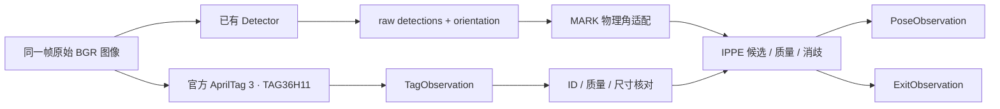

# G2 位姿与退出感知：完整实现方案

版本：2026-10-15；实施分支：`feat/pnp`；核验基线：`fd098ab0a23210f76541b1d186ae61f25d66096e`。

本文是可照着施工的实现文档。先读 §1–§7，再按 §8 顺序创建文件；每个新文件都提供完整代码，不需要自己补函数体。§9 给验收与排障，§10 附完整文件内容。

代码已在隔离源码副本中编译和测试，**没有写入你的实际仓库，没有执行 Git**。这不代替你实施后的 review gate，也不代表用户已验收或硬件已就绪。

## 1. 这块做什么，做完长什么样

G2 交付两条感知链：

1. **MARK → 位姿**：现有检测器提供原图四角和物理对应，新层输出目标到相机的候选位姿、误差、拒绝原因；有足够证据时输出唯一位姿。
2. **TAG36H11 → 退出对准测量**：官方 AprilTag 3 检测 ID 与规范四角，在白名单、解码质量、尺寸、位姿条件满足时给退出对准测量。

不做跟踪、Kalman、运动预测、底盘控制、后退决策、RFID 状态机，也不重写 MARK 检测器。Tag 检出不等于允许后退；位姿唯一不等于动作已经授权。

**本次可完成工程与离线验收；没有硬件时不能关闭 G2 的实车验证关卡。** 默认配置故意保留未知预算、Tag ID 和边长：可生成 PnP 候选，不能假装测量质量已经标定。不要为了让 `UNIQUE` 数量变大而填数。



`CaptureStamp` 旁路携带来源与时间；K/dist 和图纸模型由新配置加载。原六个检测模块仍然只负责检测与二维稳定，新 `lib/pose/` 是独立上层感知实现，组成 `mark_pose` 库，不塞进原检测器 pipeline。

## 2. 已逐项核对的事实与接入边界

| 项目 | 本分支实际情况 | 实现处理 |
|---|---|---|
| 原公开接口 | `FrameResult` 有 detections/tracks/display_state/diagnostics，没有 pose_3d | 新建独立上层类型，不追加原布局字段 |
| raw / 稳定结果 | `detections` 是当前原始测量；`tracks[].result` 已二维平滑 | PnP 只读前者，不二次滤波 |
| 方向 | `orientation[p]` 是物理角 p 到屏幕 slot 的映射 | `pixel[p] = corners[orientation[p]]`，检查为 0–3 的排列 |
| 四个物理点 | P0=L0.v0；P1=M1.v1；P2=L2.v0；P3=L3.v0 | 从现有模型文件提取，禁止取 L 中心或外板边界 |
| 模型坐标 | 当前为 (0,0)、(80,0)、(80,80)、(0,80)，模型没有单位元数据 | 新配置显式 source_unit=mm，转换为 m，不猜单位 |
| 标定 | calibration.yaml 为 1440×1080，K/dist 已存在 | 只读加载，不自动套用到缩放/裁剪图像 |
| RMSE 旧假设 | 本分支已修正统计公式；配置 reprojection_error 约 0.095094px | 不再重复“修 RMSE”；该值也不是每个角的真值误差或位姿预算 |
| 时间 | 原 TimestampSource 只有 Unknown | 不修改枚举；来源/曝光/接收/时钟/时间误差放 CaptureStamp |
| 测量质量 | 原 confidence 不是已标定位姿置信度，公开角点没有协方差 | 新层独立评估；未知 covariance 保持空 |
| 图像所有权 | 当前调用使用者需保证处理期间像素不变 | 离线运行器同步使用同一帧；未来 SDK 适配器负责锁帧/拥有像素 |

本次未发现必须改原检测器接口或算法才能接入 G2 的问题。因此 `include/mark/detector_types.hpp`、`detector.hpp`、旧生产 `.cpp/.hpp` 和旧配置均不改。

核验来源：

- [公开类型](https://github.com/shenghaotu81-droid/campus-marker-opencv-assignment/blob/fd098ab0a23210f76541b1d186ae61f25d66096e/src/tushenghao/include/mark/detector_types.hpp)、[物理角绑定](https://github.com/shenghaotu81-droid/campus-marker-opencv-assignment/blob/fd098ab0a23210f76541b1d186ae61f25d66096e/src/tushenghao/lib/corners/corner_resolver.cpp)、[发布 orientation](https://github.com/shenghaotu81-droid/campus-marker-opencv-assignment/blob/fd098ab0a23210f76541b1d186ae61f25d66096e/src/tushenghao/lib/corners/detection_publication.cpp)。
- [图纸模型](https://github.com/shenghaotu81-droid/campus-marker-opencv-assignment/blob/fd098ab0a23210f76541b1d186ae61f25d66096e/src/tushenghao/config/marker_geometry.yaml)、[标定配置](https://github.com/shenghaotu81-droid/campus-marker-opencv-assignment/blob/fd098ab0a23210f76541b1d186ae61f25d66096e/src/tushenghao/config/calibration.yaml)、[已修正的误差统计](https://github.com/shenghaotu81-droid/campus-marker-opencv-assignment/blob/fd098ab0a23210f76541b1d186ae61f25d66096e/src/tushenghao/tools/calibration/calibration_result.cpp)。
- 决策依据：你提供的《PNX 225% 随机移动兑换：视觉与决策开发路线》冻结终稿 §3.2、§3.3、G2。这里落实这些决策，不重选技术路线。

## 3. 坐标、状态和消歧契约

### 3.1 坐标与单位

| 对象 | 约定 |
|---|---|
| 相机坐标 | +X 图像右，+Y 图像下，+Z 镜头前方 |
| MARK 目标坐标 | 原点 P0；+X 指向 P1；+Y 指向 P3；Z 按右手系；四点 z=0 |
| MARK 四点 m | P0=(0,0,0)，P1=(0.08,0,0)，P2=(0.08,0.08,0)，P3=(0,0.08,0)，由文件读取，不在求解器重复写死 |
| Tag 目标坐标 | 中心原点，h=检测边界实测边长/2；p0=(-h,+h,0)、p1=(+h,+h,0)、p2=(+h,-h,0)、p3=(-h,-h,0) |
| Tag 轴方向 | +X 由 p0 指向 p1，+Y 由 p3 指向 p0；与官方规范角序对应。不要将它们重排为屏幕 LT 开始 |
| 位姿输出 | `T_camera_target_`：`X_camera = R * X_target + t`；rvec 为 rad，t 为 m |
| 逆变换 | `R_target_camera=R.t()`，`t_target_camera=-R.t()*t`；t 不是“相机世界坐标” |
| 像素域 | 本期只支持原图 RawDistorted + 原 K/dist；像素必须仍在原分辨率 |
| 时间 | 字段 us；时间误差/年龄预算 s；曝光与接收属于声明的同一单调时钟域 |

默认相机 ID 是参考数据标签，不冒充真实序列号。程序只能检查声明是否一致，不能凭一幅图自动证明镜头/焦距/裁剪/ISP 没变。

单目存在尺度自由度：把模型整体放大1000倍，t 也能放大1000倍而保持重投影一致。因此“单位错配测试”验证的是显式转换与尺度传播，不虚构算法能从残差自动识破单位错误。

### 3.2 状态分层

| PoseStatus | 含义 | 是否有唯一位姿 |
|---|---|---|
| InvalidInput | 来源、尺寸、像素域、角点、映射等非法 | 无 |
| CorrespondenceMissing | 当前 MARK 没有唯一物理对应 | 无，不用历史补方向 |
| NotDetected | 当前 raw 无目标 | 无，不补旧位姿 |
| NoSolution | 无候选或全部被质量/物理条件拒绝 | 无 |
| BudgetMissing | 可算候选，但质量/Tag条件未完成标定 | 无；候选供审计 |
| Ambiguous | 两个及以上候选同时合格 | 无；不按最小误差强选 |
| Unique | 恰好一个候选满足已声明条件 | 有；仍不等于实车可用 |

原 `FrameResult.status` 保持原语义。例如 MARK 检测成功但 PnP 歧义，原状态仍可为 DETECTED，新 `PoseObservation.status_` 为 Ambiguous。

`control_usable_` 是测量资格字段：还须相机、物理模型、预算、安装条件经实物验证，且曝光和时间误差预算合格。它不是任务授权或动作完成信号。通用 `estimate_planar()` 因不知道调用方模型来源，始终不给控制资格；MARK/Tag 类型适配器再执行完整门控。

### 3.3 固定解算顺序

1. 核对来源/帧绑定、原图尺寸、像素域、有限凸四边形、模型平面。
2. MARK 用 orientation 恢复 P0–P3；缺失就返回，不猜。
3. `solvePnPGeneric(..., SOLVEPNP_IPPE)` 保留候选；不用 IPPE_SQUARE，避免额外点序假设。
4. 对每个候选复算所有点正深度、每点误差、RMSE；RMSE=`sqrt(sum(||projected-observed||²)/4)`。
5. 按独立预算、显式安装约束、可用可信历史排除候选。只有一个合格才选，不比较“谁更小就选谁”。
6. 可选 LM 只精修已选解；不改善/越界/异常则保留原解并记原因。原始候选和误差不覆盖。
7. 协方差未知保持空，原 Detection/track 不改。

历史默认关闭；运行器不产生历史。`PosePrior.trusted_unique_` 必须来自独立可信的先验，同时确认是**同一个物理实例**，不能把上一帧最小残差候选、自选的方向或相同模型 ID 当成可信证据。身份/时钟/会话/严格先后/年龄不合格则忽略；本期不实施多目标关联。

深度>0、严格凸等是数学合法性；代码中的 `1e-12` 仅用于模型文件双精度一致性，不是允许现场角点误差的经验阈值。

官方依据：[OpenCV 4.6 PnP/多解/LM](https://docs.opencv.org/4.6.0/d5/d1f/calib3d_solvePnP.html)、[AprilTag 使用及检测边界尺寸](https://github.com/AprilRobotics/apriltag#pose-estimation)、[AprilTag 3.3.0 角序/API](https://github.com/AprilRobotics/apriltag/blob/v3.3.0/apriltag.h)。

## 4. 文件总装配图与修改边界

下树只展开 G2 文件与保持原状的边界。`[新]` 为完整新文件，`[改]` 仅按指定位置追加。原有其他文件全部保留。

```text
src/tushenghao/
├── CMakeLists.txt                         [改] 末尾追加 include(cmake/g2.cmake)
├── README.md                              [改] 增加 G2 导航链接，不覆盖历史
├── cmake/g2.cmake                         [新] 独立开关和编译目标
├── include/mark/
│   ├── detector.hpp                       [保持]
│   ├── detector_types.hpp                 [保持]
│   ├── pose_types.hpp                     [新] 来源/位姿/Tag/退出观测
│   ├── pose_config.hpp                    [新] 配置与加载接口
│   ├── pose_estimator.hpp                 [新] raw适配与平面求解
│   └── tag_detector.hpp                   [新] AprilTag PImpl与退出适配
├── lib/
│   ├── config/pose_config.cpp             [新] 配置解析/标定加载/模型转换
│   ├── core/                             [原样]
│   ├── preprocess/                       [原样]
│   ├── geometry/                         [原样]
│   ├── corners/                          [原样]
│   ├── pipeline/                         [原样]
│   └── pose/
│       ├── pose_geometry.hpp             [新] 小范围数学内部声明
│       ├── pose_geometry.cpp             [新] 凸性/误差/正深度/旋转距离
│       ├── pose_estimator.cpp            [新] MARK适配/IPPE/门控/LM
│       └── tag_detector.cpp              [新] C库生命周期/解码/Tag位姿适配
├── config/
│   ├── calibration.yaml                  [只读，不改]
│   ├── marker_geometry.yaml              [只读，不改]
│   ├── detector*.yaml                    [不改]
│   └── pose.yaml                         [新]
├── app/pose_main.cpp                     [新] 单独pose_app；不改旧main
├── tests/
│   ├── support/g2_test_scene.hpp          [新] 理想场景/主动断言
│   ├── pose_contract_test.cpp            [新]
│   └── tag_detector_test.cpp             [新]
├── tools/validation/pose_sensitivity.cpp  [新] 只测量，不填预算
└── docs/
    ├── INDEX.md                          [改] 新导航条目
    ├── g2.md                             [新] 中文运行/参数/限制说明
    ├── g2_acceptance.md                   [新] 实施验收记录模板
    └── evidence/g2/                      [实施后归档证据；不放构建产物]
```

共18个新文件、3个现有文件的局部追加。公开新类型在 `mark::pose`，原 `mark::Detection/FrameResult` 不变。新类型/类数据成员尾缀 `_`；函数 snake_case、类 PascalCase；旧接口命名不批量改。

不得引入万能 utils、新测试框架、YOLO、Kalman、RANSAC四点“鲁棒剔除”、新的原图去畸变路径或原检测阈值调整。新增 helper 只在 `lib/pose/` 内共享；配置读取放 config；运行编排放 app；试验放 tools，边界明确。

## 5. 配置清单：哪些现在有值，哪些必须等证据

所有相对资源路径相对 `pose.yaml` 所在目录解析。默认配置位置从调用源文件 `__FILE__` 推导，不硬编码 `/home/...` 或盘符。运行时显式传入的用户视频/配置路径可以是绝对路径，这与禁止源码写死机器路径不同。

| 配置项 | 语义/依据 | 当前处理 |
|---|---|---|
| schema_version | 新配置版本 | 1，严格核对 |
| camera.calibration | 原 K/dist 文件 | calibration.yaml，相对路径 |
| camera.camera_id | 参考/实际相机身份 | 当前 reference-maxicam-calibration；不是实际序列号 |
| camera.hardware_verified | 同镜头/焦距/分辨率/成像链实物确认 | 0 |
| geometry.model/source_unit/target_id | 模型位置、明确单位、模型/目标标签 | marker_geometry.yaml / mm / mark-white-structure-v1 |
| geometry.hardware_verified | 图纸结构角到实物的公制核对 | 0 |
| budgets.max_rmse_px | 原图4点欧氏重投影RMS上限 | 空；独立误差试验后批准 |
| budgets.max_corner_error_px | 最大单点重投影误差上限 | 空；不能拿角点拟合残差直接代替 |
| budgets.min_quad_area_px2 | 原图最小可用四边形面积 | 空；距离/角度/像素尺度有效域试验确定 |
| budgets.max_time_uncertainty_s | 曝光/时钟映射误差上限 | 空；未知时不放行控制级测量 |
| budgets.hardware_verified/evidence | 预算硬件确认与来源 | 0 / unmeasured；填写时附数据/条件/批准记录 |
| selection.min_z_m/max_z_m | 目标原点相机深度区间 | 必须成对；未知则都空 |
| selection.min_normal_z/max_normal_z | R(2,2)区间；来自真实安装/可见域 | 必须成对且在[-1,1]内；不擅定法向 |
| selection.constraints_verified | 已验证声明的物理适用条件 | 0，不能用它代替真实验证 |
| selection.refine_lm | 已选解后可选精修 | 0；开启后做配对比较，不参与初始强选 |
| selection.prior_enabled | 使用外部可信历史辅助排除 | 0；不自动构造历史 |
| selection.prior_max_age_s | 最坏年龄含两端时间误差 | 空；开启prior须齐全 |
| selection.prior_max_translation_m / prior_max_rotation_rad | 历史允许变化的独立预算 | 空；不从该录像拟合来强锁解 |
| tag.family | 比赛规定 | 固定 tag36h11，其他值拒绝 |
| tag.nthreads/quad_decimate/quad_sigma/refine_edges/decode_sharpening | 库算法起点，非物理验收预算 | 1 / 1.0 / 0 / 1 / 0.25；记录版本、允许后续对照 |
| tag.max_hamming | 明确纠错政策 | 0：不允许纠错；不是经验置信度 |
| tag.min_decision_margin | 解码质量指标阈值，不是概率 | 空；独立正负例确定 |
| tag.allowed_ids | 官方退出目标白名单 | 空；禁止猜ID |
| tag.sizes | 每个白名单ID的检测边界实测边长(m) | 空；不是纸张外沿 |
| tag.hardware_verified | ID/尺寸/质量/适用场景验证 | 0 |

配置合法与就绪分开：空预算是合法“未测”状态；负数、NaN、错类型、错误模型单位、错误K/畸变维数会拒绝。预算未齐不发布唯一位姿；Tag的白名单/质量/尺寸不齐不发布公制退出对准。

### 5.1 预算怎样从未测变成可用

1. 先运行本方案敏感性工具，保存声明的合成条件和全部候选误差；它只验证投影/求解、生成敏感性证据，不自动生成生产阈值。
2. 给角点噪声/姿态/距离/像素尺度建立独立来源。没有真实观测时只能写“合成假设”，不能叫实测质量。
3. 用开发集设计门槛、独立选择集决定参数、隐藏验证集报告误差尾部、唯一解覆盖与错误唯一解；按会话/场景分集，不把相邻帧拆两边。
4. 提交参数值、来源、单位、适用域、拒绝率/错误唯一解/误差分布对照，用户批准后才写入相应配置副本。不要为1676帧回归调门槛。
5. 实物尚未验证时 hardware_verified 仍为0，允许离线研究，不批准真实动作。硬件到位后完成相机/结构尺寸/安装/时间/独立真值验收再更改标记。

无法用这一步发现的物理误差必须另外测：模型尺度、镜头变化、曝光时间、相机安装关系、真实成像噪声。低重投影误差不能替代它们。

## 6. 构建、路径与运行命令

以下均从仓库根目录运行，单行命令。验证组合为 Ubuntu 24.04/WSL、GNU 13.3、OpenCV 4.6.0、AprilTag 3.3.0。其他版本先跑相同测试，不假定所有未来版本等价。

### 6.1 依赖与编译

```bash
sudo apt-get update && sudo apt-get install --no-install-recommends build-essential cmake pkg-config libopencv-dev libssl-dev libapriltag-dev
pkg-config --modversion opencv4 apriltag
cmake -S src/tushenghao -B build/g2-release -DCMAKE_BUILD_TYPE=Release -DMARK_BUILD_G2=ON
cmake --build build/g2-release -j4
ctest --test-dir build/g2-release --output-on-failure
cmake -S src/tushenghao -B build/g2-debug -DCMAKE_BUILD_TYPE=Debug -DMARK_BUILD_G2=ON
cmake --build build/g2-debug -j4
ctest --test-dir build/g2-debug --output-on-failure
```

AprilTag 使用官方3系列实现；Ubuntu系统包的CMake多架构导入存在路径兼容问题，本方案用 pkg-config 核版本，再 find_path/find_library 获取实际位置，不改系统包文件。辅助图像生成只属于测试，发行版拆出的 `apriltag-utils` 不进入公开API。

默认 `MARK_BUILD_G2=OFF`，普通检测器用户不新增必需的AprilTag依赖；本次施工显式 ON。若找不到库，先检查安装与 pkg-config，不改源码写本机绝对路径；自定义安装用 `CMAKE_PREFIX_PATH`、`PKG_CONFIG_PATH` 指向自己的前缀。

### 6.2 检查配置与运行

```bash
build/g2-release/pose_app --check-config
build/g2-release/pose_sensitivity runs/g2-sensitivity-001
VIDEO='<你的视频路径>'
build/g2-release/pose_app --video "$VIDEO" --out runs/g2-video-001 --camera-id reference-maxicam-calibration --session-id replay-001 --expected-frames 1676
```

`--check-config` 只说明配置/模型/标定可加载，不代表预算齐或硬件就绪。新输出目录必须不存在，重复试验换新目录，不覆盖旧证据。

`--expected-frames 1676` 只用于原作业录像。换视频必须换为独立确认的帧数，或省略并接受“完整性未验证”；帧数为0/给定帧数不符会非零退出。不把EOF当作文件完整的证明。

`pose_app` 逐帧同步：同一原图给Detector和Tag；无显示窗口、不导视频、不改旧应用。录像时间由frame/fps构造，明确标成回放时钟；exposure/time_uncertainty不伪造，所以录像结果不授予控制资格。

| 输出 | 内容 |
|---|---|
| observations.yaml | 每帧MARK观测、全部IPPE候选、选择/拒绝原因；Tag ID/规范四角/质量/退出位姿 |
| summary.yaml | 帧数、raw MARK数、唯一位姿数、Tag数、完整性；hardware_confirmed=0 |
| camera_and_model.yaml | 本次K/dist、原尺寸、实际使用的公制结构角 |
| pose_config_input.yaml / detector_config_input.yaml | 本次配置输入原件，供对照 |
| sensitivity.csv | 3456组声明场景的状态、候选数、真值最近候选误差、实际选中误差 |
| candidate_errors.csv | 每个候选的重投影、深度、平移/旋转真值误差；不是生产决策输入 |

敏感性网格为3个假设距离×3个假设倾角×12个真正组合旋转×4档像素噪声×8次重复，固定seed。它绕过真实检测器，不能宣称已经验证了真实像素定位或大透视前端。`truth_nearest` 是评分用上界，不能拿来报告生产唯一解正确率。

默认预算为空，录像出现 `BUDGET_MISSING` 是预期；候选中的rvec/t仍可检查，但 `T_camera_target_` 留空。零唯一位姿不是要求你放宽预算的信号。

### 6.3 路径迁移

默认路径通过 `__FILE__` 推导，因此换工作目录运行不依赖CWD。源树搬迁后在新位置重新编译；只搬二进制时必须显式传配置路径并携带相对资源。不要宣称编译时固化的源文件位置会随二进制自动迁移。

CLI额外接受 `--config <pose.yaml>`、`--detector-config <detector.yaml>`。禁止在源码里填自己的用户名、盘符或视频绝对路径。

## 7. CMake、README、INDEX 的精确修改

### 7.1 src/tushenghao/CMakeLists.txt

保留原文件全文，在最后 `target_link_libraries(calibration_tool PRIVATE ${OpenCV_LIBS})` 后追加一次：

```cmake
# G2 独立感知层，默认关闭；不改变原检测器目标。
include(cmake/g2.cmake)
```

不重排原源码清单、不改旧测试、不改旧检测器链接逻辑。旧审计的源码fingerprint可能因为扫描到新增源文件而变化，不能据此断言raw结果变化；比较raw值/计数与配置，而不是要求新旧code_hash相同。

### 7.2 src/tushenghao/README.md

在现有快速开始后加以下小节，其余保留：

```markdown
## G2 位姿与退出感知

G2 是独立构建选项，原 MARK 检测器接口保持不变。安装/构建/运行/参数与限制见 [G2 使用说明](docs/g2.md)，验收状态见 [G2 验收记录](docs/g2_acceptance.md)。

默认位姿预算和退出 Tag 信息尚未实测，候选解可用于离线验证；未经过实车确认。
```

### 7.3 src/tushenghao/docs/INDEX.md

末尾新增导航，保留原内容：

```markdown
## G2 扩展感知

- [G2 位姿与退出感知：构建、运行、参数与限制](g2.md)
- [G2 实施验收与待验证事项](g2_acceptance.md)
- G2 证据归档：`evidence/g2/`（测试日志、配置、敏感性与录像结果；不放编译产物）
```

## 8. 分步施工顺序与停点

| 步骤 | 现在做什么 | 怎么验收 | 失败先看哪里 / 必须停下的点 |
|---|---|---|---|
| 0 核对基线 | 用户确认 feat/pnp、基线fd098ab；保留原工作；建立新文件，不自动Git | 原types、标定/模型与§2一致，原25项基线可运行 | 如果分支已变化，先对照差异，不强套文件或覆盖用户工作 |
| 1 定类型 | 复制4个 include/mark 新头文件；原头不动 | 与下游cpp联合编译；字段/单位能按§3复述 | 对应关系或物理尺寸与冻结不符，停下交用户；不偷偷改freeze |
| 2 配置与模型 | 复制pose.yaml、pose_config.cpp | 默认文件能加载，读出的点为0/.08m；错误单位/负预算拒绝 | 查相对路径、OpenCV YAML头、schema、K/dist和源模型；缺预算不补数字 |
| 3 几何与MARK | 复制pose_geometry与pose_estimator | 后续pose_contract_test T01–T25；确认raw只读 | 对应/双解/负深度/尺度问题先看相应断言，不改原角点或阈值 |
| 4 Tag路径 | 复制tag_detector.cpp，安装官方依赖 | 后续tag_detector_test A01–A11，规范角序、白名单、重复ID均正确 | 库链接问题查pkg-config/头文件/运行库；物理ID/边长未知则继续留空 |
| 5 工具与装配 | 复制app、tests/support、两测试、sensitivity和cmake/g2.cmake；按§7追加CMake | Release全构建与27/27；check-config明确只验格式 | 不得删测试、NDEBUG空验收或改旧公共布局换绿 |
| 6 Debug与异常 | 完整Debug构建/CTest；异CWD配置检查；输入错误身份/尺寸、给错期待帧数 | Debug27/27；错误非零退出；没有静默缩放K/旧位姿桥接 | 查看status/reasons，再查来源/尺寸/物理对应；不直接调预算 |
| 7 离线实验 | 跑3456组合、原录像；检查候选/状态/完整性 | 默认参考配置只给候选；原raw计数/原回归值保持；实验记录齐 | 无物理真值不报告毫米精度；低重投影不等于已消歧 |
| 8 文档归档 | 复制两份docs；追加README/INDEX；归档docs/evidence/g2；填写实际耗时/剩余项 | 中文导航可达，结果与限制分开，用户review gate | 缺文档/失败未解释不写完成；只由用户做commit/push/merge |

§10 已按上述依赖顺序给出所有新文件。头文件无需单独“运行”，以完整目标编译和测试验证；不要在每个中间半成品都期待全工程编译成功。

预算、Tag信息、硬件资格的填入必须带证据和用户批准；这是后续事实补齐，不授权降低原验收质量。涉及原四角物理语义、公开Detector布局、去畸变前端或新增估计/控制算法时单独升级设计，停止越界实现。

## 9. 最终验收与易错点

### 9.1 软件必须通过

- 原25个CTest加G2两个CTest，Release/Debug均27/27；测试主动检查，不能仅依赖assert。
- T01–T25：理想真值、object→camera、24种槽置换、缺/坏orientation、帧绑定、相机/尺寸/像素域、NaN/退化/画外、缺预算、双解、尺度传播、负深度、LM、当前无检测、可信/跨会话/过期历史、配置与毫米转米、零/非零畸变。
- A01–A11：官方TAG36H11解码、规范角序、非白名单、缺质量预算、缺尺寸、空白、重复ID、空输入、非连续ROI、公制位姿接通、错误family。
- 默认配置合法但不擅自ready；敏感性3456组和6912个候选有逐项记录；默认唯一数为0有清楚原因。
- 原录像1676帧接线，raw MARK 1088；不能用位姿唯一数或detections≥1作为完成标准。若实际使用的数据/配置不同，先核对输入而不是强凑1088。
- 原Detector生产代码、头文件和已有配置零修改；追加目标不能让原检测器ABI改变。
- 文档/日志/配置归档齐；运行器未知完整性明确说明，失败非零退出。

### 9.2 硬件条件未关闭，必须写进剩余项

真实相机身份、成像设置、独立标定新会话；实物结构角尺度；安装关系与可见姿态域；真实曝光时间及误差；官方Tag ID/检测边界尺寸；真实正负例与退出背景；独立位姿真值误差；动态可见性。没有这些证据不把hardware_verified改为1。

原检测器当前仿射适用域不因PnP支持透视而扩大。大透视角前端没检出、物理对应未定、双解仍无法区分时，G2必须不可用；改这些属于后续受控对照，不在这里放宽阈值。

### 9.3 排障顺序

| 现象 | 优先核对 | 不允许的“修法” |
|---|---|---|
| 深度差1000倍但重投影很小 | 模型 source_unit、物理边长、转换后点表 | 用t除1000局部补丁或残差放宽 |
| 旋转时位姿跳 | orientation物理映射、屏幕slot切换、是否误读tracks | x/y排序猜物理身份 |
| 两候选误差接近 | 有无独立安装/质量/可信历史证据 | 强选最小残差并永久锁定 |
| 全部BUDGET_MISSING | pose.yaml预算是否尚未测 | 复制fixture里的0.05/0.1当生产值 |
| 姿态异常而2D框正常 | raw对应、K/dist、原图域、尺度、畸变是否被重复应用 | 改原检测器输出让PnP过 |
| Tag检出但不输出退出位姿 | 白名单、margin预算、该ID实测边长、尺寸一致性 | 允许任意ID/默认标签边长 |
| 旧历史似乎可消歧 | 同会话/相机/时钟/物理实例/年龄/独立可信来源 | 用上次自选结果给自己背书 |
| 换目录找不到配置 | __FILE__指向的源码树是否仍存在，是否新位置重编译 | 在代码中写死/home或盘符 |
| 系统找不到AprilTag | 包、pkg-config、头库前缀、运行库 | 替换成未经批准的family/假检测器 |

### 9.4 归档与完成口径

实施后的证据放 `src/tushenghao/docs/evidence/g2/`：release/debug构建和CTest日志、配置检查、敏感性CSV/summary、录像观测/summary、代码变更与原raw回归核对、参数批准记录（若有）。构建目录使用 `build/g2-release` / `build/g2-debug`；先归档证据，确认目录仅含本次产物后再由执行人清理，不递归清理其他build。

`docs/g2_acceptance.md` 填四栏：工程完成、离线证据、尚未证明、硬件关闭条件。附实际耗时与剩余项。不要把编写者的隔离测试复制为“用户已验收”。本次不执行Git，由用户在review gate后决定提交与合入。

## 10. 完整新文件代码

以下每节标题就是仓库内目标路径。创建对应目录，完整复制该节代码；现有三处追加按§7完成。代码采用UTF-8中文注释，不逐行翻译；解释输入边界、原有缺口和这样处理的原因。

### 10.1 `src/tushenghao/include/mark/pose_types.hpp`

```cpp
#pragma once

#include <array>
#include <cstdint>
#include <optional>
#include <string>
#include <vector>
#include <opencv2/core.hpp>

namespace mark::pose
{
enum class PixelDomain { Unknown, RawDistorted };
// 原检测接口只有一个时间戳；旁路记录真实来源，未知曝光时间不能冒充已知。
struct CaptureStamp
{
    std::string session_id_;
    std::string camera_id_;
    std::string clock_domain_;
    PixelDomain pixel_domain_{PixelDomain::Unknown};
    std::uint64_t frame_id_{0};
    std::int64_t received_us_{0};
    std::optional<std::int64_t> exposure_us_;
    std::optional<double> time_uncertainty_s_;
};

// 统一表示目标坐标到相机坐标：X_camera = R * X_target + t，平移单位 m。
struct RigidPose
{
    cv::Vec3d rvec_{0, 0, 0};
    cv::Vec3d t_m_{0, 0, 0};
};

enum class PoseStatus
{
    InvalidInput,
    CorrespondenceMissing,
    NotDetected,
    NoSolution,
    BudgetMissing,
    Ambiguous,
    Unique
};

// 原先只有二值检测；候选逐项保留测量值与拒绝原因，不把残差包装为概率。
struct PoseCandidate
{
    RigidPose pose_;
    double rmse_px_{0};
    double max_error_px_{0};
    double min_depth_m_{0};
    bool metrics_valid_{false};
    bool eligible_{false};
    std::vector<std::string> reasons_;
};

struct PoseObservation
{
    CaptureStamp stamp_;
    std::string source_;
    std::string target_id_;
    std::size_t detection_index_{0};
    PoseStatus status_{PoseStatus::InvalidInput};
    std::vector<PoseCandidate> candidates_;
    std::optional<std::size_t> selected_index_;
    std::optional<RigidPose> T_camera_target_;
    std::optional<double> selected_rmse_px_;
    std::optional<double> refined_rmse_px_;
    // 未标定不确定度时保持空；零矩阵会错误宣称没有不确定性。
    std::optional<std::array<double, 36>> covariance_se3_;
    bool control_usable_{false};
    std::vector<std::string> reasons_;
};

// 历史只作候选排除证据；不补当前角点、不预测、不在求解器中自动积累状态。
struct PosePrior
{
    CaptureStamp stamp_;
    std::string target_id_;
    RigidPose pose_;
    bool trusted_unique_{false};
};

// 保留 AprilTag 的规范解码角序 p[0..3]；它不是 MARK 的屏幕 LT/RT/RB/LB。
struct TagObservation
{
    CaptureStamp stamp_;
    std::string family_{"tag36h11"};
    int id_{-1};
    int hamming_{0};
    double decision_margin_{0};
    std::array<cv::Point2d, 4> corners_;
    bool whitelisted_{false};
    bool decode_accepted_{false};
    std::vector<std::string> reasons_;
};

// 退出感知不等于任务退出授权；RFID/权限/后退动作属于后续决策层。
struct ExitObservation
{
    TagObservation tag_;
    PoseObservation pose_;
    bool alignment_measurement_usable_{false};
};

const char *pose_status_name(PoseStatus status_) noexcept;
} // namespace mark::pose
```

### 10.2 `src/tushenghao/include/mark/pose_config.hpp`

```cpp
#pragma once

#include <array>
#include <filesystem>
#include <map>
#include <optional>
#include <set>
#include <string>
#include <opencv2/core.hpp>

namespace mark::pose
{
// 标定结果原来不带相机身份；身份与验证状态放新配置，不修改历史标定文件。
struct CameraModel
{
    cv::Mat K_;
    cv::Mat dist_;
    cv::Size image_size_;
    std::string camera_id_;
    bool hardware_verified_{false};
};

struct PoseBudgets
{
    std::optional<double> max_rmse_px_;
    std::optional<double> max_corner_error_px_;
    std::optional<double> min_quad_area_px2_;
    std::optional<double> max_time_uncertainty_s_;
    bool hardware_verified_{false};
};

struct SelectionConfig
{
    // 未知安装约束保持空，不通过默认法向/距离偷偷排除第二解。
    std::optional<double> min_z_m_;
    std::optional<double> max_z_m_;
    std::optional<double> min_normal_z_;
    std::optional<double> max_normal_z_;
    bool constraints_verified_{false};
    bool refine_lm_{false};
    bool prior_enabled_{false};
    std::optional<double> prior_max_age_s_;
    std::optional<double> prior_max_translation_m_;
    std::optional<double> prior_max_rotation_rad_;
};

struct TagConfig
{
    int nthreads_{1};
    double quad_decimate_{1};
    double quad_sigma_{0};
    bool refine_edges_{true};
    double decode_sharpening_{0.25};
    int max_hamming_{0};
    std::optional<double> min_decision_margin_;
    std::set<int> allowed_ids_;
    std::map<int, double> side_m_;
    bool hardware_verified_{false};
};

struct G2Config
{
    CameraModel camera_;
    std::array<cv::Point3d, 4> mark_points_m_;
    std::string mark_target_id_;
    bool mark_geometry_verified_{false};
    PoseBudgets budgets_;
    SelectionConfig selection_;
    TagConfig tag_;
};

// 相对资源一律相对配置所在目录；默认入口由调用方 __FILE__ 推导。
G2Config load_pose_config(const std::filesystem::path &path);
void validate_pose_config(const G2Config &config);
} // namespace mark::pose
```

### 10.3 `src/tushenghao/include/mark/pose_estimator.hpp`

```cpp
#pragma once

#include "mark/detector_types.hpp"
#include "mark/pose_config.hpp"
#include "mark/pose_types.hpp"

namespace mark::pose
{
// 原输出没有位姿；独立无状态求解器读取 raw Detection，绝不写回原检测结果。
class PoseEstimator
{
public:
    explicit PoseEstimator(G2Config config);

    PoseObservation estimate_mark(
        const FrameResult &raw, std::size_t detection_index_,
        cv::Size original_size, const CaptureStamp &stamp_,
        const std::optional<PosePrior> &prior = std::nullopt) const;

    PoseObservation estimate_planar(
        const std::array<cv::Point3d, 4> &object_points_m,
        const std::array<cv::Point2d, 4> &image_points,
        cv::Size original_size, const CaptureStamp &stamp_,
        const std::string &target_id_,
        const std::optional<PosePrior> &prior = std::nullopt) const;

    const G2Config &config() const noexcept { return config_; }

private:
    G2Config config_;
};
} // namespace mark::pose
```

### 10.4 `src/tushenghao/include/mark/tag_detector.hpp`

```cpp
#pragma once

#include <memory>
#include "mark/pose_estimator.hpp"

namespace mark::pose
{
// 官方 AprilTag 对象由 PImpl 独占；避免 C 库类型污染公开头、避免跨实例共享状态。
class TagDetector
{
public:
    explicit TagDetector(TagConfig config);
    ~TagDetector();
    TagDetector(const TagDetector &) = delete;
    TagDetector &operator=(const TagDetector &) = delete;

    std::vector<TagObservation> detect(const cv::Mat &bgr,
                                       const CaptureStamp &stamp_);

private:
    struct Impl;
    std::unique_ptr<Impl> impl_;
};

// 未知尺寸仍能输出像素 Tag，但不能构造公制对准测量。
ExitObservation estimate_exit(const TagObservation &tag_, cv::Size original_size,
                              const PoseEstimator &estimator);
} // namespace mark::pose
```

### 10.5 `src/tushenghao/config/pose.yaml`

```yaml
%YAML:1.0
---
schema_version: 1
camera:
  calibration: "calibration.yaml"
  # 这是参考数据身份，不是硬件序列号；领取相机后重新标定并核对身份。
  camera_id: "reference-maxicam-calibration"
  hardware_verified: 0
geometry:
  model: "marker_geometry.yaml"
  source_unit: "mm"
  target_id: "mark-white-structure-v1"
  # 图纸 P0=L0.v0/P1=M1.v1/P2=L2.v0/P3=L3.v0，不是外板 115x120。
  hardware_verified: 0
budgets:
  # 空字符串表示尚未标定；不继承二维角点拟合预算，不填经验值。
  max_rmse_px: ""
  max_corner_error_px: ""
  min_quad_area_px2: ""
  max_time_uncertainty_s: ""
  hardware_verified: 0
  evidence: "unmeasured"
selection:
  min_z_m: ""
  max_z_m: ""
  min_normal_z: ""
  max_normal_z: ""
  constraints_verified: 0
  refine_lm: 0
  prior_enabled: 0
  prior_max_age_s: ""
  prior_max_translation_m: ""
  prior_max_rotation_rad: ""
tag:
  family: "tag36h11"
  # 以下是可复现的算法起点，不是比赛质量阈值；默认原分辨率、单线程、无纠错。
  nthreads: 1
  quad_decimate: 1.0
  quad_sigma: 0.0
  refine_edges: 1
  decode_sharpening: 0.25
  max_hamming: 0
  min_decision_margin: ""
  allowed_ids: []
  # 硬件确认后填写 id 与 side_m；边长量取黑白检测边界，这里不猜 ID/尺寸。
  sizes: []
  hardware_verified: 0
```

### 10.6 `src/tushenghao/lib/config/pose_config.cpp`

```cpp
#include "mark/pose_config.hpp"

#include <cmath>
#include <stdexcept>
#include <vector>

namespace mark::pose
{
namespace
{
// 过去缺字段易被 OpenCV 转成 0；新配置逐项检查类型，空字符串只用于明确未知值。
cv::FileNode required(const cv::FileNode &node, const char *key)
{
    auto value = node[key];
    if (value.empty())
        throw std::runtime_error(std::string("G2 配置缺字段: ") + key);
    return value;
}

std::string text(const cv::FileNode &node, const char *key)
{
    auto value = required(node, key);
    if (!value.isString())
        throw std::runtime_error(std::string("G2 应为字符串: ") + key);
    return static_cast<std::string>(value);
}

double number(const cv::FileNode &value)
{
    if (!value.isInt() && !value.isReal())
        throw std::runtime_error("G2 应为有限数值");
    const double result = static_cast<double>(value);
    if (!std::isfinite(result))
        throw std::runtime_error("G2 数值非有限");
    return result;
}

int integer(const cv::FileNode &node, const char *key)
{
    auto value = required(node, key);
    if (!value.isInt())
        throw std::runtime_error(std::string("G2 应为整数: ") + key);
    return static_cast<int>(value);
}

bool boolean(const cv::FileNode &node, const char *key)
{
    int value = integer(node, key);
    if (value != 0 && value != 1)
        throw std::runtime_error(std::string("G2 开关必须是 0/1: ") + key);
    return value == 1;
}

std::optional<double> optional_number(const cv::FileNode &node, const char *key)
{
    auto value = required(node, key);
    if (value.isString() && static_cast<std::string>(value).empty())
        return std::nullopt;
    return number(value);
}

// 原模型单位未记录；只能显式声明 mm 或 m，不能按目标大小猜单位。
std::array<cv::Point3d, 4> load_points(const std::filesystem::path &path,
                                      const std::string &unit)
{
    if (unit != "mm" && unit != "m")
        throw std::runtime_error("G2 模型单位只接受 mm/m");
    cv::FileStorage fs(path.string(), cv::FileStorage::READ);
    if (!fs.isOpened() || !fs["polygons"].isSeq())
        throw std::runtime_error("G2 模型打不开或 polygons 非序列: " + path.string());
    const std::array<std::string, 4> ids{{"L0", "M1", "L2", "L3"}};
    const std::array<int, 4> vertex{{0, 1, 0, 0}};
    std::array<cv::Point3d, 4> out{};
    std::array<bool, 4> found{};
    const double scale = unit == "mm" ? 0.001 : 1.0;
    for (const auto &poly : fs["polygons"])
    {
        const auto id_ = text(poly, "id");
        for (std::size_t p = 0; p < ids.size(); ++p)
        {
            if (id_ != ids[p])
                continue;
            const auto vertices = required(poly, "vertices");
            if (found[p] || !vertices.isSeq() ||
                vertices.size() <= static_cast<std::size_t>(vertex[p]))
                throw std::runtime_error("G2 模型角部重复或缺顶点: " + id_);
            const auto v = vertices[vertex[p]];
            if (!v.isSeq() || v.size() != 2)
                throw std::runtime_error("G2 模型顶点必须为二维");
            out[p] = {number(v[0]) * scale, number(v[1]) * scale, 0};
            found[p] = true;
        }
    }
    for (bool value : found)
        if (!value)
            throw std::runtime_error("G2 模型缺 P0/P1/P2/P3 对应结构角");
    return out;
}

void positive(const std::optional<double> &value, const char *name)
{
    if (value && (!std::isfinite(*value) || *value <= 0))
        throw std::runtime_error(std::string("G2 必须为有限正数: ") + name);
}
} // namespace

// 加载只读参考标定、图纸模型和新配置；不写回旧 detector/calibration YAML。
G2Config load_pose_config(const std::filesystem::path &path)
{
    cv::FileStorage fs(path.string(), cv::FileStorage::READ);
    if (!fs.isOpened() || integer(fs.root(), "schema_version") != 1)
        throw std::runtime_error("G2 配置打不开或版本不支持: " + path.string());
    auto camera_ = required(fs.root(), "camera");
    auto geometry = required(fs.root(), "geometry");
    auto budgets_ = required(fs.root(), "budgets");
    auto selection_ = required(fs.root(), "selection");
    auto tag_ = required(fs.root(), "tag");
    G2Config c;
    const auto base = path.parent_path();
    auto relative_resource = [&base](const std::string &name)
    {
        const std::filesystem::path resource(name);
        if (resource.empty() || resource.is_absolute())
            throw std::runtime_error("G2 配置资源必须为相对配置目录的路径");
        return (base / resource).lexically_normal();
    };
    cv::FileStorage calibration(relative_resource(text(camera_, "calibration")).string(),
                                cv::FileStorage::READ);
    if (!calibration.isOpened() || integer(calibration.root(), "schema_version") != 1)
        throw std::runtime_error("G2 标定文件打不开或版本不支持");
    required(calibration.root(), "camera_matrix") >> c.camera_.K_;
    required(calibration.root(), "distortion_coefficients") >> c.camera_.dist_;
    c.camera_.image_size_ = {integer(calibration.root(), "image_width"),
                           integer(calibration.root(), "image_height")};
    c.camera_.camera_id_ = text(camera_, "camera_id");
    c.camera_.hardware_verified_ = boolean(camera_, "hardware_verified");
    c.mark_points_m_ = load_points(relative_resource(text(geometry, "model")),
                                 text(geometry, "source_unit"));
    c.mark_target_id_ = text(geometry, "target_id");
    c.mark_geometry_verified_ = boolean(geometry, "hardware_verified");
    c.budgets_.max_rmse_px_ = optional_number(budgets_, "max_rmse_px");
    c.budgets_.max_corner_error_px_ = optional_number(budgets_, "max_corner_error_px");
    c.budgets_.min_quad_area_px2_ = optional_number(budgets_, "min_quad_area_px2");
    c.budgets_.max_time_uncertainty_s_ = optional_number(budgets_, "max_time_uncertainty_s");
    c.budgets_.hardware_verified_ = boolean(budgets_, "hardware_verified");
    (void)text(budgets_, "evidence");
    c.selection_.min_z_m_ = optional_number(selection_, "min_z_m");
    c.selection_.max_z_m_ = optional_number(selection_, "max_z_m");
    c.selection_.min_normal_z_ = optional_number(selection_, "min_normal_z");
    c.selection_.max_normal_z_ = optional_number(selection_, "max_normal_z");
    c.selection_.constraints_verified_ = boolean(selection_, "constraints_verified");
    c.selection_.refine_lm_ = boolean(selection_, "refine_lm");
    c.selection_.prior_enabled_ = boolean(selection_, "prior_enabled");
    c.selection_.prior_max_age_s_ = optional_number(selection_, "prior_max_age_s");
    c.selection_.prior_max_translation_m_ = optional_number(selection_, "prior_max_translation_m");
    c.selection_.prior_max_rotation_rad_ = optional_number(selection_, "prior_max_rotation_rad");
    if (text(tag_, "family") != "tag36h11")
        throw std::runtime_error("G2 只允许 tag36h11");
    c.tag_.nthreads_ = integer(tag_, "nthreads");
    c.tag_.quad_decimate_ = number(required(tag_, "quad_decimate"));
    c.tag_.quad_sigma_ = number(required(tag_, "quad_sigma"));
    c.tag_.refine_edges_ = boolean(tag_, "refine_edges");
    c.tag_.decode_sharpening_ = number(required(tag_, "decode_sharpening"));
    c.tag_.max_hamming_ = integer(tag_, "max_hamming");
    c.tag_.min_decision_margin_ = optional_number(tag_, "min_decision_margin");
    c.tag_.hardware_verified_ = boolean(tag_, "hardware_verified");
    auto ids = required(tag_, "allowed_ids");
    auto sizes = required(tag_, "sizes");
    if (!ids.isSeq() || !sizes.isSeq())
        throw std::runtime_error("G2 allowed_ids/sizes 必须为序列");
    for (const auto &id_ : ids)
    {
        if (!id_.isInt() || !c.tag_.allowed_ids_.insert(static_cast<int>(id_)).second)
            throw std::runtime_error("G2 Tag ID 类型错误或重复");
    }
    for (const auto &size : sizes)
        if (!c.tag_.side_m_.emplace(integer(size, "id"), number(required(size, "side_m"))).second)
            throw std::runtime_error("G2 Tag 尺寸 ID 重复");
    validate_pose_config(c);
    return c;
}

// 配置即使来自测试构造也必须验证，避免绕开 YAML 检查污染解算输入。
void validate_pose_config(const G2Config &c)
{
    const auto &k = c.camera_.K_;
    const auto &d = c.camera_.dist_;
    const auto count = d.total();
    if (k.rows != 3 || k.cols != 3 || k.type() != CV_64F || !cv::checkRange(k) ||
        k.at<double>(0, 0) <= 0 || k.at<double>(1, 1) <= 0 ||
        k.at<double>(0, 1) != 0 || k.at<double>(1, 0) != 0 ||
        k.at<double>(2, 0) != 0 || k.at<double>(2, 1) != 0 || k.at<double>(2, 2) != 1 ||
        d.type() != CV_64F || (d.rows != 1 && d.cols != 1) || !cv::checkRange(d) ||
        (count != 4 && count != 5 && count != 8 && count != 12 && count != 14) ||
        c.camera_.image_size_.width <= 0 || c.camera_.image_size_.height <= 0 ||
        c.camera_.camera_id_.empty() || c.mark_target_id_.empty())
        throw std::runtime_error("G2 相机矩阵/畸变/尺寸/身份无效");
    for (const auto &p : c.mark_points_m_)
        if (!std::isfinite(p.x) || !std::isfinite(p.y) || p.z != 0)
            throw std::runtime_error("G2 模型必须为有限 z=0 平面点");
    const auto &p = c.mark_points_m_;
    const auto e1 = p[1] - p[0], e2 = p[3] - p[0];
    if (cv::norm(e1.cross(e2)) <= 0 || cv::norm(p[2] - p[1] - p[3] + p[0]) > 1e-12)
        throw std::runtime_error("G2 模型不是非退化 P0-P1-P2-P3 平行四边形");
    positive(c.budgets_.max_rmse_px_, "max_rmse_px");
    positive(c.budgets_.max_corner_error_px_, "max_corner_error_px");
    positive(c.budgets_.min_quad_area_px2_, "min_quad_area_px2");
    positive(c.budgets_.max_time_uncertainty_s_, "max_time_uncertainty_s");
    positive(c.selection_.min_z_m_, "min_z_m");
    positive(c.selection_.max_z_m_, "max_z_m");
    positive(c.selection_.prior_max_age_s_, "prior_max_age_s");
    positive(c.selection_.prior_max_translation_m_, "prior_max_translation_m");
    positive(c.selection_.prior_max_rotation_rad_, "prior_max_rotation_rad");
    const auto &s = c.selection_;
    if (s.min_z_m_.has_value() != s.max_z_m_.has_value() ||
        (s.min_z_m_ && *s.min_z_m_ >= *s.max_z_m_) ||
        s.min_normal_z_.has_value() != s.max_normal_z_.has_value() ||
        (s.min_normal_z_ && (!std::isfinite(*s.min_normal_z_) ||
                           !std::isfinite(*s.max_normal_z_) || *s.min_normal_z_ < -1 ||
                           *s.max_normal_z_ > 1 || *s.min_normal_z_ >= *s.max_normal_z_)) ||
        (s.prior_enabled_ && (!s.prior_max_age_s_ || !s.prior_max_translation_m_ ||
                             !s.prior_max_rotation_rad_)))
        throw std::runtime_error("G2 安装/历史约束缺字段或区间无效");
    if (c.tag_.nthreads_ < 1 || !std::isfinite(c.tag_.quad_decimate_) ||
        c.tag_.quad_decimate_ < 1 || !std::isfinite(c.tag_.quad_sigma_) || c.tag_.quad_sigma_ < 0 ||
        !std::isfinite(c.tag_.decode_sharpening_) || c.tag_.decode_sharpening_ < 0 ||
        c.tag_.max_hamming_ < 0 || c.tag_.max_hamming_ > 2)
        throw std::runtime_error("G2 Tag 算法配置不合法");
    positive(c.tag_.min_decision_margin_, "min_decision_margin");
    for (int id_ : c.tag_.allowed_ids_)
        if (id_ < 0 || id_ >= 587)
            throw std::runtime_error("G2 tag36h11 ID 越界");
    for (const auto &[id_, side] : c.tag_.side_m_)
        if (!c.tag_.allowed_ids_.count(id_) || !std::isfinite(side) || side <= 0)
            throw std::runtime_error("G2 Tag 尺寸必须为白名单 ID 的有限正米值");
}
} // namespace mark::pose
```

### 10.7 `src/tushenghao/lib/pose/pose_geometry.hpp`

```cpp
#pragma once

#include "mark/pose_types.hpp"

namespace mark::pose::detail
{
// 只做数学合法性检查；像素可用域阈值另由显式预算控制。
bool valid_stamp(const CaptureStamp &stamp_);
bool valid_quad(const std::array<cv::Point2d, 4> &points, cv::Size size);
double quad_area(const std::array<cv::Point2d, 4> &points);
double rotation_distance(const cv::Vec3d &a, const cv::Vec3d &b);
PoseCandidate evaluate_pose(const RigidPose &pose_,
                            const std::array<cv::Point3d, 4> &object,
                            const std::array<cv::Point2d, 4> &image,
                            const cv::Mat &K_, const cv::Mat &dist_);
} // namespace mark::pose::detail
```

### 10.8 `src/tushenghao/lib/pose/pose_geometry.cpp`

```cpp
#include "pose/pose_geometry.hpp"

#include <algorithm>
#include <cmath>
#include <limits>
#include <opencv2/calib3d.hpp>

namespace mark::pose
{
// 状态名用于机器日志；中文说明由文档给出，避免调用方解析自然语言错误。
const char *pose_status_name(PoseStatus status_) noexcept
{
    switch (status_)
    {
    case PoseStatus::InvalidInput: return "INVALID_INPUT";
    case PoseStatus::CorrespondenceMissing: return "CORRESPONDENCE_MISSING";
    case PoseStatus::NotDetected: return "NOT_DETECTED";
    case PoseStatus::NoSolution: return "NO_SOLUTION";
    case PoseStatus::BudgetMissing: return "BUDGET_MISSING";
    case PoseStatus::Ambiguous: return "AMBIGUOUS";
    case PoseStatus::Unique: return "UNIQUE";
    }
    return "INVALID_INPUT";
}

namespace detail
{
// 跨会话/未知时钟不可视作同一时间轴；未知曝光与时间误差允许保留，但禁止控制放行。
bool valid_stamp(const CaptureStamp &s)
{
    return !s.session_id_.empty() && !s.camera_id_.empty() && !s.clock_domain_.empty() &&
           s.pixel_domain_ == PixelDomain::RawDistorted &&
           s.received_us_ >= 0 && (!s.exposure_us_ || (*s.exposure_us_ >= 0 &&
           *s.exposure_us_ <= s.received_us_)) && (!s.time_uncertainty_s_ ||
           (std::isfinite(*s.time_uncertainty_s_) && *s.time_uncertainty_s_ >= 0));
}

double quad_area(const std::array<cv::Point2d, 4> &p)
{
    double twice = 0;
    for (std::size_t i = 0; i < p.size(); ++i)
        twice += p[i].cross(p[(i + 1) % p.size()]);
    return std::abs(twice) / 2;
}

// 原图四角必须有限、在画面内、严格凸且按相邻物理角成环；退化图形不送 OpenCV。
bool valid_quad(const std::array<cv::Point2d, 4> &p, cv::Size size)
{
    if (size.width <= 0 || size.height <= 0)
        return false;
    double sign = 0;
    for (std::size_t i = 0; i < p.size(); ++i)
    {
        if (!std::isfinite(p[i].x) || !std::isfinite(p[i].y) || p[i].x < 0 || p[i].y < 0 ||
            p[i].x >= size.width || p[i].y >= size.height)
            return false;
        const auto a = p[(i + 1) % 4] - p[i];
        const auto b = p[(i + 2) % 4] - p[(i + 1) % 4];
        const double cross = a.cross(b);
        if (cross == 0 || (i > 0 && cross * sign <= 0))
            return false;
        sign = cross;
    }
    return quad_area(p) > 0;
}

// 用旋转矩阵的夹角比较姿态，避免 Rodrigues 向量在 pi 附近直接相减的错误。
double rotation_distance(const cv::Vec3d &a, const cv::Vec3d &b)
{
    cv::Matx33d ra, rb;
    cv::Rodrigues(a, ra);
    cv::Rodrigues(b, rb);
    const double cosine = (cv::trace(ra.t() * rb) - 1) / 2;
    return std::acos(std::clamp(cosine, -1.0, 1.0));
}

// OpenCV 自带误差的口径易混淆；统一复算每点二维欧氏误差的 RMS 和最大值。
PoseCandidate evaluate_pose(const RigidPose &pose_,
                            const std::array<cv::Point3d, 4> &object,
                            const std::array<cv::Point2d, 4> &image,
                            const cv::Mat &K_, const cv::Mat &dist_)
{
    PoseCandidate out;
    out.pose_ = pose_;
    out.min_depth_m_ = std::numeric_limits<double>::infinity();
    for (int i = 0; i < 3; ++i)
        if (!std::isfinite(pose_.rvec_[i]) || !std::isfinite(pose_.t_m_[i]))
        {
            out.reasons_.push_back("NONFINITE_POSE");
            return out;
        }
    cv::Matx33d r;
    cv::Rodrigues(pose_.rvec_, r);
    for (const auto &p : object)
        out.min_depth_m_ = std::min(out.min_depth_m_,
                                   (r * cv::Vec3d(p.x, p.y, p.z) + pose_.t_m_)[2]);
    if (!(out.min_depth_m_ > 0))
    {
        out.reasons_.push_back("NONPOSITIVE_DEPTH");
        return out;
    }
    std::vector<cv::Point2d> projected;
    cv::projectPoints(std::vector<cv::Point3d>(object.begin(), object.end()),
                      pose_.rvec_, pose_.t_m_, K_, dist_, projected);
    double sum = 0;
    for (std::size_t i = 0; i < image.size(); ++i)
    {
        const double e = cv::norm(projected[i] - image[i]);
        if (!std::isfinite(e))
        {
            out.reasons_.push_back("NONFINITE_PROJECTION");
            return out;
        }
        sum += e * e;
        out.max_error_px_ = std::max(out.max_error_px_, e);
    }
    out.rmse_px_ = std::sqrt(sum / image.size());
    out.metrics_valid_ = true;
    return out;
}
} // namespace detail
} // namespace mark::pose
```

### 10.9 `src/tushenghao/lib/pose/pose_estimator.cpp`

```cpp
#include "mark/pose_estimator.hpp"
#include "pose/pose_geometry.hpp"

#include <cmath>
#include <set>
#include <opencv2/calib3d.hpp>

namespace mark::pose
{
namespace
{
// 不同安装条件分别排除候选；没有配置约束时不擅自假设目标法向朝向。
bool passes_constraints(const RigidPose &p, const SelectionConfig &s)
{
    cv::Matx33d r;
    cv::Rodrigues(p.rvec_, r);
    return (!s.min_z_m_ || (p.t_m_[2] >= *s.min_z_m_ && p.t_m_[2] <= *s.max_z_m_)) &&
           (!s.min_normal_z_ || (r(2, 2) >= *s.min_normal_z_ && r(2, 2) <= *s.max_normal_z_));
}

// 历史只有在身份、时钟、严格先后与年龄都匹配时可参与消歧；没有默认追踪器。
bool prior_is_usable(const PosePrior &p, const CaptureStamp &s,
                     const std::string &id_, const SelectionConfig &c)
{
    if (!c.prior_enabled_ || !p.trusted_unique_ || !detail::valid_stamp(p.stamp_) ||
        !s.exposure_us_ || !p.stamp_.exposure_us_ || !s.time_uncertainty_s_ ||
        !p.stamp_.time_uncertainty_s_ || p.target_id_ != id_ ||
        p.stamp_.session_id_ != s.session_id_ || p.stamp_.camera_id_ != s.camera_id_ ||
        p.stamp_.clock_domain_ != s.clock_domain_ || p.stamp_.frame_id_ >= s.frame_id_ ||
        *p.stamp_.exposure_us_ >= *s.exposure_us_)
        return false;
    for (int i = 0; i < 3; ++i)
        if (!std::isfinite(p.pose_.rvec_[i]) || !std::isfinite(p.pose_.t_m_[i]))
            return false;
    // 时间误差加入最坏年龄，不能把不确定性越大理解成历史越新。
    const long double age = (static_cast<long double>(*s.exposure_us_) -
                             *p.stamp_.exposure_us_) / 1e6L;
    return age + *s.time_uncertainty_s_ + *p.stamp_.time_uncertainty_s_ <= *c.prior_max_age_s_;
}

bool passes_prior(const RigidPose &p, const PosePrior &prior, const SelectionConfig &s)
{
    return cv::norm(p.t_m_ - prior.pose_.t_m_) <= *s.prior_max_translation_m_ &&
           detail::rotation_distance(p.rvec_, prior.pose_.rvec_) <= *s.prior_max_rotation_rad_;
}
} // namespace

PoseEstimator::PoseEstimator(G2Config config) : config_(std::move(config))
{
    validate_pose_config(config_);
    // cv::Mat 浅拷贝会允许外部改 K/dist；持有私有副本，避免求解中途被修改。
    config_.camera_.K_ = config_.camera_.K_.clone();
    config_.camera_.dist_ = config_.camera_.dist_.clone();
}

// orientation[p] 是物理角到屏幕 slot 的映射；不能把屏幕排序当物理身份。
PoseObservation PoseEstimator::estimate_mark(
    const FrameResult &raw, std::size_t index, cv::Size size, const CaptureStamp &stamp_,
    const std::optional<PosePrior> &prior) const
{
    PoseObservation out;
    out.stamp_ = stamp_;
    out.source_ = "MARK";
    out.target_id_ = config_.mark_target_id_;
    out.detection_index_ = index;
    const auto frame_time = stamp_.exposure_us_.value_or(stamp_.received_us_);
    if (raw.frame_id != stamp_.frame_id_ || raw.timestamp_us != frame_time)
    {
        out.reasons_.push_back("FRAME_STAMP_MISMATCH");
        return out;
    }
    if (raw.status != Status::DETECTED)
    {
        out.status_ = raw.status == Status::NOT_DETECTED ? PoseStatus::NotDetected : PoseStatus::InvalidInput;
        out.reasons_.push_back("RAW_DETECTOR_STATUS_UNAVAILABLE");
        return out;
    }
    if (index >= raw.detections.size())
    {
        out.reasons_.push_back("RAW_DETECTION_INDEX_OUT_OF_RANGE");
        return out;
    }
    const auto &d = raw.detections[index];
    if (!d.attributes.orientation)
    {
        out.status_ = PoseStatus::CorrespondenceMissing;
        out.reasons_.push_back("PHYSICAL_ORIENTATION_MISSING");
        return out;
    }
    std::set<int> seen;
    std::array<cv::Point2d, 4> pixels;
    for (std::size_t p = 0; p < pixels.size(); ++p)
    {
        const int slot = (*d.attributes.orientation)[p];
        if (slot < 0 || slot >= 4 || !seen.insert(slot).second)
        {
            out.reasons_.push_back("ORIENTATION_NOT_PERMUTATION");
            return out;
        }
        pixels[p] = d.corners[slot];
    }
    out = estimate_planar(config_.mark_points_m_, pixels, size, stamp_,
                          config_.mark_target_id_, prior);
    out.source_ = "MARK";
    out.detection_index_ = index;
    out.control_usable_ = out.status_ == PoseStatus::Unique &&
        config_.camera_.hardware_verified_ && config_.mark_geometry_verified_ &&
        config_.budgets_.hardware_verified_ && config_.selection_.constraints_verified_ &&
        config_.budgets_.max_time_uncertainty_s_ && stamp_.exposure_us_ &&
        stamp_.time_uncertainty_s_ &&
        *stamp_.time_uncertainty_s_ <= *config_.budgets_.max_time_uncertainty_s_;
    if (!out.control_usable_)
        out.reasons_.push_back("MARK_MEASUREMENT_NOT_HARDWARE_QUALIFIED");
    return out;
}

// 保留 IPPE 的平面多解；仅一个候选满足独立约束才发布，不按最小残差强选。
PoseObservation PoseEstimator::estimate_planar(
    const std::array<cv::Point3d, 4> &object,
    const std::array<cv::Point2d, 4> &image,
    cv::Size size, const CaptureStamp &stamp_, const std::string &id_,
    const std::optional<PosePrior> &prior) const
{
    PoseObservation out;
    out.stamp_ = stamp_;
    out.source_ = "PLANAR";
    out.target_id_ = id_;
    if (!detail::valid_stamp(stamp_) || id_.empty() ||
        stamp_.camera_id_ != config_.camera_.camera_id_ || size != config_.camera_.image_size_ ||
        !detail::valid_quad(image, size))
    {
        out.reasons_.push_back("STAMP_CAMERA_SIZE_OR_QUAD_INVALID");
        return out;
    }
    // 通用入口只接受本期四点平面；防止 NaN、共线、乱序模型进入 IPPE。
    std::array<cv::Point2d, 4> model_xy;
    for (std::size_t i = 0; i < object.size(); ++i)
    {
        if (!std::isfinite(object[i].x) || !std::isfinite(object[i].y) || object[i].z != 0)
        {
            out.reasons_.push_back("OBJECT_NOT_FINITE_Z0_PLANE");
            return out;
        }
        model_xy[i] = {object[i].x, object[i].y};
    }
    double previous_cross = 0;
    for (std::size_t i = 0; i < model_xy.size(); ++i)
    {
        const double cross = (model_xy[(i + 1) % 4] - model_xy[i]).cross(
            model_xy[(i + 2) % 4] - model_xy[(i + 1) % 4]);
        if (cross == 0 || (i && cross * previous_cross <= 0))
        {
            out.reasons_.push_back("OBJECT_QUAD_DEGENERATE");
            return out;
        }
        previous_cross = cross;
    }
    const auto &b = config_.budgets_;
    const bool budgets_ready = b.max_rmse_px_ && b.max_corner_error_px_ && b.min_quad_area_px2_;
    if (b.min_quad_area_px2_ && detail::quad_area(image) < *b.min_quad_area_px2_)
    {
        out.status_ = PoseStatus::NoSolution;
        out.reasons_.push_back("QUAD_BELOW_APPROVED_AREA");
        return out;
    }
    const bool use_prior = prior && prior_is_usable(*prior, stamp_, id_, config_.selection_);
    if (prior && !use_prior)
        out.reasons_.push_back("PRIOR_IGNORED");
    const std::vector<cv::Point3d> objects(object.begin(), object.end());
    const std::vector<cv::Point2d> pixels(image.begin(), image.end());
    std::vector<cv::Mat> rotations, translations;
    try
    {
        cv::solvePnPGeneric(objects, pixels, config_.camera_.K_, config_.camera_.dist_,
                            rotations, translations, false, cv::SOLVEPNP_IPPE);
        for (std::size_t i = 0; i < rotations.size(); ++i)
        {
            RigidPose p;
            for (int k = 0; k < 3; ++k)
            {
                p.rvec_[k] = rotations[i].at<double>(k);
                p.t_m_[k] = translations[i].at<double>(k);
            }
            auto candidate = detail::evaluate_pose(p, object, image,
                                                    config_.camera_.K_, config_.camera_.dist_);
            if (candidate.reasons_.empty() && budgets_ready)
            {
                if (candidate.rmse_px_ > *b.max_rmse_px_ ||
                    candidate.max_error_px_ > *b.max_corner_error_px_)
                    candidate.reasons_.push_back("REPROJECTION_BUDGET_EXCEEDED");
                if (!passes_constraints(p, config_.selection_))
                    candidate.reasons_.push_back("INSTALLATION_CONSTRAINT_REJECTED");
                if (use_prior && !passes_prior(p, *prior, config_.selection_))
                    candidate.reasons_.push_back("TRUSTED_PRIOR_REJECTED");
                candidate.eligible_ = candidate.reasons_.empty();
            }
            out.candidates_.push_back(std::move(candidate));
        }
        if (out.candidates_.empty())
        {
            out.status_ = PoseStatus::NoSolution;
            out.reasons_.push_back("IPPE_RETURNED_NO_CANDIDATE");
            return out;
        }
        if (!budgets_ready)
        {
            out.status_ = PoseStatus::BudgetMissing;
            out.reasons_.push_back("UNMEASURED_POSE_BUDGETS");
            return out;
        }
        std::vector<std::size_t> eligible_;
        for (std::size_t i = 0; i < out.candidates_.size(); ++i)
            if (out.candidates_[i].eligible_)
                eligible_.push_back(i);
        if (eligible_.size() != 1)
        {
            out.status_ = eligible_.empty() ? PoseStatus::NoSolution : PoseStatus::Ambiguous;
            out.reasons_.push_back(eligible_.empty() ? "ALL_CANDIDATES_REJECTED" : "PLANAR_AMBIGUITY");
            return out;
        }
        const auto index = eligible_.front();
        const auto &selected = out.candidates_[index];
        out.selected_index_ = index;
        out.T_camera_target_ = selected.pose_;
        out.selected_rmse_px_ = selected.rmse_px_;
        if (config_.selection_.refine_lm_)
        {
            try
            {
                auto refined = selected.pose_;
                cv::solvePnPRefineLM(objects, pixels, config_.camera_.K_, config_.camera_.dist_,
                                     refined.rvec_, refined.t_m_);
                const auto measured = detail::evaluate_pose(refined, object, image,
                                                             config_.camera_.K_, config_.camera_.dist_);
                if (measured.metrics_valid_)
                    out.refined_rmse_px_ = measured.rmse_px_;
                // LM 只能改进已选解，不能越过质量/安装/历史边界，原始候选证据保持不变。
                if (measured.reasons_.empty() && measured.rmse_px_ <= selected.rmse_px_ &&
                    measured.rmse_px_ <= *b.max_rmse_px_ && measured.max_error_px_ <= *b.max_corner_error_px_ &&
                    passes_constraints(refined, config_.selection_) &&
                    (!use_prior || passes_prior(refined, *prior, config_.selection_)))
                    out.T_camera_target_ = refined;
                else
                    out.reasons_.push_back("LM_REJECTED_KEEP_ORIGINAL");
            }
            catch (const cv::Exception &)
            {
                // 可选精修失败不能抹掉已通过检查的原始解；保留原解并记录失败。
                out.reasons_.push_back("LM_EXCEPTION_KEEP_ORIGINAL");
            }
        }
        out.status_ = PoseStatus::Unique;
        // 通用入口不知道物理模型是否已验证；控制级资格只能由 MARK/Tag 类型适配器赋予。
        out.control_usable_ = false;
    }
    catch (const cv::Exception &)
    {
        out.status_ = PoseStatus::NoSolution;
        out.selected_index_.reset();
        out.T_camera_target_.reset();
        out.control_usable_ = false;
        out.reasons_.push_back("OPENCV_SOLVER_EXCEPTION");
    }
    return out;
}
} // namespace mark::pose
```

### 10.10 `src/tushenghao/lib/pose/tag_detector.cpp`

```cpp
#include "mark/tag_detector.hpp"
#include "pose/pose_geometry.hpp"

#include <cmath>
#include <limits>
#include <map>
#include <stdexcept>
#include <opencv2/imgproc.hpp>
#include <apriltag/apriltag.h>
#include <apriltag/tag36h11.h>

namespace mark::pose
{
// 原项目没有 Tag 路径；每实例独占检测器和 family，按 detector->family 顺序释放。
struct TagDetector::Impl
{
    TagConfig config_;
    std::unique_ptr<apriltag_family_t, decltype(&tag36h11_destroy)> family_{
        tag36h11_create(), tag36h11_destroy};
    std::unique_ptr<apriltag_detector_t, decltype(&apriltag_detector_destroy)> detector_{
        apriltag_detector_create(), apriltag_detector_destroy};

    explicit Impl(TagConfig config) : config_(std::move(config))
    {
        if (!family_ || !detector_)
            throw std::runtime_error("AprilTag 对象创建失败");
        const auto &c = config_;
        if (c.nthreads_ < 1 || !std::isfinite(c.quad_decimate_) || c.quad_decimate_ < 1 ||
            !std::isfinite(c.quad_sigma_) || c.quad_sigma_ < 0 ||
            !std::isfinite(c.decode_sharpening_) || c.decode_sharpening_ < 0 ||
            c.max_hamming_ < 0 || c.max_hamming_ > 2 ||
            (c.min_decision_margin_ && (!std::isfinite(*c.min_decision_margin_) ||
                                       *c.min_decision_margin_ <= 0)))
            throw std::runtime_error("AprilTag 参数无效");
        for (int id_ : c.allowed_ids_)
            if (id_ < 0 || static_cast<std::uint32_t>(id_) >= family_->ncodes)
                throw std::runtime_error("AprilTag ID 越界");
        detector_->nthreads = c.nthreads_;
        detector_->quad_decimate = static_cast<float>(c.quad_decimate_);
        detector_->quad_sigma = static_cast<float>(c.quad_sigma_);
        detector_->refine_edges = c.refine_edges_;
        detector_->decode_sharpening = c.decode_sharpening_;
        // 显式指定允许纠错数；不能调用默认允许两位纠错的便捷函数。
        apriltag_detector_add_family_bits(detector_.get(), family_.get(), c.max_hamming_);
    }
};

TagDetector::TagDetector(TagConfig config) : impl_(std::make_unique<Impl>(std::move(config))) {}
TagDetector::~TagDetector() = default;

// 复制检测值后立即释放 C 检测结果；不把生命周期短的 C 指针交给调用者。
std::vector<TagObservation> TagDetector::detect(const cv::Mat &bgr, const CaptureStamp &stamp_)
{
    if (bgr.empty() || bgr.type() != CV_8UC3 || !detail::valid_stamp(stamp_))
        throw std::invalid_argument("Tag 输入必须为有效 BGR8 原图及来源时间");
    cv::Mat gray;
    cv::cvtColor(bgr, gray, cv::COLOR_BGR2GRAY);
    if (gray.step > static_cast<std::size_t>(std::numeric_limits<int>::max()))
        throw std::invalid_argument("Tag 图像步长超出 C API 范围");
    // C++17 聚合初始化，真实 stride 使用 Mat.step，不假设一定等于 width。
    image_u8_t view{gray.cols, gray.rows, static_cast<int>(gray.step), gray.data};
    std::unique_ptr<zarray_t, decltype(&apriltag_detections_destroy)> detections(
        apriltag_detector_detect(impl_->detector_.get(), &view), apriltag_detections_destroy);
    if (!detections)
        throw std::runtime_error("AprilTag 检测返回空句柄");
    std::vector<TagObservation> result;
    std::map<int, int> id_count;
    for (int i = 0; i < zarray_size(detections.get()); ++i)
    {
        apriltag_detection_t *d = nullptr;
        zarray_get(detections.get(), i, &d);
        TagObservation t;
        t.stamp_ = stamp_;
        t.id_ = d->id;
        t.hamming_ = d->hamming;
        t.decision_margin_ = d->decision_margin;
        for (std::size_t p = 0; p < t.corners_.size(); ++p)
            t.corners_[p] = {d->p[p][0], d->p[p][1]};
        const auto &c = impl_->config_;
        t.whitelisted_ = c.allowed_ids_.count(t.id_) != 0;
        if (!t.whitelisted_)
            t.reasons_.push_back("TAG_ID_NOT_APPROVED");
        if (!c.min_decision_margin_)
            t.reasons_.push_back("TAG_MARGIN_BUDGET_MISSING");
        else if (!std::isfinite(t.decision_margin_) || t.decision_margin_ < *c.min_decision_margin_)
            t.reasons_.push_back("TAG_MARGIN_REJECTED");
        if (t.hamming_ > c.max_hamming_ || !detail::valid_quad(t.corners_, bgr.size()))
            t.reasons_.push_back("TAG_DECODE_OR_QUAD_REJECTED");
        t.decode_accepted_ = t.reasons_.empty();
        ++id_count[t.id_];
        result.push_back(std::move(t));
    }
    for (auto &t : result)
        if (id_count[t.id_] != 1)
        {
            t.decode_accepted_ = false;
            t.reasons_.push_back("DUPLICATE_TAG_ID_IN_FRAME");
        }
    return result;
}

// Tag 边长使用黑白检测边界；物理角序严格对应 apriltag.h 的 H/p 定义，不按屏幕重排。
ExitObservation estimate_exit(const TagObservation &tag_, cv::Size size,
                              const PoseEstimator &estimator)
{
    ExitObservation result;
    result.tag_ = tag_;
    result.pose_.stamp_ = tag_.stamp_;
    result.pose_.source_ = "APRILTAG";
    result.pose_.target_id_ = "tag36h11:" + std::to_string(tag_.id_);
    const auto &c = estimator.config().tag_;
    const auto side = c.side_m_.find(tag_.id_);
    if (tag_.family_ != "tag36h11" || !tag_.decode_accepted_ || !tag_.whitelisted_ ||
        !c.allowed_ids_.count(tag_.id_) || !c.min_decision_margin_ || tag_.hamming_ < 0 ||
        tag_.hamming_ > c.max_hamming_ || !std::isfinite(tag_.decision_margin_) ||
        tag_.decision_margin_ < *c.min_decision_margin_ || side == c.side_m_.end())
    {
        result.pose_.status_ = PoseStatus::BudgetMissing;
        result.pose_.reasons_.push_back("TAG_ID_QUALITY_OR_METRIC_SIZE_UNAVAILABLE");
        return result;
    }
    const double h = side->second / 2;
    const std::array<cv::Point3d, 4> object{{{-h, h, 0}, {h, h, 0},
                                           {h, -h, 0}, {-h, -h, 0}}};
    result.pose_ = estimator.estimate_planar(object, tag_.corners_, size, tag_.stamp_,
                                           result.pose_.target_id_);
    result.pose_.source_ = "APRILTAG";
    const auto &cfg = estimator.config();
    result.pose_.control_usable_ = result.pose_.status_ == PoseStatus::Unique &&
        cfg.camera_.hardware_verified_ && cfg.budgets_.hardware_verified_ &&
        cfg.selection_.constraints_verified_ && c.hardware_verified_ &&
        cfg.budgets_.max_time_uncertainty_s_ && tag_.stamp_.exposure_us_ &&
        tag_.stamp_.time_uncertainty_s_ &&
        *tag_.stamp_.time_uncertainty_s_ <= *cfg.budgets_.max_time_uncertainty_s_;
    if (!result.pose_.control_usable_)
        result.pose_.reasons_.push_back("TAG_MEASUREMENT_NOT_HARDWARE_QUALIFIED");
    result.alignment_measurement_usable_ = result.pose_.control_usable_;
    return result;
}
} // namespace mark::pose
```

### 10.11 `src/tushenghao/app/pose_main.cpp`

```cpp
#include "mark/detector.hpp"
#include "mark/tag_detector.hpp"
#include "config/config.hpp"

#include <cmath>
#include <filesystem>
#include <iostream>
#include <limits>
#include <map>
#include <set>
#include <stdexcept>
#include <opencv2/videoio.hpp>

namespace
{
// 独立 G2 运行器只编排已有 Detector 与新感知层，不修改原 marker_app 模式。
std::map<std::string, std::string> parse_cli(int argc, char **argv)
{
    const std::set<std::string> allowed{"--config", "--detector-config", "--video", "--out",
                                         "--camera-id", "--session-id", "--expected-frames"};
    std::map<std::string, std::string> result;
    for (int i = 1; i < argc; ++i)
    {
        const std::string key = argv[i];
        if (key == "--check-config")
        {
            if (!result.emplace(key, "1").second)
                throw std::runtime_error("重复 --check-config");
            continue;
        }
        if (!allowed.count(key) || i + 1 >= argc ||
            std::string(argv[i + 1]).rfind("--", 0) == 0 ||
            !result.emplace(key, argv[++i]).second)
            throw std::runtime_error("未知参数、重复参数或缺值: " + key);
    }
    if (result.count("--check-config"))
    {
        for (const auto &[key, value] : result)
        {
            (void)value;
            if (key != "--check-config" && key != "--config" && key != "--detector-config")
                throw std::runtime_error("check-config 不能混用运行参数");
        }
        return result;
    }
    for (const auto *key : {"--video", "--out", "--camera-id", "--session-id"})
        if (!result.count(key) || result.at(key).empty())
            throw std::runtime_error(std::string("缺参数: ") + key);
    return result;
}

// YAML 保留全部候选和拒绝证据；不只输出一个矩阵让使用者误认为已经消歧。
void write_pose(cv::FileStorage &fs, const mark::pose::PoseObservation &p)
{
    fs << "{" << "source" << p.source_ << "target_id" << p.target_id_
       << "status" << mark::pose::pose_status_name(p.status_)
       << "detection_index" << std::to_string(p.detection_index_)
       << "control_usable" << static_cast<int>(p.control_usable_) << "reasons" << "[";
    for (const auto &reason : p.reasons_)
        fs << reason;
    fs << "]" << "candidates" << "[";
    for (const auto &candidate : p.candidates_)
    {
        fs << "{" << "rvec" << cv::Mat(candidate.pose_.rvec_)
           << "t_m" << cv::Mat(candidate.pose_.t_m_)
           << "metrics_valid" << static_cast<int>(candidate.metrics_valid_);
        if (candidate.metrics_valid_)
            fs << "rmse_px" << candidate.rmse_px_ << "max_error_px" << candidate.max_error_px_;
        if (std::isfinite(candidate.min_depth_m_))
            fs << "min_depth_m" << candidate.min_depth_m_;
        fs << "eligible" << static_cast<int>(candidate.eligible_) << "reasons" << "[";
        for (const auto &reason : candidate.reasons_)
            fs << reason;
        fs << "]" << "}";
    }
    fs << "]";
    if (p.selected_index_)
        fs << "selected_index" << static_cast<int>(*p.selected_index_);
    if (p.T_camera_target_)
        fs << "rvec" << cv::Mat(p.T_camera_target_->rvec_)
           << "t_m" << cv::Mat(p.T_camera_target_->t_m_);
    if (p.selected_rmse_px_)
        fs << "selected_raw_rmse_px" << *p.selected_rmse_px_;
    if (p.refined_rmse_px_)
        fs << "refined_rmse_px" << *p.refined_rmse_px_;
    fs << "covariance_available" << static_cast<int>(p.covariance_se3_.has_value()) << "}";
}
} // namespace

// 录像时钟明确标为回放，不伪造曝光时刻；所有输出是离线证据，不能批准实车控制。
int main(int argc, char **argv)
{
    try
    {
        const auto args = parse_cli(argc, argv);
        const auto root = std::filesystem::path(__FILE__).parent_path().parent_path();
        const auto cfg_path = args.count("--config") ? std::filesystem::path(args.at("--config")) :
                                                      root / "config/pose.yaml";
        const auto detector_path = args.count("--detector-config") ?
            std::filesystem::path(args.at("--detector-config")) : root / "config/detector.yaml";
        const auto cfg = mark::pose::load_pose_config(cfg_path);
        if (args.count("--check-config"))
        {
            mark::Detector detector(mark::loadConfig(detector_path).detector_config);
            mark::pose::TagDetector tags(cfg.tag_);
            std::cout << "G2 配置格式/模型/标定加载通过；预算未测可为空，"
                         "这不代表位姿或硬件已就绪\n";
            return 0;
        }
        if (args.at("--camera-id") != cfg.camera_.camera_id_)
            throw std::runtime_error("声明相机身份与标定配置不一致");
        auto app = mark::loadConfig(detector_path);
        mark::Detector detector(app.detector_config);
        mark::pose::PoseEstimator estimator(cfg);
        mark::pose::TagDetector tags(cfg.tag_);
        cv::VideoCapture capture(args.at("--video"));
        if (!capture.isOpened())
            throw std::runtime_error("视频打不开");
        const double fps = capture.get(cv::CAP_PROP_FPS);
        if (!std::isfinite(fps) || fps <= 0)
            throw std::runtime_error("录像帧率不可用，不能构造回放时间轴");
        std::optional<std::uint64_t> expected;
        if (args.count("--expected-frames"))
        {
            const auto &token = args.at("--expected-frames");
            if (token.empty() || token.find_first_not_of("0123456789") != std::string::npos)
                throw std::runtime_error("expected-frames 必须为正整数");
            expected = std::stoull(token);
            if (*expected == 0)
                throw std::runtime_error("expected-frames 不能为零");
        }
        const std::filesystem::path out(args.at("--out"));
        if (std::filesystem::exists(out))
            throw std::runtime_error("输出目录必须不存在，避免覆盖旧证据");
        std::filesystem::create_directories(out);
        std::filesystem::copy_file(cfg_path, out / "pose_config_input.yaml");
        std::filesystem::copy_file(detector_path, out / "detector_config_input.yaml");
        cv::FileStorage effective((out / "camera_and_model.yaml").string(), cv::FileStorage::WRITE);
        if (!effective.isOpened())
            throw std::runtime_error("输出配置无法写入");
        effective << "camera_id" << cfg.camera_.camera_id_ << "K" << cfg.camera_.K_
                  << "dist" << cfg.camera_.dist_ << "width" << cfg.camera_.image_size_.width
                  << "height" << cfg.camera_.image_size_.height << "mark_points_m" << "[";
        for (const auto &p : cfg.mark_points_m_)
            effective << "[" << p.x << p.y << p.z << "]";
        effective << "]" << "hardware_confirmed" << 0;
        effective.release();
        cv::FileStorage fs((out / "observations.yaml").string(), cv::FileStorage::WRITE);
        if (!fs.isOpened())
            throw std::runtime_error("观测文件无法写入");
        fs << "schema_version" << 1 << "session_id" << args.at("--session-id")
           << "camera_id" << cfg.camera_.camera_id_ << "clock_domain" << "video-index-clock"
           << "note" << "未经过实车确认；没有真实曝光时间" << "frames" << "[";
        cv::Mat image;
        std::uint64_t frames = 0, raw_count = 0, unique_count = 0, tag_count = 0;
        while (capture.read(image))
        {
            if (image.empty() || image.size() != cfg.camera_.image_size_ || image.type() != CV_8UC3)
                throw std::runtime_error("输入尺寸/像素类型与原始标定不一致，禁止隐式缩放 K");
            const long double us = frames * 1e6L / fps;
            if (us > static_cast<long double>(std::numeric_limits<std::int64_t>::max()))
                throw std::runtime_error("视频时间轴溢出");
            mark::pose::CaptureStamp stamp_;
            stamp_.session_id_ = args.at("--session-id");
            stamp_.camera_id_ = cfg.camera_.camera_id_;
            stamp_.clock_domain_ = "video-index-clock";
            stamp_.pixel_domain_ = mark::pose::PixelDomain::RawDistorted;
            stamp_.frame_id_ = frames;
            stamp_.received_us_ = static_cast<std::int64_t>(std::llround(us));
            mark::FrameInput input{image, frames, stamp_.received_us_, mark::TimestampSource::Unknown};
            const auto raw = detector.process(input);
            if (raw.status == mark::Status::NOT_READY || raw.status == mark::Status::INVALID_INPUT)
                throw std::runtime_error("原 Detector 未就绪或拒绝输入；先检查其配置/时间序列");
            fs << "{" << "frame_id" << std::to_string(frames)
               << "timestamp_us" << std::to_string(stamp_.received_us_) << "mark" << "[";
            for (std::size_t i = 0; i < raw.detections.size(); ++i)
            {
                auto pose_ = estimator.estimate_mark(raw, i, image.size(), stamp_);
                ++raw_count;
                unique_count += pose_.status_ == mark::pose::PoseStatus::Unique;
                write_pose(fs, pose_);
            }
            fs << "]" << "tags" << "[";
            for (const auto &tag_ : tags.detect(image, stamp_))
            {
                ++tag_count;
                const auto exit = mark::pose::estimate_exit(tag_, image.size(), estimator);
                fs << "{" << "id" << tag_.id_ << "hamming" << tag_.hamming_
                   << "decision_margin" << tag_.decision_margin_ << "corners" << "[";
                for (const auto &p : tag_.corners_)
                    fs << "[" << p.x << p.y << "]";
                fs << "]" << "decode_accepted" << static_cast<int>(tag_.decode_accepted_)
                   << "reasons" << "[";
                for (const auto &reason : tag_.reasons_)
                    fs << reason;
                fs << "]" << "pose";
                write_pose(fs, exit.pose_);
                fs << "}";
            }
            fs << "]" << "}";
            ++frames;
        }
        fs << "]";
        fs.release();
        const bool complete = expected && frames == *expected;
        cv::FileStorage summary((out / "summary.yaml").string(), cv::FileStorage::WRITE);
        if (!summary.isOpened())
            throw std::runtime_error("摘要无法写入");
        summary << "frames" << std::to_string(frames) << "raw_mark_count" << std::to_string(raw_count)
                << "unique_pose_count" << std::to_string(unique_count)
                << "tag_count" << std::to_string(tag_count)
                << "completeness_verified" << static_cast<int>(complete)
                << "incomplete" << static_cast<int>(expected && !complete)
                << "hardware_confirmed" << 0;
        std::cout << "处理帧数=" << frames << " MARK=" << raw_count << " 唯一位姿=" << unique_count
                  << " Tag=" << tag_count << "；未经过实车确认\n";
        if (!expected)
            std::cout << "完整性未验证：未提供独立期待帧数\n";
        return frames == 0 || (expected && !complete) ? 2 : 0;
    }
    catch (const std::exception &e)
    {
        std::cerr << "G2 错误: " << e.what() << '\n';
        return 1;
    }
}
```

### 10.12 `src/tushenghao/tests/support/g2_test_scene.hpp`

```cpp
#pragma once

#include "mark/pose_estimator.hpp"
#include <algorithm>
#include <filesystem>
#include <stdexcept>
#include <vector>
#include <opencv2/calib3d.hpp>

namespace g2_test
{
// 测试专属理想成像预算，只验证算法/契约；严禁复制到生产 pose.yaml。
inline mark::pose::G2Config config()
{
    const auto root = std::filesystem::path(__FILE__).parent_path().parent_path().parent_path();
    auto c = mark::pose::load_pose_config(root / "config/pose.yaml");
    c.budgets_.max_rmse_px_ = 0.05;
    c.budgets_.max_corner_error_px_ = 0.1;
    c.budgets_.min_quad_area_px2_ = 1;
    return c;
}

inline mark::pose::CaptureStamp stamp(const mark::pose::G2Config &c)
{
    mark::pose::CaptureStamp s;
    s.session_id_ = "synthetic-test";
    s.camera_id_ = c.camera_.camera_id_;
    s.clock_domain_ = "synthetic-clock";
    s.pixel_domain_ = mark::pose::PixelDomain::RawDistorted;
    s.frame_id_ = 10;
    s.received_us_ = 1000000;
    s.exposure_us_ = 999000;
    s.time_uncertainty_s_ = 0;
    return s;
}

inline mark::pose::RigidPose truth()
{
    return {cv::Vec3d(0.4, -0.3, 0.2), cv::Vec3d(-0.04, -0.04, 0.55)};
}

// 从明确真值投影，不通过被测求解器生成目标位姿。
inline std::array<cv::Point2d, 4> pixels(const mark::pose::G2Config &c)
{
    const auto p = truth();
    std::vector<cv::Point2d> projected;
    cv::projectPoints(std::vector<cv::Point3d>(c.mark_points_m_.begin(), c.mark_points_m_.end()),
                      p.rvec_, p.t_m_, c.camera_.K_, c.camera_.dist_, projected);
    std::array<cv::Point2d, 4> out;
    std::copy(projected.begin(), projected.end(), out.begin());
    return out;
}

inline mark::FrameResult raw(const mark::pose::G2Config &c)
{
    const auto s = stamp(c);
    mark::FrameResult out{};
    out.frame_id = s.frame_id_;
    out.timestamp_us = *s.exposure_us_;
    out.status = mark::Status::DETECTED;
    mark::Detection d{};
    const auto p = pixels(c);
    for (std::size_t i = 0; i < p.size(); ++i)
        d.corners[i] = p[i];
    d.attributes.orientation = std::array<int, 4>{{0, 1, 2, 3}};
    out.detections.push_back(d);
    return out;
}

// 不使用 assert：Release 下测试也必须真的失败，不能因 NDEBUG 自动变绿。
inline void require(bool value, const char *message)
{
    if (!value)
        throw std::runtime_error(message);
}
} // namespace g2_test
```

### 10.13 `src/tushenghao/tests/pose_contract_test.cpp`

```cpp
#include "support/g2_test_scene.hpp"
#include "pose/pose_geometry.hpp"

#include <algorithm>
#include <iostream>
#include <limits>

// 一套小型主动断言覆盖物理对应、预算、多解、时间和几何异常，不引入新测试框架。
int main()
{
    try
    {
        using namespace mark::pose;
        const auto c = g2_test::config();
        const auto stamp_ = g2_test::stamp(c);
        const auto points = g2_test::pixels(c);
        PoseEstimator solver(c);
        const auto base = solver.estimate_planar(c.mark_points_m_, points, c.camera_.image_size_,
                                                 stamp_, c.mark_target_id_);
        g2_test::require(base.status_ == PoseStatus::Unique && base.T_camera_target_,
                          "T01 理想倾斜四点必须有质量可区分的唯一解");
        g2_test::require(cv::norm(base.T_camera_target_->t_m_ - g2_test::truth().t_m_) < 1e-7 &&
            detail::rotation_distance(base.T_camera_target_->rvec_, g2_test::truth().rvec_) < 1e-6,
            "T02 object->camera 单位与旋转必须恢复真值");
        g2_test::require(!base.control_usable_ && !base.covariance_se3_,
                          "T03 离线结果不能宣称硬件可用或零协方差");
        auto raw = g2_test::raw(c);
        std::array<int, 4> perm{{0, 1, 2, 3}};
        do
        {
            auto shuffled = raw;
            shuffled.detections[0].attributes.orientation = perm;
            for (std::size_t p = 0; p < 4; ++p)
                shuffled.detections[0].corners[perm[p]] = points[p];
            // 放入明显不同的稳定结果；证明 PnP 没有误读 tracks。
            shuffled.tracks.push_back({0, mark::Detection{}});
            const auto result = solver.estimate_mark(shuffled, 0, c.camera_.image_size_, stamp_);
            g2_test::require(result.status_ == PoseStatus::Unique &&
                cv::norm(result.T_camera_target_->t_m_ - g2_test::truth().t_m_) < 1e-5,
                "T04 24种屏幕槽置换必须还原同一物理位姿");
        } while (std::next_permutation(perm.begin(), perm.end()));
        raw.detections[0].attributes.orientation.reset();
        g2_test::require(solver.estimate_mark(raw, 0, c.camera_.image_size_, stamp_).status_ ==
                          PoseStatus::CorrespondenceMissing, "T05 缺方向不能猜对应");
        raw.detections[0].attributes.orientation = std::array<int, 4>{{0, 0, 2, 3}};
        g2_test::require(!solver.estimate_mark(raw, 0, c.camera_.image_size_, stamp_).T_camera_target_,
                          "T06 非排列方向必须拒绝");
        auto wrong_stamp = stamp_;
        ++wrong_stamp.frame_id_;
        g2_test::require(solver.estimate_mark(raw, 0, c.camera_.image_size_, wrong_stamp).status_ ==
                          PoseStatus::InvalidInput, "T07 帧绑定错误必须拒绝");
        wrong_stamp = stamp_;
        wrong_stamp.camera_id_ = "other-camera";
        g2_test::require(solver.estimate_planar(c.mark_points_m_, points, c.camera_.image_size_,
            wrong_stamp, c.mark_target_id_).status_ == PoseStatus::InvalidInput,
            "T08 相机身份不符必须拒绝");
        g2_test::require(solver.estimate_planar(c.mark_points_m_, points, {720, 540}, stamp_,
            c.mark_target_id_).status_ == PoseStatus::InvalidInput, "T09 不暗缩放 K");
        wrong_stamp = stamp_;
        wrong_stamp.pixel_domain_ = PixelDomain::Unknown;
        g2_test::require(solver.estimate_planar(c.mark_points_m_, points, c.camera_.image_size_,
            wrong_stamp, c.mark_target_id_).status_ == PoseStatus::InvalidInput,
            "T10 未知/去畸变像素域不能配原 K/dist");
        auto bad = points;
        bad[0].x = std::numeric_limits<double>::quiet_NaN();
        g2_test::require(!solver.estimate_planar(c.mark_points_m_, bad, c.camera_.image_size_,
            stamp_, c.mark_target_id_).T_camera_target_, "T11 NaN角点必须拒绝");
        bad = points;
        bad[2] = bad[1];
        g2_test::require(!solver.estimate_planar(c.mark_points_m_, bad, c.camera_.image_size_,
            stamp_, c.mark_target_id_).T_camera_target_, "T12 重复/退化角点必须拒绝");
        bad = points;
        bad[0].x = -1;
        g2_test::require(!solver.estimate_planar(c.mark_points_m_, bad, c.camera_.image_size_,
            stamp_, c.mark_target_id_).T_camera_target_, "T13 画外角点必须拒绝");
        auto no_budget = c;
        no_budget.budgets_.max_rmse_px_.reset();
        auto result = PoseEstimator(no_budget).estimate_planar(c.mark_points_m_, points,
            c.camera_.image_size_, stamp_, c.mark_target_id_);
        g2_test::require(result.status_ == PoseStatus::BudgetMissing && !result.candidates_.empty() &&
                          !result.T_camera_target_, "T14 未标定预算只给候选");
        auto permissive = c;
        // 故意构造双解都合格的测试条件；不是为视频放宽生产阈值。
        permissive.budgets_.max_rmse_px_ = 1000;
        permissive.budgets_.max_corner_error_px_ = 1000;
        result = PoseEstimator(permissive).estimate_planar(c.mark_points_m_, points,
            c.camera_.image_size_, stamp_, c.mark_target_id_);
        g2_test::require(result.status_ == PoseStatus::Ambiguous && result.candidates_.size() == 2 &&
                          !result.selected_index_ && !result.T_camera_target_,
                          "T15 双合格解必须歧义，不能选择较小重投影误差");
        auto large = c.mark_points_m_;
        for (auto &p : large)
            p *= 1000;
        result = solver.estimate_planar(large, points, c.camera_.image_size_, stamp_, "mm-as-m-fixture");
        g2_test::require(result.T_camera_target_ &&
            cv::norm(result.T_camera_target_->t_m_ - g2_test::truth().t_m_ * 1000) < 1e-3,
            "T16 单目尺度错误不可观测，必须由模型单位保证而非残差检出");
        auto negative = g2_test::truth();
        negative.t_m_[2] = -1;
        g2_test::require(!detail::evaluate_pose(negative, c.mark_points_m_, points,
            c.camera_.K_, c.camera_.dist_).reasons_.empty(), "T17 所有物理点必须正深度");
        auto lm = c;
        lm.selection_.refine_lm_ = true;
        result = PoseEstimator(lm).estimate_planar(c.mark_points_m_, points, c.camera_.image_size_,
            stamp_, c.mark_target_id_);
        g2_test::require(result.status_ == PoseStatus::Unique && result.refined_rmse_px_ &&
            cv::norm(result.T_camera_target_->t_m_ - g2_test::truth().t_m_) < 1e-6,
            "T18 LM只能改善已选解，不能替代消歧");
        raw = g2_test::raw(c);
        raw.status = mark::Status::NOT_DETECTED;
        g2_test::require(solver.estimate_mark(raw, 0, c.camera_.image_size_, stamp_).status_ ==
                          PoseStatus::NotDetected, "T19 当前无检测不得桥接旧位姿");
        auto prior_cfg = permissive;
        prior_cfg.selection_.prior_enabled_ = true;
        prior_cfg.selection_.prior_max_age_s_ = 0.1;
        prior_cfg.selection_.prior_max_translation_m_ = 0.001;
        prior_cfg.selection_.prior_max_rotation_rad_ = 0.001;
        PosePrior prior{stamp_, c.mark_target_id_, g2_test::truth(), true};
        --prior.stamp_.frame_id_;
        *prior.stamp_.exposure_us_ -= 1000;
        prior.stamp_.received_us_ -= 1000;
        result = PoseEstimator(prior_cfg).estimate_planar(c.mark_points_m_, points,
            c.camera_.image_size_, stamp_, c.mark_target_id_, prior);
        g2_test::require(result.status_ == PoseStatus::Unique,
                          "T20 有独立可信历史时可以排除不符候选");
        prior.stamp_.session_id_ = "old-session";
        result = PoseEstimator(prior_cfg).estimate_planar(c.mark_points_m_, points,
            c.camera_.image_size_, stamp_, c.mark_target_id_, prior);
        g2_test::require(result.status_ == PoseStatus::Ambiguous,
                          "T21 跨会话历史不能消歧");
        auto invalid_config = c;
        invalid_config.budgets_.max_rmse_px_ = -1;
        bool threw = false;
        try { PoseEstimator rejected(invalid_config); }
        catch (const std::runtime_error &) { threw = true; }
        g2_test::require(threw, "T22 负数预算必须拒绝，不能取绝对值或降级默认值");
        g2_test::require(cv::norm(c.mark_points_m_[0] - cv::Point3d(0, 0, 0)) < 1e-12 &&
            cv::norm(c.mark_points_m_[1] - cv::Point3d(0.08, 0, 0)) < 1e-12 &&
            cv::norm(c.mark_points_m_[2] - cv::Point3d(0.08, 0.08, 0)) < 1e-12,
            "T23 图纸毫米转米且 P1 必须绑定 M1.v1");
        auto zero_dist = c;
        zero_dist.camera_.dist_ = cv::Mat::zeros(1, 5, CV_64F);
        const auto zero_pixels = g2_test::pixels(zero_dist);
        result = PoseEstimator(zero_dist).estimate_planar(zero_dist.mark_points_m_, zero_pixels,
            zero_dist.camera_.image_size_, stamp_, zero_dist.mark_target_id_);
        g2_test::require(result.T_camera_target_ &&
            cv::norm(result.T_camera_target_->t_m_ - g2_test::truth().t_m_) < 1e-7,
            "T24 零畸变与非零畸变均能正确投影/还原");
        prior.stamp_.session_id_ = stamp_.session_id_;
        prior.stamp_.exposure_us_ = 1;
        result = PoseEstimator(prior_cfg).estimate_planar(c.mark_points_m_, points,
            c.camera_.image_size_, stamp_, c.mark_target_id_, prior);
        g2_test::require(result.status_ == PoseStatus::Ambiguous,
                          "T25 过期历史不得消歧");
        std::cout << "G2 pose contract T01-T25 PASS (24 permutations included)\n";
        return 0;
    }
    catch (const std::exception &e)
    {
        std::cerr << e.what() << '\n';
        return 1;
    }
}
```

### 10.14 `src/tushenghao/tests/tag_detector_test.cpp`

```cpp
#include "support/g2_test_scene.hpp"
#include "mark/tag_detector.hpp"

#include <iostream>
#include <opencv2/imgproc.hpp>
#include <apriltag/apriltag.h>
#include <apriltag/tag36h11.h>

// 官方库生成编码图供集成测试；这只证明同库接口一致性，不冒充独立真实 Tag 泛化。
cv::Mat fixture()
{
    std::unique_ptr<apriltag_family_t, decltype(&tag36h11_destroy)> family_(
        tag36h11_create(), tag36h11_destroy);
    auto *raw = apriltag_to_image(family_.get(), 0);
    if (!raw)
        throw std::runtime_error("生成测试 Tag 失败");
    cv::Mat gray(raw->height, raw->width, CV_8U, raw->buf, raw->stride);
    cv::Mat tile;
    cv::resize(gray, tile, {}, 20, 20, cv::INTER_NEAREST);
    // Debian/Ubuntu 的图像辅助函数由独立 utils 链接；fixture 先复制像素再释放。
    image_u8_destroy(raw);
    cv::copyMakeBorder(tile, tile, 80, 80, 80, 80, cv::BORDER_CONSTANT, cv::Scalar(255));
    cv::Mat bgr;
    cv::cvtColor(tile, bgr, cv::COLOR_GRAY2BGR);
    return bgr;
}

int main()
{
    try
    {
        auto cfg = g2_test::config();
        auto stamp_ = g2_test::stamp(cfg);
        auto image = fixture();
        cfg.tag_.allowed_ids_ = {0};
        cfg.tag_.min_decision_margin_ = 1; // 明确无噪声fixture阈值，不是官方现场预算。
        mark::pose::TagDetector detector(cfg.tag_);
        auto tags = detector.detect(image, stamp_);
        g2_test::require(tags.size() == 1 && tags[0].id_ == 0 && tags[0].decode_accepted_,
                          "A01 TAG36H11 ID0必须解出");
        g2_test::require(tags[0].corners_[0].x < tags[0].corners_[1].x &&
            tags[0].corners_[0].y > tags[0].corners_[3].y,
            "A02 规范 p0/p1/p2/p3 角序不得误当屏幕序");
        cfg.tag_.allowed_ids_ = {1};
        tags = mark::pose::TagDetector(cfg.tag_).detect(image, stamp_);
        g2_test::require(tags.size() == 1 && !tags[0].decode_accepted_,
                          "A03 非白名单仍留像素证据但不能用于退出");
        cfg.tag_.allowed_ids_ = {0};
        cfg.tag_.min_decision_margin_.reset();
        tags = mark::pose::TagDetector(cfg.tag_).detect(image, stamp_);
        g2_test::require(!tags[0].decode_accepted_,
                          "A04 未标定质量预算不默许解码合格");
        auto exit = mark::pose::estimate_exit(tags[0], image.size(), mark::pose::PoseEstimator(cfg));
        g2_test::require(!exit.pose_.T_camera_target_ && !exit.alignment_measurement_usable_,
                          "A05 未知 Tag 公制尺寸必须拒绝公制对准");
        cv::Mat blank(image.size(), CV_8UC3, cv::Scalar::all(255));
        g2_test::require(detector.detect(blank, stamp_).empty(), "A06 空白图无 Tag");
        cv::Mat two;
        cv::hconcat(image, image, two);
        tags = detector.detect(two, stamp_);
        g2_test::require(tags.size() == 2 && !tags[0].decode_accepted_ && !tags[1].decode_accepted_,
                          "A07 同帧同 ID 多实例不能选择错误目标");
        bool threw = false;
        try { detector.detect(cv::Mat{}, stamp_); }
        catch (const std::invalid_argument &) { threw = true; }
        g2_test::require(threw, "A08 空输入必须明确报错");
        // 非连续 ROI 测试，确保 stride 处理不依赖紧密存储。
        cv::Mat padded(image.rows + 20, image.cols + 20, CV_8UC3, cv::Scalar::all(255));
        auto roi = padded(cv::Rect(10, 10, image.cols, image.rows));
        image.copyTo(roi);
        g2_test::require(!roi.isContinuous() && detector.detect(roi, stamp_).size() == 1,
                          "A09 非连续 Mat 输入应正常检测");
        cfg.tag_.min_decision_margin_ = 1;
        cfg.tag_.side_m_[0] = 0.12; // 仅构造本测试的已知真值，不是现场标签边长。
        const double h = cfg.tag_.side_m_.at(0) / 2;
        const std::vector<cv::Point3d> object{{-h, h, 0}, {h, h, 0},
                                              {h, -h, 0}, {-h, -h, 0}};
        const auto truth = g2_test::truth();
        std::vector<cv::Point2d> projected;
        cv::projectPoints(object, truth.rvec_, truth.t_m_, cfg.camera_.K_, cfg.camera_.dist_, projected);
        mark::pose::TagObservation known;
        known.stamp_ = stamp_;
        known.id_ = 0;
        known.whitelisted_ = true;
        known.decode_accepted_ = true;
        known.decision_margin_ = 10;
        std::copy(projected.begin(), projected.end(), known.corners_.begin());
        exit = mark::pose::estimate_exit(known, cfg.camera_.image_size_, mark::pose::PoseEstimator(cfg));
        g2_test::require(exit.pose_.status_ == mark::pose::PoseStatus::Unique &&
            cv::norm(exit.pose_.T_camera_target_->t_m_ - truth.t_m_) < 1e-6 &&
            !exit.alignment_measurement_usable_, "A10 Tag规范点序与公制位姿接通但不批准实车");
        known.family_ = "tag25h9";
        exit = mark::pose::estimate_exit(known, cfg.camera_.image_size_, mark::pose::PoseEstimator(cfg));
        g2_test::require(!exit.pose_.T_camera_target_, "A11 错 family 不得用于退出位姿");
        std::cout << "G2 tag A01-A11 PASS\n";
        return 0;
    }
    catch (const std::exception &e)
    {
        std::cerr << e.what() << '\n';
        return 1;
    }
}
```

### 10.15 `src/tushenghao/tools/validation/pose_sensitivity.cpp`

```cpp
#include "mark/pose_estimator.hpp"

#include <algorithm>
#include <cmath>
#include <filesystem>
#include <fstream>
#include <iomanip>
#include <iostream>
#include <random>
#include <opencv2/calib3d.hpp>

// 只写合成敏感性证据，不填生产预算；真值只进入评分，不进入候选选择。
int main(int argc, char **argv)
{
    try
    {
        if (argc != 2)
            throw std::runtime_error("用法: pose_sensitivity <不存在的输出目录>");
        const std::filesystem::path out(argv[1]);
        if (std::filesystem::exists(out))
            throw std::runtime_error("拒绝覆盖已有敏感性结果");
        const auto root = std::filesystem::path(__FILE__).parent_path().parent_path().parent_path();
        const auto c = mark::pose::load_pose_config(root / "config/pose.yaml");
        mark::pose::PoseEstimator solver(c);
        std::filesystem::create_directories(out);
        std::ofstream csv(out / "sensitivity.csv");
        if (!csv)
            throw std::runtime_error("CSV 打不开");
        csv << "distance_m,tilt_rad,roll_deg,noise_sigma_px,repeat,status,candidates,"
               "truth_nearest_candidate_translation_error_m,selected_translation_error_m\n";
        csv << std::setprecision(17);
        std::ofstream candidates(out / "candidate_errors.csv");
        if (!candidates)
            throw std::runtime_error("候选误差 CSV 打不开");
        candidates << "sample_id,candidate_index,rmse_px,min_depth_m,translation_error_m,rotation_error_rad\n";
        candidates << std::setprecision(17);
        std::mt19937 rng(20261015);
        std::normal_distribution<double> normal(0, 1);
        std::uint64_t sequence = 0, unique = 0, invalid = 0;
        // 这些距离/倾角/噪声仅是离线探针假设，不宣称比赛实际分布或公制精度预算。
        for (double distance : {0.35, 0.7, 1.4})
            for (double tilt : {0.1, 0.35, 0.6})
                for (int roll = 0; roll < 360; roll += 30)
                    for (double sigma : {0.0, 0.25, 0.5, 1.0})
                        for (int repeat = 0; repeat < 8; ++repeat)
                        {
                            cv::Matx33d rx, ry, rz;
                            cv::Rodrigues(cv::Vec3d(tilt, 0, 0), rx);
                            cv::Rodrigues(cv::Vec3d(0, -tilt / 2, 0), ry);
                            cv::Rodrigues(cv::Vec3d(0, 0, roll * CV_PI / 180), rz);
                            const auto rotation = rz * ry * rx;
                            cv::Vec3d rvec_;
                            cv::Rodrigues(rotation, rvec_);
                            const auto center = (c.mark_points_m_[0] + c.mark_points_m_[2]) * 0.5;
                            const cv::Vec3d translation = cv::Vec3d(0, 0, distance) -
                                rotation * cv::Vec3d(center.x, center.y, center.z);
                            std::vector<cv::Point2d> pixels;
                            cv::projectPoints(std::vector<cv::Point3d>(c.mark_points_m_.begin(),
                                c.mark_points_m_.end()), rvec_, translation,
                                c.camera_.K_, c.camera_.dist_, pixels);
                            std::array<cv::Point2d, 4> observed;
                            for (std::size_t p = 0; p < observed.size(); ++p)
                                observed[p] = pixels[p] + cv::Point2d(normal(rng) * sigma,
                                                                     normal(rng) * sigma);
                            mark::pose::CaptureStamp stamp_;
                            stamp_.session_id_ = "sensitivity-seed-20261015";
                            stamp_.camera_id_ = c.camera_.camera_id_;
                            stamp_.clock_domain_ = "synthetic-clock";
                            stamp_.pixel_domain_ = mark::pose::PixelDomain::RawDistorted;
                            stamp_.frame_id_ = sequence++;
                            const auto result = solver.estimate_planar(c.mark_points_m_, observed,
                                c.camera_.image_size_, stamp_, c.mark_target_id_);
                            unique += result.status_ == mark::pose::PoseStatus::Unique;
                            invalid += result.status_ == mark::pose::PoseStatus::InvalidInput;
                            csv << distance << ',' << tilt << ',' << roll << ',' << sigma << ','
                                << repeat << ',' << mark::pose::pose_status_name(result.status_)
                                << ',' << result.candidates_.size() << ',';
                            if (!result.candidates_.empty())
                            {
                                double nearest = INFINITY;
                                for (const auto &candidate : result.candidates_)
                                    if (candidate.min_depth_m_ > 0)
                                        nearest = std::min(nearest,
                                            cv::norm(candidate.pose_.t_m_ - translation));
                                if (std::isfinite(nearest))
                                    csv << nearest;
                            }
                            csv << ',';
                            if (result.T_camera_target_)
                                csv << cv::norm(result.T_camera_target_->t_m_ - translation);
                            csv << '\n';
                            for (std::size_t k = 0; k < result.candidates_.size(); ++k)
                            {
                                const auto &candidate = result.candidates_[k];
                                cv::Matx33d measured_rotation;
                                cv::Rodrigues(candidate.pose_.rvec_, measured_rotation);
                                const double cosine = (cv::trace(rotation.t() * measured_rotation) - 1) / 2;
                                candidates << (sequence - 1) << ',' << k << ',' << candidate.rmse_px_
                                    << ',' << candidate.min_depth_m_ << ','
                                    << cv::norm(candidate.pose_.t_m_ - translation) << ','
                                    << std::acos(std::clamp(cosine, -1.0, 1.0)) << '\n';
                            }
                        }
        if (!csv.good() || !candidates.good())
            throw std::runtime_error("CSV 写入失败");
        cv::FileStorage summary((out / "summary.yaml").string(), cv::FileStorage::WRITE);
        if (!summary.isOpened())
            throw std::runtime_error("摘要打不开");
        summary << "samples" << std::to_string(sequence) << "unique" << std::to_string(unique)
                << "invalid" << std::to_string(invalid) << "seed" << 20261015
                << "hardware_confirmed" << 0
                << "note" << "未经过实车确认；truth_nearest 是离线评分，不是生产选择";
        std::cout << "合成探针=" << sequence << " 唯一=" << unique << " 无效=" << invalid
                  << "；不自动填预算；未经过实车确认\n";
        return 0;
    }
    catch (const std::exception &e)
    {
        std::cerr << e.what() << '\n';
        return 1;
    }
}
```

### 10.16 `src/tushenghao/cmake/g2.cmake`

```cmake
# G2 独立编译目标：不把位姿/退出逻辑塞入已封口的 mark_detector 源码清单。
option(MARK_BUILD_G2 "构建 G2 位姿与退出感知" OFF)
if(MARK_BUILD_G2)
    if(OpenCV_VERSION VERSION_LESS "4.6.0")
        message(FATAL_ERROR "G2 要求 OpenCV >= 4.6.0；已验证版本为 4.6.0")
    endif()
    # Ubuntu 24.04 的 3.3.0 包有 CMake 多架构前缀问题；用同包提供的 pkg-config。
    find_package(PkgConfig REQUIRED)
    pkg_check_modules(APRILTAG REQUIRED apriltag>=3.3)
    find_package(Threads REQUIRED)
    find_path(APRILTAG_INCLUDE_ROOT NAMES apriltag/apriltag.h HINTS ${APRILTAG_INCLUDE_DIRS})
    find_library(APRILTAG_LIBRARY NAMES apriltag HINTS ${APRILTAG_LIBRARY_DIRS})
    if(NOT APRILTAG_INCLUDE_ROOT OR NOT APRILTAG_LIBRARY)
        message(FATAL_ERROR "找不到 AprilTag 3 头文件或库；安装 libapriltag-dev 或设置 CMAKE_PREFIX_PATH")
    endif()
    add_library(mark_apriltag INTERFACE)
    target_include_directories(mark_apriltag SYSTEM INTERFACE "${APRILTAG_INCLUDE_ROOT}")
    target_link_libraries(mark_apriltag INTERFACE "${APRILTAG_LIBRARY}" Threads::Threads)
    add_library(mark_pose
        lib/config/pose_config.cpp
        lib/pose/pose_geometry.cpp
        lib/pose/pose_estimator.cpp
        lib/pose/tag_detector.cpp
    )
    target_include_directories(mark_pose
        PUBLIC "${CMAKE_CURRENT_SOURCE_DIR}/include"
        PRIVATE "${CMAKE_CURRENT_SOURCE_DIR}/lib"
    )
    target_link_libraries(mark_pose PUBLIC mark_detector PRIVATE mark_apriltag)
    target_compile_options(mark_pose PRIVATE
        $<$<CXX_COMPILER_ID:GNU,Clang>:-Wall;-Wextra;-Wpedantic>
    )

    add_executable(pose_app app/pose_main.cpp)
    target_link_libraries(pose_app PRIVATE mark_pose mark_detector_internal_headers)

    add_executable(pose_contract_test tests/pose_contract_test.cpp)
    target_include_directories(pose_contract_test PRIVATE "${CMAKE_CURRENT_SOURCE_DIR}/lib")
    target_link_libraries(pose_contract_test PRIVATE mark_pose)
    add_test(NAME pose_contract_test COMMAND pose_contract_test)

    add_executable(tag_detector_test tests/tag_detector_test.cpp)
    target_link_libraries(tag_detector_test PRIVATE mark_pose mark_apriltag)
    # Debian/Ubuntu 将图像生成辅助符号拆进 utils；只供测试 fixture，不加入生产 API。
    find_library(APRILTAG_UTILS NAMES apriltag-utils HINTS ${APRILTAG_LIBRARY_DIRS})
    if(APRILTAG_UTILS)
        target_link_libraries(tag_detector_test PRIVATE ${APRILTAG_UTILS})
    endif()
    add_test(NAME tag_detector_test COMMAND tag_detector_test)

    add_executable(pose_sensitivity tools/validation/pose_sensitivity.cpp)
    target_link_libraries(pose_sensitivity PRIVATE mark_pose)
endif()
```

### 10.17 `src/tushenghao/docs/g2.md`

````markdown
# G2 位姿与退出感知

## 完成内容

`mark_pose` 是独立上层感知库：读取原 `Detector` 的 raw `detections`，输出 `mark::pose::PoseObservation`；TAG36H11 使用官方 AprilTag 3，输出 `TagObservation` 与 `ExitObservation`。原检测器六个模块、公共类型和原应用保持原行为。

物理角恢复公式为 `pixel[p] = detection.corners[orientation[p]]`。MARK 模型从 `marker_geometry.yaml` 读取 P0=L0.v0、P1=M1.v1、P2=L2.v0、P3=L3.v0，按 `pose.yaml` 明确声明的单位转换为 m。当前图纸模型是 80×80 的白图案结构角；不是外板尺寸。

`T_camera_target_` 表示目标到相机：`X_camera = R * X_target + t`，t 为 m、Rodrigues 旋转向量为 rad。相机在目标系的位置是 `-R.t() * t`，不能直接把 t 称为相机世界坐标。MARK 目标原点在 P0，+X 指向 P1，+Y 指向 P3。Tag 目标原点在中心，p0=(-h,+h)、p1=(+h,+h)、p2=(+h,-h)、p3=(-h,-h)，与 AprilTag 3 规范角序对应，不按屏幕重排。

## 验证方法

以下命令从仓库根目录运行，每条保持单行。

```bash
sudo apt-get update && sudo apt-get install --no-install-recommends build-essential cmake pkg-config libopencv-dev libssl-dev libapriltag-dev
cmake -S src/tushenghao -B build/g2-release -DCMAKE_BUILD_TYPE=Release -DMARK_BUILD_G2=ON
cmake --build build/g2-release -j4
ctest --test-dir build/g2-release --output-on-failure
build/g2-release/pose_app --check-config
build/g2-release/pose_sensitivity runs/g2-sensitivity-001
```

录像接线验证（将 `$VIDEO` 改为自己的文件；不要复制占位符当真实路径）：

```bash
VIDEO='<你的视频路径>'
build/g2-release/pose_app --video "$VIDEO" --out runs/g2-video-001 --camera-id reference-maxicam-calibration --session-id replay-001 --expected-frames 1676
```

1676 只对应已有作业录像。其他录像填独立确认的帧数，或省略该选项并接受“完整性未验证”。本运行器不会仅凭可疑文件头宣称完整。输出目录必须不存在。

输出：`observations.yaml` 是逐帧 MARK/Tag、全部候选及拒绝原因；`summary.yaml` 是计数与完整性；`camera_and_model.yaml` 保存本次 K/dist、图像尺寸及公制模型；两份 `*_config_input.yaml` 保存调用配置。录像按帧率构造回放时钟，不伪造曝光时间；因此不会输出控制级就绪。

## 踩坑记录

- 必须读 raw `detections`，不能读二维平滑后的 `tracks`。
- 屏幕 LT/RT/RB/LB 是规范排序，不是物理标签。没有 orientation 必须停在对应缺失。
- 两个平面候选都满足条件时返回 `AMBIGUOUS`；不得为了得到数字而选择残差最小者。
- 原图像素配原 K/dist。本期只接收显式 `RawDistorted` 像素域，不支持把去畸变图再次套原 dist。
- Tag `decision_margin` 不是概率，白名单、质量预算和检测边界实测边长均需另行确认。
- 单目尺度错误无法靠重投影残差发现；模型单位是输入契约。
- `__FILE__` 用来定位源码树中的默认配置；搬迁后需在新位置重新编译。若只分发二进制，显式传 `--config` 与 `--detector-config`，并带齐它们引用的相对资源。
- Ubuntu 24.04 的 AprilTag 包 CMake 导入路径有兼容问题；本项目使用 pkg-config 核对版本、find_path/find_library 定位头与库。

## 已知限制

默认 `pose.yaml` 的位姿预算、Tag ID/边长/质量预算保持未测。软件可求候选，但不能宣称唯一位姿或真实退出已就绪。测试里的数值是已知真值、理想成像场景的断言条件，禁止复制进生产配置。

`UNIQUE` 只是声明条件下的唯一候选；`control_usable_` 还需相机、物理模型、预算、安装条件经过硬件确认，以及曝光时间和时间误差达标。它也不是动作授权，不能直接触发后退或投放。

协方差保持空；本期不把二维拟合残差转换成位姿协方差，不实现跟踪/预测/权限状态机/RFID。`PosePrior` 只能由上层提供独立可信且同物理目标的历史；当前运行器不生成或使用它。多个 MARK 实例尚无关联策略，因此禁止由模型 ID 自动推断同一物理实例。

敏感性工具绕过真实检测器，使用 `projectPoints` 生成观测，评估实现内部一致性；Tag fixture 由同库生成。这些都未经过实车确认，不能宣称真实场景精度/召回率/假阳性率。

参数解释与实施检查点见完整实现方案。现场失败先查 `status/reasons/candidates`，依次核对帧来源、物理对应、原图尺寸、K/dist、模型单位和预算证据；不直接放宽阈值。
````

### 10.18 `src/tushenghao/docs/g2_acceptance.md`

```markdown
# G2 实施验收记录

此文件记录实际仓库的实施结果。方案编写者的隔离预验证见完整实现方案，不能替代执行人的重跑和用户审核。

## 完成内容

| 项目 | 实施状态 | 证据路径 |
|---|---|---|
| 独立 mark_pose 目标、原公开布局不变 | 待实施后填写 | docs/evidence/g2/ |
| MARK raw 适配、物理对应、平面多解/质量/消歧 | 待实施后填写 | docs/evidence/g2/ |
| AprilTag 3 TAG36H11、白名单/尺寸/退出位姿 | 待实施后填写 | docs/evidence/g2/ |
| 配置、运行器、文档与导航 | 待实施后填写 | docs/evidence/g2/ |

## 验证方法

| 检查 | 通过标准 | 实际结果/证据 |
|---|---|---|
| Release 完整构建与 CTest | 原25项+G2两项全部通过；不得删测试或改阈值换绿 | 待填 |
| Debug 完整构建与 CTest | 同上；主动断言在两种构建下有效 | 待填 |
| pose_contract_test | T01–T25 全通过，包含24种槽置换 | 待填 |
| tag_detector_test | A01–A11 全通过 | 待填 |
| 配置检查 | 格式合法；明确区分合法与位姿/硬件就绪 | 待填 |
| 敏感性 | 3456条场景记录，候选误差表；无静默漏记录，不自动填预算 | 待填 |
| 原录像接线 | 完整帧数与 raw 数量核对；允许默认 BUDGET_MISSING；不得以唯一位姿数量代替正确性 | 待填 |
| 原检测器保护 | 原有生产源/公开头/配置未改，原回归计数和raw输出保持基线 | 待填 |
| 迁移/异常输入 | 异CWD可运行；错误相机/尺寸拒绝；未知完整性不宣称通过 | 待填 |

## 踩坑记录

| 现象 | 根因 | 修改/处理 | 验证 |
|---|---|---|---|
| 待填 | 待填 | 待填 | 待填 |

## 已知限制

| 尚未证明 | 关闭条件 |
|---|---|
| 公制精度和真实视场有效域 | 新相机标定、实物结构尺寸、独立距离/角度真值实验 |
| 退出 Tag ID、尺寸和质量门槛 | 官方场地确认与真实正负例/运动录像 |
| 时间质量、相机身份和安装关系 | SDK曝光时间/映射误差、相机身份与安装测量 |
| 平面多解的现场可辨范围 | 受控安装约束/额外真实证据/可信关联，保持歧义拒绝 |
| 大透视下原检测器覆盖率 | 新会话数据；PnP不扩大已有前端适用域 |
| 位姿协方差/真实控制/跟踪/RFID退出 | 后续独立板块，不在本次冒充完成 |

审核结论：工程完成 / 离线证据 / 尚未证明 / 硬件关闭条件分别填写。没有硬件时最多确认前两项；明确写“未经过实车确认”。
```

## 11. 编写者的隔离预验证记录

这是方案附带代码的预验证，不是对你实际工作树的修改或验收。

| 项目 | 实际结果 | 边界 |
|---|---|---|
| 环境 | Ubuntu24.04/WSL，GNU13.3，OpenCV4.6.0，AprilTag3.3.0 | AprilTag取Ubuntu官方包解压进隔离前缀；没有声称新空白容器安装已验 |
| 完整Release | 27/27 CTest通过 | 原25+新增2；完整构建与测试日志保留 |
| 完整Debug | 27/27 CTest通过 | 同一套主动断言 |
| 1676帧录像 | raw MARK=1088，Tag=0，唯一位姿=0；完整性核对通过 | 默认预算为空，1088条均BUDGET_MISSING；无真实位姿真值，不报告毫米误差 |
| 合成敏感性 | 3456组、6912候选，非法输入计数0 | 所有组默认BUDGET_MISSING；真值只评分，没有喂给候选选择 |
| 原文件保护 | 182个原有源码/头/配置等文件内容哈希保持；仅CMake尾部追加 | 原Detection/FrameResult/Detector与算法文件未改；新文件不计原文件比较 |
| 硬件 | 未验证 | 相机/结构尺寸/Tag/曝光/安装/公制精度/退出链均不可冒充完成 |

附带源码包中的 `evidence/` 保存预验证日志、默认参考配置接线结果摘要、敏感性记录和SHA256清单。实施者仍须在自己的分支重新构建与运行，并填写仓库内g2_acceptance。

## 12. 给执行 Codex 的约束摘要

只在 `feat/pnp` 实施本文18个新增文件与3处局部追加。先确认基线；若代码已经变化先对照，不覆盖用户改动。不要执行Git。

完整复制代码后按§8顺序验证。新类型成员尾缀 `_`，类PascalCase、函数snake_case、中文注释解释边界与原因。原Detector代码、Detection/FrameResult布局、旧配置、冻结原文、旧测试保持不变。

所有未知质量预算/Tag ID/尺寸留空，不填经验值；不复制fixture数值当生产值；不为通过录像放宽门槛。不要实现跟踪、预测、控制、RFID或新的检测路线。

若不能通过：保留失败证据、指出具体断言/候选/配置来源，提出问题；不能删测试换绿，不能拿检出或有一个位姿当完成。文档和证据缺失视为未完成。

最终给用户：改动文件、Release/Debug测试、录像/合成结果、预算待测与硬件未验证清单，以及review gate。用户负责提交、push、合入和物理参数批准。
